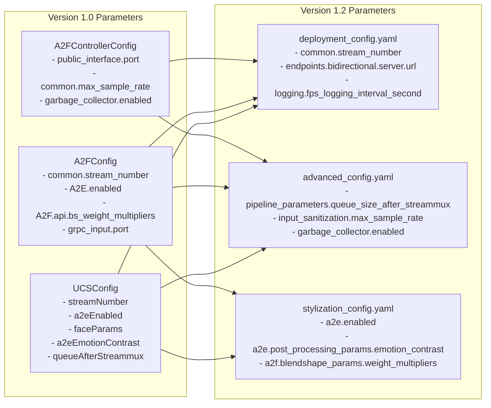
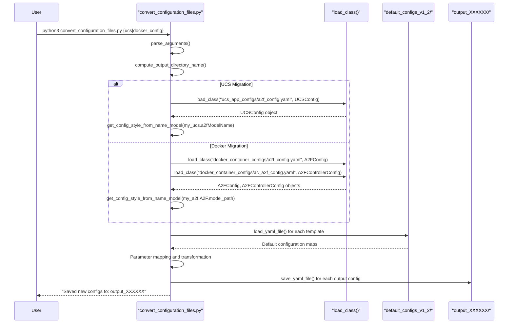
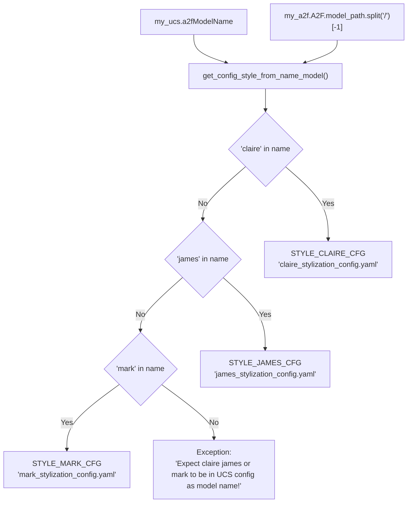

<!-- source: DeepWiki mcp.deepwiki.com · repo NVIDIA/Audio2Face-3D-Samples · page 3 Configuration Management and Migration · fetched 2026-10-26 -->

# Configuration Management and Migration

<details>
<summary>Relevant source files</summary>

The following files were used as context for generating this wiki page:

- [migration/deployment_configuration_files_from_v1.0_to_v1.2/README.md](migration/deployment_configuration_files_from_v1.0_to_v1.2/README.md)
- [migration/deployment_configuration_files_from_v1.0_to_v1.2/convert_configuration_files.py](migration/deployment_configuration_files_from_v1.0_to_v1.2/convert_configuration_files.py)
- [migration/deployment_configuration_files_from_v1.0_to_v1.2/requirements.txt](migration/deployment_configuration_files_from_v1.0_to_v1.2/requirements.txt)

</details>


## Purpose and Scope

This document covers the tools and processes for managing Audio2Face-3D configuration files, specifically focusing on migrating configurations from version 1.0 to version 1.2 format. The migration system handles two primary deployment scenarios: UCS (Unified Computing System) application configurations and Docker container configurations.

For information about the structure and parameters of individual character configurations, see [Character Models and Stylization](#2). For details about runtime deployment using these configurations, see [Deployment and Operations](#5).

## Migration System Overview

The Audio2Face-3D system underwent a significant configuration restructuring between versions 1.0 and 1.2, requiring automated migration tools to convert existing deployments. The migration system transforms monolithic configuration files into a modular structure separating deployment settings, pipeline parameters, and character-specific stylization.

### Configuration Migration Architecture

```mermaid
graph TB
    subgraph "Version 1.0 Configurations"
        UCS_V1[UCSConfig] --> UCS_File["`ucs_app_configs/
        a2f_config.yaml`"]
        A2F_V1[A2FConfig] --> A2F_File["`docker_container_configs/
        a2f_config.yaml`"]
        Controller_V1[A2FControllerConfig] --> Controller_File["`docker_container_configs/
        ac_a2f_config.yaml`"]
    end
    
    subgraph "Migration Tool"
        ConvertTool["`convert_configuration_files.py`"]
        LoadClass["`load_class()`"]
        ConvertUCS["`convert_ucs_config()`"]
        ConvertDocker["`convert_docker_config()`"]
        
        ConvertTool --> LoadClass
        ConvertTool --> ConvertUCS
        ConvertTool --> ConvertDocker
    end
    
    subgraph "Default Templates v1.2"
        DefaultFolder["`default_configs_v1_2/`"]
        JamesDefault["`james_stylization_config.yaml`"]
        ClaireDefault["`claire_stylization_config.yaml`"]
        MarkDefault["`mark_stylization_config.yaml`"]
        DeployDefault["`deployment_config.yaml`"]
        AdvancedDefault["`advanced_config.yaml`"]
        
        DefaultFolder --> JamesDefault
        DefaultFolder --> ClaireDefault
        DefaultFolder --> MarkDefault
        DefaultFolder --> DeployDefault
        DefaultFolder --> AdvancedDefault
    end
    
    subgraph "Version 1.2 Output Configurations"
        OutputFolder["`output_XXXXXX/`"]
        JamesOut["`james_stylization_config.yaml`"]
        ClaireOut["`claire_stylization_config.yaml`"]
        MarkOut["`mark_stylization_config.yaml`"]
        DeployOut["`deployment_config.yaml`"]
        AdvancedOut["`advanced_config.yaml`"]
        
        OutputFolder --> JamesOut
        OutputFolder --> ClaireOut
        OutputFolder --> MarkOut
        OutputFolder --> DeployOut
        OutputFolder --> AdvancedOut
    end
    
    UCS_File --> ConvertUCS
    A2F_File --> ConvertDocker
    Controller_File --> ConvertDocker
    
    JamesDefault --> ConvertTool
    ClaireDefault --> ConvertTool
    MarkDefault --> ConvertTool
    DeployDefault --> ConvertTool
    AdvancedDefault --> ConvertTool
    
    ConvertUCS --> JamesOut
    ConvertUCS --> ClaireOut
    ConvertUCS --> MarkOut
    ConvertUCS --> DeployOut
    ConvertUCS --> AdvancedOut
    
    ConvertDocker --> JamesOut
    ConvertDocker --> ClaireOut
    ConvertDocker --> MarkOut
    ConvertDocker --> DeployOut
    ConvertDocker --> AdvancedOut
```



**Sources:** [migration/deployment_configuration_files_from_v1.0_to_v1.2/convert_configuration_files.py:1-340]()

## Configuration File Evolution

The migration from version 1.0 to 1.2 represents a fundamental restructuring of how Audio2Face-3D configurations are organized and managed.

### Version 1.0 Structure

Version 1.0 used monolithic configuration files that combined all settings:

| Configuration Type | File Path | Primary Class |
|-------------------|-----------|---------------|
| UCS Application | `ucs_app_configs/a2f_config.yaml` | `UCSConfig` |
| Docker A2F Service | `docker_container_configs/a2f_config.yaml` | `A2FConfig` |
| Docker Controller | `docker_container_configs/ac_a2f_config.yaml` | `A2FControllerConfig` |

### Version 1.2 Structure

Version 1.2 separates concerns into specialized configuration files:

| Configuration File | Purpose | Key Sections |
|-------------------|---------|--------------|
| `deployment_config.yaml` | Service endpoints and telemetry | `endpoints`, `common`, `logging` |
| `advanced_config.yaml` | Pipeline and performance settings | `pipeline_parameters`, `input_sanitization`, `trt_model_generation` |
| `{character}_stylization_config.yaml` | Character-specific parameters | `a2e`, `a2f`, `default_beginning_emotions` |

### Configuration Parameter Mapping



**Sources:** [migration/deployment_configuration_files_from_v1.0_to_v1.2/convert_configuration_files.py:165-244](), [migration/deployment_configuration_files_from_v1.0_to_v1.2/convert_configuration_files.py:246-325]()

## Migration Tool Architecture

The `convert_configuration_files.py` tool provides automated migration capabilities through a modular architecture that handles different source configuration formats.

### Core Migration Components

| Component | Function | Purpose |
|-----------|----------|---------|
| `parse_arguments()` | Command-line interface | Accepts `ucs` or `docker_config` migration modes |
| `load_class()` | Configuration loading | Deserializes YAML to dataclass objects |
| `convert_ucs_config()` | UCS migration | Transforms UCS application configurations |
| `convert_docker_config()` | Docker migration | Transforms Docker container configurations |
| `compute_output_directory_name()` | Output management | Creates unique output directories |

### Migration Process Workflow



**Sources:** [migration/deployment_configuration_files_from_v1.0_to_v1.2/convert_configuration_files.py:120-128](), [migration/deployment_configuration_files_from_v1.0_to_v1.2/convert_configuration_files.py:328-339]()

### Character Model Detection

The migration tool automatically detects the target character model from the source configuration and selects the appropriate stylization template:



**Sources:** [migration/deployment_configuration_files_from_v1.0_to_v1.2/convert_configuration_files.py:152-162](), [migration/deployment_configuration_files_from_v1.0_to_v1.2/convert_configuration_files.py:33-37]()

## Migration Process

### Prerequisites and Setup

The migration tool requires a Python virtual environment with specific dependencies:

```bash
python3 -m venv .venv
source .venv/bin/activate
python3 -m pip install -r requirements.txt
```

The `requirements.txt` file specifies the `ruamel.yaml` library for YAML processing with preserved formatting and comments.

### UCS Configuration Migration

For UCS application deployments, update the source configuration file and execute:

```bash
python3 convert_configuration_files.py ucs
```

This migration process performs the following parameter transformations:

| Source Parameter | Target Configuration | Target Parameter |
|-----------------|---------------------|------------------|
| `streamNumber` | `deployment_config.yaml` | `common.stream_number` |
| `addSilencePaddingAfterAudio` | `deployment_config.yaml` | `common.add_silence_padding_after_audio` |
| `a2eEnabled` | `{character}_stylization_config.yaml` | `a2e.enabled` |
| `faceParams` | `{character}_stylization_config.yaml` | `a2f.face_params.*` |
| `a2eEmotionContrast` | `{character}_stylization_config.yaml` | `a2e.post_processing_params.emotion_contrast` |
| `queueAfterStreammux` | `advanced_config.yaml` | `pipeline_parameters.queue_size_after_streammux` |

### Docker Configuration Migration

For Docker container deployments, update both configuration files and execute:

```bash
python3 convert_configuration_files.py docker_config
```

This migration handles the dual-container architecture by mapping parameters from both `A2FConfig` and `A2FControllerConfig` to the new unified configuration structure.

### Output Structure

The migration tool generates configurations in uniquely named output directories following the pattern `output_XXXXXX`. Each output directory contains the complete set of v1.2 configuration files required for Audio2Face-3D deployment.

**Sources:** [migration/deployment_configuration_files_from_v1.0_to_v1.2/README.md:1-56](), [migration/deployment_configuration_files_from_v1.0_to_v1.2/convert_configuration_files.py:95-101]()

---

