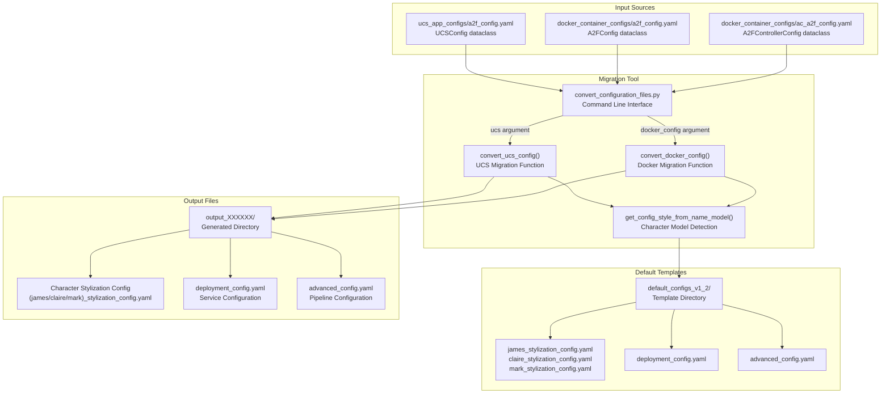
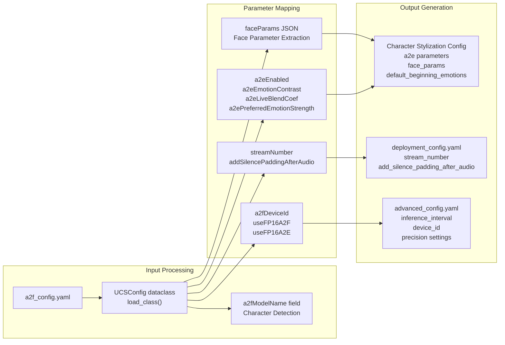
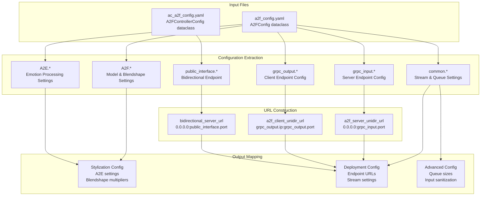
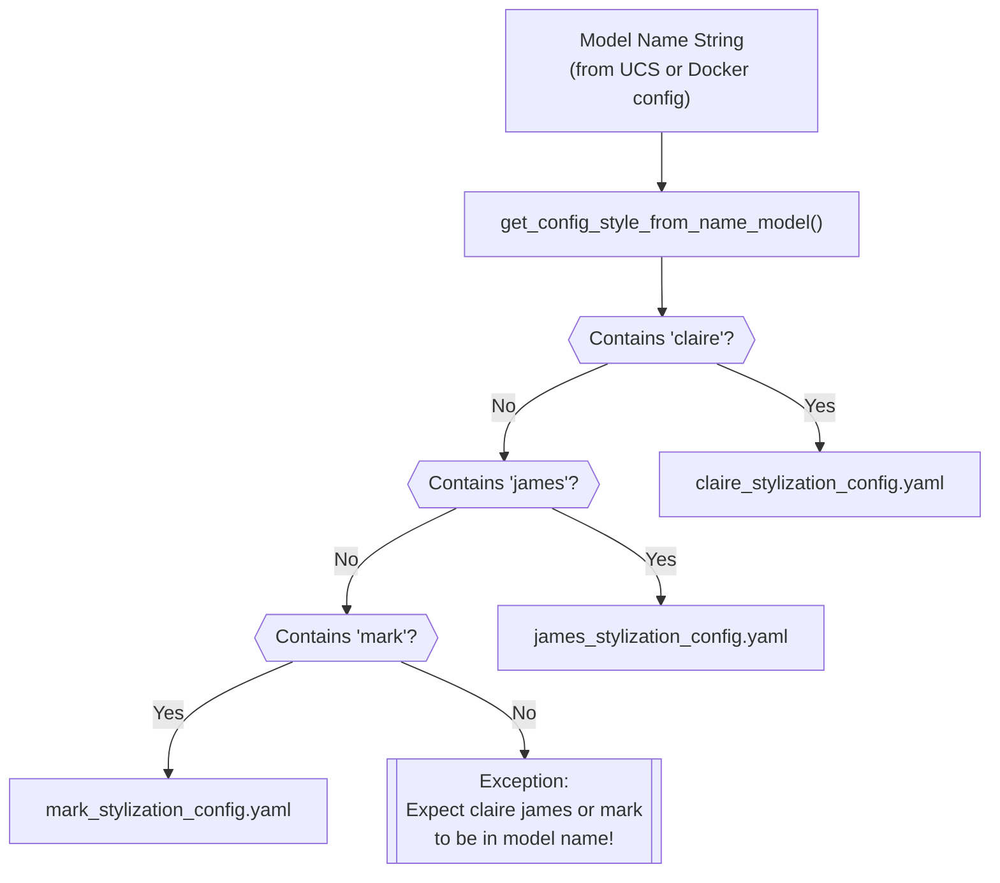

<!-- source: DeepWiki mcp.deepwiki.com · repo NVIDIA/Audio2Face-3D-Samples · page 3.1 Configuration Migration Tool · fetched 2026-10-26 -->

# Configuration Migration Tool

<details>
<summary>Relevant source files</summary>

The following files were used as context for generating this wiki page:

- [migration/deployment_configuration_files_from_v1.0_to_v1.2/convert_configuration_files.py](migration/deployment_configuration_files_from_v1.0_to_v1.2/convert_configuration_files.py)
- [migration/deployment_configuration_files_from_v1.0_to_v1.2/requirements.txt](migration/deployment_configuration_files_from_v1.0_to_v1.2/requirements.txt)

</details>


## Purpose and Scope

The Configuration Migration Tool provides automated conversion of Audio2Face-3D configuration files from version 1.0 to version 1.2 format. This tool handles the structural changes and parameter mappings required to upgrade existing deployments to the new configuration schema introduced in v1.2.

The tool supports two distinct migration paths: UCS (Universal Control System) application configurations and Docker container configurations. For information about the v1.2 configuration file structure and parameters, see [Configuration File Structure](#3.2). For details on extracting configurations from running services, see [Configuration Fetching](#3.3).

## Migration Process Overview

The migration tool implements a template-based conversion approach, where v1.0 configurations are mapped to v1.2 templates with preserved user customizations.

**Migration Process Flow**



Sources: [migration/deployment_configuration_files_from_v1.0_to_v1.2/convert_configuration_files.py:1-340]()

## Migration Command Interface

The tool provides a simple command-line interface with two migration modes:

| Migration Mode | Input Source | Description |
|----------------|-------------|-------------|
| `ucs` | `ucs_app_configs/a2f_config.yaml` | Migrates UCS application configurations |
| `docker_config` | `docker_container_configs/a2f_config.yaml`<br/>`docker_container_configs/ac_a2f_config.yaml` | Migrates Docker container configurations |

**Usage Examples:**

```bash
# Migrate UCS application configuration
python convert_configuration_files.py ucs

# Migrate Docker container configuration  
python convert_configuration_files.py docker_config
```

The tool automatically creates a uniquely numbered output directory using the pattern `output_XXXXXX` where `XXXXXX` is an incrementing six-digit number.

Sources: [migration/deployment_configuration_files_from_v1.0_to_v1.2/convert_configuration_files.py:120-128](), [migration/deployment_configuration_files_from_v1.0_to_v1.2/convert_configuration_files.py:95-101]()

## UCS Configuration Migration

The UCS migration path converts Universal Control System application configurations to the new v1.2 format.

**UCS Migration Data Flow**



### UCS Parameter Mappings

The UCS migration handles several categories of parameter conversions:

**Face Parameters**: JSON-encoded face parameters are extracted and mapped to the new `face_params` structure:

| UCS Parameter | v1.2 Location | Mapping |
|---------------|---------------|---------|
| `faceParams.face_params.eyelid_offset` | `a2f.face_params.eyelid_offset` | Direct copy |
| `faceParams.face_params.input_strength` | `a2f.face_params.input_strength` | Direct copy |
| `faceParams.face_params.emotion[0-9]` | `default_beginning_emotions.*` | Array to named emotion mapping |

**Audio2Emotion Parameters**: A2E configuration is mapped to stylization config:

| UCS Parameter | v1.2 Location | Conversion |
|---------------|---------------|------------|
| `a2eEnabled` | `a2e.enabled` | String to boolean |
| `a2eEmotionContrast` | `a2e.post_processing_params.emotion_contrast` | String to float |
| `a2eInferenceInterval` | Advanced config `a2e.inference_interval` | String to int |

Sources: [migration/deployment_configuration_files_from_v1.0_to_v1.2/convert_configuration_files.py:165-244]()

## Docker Configuration Migration

The Docker migration path processes both A2F service configuration and A2F controller configuration files to generate the complete v1.2 configuration set.

**Docker Migration Architecture**



### Docker Configuration Mappings

**Endpoint Configuration**: The Docker migration constructs service endpoints from individual IP and port components:

```
Unidirectional Server: 0.0.0.0:{grpc_input.port}
Unidirectional Client: {grpc_output.ip}:{grpc_output.port}  
Bidirectional Server: 0.0.0.0:{public_interface.port}
```

**Blendshape Weight Multipliers**: The 52-element blendshape weight array is mapped to named parameters using `LIST_FACE_PARAM_ORDER`:

| Array Index | Blendshape Name | v1.2 Location |
|-------------|----------------|---------------|
| 0 | `EyeBlinkLeft` | `a2f.blendshape_params.weight_multipliers.EyeBlinkLeft` |
| 1 | `EyeLookDownLeft` | `a2f.blendshape_params.weight_multipliers.EyeLookDownLeft` |
| ... | ... | ... |
| 51 | `TongueOut` | `a2f.blendshape_params.weight_multipliers.TongueOut` |

Sources: [migration/deployment_configuration_files_from_v1.0_to_v1.2/convert_configuration_files.py:246-326](), [migration/deployment_configuration_files_from_v1.0_to_v1.2/convert_configuration_files.py:39-92]()

## Character Model Detection

The migration tool automatically detects the target character model from the configuration and selects the appropriate stylization template.

**Character Detection Logic**



The detection function performs case-insensitive substring matching on the model name to determine the character type.

Sources: [migration/deployment_configuration_files_from_v1.0_to_v1.2/convert_configuration_files.py:152-162]()

## Output File Structure

The migration tool generates three types of configuration files in the output directory:

| File Type | Purpose | Content |
|-----------|---------|---------|
| **Character Stylization Config** | Character-specific A2E and A2F parameters | Emotion processing settings, face parameters, blendshape multipliers |
| **Deployment Config** | Service deployment settings | Endpoint URLs, stream configuration, logging settings |
| **Advanced Config** | Pipeline performance settings | Queue sizes, input validation, TensorRT precision, garbage collector |

**Template Loading Process**

The migration tool loads default templates from the `default_configs_v1_2/` directory and applies user-specific parameter overrides:

1. Load template YAML files using `load_yaml_file()`
2. Apply parameter mappings from source configuration
3. Save modified configurations using `save_yaml_file()`

**Output Directory Naming**

The `compute_output_directory_name()` function generates unique output directories using an incremental numbering scheme to prevent overwrites of previous migration results.

Sources: [migration/deployment_configuration_files_from_v1.0_to_v1.2/convert_configuration_files.py:32-37](), [migration/deployment_configuration_files_from_v1.0_to_v1.2/convert_configuration_files.py:141-149](), [migration/deployment_configuration_files_from_v1.0_to_v1.2/convert_configuration_files.py:95-101]()

---

