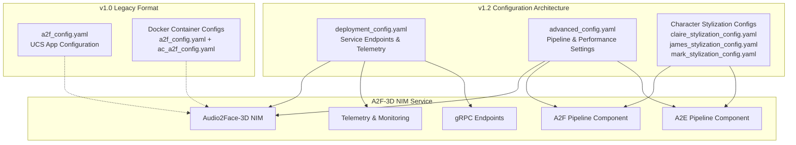
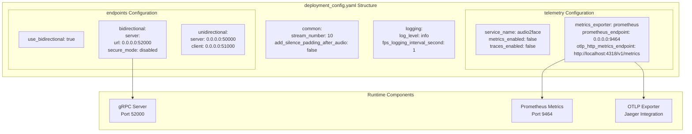
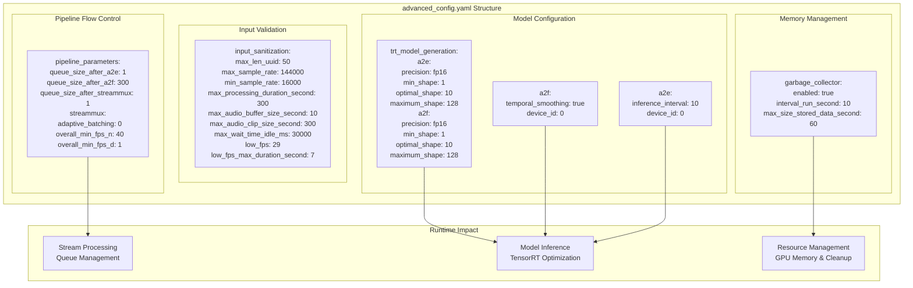
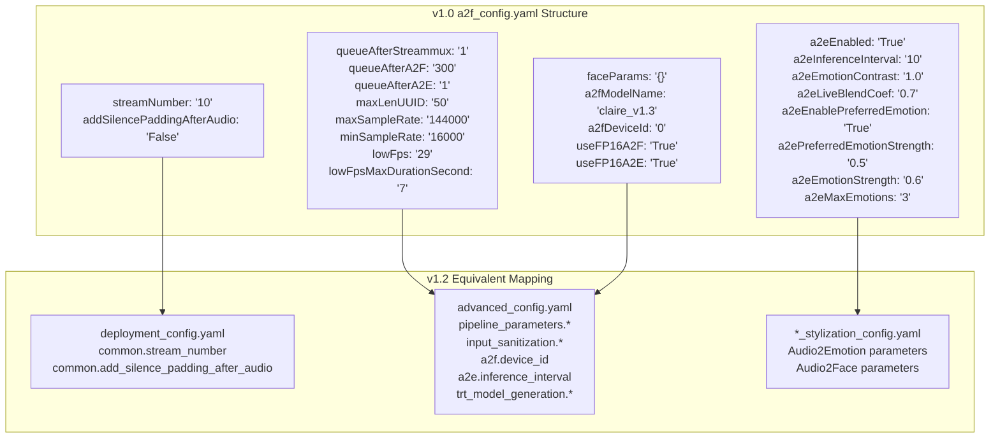

<!-- source: DeepWiki mcp.deepwiki.com · repo NVIDIA/Audio2Face-3D-Samples · page 3.2 Configuration File Structure · fetched 2026-10-26 -->

# Configuration File Structure

Relevant source files

The following files were used as context for generating this wiki page:

- [configs/advanced_config.yaml](configs/advanced_config.yaml)
- [configs/deployment_config.yaml](configs/deployment_config.yaml)
- [migration/deployment_configuration_files_from_v1.0_to_v1.2/ucs_app_configs/a2f_config.yaml](migration/deployment_configuration_files_from_v1.0_to_v1.2/ucs_app_configs/a2f_config.yaml)

This document describes the structure and parameters of Audio2Face-3D configuration files across different versions (v1.0 and v1.2). It covers the YAML configuration schemas, parameter definitions, and the relationships between different configuration file types used by the Audio2Face-3D NIM service.

For information about migrating between configuration versions, see [Configuration Migration Tool](#3.1). For extracting configuration from running services, see [Configuration Fetching](#3.3).

## Configuration File Types Overview

The Audio2Face-3D system uses multiple YAML configuration files to control different aspects of service behavior. The current v1.2 format separates concerns into specialized configuration files, while the legacy v1.0 format used monolithic configuration files.

**Sources:** [configs/deployment_config.yaml:1-96](), [configs/advanced_config.yaml:1-100](), [migration/deployment_configuration_files_from_v1.0_to_v1.2/ucs_app_configs/a2f_config.yaml:1-87]()

## Deployment Configuration Structure

The `deployment_config.yaml` file controls service-level settings including endpoints, security, logging, and telemetry. This configuration defines how the Audio2Face-3D NIM service exposes its functionality and integrates with monitoring systems.

### Service Configuration Parameters

| Section | Parameters | Description |
|---------|------------|-------------|
| `common` | `stream_number`, `add_silence_padding_after_audio` | Core service behavior settings |
| `logging` | `log_level`, `fps_logging_interval_second` | Logging configuration and verbosity |
| `endpoints` | `use_bidirectional`, `bidirectional`, `unidirectional` | gRPC endpoint configuration |
| `telemetry` | `metrics_enabled`, `traces_enabled`, `service_name` | Observability and monitoring settings |

**Sources:** [configs/deployment_config.yaml:16-96]()

### Security and TLS Configuration

The deployment configuration supports multiple security modes for gRPC endpoints:

- `disabled`: No encryption (default)
- `tls`: Server-side TLS encryption
- `mtls`: Mutual TLS authentication

Certificate paths are configured via `certificate_path`, `key_path`, and `ca_path` parameters when security is enabled.

**Sources:** [configs/deployment_config.yaml:50-61]()

## Advanced Configuration Structure

The `advanced_config.yaml` file contains pipeline-specific settings, performance tuning parameters, and model generation configurations. This file directly impacts the Audio2Face and Audio2Emotion processing behavior.

### Pipeline Parameter Categories

**Sources:** [configs/advanced_config.yaml:16-100]()

### Performance Tuning Parameters

The advanced configuration includes several performance-critical settings:

| Parameter Category | Key Parameters | Impact |
|-------------------|----------------|---------|
| Queue Sizes | `queue_size_after_a2e`, `queue_size_after_a2f`, `queue_size_after_streammux` | Throughput vs latency tradeoff |
| FPS Control | `overall_min_fps_n`, `overall_min_fps_d`, `low_fps`, `low_fps_max_duration_second` | Real-time processing guarantees |
| Model Optimization | `trt_model_generation.precision`, `min_shape`, `optimal_shape`, `maximum_shape` | TensorRT engine optimization |
| Device Assignment | `a2f.device_id`, `a2e.device_id` | GPU resource allocation |

**Sources:** [configs/advanced_config.yaml:56-100]()

## Legacy v1.0 Configuration Format

The v1.0 configuration format used a single `a2f_config.yaml` file with string-typed parameters and inline documentation. This format was used in both UCS applications and Docker container deployments.

### v1.0 Parameter Structure

**Sources:** [migration/deployment_configuration_files_from_v1.0_to_v1.2/ucs_app_configs/a2f_config.yaml:16-87]()

### v1.0 Parameter Characteristics

Key characteristics of the v1.0 format:
- All parameters stored as string values requiring runtime parsing
- Inline documentation using `#>` comment syntax
- Monolithic structure combining deployment and pipeline settings
- Model-specific parameters embedded in global configuration

**Sources:** [migration/deployment_configuration_files_from_v1.0_to_v1.2/ucs_app_configs/a2f_config.yaml:17-87]()

## Configuration Parameter Mapping

The migration from v1.0 to v1.2 involved restructuring parameters across multiple specialized files while preserving functionality.

### Parameter Migration Mapping

| v1.0 Parameter | v1.2 Location | v1.2 Parameter | Type Change |
|----------------|---------------|----------------|-------------|
| `streamNumber` | `deployment_config.yaml` | `common.stream_number` | string → integer |
| `addSilencePaddingAfterAudio` | `deployment_config.yaml` | `common.add_silence_padding_after_audio` | string → boolean |
| `queueAfterA2F` | `advanced_config.yaml` | `pipeline_parameters.queue_size_after_a2f` | string → integer |
| `queueAfterA2E` | `advanced_config.yaml` | `pipeline_parameters.queue_size_after_a2e` | string → integer |
| `queueAfterStreammux` | `advanced_config.yaml` | `pipeline_parameters.queue_size_after_streammux` | string → integer |
| `a2fDeviceId` | `advanced_config.yaml` | `a2f.device_id` | string → integer |
| `a2eInferenceInterval` | `advanced_config.yaml` | `a2e.inference_interval` | string → integer |
| `useFP16A2F` | `advanced_config.yaml` | `trt_model_generation.a2f.precision` | string boolean → "fp16" |
| `useFP16A2E` | `advanced_config.yaml` | `trt_model_generation.a2e.precision` | string boolean → "fp16" |

**Sources:** [migration/deployment_configuration_files_from_v1.0_to_v1.2/ucs_app_configs/a2f_config.yaml:16-87](), [configs/deployment_config.yaml:16-25](), [configs/advanced_config.yaml:56-100]()

---

