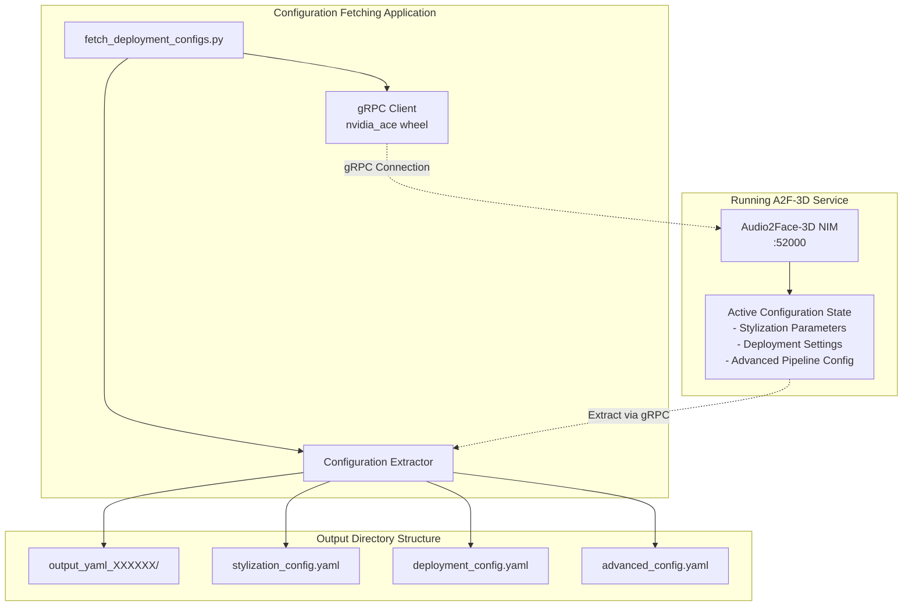
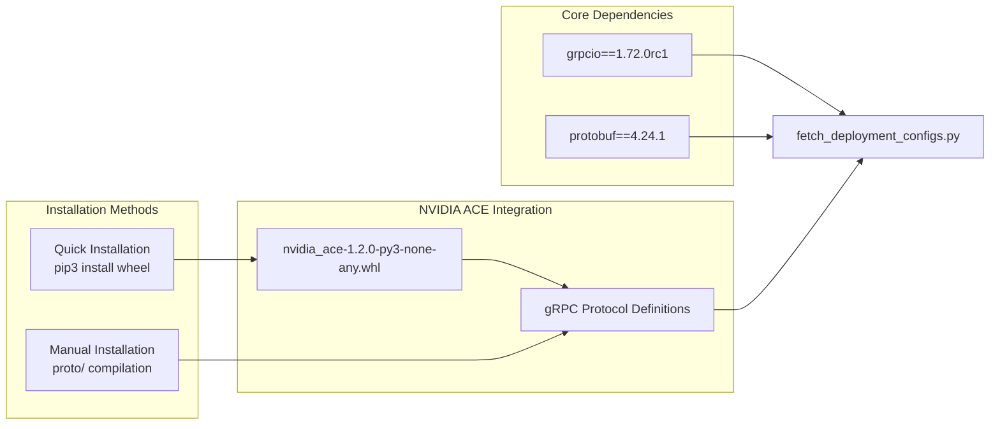
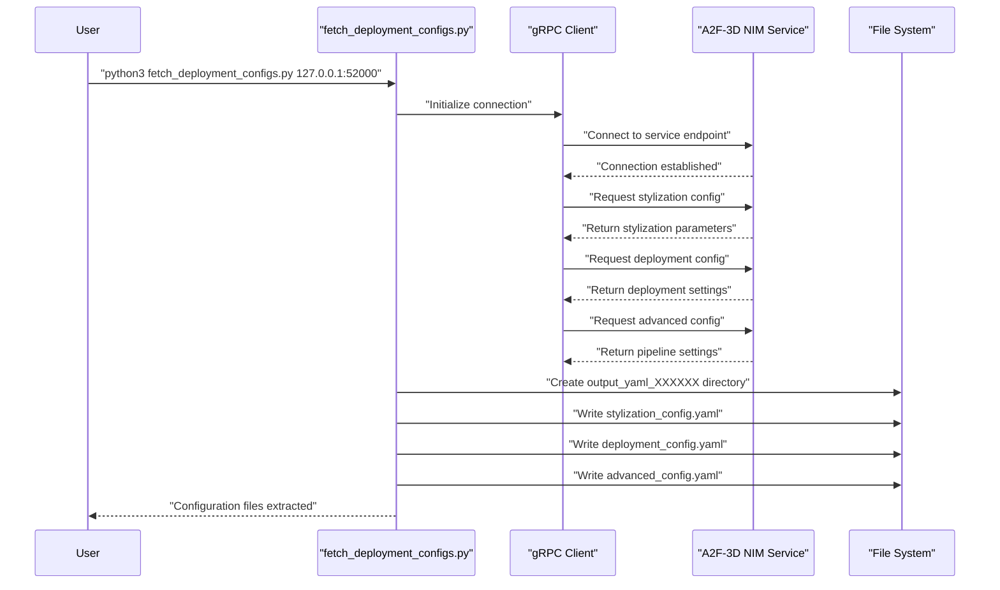
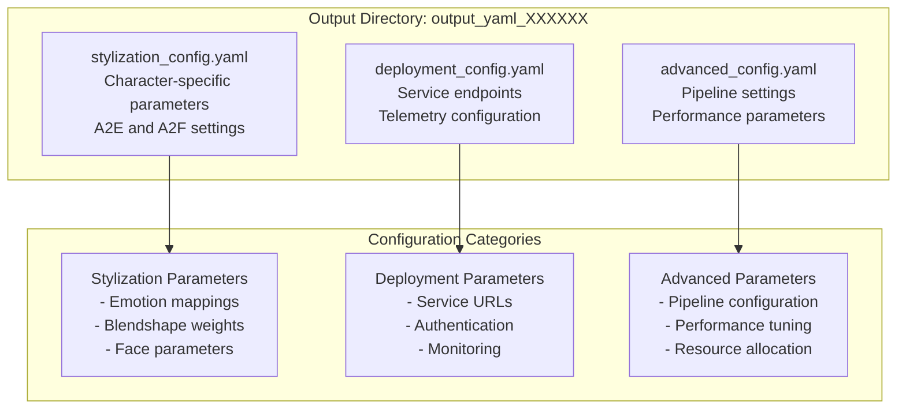
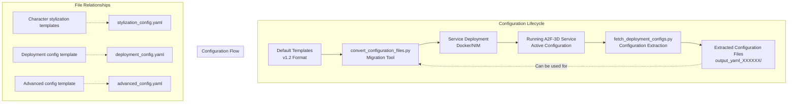

<!-- source: DeepWiki mcp.deepwiki.com · repo NVIDIA/Audio2Face-3D-Samples · page 3.3 Configuration Fetching · fetched 2026-10-26 -->

# Configuration Fetching

<details>
<summary>Relevant source files</summary>

The following files were used as context for generating this wiki page:

- [scripts/config_fetching_app/README.md](scripts/config_fetching_app/README.md)
- [scripts/config_fetching_app/requirements.txt](scripts/config_fetching_app/requirements.txt)

</details>


## Purpose and Scope

This document covers the configuration fetching system for Audio2Face-3D, which extracts active configuration files from running A2F-3D NIM services. The system enables administrators and developers to retrieve the current stylization, deployment, and advanced configuration parameters from live services for backup, analysis, or migration purposes.

For information about migrating configuration files between versions, see [Configuration Migration Tool](#3.1). For details about the structure and parameters of configuration files, see [Configuration File Structure](#3.2).

## System Overview

The configuration fetching system consists of a standalone Python application that connects to running Audio2Face-3D NIM services via gRPC to extract their active configuration state. The system retrieves three types of configuration files that define the service's operational parameters.



**Configuration Fetching System Architecture**

Sources: [scripts/config_fetching_app/README.md:1-57]()

## Prerequisites and Environment Setup

The configuration fetching application requires specific dependencies and environment setup to communicate with Audio2Face-3D services.

### System Requirements

| Component | Requirement |
|-----------|-------------|
| Python Version | python3 |
| Virtual Environment | python3-venv |
| Running Service | Audio2Face-3D NIM instance |
| Network Access | gRPC connectivity to service endpoint |

### Dependency Installation

The system requires two primary dependencies for gRPC communication:



**Dependency Installation Flow**

The environment setup follows this sequence:

1. Create Python virtual environment: `python3 -m venv .venv`
2. Activate environment: `source .venv/bin/activate`
3. Install NVIDIA ACE wheel: `pip3 install ../../proto/sample_wheel/nvidia_ace-1.2.0-py3-none-any.whl`
4. Install requirements: `pip3 install -r requirements.txt`

Sources: [scripts/config_fetching_app/README.md:4-43](), [scripts/config_fetching_app/requirements.txt:1-3]()

## Application Execution and Usage

The configuration fetching application operates through a single Python script that accepts the target service endpoint as a command-line argument.

### Command Syntax

```
python3 fetch_deployment_configs.py <host>:<port>
```

### Execution Flow



**Configuration Extraction Sequence**

### Example Output

When executed successfully, the application produces output indicating the location of extracted configuration files:

```
Writing config file to output_yaml_000001/stylization_config.yaml
Writing config file to output_yaml_000001/deployment_config.yaml
Writing config file to output_yaml_000001/advanced_config.yaml
```

Sources: [scripts/config_fetching_app/README.md:45-57]()

## Output Structure and Configuration Files

The configuration fetching system generates three distinct YAML files that represent different aspects of the Audio2Face-3D service configuration.

### Output Directory Structure



**Configuration File Categories**

### Configuration File Types

| File | Purpose | Content |
|------|---------|---------|
| `stylization_config.yaml` | Character-specific settings | Audio2Emotion parameters, Audio2Face parameters, blendshape configurations |
| `deployment_config.yaml` | Service deployment settings | Service endpoints, telemetry configuration, authentication parameters |
| `advanced_config.yaml` | Pipeline configuration | Performance settings, resource allocation, advanced pipeline parameters |

The extracted configurations represent the live state of the Audio2Face-3D service and can be used for:
- Service backup and restore operations
- Configuration analysis and debugging
- Migration to new service instances
- Compliance and audit requirements

Sources: [scripts/config_fetching_app/README.md:56-57]()

## Integration with Configuration Management System

The configuration fetching application integrates with the broader Audio2Face-3D configuration management ecosystem, providing runtime configuration extraction capabilities.



**Configuration Management Integration**

The fetching system complements other configuration management tools by providing runtime state extraction, enabling a complete configuration lifecycle from template creation through deployment to operational state capture.

Sources: [scripts/config_fetching_app/README.md:1-57]()

---

