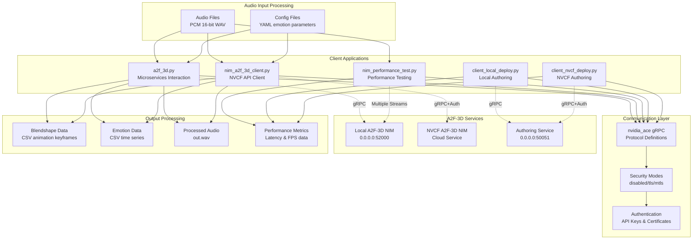
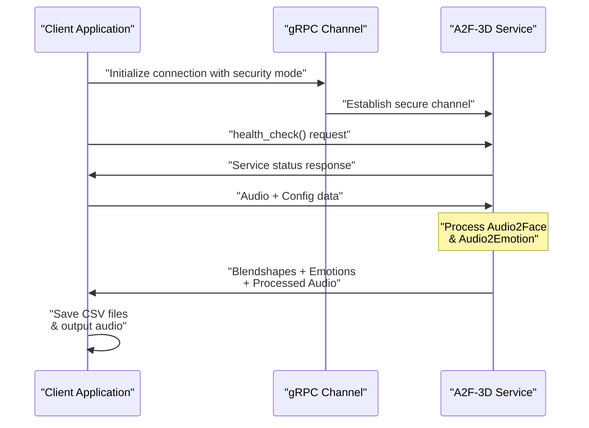
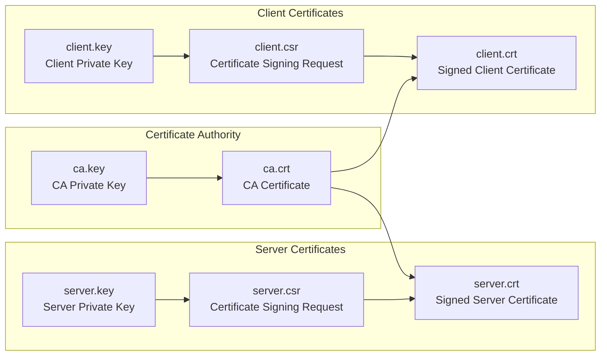

<!-- source: DeepWiki mcp.deepwiki.com · repo NVIDIA/Audio2Face-3D-Samples · page 4 Client Applications and APIs · fetched 2026-10-26 -->

# Client Applications and APIs

<details>
<summary>Relevant source files</summary>

The following files were used as context for generating this wiki page:

- [scripts/audio2face_3d_api_client/README.md](scripts/audio2face_3d_api_client/README.md)
- [scripts/audio2face_3d_microservices_interaction_app/README.md](scripts/audio2face_3d_microservices_interaction_app/README.md)

</details>


This page provides an overview of the client applications and APIs available for interacting with Audio2Face-3D services. These applications demonstrate various interaction patterns, from basic inference requests to performance testing and cloud-based deployments.

For deployment and configuration details, see [Deployment and Operations](#5). For character model parameters used by these clients, see [Character Models and Stylization](#2).

## Overview

The Audio2Face-3D system provides multiple client applications that serve different use cases and deployment scenarios. These clients communicate with Audio2Face-3D services via gRPC protocol and support various security modes including TLS and mTLS authentication.

### Client Application Types

| Application Type | Primary Use Case | Target Service |
|------------------|------------------|----------------|
| **Microservices Interaction** | Local development and testing | Local A2F-3D NIM (port 52000) |
| **NVCF API Client** | Cloud-based inference | NVIDIA Cloud Functions |
| **Authoring Clients** | Early access authoring features | Authoring services (port 50051) |
| **Performance Testing** | Load testing and benchmarking | Local A2F-3D NIM |

## Client Architecture Overview



Sources: [scripts/audio2face_3d_microservices_interaction_app/README.md:1-239](), [scripts/audio2face_3d_api_client/README.md:1-51]()

## gRPC Communication Patterns

All client applications follow a consistent communication pattern using the `nvidia_ace` gRPC protocol definitions. The core interaction flow involves:



Sources: [scripts/audio2face_3d_microservices_interaction_app/README.md:167-177](), [scripts/audio2face_3d_api_client/README.md:41-51]()

## Security and Authentication

### Security Modes

The client applications support three security modes for gRPC communication:

| Mode | Description | Required Parameters |
|------|-------------|-------------------|
| `disabled` | No encryption or authentication | None |
| `tls` | Encrypted communication, server verification | `--root-cert-path` |
| `mtls` | Mutual TLS with client-server authentication | `--root-cert-path`, `--client-cert-path`, `--client-key-path` |

### Certificate Management

For secure deployments, clients support standard TLS certificate workflows:



Sources: [scripts/audio2face_3d_microservices_interaction_app/README.md:76-107]()

## Common Input/Output Patterns

### Input Requirements

All client applications follow consistent input requirements:

- **Audio Format**: PCM 16-bit WAV files
- **Configuration**: YAML files containing emotion parameters
- **Character Models**: Support for Claire, James, and Mark configurations

### Output Generation

Standard output artifacts produced by client applications:

| Output Type | Format | Description |
|-------------|--------|-------------|
| **Animation Data** | CSV | Blendshape keyframes with name, value, and timecode |
| **Emotion Data** | CSV | Emotion values and timestamps |
| **Processed Audio** | WAV | Audio output (typically same as input) |
| **Performance Data** | TXT/PNG | Latency and FPS metrics with visualizations |

Sources: [scripts/audio2face_3d_microservices_interaction_app/README.md:167-177](), [scripts/audio2face_3d_api_client/README.md:41-51]()

## Dependencies and Installation

### Core Dependencies

All client applications require:

- **Python 3** with virtual environment support
- **nvidia_ace Python wheel**: gRPC protocol definitions for Audio2Face-3D
- **Standard Python packages**: Listed in individual `requirements.txt` files

### gRPC Protocol Integration

The `nvidia_ace` wheel package provides the essential gRPC bindings:

```bash
pip3 install ../../proto/sample_wheel/nvidia_ace-1.2.0-py3-none-any.whl
```

This wheel is compatible with Audio2Face-3D NIM version 1.3 and contains the compiled protocol buffer definitions for client-service communication.

Sources: [scripts/audio2face_3d_microservices_interaction_app/README.md:28-47](), [scripts/audio2face_3d_api_client/README.md:14-22]()

## Detailed Application Documentation

For comprehensive documentation of individual client applications:

- **Microservices Interaction Application**: See [Microservices Interaction Application](#4.1) for `a2f_3d.py` and `nim_performance_test.py`
- **NVCF API Client**: See [API Client for NVCF](#4.2) for `nim_a2f_3d_client.py`
- **Authoring Applications**: See [Authoring Sample Applications](#4.3) for early access authoring clients
- **Technical Integration Details**: See [Client Dependencies and gRPC Integration](#4.4) for protocol definitions and shared components

---

