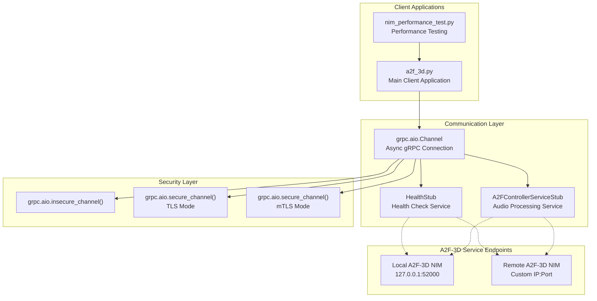
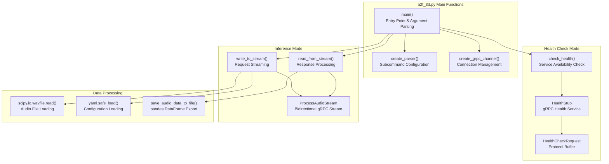
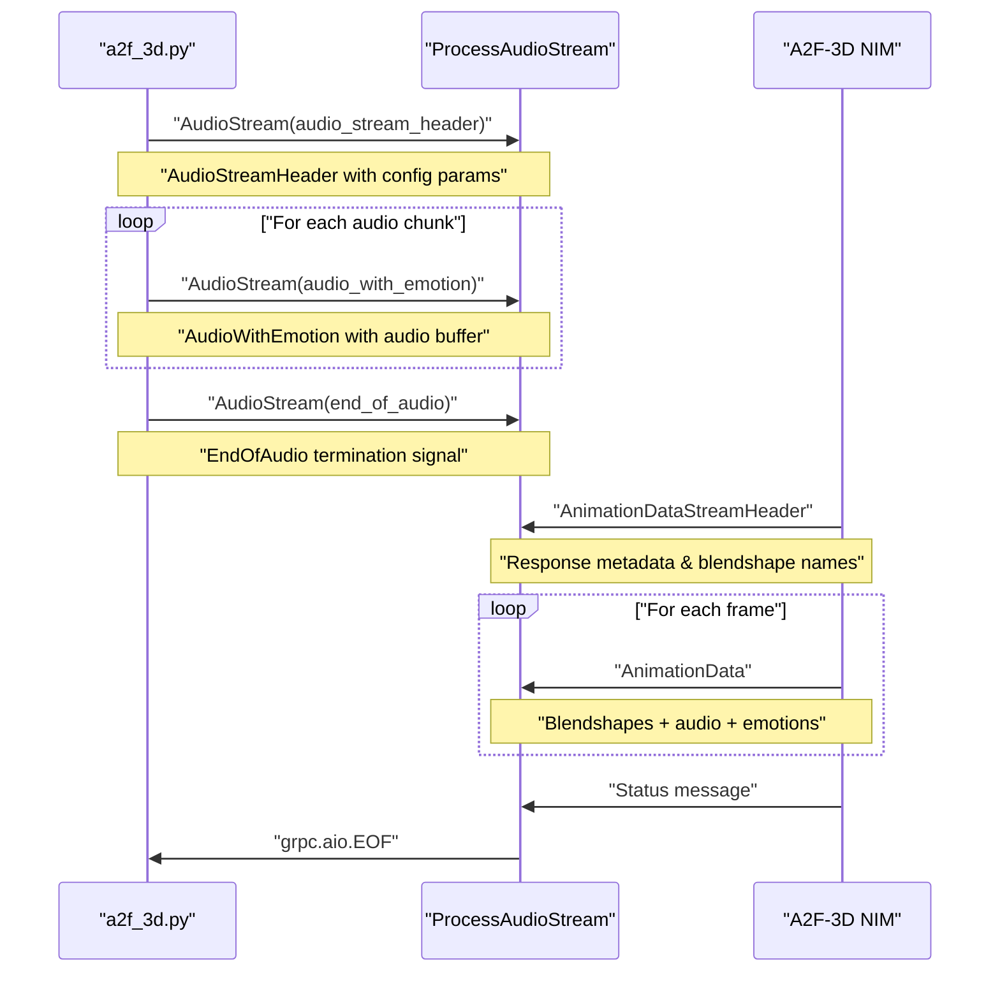
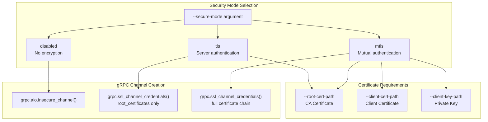
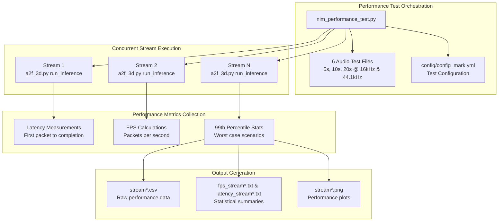
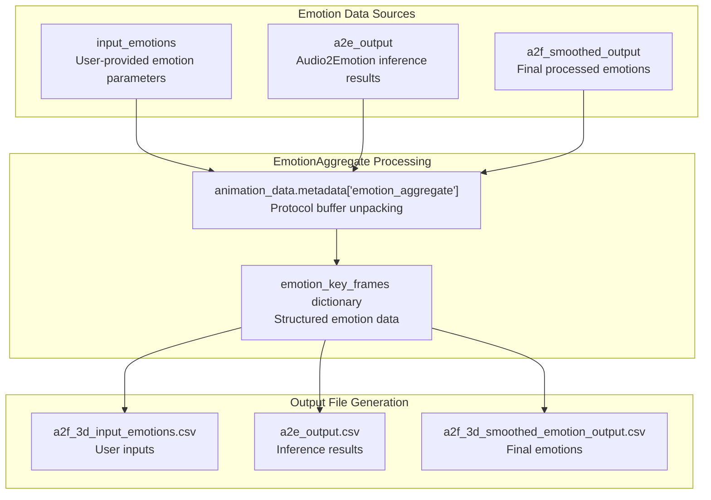

<!-- source: DeepWiki mcp.deepwiki.com · repo NVIDIA/Audio2Face-3D-Samples · page 4.1 Microservices Interaction Application · fetched 2026-10-26 -->

# Microservices Interaction Application

<details>
<summary>Relevant source files</summary>

The following files were used as context for generating this wiki page:

- [scripts/audio2face_3d_microservices_interaction_app/README.md](scripts/audio2face_3d_microservices_interaction_app/README.md)
- [scripts/audio2face_3d_microservices_interaction_app/a2f_3d.py](scripts/audio2face_3d_microservices_interaction_app/a2f_3d.py)

</details>


## Purpose and Scope

This document covers the primary client application for interacting with Audio2Face-3D NIM (NVIDIA Inference Microservice), specifically the `a2f_3d.py` script and its companion performance testing utility. This application provides health checking, audio processing inference, and performance measurement capabilities for Audio2Face-3D deployments.

For information about API clients for NVCF deployments, see [API Client for NVCF](#4.2). For authoring service interactions, see [Authoring Sample Applications](#4.3).

## Application Architecture

The microservices interaction application consists of two primary components that communicate with Audio2Face-3D services via gRPC:



**Sources:** [scripts/audio2face_3d_microservices_interaction_app/a2f_3d.py:1-459](), [scripts/audio2face_3d_microservices_interaction_app/README.md:1-239]()

## Core Application Components

The main application is structured around two primary operational modes implemented as subcommands:



**Sources:** [scripts/audio2face_3d_microservices_interaction_app/a2f_3d.py:341-376](), [scripts/audio2face_3d_microservices_interaction_app/a2f_3d.py:398-458]()

## Communication Protocol Implementation

The application implements bidirectional streaming communication using specific gRPC protocol buffer types:

| Protocol Buffer Type | Purpose | Usage Context |
|---------------------|---------|---------------|
| `AudioStream` | Main message container | Request streaming |
| `AudioStreamHeader` | Audio metadata and configuration | First message sent |
| `AudioWithEmotion` | Audio data with emotion parameters | Streaming audio chunks |
| `AnimationDataStreamHeader` | Response metadata | First response received |
| `AnimationData` | Blendshape and emotion results | Streaming responses |
| `EmotionAggregate` | Detailed emotion data | Response metadata |

### Request Flow Implementation



**Sources:** [scripts/audio2face_3d_microservices_interaction_app/a2f_3d.py:224-318](), [scripts/audio2face_3d_microservices_interaction_app/a2f_3d.py:125-222]()

## Security Implementation

The application supports three security modes through the `create_grpc_channel()` function:



**Sources:** [scripts/audio2face_3d_microservices_interaction_app/a2f_3d.py:378-396](), [scripts/audio2face_3d_microservices_interaction_app/README.md:76-156]()

## Performance Testing Architecture

The `nim_performance_test.py` script orchestrates concurrent testing by launching multiple instances of the main application:

### Performance Test Parameters

| Parameter | Purpose | Configuration |
|-----------|---------|---------------|
| `--request-nb` | Requests per audio file per stream | Load intensity control |
| `--max-stream-nb` | Concurrent stream count | Parallelism level |
| `--url` | A2F-3D service endpoint | Target service |

### Test Execution Flow



**Sources:** [scripts/audio2face_3d_microservices_interaction_app/README.md:184-239](), [scripts/audio2face_3d_microservices_interaction_app/README.md:204-231]()

## Data Processing and Output Generation

### Emotion Data Processing

The application processes three types of emotion data through the `parse_emotion_data()` function:



### Animation Data Processing

| Data Type | Processing Function | Output Format |
|-----------|-------------------|---------------|
| Blendshapes | `dict(zip(bs_names, blendshapes.values))` | `animation_frames.csv` |
| Audio | `save_audio_data_to_file()` | `out.wav` |
| Emotions | `parse_emotion_data()` | Multiple CSV files |
| Performance | FPS and latency calculation | Console output |

**Sources:** [scripts/audio2face_3d_microservices_interaction_app/a2f_3d.py:83-114](), [scripts/audio2face_3d_microservices_interaction_app/a2f_3d.py:164-179]()

## Usage Patterns and Command Interface

### Health Check Operation

```bash
python3 a2f_3d.py health_check --url <ip>:<port> [--secure-mode <mode>]
```

### Inference Operation

```bash
python3 a2f_3d.py run_inference <audio_file.wav> <config.yml> -u <ip>:<port> [options]
```

### Common Configuration Requirements

| Requirement | Specification | Validation |
|-------------|---------------|------------|
| Audio Format | 16-bit PCM mono | `REQUIRED_BITS_PER_SAMPLE = 16` |
| Audio Channels | Mono only | `REQUIRED_CHANNEL_COUNT = 1` |
| Config Format | YAML with emotion parameters | `yaml.safe_load()` parsing |
| Service Endpoint | gRPC-compatible URL | Health check validation |

**Sources:** [scripts/audio2face_3d_microservices_interaction_app/a2f_3d.py:44-53](), [scripts/audio2face_3d_microservices_interaction_app/README.md:49-75]()

---

