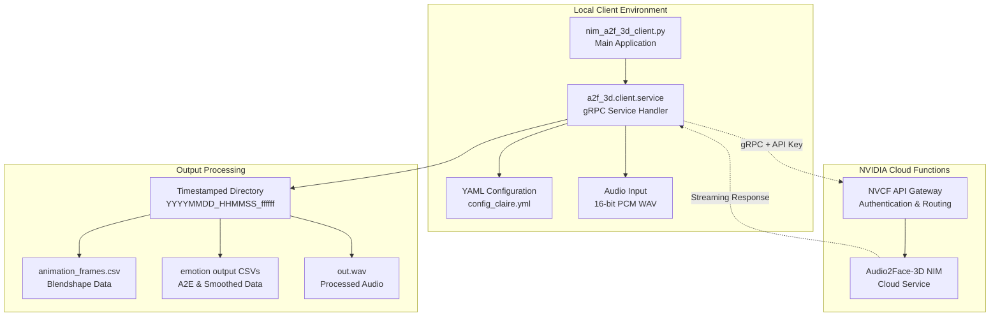
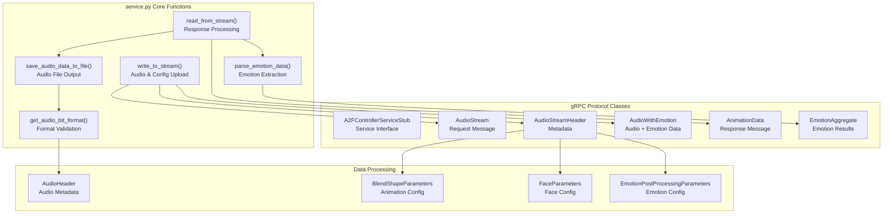
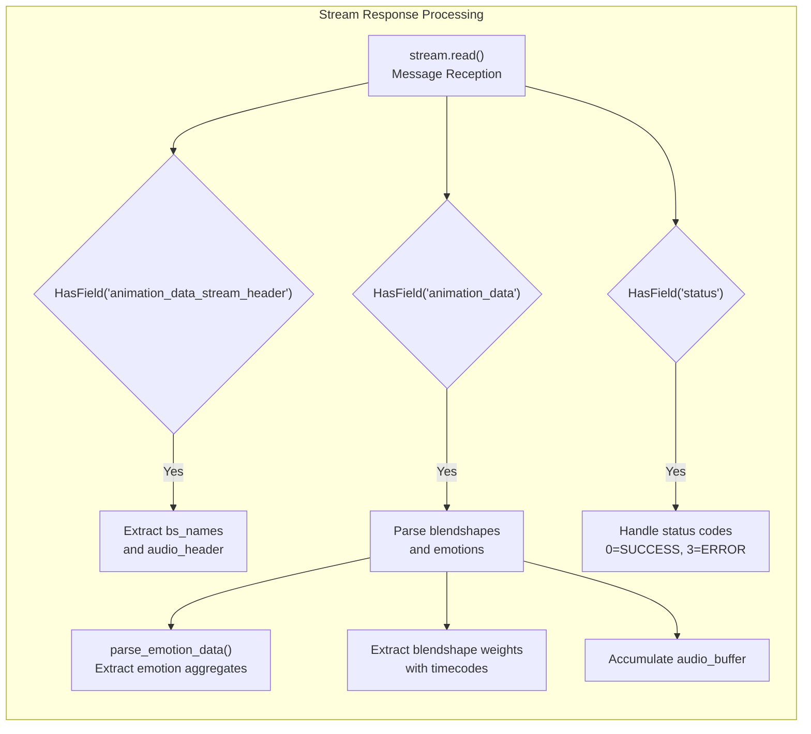
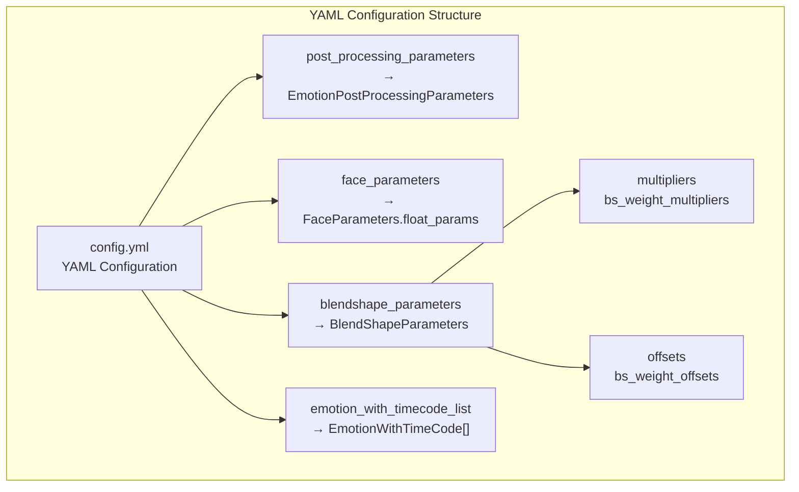

<!-- source: DeepWiki mcp.deepwiki.com · repo NVIDIA/Audio2Face-3D-Samples · page 4.2 API Client for NVCF · fetched 2026-10-26 -->

# API Client for NVCF

<details>
<summary>Relevant source files</summary>

The following files were used as context for generating this wiki page:

- [scripts/audio2face_3d_api_client/README.md](scripts/audio2face_3d_api_client/README.md)
- [scripts/audio2face_3d_api_client/a2f_3d/client/service.py](scripts/audio2face_3d_api_client/a2f_3d/client/service.py)

</details>


This document covers the API client application that connects to Audio2Face-3D NIM hosted on NVIDIA Cloud Functions (NVCF). This client enables cloud-based processing of audio files to generate facial animation blendshapes and emotion data.

For information about the local microservices client, see [Microservices Interaction Application](#4.1). For details about authoring services, see [Authoring Sample Applications](#4.3).

## Purpose and Architecture

The NVCF API client provides a Python application that interfaces with Audio2Face-3D NIM deployed on NVIDIA's cloud infrastructure. It handles authentication, data streaming, and result processing for cloud-based facial animation generation.

### System Architecture



Sources: [scripts/audio2face_3d_api_client/README.md:1-51](), [scripts/audio2face_3d_api_client/a2f_3d/client/service.py:1-243]()

## Core Components

### Client Service Implementation

The primary service logic is implemented in the `service.py` module, which handles all gRPC communication with the NVCF-hosted Audio2Face-3D NIM.



Sources: [scripts/audio2face_3d_api_client/a2f_3d/client/service.py:16-26](), [scripts/audio2face_3d_api_client/a2f_3d/client/service.py:171-243](), [scripts/audio2face_3d_api_client/a2f_3d/client/service.py:91-169]()

## Data Flow and Processing

### Upload Stream Processing

The `write_to_stream()` function handles the upload of audio data and configuration to the NVCF service:

| Component | Purpose | Data Format |
|-----------|---------|-------------|
| `AudioStreamHeader` | Initial metadata packet | Audio format, emotion parameters, face parameters |
| `AudioWithEmotion` | Audio chunks with emotion data | 16-bit PCM audio bytes + emotion timecodes |
| `EndOfAudio` | Stream termination signal | Empty message indicating upload complete |

**Key Constants:**
- `BITS_PER_SAMPLE = 16` - Only 16-bit PCM supported
- `CHANNEL_COUNT = 1` - Mono audio only
- `AUDIO_FORMAT = AudioHeader.AUDIO_FORMAT_PCM` - PCM format required

Sources: [scripts/audio2face_3d_api_client/a2f_3d/client/service.py:27-32](), [scripts/audio2face_3d_api_client/a2f_3d/client/service.py:171-243]()

### Response Stream Processing

The `read_from_stream()` function processes the streaming response from the NVCF service:



Sources: [scripts/audio2face_3d_api_client/a2f_3d/client/service.py:91-169]()

### Emotion Data Processing

The `parse_emotion_data()` function extracts three types of emotion data from the `EmotionAggregate` metadata:

| Emotion Type | Description | Storage Key |
|--------------|-------------|-------------|
| `input_emotions` | User-provided emotion parameters | `"input"` |
| `a2e_output` | Raw Audio2Emotion inference results | `"a2e_output"` |
| `a2f_smoothed_output` | Final smoothed emotions for blendshapes | `"a2f_smoothed_output"` |

Sources: [scripts/audio2face_3d_api_client/a2f_3d/client/service.py:61-89]()

## Configuration and Authentication

### Required Parameters

The client requires four mandatory parameters for NVCF access:

| Parameter | Purpose | Example |
|-----------|---------|---------|
| `audio_file.wav` | Input audio file (16-bit PCM) | `Claire_neutral.wav` |
| `config.yml` | Emotion and face parameters | `config_claire.yml` |
| `--apikey` | API key from NVIDIA API Catalogue | Generated API key |
| `--function-id` | NVCF function identifier | Cloud function ID |

**Default Usage:**
```bash
python3 ./nim_a2f_3d_client.py ../../example_audio/Claire_neutral.wav config/config_claire.yml --apikey <API_KEY> --function-id <Function_ID>
```

Sources: [scripts/audio2face_3d_api_client/README.md:24-40]()

### Configuration File Structure

The YAML configuration file contains three main sections that map to gRPC message types:



Sources: [scripts/audio2face_3d_api_client/a2f_3d/client/service.py:174-197]()

## Output Processing and File Generation

### Output Directory Structure

The client creates a timestamped directory for each processing run using the format `YYYYMMDD_HHMMSS_ffffff`:

| File | Content | Format |
|------|---------|--------|
| `out.wav` | Processed audio (should match input) | 16-bit PCM WAV |
| `animation_frames.csv` | Blendshape weights with timecodes | Normalized pandas DataFrame |
| `a2f_smoothed_emotion_output.csv` | Final smoothed emotion data | JSON normalized format |
| `a2f_input_emotions.csv` | Original input emotion parameters | JSON normalized format |

### Data Normalization and Export

The response processing uses pandas for data normalization and CSV export:

```python
# Normalize the dictionnary data to output in JSON.
df_animation = pandas.json_normalize(animation_key_frames)
df_smoothed_output = pandas.json_normalize(emotion_key_frames["a2f_smoothed_output"])
df_input = pandas.json_normalize(emotion_key_frames["input"])
```

Sources: [scripts/audio2face_3d_api_client/a2f_3d/client/service.py:110-127]()

### Audio File Processing

The `save_audio_data_to_file()` function reconstructs the audio output using the `AudioHeader` metadata and raw audio buffer:

```python
def save_audio_data_to_file(outdir: str, audio_header: AudioHeader, audio_buffer: bytes):
    dtype = get_audio_bit_format(audio_header)  # Returns numpy.int16 for 16-bit PCM
    audio_data_to_save = numpy.frombuffer(audio_buffer, dtype=dtype) 
    scipy.io.wavfile.write(f"{outdir}/out.wav", audio_header.samples_per_second, audio_data_to_save)
```

Sources: [scripts/audio2face_3d_api_client/a2f_3d/client/service.py:45-58]()

## Dependencies and Setup

### Python Environment Requirements

The client requires the following Python packages:
- `scipy` - Audio file I/O and processing
- `numpy` - Numerical data handling
- `pandas` - Data normalization and CSV export
- `grpc` - gRPC communication
- `yaml` - Configuration file parsing
- `nvidia_ace` - NVIDIA ACE protocol definitions wheel

### Installation Commands

```bash
python3 -m venv .venv
source .venv/bin/activate
pip3 install -r requirements
pip3 install ../../proto/sample_wheel/nvidia_ace-1.2.0-py3-none-any.whl
```

**Note:** The nvidia_ace wheel version 1.2.0 is compatible with Audio2Face-3D NIM 1.3.

Sources: [scripts/audio2face_3d_api_client/README.md:7-22]()

---

