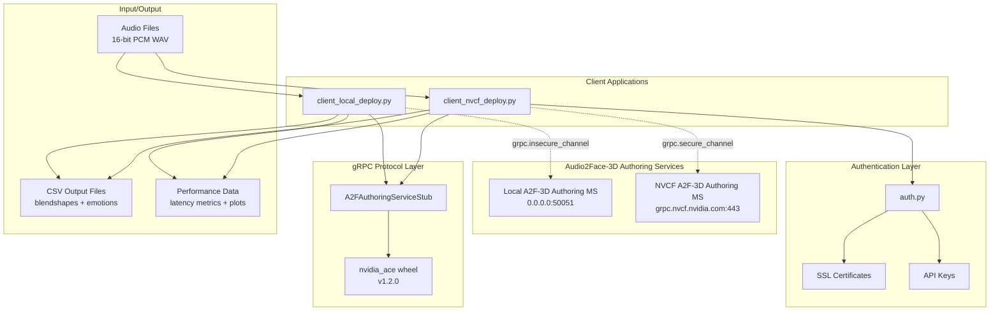
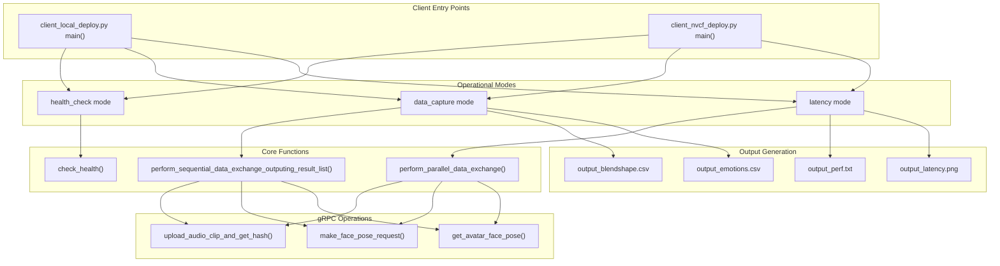
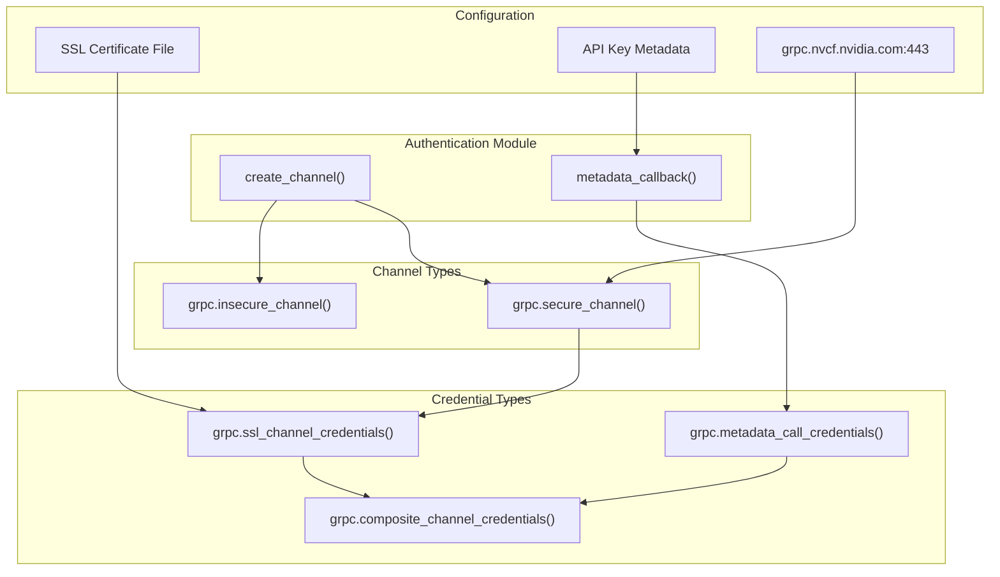

<!-- source: DeepWiki mcp.deepwiki.com · repo NVIDIA/Audio2Face-3D-Samples · page 4.3 Authoring Sample Applications · fetched 2026-10-26 -->

# Authoring Sample Applications

Relevant source files

The following files were used as context for generating this wiki page:

- [early_access/a2f-3d-authoring-sample-app/README.md](early_access/a2f-3d-authoring-sample-app/README.md)
- [early_access/a2f-3d-authoring-sample-app/auth.py](early_access/a2f-3d-authoring-sample-app/auth.py)
- [early_access/a2f-3d-authoring-sample-app/client_local_deploy.py](early_access/a2f-3d-authoring-sample-app/client_local_deploy.py)

This document covers the early access sample applications for interacting with the Audio2Face-3D Authoring Microservice. These applications provide programmatic access to authoring capabilities for generating facial animation data and emotion parameters from audio input.

For information about the primary Audio2Face-3D NIM client applications, see [Microservices Interaction Application](#4.1) and [API Client for NVCF](#4.2).

## Overview

The Audio2Face-3D Authoring sample applications consist of two main client implementations that demonstrate different deployment scenarios:

| Client Application | Target Service | Authentication | Purpose |
|-------------------|----------------|----------------|---------|
| `client_local_deploy.py` | Local A2F-3D Authoring MS | None (insecure channel) | Local development and testing |
| `client_nvcf_deploy.py` | NVCF A2F-3D Authoring MS | API Key + SSL | Cloud deployment interaction |

Each client supports three operational modes for comprehensive service interaction and performance evaluation.

**Sources:** [early_access/a2f-3d-authoring-sample-app/README.md:1-206]()

## System Architecture

The authoring sample applications communicate with Audio2Face-3D Authoring Microservices through gRPC protocol to generate facial animation and emotion data.

### Service Communication Flow

**Sources:** [early_access/a2f-3d-authoring-sample-app/client_local_deploy.py:132-134](), [early_access/a2f-3d-authoring-sample-app/auth.py:22-49]()

## Operational Modes

Both client applications implement three distinct operational modes, each serving different testing and validation purposes.

### Mode Architecture

**Sources:** [early_access/a2f-3d-authoring-sample-app/client_local_deploy.py:142-204]()

### Health Check Mode

The `health_check` mode verifies service availability and connectivity.

| Parameter | Type | Description |
|-----------|------|-------------|
| `--url` | string | gRPC service URL for local deployment |
| `--apikey` | string | API key for NVCF deployment |
| `--function-id` | string | NVCF function identifier |
| `--version-id` | string | NVCF version identifier |

The mode calls the `check_health()` function which returns a boolean indicating service status.

**Sources:** [early_access/a2f-3d-authoring-sample-app/client_local_deploy.py:155-158](), [early_access/a2f-3d-authoring-sample-app/README.md:50-81]()

### Data Capture Mode

The `data_capture` mode processes complete audio clips and generates facial animation data.

| Parameter | Type | Description |
|-----------|------|-------------|
| `--audio-clip` | string | Path to 16-bit PCM WAV file |
| `--print-bs-names` | flag | Optional flag to output blendshape names |

**Processing Flow:**
1. Upload audio clip via `upload_audio_clip_and_get_hash()`
2. Calculate frame count: `int((len(data) / samplerate) * 30)`
3. Generate sequential `FacePoseRequest` objects for each frame
4. Execute `get_avatar_face_pose()` for each request
5. Output results to `output_blendshape.csv` and `output_emotions.csv`

**Sources:** [early_access/a2f-3d-authoring-sample-app/client_local_deploy.py:160-185](), [early_access/a2f-3d-authoring-sample-app/client_local_deploy.py:112-139]()

### Latency Test Mode

The `latency` mode evaluates service performance under concurrent load.

| Parameter | Type | Description |
|-----------|------|-------------|
| `--number-requests` | int | Total number of requests to execute |
| `--concurrent` | int | Number of parallel connections |

The mode uses `perform_parallel_data_exchange()` to simulate concurrent load and generates performance metrics in `output_perf.txt` and latency distribution plots in `output_latency.png`.

**Sources:** [early_access/a2f-3d-authoring-sample-app/client_local_deploy.py:187-203](), [early_access/a2f-3d-authoring-sample-app/README.md:115-151]()

## Authentication and Security

The authentication system supports both insecure local connections and secure NVCF deployments.

### Channel Creation Architecture

**Sources:** [early_access/a2f-3d-authoring-sample-app/auth.py:25-49]()

The `create_channel()` function in `auth.py` provides flexible channel creation with optional SSL certificates and metadata for API key authentication. The `GRPC_URI` constant defines the default NVCF endpoint as `grpc.nvcf.nvidia.com:443`.

**Sources:** [early_access/a2f-3d-authoring-sample-app/auth.py:22-23]()

## Data Processing and Output

The authoring clients generate structured output in CSV format containing facial animation and emotion data.

### Output File Structure

| File | Content | Format |
|------|---------|--------|
| `output_blendshape.csv` | Facial blendshape coefficients | `timecode,EyeBlinkLeft,EyeLookDownLeft,...` |
| `output_emotions.csv` | Emotion intensity values | `timecode,EMOTION_KEYS...` |
| `output_perf.txt` | Performance metrics | Raw latency data |
| `output_latency.png` | Latency distribution | Percentile plot |

The blendshape output includes 52 ARKit-compatible blendshape parameters covering eye movement, jaw articulation, mouth shapes, brow positions, cheek deformation, and nose expressions. Deprecated head rotation parameters (`HeadRoll_deprecated`, `HeadPitch_deprecated`, `HeadYaw_deprecated`) are included for compatibility.

**Sources:** [early_access/a2f-3d-authoring-sample-app/client_local_deploy.py:168-185](), [early_access/a2f-3d-authoring-sample-app/README.md:103-113]()

### Frame Timing and Synchronization

The system operates at 30 FPS with frame timing calculated as:
- `TIME_1_FRAME = 1.0/30.0` (0.033 seconds per frame)
- Frame count: `number_frames = int((len(data) / samplerate) * 30)`
- Timecode: `i * TIME_1_FRAME` for frame index `i`

**Sources:** [early_access/a2f-3d-authoring-sample-app/client_local_deploy.py:129](), [early_access/a2f-3d-authoring-sample-app/client_local_deploy.py:172]()

## Dependencies and Setup

The authoring sample applications require specific Python packages and gRPC protocol definitions.

### Required Dependencies

| Dependency | Version | Purpose |
|------------|---------|---------|
| `nvidia_ace` wheel | 1.2.0 | gRPC protocol definitions for A2F-3D |
| `grpc` | - | gRPC communication framework |
| `scipy` | - | Audio file processing |

The `nvidia_ace` wheel package is installed from `proto/sample_wheel/nvidia_ace-1.2.0-py3-none-any.whl` and provides the `A2FAuthoringServiceStub` class and related protocol buffer definitions.

**Sources:** [early_access/a2f-3d-authoring-sample-app/README.md:30-37](), [early_access/a2f-3d-authoring-sample-app/client_local_deploy.py:37]()

---

