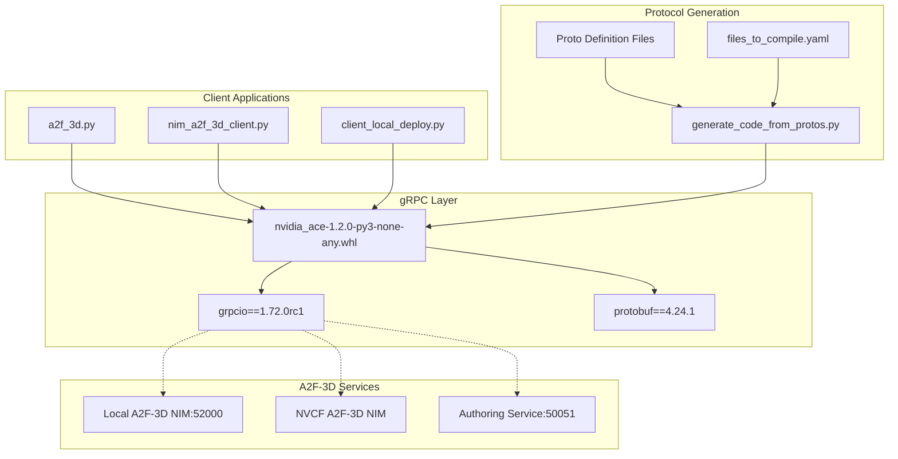
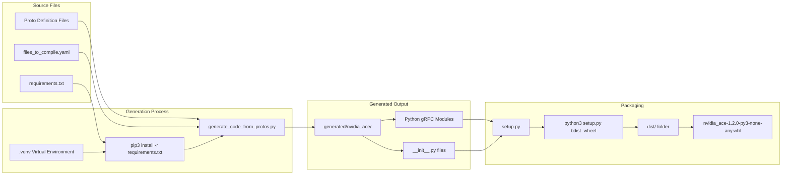
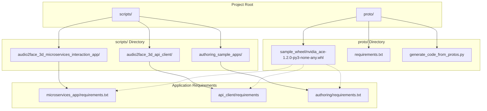

<!-- source: DeepWiki mcp.deepwiki.com · repo NVIDIA/Audio2Face-3D-Samples · page 4.4 Client Dependencies and gRPC Integration · fetched 2026-10-26 -->

# Client Dependencies and gRPC Integration

<details>
<summary>Relevant source files</summary>

The following files were used as context for generating this wiki page:

- [proto/README.md](proto/README.md)
- [scripts/audio2face_3d_api_client/requirements](scripts/audio2face_3d_api_client/requirements)
- [scripts/audio2face_3d_microservices_interaction_app/requirements.txt](scripts/audio2face_3d_microservices_interaction_app/requirements.txt)

</details>


## Purpose and Scope

This document covers the shared dependencies and gRPC communication patterns used across all Audio2Face-3D client applications. It provides technical details on protocol buffer integration, dependency management, and the common communication layer that enables clients to interact with Audio2Face-3D services.

For specific client application implementations, see [Microservices Interaction Application](#4.1), [API Client for NVCF](#4.2), and [Authoring Sample Applications](#4.3). For protocol buffer definitions and generation processes, see [Protocol Buffer Definitions](#6.1).

## Common Dependencies Architecture

All Audio2Face-3D client applications share a core set of Python dependencies that enable gRPC communication, data processing, and configuration management.

### Dependency Requirements Matrix

| Package | Version | Microservices App | API Client | Purpose |
|---------|---------|-------------------|------------|---------|
| numpy | 1.26.4 | ✓ | ✓ | Array processing for audio data |
| scipy | 1.13.0 | ✓ | ✓ | Signal processing algorithms |
| grpcio | 1.72.0rc1 | ✓ | ✓ | gRPC communication protocol |
| protobuf | 4.24.1 | ✓ | ✓ | Protocol buffer serialization |
| PyYAML | 6.0.1 | ✓ | ✓ | Configuration file parsing |
| pandas | 2.2.2 | ✓ | ✓ | Data manipulation and CSV output |
| matplotlib | 3.9.1 | ✓ | ✗ | Performance visualization |

**Sources:** [scripts/audio2face_3d_microservices_interaction_app/requirements.txt:1-8](), [scripts/audio2face_3d_api_client/requirements:1-7]()

## gRPC Integration Architecture

The Audio2Face-3D system uses gRPC for all client-server communication, with protocol buffer definitions provided through the `nvidia_ace` Python wheel package.

### gRPC Communication Flow



**Sources:** [proto/README.md:1-85]()

## Protocol Buffer Package Management

The `nvidia_ace` wheel package provides pre-compiled gRPC Python modules for Audio2Face-3D NIM v1.3 compatibility.

### Installation Methods

#### Method 1: Pre-built Wheel Installation
```bash
pip3 install ./sample_wheel/nvidia_ace-1.2.0-py3-none-any.whl
```

#### Method 2: Generate from Proto Files
```bash
python3 -m venv .venv
source .venv/bin/activate
pip3 install -r requirements.txt
python3 generate_code_from_protos.py files_to_compile.yaml
```

#### Method 3: Custom Wheel Generation
```bash
mv generated/* .
python3 setup.py bdist_wheel
```

**Sources:** [proto/README.md:6-12](), [proto/README.md:22-38](), [proto/README.md:63-84]()

## Code Generation Process

### Protocol Buffer Compilation Pipeline



**Sources:** [proto/README.md:20-38](), [proto/README.md:63-84]()

## Version Compatibility Matrix

### Audio2Face-3D NIM Compatibility

| A2F-3D NIM Version | nvidia_ace Wheel Version | gRPC Version | Protocol Buffer Version |
|-------------------|-------------------------|--------------|------------------------|
| 1.3 | 1.2.0 | 1.72.0rc1 | 4.24.1 |

**Note:** Audio2Face-3D NIM v1.3 continues to use v1.2.0 of the `nvidia_ace` gRPC Python module, maintaining backward compatibility while providing enhanced service features.

**Sources:** [proto/README.md:18-18]()

## Dependency Installation Patterns

### Client Application Setup

Each client application follows a consistent dependency installation pattern:

```bash
# Create virtual environment
python3 -m venv .venv
source .venv/bin/activate

# Install application-specific requirements
pip3 install -r requirements.txt

# Install nvidia_ace wheel for gRPC communication
pip3 install ./proto/sample_wheel/nvidia_ace-1.2.0-py3-none-any.whl
```

### Development Environment Structure



**Sources:** [proto/README.md:6-12](), [scripts/audio2face_3d_microservices_interaction_app/requirements.txt:1-8](), [scripts/audio2face_3d_api_client/requirements:1-7]()

---

