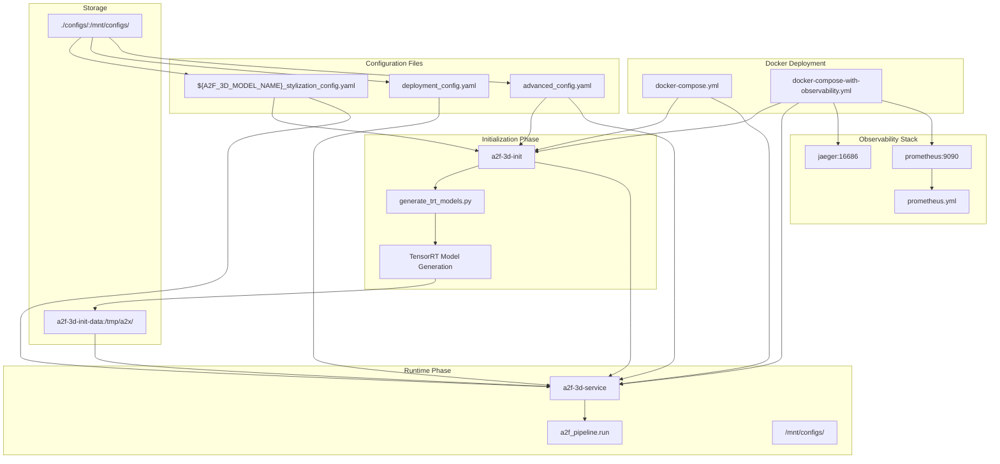
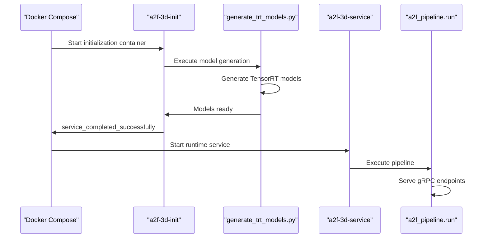
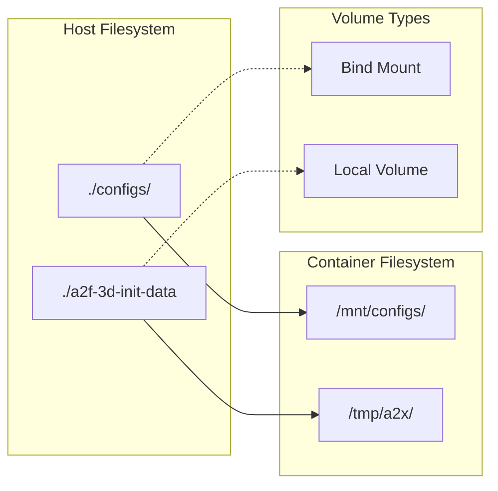
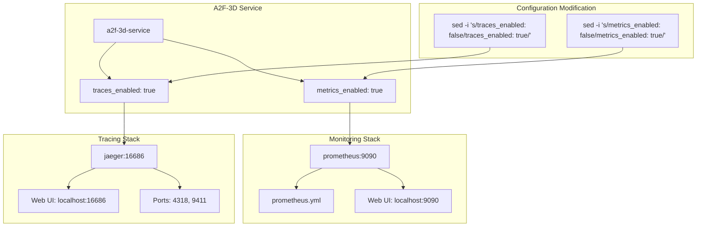

<!-- source: DeepWiki mcp.deepwiki.com · repo NVIDIA/Audio2Face-3D-Samples · page 5 Deployment and Operations · fetched 2026-10-26 -->

# Deployment and Operations

<details>
<summary>Relevant source files</summary>

The following files were used as context for generating this wiki page:

- [quick-start/docker-compose-with-observability.yml](quick-start/docker-compose-with-observability.yml)
- [quick-start/docker-compose.yml](quick-start/docker-compose.yml)

</details>


This document covers the deployment and operational aspects of the NVIDIA Audio2Face-3D system, including Docker containerization, service orchestration, and observability infrastructure. It focuses on the production deployment patterns and monitoring capabilities provided by the system.

For information about configuration file structures and migration, see [Configuration Management and Migration](#3). For client application deployment patterns, see [Client Applications and APIs](#4).

## Deployment Architecture

The Audio2Face-3D system employs a multi-stage Docker deployment architecture with separate initialization and runtime phases. The deployment system supports both basic service deployment and enhanced observability configurations.

### Docker Service Architecture



**Sources:** [quick-start/docker-compose.yml:16-73](), [quick-start/docker-compose-with-observability.yml:16-95]()

### Service Dependencies and Startup Sequence

The deployment follows a strict dependency chain where the initialization service must complete successfully before the runtime service starts:



**Sources:** [quick-start/docker-compose.yml:40-42](), [quick-start/docker-compose-with-observability.yml:40-42]()

## Docker Deployment Configuration

### Basic Deployment Setup

The standard deployment uses the `docker-compose.yml` configuration with two primary services:

| Service | Purpose | Image | Dependencies |
|---------|---------|-------|--------------|
| `a2f-3d-init` | TensorRT model generation | `nvcr.io/nim/nvidia/audio2face-3d:1.3` | None |
| `a2f-3d-service` | Runtime inference service | `nvcr.io/nim/nvidia/audio2face-3d:1.3` | `a2f-3d-init` |

The initialization service executes the `generate_trt_models.py` script with stylization and advanced configuration parameters, while the runtime service launches `a2f_pipeline.run` with the complete configuration set.

**Sources:** [quick-start/docker-compose.yml:17-43]()

### Environment Variables and Configuration

Key environment variables control the deployment behavior:

| Variable | Purpose | Default Value |
|----------|---------|---------------|
| `A2F_3D_MODEL_NAME` | Character model selection | Unset (required) |
| `USE_NEW_NVSTREAMMUX` | Enable new NVIDIA Stream Mux | `yes` |
| `NIM_DISABLE_MODEL_DOWNLOAD` | Disable model download | `true` |
| `NIM_SKIP_A2F_START` | Skip Audio2Face startup | `true` |
| `NGC_API_KEY` | NVIDIA NGC API key | From secrets |

**Sources:** [quick-start/docker-compose.yml:44-52](), [quick-start/docker-compose-with-observability.yml:44-52]()

### Volume Management

The deployment uses persistent volumes for model data and configuration:



**Sources:** [quick-start/docker-compose.yml:25-27](), [quick-start/docker-compose.yml:49-51](), [quick-start/docker-compose.yml:61-68]()

## Observability and Monitoring

### Enhanced Observability Deployment

The `docker-compose-with-observability.yml` extends the basic deployment with monitoring and tracing capabilities:



**Sources:** [quick-start/docker-compose-with-observability.yml:44-47](), [quick-start/docker-compose-with-observability.yml:65-82]()

### Monitoring Endpoints and Ports

The observability stack exposes the following service endpoints:

| Service | Port | Purpose | UI Access |
|---------|------|---------|-----------|
| Prometheus | 9090 | Metrics collection and storage | `http://localhost:9090` |
| Jaeger | 16686 | Distributed tracing UI | `http://localhost:16686` |
| Jaeger OTLP | 4318 | OpenTelemetry Protocol endpoint | N/A |
| Jaeger Zipkin | 9411 | Zipkin-compatible tracing endpoint | N/A |

**Sources:** [quick-start/docker-compose-with-observability.yml:65-82]()

### Configuration Injection for Observability

The observability deployment uses runtime configuration modification to enable telemetry features:

```bash
sed -i 's/^\\([[:space:]]*metrics_enabled:[[:space:]]*\\)false/\\1true/' /mnt/configs/deployment_config.yaml
sed -i 's/^\\([[:space:]]*traces_enabled:[[:space:]]*\\)false/\\1true/' /mnt/configs/deployment_config.yaml
```

This approach allows the same configuration files to be used for both basic and observability-enabled deployments.

**Sources:** [quick-start/docker-compose-with-observability.yml:45-46]()

## GPU Resource Management

Both deployment configurations require NVIDIA GPU access with specific resource reservations:

```yaml
deploy:
  resources:
    reservations:
      devices:
        - driver: nvidia
          count: 1
          capabilities: [ gpu ]
```

This ensures each service container has access to one NVIDIA GPU for CUDA operations and TensorRT inference.

**Sources:** [quick-start/docker-compose.yml:28-34](), [quick-start/docker-compose.yml:53-59]()

## Network Configuration

The deployment uses `host` networking mode for direct access to host network interfaces:

```yaml
network_mode: "host"
```

This configuration allows the Audio2Face-3D service to bind directly to host ports without Docker network address translation, typically serving on port `52000` for the main gRPC endpoint.

**Sources:** [quick-start/docker-compose.yml:52](), [quick-start/docker-compose-with-observability.yml:56]()

## Security and Secrets Management

### NGC API Key Management

The deployment uses Docker Compose secrets to manage the NVIDIA NGC API key:

```yaml
secrets:
  ngc_api_key:
    environment: NGC_API_KEY
```

The API key must be provided as the `NGC_API_KEY` environment variable when running the deployment.

**Sources:** [quick-start/docker-compose.yml:70-73](), [quick-start/docker-compose-with-observability.yml:92-95]()

### Container Security Context

The containers run with default security context but require GPU device access. The deployment follows NVIDIA Container Runtime security best practices for GPU workloads.

**Sources:** [quick-start/docker-compose.yml:28-34](), [quick-start/docker-compose.yml:53-59]()

---

