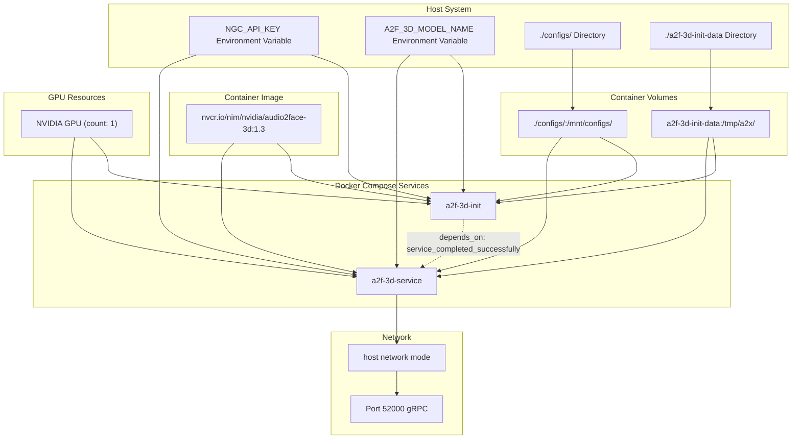
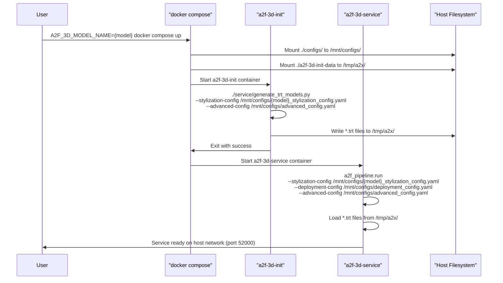
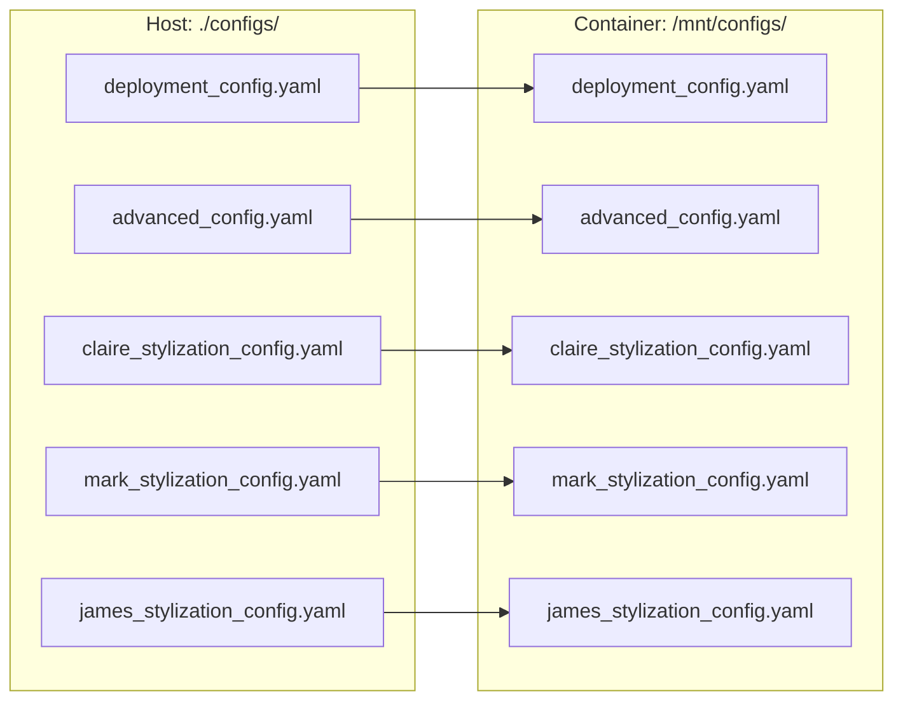
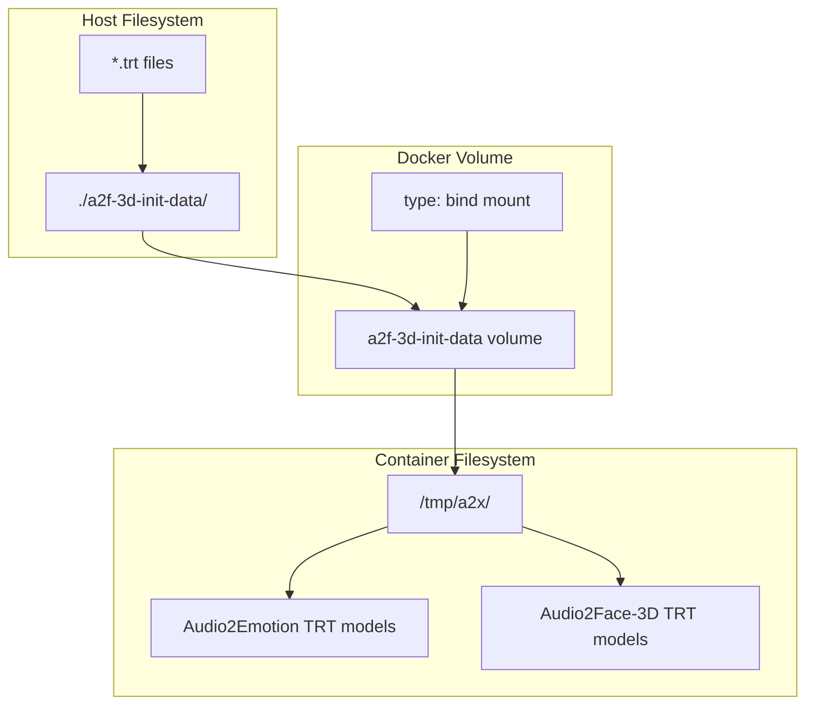

<!-- source: DeepWiki mcp.deepwiki.com · repo NVIDIA/Audio2Face-3D-Samples · page 5.1 Docker Deployment · fetched 2026-10-26 -->

# Docker Deployment

<details>
<summary>Relevant source files</summary>

The following files were used as context for generating this wiki page:

- [quick-start/README.md](quick-start/README.md)
- [quick-start/docker-compose.yml](quick-start/docker-compose.yml)

</details>


This document covers deploying the Audio2Face-3D NIM (NVIDIA Inference Microservice) using Docker Compose. It includes setup requirements, service architecture, deployment workflows, and configuration management for local container-based deployments.

For observability and monitoring setup with Prometheus and Jaeger, see [Observability and Monitoring](#5.2). For client applications that connect to the deployed service, see [Client Applications and APIs](#4).

## Prerequisites and Environment Setup

The Docker deployment requires several system components and environment configuration before starting the Audio2Face-3D services.

### System Requirements

| Component | Purpose | Documentation |
|-----------|---------|---------------|
| Docker | Container runtime | [Docker Installation](https://docs.docker.com/get-docker/) |
| NVIDIA Container Toolkit | GPU access in containers | [NVIDIA Container Toolkit](https://docs.nvidia.com/datacenter/cloud-native/container-toolkit/latest/install-guide.html) |
| Docker Compose | Multi-container orchestration | [Docker Compose Installation](https://docs.docker.com/compose/install/) |

### NGC API Key Configuration

The deployment requires an NGC API key for accessing the Audio2Face-3D NIM container image. This must be set as an environment variable:

```bash
export NGC_API_KEY=<your_ngc_api_key>
```

The API key is passed to containers as a Docker secret named `ngc_api_key` as defined in [quick-start/docker-compose.yml:70-72]().

**Sources:** [quick-start/README.md:1-17]()

## Docker Compose Service Architecture

The Audio2Face-3D deployment consists of two primary services orchestrated through Docker Compose, with a specific initialization and runtime workflow.

### Service Architecture Diagram



### Service Definitions

#### a2f-3d-init Service

The initialization service generates TensorRT models required for Audio2Face-3D inference:

- **Image**: `nvcr.io/nim/nvidia/audio2face-3d:1.3`
- **Entrypoint**: `./service/generate_trt_models.py` with stylization and advanced config parameters
- **Purpose**: Pre-generate TensorRT engines for the selected character model
- **Lifecycle**: Runs once and exits successfully before main service starts

#### a2f-3d-service Service

The main inference service provides the Audio2Face-3D gRPC API:

- **Image**: `nvcr.io/nim/nvidia/audio2face-3d:1.3`
- **Entrypoint**: `a2f_pipeline.run` with configuration file parameters
- **Network**: Host mode for direct port access
- **Dependencies**: Waits for `a2f-3d-init` to complete successfully

**Sources:** [quick-start/docker-compose.yml:16-59]()

## Deployment Workflow

The deployment process follows a specific sequence for model initialization and service startup.

### Deployment Process Diagram



### Character Model Selection

The deployment supports three character models, selected via the `A2F_3D_MODEL_NAME` environment variable:

| Model | Command | Stylization Config |
|-------|---------|-------------------|
| Claire | `A2F_3D_MODEL_NAME=claire docker compose up` | `claire_stylization_config.yaml` |
| Mark | `A2F_3D_MODEL_NAME=mark docker compose up` | `mark_stylization_config.yaml` |
| James | `A2F_3D_MODEL_NAME=james docker compose up` | `james_stylization_config.yaml` |

### First Run Considerations

The initial deployment takes several minutes as both Audio2Emotion and Audio2Face-3D TensorRT models must be generated. Subsequent deployments use cached models for faster startup.

**Sources:** [quick-start/README.md:19-47]()

## Configuration Management

The Docker deployment uses volume mounts to provide configuration files to the running containers.

### Configuration File Mapping



### Configuration Update Process

Configuration changes require container restart:

1. Modify configuration files in the `./configs/` directory
2. Stop containers with `Ctrl+C`
3. Restart with `docker compose up`

The volume mount at [quick-start/docker-compose.yml:51]() provides live access to configuration files, but the service must be restarted to reload them.

**Sources:** [quick-start/README.md:52-56](), [quick-start/docker-compose.yml:27](), [quick-start/docker-compose.yml:51]()

## Model Caching System

The Docker deployment implements a persistent caching mechanism for generated TensorRT models to improve startup performance.

### Cache Architecture



### Cache Management

| Operation | Command | Purpose |
|-----------|---------|---------|
| View cache | `ls ./a2f-3d-init-data/` | List cached TRT files |
| Clear cache | `rm ./a2f-3d-init-data/*.trt` | Force model regeneration |
| Remove volume | `docker compose down -v` | Clean all cached data |

The volume configuration uses a bind mount as defined in [quick-start/docker-compose.yml:62-67](), mapping the host directory directly to container storage.

**Sources:** [quick-start/README.md:48-51](), [quick-start/docker-compose.yml:62-67]()

## Observability Integration

The deployment includes an optional observability stack with Prometheus metrics and Jaeger tracing.

### Observability Deployment

Use the observability-enabled compose file:

```bash
A2F_3D_MODEL_NAME={model_name} docker compose -f docker-compose-with-observability.yml up
```

This deployment automatically modifies the `deployment_config.yaml` to enable telemetry:
- `telemetry.metrics_enabled: true`
- `telemetry.traces_enabled: true`

### Monitoring Endpoints

| Service | URL | Purpose |
|---------|-----|---------|
| Prometheus | http://localhost:9090/graph | Metrics visualization |
| Jaeger | http://localhost:16686/search | Distributed tracing |

For detailed observability configuration, see [Observability and Monitoring](#5.2).

**Sources:** [quick-start/README.md:58-74]()

## Troubleshooting and Maintenance

Common deployment issues and their resolution procedures.

### Container State Management

```mermaid
graph TB
    subgraph "Problem States"
        INVALID_STATE["Invalid deployment state"]
        START_ERRORS["Startup errors"]
        MODEL_CORRUPTION["Corrupted TRT models"]
    end
    
    subgraph "Cleanup Commands"
        DOWN_VOLUMES["docker compose down -v"]
        CONTAINER_PRUNE["docker container prune -f"]
        MANUAL_CACHE["rm ./a2f-3d-init-data/*.trt"]
    end
    
    subgraph "Recovery Actions"
        REMOVE_MODELS["Remove cached models"]
        REMOVE_CONTAINERS["Remove all containers"]
        FRESH_DEPLOY["Fresh deployment"]
    end
    
    INVALID_STATE --> DOWN_VOLUMES
    START_ERRORS --> CONTAINER_PRUNE
    MODEL_CORRUPTION --> MANUAL_CACHE
    
    DOWN_VOLUMES --> REMOVE_MODELS
    CONTAINER_PRUNE --> REMOVE_CONTAINERS
    MANUAL_CACHE --> REMOVE_MODELS
    
    REMOVE_MODELS --> FRESH_DEPLOY
    REMOVE_CONTAINERS --> FRESH_DEPLOY
```



### Common Troubleshooting Commands

| Issue | Command | Effect |
|-------|---------|--------|
| Remove cached models | `A2F_3D_MODEL_NAME={model} docker compose down -v` | Deletes volume data, forces TRT regeneration |
| Clean containers | `docker container prune -f` | Removes all stopped containers |
| Manual cache clear | `rm ./a2f-3d-init-data/*.trt` | Removes TRT files, preserves other cache |

### Environment Variables

Critical environment variables for troubleshooting:

- `NGC_API_KEY`: Must be set for container image access
- `A2F_3D_MODEL_NAME`: Must match available character models (claire, mark, james)
- `LD_LIBRARY_PATH`: Set automatically in [quick-start/docker-compose.yml:45]()
- `USE_NEW_NVSTREAMMUX`: Enabled for pipeline compatibility [quick-start/docker-compose.yml:46]()

**Sources:** [quick-start/README.md:75-89](), [quick-start/docker-compose.yml:44-48]()

---

