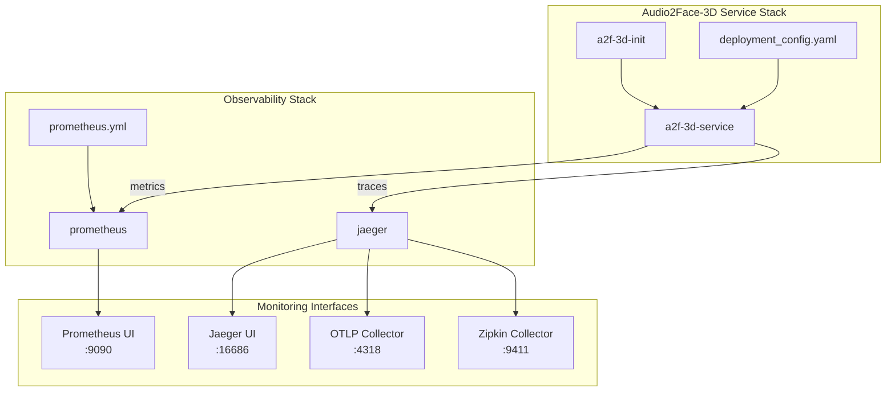
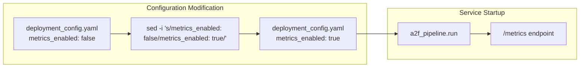
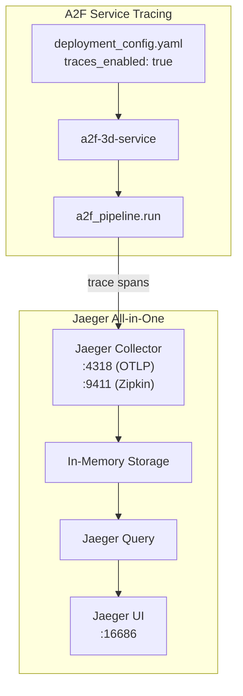
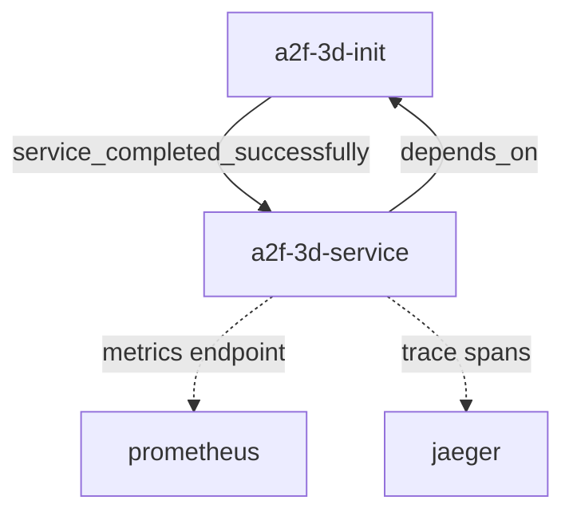

<!-- source: DeepWiki mcp.deepwiki.com · repo NVIDIA/Audio2Face-3D-Samples · page 5.2 Observability and Monitoring · fetched 2026-10-26 -->

# Observability and Monitoring

<details>
<summary>Relevant source files</summary>

The following files were used as context for generating this wiki page:

- [quick-start/docker-compose-with-observability.yml](quick-start/docker-compose-with-observability.yml)

</details>


## Purpose and Scope

This document describes the observability and monitoring capabilities available for Audio2Face-3D deployments. It covers the setup and configuration of metrics collection using Prometheus and distributed tracing using Jaeger, enabling operators to monitor service health, performance, and troubleshoot issues in production deployments.

For basic Docker deployment without observability features, see [Docker Deployment](#5.1). For general deployment configuration parameters, see [Configuration File Structure](#3.2).

## Observability Architecture

The Audio2Face-3D system supports comprehensive observability through two primary components: Prometheus for metrics collection and Jaeger for distributed tracing. These tools integrate with the core `a2f-3d-service` to provide real-time monitoring and performance analysis capabilities.

### System Architecture



Sources: [quick-start/docker-compose-with-observability.yml:16-95]()

## Prometheus Metrics Collection

Prometheus provides metrics collection and monitoring capabilities for the Audio2Face-3D service. The `prometheus` service runs as a containerized deployment that scrapes metrics from the A2F service endpoints.

### Prometheus Service Configuration

The Prometheus service is configured with the following specifications:

| Parameter | Value | Purpose |
|-----------|-------|---------|
| Image | `prom/prometheus:latest` | Official Prometheus container |
| Network Mode | `host` | Direct host network access |
| Port | `9090` | Prometheus web UI and API |
| Config Volume | `./prometheus.yml:/etc/prometheus/prometheus.yml` | Scraping configuration |

The service requires a `prometheus.yml` configuration file in the deployment directory that defines the scraping targets and intervals for collecting metrics from the A2F service.

### Metrics Enablement Process



Sources: [quick-start/docker-compose-with-observability.yml:45-46](), [quick-start/docker-compose-with-observability.yml:75-81]()

## Jaeger Distributed Tracing

Jaeger provides distributed tracing capabilities to track request flows and performance across the Audio2Face-3D service components. The all-in-one Jaeger deployment includes the collector, query service, and web UI.

### Jaeger Service Configuration

The Jaeger service exposes multiple endpoints for different tracing protocols:

| Port | Protocol | Purpose |
|------|----------|---------|
| 16686 | HTTP | Jaeger web UI for trace visualization |
| 4318 | OTLP | OpenTelemetry Protocol collector endpoint |
| 9411 | Zipkin | Zipkin-compatible trace collection |

### Trace Collection Setup



Sources: [quick-start/docker-compose-with-observability.yml:46-47](), [quick-start/docker-compose-with-observability.yml:65-73]()

## Configuration Integration

The observability stack integrates with the Audio2Face-3D service through dynamic configuration modification. The Docker Compose setup automatically enables both metrics and tracing by modifying the `deployment_config.yaml` file at runtime.

### Runtime Configuration Modification

The `a2f-3d-service` container performs the following configuration changes during startup:

```bash
sed -i 's/^\\([[:space:]]*metrics_enabled:[[:space:]]*\\)false/\\1true/' /mnt/configs/deployment_config.yaml
sed -i 's/^\\([[:space:]]*traces_enabled:[[:space:]]*\\)false/\\1true/' /mnt/configs/deployment_config.yaml
```

These commands enable observability features by:
1. Setting `metrics_enabled: true` in the deployment configuration
2. Setting `traces_enabled: true` in the deployment configuration
3. Preserving the original YAML formatting and indentation

### Service Dependencies

The observability-enabled deployment follows this dependency chain:



Sources: [quick-start/docker-compose-with-observability.yml:40-42](), [quick-start/docker-compose-with-observability.yml:44-47]()

## Deployment Instructions

To deploy Audio2Face-3D with observability enabled, use the dedicated Docker Compose configuration that includes the monitoring stack.

### Prerequisites

1. Ensure `prometheus.yml` configuration file exists in the deployment directory
2. Set the required environment variables:
   - `NGC_API_KEY` for NVIDIA container registry access
   - `A2F_3D_MODEL_NAME` for character model selection

### Deployment Command

```bash
docker-compose -f docker-compose-with-observability.yml up
```

### Network Configuration

All services use `network_mode: "host"` for direct host network access, eliminating the need for port mapping and reducing network overhead. This configuration allows:

- Direct access to Prometheus UI at `http://localhost:9090`
- Direct access to Jaeger UI at `http://localhost:16686`  
- Simplified service-to-service communication for metrics and trace collection

### Volume Mounts

The observability deployment utilizes the following volume configurations:

| Volume | Mount Point | Purpose |
|--------|-------------|---------|
| `a2f-3d-init-data` | `/tmp/a2x/` | Shared TensorRT model cache |
| `./configs/` | `/mnt/configs/` | Configuration file access |
| `./prometheus.yml` | `/etc/prometheus/prometheus.yml` | Prometheus scraping config |

Sources: [quick-start/docker-compose-with-observability.yml:53-55](), [quick-start/docker-compose-with-observability.yml:80-81](), [quick-start/docker-compose-with-observability.yml:83-89]()

---

