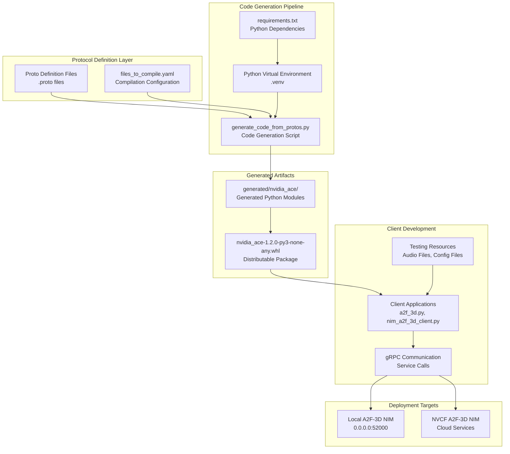
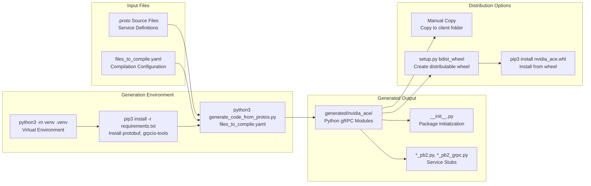

<!-- source: DeepWiki mcp.deepwiki.com · repo NVIDIA/Audio2Face-3D-Samples · page 6 Development Resources · fetched 2026-10-26 -->

# Development Resources

<details>
<summary>Relevant source files</summary>

The following files were used as context for generating this wiki page:

- [example_audio/Claire_anger.wav](example_audio/Claire_anger.wav)
- [proto/README.md](proto/README.md)

</details>


This page provides essential resources and tools for developers working with the Audio2Face-3D system. It covers the development environment setup, protocol buffer management, code generation workflows, and testing resources needed to build and integrate with Audio2Face-3D services.

For specific protocol buffer implementation details, see [Protocol Buffer Definitions](#6.1). For testing resources and example files, see [Example Audio and Testing](#6.2).

## Development Workflow Overview

The Audio2Face-3D development ecosystem follows a structured workflow from protocol definitions to client application deployment. Understanding this workflow is essential for developing new clients or extending existing functionality.

**Development Workflow Architecture**



Sources: [proto/README.md:1-85]()

## Protocol Buffer Code Generation

The Audio2Face-3D system uses protocol buffers for gRPC communication between clients and services. The code generation process transforms `.proto` definition files into Python modules that client applications can import and use.

**Protocol Buffer Generation Pipeline**



Sources: [proto/README.md:20-38](), [proto/README.md:40-84]()

## Development Environment Setup

Setting up a proper development environment is crucial for working with the Audio2Face-3D system. The following setup process ensures all dependencies are correctly installed and isolated.

### Virtual Environment Creation

Create an isolated Python environment to avoid dependency conflicts:

```bash
python3 -m venv .venv
source .venv/bin/activate
```

### Dependency Installation Options

**Option 1: Use Pre-built Wheel Package**

Install the provided `nvidia_ace` wheel package compatible with Audio2Face-3D NIM 1.3:

```bash
pip3 install ./sample_wheel/nvidia_ace-1.2.0-py3-none-any.whl
```

**Option 2: Generate from Source**

For development or customization, generate the gRPC module from protocol definitions:

```bash
pip3 install -r requirements.txt
python3 generate_code_from_protos.py files_to_compile.yaml
```

**Option 3: Create Custom Wheel**

For distribution, create your own wheel package:

```bash
pip3 install setuptools wheel
mv generated/* .
python3 setup.py bdist_wheel
```

Sources: [proto/README.md:5-11](), [proto/README.md:22-34](), [proto/README.md:50-82]()

## Package Structure and Components

Understanding the generated package structure is important for development and integration work.

### Generated Package Structure

The `nvidia_ace` package follows this structure after generation:

| Component | Description | Location |
|-----------|-------------|----------|
| Package Root | Main package directory | `nvidia_ace/` |
| Initialization | Package initialization file | `nvidia_ace/__init__.py` |
| Service Stubs | Generated gRPC service definitions | `nvidia_ace/*_pb2.py` |
| gRPC Clients | Generated client stubs | `nvidia_ace/*_pb2_grpc.py` |

### Version Compatibility

| Audio2Face-3D NIM Version | nvidia_ace Package Version | Compatibility Notes |
|---------------------------|---------------------------|-------------------|
| v1.3 | v1.2.0 | Current recommended version |
| v1.2 | v1.2.0 | Backward compatible |

Sources: [proto/README.md:8](), [proto/README.md:18](), [proto/README.md:69-76]()

## Integration Patterns

### Direct Integration Pattern

For development and testing, copy generated modules directly to your project:

```python
# Import generated modules directly
from nvidia_ace import audio2face_pb2
from nvidia_ace import audio2face_pb2_grpc
```

### Wheel Package Integration Pattern

For production deployments, use the wheel package installation:

```python
# Import from installed package
import nvidia_ace
from nvidia_ace import audio2face_pb2
from nvidia_ace import audio2face_pb2_grpc
```

### Custom Generation Pattern

For specialized requirements, customize the generation process by modifying `files_to_compile.yaml` and regenerating:

```bash
# Edit compilation configuration
vim files_to_compile.yaml

# Regenerate with custom settings
python3 generate_code_from_protos.py files_to_compile.yaml
```

Sources: [proto/README.md:13-16](), [proto/README.md:29-38]()

## Development Best Practices

### Environment Isolation

Always use virtual environments to isolate dependencies and avoid conflicts with system packages or other projects.

### Version Management

- Pin the `nvidia_ace` package version in your requirements
- Test compatibility when upgrading Audio2Face-3D NIM versions
- Maintain separate environments for different NIM versions if needed

### Code Generation Workflow

1. Modify protocol definitions only when extending functionality
2. Regenerate Python modules after proto changes
3. Update wheel packages for distribution
4. Test generated code with existing client applications

### Testing Integration

Use the provided example audio files and client applications to validate your development environment setup and generated code functionality.

Sources: [proto/README.md:22-27](), [proto/README.md:40-59]()

---

