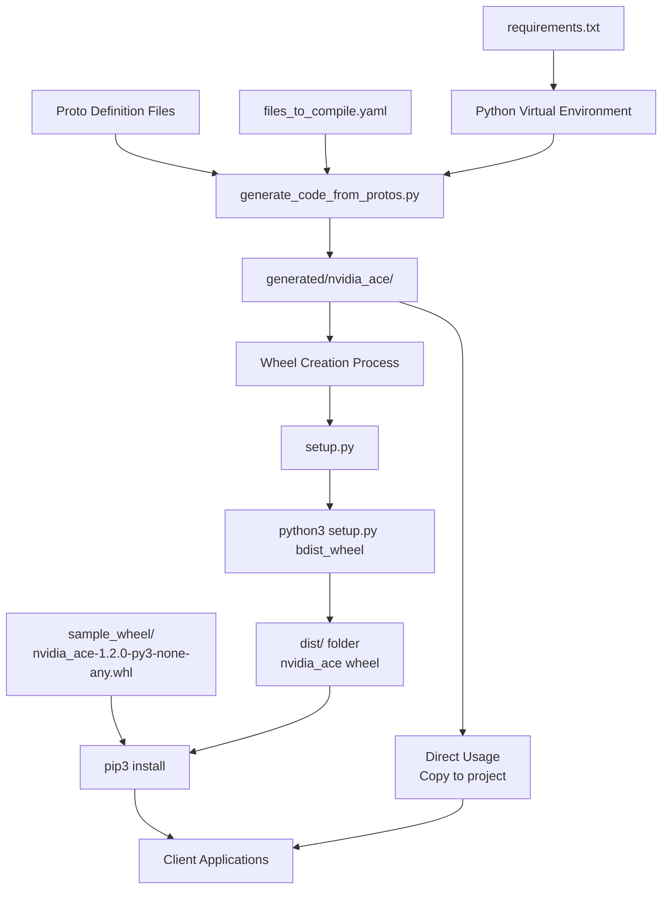
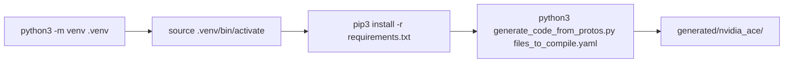
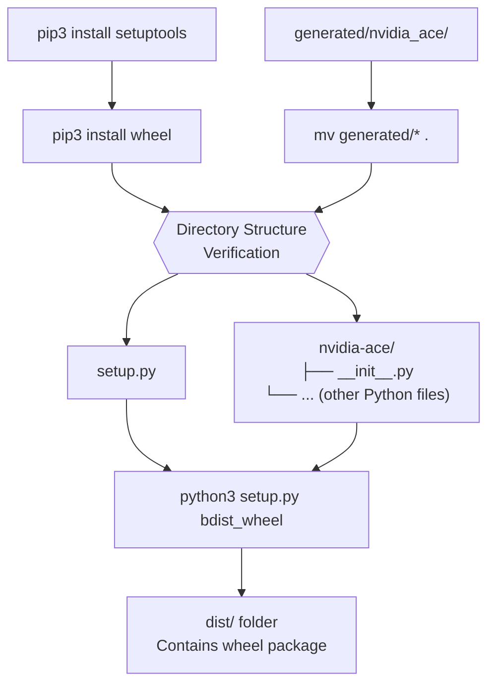
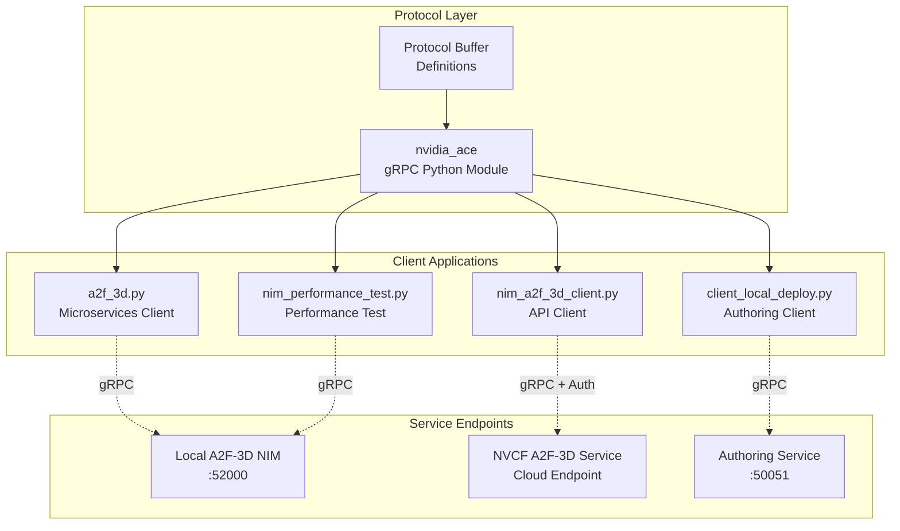

<!-- source: DeepWiki mcp.deepwiki.com · repo NVIDIA/Audio2Face-3D-Samples · page 6.1 Protocol Buffer Definitions · fetched 2026-10-26 -->

# Protocol Buffer Definitions

Relevant source files

The following files were used as context for generating this wiki page:

- [proto/README.md](proto/README.md)

This document covers the gRPC Protocol Buffer definitions used by the Audio2Face-3D system and the process for generating Python client libraries from these definitions. The `nvidia_ace` gRPC Python module provides the protocol definitions needed for client applications to communicate with Audio2Face-3D services.

For information about client applications that use these protocol definitions, see [Client Applications and APIs](#4). For deployment configuration, see [Deployment and Operations](#5).

## Overview

The Audio2Face-3D system uses gRPC for client-server communication, requiring Protocol Buffer definitions to generate language-specific client libraries. The system provides two main approaches for accessing these definitions:

1. **Pre-built Package**: Install the provided `nvidia_ace` Python wheel
2. **Source Generation**: Generate the gRPC Python module from proto source files

## Installation Options

### Pre-built Wheel Package

The simplest approach is to install the pre-built `nvidia_ace` wheel package compatible with Audio2Face-3D NIM 1.3:

| Component | Version | Compatibility |
|-----------|---------|---------------|
| Audio2Face-3D NIM | v1.3 | Current release |
| nvidia_ace wheel | v1.2.0 | Compatible with NIM v1.3 |

The wheel package is located in the `sample_wheel/` directory and can be installed using pip.

**Sources:** [proto/README.md:5-12]()

### Source Generation Workflow

**Protocol Buffer Generation Workflow**

This diagram shows the complete process from proto definitions to usable Python modules, including both the pre-built and source generation paths.

**Sources:** [proto/README.md:20-84]()

## Code Generation Process

### Environment Setup

The code generation process requires a Python virtual environment with specific dependencies:

**Environment Setup and Code Generation Pipeline**

**Sources:** [proto/README.md:22-38]()

### Generated Code Structure

The code generation process creates the following directory structure:

| Path | Description |
|------|-------------|
| `generated/nvidia_ace/` | Generated gRPC Python modules |
| `generated/nvidia_ace/__init__.py` | Package initialization |
| `files_to_compile.yaml` | Proto compilation configuration |
| `generate_code_from_protos.py` | Code generation script |
| `requirements.txt` | Python dependencies |

**Sources:** [proto/README.md:37-38]()

## Wheel Package Creation

### Wheel Build Process

For distribution, the generated code can be packaged into a Python wheel:

**Wheel Package Creation Process**

**Sources:** [proto/README.md:40-84]()

### Required Directory Structure

Before creating a wheel, the directory structure must match the expected layout:

| File/Directory | Purpose |
|----------------|---------|
| `setup.py` | Wheel build configuration |
| `nvidia-ace/` | Main package directory |
| `nvidia-ace/__init__.py` | Package initialization file |
| `nvidia-ace/...` | Generated Python modules |

**Sources:** [proto/README.md:69-76]()

## Integration with Client Applications

The generated or installed `nvidia_ace` module provides the protocol buffer definitions used by all client applications in the Audio2Face-3D ecosystem:

**Protocol Buffer Integration with Client Applications**

This diagram shows how the `nvidia_ace` module serves as the communication foundation for all client applications in the system.

**Sources:** [proto/README.md:1-18]()

## Version Compatibility

| Audio2Face-3D NIM Version | nvidia_ace Version | Compatibility Status |
|---------------------------|-------------------|---------------------|
| v1.3 | v1.2.0 | Current (Active) |
| Earlier versions | Earlier versions | Legacy |

The `nvidia_ace` module version may not directly correspond to the NIM version, as protocol definitions can remain stable across NIM releases.

**Sources:** [proto/README.md:18]()

---

