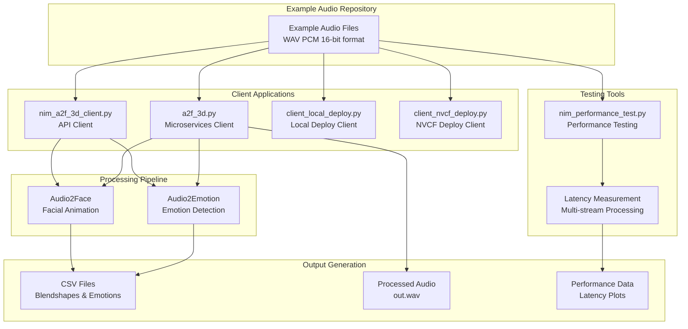
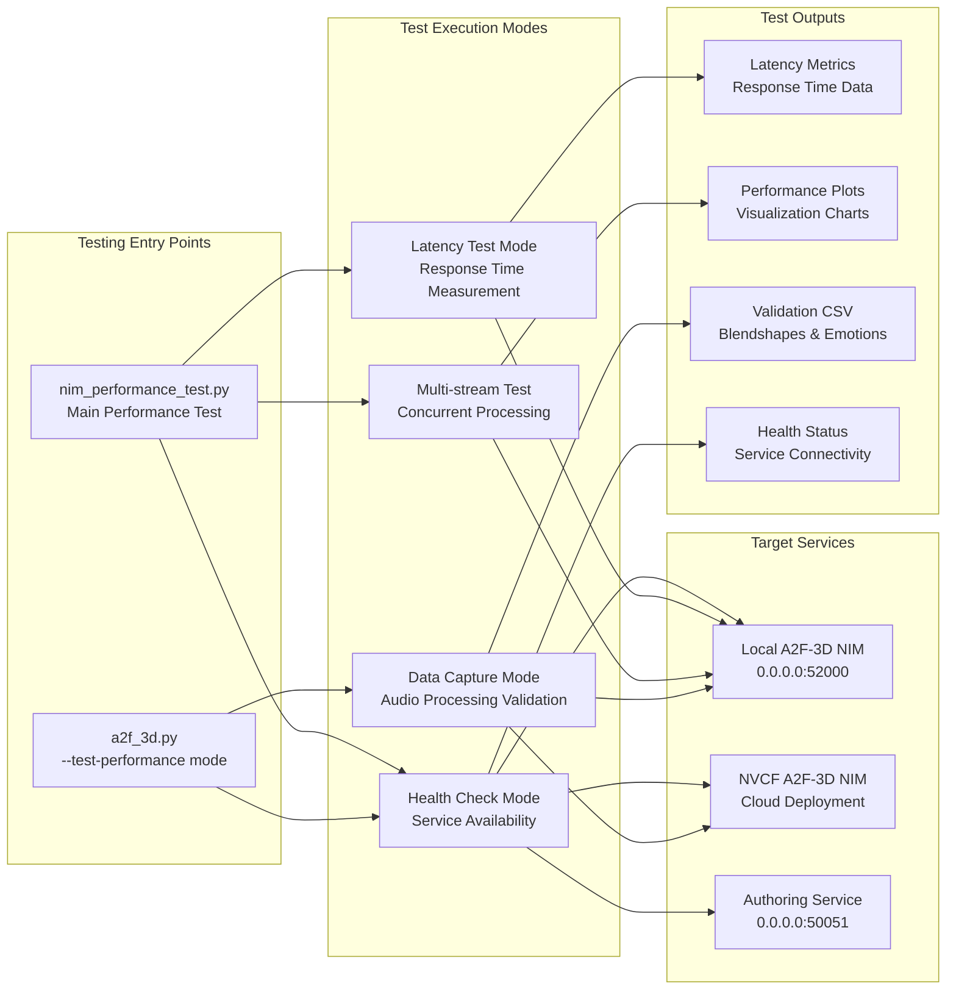
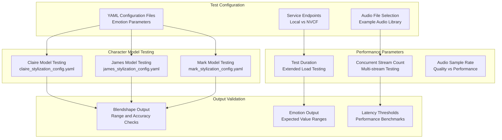

<!-- source: DeepWiki mcp.deepwiki.com · repo NVIDIA/Audio2Face-3D-Samples · page 6.2 Example Audio and Testing · fetched 2026-10-26 -->

# Example Audio and Testing

Relevant source files

The following files were used as context for generating this wiki page:

- [example_audio/Claire_anger.wav](example_audio/Claire_anger.wav)

## Purpose and Scope

This document covers the example audio files and testing resources provided in the Audio2Face-3D repository. These resources enable developers to quickly test the system functionality, validate deployments, and understand expected input formats and output behaviors.

For information about client applications that use these resources, see [Client Applications and APIs](#4). For deployment and operational testing, see [Deployment and Operations](#5).

## Example Audio Files

The repository includes sample audio files that demonstrate the expected input format and provide baseline content for testing Audio2Face-3D functionality.

### Audio Format Specifications

All example audio files follow the Audio2Face-3D input requirements:

| Property | Specification |
|----------|--------------|
| Format | WAV (Waveform Audio File Format) |
| Encoding | PCM (Pulse Code Modulation) |
| Bit Depth | 16-bit |
| Sample Rate | Typically 22kHz or 44.1kHz |
| Channels | Mono or Stereo |

### Audio File Usage in Client Applications

The example audio files serve as input for various client applications and testing scenarios:

Sources: System architecture diagrams, client application ecosystem analysis

## Testing Resources and Tools

### Performance Testing Framework

The repository provides comprehensive testing tools for validating Audio2Face-3D performance and functionality:

Sources: Client application ecosystem diagram, testing mode analysis

### Testing Workflow Integration

The testing resources integrate with the Audio2Face-3D pipeline to provide comprehensive validation:

| Test Type | Purpose | Input Required | Output Generated |
|-----------|---------|----------------|------------------|
| Health Check | Verify service availability | None | Connection status |
| Latency Test | Measure response times | Example audio files | Timing metrics |
| Data Capture | Validate processing accuracy | Audio + emotion configs | CSV with blendshapes |
| Performance Test | Load testing with multiple streams | Audio files | Performance plots |

### Test Configuration and Parameters

Testing tools support various configuration options for comprehensive validation:

Sources: Configuration management system, character model documentation

## Testing Best Practices

### Validation Methodology

The testing framework follows a structured approach to ensure comprehensive coverage:

1. **Service Health Validation**: Verify connectivity and basic functionality
2. **Functional Testing**: Validate audio processing and output generation
3. **Performance Testing**: Measure latency and throughput under load
4. **Character Model Testing**: Test each character configuration independently
5. **Output Validation**: Verify blendshape and emotion data ranges

### Expected Output Formats

Testing generates standardized output formats for analysis and validation:

| Output Type | Format | Content | Usage |
|-------------|--------|---------|-------|
| Blendshapes | CSV | Facial animation coefficients | Animation validation |
| Emotions | CSV | Emotion detection results | Behavior validation |
| Performance | Plots/Charts | Latency and throughput data | Performance analysis |
| Health | Status logs | Service connectivity results | Deployment validation |

Sources: Data processing pipeline architecture, output format specifications