# Page: Audio2Face-3D Overview

# Audio2Face-3D Overview

<details>
<summary>Relevant source files</summary>

The following files were used as context for generating this wiki page:

- [README.md](README.md)
- [quick-start/README.md](quick-start/README.md)

</details>


## Purpose and Scope

This document provides a high-level introduction to NVIDIA's Audio2Face-3D system, its architecture, and the organization of this repository. Audio2Face-3D NIM (NVIDIA Inference Microservice) is a generative AI solution that converts speech audio into facial animations using ARKit Blendshapes, with automatic emotion detection and expression generation.

For detailed information about specific character model configurations, see [Character Models and Stylization](#2). For deployment procedures, see [Deployment and Operations](#5). For client application usage, see [Client Applications and APIs](#4).

Sources: [README.md:1-57](), [quick-start/README.md:1-90]()

## System Architecture

Audio2Face-3D consists of several interconnected components that work together to process audio input and generate facial animation output.

### Core System Components

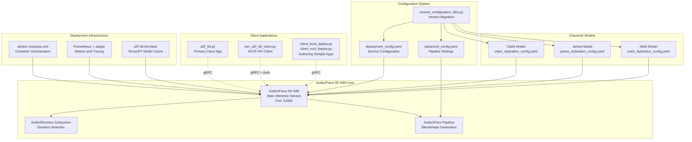

Sources: [README.md:29-48](), [quick-start/README.md:19-44]()

## Core Components

### Audio2Face-3D NIM Service

The primary service that processes audio input and generates facial animation output. The service operates on port 52000 by default and provides gRPC endpoints for:

- Health checking and service status
- Audio-to-blendshape inference
- Emotion detection and processing
- Performance monitoring and metrics

The service supports three character models: `claire`, `james`, and `mark`, each with distinct facial characteristics and parameter configurations.

### Character Model System

| Character | Model Version | Configuration File | Key Features |
|-----------|---------------|-------------------|--------------|
| Claire | v2.3 | `claire_stylization_config.yaml` | Balanced emotional expression |
| James | v2.3 | `james_stylization_config.yaml` | Masculine facial characteristics |
| Mark | v2.3 | `mark_stylization_config.yaml` | Distinct personality parameters |

Each character model includes Audio2Emotion (A2E) and Audio2Face (A2F) parameter configurations that control blendshape generation and emotional expression intensity.

### Processing Pipeline

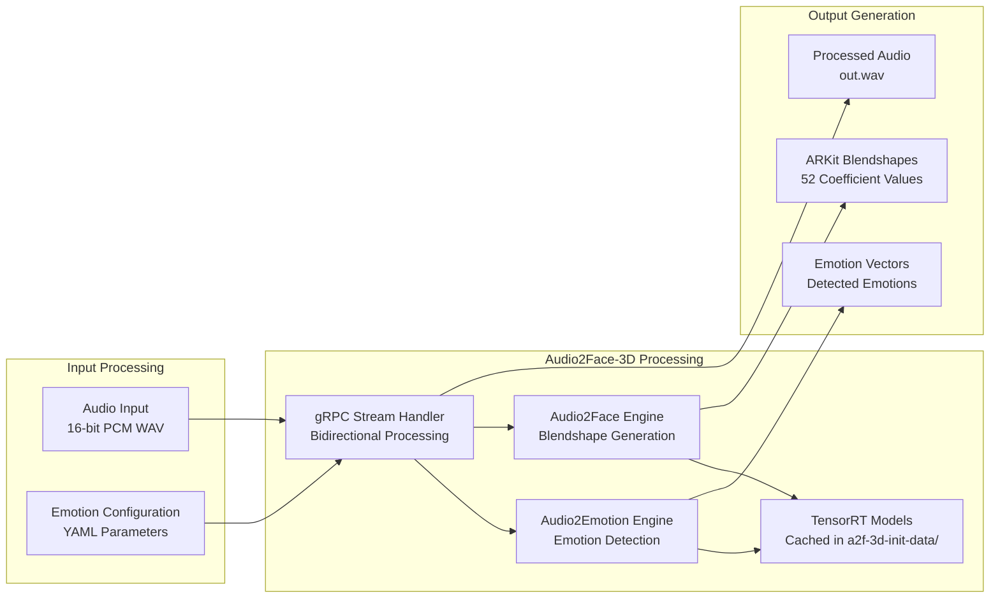

Sources: [README.md:5-10](), [quick-start/README.md:41-42](), [quick-start/README.md:50-51]()

## Repository Structure

The repository is organized into functional modules that correspond to different aspects of the Audio2Face-3D system:

### Directory Layout

| Directory | Purpose | Key Files | Wiki Section |
|-----------|---------|-----------|--------------|
| `configs/` | Configuration templates and examples | `deployment_config.yaml`, `advanced_config.yaml`, character configs | [2](#2), [3.2](#3.2) |
| `early_access/` | Early access sample applications | `client_local_deploy.py`, `client_nvcf_deploy.py` | [4.3](#4.3) |
| `example_audio/` | Sample audio files for testing | WAV audio files | [6.2](#6.2) |
| `migration/` | Configuration migration tools | `convert_configuration_files.py` | [3](#3), [3.1](#3.1) |
| `proto/` | gRPC protocol definitions | Proto files and build instructions | [6.1](#6.1) |
| `quick-start/` | Docker deployment files | `docker-compose.yml` | [5.1](#5.1) |
| `scripts/` | Client applications | `a2f_3d.py`, `nim_a2f_3d_client.py` | [4](#4) |

### Configuration Management

The system uses a hierarchical configuration approach:

- **Deployment Configuration**: Service endpoints, authentication, and telemetry settings
- **Advanced Configuration**: Pipeline performance and processing parameters  
- **Stylization Configuration**: Character-specific Audio2Emotion and Audio2Face parameters

Configuration files have evolved from version 1.0 to 1.2, with migration tools provided to upgrade existing configurations.

Sources: [README.md:33-48]()

## Key Technologies and Protocols

### Communication Protocol

Audio2Face-3D uses gRPC for client-server communication, with protocol definitions available in the `nvidia_ace` Python wheel. The service supports:

- Bidirectional streaming for real-time audio processing
- Authentication via API keys for cloud deployments
- Health check endpoints for service monitoring

### Model Execution

The system utilizes TensorRT for optimized model inference:

- Models are compiled to TensorRT format on first startup
- Compiled models are cached in the `a2f-3d-init-data/` directory
- Cache can be invalidated by removing `*.trt` files

### Observability

Integrated monitoring and tracing capabilities:

- Prometheus metrics collection on port 9090
- Jaeger distributed tracing on port 16686
- Configurable telemetry settings in `deployment_config.yaml`

Sources: [quick-start/README.md:50-74](), [README.md:42-43]()

---

# Page: Character Models and Stylization

# Character Models and Stylization

<details>
<summary>Relevant source files</summary>

The following files were used as context for generating this wiki page:

- [configs/claire_stylization_config.yaml](configs/claire_stylization_config.yaml)
- [configs/james_stylization_config.yaml](configs/james_stylization_config.yaml)
- [configs/mark_stylization_config.yaml](configs/mark_stylization_config.yaml)

</details>


This document covers the three pre-configured character models available in the Audio2Face-3D system: Claire, James, and Mark. It explains the configuration structure, stylization parameters, and how each character's Audio2Emotion (A2E) and Audio2Face (A2F) settings are customized for optimal performance.

For detailed configuration parameters of individual characters, see [Claire Configuration](#2.1), [James Configuration](#2.2), and [Mark Configuration](#2.3). For information about configuration management and migration tools, see [Configuration Management](#3).

## Character Model System Overview

The Audio2Face-3D system provides three distinct character models, each with specialized configuration files that define their emotional response patterns and facial animation parameters. Each character uses specific inference models and blendshape configurations optimized for their facial topology.

### Character Model Architecture

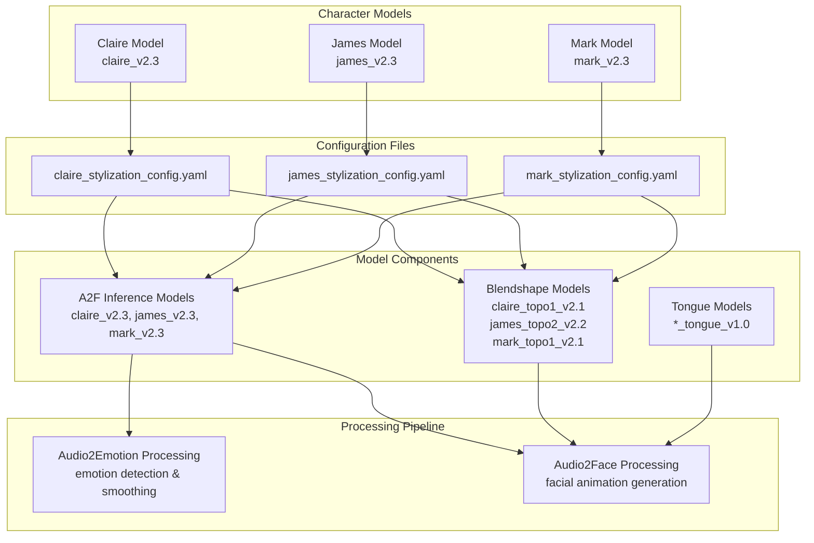

**Sources:** [configs/claire_stylization_config.yaml:42-46](), [configs/james_stylization_config.yaml:42-46](), [configs/mark_stylization_config.yaml:42-46]()

## Configuration File Structure

Each character's stylization configuration follows a consistent YAML structure with four main sections that control different aspects of the character's behavior and appearance.

### Configuration Schema

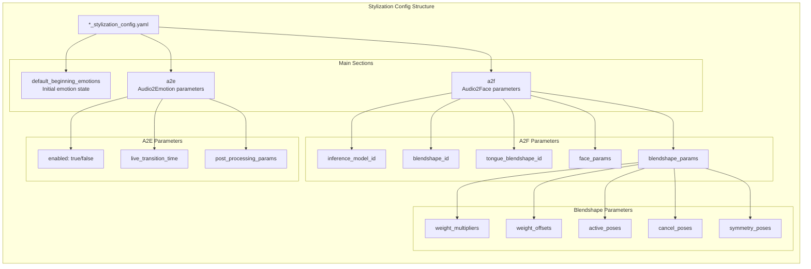

**Sources:** [configs/claire_stylization_config.yaml:16-332](), [configs/james_stylization_config.yaml:16-332](), [configs/mark_stylization_config.yaml:16-332]()

## Audio2Emotion Configuration

All three characters share identical Audio2Emotion (A2E) processing parameters, providing consistent emotional response behavior across the character set. The A2E system analyzes input audio to detect emotional content and applies smoothing and post-processing to generate natural emotional transitions.

### Emotion Types and Default Values

| Emotion | Default Value | Range | Description |
|---------|---------------|-------|-------------|
| `amazement` | 0.0 | 0.0-1.0 | Wonder and surprise |
| `anger` | 0.0 | 0.0-1.0 | Hostile or aggressive emotion |
| `cheekiness` | 0.0 | 0.0-1.0 | Playful or mischievous behavior |
| `disgust` | 0.0 | 0.0-1.0 | Revulsion or distaste |
| `fear` | 0.0 | 0.0-1.0 | Anxiety or apprehension |
| `grief` | 0.0 | 0.0-1.0 | Deep sorrow or mourning |
| `joy` | 0.0 | 0.0-1.0 | Happiness and pleasure |
| `outofbreath` | 0.0 | 0.0-1.0 | Physical exertion state |
| `pain` | 0.0 | 0.0-1.0 | Physical or emotional suffering |
| `sadness` | 0.0 | 0.0-1.0 | Low-energy negative emotion |

### A2E Processing Parameters

| Parameter | Value | Description |
|-----------|-------|-------------|
| `enabled` | `true` | Enables Audio2Emotion processing |
| `live_transition_time` | `0.5` | Seconds for emotion transitions |
| `emotion_contrast` | `1.0` | Increases spread between emotion values |
| `emotion_strength` | `0.6` | Strength of generated emotions vs neutral |
| `enable_preferred_emotion` | `true` | Blends preferred emotion with auto-emotion |
| `live_blend_coef` | `0.7` | Exponential smoothing coefficient |
| `max_emotions` | `3` | Maximum simultaneous active emotions |
| `preferred_emotion_strength` | `0.5` | Strength of preferred emotion blending |

**Sources:** [configs/claire_stylization_config.yaml:16-39](), [configs/james_stylization_config.yaml:16-39](), [configs/mark_stylization_config.yaml:16-39]()

## Audio2Face Model Configuration

Each character uses distinct Audio2Face models and blendshape configurations tailored to their specific facial topology and animation requirements.

### Character Model Specifications

| Character | Inference Model | Blendshape Model | Tongue Model | Tongue Enabled |
|-----------|----------------|------------------|--------------|----------------|
| Claire | `claire_v2.3` | `claire_topo1_v2.1` | `claire_tongue_v1.0` | `true` |
| James | `james_v2.3` | `james_topo2_v2.2` | `james_tongue_v1.0` | `true` |
| Mark | `mark_v2.3` | `mark_topo1_v2.1` | `mark_tongue_v1.0` | `true` |

### Face Parameter Differences

The characters have distinct face parameter tuning to accommodate their unique facial characteristics:

| Parameter | Claire | James | Mark | Description |
|-----------|--------|-------|------|-------------|
| `eyelid_offset` | `0.0` | `0.06` | `0.06` | Default eyelid pose adjustment |
| `lip_close_offset` | `0.0` | `-0.02` | `-0.03` | Default lip closure pose |
| `input_strength` | `1.0` | `1.0` | `1.3` | Audio input magnitude control |
| `lower_face_smoothing` | `0.006` | `0.006` | `0.0023` | Temporal smoothing for lower face |
| `lower_face_strength` | `1.25` | `1.2` | `1.4` | Range of motion for lower face |
| `skin_strength` | `1.0` | `1.0` | `1.1` | Skin motion range control |

**Sources:** [configs/claire_stylization_config.yaml:48-58](), [configs/james_stylization_config.yaml:48-58](), [configs/mark_stylization_config.yaml:48-58]()

## Blendshape Parameter System

The blendshape system controls facial animation through 52 individual facial poses, each with configurable weight multipliers, offsets, and activation states. All characters use identical blendshape parameter structures but may have different model topologies.

### Blendshape Categories

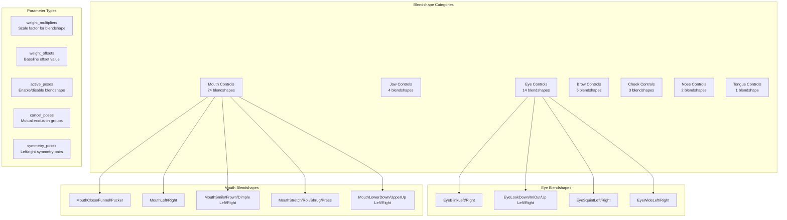

**Sources:** [configs/claire_stylization_config.yaml:63-331](), [configs/james_stylization_config.yaml:63-331](), [configs/mark_stylization_config.yaml:63-331]()

### Blendshape Control Parameters

Each blendshape is controlled by five parameter types:

- **`weight_multipliers`**: Scaling factor applied to blendshape weights (default: `1.0`)
- **`weight_offsets`**: Baseline offset added to blendshape weights (default: `0.0`)  
- **`active_poses`**: Enable (`1`) or disable (`0`) individual blendshapes
- **`cancel_poses`**: Grouping for mutually exclusive blendshapes (value: `-1`)
- **`symmetry_poses`**: Pairing for left/right symmetric blendshapes (shared group numbers)

### Notable Blendshape Configurations

| Blendshape Group | Active State | Symmetry Groups | Notes |
|------------------|--------------|-----------------|-------|
| Eye Look Controls | Disabled (`0`) | Individual (`-1`) | Gaze tracking disabled by default |
| Tongue Out | Disabled (`0`) | Individual (`-1`) | Requires explicit activation |
| Mouth Smile/Frown | Enabled (`1`) | Paired (`2`/`3`) | Symmetric expression pairs |
| Brow Controls | Enabled (`1`) | Outer paired (`9`), Inner individual | Asymmetric brow capability |

**Sources:** [configs/claire_stylization_config.yaml:171-331](), [configs/james_stylization_config.yaml:171-331](), [configs/mark_stylization_config.yaml:171-331]()

---

# Page: Claire Character Configuration

# Claire Character Configuration

<details>
<summary>Relevant source files</summary>

The following files were used as context for generating this wiki page:

- [configs/claire_stylization_config.yaml](configs/claire_stylization_config.yaml)

</details>


## Purpose and Scope

This document provides detailed documentation of Claire's character configuration parameters as defined in the stylization configuration file. Claire is one of three available character models in the Audio2Face-3D system, alongside James and Mark. This page covers Claire's specific Audio2Emotion (A2E) parameters, Audio2Face (A2F) settings, blendshape configurations, and facial animation parameters.

For information about other character models, see [James Character Configuration](#2.2) and [Mark Character Configuration](#2.3). For general configuration management tools, see [Configuration Management and Migration](#3).

## Configuration File Structure

Claire's character configuration is defined in [configs/claire_stylization_config.yaml:1-331](). The configuration file is structured into four main sections that control different aspects of Claire's facial animation and emotion processing.

```mermaid
graph TB
    subgraph "Claire Configuration Structure"
        ConfigFile["`claire_stylization_config.yaml`"]
        
        subgraph "Main Sections"
            DefaultEmotions["`default_beginning_emotions`<br/>Initial emotion states"]
            A2EConfig["`a2e`<br/>Audio2Emotion parameters"]
            A2FConfig["`a2f`<br/>Audio2Face parameters"]
        end
        
        subgraph "A2F Subsections"
            ModelConfig["`inference_model_id: claire_v2.3`<br/>`blendshape_id: claire_topo1_v2.1`"]
            FaceParams["`face_params`<br/>Facial animation controls"]
            BlendshapeParams["`blendshape_params`<br/>Individual blendshape settings"]
        end
        
        subgraph "Blendshape Parameter Types"
            WeightMult["`weight_multipliers`<br/>Scaling factors"]
            WeightOffset["`weight_offsets`<br/>Base offsets"]
            ActivePoses["`active_poses`<br/>Enable/disable flags"]
            CancelPoses["`cancel_poses`<br/>Cancellation rules"]
            SymmetryPoses["`symmetry_poses`<br/>Symmetry groupings"]
        end
    end
    
    ConfigFile --> DefaultEmotions
    ConfigFile --> A2EConfig
    ConfigFile --> A2FConfig
    
    A2FConfig --> ModelConfig
    A2FConfig --> FaceParams
    A2FConfig --> BlendshapeParams
    
    BlendshapeParams --> WeightMult
    BlendshapeParams --> WeightOffset
    BlendshapeParams --> ActivePoses
    BlendshapeParams --> CancelPoses
    BlendshapeParams --> SymmetryPoses
```

**Sources:** [configs/claire_stylization_config.yaml:1-331]()

## Default Emotion Configuration

The `default_beginning_emotions` section defines the initial emotional state applied at the start of any audio clip processing. All emotion values range from 0.0 to 1.0, with Claire's default configuration setting all emotions to neutral (0.0).

| Emotion | Default Value | Description |
|---------|---------------|-------------|
| `amazement` | 0.0 | Wonder or surprise expression |
| `anger` | 0.0 | Anger or frustration expression |
| `cheekiness` | 0.0 | Playful or mischievous expression |
| `disgust` | 0.0 | Disgust or distaste expression |
| `fear` | 0.0 | Fear or anxiety expression |
| `grief` | 0.0 | Grief or sorrow expression |
| `joy` | 0.0 | Joy or happiness expression |
| `outofbreath` | 0.0 | Breathless or exerted expression |
| `pain` | 0.0 | Pain or discomfort expression |
| `sadness` | 0.0 | Sadness expression |

**Sources:** [configs/claire_stylization_config.yaml:16-28]()

## Audio2Emotion (A2E) Parameters

The A2E subsystem processes audio input to generate emotional states that influence facial expressions. Claire's A2E configuration includes both enabling flags and post-processing parameters.

```mermaid
graph LR
    subgraph "A2E Processing Pipeline"
        AudioInput["`Audio Input`"]
        A2EProcessor["`A2E Engine`<br/>`enabled: true`"]
        PostProcessor["`Post Processing`<br/>`emotion_contrast`<br/>`emotion_strength`<br/>`live_blend_coef`"]
        EmotionOutput["`Emotion Values`<br/>`max_emotions: 3`"]
    end
    
    AudioInput --> A2EProcessor
    A2EProcessor --> PostProcessor
    PostProcessor --> EmotionOutput
    
    subgraph "Configuration Parameters"
        LiveTransition["`live_transition_time: 0.5`"]
        PreferredEmotion["`enable_preferred_emotion: true`<br/>`preferred_emotion_strength: 0.5`"]
    end
    
    LiveTransition --> PostProcessor
    PreferredEmotion --> PostProcessor
```

### A2E Configuration Parameters

| Parameter | Value | Description |
|-----------|-------|-------------|
| `enabled` | `true` | Enables the Audio2Emotion subsystem |
| `live_transition_time` | `0.5` | Transition time between emotion states in seconds |

### Post-Processing Parameters

| Parameter | Value | Description |
|-----------|-------|-------------|
| `emotion_contrast` | `1.0` | Increases spread between emotion values |
| `emotion_strength` | `0.6` | Strength of generated emotions relative to neutral |
| `enable_preferred_emotion` | `true` | Blends preferred emotion with auto-generated emotions |
| `live_blend_coef` | `0.7` | Exponential smoothing coefficient for emotion blending |
| `max_emotions` | `3` | Maximum number of simultaneous active emotions |
| `preferred_emotion_strength` | `0.5` | Strength of preferred emotion relative to generated emotions |

**Sources:** [configs/claire_stylization_config.yaml:30-39]()

## Audio2Face (A2F) Core Configuration

The A2F subsystem converts audio and emotion inputs into facial blendshape animations. Claire's A2F configuration specifies the model identifiers and core face animation parameters.

### Model and Blendshape Configuration

| Parameter | Value | Description |
|-----------|-------|-------------|
| `inference_model_id` | `claire_v2.3` | Claire's facial animation model version |
| `blendshape_id` | `claire_topo1_v2.1` | Primary blendshape topology identifier |
| `tongue_blendshape_id` | `claire_tongue_v1.0` | Tongue-specific blendshape identifier |
| `enable_tongue_blendshapes` | `true` | Enables tongue animation blendshapes |

**Sources:** [configs/claire_stylization_config.yaml:42-46]()

### Face Parameters

The `face_params` section controls global facial animation behavior and regional strength settings.

| Parameter | Value | Description |
|-----------|-------|-------------|
| `eyelid_offset` | `0.0` | Default eyelid open-close position |
| `face_mask_level` | `0.6` | Boundary between upper and lower face regions |
| `face_mask_softness` | `0.0085` | Blending smoothness between face regions |
| `input_strength` | `1.0` | Audio input magnitude control |
| `lip_close_offset` | `0.0` | Default lip close-open position |
| `lower_face_smoothing` | `0.006` | Temporal smoothing for lower face motion |
| `lower_face_strength` | `1.25` | Motion range multiplier for lower face |
| `skin_strength` | `1.0` | Skin deformation motion range |
| `upper_face_smoothing` | `0.001` | Temporal smoothing for upper face motion |
| `upper_face_strength` | `1.0` | Motion range multiplier for upper face |

**Sources:** [configs/claire_stylization_config.yaml:48-58]()

## Blendshape Parameters Configuration

Claire's blendshape configuration defines how individual facial poses are weighted, offset, activated, and grouped. The system supports 52 distinct blendshapes covering eyes, jaw, mouth, brows, cheeks, nose, and tongue.

```mermaid
graph TB
    subgraph "Blendshape Categories"
        EyeBlendshapes["`Eye Blendshapes`<br/>`EyeBlinkLeft/Right`<br/>`EyeLookDown/In/Out/Up`<br/>`EyeSquint/Wide`"]
        JawBlendshapes["`Jaw Blendshapes`<br/>`JawForward/Left/Right/Open`"]
        MouthBlendshapes["`Mouth Blendshapes`<br/>`MouthClose/Funnel/Pucker`<br/>`MouthSmile/Frown/Stretch`<br/>`MouthRoll/Shrug/Press`"]
        BrowBlendshapes["`Brow Blendshapes`<br/>`BrowDown/InnerUp/OuterUp`"]
        FaceBlendshapes["`Face Blendshapes`<br/>`CheekPuff/Squint`<br/>`NoseSneer`<br/>`TongueOut`"]
    end
    
    subgraph "Parameter Types Applied to All Blendshapes"
        WeightMult["`weight_multipliers`<br/>Default: 1.0"]
        WeightOffset["`weight_offsets`<br/>Default: 0.0"]
        ActivePoses["`active_poses`<br/>1=active, 0=inactive"]
        CancelPoses["`cancel_poses`<br/>Default: -1"]
        SymmetryPoses["`symmetry_poses`<br/>Grouping IDs"]
    end
    
    EyeBlendshapes --> WeightMult
    JawBlendshapes --> WeightMult
    MouthBlendshapes --> WeightMult
    BrowBlendshapes --> WeightMult
    FaceBlendshapes --> WeightMult
    
    WeightMult --> WeightOffset
    WeightOffset --> ActivePoses
    ActivePoses --> CancelPoses
    CancelPoses --> SymmetryPoses
```

### Blendshape Parameter Types

The blendshape parameters use a transformation formula: `final_weight = (input_weight * multiplier) + offset`

| Parameter Type | Purpose | Default Values |
|----------------|---------|----------------|
| `weight_multipliers` | Scaling factors for blendshape intensity | `1.0` for all blendshapes |
| `weight_offsets` | Base offset values added to weighted results | `0.0` for all blendshapes |
| `active_poses` | Enable/disable individual blendshapes | Most set to `1` (active), eye look poses set to `0`, `TongueOut` set to `0` |
| `cancel_poses` | Pose cancellation rules | All set to `-1` (no cancellation) |
| `symmetry_poses` | Groups symmetric blendshapes for coordinated control | Various grouping IDs for symmetric pairs |

**Sources:** [configs/claire_stylization_config.yaml:60-331]()

### Eye Blendshape Configuration

Claire's eye blendshapes control eyelid movement, eye direction, and eye shape expressions.

| Blendshape | Active | Notes |
|------------|--------|-------|
| `EyeBlinkLeft/Right` | 1 | Eyelid closing animation |
| `EyeLookDownLeft/Right` | 0 | Eye gaze direction (disabled by default) |
| `EyeLookInLeft/Right` | 0 | Eye gaze direction (disabled by default) |
| `EyeLookOutLeft/Right` | 0 | Eye gaze direction (disabled by default) |
| `EyeLookUpLeft/Right` | 0 | Eye gaze direction (disabled by default) |
| `EyeSquintLeft/Right` | 1 | Eye squinting expression |
| `EyeWideLeft/Right` | 1 | Wide-eyed expression |

### Mouth Blendshape Symmetry Groups

Claire's mouth blendshapes are organized into symmetry groups for coordinated left-right movement:

| Symmetry Group | Left Blendshape | Right Blendshape |
|----------------|-----------------|------------------|
| Group 2 | `MouthSmileLeft` | `MouthSmileRight` |
| Group 3 | `MouthFrownLeft` | `MouthFrownRight` |
| Group 4 | `MouthDimpleLeft` | `MouthDimpleRight` |
| Group 5 | `MouthStretchLeft` | `MouthStretchRight` |
| Group 6 | `MouthPressLeft` | `MouthPressRight` |
| Group 7 | `MouthLowerDownLeft` | `MouthLowerDownRight` |
| Group 8 | `MouthUpperUpLeft` | `MouthUpperUpRight` |

**Sources:** [configs/claire_stylization_config.yaml:303-320]()

### Special Configuration Notes

- **Tongue Animation**: `TongueOut` blendshape is set to inactive (`0`) in `active_poses` but tongue blendshapes are enabled via `enable_tongue_blendshapes: true`
- **Eye Gaze**: All eye look direction blendshapes (`EyeLookDown/In/Out/Up`) are disabled by default
- **Clamping**: `enable_clamping_bs_weight` is set to `false`, allowing blendshape weights to exceed normal 0-1 range

**Sources:** [configs/claire_stylization_config.yaml:61](), [configs/claire_stylization_config.yaml:46](), [configs/claire_stylization_config.yaml:173-183](), [configs/claire_stylization_config.yaml:223]()

---

# Page: James Character Configuration

# James Character Configuration

<details>
<summary>Relevant source files</summary>

The following files were used as context for generating this wiki page:

- [configs/james_stylization_config.yaml](configs/james_stylization_config.yaml)

</details>


## Purpose and Scope

This document provides detailed documentation of the James character model configuration parameters in the Audio2Face-3D system. The James character is one of three pre-configured character models available in the system, alongside Claire and Mark. This documentation covers the specific parameter settings, blendshape configurations, and emotion processing parameters that define James's unique facial animation characteristics.

For information about other character configurations, see [Claire Character Configuration](#2.1) and [Mark Character Configuration](#2.3). For general information about the configuration management system, see [Configuration Management and Migration](#3).

## James Configuration File Structure

The James character configuration is defined in a YAML file that contains three main sections: default emotions, Audio2Emotion (A2E) processing parameters, and Audio2Face (A2F) animation parameters.

```mermaid
graph TD
    JamesConfig["james_stylization_config.yaml"]
    
    subgraph "Default Emotion Settings"
        DefaultEmotions["default_beginning_emotions"]
        EmotionList["amazement, anger, cheekiness<br/>disgust, fear, grief, joy<br/>outofbreath, pain, sadness"]
    end
    
    subgraph "Audio2Emotion Configuration"
        A2ESection["a2e"]
        A2EEnabled["enabled: true"]
        TransitionTime["live_transition_time: 0.5"]
        PostProcessing["post_processing_params"]
        EmotionContrast["emotion_contrast: 1.0"]
        EmotionStrength["emotion_strength: 0.6"]
        PreferredEmotion["enable_preferred_emotion: true"]
        BlendCoef["live_blend_coef: 0.7"]
        MaxEmotions["max_emotions: 3"]
        PreferredStrength["preferred_emotion_strength: 0.5"]
    end
    
    subgraph "Audio2Face Configuration"
        A2FSection["a2f"]
        ModelConfig["Model Configuration"]
        FaceParams["face_params"]
        BlendshapeParams["blendshape_params"]
        
        ModelID["inference_model_id: james_v2.3"]
        BlendshapeID["blendshape_id: james_topo2_v2.2"]
        TongueID["tongue_blendshape_id: james_tongue_v1.0"]
        EnableTongue["enable_tongue_blendshapes: true"]
    end
    
    JamesConfig --> DefaultEmotions
    JamesConfig --> A2ESection
    JamesConfig --> A2FSection
    
    DefaultEmotions --> EmotionList
    A2ESection --> A2EEnabled
    A2ESection --> TransitionTime
    A2ESection --> PostProcessing
    PostProcessing --> EmotionContrast
    PostProcessing --> EmotionStrength
    PostProcessing --> PreferredEmotion
    PostProcessing --> BlendCoef
    PostProcessing --> MaxEmotions
    PostProcessing --> PreferredStrength
    
    A2FSection --> ModelConfig
    A2FSection --> FaceParams
    A2FSection --> BlendshapeParams
    ModelConfig --> ModelID
    ModelConfig --> BlendshapeID
    ModelConfig --> TongueID
    ModelConfig --> EnableTongue
```

Sources: [configs/james_stylization_config.yaml:1-332]()

## Default Beginning Emotions

The James character starts with all emotions set to neutral (0.0) at the beginning of any audio clip. This provides a consistent baseline for emotion processing across all audio inputs.

| Emotion | Default Value | Range |
|---------|---------------|-------|
| amazement | 0.0 | 0.0 - 1.0 |
| anger | 0.0 | 0.0 - 1.0 |
| cheekiness | 0.0 | 0.0 - 1.0 |
| disgust | 0.0 | 0.0 - 1.0 |
| fear | 0.0 | 0.0 - 1.0 |
| grief | 0.0 | 0.0 - 1.0 |
| joy | 0.0 | 0.0 - 1.0 |
| outofbreath | 0.0 | 0.0 - 1.0 |
| pain | 0.0 | 0.0 - 1.0 |
| sadness | 0.0 | 0.0 - 1.0 |

Sources: [configs/james_stylization_config.yaml:18-28]()

## Audio2Emotion (A2E) Configuration

The A2E system for James is enabled and configured with specific parameters that control how emotions are detected and processed from audio input.

### Core A2E Parameters

| Parameter | Value | Description |
|-----------|-------|-------------|
| `enabled` | `true` | Enables Audio2Emotion processing |
| `live_transition_time` | `0.5` | Time in seconds for emotion transitions |

### Post-Processing Parameters

The James character uses specific post-processing parameters to fine-tune emotion detection:

| Parameter | Value | Description |
|-----------|-------|-------------|
| `emotion_contrast` | `1.0` | Increases spread between emotion values |
| `emotion_strength` | `0.6` | Strength of generated emotions relative to neutral |
| `enable_preferred_emotion` | `true` | Activates preferred emotion blending |
| `live_blend_coef` | `0.7` | Coefficient for exponential emotion smoothing |
| `max_emotions` | `3` | Maximum number of simultaneous emotions |
| `preferred_emotion_strength` | `0.5` | Strength of preferred emotions relative to generated emotions |

Sources: [configs/james_stylization_config.yaml:30-39]()

## Audio2Face (A2F) Configuration

The A2F configuration defines how the James character model generates facial animations from audio input and emotion data.

### Model and Blendshape Identifiers

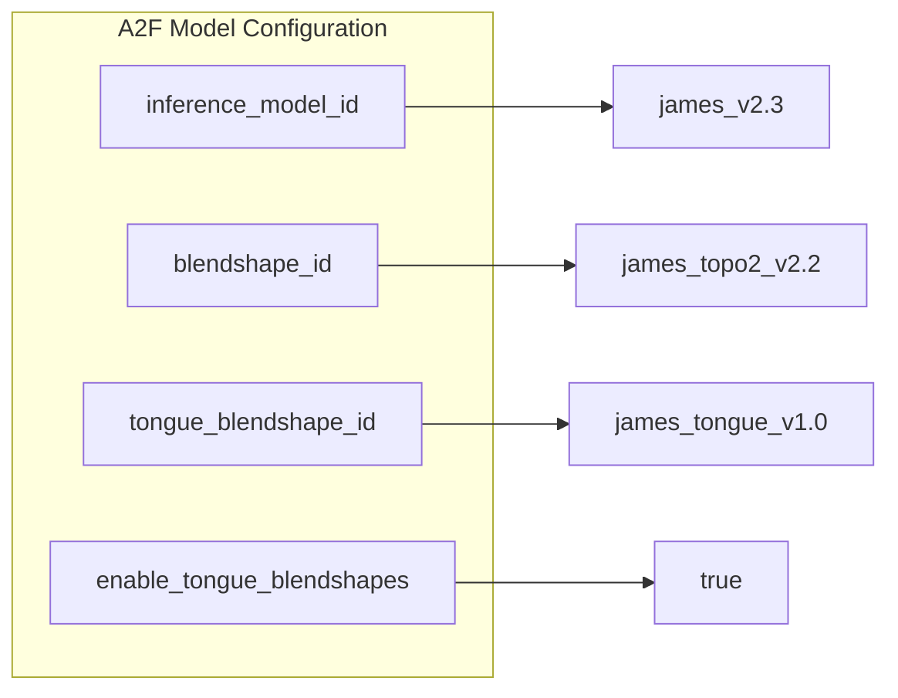

Sources: [configs/james_stylization_config.yaml:42-46]()

### Face Parameters

The James character uses the following face parameters to control facial animation behavior:

| Parameter | Value | Description |
|-----------|-------|-------------|
| `eyelid_offset` | `0.06` | Adjusts default eyelid open-close pose |
| `face_mask_level` | `0.6` | Boundary between upper and lower face regions |
| `face_mask_softness` | `0.0085` | Smoothness of face region blending |
| `input_strength` | `1.0` | Magnitude control of input audio |
| `lip_close_offset` | `-0.02` | Adjusts default lip close-open pose |
| `lower_face_smoothing` | `0.006` | Temporal smoothing for lower face motion |
| `lower_face_strength` | `1.2` | Range of motion for lower face regions |
| `skin_strength` | `1.0` | Range of motion for skin |
| `upper_face_smoothing` | `0.001` | Temporal smoothing for upper face motion |
| `upper_face_strength` | `1.0` | Range of motion for upper face regions |

Sources: [configs/james_stylization_config.yaml:48-58]()

## Blendshape Parameters

The James character configuration includes comprehensive blendshape parameters that control how each facial blendshape is applied during animation.

### Blendshape Parameter Structure

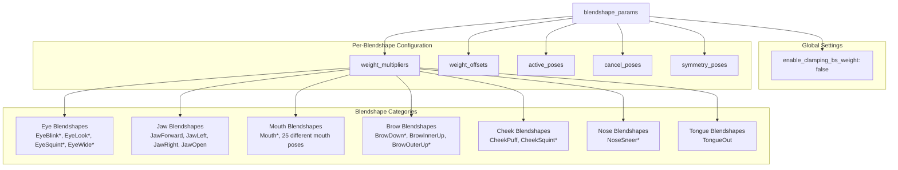

Sources: [configs/james_stylization_config.yaml:60-332]()

### Weight Multipliers and Offsets

All blendshapes in the James configuration use default weight multipliers of `1.0` and weight offsets of `0.0`, meaning no scaling or baseline adjustment is applied to the blendshape weights during animation.

### Active and Cancel Poses

The James character configuration defines which poses are active during animation:

#### Active Poses (Set to 1)
- **Eye poses**: `EyeBlinkLeft/Right`, `EyeSquintLeft/Right`, `EyeWideLeft/Right`
- **Eye gaze poses**: All `EyeLook*` poses are set to `0` (inactive)
- **Jaw poses**: All jaw movements are active (`JawForward`, `JawLeft/Right`, `JawOpen`)
- **Mouth poses**: All 25 mouth blendshapes are active
- **Brow poses**: All brow movements are active
- **Cheek and nose poses**: Active
- **Tongue poses**: `TongueOut` is set to `0` (inactive)

#### Cancel Poses
All cancel poses are set to `-1`, indicating default cancellation behavior without custom overrides.

Sources: [configs/james_stylization_config.yaml:171-277]()

### Symmetry Pose Groupings

The James character uses symmetry groupings to ensure coordinated movement between paired facial features:

| Symmetry Group | Left Blendshape | Right Blendshape |
|----------------|-----------------|------------------|
| Group 2 | `MouthSmileLeft` | `MouthSmileRight` |
| Group 3 | `MouthFrownLeft` | `MouthFrownRight` |
| Group 4 | `MouthDimpleLeft` | `MouthDimpleRight` |
| Group 5 | `MouthStretchLeft` | `MouthStretchRight` |
| Group 6 | `MouthPressLeft` | `MouthPressRight` |
| Group 7 | `MouthLowerDownLeft` | `MouthLowerDownRight` |
| Group 8 | `MouthUpperUpLeft` | `MouthUpperUpRight` |
| Group 9 | `BrowOuterUpLeft` | `BrowOuterUpRight` |
| Group 10 | `BrowDownLeft` | `BrowDownRight` |
| Group 11 | `CheekSquintLeft` | `CheekSquintRight` |
| Group 12 | `NoseSneerLeft` | `NoseSneerRight` |

Blendshapes with symmetry value `-1` operate independently, while those with value `0` or `1` have special symmetry behaviors.

Sources: [configs/james_stylization_config.yaml:279-331]()

## Parameter Interaction Flow

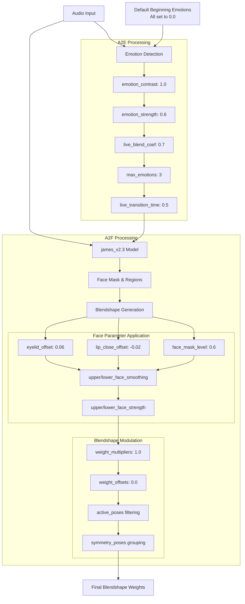

Sources: [configs/james_stylization_config.yaml:1-332]()

---

# Page: Mark Character Configuration

# Mark Character Configuration

<details>
<summary>Relevant source files</summary>

The following files were used as context for generating this wiki page:

- [configs/mark_stylization_config.yaml](configs/mark_stylization_config.yaml)

</details>


This document provides comprehensive documentation of the Mark character's stylization configuration parameters within the Audio2Face-3D system. The Mark character configuration defines Audio2Emotion (A2E) and Audio2Face (A2F) parameters specific to the `mark_v2.3` inference model, including emotion processing, facial animation controls, and detailed blendshape parameter management.

For information about other character configurations, see [Claire Character Configuration](#2.1) and [James Character Configuration](#2.2). For broader configuration management topics, see [Configuration Management and Migration](#3).

## Configuration File Structure

The Mark character configuration is defined in `mark_stylization_config.yaml` and follows the standard Audio2Face-3D v1.2 configuration format. The configuration is organized into three primary sections: default emotions, Audio2Emotion processing, and Audio2Face model parameters.

### Mark Configuration Architecture

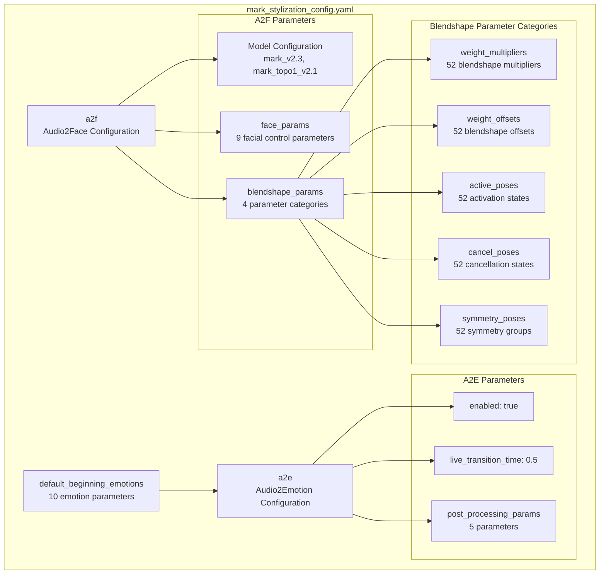

Sources: [configs/mark_stylization_config.yaml:1-331]()

## Default Emotion Configuration

The Mark character begins audio processing with a neutral emotional state, where all emotion parameters are set to `0.0`. This provides a consistent baseline for Audio2Emotion processing.

| Emotion Parameter | Default Value | Description |
|------------------|---------------|-------------|
| `amazement` | 0.0 | Wonder and surprise expression |
| `anger` | 0.0 | Anger and frustration expression |
| `cheekiness` | 0.0 | Playful and mischievous expression |
| `disgust` | 0.0 | Disgust and revulsion expression |
| `fear` | 0.0 | Fear and anxiety expression |
| `grief` | 0.0 | Grief and mourning expression |
| `joy` | 0.0 | Joy and happiness expression |
| `outofbreath` | 0.0 | Breathless and exerted expression |
| `pain` | 0.0 | Pain and discomfort expression |
| `sadness` | 0.0 | Sadness and melancholy expression |

Sources: [configs/mark_stylization_config.yaml:16-28]()

## Audio2Emotion (A2E) Configuration

The Mark character's Audio2Emotion system processes audio input to generate emotional expressions. The configuration enables emotion detection with specific post-processing parameters optimized for the Mark character model.

### A2E Core Parameters

| Parameter | Value | Description |
|-----------|-------|-------------|
| `enabled` | `true` | Enables Audio2Emotion processing |
| `live_transition_time` | `0.5` | Transition time between emotion states (seconds) |

### A2E Post-Processing Parameters

| Parameter | Value | Description |
|-----------|-------|-------------|
| `emotion_contrast` | `1.0` | Increases spread between emotion values |
| `emotion_strength` | `0.6` | Strength of generated emotions relative to neutral |
| `enable_preferred_emotion` | `true` | Activates blending with preferred emotion |
| `live_blend_coef` | `0.7` | Exponential smoothing coefficient for emotions |
| `max_emotions` | `3` | Maximum number of concurrent active emotions |
| `preferred_emotion_strength` | `0.5` | Strength of preferred emotion relative to auto-generated |

Sources: [configs/mark_stylization_config.yaml:30-39]()

## Audio2Face (A2F) Model Configuration

The Mark character utilizes the `mark_v2.3` inference model with associated blendshape topologies for facial animation generation.

### Model Identifiers

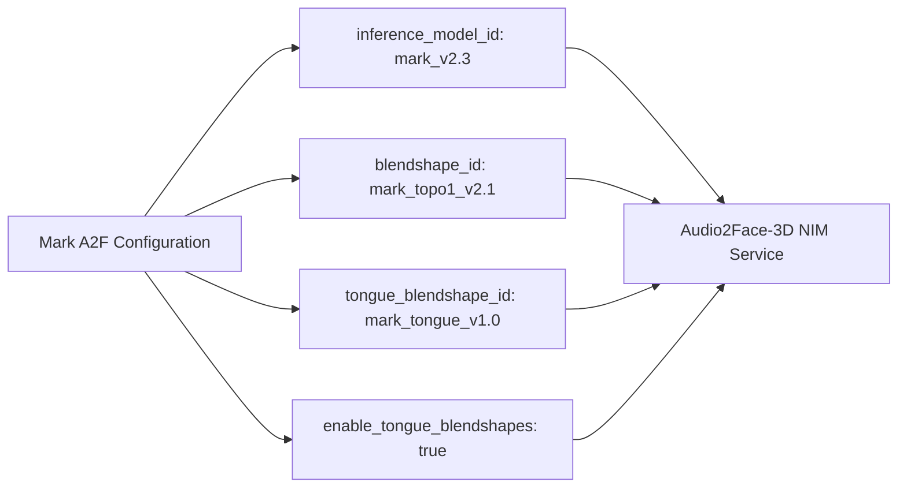

Sources: [configs/mark_stylization_config.yaml:42-46]()

### Face Parameters

The Mark character's facial animation is controlled by nine core parameters that govern different aspects of facial movement and expression intensity.

| Parameter | Value | Description |
|-----------|-------|-------------|
| `eyelid_offset` | `0.06` | Default eyelid open-close position adjustment |
| `face_mask_level` | `0.6` | Boundary between upper and lower face regions |
| `face_mask_softness` | `0.0085` | Blending smoothness between face regions |
| `input_strength` | `1.3` | Audio input magnitude control |
| `lip_close_offset` | `-0.03` | Default lip close-open position adjustment |
| `lower_face_smoothing` | `0.0023` | Temporal smoothing for lower face motion |
| `lower_face_strength` | `1.4` | Motion range for lower face regions |
| `skin_strength` | `1.1` | Skin deformation motion range |
| `upper_face_smoothing` | `0.001` | Temporal smoothing for upper face motion |
| `upper_face_strength` | `1.0` | Motion range for upper face regions |

Sources: [configs/mark_stylization_config.yaml:48-58]()

## Blendshape Parameter System

The Mark character configuration includes comprehensive blendshape parameter management across 52 individual facial blendshapes. The system applies the formula: `final_weight = (input_weight * multiplier) + offset` for each active blendshape.

### Blendshape Categories

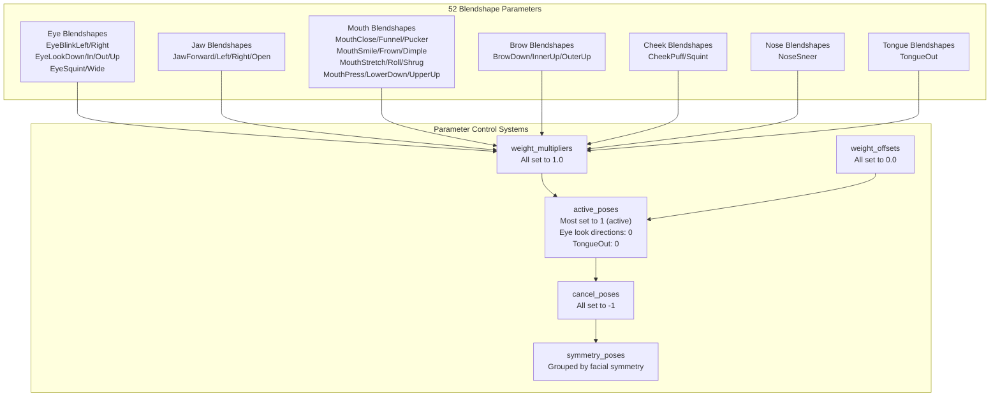

Sources: [configs/mark_stylization_config.yaml:60-331]()

### Weight Multipliers and Offsets

All blendshape `weight_multipliers` are set to `1.0`, providing neutral scaling of input weights. All `weight_offsets` are set to `0.0`, applying no baseline offset to blendshape activations.

### Active Poses Configuration

The Mark character activates most blendshapes (`active_poses: 1`) with specific exceptions:

| Blendshape Category | Active State | Count |
|-------------------|--------------|-------|
| Eye look directions | `0` (inactive) | 8 blendshapes |
| `TongueOut` | `0` (inactive) | 1 blendshape |
| All other blendshapes | `1` (active) | 43 blendshapes |

Sources: [configs/mark_stylization_config.yaml:171-223]()

### Symmetry Pose Groups

The Mark character configuration defines 12 symmetry groups for bilateral facial features:

| Symmetry Group | Left Blendshape | Right Blendshape |
|---------------|-----------------|------------------|
| Group 2 | `MouthSmileLeft` | `MouthSmileRight` |
| Group 3 | `MouthFrownLeft` | `MouthFrownRight` |
| Group 4 | `MouthDimpleLeft` | `MouthDimpleRight` |
| Group 5 | `MouthStretchLeft` | `MouthStretchRight` |
| Group 6 | `MouthPressLeft` | `MouthPressRight` |
| Group 7 | `MouthLowerDownLeft` | `MouthLowerDownRight` |
| Group 8 | `MouthUpperUpLeft` | `MouthUpperUpRight` |
| Group 9 | `BrowOuterUpLeft` | `BrowOuterUpRight` |
| Group 10 | `BrowDownLeft` | `BrowDownRight` |
| Group 11 | `CheekSquintLeft` | `CheekSquintRight` |
| Group 12 | `NoseSneerLeft` | `NoseSneerRight` |

Blendshapes with symmetry value `-1` operate independently, while `0` indicates no symmetry constraint.

Sources: [configs/mark_stylization_config.yaml:279-331]()

## Configuration Integration

The Mark character configuration integrates with the Audio2Face-3D system through the deployment configuration's character model selection. When `inference_model_id: mark_v2.3` is specified, the system loads the corresponding blendshape topology and applies all Mark-specific parameters during audio processing.

The configuration file is referenced by client applications and the Audio2Face-3D NIM service during character initialization and runtime parameter application.

Sources: [configs/mark_stylization_config.yaml:1-331]()

---

# Page: Configuration Management and Migration

# Configuration Management and Migration

<details>
<summary>Relevant source files</summary>

The following files were used as context for generating this wiki page:

- [migration/deployment_configuration_files_from_v1.0_to_v1.2/README.md](migration/deployment_configuration_files_from_v1.0_to_v1.2/README.md)
- [migration/deployment_configuration_files_from_v1.0_to_v1.2/convert_configuration_files.py](migration/deployment_configuration_files_from_v1.0_to_v1.2/convert_configuration_files.py)
- [migration/deployment_configuration_files_from_v1.0_to_v1.2/requirements.txt](migration/deployment_configuration_files_from_v1.0_to_v1.2/requirements.txt)

</details>


## Purpose and Scope

This document covers the tools and processes for managing Audio2Face-3D configuration files, specifically focusing on migrating configurations from version 1.0 to version 1.2 format. The migration system handles two primary deployment scenarios: UCS (Unified Computing System) application configurations and Docker container configurations.

For information about the structure and parameters of individual character configurations, see [Character Models and Stylization](#2). For details about runtime deployment using these configurations, see [Deployment and Operations](#5).

## Migration System Overview

The Audio2Face-3D system underwent a significant configuration restructuring between versions 1.0 and 1.2, requiring automated migration tools to convert existing deployments. The migration system transforms monolithic configuration files into a modular structure separating deployment settings, pipeline parameters, and character-specific stylization.

### Configuration Migration Architecture

```mermaid
graph TB
    subgraph "Version 1.0 Configurations"
        UCS_V1[UCSConfig] --> UCS_File["`ucs_app_configs/
        a2f_config.yaml`"]
        A2F_V1[A2FConfig] --> A2F_File["`docker_container_configs/
        a2f_config.yaml`"]
        Controller_V1[A2FControllerConfig] --> Controller_File["`docker_container_configs/
        ac_a2f_config.yaml`"]
    end
    
    subgraph "Migration Tool"
        ConvertTool["`convert_configuration_files.py`"]
        LoadClass["`load_class()`"]
        ConvertUCS["`convert_ucs_config()`"]
        ConvertDocker["`convert_docker_config()`"]
        
        ConvertTool --> LoadClass
        ConvertTool --> ConvertUCS
        ConvertTool --> ConvertDocker
    end
    
    subgraph "Default Templates v1.2"
        DefaultFolder["`default_configs_v1_2/`"]
        JamesDefault["`james_stylization_config.yaml`"]
        ClaireDefault["`claire_stylization_config.yaml`"]
        MarkDefault["`mark_stylization_config.yaml`"]
        DeployDefault["`deployment_config.yaml`"]
        AdvancedDefault["`advanced_config.yaml`"]
        
        DefaultFolder --> JamesDefault
        DefaultFolder --> ClaireDefault
        DefaultFolder --> MarkDefault
        DefaultFolder --> DeployDefault
        DefaultFolder --> AdvancedDefault
    end
    
    subgraph "Version 1.2 Output Configurations"
        OutputFolder["`output_XXXXXX/`"]
        JamesOut["`james_stylization_config.yaml`"]
        ClaireOut["`claire_stylization_config.yaml`"]
        MarkOut["`mark_stylization_config.yaml`"]
        DeployOut["`deployment_config.yaml`"]
        AdvancedOut["`advanced_config.yaml`"]
        
        OutputFolder --> JamesOut
        OutputFolder --> ClaireOut
        OutputFolder --> MarkOut
        OutputFolder --> DeployOut
        OutputFolder --> AdvancedOut
    end
    
    UCS_File --> ConvertUCS
    A2F_File --> ConvertDocker
    Controller_File --> ConvertDocker
    
    JamesDefault --> ConvertTool
    ClaireDefault --> ConvertTool
    MarkDefault --> ConvertTool
    DeployDefault --> ConvertTool
    AdvancedDefault --> ConvertTool
    
    ConvertUCS --> JamesOut
    ConvertUCS --> ClaireOut
    ConvertUCS --> MarkOut
    ConvertUCS --> DeployOut
    ConvertUCS --> AdvancedOut
    
    ConvertDocker --> JamesOut
    ConvertDocker --> ClaireOut
    ConvertDocker --> MarkOut
    ConvertDocker --> DeployOut
    ConvertDocker --> AdvancedOut
```

**Sources:** [migration/deployment_configuration_files_from_v1.0_to_v1.2/convert_configuration_files.py:1-340]()

## Configuration File Evolution

The migration from version 1.0 to 1.2 represents a fundamental restructuring of how Audio2Face-3D configurations are organized and managed.

### Version 1.0 Structure

Version 1.0 used monolithic configuration files that combined all settings:

| Configuration Type | File Path | Primary Class |
|-------------------|-----------|---------------|
| UCS Application | `ucs_app_configs/a2f_config.yaml` | `UCSConfig` |
| Docker A2F Service | `docker_container_configs/a2f_config.yaml` | `A2FConfig` |
| Docker Controller | `docker_container_configs/ac_a2f_config.yaml` | `A2FControllerConfig` |

### Version 1.2 Structure

Version 1.2 separates concerns into specialized configuration files:

| Configuration File | Purpose | Key Sections |
|-------------------|---------|--------------|
| `deployment_config.yaml` | Service endpoints and telemetry | `endpoints`, `common`, `logging` |
| `advanced_config.yaml` | Pipeline and performance settings | `pipeline_parameters`, `input_sanitization`, `trt_model_generation` |
| `{character}_stylization_config.yaml` | Character-specific parameters | `a2e`, `a2f`, `default_beginning_emotions` |

### Configuration Parameter Mapping

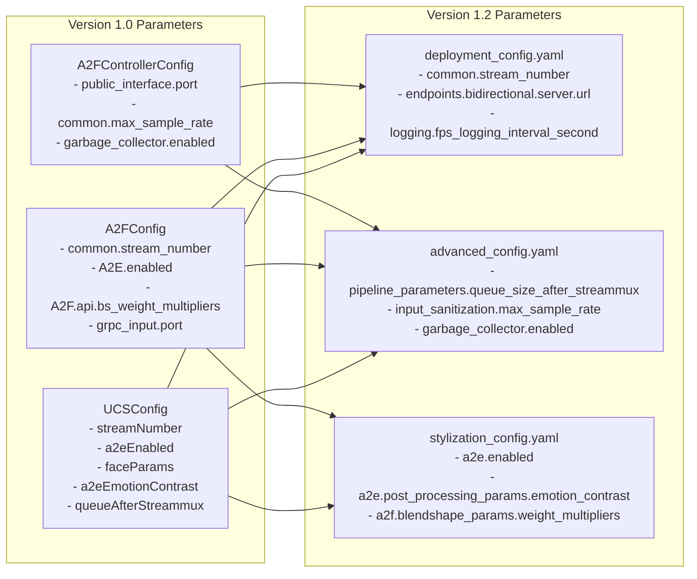

**Sources:** [migration/deployment_configuration_files_from_v1.0_to_v1.2/convert_configuration_files.py:165-244](), [migration/deployment_configuration_files_from_v1.0_to_v1.2/convert_configuration_files.py:246-325]()

## Migration Tool Architecture

The `convert_configuration_files.py` tool provides automated migration capabilities through a modular architecture that handles different source configuration formats.

### Core Migration Components

| Component | Function | Purpose |
|-----------|----------|---------|
| `parse_arguments()` | Command-line interface | Accepts `ucs` or `docker_config` migration modes |
| `load_class()` | Configuration loading | Deserializes YAML to dataclass objects |
| `convert_ucs_config()` | UCS migration | Transforms UCS application configurations |
| `convert_docker_config()` | Docker migration | Transforms Docker container configurations |
| `compute_output_directory_name()` | Output management | Creates unique output directories |

### Migration Process Workflow

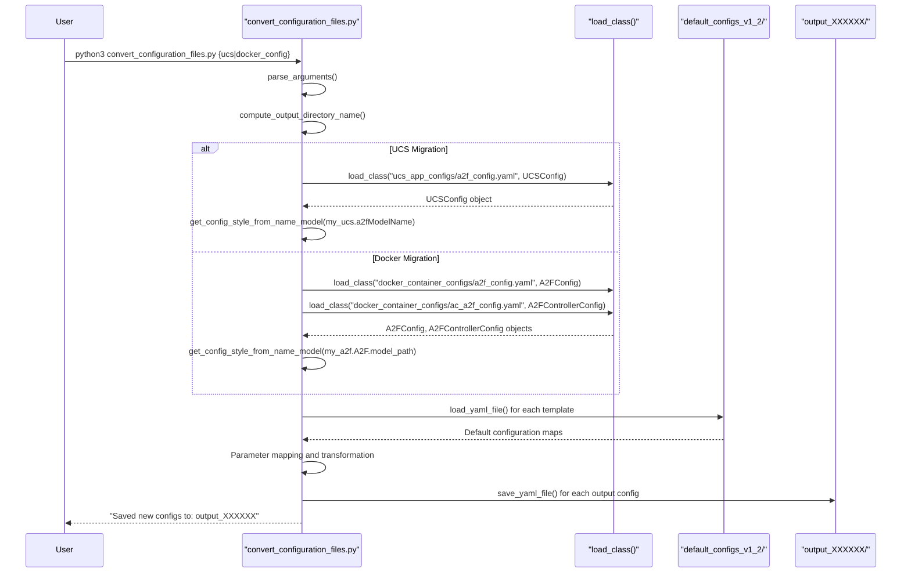

**Sources:** [migration/deployment_configuration_files_from_v1.0_to_v1.2/convert_configuration_files.py:120-128](), [migration/deployment_configuration_files_from_v1.0_to_v1.2/convert_configuration_files.py:328-339]()

### Character Model Detection

The migration tool automatically detects the target character model from the source configuration and selects the appropriate stylization template:

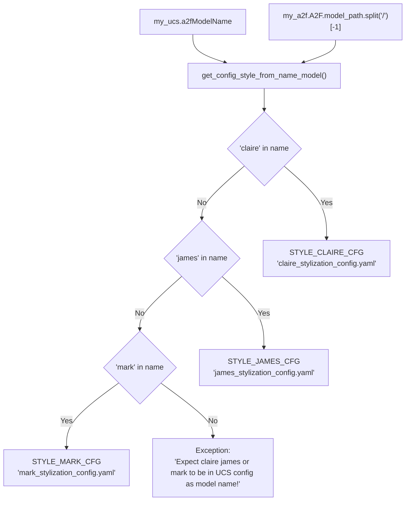

**Sources:** [migration/deployment_configuration_files_from_v1.0_to_v1.2/convert_configuration_files.py:152-162](), [migration/deployment_configuration_files_from_v1.0_to_v1.2/convert_configuration_files.py:33-37]()

## Migration Process

### Prerequisites and Setup

The migration tool requires a Python virtual environment with specific dependencies:

```bash
python3 -m venv .venv
source .venv/bin/activate
python3 -m pip install -r requirements.txt
```

The `requirements.txt` file specifies the `ruamel.yaml` library for YAML processing with preserved formatting and comments.

### UCS Configuration Migration

For UCS application deployments, update the source configuration file and execute:

```bash
python3 convert_configuration_files.py ucs
```

This migration process performs the following parameter transformations:

| Source Parameter | Target Configuration | Target Parameter |
|-----------------|---------------------|------------------|
| `streamNumber` | `deployment_config.yaml` | `common.stream_number` |
| `addSilencePaddingAfterAudio` | `deployment_config.yaml` | `common.add_silence_padding_after_audio` |
| `a2eEnabled` | `{character}_stylization_config.yaml` | `a2e.enabled` |
| `faceParams` | `{character}_stylization_config.yaml` | `a2f.face_params.*` |
| `a2eEmotionContrast` | `{character}_stylization_config.yaml` | `a2e.post_processing_params.emotion_contrast` |
| `queueAfterStreammux` | `advanced_config.yaml` | `pipeline_parameters.queue_size_after_streammux` |

### Docker Configuration Migration

For Docker container deployments, update both configuration files and execute:

```bash
python3 convert_configuration_files.py docker_config
```

This migration handles the dual-container architecture by mapping parameters from both `A2FConfig` and `A2FControllerConfig` to the new unified configuration structure.

### Output Structure

The migration tool generates configurations in uniquely named output directories following the pattern `output_XXXXXX`. Each output directory contains the complete set of v1.2 configuration files required for Audio2Face-3D deployment.

**Sources:** [migration/deployment_configuration_files_from_v1.0_to_v1.2/README.md:1-56](), [migration/deployment_configuration_files_from_v1.0_to_v1.2/convert_configuration_files.py:95-101]()

---

# Page: Configuration Migration Tool

# Configuration Migration Tool

<details>
<summary>Relevant source files</summary>

The following files were used as context for generating this wiki page:

- [migration/deployment_configuration_files_from_v1.0_to_v1.2/convert_configuration_files.py](migration/deployment_configuration_files_from_v1.0_to_v1.2/convert_configuration_files.py)
- [migration/deployment_configuration_files_from_v1.0_to_v1.2/requirements.txt](migration/deployment_configuration_files_from_v1.0_to_v1.2/requirements.txt)

</details>


## Purpose and Scope

The Configuration Migration Tool provides automated conversion of Audio2Face-3D configuration files from version 1.0 to version 1.2 format. This tool handles the structural changes and parameter mappings required to upgrade existing deployments to the new configuration schema introduced in v1.2.

The tool supports two distinct migration paths: UCS (Universal Control System) application configurations and Docker container configurations. For information about the v1.2 configuration file structure and parameters, see [Configuration File Structure](#3.2). For details on extracting configurations from running services, see [Configuration Fetching](#3.3).

## Migration Process Overview

The migration tool implements a template-based conversion approach, where v1.0 configurations are mapped to v1.2 templates with preserved user customizations.

**Migration Process Flow**

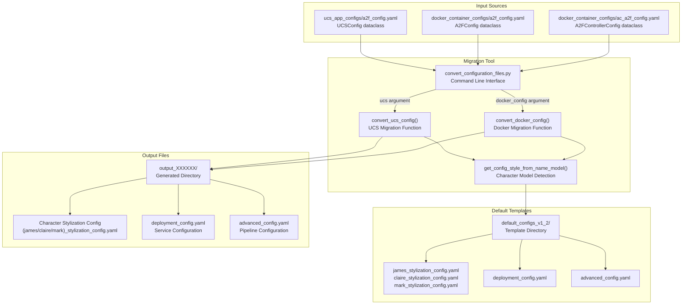

Sources: [migration/deployment_configuration_files_from_v1.0_to_v1.2/convert_configuration_files.py:1-340]()

## Migration Command Interface

The tool provides a simple command-line interface with two migration modes:

| Migration Mode | Input Source | Description |
|----------------|-------------|-------------|
| `ucs` | `ucs_app_configs/a2f_config.yaml` | Migrates UCS application configurations |
| `docker_config` | `docker_container_configs/a2f_config.yaml`<br/>`docker_container_configs/ac_a2f_config.yaml` | Migrates Docker container configurations |

**Usage Examples:**

```bash
# Migrate UCS application configuration
python convert_configuration_files.py ucs

# Migrate Docker container configuration  
python convert_configuration_files.py docker_config
```

The tool automatically creates a uniquely numbered output directory using the pattern `output_XXXXXX` where `XXXXXX` is an incrementing six-digit number.

Sources: [migration/deployment_configuration_files_from_v1.0_to_v1.2/convert_configuration_files.py:120-128](), [migration/deployment_configuration_files_from_v1.0_to_v1.2/convert_configuration_files.py:95-101]()

## UCS Configuration Migration

The UCS migration path converts Universal Control System application configurations to the new v1.2 format.

**UCS Migration Data Flow**

```mermaid
flowchart LR
    subgraph "Input Processing"
        UCSFile["a2f_config.yaml"]
        UCSClass["UCSConfig dataclass<br/>load_class()"]
        ModelName["a2fModelName field<br/>Character Detection"]
    end
    
    subgraph "Parameter Mapping"
        FaceParams["faceParams JSON<br/>Face Parameter Extraction"]
        StreamParams["streamNumber<br/>addSilencePaddingAfterAudio"]
        A2EParams["a2eEnabled<br/>a2eEmotionContrast<br/>a2eLiveBlendCoef<br/>a2ePreferredEmotionStrength"]
        DeviceParams["a2fDeviceId<br/>useFP16A2F<br/>useFP16A2E"]
    end
    
    subgraph "Output Generation"
        StyleConfig["Character Stylization Config<br/>a2e parameters<br/>face_params<br/>default_beginning_emotions"]
        DeployConfig["deployment_config.yaml<br/>stream_number<br/>add_silence_padding_after_audio"]
        AdvancedConfig["advanced_config.yaml<br/>inference_interval<br/>device_id<br/>precision settings"]
    end
    
    UCSFile --> UCSClass
    UCSClass --> ModelName
    UCSClass --> FaceParams
    UCSClass --> StreamParams
    UCSClass --> A2EParams
    UCSClass --> DeviceParams
    
    FaceParams --> StyleConfig
    StreamParams --> DeployConfig
    A2EParams --> StyleConfig
    DeviceParams --> AdvancedConfig
```

### UCS Parameter Mappings

The UCS migration handles several categories of parameter conversions:

**Face Parameters**: JSON-encoded face parameters are extracted and mapped to the new `face_params` structure:

| UCS Parameter | v1.2 Location | Mapping |
|---------------|---------------|---------|
| `faceParams.face_params.eyelid_offset` | `a2f.face_params.eyelid_offset` | Direct copy |
| `faceParams.face_params.input_strength` | `a2f.face_params.input_strength` | Direct copy |
| `faceParams.face_params.emotion[0-9]` | `default_beginning_emotions.*` | Array to named emotion mapping |

**Audio2Emotion Parameters**: A2E configuration is mapped to stylization config:

| UCS Parameter | v1.2 Location | Conversion |
|---------------|---------------|------------|
| `a2eEnabled` | `a2e.enabled` | String to boolean |
| `a2eEmotionContrast` | `a2e.post_processing_params.emotion_contrast` | String to float |
| `a2eInferenceInterval` | Advanced config `a2e.inference_interval` | String to int |

Sources: [migration/deployment_configuration_files_from_v1.0_to_v1.2/convert_configuration_files.py:165-244]()

## Docker Configuration Migration

The Docker migration path processes both A2F service configuration and A2F controller configuration files to generate the complete v1.2 configuration set.

**Docker Migration Architecture**

```mermaid
flowchart TD
    subgraph "Input Files"
        A2FConfig["a2f_config.yaml<br/>A2FConfig dataclass"]
        ControllerConfig["ac_a2f_config.yaml<br/>A2FControllerConfig dataclass"]
    end
    
    subgraph "Configuration Extraction"
        CommonParams["common.*<br/>Stream & Queue Settings"]
        GRPCInput["grpc_input.*<br/>Server Endpoint Config"]
        GRPCOutput["grpc_output.*<br/>Client Endpoint Config"]
        A2FParams["A2F.*<br/>Model & Blendshape Settings"]
        A2EParams["A2E.*<br/>Emotion Processing Settings"]
        ControllerParams["public_interface.*<br/>Bidirectional Endpoint"]
    end
    
    subgraph "URL Construction"
        UnidirServer["a2f_server_unidir_url<br/>0.0.0.0:grpc_input.port"]
        UnidirClient["a2f_client_unidir_url<br/>grpc_output.ip:grpc_output.port"]
        BidirServer["bidirectional_server_url<br/>0.0.0.0:public_interface.port"]
    end
    
    subgraph "Output Mapping"
        StyleOut["Stylization Config<br/>A2E settings<br/>Blendshape multipliers"]
        DeployOut["Deployment Config<br/>Endpoint URLs<br/>Stream settings"]
        AdvancedOut["Advanced Config<br/>Queue sizes<br/>Input sanitization"]
    end
    
    A2FConfig --> CommonParams
    A2FConfig --> GRPCInput
    A2FConfig --> GRPCOutput
    A2FConfig --> A2FParams
    A2FConfig --> A2EParams
    
    ControllerConfig --> ControllerParams
    
    GRPCInput --> UnidirServer
    GRPCOutput --> UnidirClient
    ControllerParams --> BidirServer
    
    CommonParams --> DeployOut
    CommonParams --> AdvancedOut
    A2FParams --> StyleOut
    A2EParams --> StyleOut
    UnidirServer --> DeployOut
    UnidirClient --> DeployOut
    BidirServer --> DeployOut
```

### Docker Configuration Mappings

**Endpoint Configuration**: The Docker migration constructs service endpoints from individual IP and port components:

```
Unidirectional Server: 0.0.0.0:{grpc_input.port}
Unidirectional Client: {grpc_output.ip}:{grpc_output.port}  
Bidirectional Server: 0.0.0.0:{public_interface.port}
```

**Blendshape Weight Multipliers**: The 52-element blendshape weight array is mapped to named parameters using `LIST_FACE_PARAM_ORDER`:

| Array Index | Blendshape Name | v1.2 Location |
|-------------|----------------|---------------|
| 0 | `EyeBlinkLeft` | `a2f.blendshape_params.weight_multipliers.EyeBlinkLeft` |
| 1 | `EyeLookDownLeft` | `a2f.blendshape_params.weight_multipliers.EyeLookDownLeft` |
| ... | ... | ... |
| 51 | `TongueOut` | `a2f.blendshape_params.weight_multipliers.TongueOut` |

Sources: [migration/deployment_configuration_files_from_v1.0_to_v1.2/convert_configuration_files.py:246-326](), [migration/deployment_configuration_files_from_v1.0_to_v1.2/convert_configuration_files.py:39-92]()

## Character Model Detection

The migration tool automatically detects the target character model from the configuration and selects the appropriate stylization template.

**Character Detection Logic**

```mermaid
flowchart TD
    ModelName["Model Name String<br/>(from UCS or Docker config)"]
    Detection["get_config_style_from_name_model()"]
    
    Claire{{"Contains 'claire'?"}}
    James{{"Contains 'james'?"}}
    Mark{{"Contains 'mark'?"}}
    Error[["Exception:<br/>Expect claire james or mark<br/>to be in model name!"]]
    
    ClaireCfg["claire_stylization_config.yaml"]
    JamesCfg["james_stylization_config.yaml"] 
    MarkCfg["mark_stylization_config.yaml"]
    
    ModelName --> Detection
    Detection --> Claire
    Claire -->|Yes| ClaireCfg
    Claire -->|No| James
    James -->|Yes| JamesCfg
    James -->|No| Mark
    Mark -->|Yes| MarkCfg
    Mark -->|No| Error
```

The detection function performs case-insensitive substring matching on the model name to determine the character type.

Sources: [migration/deployment_configuration_files_from_v1.0_to_v1.2/convert_configuration_files.py:152-162]()

## Output File Structure

The migration tool generates three types of configuration files in the output directory:

| File Type | Purpose | Content |
|-----------|---------|---------|
| **Character Stylization Config** | Character-specific A2E and A2F parameters | Emotion processing settings, face parameters, blendshape multipliers |
| **Deployment Config** | Service deployment settings | Endpoint URLs, stream configuration, logging settings |
| **Advanced Config** | Pipeline performance settings | Queue sizes, input validation, TensorRT precision, garbage collector |

**Template Loading Process**

The migration tool loads default templates from the `default_configs_v1_2/` directory and applies user-specific parameter overrides:

1. Load template YAML files using `load_yaml_file()`
2. Apply parameter mappings from source configuration
3. Save modified configurations using `save_yaml_file()`

**Output Directory Naming**

The `compute_output_directory_name()` function generates unique output directories using an incremental numbering scheme to prevent overwrites of previous migration results.

Sources: [migration/deployment_configuration_files_from_v1.0_to_v1.2/convert_configuration_files.py:32-37](), [migration/deployment_configuration_files_from_v1.0_to_v1.2/convert_configuration_files.py:141-149](), [migration/deployment_configuration_files_from_v1.0_to_v1.2/convert_configuration_files.py:95-101]()

---

# Page: Configuration File Structure

# Configuration File Structure

<details>
<summary>Relevant source files</summary>

The following files were used as context for generating this wiki page:

- [configs/advanced_config.yaml](configs/advanced_config.yaml)
- [configs/deployment_config.yaml](configs/deployment_config.yaml)
- [migration/deployment_configuration_files_from_v1.0_to_v1.2/ucs_app_configs/a2f_config.yaml](migration/deployment_configuration_files_from_v1.0_to_v1.2/ucs_app_configs/a2f_config.yaml)

</details>


This document describes the structure and parameters of Audio2Face-3D configuration files across different versions (v1.0 and v1.2). It covers the YAML configuration schemas, parameter definitions, and the relationships between different configuration file types used by the Audio2Face-3D NIM service.

For information about migrating between configuration versions, see [Configuration Migration Tool](#3.1). For extracting configuration from running services, see [Configuration Fetching](#3.3).

## Configuration File Types Overview

The Audio2Face-3D system uses multiple YAML configuration files to control different aspects of service behavior. The current v1.2 format separates concerns into specialized configuration files, while the legacy v1.0 format used monolithic configuration files.

```mermaid
graph TB
    subgraph "v1.2 Configuration Architecture"
        deployment_config["deployment_config.yaml<br/>Service Endpoints & Telemetry"]
        advanced_config["advanced_config.yaml<br/>Pipeline & Performance Settings"]
        stylization_configs["Character Stylization Configs<br/>claire_stylization_config.yaml<br/>james_stylization_config.yaml<br/>mark_stylization_config.yaml"]
    end
    
    subgraph "v1.0 Legacy Format"
        ucs_config["a2f_config.yaml<br/>UCS App Configuration"]
        docker_configs["Docker Container Configs<br/>a2f_config.yaml + ac_a2f_config.yaml"]
    end
    
    subgraph "A2F-3D NIM Service"
        service["Audio2Face-3D NIM"]
        a2f_component["A2F Pipeline Component"]
        a2e_component["A2E Pipeline Component"]
        telemetry["Telemetry & Monitoring"]
        endpoints["gRPC Endpoints"]
    end
    
    deployment_config --> service
    deployment_config --> telemetry
    deployment_config --> endpoints
    
    advanced_config --> service
    advanced_config --> a2f_component
    advanced_config --> a2e_component
    
    stylization_configs --> a2f_component
    stylization_configs --> a2e_component
    
    ucs_config -.-> service
    docker_configs -.-> service
```

**Sources:** [configs/deployment_config.yaml:1-96](), [configs/advanced_config.yaml:1-100](), [migration/deployment_configuration_files_from_v1.0_to_v1.2/ucs_app_configs/a2f_config.yaml:1-87]()

## Deployment Configuration Structure

The `deployment_config.yaml` file controls service-level settings including endpoints, security, logging, and telemetry. This configuration defines how the Audio2Face-3D NIM service exposes its functionality and integrates with monitoring systems.

### Service Configuration Parameters

| Section | Parameters | Description |
|---------|------------|-------------|
| `common` | `stream_number`, `add_silence_padding_after_audio` | Core service behavior settings |
| `logging` | `log_level`, `fps_logging_interval_second` | Logging configuration and verbosity |
| `endpoints` | `use_bidirectional`, `bidirectional`, `unidirectional` | gRPC endpoint configuration |
| `telemetry` | `metrics_enabled`, `traces_enabled`, `service_name` | Observability and monitoring settings |

```mermaid
graph TB
    subgraph "deployment_config.yaml Structure"
        common["common:<br/>stream_number: 10<br/>add_silence_padding_after_audio: false"]
        
        logging["logging:<br/>log_level: info<br/>fps_logging_interval_second: 1"]
        
        subgraph "endpoints Configuration"
            use_bidirectional["use_bidirectional: true"]
            bidirectional["bidirectional:<br/>server:<br/>  url: 0.0.0.0:52000<br/>  secure_mode: disabled"]
            unidirectional["unidirectional:<br/>server: 0.0.0.0:50000<br/>client: 0.0.0.0:51000"]
        end
        
        subgraph "telemetry Configuration"
            telemetry_basic["service_name: audio2face<br/>metrics_enabled: false<br/>traces_enabled: false"]
            telemetry_exporters["metrics_exporter: prometheus<br/>prometheus_endpoint: 0.0.0.0:9464<br/>otlp_http_metrics_endpoint: http://localhost:4318/v1/metrics"]
        end
    end
    
    subgraph "Runtime Components"
        grpc_server["gRPC Server<br/>Port 52000"]
        prometheus_metrics["Prometheus Metrics<br/>Port 9464"]
        otlp_exporter["OTLP Exporter<br/>Jaeger Integration"]
    end
    
    bidirectional --> grpc_server
    telemetry_exporters --> prometheus_metrics
    telemetry_exporters --> otlp_exporter
```

**Sources:** [configs/deployment_config.yaml:16-96]()

### Security and TLS Configuration

The deployment configuration supports multiple security modes for gRPC endpoints:

- `disabled`: No encryption (default)
- `tls`: Server-side TLS encryption
- `mtls`: Mutual TLS authentication

Certificate paths are configured via `certificate_path`, `key_path`, and `ca_path` parameters when security is enabled.

**Sources:** [configs/deployment_config.yaml:50-61]()

## Advanced Configuration Structure

The `advanced_config.yaml` file contains pipeline-specific settings, performance tuning parameters, and model generation configurations. This file directly impacts the Audio2Face and Audio2Emotion processing behavior.

### Pipeline Parameter Categories

```mermaid
graph TB
    subgraph "advanced_config.yaml Structure"
        subgraph "Input Validation"
            input_sanitization["input_sanitization:<br/>max_len_uuid: 50<br/>max_sample_rate: 144000<br/>min_sample_rate: 16000<br/>max_processing_duration_second: 300<br/>max_audio_buffer_size_second: 10<br/>max_audio_clip_size_second: 300<br/>max_wait_time_idle_ms: 30000<br/>low_fps: 29<br/>low_fps_max_duration_second: 7"]
        end
        
        subgraph "Memory Management"
            garbage_collector["garbage_collector:<br/>enabled: true<br/>interval_run_second: 10<br/>max_size_stored_data_second: 60"]
        end
        
        subgraph "Pipeline Flow Control"
            pipeline_parameters["pipeline_parameters:<br/>queue_size_after_a2e: 1<br/>queue_size_after_a2f: 300<br/>queue_size_after_streammux: 1<br/>streammux:<br/>  adaptive_batching: 0<br/>  overall_min_fps_n: 40<br/>  overall_min_fps_d: 1"]
        end
        
        subgraph "Model Configuration"
            a2f_config["a2f:<br/>temporal_smoothing: true<br/>device_id: 0"]
            a2e_config["a2e:<br/>inference_interval: 10<br/>device_id: 0"]
            trt_config["trt_model_generation:<br/>a2e:<br/>  precision: fp16<br/>  min_shape: 1<br/>  optimal_shape: 10<br/>  maximum_shape: 128<br/>a2f:<br/>  precision: fp16<br/>  min_shape: 1<br/>  optimal_shape: 10<br/>  maximum_shape: 128"]
        end
    end
    
    subgraph "Runtime Impact"
        stream_processing["Stream Processing<br/>Queue Management"]
        model_inference["Model Inference<br/>TensorRT Optimization"]
        resource_management["Resource Management<br/>GPU Memory & Cleanup"]
    end
    
    pipeline_parameters --> stream_processing
    trt_config --> model_inference
    garbage_collector --> resource_management
    a2f_config --> model_inference
    a2e_config --> model_inference
```

**Sources:** [configs/advanced_config.yaml:16-100]()

### Performance Tuning Parameters

The advanced configuration includes several performance-critical settings:

| Parameter Category | Key Parameters | Impact |
|-------------------|----------------|---------|
| Queue Sizes | `queue_size_after_a2e`, `queue_size_after_a2f`, `queue_size_after_streammux` | Throughput vs latency tradeoff |
| FPS Control | `overall_min_fps_n`, `overall_min_fps_d`, `low_fps`, `low_fps_max_duration_second` | Real-time processing guarantees |
| Model Optimization | `trt_model_generation.precision`, `min_shape`, `optimal_shape`, `maximum_shape` | TensorRT engine optimization |
| Device Assignment | `a2f.device_id`, `a2e.device_id` | GPU resource allocation |

**Sources:** [configs/advanced_config.yaml:56-100]()

## Legacy v1.0 Configuration Format

The v1.0 configuration format used a single `a2f_config.yaml` file with string-typed parameters and inline documentation. This format was used in both UCS applications and Docker container deployments.

### v1.0 Parameter Structure

```mermaid
graph TB
    subgraph "v1.0 a2f_config.yaml Structure"
        stream_config["streamNumber: '10'<br/>addSilencePaddingAfterAudio: 'False'"]
        
        a2e_params["a2eEnabled: 'True'<br/>a2eInferenceInterval: '10'<br/>a2eEmotionContrast: '1.0'<br/>a2eLiveBlendCoef: '0.7'<br/>a2eEnablePreferredEmotion: 'True'<br/>a2ePreferredEmotionStrength: '0.5'<br/>a2eEmotionStrength: '0.6'<br/>a2eMaxEmotions: '3'"]
        
        a2f_params["faceParams: '{}'<br/>a2fModelName: 'claire_v1.3'<br/>a2fDeviceId: '0'<br/>useFP16A2F: 'True'<br/>useFP16A2E: 'True'"]
        
        pipeline_params["queueAfterStreammux: '1'<br/>queueAfterA2F: '300'<br/>queueAfterA2E: '1'<br/>maxLenUUID: '50'<br/>maxSampleRate: '144000'<br/>minSampleRate: '16000'<br/>lowFps: '29'<br/>lowFpsMaxDurationSecond: '7'"]
    end
    
    subgraph "v1.2 Equivalent Mapping"
        deployment_target["deployment_config.yaml<br/>common.stream_number<br/>common.add_silence_padding_after_audio"]
        
        advanced_target["advanced_config.yaml<br/>pipeline_parameters.*<br/>input_sanitization.*<br/>a2f.device_id<br/>a2e.inference_interval<br/>trt_model_generation.*"]
        
        stylization_target["*_stylization_config.yaml<br/>Audio2Emotion parameters<br/>Audio2Face parameters"]
    end
    
    stream_config --> deployment_target
    pipeline_params --> advanced_target
    a2f_params --> advanced_target
    a2e_params --> stylization_target
```

**Sources:** [migration/deployment_configuration_files_from_v1.0_to_v1.2/ucs_app_configs/a2f_config.yaml:16-87]()

### v1.0 Parameter Characteristics

Key characteristics of the v1.0 format:
- All parameters stored as string values requiring runtime parsing
- Inline documentation using `#>` comment syntax
- Monolithic structure combining deployment and pipeline settings
- Model-specific parameters embedded in global configuration

**Sources:** [migration/deployment_configuration_files_from_v1.0_to_v1.2/ucs_app_configs/a2f_config.yaml:17-87]()

## Configuration Parameter Mapping

The migration from v1.0 to v1.2 involved restructuring parameters across multiple specialized files while preserving functionality.

### Parameter Migration Mapping

| v1.0 Parameter | v1.2 Location | v1.2 Parameter | Type Change |
|----------------|---------------|----------------|-------------|
| `streamNumber` | `deployment_config.yaml` | `common.stream_number` | string → integer |
| `addSilencePaddingAfterAudio` | `deployment_config.yaml` | `common.add_silence_padding_after_audio` | string → boolean |
| `queueAfterA2F` | `advanced_config.yaml` | `pipeline_parameters.queue_size_after_a2f` | string → integer |
| `queueAfterA2E` | `advanced_config.yaml` | `pipeline_parameters.queue_size_after_a2e` | string → integer |
| `queueAfterStreammux` | `advanced_config.yaml` | `pipeline_parameters.queue_size_after_streammux` | string → integer |
| `a2fDeviceId` | `advanced_config.yaml` | `a2f.device_id` | string → integer |
| `a2eInferenceInterval` | `advanced_config.yaml` | `a2e.inference_interval` | string → integer |
| `useFP16A2F` | `advanced_config.yaml` | `trt_model_generation.a2f.precision` | string boolean → "fp16" |
| `useFP16A2E` | `advanced_config.yaml` | `trt_model_generation.a2e.precision` | string boolean → "fp16" |

**Sources:** [migration/deployment_configuration_files_from_v1.0_to_v1.2/ucs_app_configs/a2f_config.yaml:16-87](), [configs/deployment_config.yaml:16-25](), [configs/advanced_config.yaml:56-100]()

---

# Page: Configuration Fetching

# Configuration Fetching

<details>
<summary>Relevant source files</summary>

The following files were used as context for generating this wiki page:

- [scripts/config_fetching_app/README.md](scripts/config_fetching_app/README.md)
- [scripts/config_fetching_app/requirements.txt](scripts/config_fetching_app/requirements.txt)

</details>


## Purpose and Scope

This document covers the configuration fetching system for Audio2Face-3D, which extracts active configuration files from running A2F-3D NIM services. The system enables administrators and developers to retrieve the current stylization, deployment, and advanced configuration parameters from live services for backup, analysis, or migration purposes.

For information about migrating configuration files between versions, see [Configuration Migration Tool](#3.1). For details about the structure and parameters of configuration files, see [Configuration File Structure](#3.2).

## System Overview

The configuration fetching system consists of a standalone Python application that connects to running Audio2Face-3D NIM services via gRPC to extract their active configuration state. The system retrieves three types of configuration files that define the service's operational parameters.

```mermaid
graph TB
    subgraph "Running A2F-3D Service"
        A2F_NIM["Audio2Face-3D NIM<br/>:52000"]
        ActiveConfigs["Active Configuration State<br/>- Stylization Parameters<br/>- Deployment Settings<br/>- Advanced Pipeline Config"]
    end
    
    subgraph "Configuration Fetching Application"
        FetchScript["fetch_deployment_configs.py"]
        GRPCClient["gRPC Client<br/>nvidia_ace wheel"]
        ConfigExtractor["Configuration Extractor"]
    end
    
    subgraph "Output Directory Structure"
        OutputDir["output_yaml_XXXXXX/"]
        StyleConfig["stylization_config.yaml"]
        DeployConfig["deployment_config.yaml"] 
        AdvancedConfig["advanced_config.yaml"]
    end
    
    A2F_NIM --> ActiveConfigs
    FetchScript --> GRPCClient
    GRPCClient -.->|"gRPC Connection"| A2F_NIM
    ConfigExtractor --> OutputDir
    ConfigExtractor --> StyleConfig
    ConfigExtractor --> DeployConfig
    ConfigExtractor --> AdvancedConfig
    
    FetchScript --> ConfigExtractor
    ActiveConfigs -.->|"Extract via gRPC"| ConfigExtractor
```

**Configuration Fetching System Architecture**

Sources: [scripts/config_fetching_app/README.md:1-57]()

## Prerequisites and Environment Setup

The configuration fetching application requires specific dependencies and environment setup to communicate with Audio2Face-3D services.

### System Requirements

| Component | Requirement |
|-----------|-------------|
| Python Version | python3 |
| Virtual Environment | python3-venv |
| Running Service | Audio2Face-3D NIM instance |
| Network Access | gRPC connectivity to service endpoint |

### Dependency Installation

The system requires two primary dependencies for gRPC communication:

```mermaid
graph LR
    subgraph "Core Dependencies"
        GRPC["grpcio==1.72.0rc1"]
        Protobuf["protobuf==4.24.1"]
    end
    
    subgraph "NVIDIA ACE Integration"
        WheelPackage["nvidia_ace-1.2.0-py3-none-any.whl"]
        ProtoDefinitions["gRPC Protocol Definitions"]
    end
    
    subgraph "Installation Methods"
        QuickInstall["Quick Installation<br/>pip3 install wheel"]
        ManualInstall["Manual Installation<br/>proto/ compilation"]
    end
    
    GRPC --> FetchApp["fetch_deployment_configs.py"]
    Protobuf --> FetchApp
    WheelPackage --> ProtoDefinitions
    ProtoDefinitions --> FetchApp
    
    QuickInstall --> WheelPackage
    ManualInstall --> ProtoDefinitions
```

**Dependency Installation Flow**

The environment setup follows this sequence:

1. Create Python virtual environment: `python3 -m venv .venv`
2. Activate environment: `source .venv/bin/activate`
3. Install NVIDIA ACE wheel: `pip3 install ../../proto/sample_wheel/nvidia_ace-1.2.0-py3-none-any.whl`
4. Install requirements: `pip3 install -r requirements.txt`

Sources: [scripts/config_fetching_app/README.md:4-43](), [scripts/config_fetching_app/requirements.txt:1-3]()

## Application Execution and Usage

The configuration fetching application operates through a single Python script that accepts the target service endpoint as a command-line argument.

### Command Syntax

```
python3 fetch_deployment_configs.py <host>:<port>
```

### Execution Flow

```mermaid
sequenceDiagram
    participant User
    participant fetch_deployment_configs_py as "fetch_deployment_configs.py"
    participant gRPC_Client as "gRPC Client"
    participant A2F_NIM as "A2F-3D NIM Service"
    participant FileSystem as "File System"
    
    User->>fetch_deployment_configs_py: "python3 fetch_deployment_configs.py 127.0.0.1:52000"
    fetch_deployment_configs_py->>gRPC_Client: "Initialize connection"
    gRPC_Client->>A2F_NIM: "Connect to service endpoint"
    A2F_NIM-->>gRPC_Client: "Connection established"
    
    gRPC_Client->>A2F_NIM: "Request stylization config"
    A2F_NIM-->>gRPC_Client: "Return stylization parameters"
    
    gRPC_Client->>A2F_NIM: "Request deployment config" 
    A2F_NIM-->>gRPC_Client: "Return deployment settings"
    
    gRPC_Client->>A2F_NIM: "Request advanced config"
    A2F_NIM-->>gRPC_Client: "Return pipeline settings"
    
    fetch_deployment_configs_py->>FileSystem: "Create output_yaml_XXXXXX directory"
    fetch_deployment_configs_py->>FileSystem: "Write stylization_config.yaml"
    fetch_deployment_configs_py->>FileSystem: "Write deployment_config.yaml"
    fetch_deployment_configs_py->>FileSystem: "Write advanced_config.yaml"
    
    fetch_deployment_configs_py-->>User: "Configuration files extracted"
```

**Configuration Extraction Sequence**

### Example Output

When executed successfully, the application produces output indicating the location of extracted configuration files:

```
Writing config file to output_yaml_000001/stylization_config.yaml
Writing config file to output_yaml_000001/deployment_config.yaml
Writing config file to output_yaml_000001/advanced_config.yaml
```

Sources: [scripts/config_fetching_app/README.md:45-57]()

## Output Structure and Configuration Files

The configuration fetching system generates three distinct YAML files that represent different aspects of the Audio2Face-3D service configuration.

### Output Directory Structure

```mermaid
graph TD
    subgraph "Output Directory: output_yaml_XXXXXX"
        StyleFile["stylization_config.yaml<br/>Character-specific parameters<br/>A2E and A2F settings"]
        DeployFile["deployment_config.yaml<br/>Service endpoints<br/>Telemetry configuration"]
        AdvFile["advanced_config.yaml<br/>Pipeline settings<br/>Performance parameters"]
    end
    
    subgraph "Configuration Categories"
        StyleParams["Stylization Parameters<br/>- Emotion mappings<br/>- Blendshape weights<br/>- Face parameters"]
        DeployParams["Deployment Parameters<br/>- Service URLs<br/>- Authentication<br/>- Monitoring"]
        AdvParams["Advanced Parameters<br/>- Pipeline configuration<br/>- Performance tuning<br/>- Resource allocation"]
    end
    
    StyleFile --> StyleParams
    DeployFile --> DeployParams  
    AdvFile --> AdvParams
```

**Configuration File Categories**

### Configuration File Types

| File | Purpose | Content |
|------|---------|---------|
| `stylization_config.yaml` | Character-specific settings | Audio2Emotion parameters, Audio2Face parameters, blendshape configurations |
| `deployment_config.yaml` | Service deployment settings | Service endpoints, telemetry configuration, authentication parameters |
| `advanced_config.yaml` | Pipeline configuration | Performance settings, resource allocation, advanced pipeline parameters |

The extracted configurations represent the live state of the Audio2Face-3D service and can be used for:
- Service backup and restore operations
- Configuration analysis and debugging
- Migration to new service instances
- Compliance and audit requirements

Sources: [scripts/config_fetching_app/README.md:56-57]()

## Integration with Configuration Management System

The configuration fetching application integrates with the broader Audio2Face-3D configuration management ecosystem, providing runtime configuration extraction capabilities.

```mermaid
graph TB
    subgraph "Configuration Lifecycle"
        Templates["Default Templates<br/>v1.2 Format"]
        Migration["convert_configuration_files.py<br/>Migration Tool"]
        Deployment["Service Deployment<br/>Docker/NIM"]
        Runtime["Running A2F-3D Service<br/>Active Configuration"]
        Fetching["fetch_deployment_configs.py<br/>Configuration Extraction"]
        ExtractedConfigs["Extracted Configuration Files<br/>output_yaml_XXXXXX/"]
    end
    
    subgraph "Configuration Flow"
        Templates --> Migration
        Migration --> Deployment
        Deployment --> Runtime
        Runtime --> Fetching
        Fetching --> ExtractedConfigs
        ExtractedConfigs -.->|"Can be used for"| Migration
    end
    
    subgraph "File Relationships"
        StyleTemplate["Character stylization templates"]
        DeployTemplate["Deployment config template"]
        AdvTemplate["Advanced config template"]
        
        StyleExtracted["stylization_config.yaml"]
        DeployExtracted["deployment_config.yaml"]
        AdvExtracted["advanced_config.yaml"]
    end
    
    StyleTemplate -.-> StyleExtracted
    DeployTemplate -.-> DeployExtracted
    AdvTemplate -.-> AdvExtracted
```

**Configuration Management Integration**

The fetching system complements other configuration management tools by providing runtime state extraction, enabling a complete configuration lifecycle from template creation through deployment to operational state capture.

Sources: [scripts/config_fetching_app/README.md:1-57]()

---

# Page: Client Applications and APIs

# Client Applications and APIs

<details>
<summary>Relevant source files</summary>

The following files were used as context for generating this wiki page:

- [scripts/audio2face_3d_api_client/README.md](scripts/audio2face_3d_api_client/README.md)
- [scripts/audio2face_3d_microservices_interaction_app/README.md](scripts/audio2face_3d_microservices_interaction_app/README.md)

</details>


This page provides an overview of the client applications and APIs available for interacting with Audio2Face-3D services. These applications demonstrate various interaction patterns, from basic inference requests to performance testing and cloud-based deployments.

For deployment and configuration details, see [Deployment and Operations](#5). For character model parameters used by these clients, see [Character Models and Stylization](#2).

## Overview

The Audio2Face-3D system provides multiple client applications that serve different use cases and deployment scenarios. These clients communicate with Audio2Face-3D services via gRPC protocol and support various security modes including TLS and mTLS authentication.

### Client Application Types

| Application Type | Primary Use Case | Target Service |
|------------------|------------------|----------------|
| **Microservices Interaction** | Local development and testing | Local A2F-3D NIM (port 52000) |
| **NVCF API Client** | Cloud-based inference | NVIDIA Cloud Functions |
| **Authoring Clients** | Early access authoring features | Authoring services (port 50051) |
| **Performance Testing** | Load testing and benchmarking | Local A2F-3D NIM |

## Client Architecture Overview

```mermaid
graph TB
    subgraph "Audio Input Processing"
        AudioFiles["Audio Files<br/>PCM 16-bit WAV"]
        ConfigFiles["Config Files<br/>YAML emotion parameters"]
    end
    
    subgraph "Client Applications"
        A2F3DScript["a2f_3d.py<br/>Microservices Interaction"]
        NIMClient["nim_a2f_3d_client.py<br/>NVCF API Client"]
        PerfTest["nim_performance_test.py<br/>Performance Testing"]
        LocalAuth["client_local_deploy.py<br/>Local Authoring"]
        NVCFAuth["client_nvcf_deploy.py<br/>NVCF Authoring"]
    end
    
    subgraph "Communication Layer"
        gRPCProto["nvidia_ace gRPC<br/>Protocol Definitions"]
        SecurityModes["Security Modes<br/>disabled/tls/mtls"]
        AuthLayer["Authentication<br/>API Keys & Certificates"]
    end
    
    subgraph "A2F-3D Services"
        LocalNIM["Local A2F-3D NIM<br/>0.0.0.0:52000"]
        NVCFNIM["NVCF A2F-3D NIM<br/>Cloud Service"]
        AuthService["Authoring Service<br/>0.0.0.0:50051"]
    end
    
    subgraph "Output Processing"
        BlendshapeCSV["Blendshape Data<br/>CSV animation keyframes"]
        EmotionCSV["Emotion Data<br/>CSV time series"]
        ProcessedAudio["Processed Audio<br/>out.wav"]
        PerfMetrics["Performance Metrics<br/>Latency & FPS data"]
    end
    
    AudioFiles --> A2F3DScript
    AudioFiles --> NIMClient
    AudioFiles --> PerfTest
    ConfigFiles --> A2F3DScript
    ConfigFiles --> NIMClient
    
    A2F3DScript --> gRPCProto
    NIMClient --> gRPCProto
    PerfTest --> gRPCProto
    LocalAuth --> gRPCProto
    NVCFAuth --> gRPCProto
    
    gRPCProto --> SecurityModes
    SecurityModes --> AuthLayer
    
    A2F3DScript -.->|"gRPC"| LocalNIM
    NIMClient -.->|"gRPC+Auth"| NVCFNIM  
    PerfTest -.->|"Multiple Streams"| LocalNIM
    LocalAuth -.->|"gRPC"| AuthService
    NVCFAuth -.->|"gRPC+Auth"| AuthService
    
    A2F3DScript --> BlendshapeCSV
    A2F3DScript --> EmotionCSV
    A2F3DScript --> ProcessedAudio
    NIMClient --> BlendshapeCSV
    NIMClient --> EmotionCSV
    NIMClient --> ProcessedAudio
    PerfTest --> PerfMetrics
    LocalAuth --> PerfMetrics
    NVCFAuth --> PerfMetrics
```

Sources: [scripts/audio2face_3d_microservices_interaction_app/README.md:1-239](), [scripts/audio2face_3d_api_client/README.md:1-51]()

## gRPC Communication Patterns

All client applications follow a consistent communication pattern using the `nvidia_ace` gRPC protocol definitions. The core interaction flow involves:

```mermaid
sequenceDiagram
    participant Client as "Client Application"
    participant gRPC as "gRPC Channel"
    participant Service as "A2F-3D Service"
    
    Client->>gRPC: "Initialize connection with security mode"
    gRPC->>Service: "Establish secure channel"
    
    Client->>Service: "health_check() request"
    Service->>Client: "Service status response"
    
    Client->>Service: "Audio + Config data"
    Note over Service: "Process Audio2Face<br/>& Audio2Emotion"
    Service->>Client: "Blendshapes + Emotions<br/>+ Processed Audio"
    
    Client->>Client: "Save CSV files<br/>& output audio"
```

Sources: [scripts/audio2face_3d_microservices_interaction_app/README.md:167-177](), [scripts/audio2face_3d_api_client/README.md:41-51]()

## Security and Authentication

### Security Modes

The client applications support three security modes for gRPC communication:

| Mode | Description | Required Parameters |
|------|-------------|-------------------|
| `disabled` | No encryption or authentication | None |
| `tls` | Encrypted communication, server verification | `--root-cert-path` |
| `mtls` | Mutual TLS with client-server authentication | `--root-cert-path`, `--client-cert-path`, `--client-key-path` |

### Certificate Management

For secure deployments, clients support standard TLS certificate workflows:

```mermaid
graph LR
    subgraph "Certificate Authority"
        CAKey["ca.key<br/>CA Private Key"]
        CACert["ca.crt<br/>CA Certificate"]
    end
    
    subgraph "Server Certificates"
        ServerKey["server.key<br/>Server Private Key"]
        ServerCSR["server.csr<br/>Certificate Signing Request"]
        ServerCert["server.crt<br/>Signed Server Certificate"]
    end
    
    subgraph "Client Certificates"
        ClientKey["client.key<br/>Client Private Key"]
        ClientCSR["client.csr<br/>Certificate Signing Request"]
        ClientCert["client.crt<br/>Signed Client Certificate"]
    end
    
    CAKey --> CACert
    ServerKey --> ServerCSR
    ClientKey --> ClientCSR
    
    CACert --> ServerCert
    CACert --> ClientCert
    ServerCSR --> ServerCert
    ClientCSR --> ClientCert
```

Sources: [scripts/audio2face_3d_microservices_interaction_app/README.md:76-107]()

## Common Input/Output Patterns

### Input Requirements

All client applications follow consistent input requirements:

- **Audio Format**: PCM 16-bit WAV files
- **Configuration**: YAML files containing emotion parameters
- **Character Models**: Support for Claire, James, and Mark configurations

### Output Generation

Standard output artifacts produced by client applications:

| Output Type | Format | Description |
|-------------|--------|-------------|
| **Animation Data** | CSV | Blendshape keyframes with name, value, and timecode |
| **Emotion Data** | CSV | Emotion values and timestamps |
| **Processed Audio** | WAV | Audio output (typically same as input) |
| **Performance Data** | TXT/PNG | Latency and FPS metrics with visualizations |

Sources: [scripts/audio2face_3d_microservices_interaction_app/README.md:167-177](), [scripts/audio2face_3d_api_client/README.md:41-51]()

## Dependencies and Installation

### Core Dependencies

All client applications require:

- **Python 3** with virtual environment support
- **nvidia_ace Python wheel**: gRPC protocol definitions for Audio2Face-3D
- **Standard Python packages**: Listed in individual `requirements.txt` files

### gRPC Protocol Integration

The `nvidia_ace` wheel package provides the essential gRPC bindings:

```bash
pip3 install ../../proto/sample_wheel/nvidia_ace-1.2.0-py3-none-any.whl
```

This wheel is compatible with Audio2Face-3D NIM version 1.3 and contains the compiled protocol buffer definitions for client-service communication.

Sources: [scripts/audio2face_3d_microservices_interaction_app/README.md:28-47](), [scripts/audio2face_3d_api_client/README.md:14-22]()

## Detailed Application Documentation

For comprehensive documentation of individual client applications:

- **Microservices Interaction Application**: See [Microservices Interaction Application](#4.1) for `a2f_3d.py` and `nim_performance_test.py`
- **NVCF API Client**: See [API Client for NVCF](#4.2) for `nim_a2f_3d_client.py`
- **Authoring Applications**: See [Authoring Sample Applications](#4.3) for early access authoring clients
- **Technical Integration Details**: See [Client Dependencies and gRPC Integration](#4.4) for protocol definitions and shared components

---

# Page: Microservices Interaction Application

# Microservices Interaction Application

<details>
<summary>Relevant source files</summary>

The following files were used as context for generating this wiki page:

- [scripts/audio2face_3d_microservices_interaction_app/README.md](scripts/audio2face_3d_microservices_interaction_app/README.md)
- [scripts/audio2face_3d_microservices_interaction_app/a2f_3d.py](scripts/audio2face_3d_microservices_interaction_app/a2f_3d.py)

</details>


## Purpose and Scope

This document covers the primary client application for interacting with Audio2Face-3D NIM (NVIDIA Inference Microservice), specifically the `a2f_3d.py` script and its companion performance testing utility. This application provides health checking, audio processing inference, and performance measurement capabilities for Audio2Face-3D deployments.

For information about API clients for NVCF deployments, see [API Client for NVCF](#4.2). For authoring service interactions, see [Authoring Sample Applications](#4.3).

## Application Architecture

The microservices interaction application consists of two primary components that communicate with Audio2Face-3D services via gRPC:

```mermaid
graph TB
    subgraph "Client Applications"
        A2F3D["a2f_3d.py<br/>Main Client Application"]
        PerfTest["nim_performance_test.py<br/>Performance Testing"]
    end
    
    subgraph "A2F-3D Service Endpoints"
        LocalNIM["Local A2F-3D NIM<br/>127.0.0.1:52000"]
        RemoteNIM["Remote A2F-3D NIM<br/>Custom IP:Port"]
    end
    
    subgraph "Communication Layer"
        gRPCChannel["grpc.aio.Channel<br/>Async gRPC Connection"]
        HealthStub["HealthStub<br/>Health Check Service"]
        A2FStub["A2FControllerServiceStub<br/>Audio Processing Service"]
    end
    
    subgraph "Security Layer"
        InsecureChannel["grpc.aio.insecure_channel()"]
        TLSChannel["grpc.aio.secure_channel()<br/>TLS Mode"]
        mTLSChannel["grpc.aio.secure_channel()<br/>mTLS Mode"]
    end
    
    A2F3D --> gRPCChannel
    PerfTest --> A2F3D
    gRPCChannel --> HealthStub
    gRPCChannel --> A2FStub
    
    HealthStub -.-> LocalNIM
    HealthStub -.-> RemoteNIM
    A2FStub -.-> LocalNIM
    A2FStub -.-> RemoteNIM
    
    gRPCChannel --> InsecureChannel
    gRPCChannel --> TLSChannel
    gRPCChannel --> mTLSChannel
```

**Sources:** [scripts/audio2face_3d_microservices_interaction_app/a2f_3d.py:1-459](), [scripts/audio2face_3d_microservices_interaction_app/README.md:1-239]()

## Core Application Components

The main application is structured around two primary operational modes implemented as subcommands:

```mermaid
graph TD
    subgraph "a2f_3d.py Main Functions"
        MainFunc["main()<br/>Entry Point & Argument Parsing"]
        ParserFunc["create_parser()<br/>Subcommand Configuration"]
        ChannelFunc["create_grpc_channel()<br/>Connection Management"]
    end
    
    subgraph "Health Check Mode"
        HealthCheck["check_health()<br/>Service Availability Check"]
        HealthStub["HealthStub<br/>gRPC Health Service"]
        HealthReq["HealthCheckRequest<br/>Protocol Buffer"]
    end
    
    subgraph "Inference Mode"
        StreamRead["read_from_stream()<br/>Response Processing"]
        StreamWrite["write_to_stream()<br/>Request Streaming"]
        ProcessStream["ProcessAudioStream<br/>Bidirectional gRPC Stream"]
    end
    
    subgraph "Data Processing"
        AudioParser["scipy.io.wavfile.read()<br/>Audio File Loading"]
        ConfigParser["yaml.safe_load()<br/>Configuration Loading"]
        OutputGen["save_audio_data_to_file()<br/>pandas DataFrame Export"]
    end
    
    MainFunc --> ParserFunc
    MainFunc --> ChannelFunc
    MainFunc --> HealthCheck
    MainFunc --> StreamRead
    MainFunc --> StreamWrite
    
    HealthCheck --> HealthStub
    HealthStub --> HealthReq
    
    StreamRead --> ProcessStream
    StreamWrite --> ProcessStream
    StreamWrite --> AudioParser
    StreamWrite --> ConfigParser
    StreamRead --> OutputGen
```

**Sources:** [scripts/audio2face_3d_microservices_interaction_app/a2f_3d.py:341-376](), [scripts/audio2face_3d_microservices_interaction_app/a2f_3d.py:398-458]()

## Communication Protocol Implementation

The application implements bidirectional streaming communication using specific gRPC protocol buffer types:

| Protocol Buffer Type | Purpose | Usage Context |
|---------------------|---------|---------------|
| `AudioStream` | Main message container | Request streaming |
| `AudioStreamHeader` | Audio metadata and configuration | First message sent |
| `AudioWithEmotion` | Audio data with emotion parameters | Streaming audio chunks |
| `AnimationDataStreamHeader` | Response metadata | First response received |
| `AnimationData` | Blendshape and emotion results | Streaming responses |
| `EmotionAggregate` | Detailed emotion data | Response metadata |

### Request Flow Implementation

```mermaid
sequenceDiagram
    participant Client as "a2f_3d.py"
    participant Stream as "ProcessAudioStream"
    participant Service as "A2F-3D NIM"
    
    Client->>Stream: "AudioStream(audio_stream_header)"
    Note over Client,Stream: "AudioStreamHeader with config params"
    
    loop "For each audio chunk"
        Client->>Stream: "AudioStream(audio_with_emotion)"
        Note over Client,Stream: "AudioWithEmotion with audio buffer"
    end
    
    Client->>Stream: "AudioStream(end_of_audio)"
    Note over Client,Stream: "EndOfAudio termination signal"
    
    Service->>Stream: "AnimationDataStreamHeader"
    Note over Stream,Service: "Response metadata & blendshape names"
    
    loop "For each frame"
        Service->>Stream: "AnimationData"
        Note over Stream,Service: "Blendshapes + audio + emotions"
    end
    
    Service->>Stream: "Status message"
    Stream->>Client: "grpc.aio.EOF"
```

**Sources:** [scripts/audio2face_3d_microservices_interaction_app/a2f_3d.py:224-318](), [scripts/audio2face_3d_microservices_interaction_app/a2f_3d.py:125-222]()

## Security Implementation

The application supports three security modes through the `create_grpc_channel()` function:

```mermaid
graph TD
    subgraph "Security Mode Selection"
        SecureMode["--secure-mode argument"]
        Disabled["disabled<br/>No encryption"]
        TLS["tls<br/>Server authentication"]
        mTLS["mtls<br/>Mutual authentication"]
    end
    
    subgraph "Certificate Requirements"
        RootCert["--root-cert-path<br/>CA Certificate"]
        ClientCert["--client-cert-path<br/>Client Certificate"]
        ClientKey["--client-key-path<br/>Private Key"]
    end
    
    subgraph "gRPC Channel Creation"
        InsecureChannel["grpc.aio.insecure_channel()"]
        SecureChannelTLS["grpc.ssl_channel_credentials()<br/>root_certificates only"]
        SecureChannelmTLS["grpc.ssl_channel_credentials()<br/>full certificate chain"]
    end
    
    SecureMode --> Disabled
    SecureMode --> TLS
    SecureMode --> mTLS
    
    Disabled --> InsecureChannel
    TLS --> RootCert
    TLS --> SecureChannelTLS
    mTLS --> RootCert
    mTLS --> ClientCert
    mTLS --> ClientKey
    mTLS --> SecureChannelmTLS
```

**Sources:** [scripts/audio2face_3d_microservices_interaction_app/a2f_3d.py:378-396](), [scripts/audio2face_3d_microservices_interaction_app/README.md:76-156]()

## Performance Testing Architecture

The `nim_performance_test.py` script orchestrates concurrent testing by launching multiple instances of the main application:

### Performance Test Parameters

| Parameter | Purpose | Configuration |
|-----------|---------|---------------|
| `--request-nb` | Requests per audio file per stream | Load intensity control |
| `--max-stream-nb` | Concurrent stream count | Parallelism level |
| `--url` | A2F-3D service endpoint | Target service |

### Test Execution Flow

```mermaid
graph TD
    subgraph "Performance Test Orchestration"
        PerfScript["nim_performance_test.py"]
        TestFiles["6 Audio Test Files<br/>5s, 10s, 20s @ 16kHz & 44.1kHz"]
        ConfigFile["config/config_mark.yml<br/>Test Configuration"]
    end
    
    subgraph "Concurrent Stream Execution"
        Stream1["Stream 1<br/>a2f_3d.py run_inference"]
        Stream2["Stream 2<br/>a2f_3d.py run_inference"]
        StreamN["Stream N<br/>a2f_3d.py run_inference"]
    end
    
    subgraph "Performance Metrics Collection"
        LatencyData["Latency Measurements<br/>First packet to completion"]
        FPSData["FPS Calculations<br/>Packets per second"]
        Statistics["99th Percentile Stats<br/>Worst case scenarios"]
    end
    
    subgraph "Output Generation"
        CSVFiles["stream*.csv<br/>Raw performance data"]
        TXTFiles["fps_stream*.txt & latency_stream*.txt<br/>Statistical summaries"]
        PNGFiles["stream*.png<br/>Performance plots"]
    end
    
    PerfScript --> TestFiles
    PerfScript --> ConfigFile
    PerfScript --> Stream1
    PerfScript --> Stream2
    PerfScript --> StreamN
    
    Stream1 --> LatencyData
    Stream2 --> FPSData
    StreamN --> Statistics
    
    Statistics --> CSVFiles
    Statistics --> TXTFiles
    Statistics --> PNGFiles
```

**Sources:** [scripts/audio2face_3d_microservices_interaction_app/README.md:184-239](), [scripts/audio2face_3d_microservices_interaction_app/README.md:204-231]()

## Data Processing and Output Generation

### Emotion Data Processing

The application processes three types of emotion data through the `parse_emotion_data()` function:

```mermaid
graph TD
    subgraph "Emotion Data Sources"
        InputEmotions["input_emotions<br/>User-provided emotion parameters"]
        A2EOutput["a2e_output<br/>Audio2Emotion inference results"]
        A2FSmoothed["a2f_smoothed_output<br/>Final processed emotions"]
    end
    
    subgraph "EmotionAggregate Processing"
        MetadataUnpack["animation_data.metadata['emotion_aggregate']<br/>Protocol buffer unpacking"]
        EmotionKeyFrames["emotion_key_frames dictionary<br/>Structured emotion data"]
    end
    
    subgraph "Output File Generation"
        InputCSV["a2f_3d_input_emotions.csv<br/>User inputs"]
        A2ECSV["a2e_output.csv<br/>Inference results"]
        SmoothedCSV["a2f_3d_smoothed_emotion_output.csv<br/>Final emotions"]
    end
    
    InputEmotions --> MetadataUnpack
    A2EOutput --> MetadataUnpack
    A2FSmoothed --> MetadataUnpack
    
    MetadataUnpack --> EmotionKeyFrames
    
    EmotionKeyFrames --> InputCSV
    EmotionKeyFrames --> A2ECSV
    EmotionKeyFrames --> SmoothedCSV
```

### Animation Data Processing

| Data Type | Processing Function | Output Format |
|-----------|-------------------|---------------|
| Blendshapes | `dict(zip(bs_names, blendshapes.values))` | `animation_frames.csv` |
| Audio | `save_audio_data_to_file()` | `out.wav` |
| Emotions | `parse_emotion_data()` | Multiple CSV files |
| Performance | FPS and latency calculation | Console output |

**Sources:** [scripts/audio2face_3d_microservices_interaction_app/a2f_3d.py:83-114](), [scripts/audio2face_3d_microservices_interaction_app/a2f_3d.py:164-179]()

## Usage Patterns and Command Interface

### Health Check Operation

```bash
python3 a2f_3d.py health_check --url <ip>:<port> [--secure-mode <mode>]
```

### Inference Operation

```bash
python3 a2f_3d.py run_inference <audio_file.wav> <config.yml> -u <ip>:<port> [options]
```

### Common Configuration Requirements

| Requirement | Specification | Validation |
|-------------|---------------|------------|
| Audio Format | 16-bit PCM mono | `REQUIRED_BITS_PER_SAMPLE = 16` |
| Audio Channels | Mono only | `REQUIRED_CHANNEL_COUNT = 1` |
| Config Format | YAML with emotion parameters | `yaml.safe_load()` parsing |
| Service Endpoint | gRPC-compatible URL | Health check validation |

**Sources:** [scripts/audio2face_3d_microservices_interaction_app/a2f_3d.py:44-53](), [scripts/audio2face_3d_microservices_interaction_app/README.md:49-75]()

---

# Page: API Client for NVCF

# API Client for NVCF

<details>
<summary>Relevant source files</summary>

The following files were used as context for generating this wiki page:

- [scripts/audio2face_3d_api_client/README.md](scripts/audio2face_3d_api_client/README.md)
- [scripts/audio2face_3d_api_client/a2f_3d/client/service.py](scripts/audio2face_3d_api_client/a2f_3d/client/service.py)

</details>


This document covers the API client application that connects to Audio2Face-3D NIM hosted on NVIDIA Cloud Functions (NVCF). This client enables cloud-based processing of audio files to generate facial animation blendshapes and emotion data.

For information about the local microservices client, see [Microservices Interaction Application](#4.1). For details about authoring services, see [Authoring Sample Applications](#4.3).

## Purpose and Architecture

The NVCF API client provides a Python application that interfaces with Audio2Face-3D NIM deployed on NVIDIA's cloud infrastructure. It handles authentication, data streaming, and result processing for cloud-based facial animation generation.

### System Architecture

```mermaid
graph TB
    subgraph "Local Client Environment"
        ClientApp["nim_a2f_3d_client.py<br/>Main Application"]
        ServiceModule["a2f_3d.client.service<br/>gRPC Service Handler"]
        ConfigFiles["YAML Configuration<br/>config_claire.yml"]
        AudioInput["Audio Input<br/>16-bit PCM WAV"]
    end
    
    subgraph "NVIDIA Cloud Functions"
        NVCF["Audio2Face-3D NIM<br/>Cloud Service"]
        APIGateway["NVCF API Gateway<br/>Authentication & Routing"]
    end
    
    subgraph "Output Processing"
        OutputDir["Timestamped Directory<br/>YYYYMMDD_HHMMSS_ffffff"]
        AnimationCSV["animation_frames.csv<br/>Blendshape Data"]
        EmotionCSV["emotion output CSVs<br/>A2E & Smoothed Data"]
        AudioOutput["out.wav<br/>Processed Audio"]
    end
    
    ClientApp --> ServiceModule
    ServiceModule --> ConfigFiles
    ServiceModule --> AudioInput
    ServiceModule -.->|"gRPC + API Key"| APIGateway
    APIGateway --> NVCF
    NVCF -.->|"Streaming Response"| ServiceModule
    ServiceModule --> OutputDir
    OutputDir --> AnimationCSV
    OutputDir --> EmotionCSV
    OutputDir --> AudioOutput
```

Sources: [scripts/audio2face_3d_api_client/README.md:1-51](), [scripts/audio2face_3d_api_client/a2f_3d/client/service.py:1-243]()

## Core Components

### Client Service Implementation

The primary service logic is implemented in the `service.py` module, which handles all gRPC communication with the NVCF-hosted Audio2Face-3D NIM.

```mermaid
graph TB
    subgraph "service.py Core Functions"
        WriteStream["write_to_stream()<br/>Audio & Config Upload"]
        ReadStream["read_from_stream()<br/>Response Processing"]
        ParseEmotion["parse_emotion_data()<br/>Emotion Extraction"]
        SaveAudio["save_audio_data_to_file()<br/>Audio File Output"]
        GetFormat["get_audio_bit_format()<br/>Format Validation"]
    end
    
    subgraph "gRPC Protocol Classes"
        A2FStub["A2FControllerServiceStub<br/>Service Interface"]
        AudioStream["AudioStream<br/>Request Message"]
        AudioStreamHeader["AudioStreamHeader<br/>Metadata"]
        AudioWithEmotion["AudioWithEmotion<br/>Audio + Emotion Data"]
        AnimationData["AnimationData<br/>Response Message"]
        EmotionAggregate["EmotionAggregate<br/>Emotion Results"]
    end
    
    subgraph "Data Processing"
        AudioHeader["AudioHeader<br/>Audio Metadata"]
        BlendShapeParams["BlendShapeParameters<br/>Animation Config"]
        FaceParams["FaceParameters<br/>Face Config"]
        EmotionPostProc["EmotionPostProcessingParameters<br/>Emotion Config"]
    end
    
    WriteStream --> AudioStream
    WriteStream --> AudioStreamHeader
    WriteStream --> AudioWithEmotion
    
    ReadStream --> AnimationData
    ReadStream --> ParseEmotion
    ReadStream --> SaveAudio
    
    ParseEmotion --> EmotionAggregate
    SaveAudio --> GetFormat
    GetFormat --> AudioHeader
    
    AudioStreamHeader --> BlendShapeParams
    AudioStreamHeader --> FaceParams
    AudioStreamHeader --> EmotionPostProc
```

Sources: [scripts/audio2face_3d_api_client/a2f_3d/client/service.py:16-26](), [scripts/audio2face_3d_api_client/a2f_3d/client/service.py:171-243](), [scripts/audio2face_3d_api_client/a2f_3d/client/service.py:91-169]()

## Data Flow and Processing

### Upload Stream Processing

The `write_to_stream()` function handles the upload of audio data and configuration to the NVCF service:

| Component | Purpose | Data Format |
|-----------|---------|-------------|
| `AudioStreamHeader` | Initial metadata packet | Audio format, emotion parameters, face parameters |
| `AudioWithEmotion` | Audio chunks with emotion data | 16-bit PCM audio bytes + emotion timecodes |
| `EndOfAudio` | Stream termination signal | Empty message indicating upload complete |

**Key Constants:**
- `BITS_PER_SAMPLE = 16` - Only 16-bit PCM supported
- `CHANNEL_COUNT = 1` - Mono audio only
- `AUDIO_FORMAT = AudioHeader.AUDIO_FORMAT_PCM` - PCM format required

Sources: [scripts/audio2face_3d_api_client/a2f_3d/client/service.py:27-32](), [scripts/audio2face_3d_api_client/a2f_3d/client/service.py:171-243]()

### Response Stream Processing

The `read_from_stream()` function processes the streaming response from the NVCF service:

```mermaid
graph LR
    subgraph "Stream Response Processing"
        StreamRead["stream.read()<br/>Message Reception"]
        HeaderCheck{"HasField('animation_data_stream_header')"}
        DataCheck{"HasField('animation_data')"}
        StatusCheck{"HasField('status')"}
        
        StreamRead --> HeaderCheck
        StreamRead --> DataCheck
        StreamRead --> StatusCheck
        
        HeaderCheck -->|"Yes"| ExtractHeader["Extract bs_names<br/>and audio_header"]
        DataCheck -->|"Yes"| ProcessData["Parse blendshapes<br/>and emotions"]
        StatusCheck -->|"Yes"| ProcessStatus["Handle status codes<br/>0=SUCCESS, 3=ERROR"]
        
        ProcessData --> ParseEmotion["parse_emotion_data()<br/>Extract emotion aggregates"]
        ProcessData --> BlendshapeExtract["Extract blendshape weights<br/>with timecodes"]
        ProcessData --> AudioBuffer["Accumulate audio_buffer"]
    end
```

Sources: [scripts/audio2face_3d_api_client/a2f_3d/client/service.py:91-169]()

### Emotion Data Processing

The `parse_emotion_data()` function extracts three types of emotion data from the `EmotionAggregate` metadata:

| Emotion Type | Description | Storage Key |
|--------------|-------------|-------------|
| `input_emotions` | User-provided emotion parameters | `"input"` |
| `a2e_output` | Raw Audio2Emotion inference results | `"a2e_output"` |
| `a2f_smoothed_output` | Final smoothed emotions for blendshapes | `"a2f_smoothed_output"` |

Sources: [scripts/audio2face_3d_api_client/a2f_3d/client/service.py:61-89]()

## Configuration and Authentication

### Required Parameters

The client requires four mandatory parameters for NVCF access:

| Parameter | Purpose | Example |
|-----------|---------|---------|
| `audio_file.wav` | Input audio file (16-bit PCM) | `Claire_neutral.wav` |
| `config.yml` | Emotion and face parameters | `config_claire.yml` |
| `--apikey` | API key from NVIDIA API Catalogue | Generated API key |
| `--function-id` | NVCF function identifier | Cloud function ID |

**Default Usage:**
```bash
python3 ./nim_a2f_3d_client.py ../../example_audio/Claire_neutral.wav config/config_claire.yml --apikey <API_KEY> --function-id <Function_ID>
```

Sources: [scripts/audio2face_3d_api_client/README.md:24-40]()

### Configuration File Structure

The YAML configuration file contains three main sections that map to gRPC message types:

```mermaid
graph TB
    subgraph "YAML Configuration Structure"
        ConfigYAML["config.yml<br/>YAML Configuration"]
        
        PostProc["post_processing_parameters<br/>→ EmotionPostProcessingParameters"]
        FaceParams["face_parameters<br/>→ FaceParameters.float_params"]
        BlendshapeParams["blendshape_parameters<br/>→ BlendShapeParameters"]
        EmotionTimecodes["emotion_with_timecode_list<br/>→ EmotionWithTimeCode[]"]
        
        ConfigYAML --> PostProc
        ConfigYAML --> FaceParams
        ConfigYAML --> BlendshapeParams
        ConfigYAML --> EmotionTimecodes
        
        BlendshapeParams --> Multipliers["multipliers<br/>bs_weight_multipliers"]
        BlendshapeParams --> Offsets["offsets<br/>bs_weight_offsets"]
    end
```

Sources: [scripts/audio2face_3d_api_client/a2f_3d/client/service.py:174-197]()

## Output Processing and File Generation

### Output Directory Structure

The client creates a timestamped directory for each processing run using the format `YYYYMMDD_HHMMSS_ffffff`:

| File | Content | Format |
|------|---------|--------|
| `out.wav` | Processed audio (should match input) | 16-bit PCM WAV |
| `animation_frames.csv` | Blendshape weights with timecodes | Normalized pandas DataFrame |
| `a2f_smoothed_emotion_output.csv` | Final smoothed emotion data | JSON normalized format |
| `a2f_input_emotions.csv` | Original input emotion parameters | JSON normalized format |

### Data Normalization and Export

The response processing uses pandas for data normalization and CSV export:

```python
# Normalize the dictionnary data to output in JSON.
df_animation = pandas.json_normalize(animation_key_frames)
df_smoothed_output = pandas.json_normalize(emotion_key_frames["a2f_smoothed_output"])
df_input = pandas.json_normalize(emotion_key_frames["input"])
```

Sources: [scripts/audio2face_3d_api_client/a2f_3d/client/service.py:110-127]()

### Audio File Processing

The `save_audio_data_to_file()` function reconstructs the audio output using the `AudioHeader` metadata and raw audio buffer:

```python
def save_audio_data_to_file(outdir: str, audio_header: AudioHeader, audio_buffer: bytes):
    dtype = get_audio_bit_format(audio_header)  # Returns numpy.int16 for 16-bit PCM
    audio_data_to_save = numpy.frombuffer(audio_buffer, dtype=dtype) 
    scipy.io.wavfile.write(f"{outdir}/out.wav", audio_header.samples_per_second, audio_data_to_save)
```

Sources: [scripts/audio2face_3d_api_client/a2f_3d/client/service.py:45-58]()

## Dependencies and Setup

### Python Environment Requirements

The client requires the following Python packages:
- `scipy` - Audio file I/O and processing
- `numpy` - Numerical data handling
- `pandas` - Data normalization and CSV export
- `grpc` - gRPC communication
- `yaml` - Configuration file parsing
- `nvidia_ace` - NVIDIA ACE protocol definitions wheel

### Installation Commands

```bash
python3 -m venv .venv
source .venv/bin/activate
pip3 install -r requirements
pip3 install ../../proto/sample_wheel/nvidia_ace-1.2.0-py3-none-any.whl
```

**Note:** The nvidia_ace wheel version 1.2.0 is compatible with Audio2Face-3D NIM 1.3.

Sources: [scripts/audio2face_3d_api_client/README.md:7-22]()

---

# Page: Authoring Sample Applications

# Authoring Sample Applications

<details>
<summary>Relevant source files</summary>

The following files were used as context for generating this wiki page:

- [early_access/a2f-3d-authoring-sample-app/README.md](early_access/a2f-3d-authoring-sample-app/README.md)
- [early_access/a2f-3d-authoring-sample-app/auth.py](early_access/a2f-3d-authoring-sample-app/auth.py)
- [early_access/a2f-3d-authoring-sample-app/client_local_deploy.py](early_access/a2f-3d-authoring-sample-app/client_local_deploy.py)

</details>


This document covers the early access sample applications for interacting with the Audio2Face-3D Authoring Microservice. These applications provide programmatic access to authoring capabilities for generating facial animation data and emotion parameters from audio input.

For information about the primary Audio2Face-3D NIM client applications, see [Microservices Interaction Application](#4.1) and [API Client for NVCF](#4.2).

## Overview

The Audio2Face-3D Authoring sample applications consist of two main client implementations that demonstrate different deployment scenarios:

| Client Application | Target Service | Authentication | Purpose |
|-------------------|----------------|----------------|---------|
| `client_local_deploy.py` | Local A2F-3D Authoring MS | None (insecure channel) | Local development and testing |
| `client_nvcf_deploy.py` | NVCF A2F-3D Authoring MS | API Key + SSL | Cloud deployment interaction |

Each client supports three operational modes for comprehensive service interaction and performance evaluation.

**Sources:** [early_access/a2f-3d-authoring-sample-app/README.md:1-206]()

## System Architecture

The authoring sample applications communicate with Audio2Face-3D Authoring Microservices through gRPC protocol to generate facial animation and emotion data.

### Service Communication Flow

```mermaid
graph TB
    subgraph "Client Applications"
        LocalClient["client_local_deploy.py"]
        NVCFClient["client_nvcf_deploy.py"]
    end
    
    subgraph "Authentication Layer"
        AuthModule["auth.py"]
        SSLCerts["SSL Certificates"]
        APIKeys["API Keys"]
    end
    
    subgraph "Audio2Face-3D Authoring Services"
        LocalService["Local A2F-3D Authoring MS<br/>0.0.0.0:50051"]
        NVCFService["NVCF A2F-3D Authoring MS<br/>grpc.nvcf.nvidia.com:443"]
    end
    
    subgraph "gRPC Protocol Layer"
        A2FStub["A2FAuthoringServiceStub"]
        ProtoLib["nvidia_ace wheel<br/>v1.2.0"]
    end
    
    subgraph "Input/Output"
        AudioInput["Audio Files<br/>16-bit PCM WAV"]
        CSVOutput["CSV Output Files<br/>blendshapes + emotions"]
        PerfOutput["Performance Data<br/>latency metrics + plots"]
    end
    
    %% Client to service connections
    LocalClient -.->|"grpc.insecure_channel"| LocalService
    NVCFClient -.->|"grpc.secure_channel"| NVCFService
    
    %% Authentication flow
    NVCFClient --> AuthModule
    AuthModule --> SSLCerts
    AuthModule --> APIKeys
    
    %% gRPC layer
    LocalClient --> A2FStub
    NVCFClient --> A2FStub
    A2FStub --> ProtoLib
    
    %% Data flow
    AudioInput --> LocalClient
    AudioInput --> NVCFClient
    LocalClient --> CSVOutput
    LocalClient --> PerfOutput
    NVCFClient --> CSVOutput
    NVCFClient --> PerfOutput
```

**Sources:** [early_access/a2f-3d-authoring-sample-app/client_local_deploy.py:132-134](), [early_access/a2f-3d-authoring-sample-app/auth.py:22-49]()

## Operational Modes

Both client applications implement three distinct operational modes, each serving different testing and validation purposes.

### Mode Architecture

```mermaid
graph TD
    subgraph "Client Entry Points"
        LocalEntry["client_local_deploy.py main()"]
        NVCFEntry["client_nvcf_deploy.py main()"]
    end
    
    subgraph "Operational Modes"
        HealthCheck["health_check mode"]
        DataCapture["data_capture mode"]
        LatencyTest["latency mode"]
    end
    
    subgraph "Core Functions"
        CheckHealth["check_health()"]
        SequentialExchange["perform_sequential_data_exchange_outputing_result_list()"]
        ParallelExchange["perform_parallel_data_exchange()"]
    end
    
    subgraph "gRPC Operations"
        UploadAudio["upload_audio_clip_and_get_hash()"]
        FacePoseRequest["make_face_pose_request()"]
        GetAvatarPose["get_avatar_face_pose()"]
    end
    
    subgraph "Output Generation"
        BlendshapeCSV["output_blendshape.csv"]
        EmotionCSV["output_emotions.csv"]
        PerfData["output_perf.txt"]
        LatencyPlot["output_latency.png"]
    end
    
    %% Mode routing
    LocalEntry --> HealthCheck
    LocalEntry --> DataCapture
    LocalEntry --> LatencyTest
    NVCFEntry --> HealthCheck
    NVCFEntry --> DataCapture
    NVCFEntry --> LatencyTest
    
    %% Function mapping
    HealthCheck --> CheckHealth
    DataCapture --> SequentialExchange
    LatencyTest --> ParallelExchange
    
    %% gRPC operation flow
    SequentialExchange --> UploadAudio
    SequentialExchange --> FacePoseRequest
    SequentialExchange --> GetAvatarPose
    ParallelExchange --> UploadAudio
    ParallelExchange --> FacePoseRequest
    ParallelExchange --> GetAvatarPose
    
    %% Output generation
    DataCapture --> BlendshapeCSV
    DataCapture --> EmotionCSV
    LatencyTest --> PerfData
    LatencyTest --> LatencyPlot
```

**Sources:** [early_access/a2f-3d-authoring-sample-app/client_local_deploy.py:142-204]()

### Health Check Mode

The `health_check` mode verifies service availability and connectivity.

| Parameter | Type | Description |
|-----------|------|-------------|
| `--url` | string | gRPC service URL for local deployment |
| `--apikey` | string | API key for NVCF deployment |
| `--function-id` | string | NVCF function identifier |
| `--version-id` | string | NVCF version identifier |

The mode calls the `check_health()` function which returns a boolean indicating service status.

**Sources:** [early_access/a2f-3d-authoring-sample-app/client_local_deploy.py:155-158](), [early_access/a2f-3d-authoring-sample-app/README.md:50-81]()

### Data Capture Mode

The `data_capture` mode processes complete audio clips and generates facial animation data.

| Parameter | Type | Description |
|-----------|------|-------------|
| `--audio-clip` | string | Path to 16-bit PCM WAV file |
| `--print-bs-names` | flag | Optional flag to output blendshape names |

**Processing Flow:**
1. Upload audio clip via `upload_audio_clip_and_get_hash()`
2. Calculate frame count: `int((len(data) / samplerate) * 30)`
3. Generate sequential `FacePoseRequest` objects for each frame
4. Execute `get_avatar_face_pose()` for each request
5. Output results to `output_blendshape.csv` and `output_emotions.csv`

**Sources:** [early_access/a2f-3d-authoring-sample-app/client_local_deploy.py:160-185](), [early_access/a2f-3d-authoring-sample-app/client_local_deploy.py:112-139]()

### Latency Test Mode

The `latency` mode evaluates service performance under concurrent load.

| Parameter | Type | Description |
|-----------|------|-------------|
| `--number-requests` | int | Total number of requests to execute |
| `--concurrent` | int | Number of parallel connections |

The mode uses `perform_parallel_data_exchange()` to simulate concurrent load and generates performance metrics in `output_perf.txt` and latency distribution plots in `output_latency.png`.

**Sources:** [early_access/a2f-3d-authoring-sample-app/client_local_deploy.py:187-203](), [early_access/a2f-3d-authoring-sample-app/README.md:115-151]()

## Authentication and Security

The authentication system supports both insecure local connections and secure NVCF deployments.

### Channel Creation Architecture

```mermaid
graph TD
    subgraph "Authentication Module"
        CreateChannel["create_channel()"]
        MetadataCallback["metadata_callback()"]
    end
    
    subgraph "Channel Types"
        InsecureChannel["grpc.insecure_channel()"]
        SecureChannel["grpc.secure_channel()"]
    end
    
    subgraph "Credential Types"
        SSLCreds["grpc.ssl_channel_credentials()"]
        AuthCreds["grpc.metadata_call_credentials()"]
        CompositeCreds["grpc.composite_channel_credentials()"]
    end
    
    subgraph "Configuration"
        SSLCert["SSL Certificate File"]
        APIMetadata["API Key Metadata"]
        GRPCURI["grpc.nvcf.nvidia.com:443"]
    end
    
    %% Channel creation flow
    CreateChannel --> InsecureChannel
    CreateChannel --> SecureChannel
    
    %% Secure channel setup
    SecureChannel --> SSLCreds
    SSLCreds --> CompositeCreds
    AuthCreds --> CompositeCreds
    MetadataCallback --> AuthCreds
    
    %% Configuration inputs
    SSLCert --> SSLCreds
    APIMetadata --> MetadataCallback
    GRPCURI --> SecureChannel
```

**Sources:** [early_access/a2f-3d-authoring-sample-app/auth.py:25-49]()

The `create_channel()` function in `auth.py` provides flexible channel creation with optional SSL certificates and metadata for API key authentication. The `GRPC_URI` constant defines the default NVCF endpoint as `grpc.nvcf.nvidia.com:443`.

**Sources:** [early_access/a2f-3d-authoring-sample-app/auth.py:22-23]()

## Data Processing and Output

The authoring clients generate structured output in CSV format containing facial animation and emotion data.

### Output File Structure

| File | Content | Format |
|------|---------|--------|
| `output_blendshape.csv` | Facial blendshape coefficients | `timecode,EyeBlinkLeft,EyeLookDownLeft,...` |
| `output_emotions.csv` | Emotion intensity values | `timecode,EMOTION_KEYS...` |
| `output_perf.txt` | Performance metrics | Raw latency data |
| `output_latency.png` | Latency distribution | Percentile plot |

The blendshape output includes 52 ARKit-compatible blendshape parameters covering eye movement, jaw articulation, mouth shapes, brow positions, cheek deformation, and nose expressions. Deprecated head rotation parameters (`HeadRoll_deprecated`, `HeadPitch_deprecated`, `HeadYaw_deprecated`) are included for compatibility.

**Sources:** [early_access/a2f-3d-authoring-sample-app/client_local_deploy.py:168-185](), [early_access/a2f-3d-authoring-sample-app/README.md:103-113]()

### Frame Timing and Synchronization

The system operates at 30 FPS with frame timing calculated as:
- `TIME_1_FRAME = 1.0/30.0` (0.033 seconds per frame)
- Frame count: `number_frames = int((len(data) / samplerate) * 30)`
- Timecode: `i * TIME_1_FRAME` for frame index `i`

**Sources:** [early_access/a2f-3d-authoring-sample-app/client_local_deploy.py:129](), [early_access/a2f-3d-authoring-sample-app/client_local_deploy.py:172]()

## Dependencies and Setup

The authoring sample applications require specific Python packages and gRPC protocol definitions.

### Required Dependencies

| Dependency | Version | Purpose |
|------------|---------|---------|
| `nvidia_ace` wheel | 1.2.0 | gRPC protocol definitions for A2F-3D |
| `grpc` | - | gRPC communication framework |
| `scipy` | - | Audio file processing |

The `nvidia_ace` wheel package is installed from `proto/sample_wheel/nvidia_ace-1.2.0-py3-none-any.whl` and provides the `A2FAuthoringServiceStub` class and related protocol buffer definitions.

**Sources:** [early_access/a2f-3d-authoring-sample-app/README.md:30-37](), [early_access/a2f-3d-authoring-sample-app/client_local_deploy.py:37]()

---

# Page: Client Dependencies and gRPC Integration

# Client Dependencies and gRPC Integration

<details>
<summary>Relevant source files</summary>

The following files were used as context for generating this wiki page:

- [proto/README.md](proto/README.md)
- [scripts/audio2face_3d_api_client/requirements](scripts/audio2face_3d_api_client/requirements)
- [scripts/audio2face_3d_microservices_interaction_app/requirements.txt](scripts/audio2face_3d_microservices_interaction_app/requirements.txt)

</details>


## Purpose and Scope

This document covers the shared dependencies and gRPC communication patterns used across all Audio2Face-3D client applications. It provides technical details on protocol buffer integration, dependency management, and the common communication layer that enables clients to interact with Audio2Face-3D services.

For specific client application implementations, see [Microservices Interaction Application](#4.1), [API Client for NVCF](#4.2), and [Authoring Sample Applications](#4.3). For protocol buffer definitions and generation processes, see [Protocol Buffer Definitions](#6.1).

## Common Dependencies Architecture

All Audio2Face-3D client applications share a core set of Python dependencies that enable gRPC communication, data processing, and configuration management.

### Dependency Requirements Matrix

| Package | Version | Microservices App | API Client | Purpose |
|---------|---------|-------------------|------------|---------|
| numpy | 1.26.4 | ✓ | ✓ | Array processing for audio data |
| scipy | 1.13.0 | ✓ | ✓ | Signal processing algorithms |
| grpcio | 1.72.0rc1 | ✓ | ✓ | gRPC communication protocol |
| protobuf | 4.24.1 | ✓ | ✓ | Protocol buffer serialization |
| PyYAML | 6.0.1 | ✓ | ✓ | Configuration file parsing |
| pandas | 2.2.2 | ✓ | ✓ | Data manipulation and CSV output |
| matplotlib | 3.9.1 | ✓ | ✗ | Performance visualization |

**Sources:** [scripts/audio2face_3d_microservices_interaction_app/requirements.txt:1-8](), [scripts/audio2face_3d_api_client/requirements:1-7]()

## gRPC Integration Architecture

The Audio2Face-3D system uses gRPC for all client-server communication, with protocol buffer definitions provided through the `nvidia_ace` Python wheel package.

### gRPC Communication Flow

```mermaid
graph TB
    subgraph "Client Applications"
        MicroApp["a2f_3d.py"]
        APIClient["nim_a2f_3d_client.py"]
        AuthoringClient["client_local_deploy.py"]
    end
    
    subgraph "gRPC Layer"
        ProtoWheel["nvidia_ace-1.2.0-py3-none-any.whl"]
        GRPCLib["grpcio==1.72.0rc1"]
        ProtoBuf["protobuf==4.24.1"]
    end
    
    subgraph "Protocol Generation"
        ProtoFiles["Proto Definition Files"]
        GenerateScript["generate_code_from_protos.py"]
        FilesToCompile["files_to_compile.yaml"]
    end
    
    subgraph "A2F-3D Services"
        LocalNIM["Local A2F-3D NIM:52000"]
        NVCFNIM["NVCF A2F-3D NIM"]
        AuthoringService["Authoring Service:50051"]
    end
    
    MicroApp --> ProtoWheel
    APIClient --> ProtoWheel
    AuthoringClient --> ProtoWheel
    
    ProtoWheel --> GRPCLib
    ProtoWheel --> ProtoBuf
    
    ProtoFiles --> GenerateScript
    FilesToCompile --> GenerateScript
    GenerateScript --> ProtoWheel
    
    GRPCLib -.-> LocalNIM
    GRPCLib -.-> NVCFNIM
    GRPCLib -.-> AuthoringService
```

**Sources:** [proto/README.md:1-85]()

## Protocol Buffer Package Management

The `nvidia_ace` wheel package provides pre-compiled gRPC Python modules for Audio2Face-3D NIM v1.3 compatibility.

### Installation Methods

#### Method 1: Pre-built Wheel Installation
```bash
pip3 install ./sample_wheel/nvidia_ace-1.2.0-py3-none-any.whl
```

#### Method 2: Generate from Proto Files
```bash
python3 -m venv .venv
source .venv/bin/activate
pip3 install -r requirements.txt
python3 generate_code_from_protos.py files_to_compile.yaml
```

#### Method 3: Custom Wheel Generation
```bash
mv generated/* .
python3 setup.py bdist_wheel
```

**Sources:** [proto/README.md:6-12](), [proto/README.md:22-38](), [proto/README.md:63-84]()

## Code Generation Process

### Protocol Buffer Compilation Pipeline

```mermaid
graph LR
    subgraph "Source Files"
        ProtoFiles["Proto Definition Files"]
        FilesToCompile["files_to_compile.yaml"]
        RequirementsTxt["requirements.txt"]
    end
    
    subgraph "Generation Process"
        PythonVenv[".venv Virtual Environment"]
        InstallDeps["pip3 install -r requirements.txt"]
        GenerateCode["generate_code_from_protos.py"]
    end
    
    subgraph "Generated Output"
        GeneratedFolder["generated/nvidia_ace/"]
        PythonModules["Python gRPC Modules"]
        InitFiles["__init__.py files"]
    end
    
    subgraph "Packaging"
        SetupPy["setup.py"]
        WheelBuild["python3 setup.py bdist_wheel"]
        DistFolder["dist/ folder"]
        WheelFile["nvidia_ace-1.2.0-py3-none-any.whl"]
    end
    
    ProtoFiles --> GenerateCode
    FilesToCompile --> GenerateCode
    RequirementsTxt --> InstallDeps
    PythonVenv --> InstallDeps
    InstallDeps --> GenerateCode
    
    GenerateCode --> GeneratedFolder
    GeneratedFolder --> PythonModules
    GeneratedFolder --> InitFiles
    
    PythonModules --> SetupPy
    InitFiles --> SetupPy
    SetupPy --> WheelBuild
    WheelBuild --> DistFolder
    DistFolder --> WheelFile
```

**Sources:** [proto/README.md:20-38](), [proto/README.md:63-84]()

## Version Compatibility Matrix

### Audio2Face-3D NIM Compatibility

| A2F-3D NIM Version | nvidia_ace Wheel Version | gRPC Version | Protocol Buffer Version |
|-------------------|-------------------------|--------------|------------------------|
| 1.3 | 1.2.0 | 1.72.0rc1 | 4.24.1 |

**Note:** Audio2Face-3D NIM v1.3 continues to use v1.2.0 of the `nvidia_ace` gRPC Python module, maintaining backward compatibility while providing enhanced service features.

**Sources:** [proto/README.md:18-18]()

## Dependency Installation Patterns

### Client Application Setup

Each client application follows a consistent dependency installation pattern:

```bash
# Create virtual environment
python3 -m venv .venv
source .venv/bin/activate

# Install application-specific requirements
pip3 install -r requirements.txt

# Install nvidia_ace wheel for gRPC communication
pip3 install ./proto/sample_wheel/nvidia_ace-1.2.0-py3-none-any.whl
```

### Development Environment Structure

```mermaid
graph TB
    subgraph "Project Root"
        ProtoDir["proto/"]
        ScriptsDir["scripts/"]
    end
    
    subgraph "proto/ Directory"
        SampleWheel["sample_wheel/nvidia_ace-1.2.0-py3-none-any.whl"]
        ProtoRequirements["requirements.txt"]
        GenerateScript["generate_code_from_protos.py"]
    end
    
    subgraph "scripts/ Directory"
        MicroservicesApp["audio2face_3d_microservices_interaction_app/"]
        APIClient["audio2face_3d_api_client/"]
        AuthoringClients["authoring_sample_apps/"]
    end
    
    subgraph "Application Requirements"
        MicroReqs["microservices_app/requirements.txt"]
        APIReqs["api_client/requirements"]
        AuthoringReqs["authoring/requirements.txt"]
    end
    
    ProtoDir --> SampleWheel
    ProtoDir --> ProtoRequirements
    ProtoDir --> GenerateScript
    
    ScriptsDir --> MicroservicesApp
    ScriptsDir --> APIClient
    ScriptsDir --> AuthoringClients
    
    MicroservicesApp --> MicroReqs
    APIClient --> APIReqs
    AuthoringClients --> AuthoringReqs
    
    SampleWheel -.-> MicroReqs
    SampleWheel -.-> APIReqs
    SampleWheel -.-> AuthoringReqs
```

**Sources:** [proto/README.md:6-12](), [scripts/audio2face_3d_microservices_interaction_app/requirements.txt:1-8](), [scripts/audio2face_3d_api_client/requirements:1-7]()

---

# Page: Deployment and Operations

# Deployment and Operations

<details>
<summary>Relevant source files</summary>

The following files were used as context for generating this wiki page:

- [quick-start/docker-compose-with-observability.yml](quick-start/docker-compose-with-observability.yml)
- [quick-start/docker-compose.yml](quick-start/docker-compose.yml)

</details>


This document covers the deployment and operational aspects of the NVIDIA Audio2Face-3D system, including Docker containerization, service orchestration, and observability infrastructure. It focuses on the production deployment patterns and monitoring capabilities provided by the system.

For information about configuration file structures and migration, see [Configuration Management and Migration](#3). For client application deployment patterns, see [Client Applications and APIs](#4).

## Deployment Architecture

The Audio2Face-3D system employs a multi-stage Docker deployment architecture with separate initialization and runtime phases. The deployment system supports both basic service deployment and enhanced observability configurations.

### Docker Service Architecture

```mermaid
graph TB
    subgraph "Docker Deployment"
        DC["docker-compose.yml"]
        DCO["docker-compose-with-observability.yml"]
    end
    
    subgraph "Initialization Phase"
        A2FInit["a2f-3d-init"]
        InitScript["generate_trt_models.py"]
        TRTModels["TensorRT Model Generation"]
    end
    
    subgraph "Runtime Phase"
        A2FService["a2f-3d-service"]
        Pipeline["a2f_pipeline.run"]
        ConfigMount["/mnt/configs/"]
    end
    
    subgraph "Configuration Files"
        StyleConfig["${A2F_3D_MODEL_NAME}_stylization_config.yaml"]
        DeployConfig["deployment_config.yaml"]
        AdvancedConfig["advanced_config.yaml"]
    end
    
    subgraph "Observability Stack"
        Jaeger["jaeger:16686"]
        Prometheus["prometheus:9090"]
        PrometheusConfig["prometheus.yml"]
    end
    
    subgraph "Storage"
        InitData["a2f-3d-init-data:/tmp/a2x/"]
        ConfigVolume["./configs/:/mnt/configs/"]
    end
    
    DC --> A2FInit
    DC --> A2FService
    DCO --> A2FInit
    DCO --> A2FService
    DCO --> Jaeger
    DCO --> Prometheus
    
    A2FInit --> InitScript
    InitScript --> TRTModels
    TRTModels --> InitData
    
    A2FService --> Pipeline
    A2FInit --> A2FService
    
    ConfigVolume --> StyleConfig
    ConfigVolume --> DeployConfig
    ConfigVolume --> AdvancedConfig
    
    StyleConfig --> A2FInit
    StyleConfig --> A2FService
    DeployConfig --> A2FService
    AdvancedConfig --> A2FInit
    AdvancedConfig --> A2FService
    
    InitData --> A2FService
    
    Prometheus --> PrometheusConfig
```

**Sources:** [quick-start/docker-compose.yml:16-73](), [quick-start/docker-compose-with-observability.yml:16-95]()

### Service Dependencies and Startup Sequence

The deployment follows a strict dependency chain where the initialization service must complete successfully before the runtime service starts:

```mermaid
sequenceDiagram
    participant DC as "Docker Compose"
    participant Init as "a2f-3d-init"
    participant TRT as "generate_trt_models.py"
    participant Service as "a2f-3d-service"
    participant Pipeline as "a2f_pipeline.run"
    
    DC->>Init: Start initialization container
    Init->>TRT: Execute model generation
    TRT->>TRT: Generate TensorRT models
    TRT->>Init: Models ready
    Init->>DC: service_completed_successfully
    DC->>Service: Start runtime service
    Service->>Pipeline: Execute pipeline
    Pipeline->>Pipeline: Serve gRPC endpoints
```

**Sources:** [quick-start/docker-compose.yml:40-42](), [quick-start/docker-compose-with-observability.yml:40-42]()

## Docker Deployment Configuration

### Basic Deployment Setup

The standard deployment uses the `docker-compose.yml` configuration with two primary services:

| Service | Purpose | Image | Dependencies |
|---------|---------|-------|--------------|
| `a2f-3d-init` | TensorRT model generation | `nvcr.io/nim/nvidia/audio2face-3d:1.3` | None |
| `a2f-3d-service` | Runtime inference service | `nvcr.io/nim/nvidia/audio2face-3d:1.3` | `a2f-3d-init` |

The initialization service executes the `generate_trt_models.py` script with stylization and advanced configuration parameters, while the runtime service launches `a2f_pipeline.run` with the complete configuration set.

**Sources:** [quick-start/docker-compose.yml:17-43]()

### Environment Variables and Configuration

Key environment variables control the deployment behavior:

| Variable | Purpose | Default Value |
|----------|---------|---------------|
| `A2F_3D_MODEL_NAME` | Character model selection | Unset (required) |
| `USE_NEW_NVSTREAMMUX` | Enable new NVIDIA Stream Mux | `yes` |
| `NIM_DISABLE_MODEL_DOWNLOAD` | Disable model download | `true` |
| `NIM_SKIP_A2F_START` | Skip Audio2Face startup | `true` |
| `NGC_API_KEY` | NVIDIA NGC API key | From secrets |

**Sources:** [quick-start/docker-compose.yml:44-52](), [quick-start/docker-compose-with-observability.yml:44-52]()

### Volume Management

The deployment uses persistent volumes for model data and configuration:

```mermaid
graph LR
    subgraph "Host Filesystem"
        ConfigDir["./configs/"]
        InitDataDir["./a2f-3d-init-data"]
    end
    
    subgraph "Container Filesystem"
        ConfigMount["/mnt/configs/"]
        InitDataMount["/tmp/a2x/"]
    end
    
    ConfigDir --> ConfigMount
    InitDataDir --> InitDataMount
    
    subgraph "Volume Types"
        BindMount["Bind Mount"]
        LocalVolume["Local Volume"]
    end
    
    ConfigDir -.-> BindMount
    InitDataDir -.-> LocalVolume
```

**Sources:** [quick-start/docker-compose.yml:25-27](), [quick-start/docker-compose.yml:49-51](), [quick-start/docker-compose.yml:61-68]()

## Observability and Monitoring

### Enhanced Observability Deployment

The `docker-compose-with-observability.yml` extends the basic deployment with monitoring and tracing capabilities:

```mermaid
graph TB
    subgraph "A2F-3D Service"
        A2FService["a2f-3d-service"]
        MetricsEnabled["metrics_enabled: true"]
        TracesEnabled["traces_enabled: true"]
    end
    
    subgraph "Monitoring Stack"
        Prometheus["prometheus:9090"]
        PrometheusConfig["prometheus.yml"]
        PrometheusUI["Web UI: localhost:9090"]
    end
    
    subgraph "Tracing Stack"
        Jaeger["jaeger:16686"]
        JaegerUI["Web UI: localhost:16686"]
        JaegerPorts["Ports: 4318, 9411"]
    end
    
    subgraph "Configuration Modification"
        SedMetrics["sed -i 's/metrics_enabled: false/metrics_enabled: true/'"]
        SedTraces["sed -i 's/traces_enabled: false/traces_enabled: true/'"]
    end
    
    A2FService --> MetricsEnabled
    A2FService --> TracesEnabled
    
    SedMetrics --> MetricsEnabled
    SedTraces --> TracesEnabled
    
    MetricsEnabled --> Prometheus
    TracesEnabled --> Jaeger
    
    Prometheus --> PrometheusConfig
    Prometheus --> PrometheusUI
    
    Jaeger --> JaegerUI
    Jaeger --> JaegerPorts
```

**Sources:** [quick-start/docker-compose-with-observability.yml:44-47](), [quick-start/docker-compose-with-observability.yml:65-82]()

### Monitoring Endpoints and Ports

The observability stack exposes the following service endpoints:

| Service | Port | Purpose | UI Access |
|---------|------|---------|-----------|
| Prometheus | 9090 | Metrics collection and storage | `http://localhost:9090` |
| Jaeger | 16686 | Distributed tracing UI | `http://localhost:16686` |
| Jaeger OTLP | 4318 | OpenTelemetry Protocol endpoint | N/A |
| Jaeger Zipkin | 9411 | Zipkin-compatible tracing endpoint | N/A |

**Sources:** [quick-start/docker-compose-with-observability.yml:65-82]()

### Configuration Injection for Observability

The observability deployment uses runtime configuration modification to enable telemetry features:

```bash
sed -i 's/^\\([[:space:]]*metrics_enabled:[[:space:]]*\\)false/\\1true/' /mnt/configs/deployment_config.yaml
sed -i 's/^\\([[:space:]]*traces_enabled:[[:space:]]*\\)false/\\1true/' /mnt/configs/deployment_config.yaml
```

This approach allows the same configuration files to be used for both basic and observability-enabled deployments.

**Sources:** [quick-start/docker-compose-with-observability.yml:45-46]()

## GPU Resource Management

Both deployment configurations require NVIDIA GPU access with specific resource reservations:

```yaml
deploy:
  resources:
    reservations:
      devices:
        - driver: nvidia
          count: 1
          capabilities: [ gpu ]
```

This ensures each service container has access to one NVIDIA GPU for CUDA operations and TensorRT inference.

**Sources:** [quick-start/docker-compose.yml:28-34](), [quick-start/docker-compose.yml:53-59]()

## Network Configuration

The deployment uses `host` networking mode for direct access to host network interfaces:

```yaml
network_mode: "host"
```

This configuration allows the Audio2Face-3D service to bind directly to host ports without Docker network address translation, typically serving on port `52000` for the main gRPC endpoint.

**Sources:** [quick-start/docker-compose.yml:52](), [quick-start/docker-compose-with-observability.yml:56]()

## Security and Secrets Management

### NGC API Key Management

The deployment uses Docker Compose secrets to manage the NVIDIA NGC API key:

```yaml
secrets:
  ngc_api_key:
    environment: NGC_API_KEY
```

The API key must be provided as the `NGC_API_KEY` environment variable when running the deployment.

**Sources:** [quick-start/docker-compose.yml:70-73](), [quick-start/docker-compose-with-observability.yml:92-95]()

### Container Security Context

The containers run with default security context but require GPU device access. The deployment follows NVIDIA Container Runtime security best practices for GPU workloads.

**Sources:** [quick-start/docker-compose.yml:28-34](), [quick-start/docker-compose.yml:53-59]()

---

# Page: Docker Deployment

# Docker Deployment

<details>
<summary>Relevant source files</summary>

The following files were used as context for generating this wiki page:

- [quick-start/README.md](quick-start/README.md)
- [quick-start/docker-compose.yml](quick-start/docker-compose.yml)

</details>


This document covers deploying the Audio2Face-3D NIM (NVIDIA Inference Microservice) using Docker Compose. It includes setup requirements, service architecture, deployment workflows, and configuration management for local container-based deployments.

For observability and monitoring setup with Prometheus and Jaeger, see [Observability and Monitoring](#5.2). For client applications that connect to the deployed service, see [Client Applications and APIs](#4).

## Prerequisites and Environment Setup

The Docker deployment requires several system components and environment configuration before starting the Audio2Face-3D services.

### System Requirements

| Component | Purpose | Documentation |
|-----------|---------|---------------|
| Docker | Container runtime | [Docker Installation](https://docs.docker.com/get-docker/) |
| NVIDIA Container Toolkit | GPU access in containers | [NVIDIA Container Toolkit](https://docs.nvidia.com/datacenter/cloud-native/container-toolkit/latest/install-guide.html) |
| Docker Compose | Multi-container orchestration | [Docker Compose Installation](https://docs.docker.com/compose/install/) |

### NGC API Key Configuration

The deployment requires an NGC API key for accessing the Audio2Face-3D NIM container image. This must be set as an environment variable:

```bash
export NGC_API_KEY=<your_ngc_api_key>
```

The API key is passed to containers as a Docker secret named `ngc_api_key` as defined in [quick-start/docker-compose.yml:70-72]().

**Sources:** [quick-start/README.md:1-17]()

## Docker Compose Service Architecture

The Audio2Face-3D deployment consists of two primary services orchestrated through Docker Compose, with a specific initialization and runtime workflow.

### Service Architecture Diagram

```mermaid
graph TB
    subgraph "Host System"
        NGC_KEY["NGC_API_KEY Environment Variable"]
        MODEL_NAME["A2F_3D_MODEL_NAME Environment Variable"]
        HOST_CONFIGS["./configs/ Directory"]
        HOST_CACHE["./a2f-3d-init-data Directory"]
    end
    
    subgraph "Docker Compose Services"
        INIT_SERVICE["a2f-3d-init"]
        MAIN_SERVICE["a2f-3d-service"]
    end
    
    subgraph "Container Image"
        NIM_IMAGE["nvcr.io/nim/nvidia/audio2face-3d:1.3"]
    end
    
    subgraph "Container Volumes"
        VOLUME_CACHE["a2f-3d-init-data:/tmp/a2x/"]
        VOLUME_CONFIGS["./configs/:/mnt/configs/"]
    end
    
    subgraph "GPU Resources"
        NVIDIA_GPU["NVIDIA GPU (count: 1)"]
    end
    
    subgraph "Network"
        HOST_NETWORK["host network mode"]
        GRPC_PORT["Port 52000 gRPC"]
    end
    
    NGC_KEY --> INIT_SERVICE
    NGC_KEY --> MAIN_SERVICE
    MODEL_NAME --> INIT_SERVICE
    MODEL_NAME --> MAIN_SERVICE
    
    HOST_CONFIGS --> VOLUME_CONFIGS
    HOST_CACHE --> VOLUME_CACHE
    
    NIM_IMAGE --> INIT_SERVICE
    NIM_IMAGE --> MAIN_SERVICE
    
    VOLUME_CACHE --> INIT_SERVICE
    VOLUME_CONFIGS --> INIT_SERVICE
    VOLUME_CACHE --> MAIN_SERVICE
    VOLUME_CONFIGS --> MAIN_SERVICE
    
    NVIDIA_GPU --> INIT_SERVICE
    NVIDIA_GPU --> MAIN_SERVICE
    
    INIT_SERVICE -.->|"depends_on: service_completed_successfully"| MAIN_SERVICE
    
    MAIN_SERVICE --> HOST_NETWORK
    HOST_NETWORK --> GRPC_PORT
```

### Service Definitions

#### a2f-3d-init Service

The initialization service generates TensorRT models required for Audio2Face-3D inference:

- **Image**: `nvcr.io/nim/nvidia/audio2face-3d:1.3`
- **Entrypoint**: `./service/generate_trt_models.py` with stylization and advanced config parameters
- **Purpose**: Pre-generate TensorRT engines for the selected character model
- **Lifecycle**: Runs once and exits successfully before main service starts

#### a2f-3d-service Service

The main inference service provides the Audio2Face-3D gRPC API:

- **Image**: `nvcr.io/nim/nvidia/audio2face-3d:1.3`
- **Entrypoint**: `a2f_pipeline.run` with configuration file parameters
- **Network**: Host mode for direct port access
- **Dependencies**: Waits for `a2f-3d-init` to complete successfully

**Sources:** [quick-start/docker-compose.yml:16-59]()

## Deployment Workflow

The deployment process follows a specific sequence for model initialization and service startup.

### Deployment Process Diagram

```mermaid
sequenceDiagram
    participant User
    participant DockerCompose as "docker compose"
    participant InitService as "a2f-3d-init"
    participant MainService as "a2f-3d-service"
    participant FileSystem as "Host Filesystem"
    
    User->>DockerCompose: A2F_3D_MODEL_NAME={model} docker compose up
    DockerCompose->>FileSystem: Mount ./configs/ to /mnt/configs/
    DockerCompose->>FileSystem: Mount ./a2f-3d-init-data to /tmp/a2x/
    
    DockerCompose->>InitService: Start a2f-3d-init container
    InitService->>InitService: ./service/generate_trt_models.py<br/>--stylization-config /mnt/configs/{model}_stylization_config.yaml<br/>--advanced-config /mnt/configs/advanced_config.yaml
    InitService->>FileSystem: Write *.trt files to /tmp/a2x/
    InitService->>DockerCompose: Exit with success
    
    DockerCompose->>MainService: Start a2f-3d-service container
    MainService->>MainService: a2f_pipeline.run<br/>--stylization-config /mnt/configs/{model}_stylization_config.yaml<br/>--deployment-config /mnt/configs/deployment_config.yaml<br/>--advanced-config /mnt/configs/advanced_config.yaml
    MainService->>MainService: Load *.trt files from /tmp/a2x/
    MainService->>User: Service ready on host network (port 52000)
```

### Character Model Selection

The deployment supports three character models, selected via the `A2F_3D_MODEL_NAME` environment variable:

| Model | Command | Stylization Config |
|-------|---------|-------------------|
| Claire | `A2F_3D_MODEL_NAME=claire docker compose up` | `claire_stylization_config.yaml` |
| Mark | `A2F_3D_MODEL_NAME=mark docker compose up` | `mark_stylization_config.yaml` |
| James | `A2F_3D_MODEL_NAME=james docker compose up` | `james_stylization_config.yaml` |

### First Run Considerations

The initial deployment takes several minutes as both Audio2Emotion and Audio2Face-3D TensorRT models must be generated. Subsequent deployments use cached models for faster startup.

**Sources:** [quick-start/README.md:19-47]()

## Configuration Management

The Docker deployment uses volume mounts to provide configuration files to the running containers.

### Configuration File Mapping

```mermaid
graph LR
    subgraph "Host: ./configs/"
        DEPLOY_CONFIG["deployment_config.yaml"]
        ADVANCED_CONFIG["advanced_config.yaml"]
        CLAIRE_CONFIG["claire_stylization_config.yaml"]
        MARK_CONFIG["mark_stylization_config.yaml"]
        JAMES_CONFIG["james_stylization_config.yaml"]
    end
    
    subgraph "Container: /mnt/configs/"
        CONTAINER_DEPLOY["deployment_config.yaml"]
        CONTAINER_ADVANCED["advanced_config.yaml"]
        CONTAINER_CLAIRE["claire_stylization_config.yaml"]
        CONTAINER_MARK["mark_stylization_config.yaml"]
        CONTAINER_JAMES["james_stylization_config.yaml"]
    end
    
    DEPLOY_CONFIG --> CONTAINER_DEPLOY
    ADVANCED_CONFIG --> CONTAINER_ADVANCED
    CLAIRE_CONFIG --> CONTAINER_CLAIRE
    MARK_CONFIG --> CONTAINER_MARK
    JAMES_CONFIG --> CONTAINER_JAMES
```

### Configuration Update Process

Configuration changes require container restart:

1. Modify configuration files in the `./configs/` directory
2. Stop containers with `Ctrl+C`
3. Restart with `docker compose up`

The volume mount at [quick-start/docker-compose.yml:51]() provides live access to configuration files, but the service must be restarted to reload them.

**Sources:** [quick-start/README.md:52-56](), [quick-start/docker-compose.yml:27](), [quick-start/docker-compose.yml:51]()

## Model Caching System

The Docker deployment implements a persistent caching mechanism for generated TensorRT models to improve startup performance.

### Cache Architecture

```mermaid
graph TB
    subgraph "Host Filesystem"
        HOST_DIR["./a2f-3d-init-data/"]
        TRT_FILES["*.trt files"]
    end
    
    subgraph "Docker Volume"
        VOLUME_DEF["a2f-3d-init-data volume"]
        BIND_MOUNT["type: bind mount"]
    end
    
    subgraph "Container Filesystem"
        CONTAINER_PATH["/tmp/a2x/"]
        A2E_MODELS["Audio2Emotion TRT models"]
        A2F_MODELS["Audio2Face-3D TRT models"]
    end
    
    HOST_DIR --> VOLUME_DEF
    BIND_MOUNT --> VOLUME_DEF
    VOLUME_DEF --> CONTAINER_PATH
    
    CONTAINER_PATH --> A2E_MODELS
    CONTAINER_PATH --> A2F_MODELS
    
    TRT_FILES --> HOST_DIR
```

### Cache Management

| Operation | Command | Purpose |
|-----------|---------|---------|
| View cache | `ls ./a2f-3d-init-data/` | List cached TRT files |
| Clear cache | `rm ./a2f-3d-init-data/*.trt` | Force model regeneration |
| Remove volume | `docker compose down -v` | Clean all cached data |

The volume configuration uses a bind mount as defined in [quick-start/docker-compose.yml:62-67](), mapping the host directory directly to container storage.

**Sources:** [quick-start/README.md:48-51](), [quick-start/docker-compose.yml:62-67]()

## Observability Integration

The deployment includes an optional observability stack with Prometheus metrics and Jaeger tracing.

### Observability Deployment

Use the observability-enabled compose file:

```bash
A2F_3D_MODEL_NAME={model_name} docker compose -f docker-compose-with-observability.yml up
```

This deployment automatically modifies the `deployment_config.yaml` to enable telemetry:
- `telemetry.metrics_enabled: true`
- `telemetry.traces_enabled: true`

### Monitoring Endpoints

| Service | URL | Purpose |
|---------|-----|---------|
| Prometheus | http://localhost:9090/graph | Metrics visualization |
| Jaeger | http://localhost:16686/search | Distributed tracing |

For detailed observability configuration, see [Observability and Monitoring](#5.2).

**Sources:** [quick-start/README.md:58-74]()

## Troubleshooting and Maintenance

Common deployment issues and their resolution procedures.

### Container State Management

```mermaid
graph TB
    subgraph "Problem States"
        INVALID_STATE["Invalid deployment state"]
        START_ERRORS["Startup errors"]
        MODEL_CORRUPTION["Corrupted TRT models"]
    end
    
    subgraph "Cleanup Commands"
        DOWN_VOLUMES["docker compose down -v"]
        CONTAINER_PRUNE["docker container prune -f"]
        MANUAL_CACHE["rm ./a2f-3d-init-data/*.trt"]
    end
    
    subgraph "Recovery Actions"
        REMOVE_MODELS["Remove cached models"]
        REMOVE_CONTAINERS["Remove all containers"]
        FRESH_DEPLOY["Fresh deployment"]
    end
    
    INVALID_STATE --> DOWN_VOLUMES
    START_ERRORS --> CONTAINER_PRUNE
    MODEL_CORRUPTION --> MANUAL_CACHE
    
    DOWN_VOLUMES --> REMOVE_MODELS
    CONTAINER_PRUNE --> REMOVE_CONTAINERS
    MANUAL_CACHE --> REMOVE_MODELS
    
    REMOVE_MODELS --> FRESH_DEPLOY
    REMOVE_CONTAINERS --> FRESH_DEPLOY
```

### Common Troubleshooting Commands

| Issue | Command | Effect |
|-------|---------|--------|
| Remove cached models | `A2F_3D_MODEL_NAME={model} docker compose down -v` | Deletes volume data, forces TRT regeneration |
| Clean containers | `docker container prune -f` | Removes all stopped containers |
| Manual cache clear | `rm ./a2f-3d-init-data/*.trt` | Removes TRT files, preserves other cache |

### Environment Variables

Critical environment variables for troubleshooting:

- `NGC_API_KEY`: Must be set for container image access
- `A2F_3D_MODEL_NAME`: Must match available character models (claire, mark, james)
- `LD_LIBRARY_PATH`: Set automatically in [quick-start/docker-compose.yml:45]()
- `USE_NEW_NVSTREAMMUX`: Enabled for pipeline compatibility [quick-start/docker-compose.yml:46]()

**Sources:** [quick-start/README.md:75-89](), [quick-start/docker-compose.yml:44-48]()

---

# Page: Observability and Monitoring

# Observability and Monitoring

<details>
<summary>Relevant source files</summary>

The following files were used as context for generating this wiki page:

- [quick-start/docker-compose-with-observability.yml](quick-start/docker-compose-with-observability.yml)

</details>


## Purpose and Scope

This document describes the observability and monitoring capabilities available for Audio2Face-3D deployments. It covers the setup and configuration of metrics collection using Prometheus and distributed tracing using Jaeger, enabling operators to monitor service health, performance, and troubleshoot issues in production deployments.

For basic Docker deployment without observability features, see [Docker Deployment](#5.1). For general deployment configuration parameters, see [Configuration File Structure](#3.2).

## Observability Architecture

The Audio2Face-3D system supports comprehensive observability through two primary components: Prometheus for metrics collection and Jaeger for distributed tracing. These tools integrate with the core `a2f-3d-service` to provide real-time monitoring and performance analysis capabilities.

### System Architecture

```mermaid
graph TB
    subgraph "Audio2Face-3D Service Stack"
        A2F_Init[a2f-3d-init]
        A2F_Service[a2f-3d-service]
        Config[deployment_config.yaml]
    end
    
    subgraph "Observability Stack" 
        Prometheus[prometheus]
        Jaeger[jaeger]
        PrometheusConfig[prometheus.yml]
    end
    
    subgraph "Monitoring Interfaces"
        PrometheusUI["Prometheus UI<br/>:9090"]
        JaegerUI["Jaeger UI<br/>:16686"] 
        OTLP["OTLP Collector<br/>:4318"]
        Zipkin["Zipkin Collector<br/>:9411"]
    end
    
    A2F_Init --> A2F_Service
    Config --> A2F_Service
    A2F_Service -->|"metrics"| Prometheus
    A2F_Service -->|"traces"| Jaeger
    PrometheusConfig --> Prometheus
    Prometheus --> PrometheusUI
    Jaeger --> JaegerUI
    Jaeger --> OTLP
    Jaeger --> Zipkin
```

Sources: [quick-start/docker-compose-with-observability.yml:16-95]()

## Prometheus Metrics Collection

Prometheus provides metrics collection and monitoring capabilities for the Audio2Face-3D service. The `prometheus` service runs as a containerized deployment that scrapes metrics from the A2F service endpoints.

### Prometheus Service Configuration

The Prometheus service is configured with the following specifications:

| Parameter | Value | Purpose |
|-----------|-------|---------|
| Image | `prom/prometheus:latest` | Official Prometheus container |
| Network Mode | `host` | Direct host network access |
| Port | `9090` | Prometheus web UI and API |
| Config Volume | `./prometheus.yml:/etc/prometheus/prometheus.yml` | Scraping configuration |

The service requires a `prometheus.yml` configuration file in the deployment directory that defines the scraping targets and intervals for collecting metrics from the A2F service.

### Metrics Enablement Process

```mermaid
graph LR
    subgraph "Configuration Modification"
        DeploymentConfig["deployment_config.yaml<br/>metrics_enabled: false"]
        SedCommand["sed -i 's/metrics_enabled: false/metrics_enabled: true/'"]
        ModifiedConfig["deployment_config.yaml<br/>metrics_enabled: true"]
    end
    
    subgraph "Service Startup"
        A2FPipeline["a2f_pipeline.run"]
        MetricsEndpoint["/metrics endpoint"]
    end
    
    DeploymentConfig --> SedCommand
    SedCommand --> ModifiedConfig
    ModifiedConfig --> A2FPipeline
    A2FPipeline --> MetricsEndpoint
```

Sources: [quick-start/docker-compose-with-observability.yml:45-46](), [quick-start/docker-compose-with-observability.yml:75-81]()

## Jaeger Distributed Tracing

Jaeger provides distributed tracing capabilities to track request flows and performance across the Audio2Face-3D service components. The all-in-one Jaeger deployment includes the collector, query service, and web UI.

### Jaeger Service Configuration

The Jaeger service exposes multiple endpoints for different tracing protocols:

| Port | Protocol | Purpose |
|------|----------|---------|
| 16686 | HTTP | Jaeger web UI for trace visualization |
| 4318 | OTLP | OpenTelemetry Protocol collector endpoint |
| 9411 | Zipkin | Zipkin-compatible trace collection |

### Trace Collection Setup

```mermaid
graph TB
    subgraph "A2F Service Tracing"
        A2FService[a2f-3d-service]
        TracesConfig["deployment_config.yaml<br/>traces_enabled: true"]
        Pipeline[a2f_pipeline.run]
    end
    
    subgraph "Jaeger All-in-One"
        Collector["Jaeger Collector<br/>:4318 (OTLP)<br/>:9411 (Zipkin)"]
        Query["Jaeger Query"]
        UI["Jaeger UI<br/>:16686"]
        Storage["In-Memory Storage"]
    end
    
    TracesConfig --> A2FService
    A2FService --> Pipeline
    Pipeline -->|"trace spans"| Collector
    Collector --> Storage
    Storage --> Query
    Query --> UI
```

Sources: [quick-start/docker-compose-with-observability.yml:46-47](), [quick-start/docker-compose-with-observability.yml:65-73]()

## Configuration Integration

The observability stack integrates with the Audio2Face-3D service through dynamic configuration modification. The Docker Compose setup automatically enables both metrics and tracing by modifying the `deployment_config.yaml` file at runtime.

### Runtime Configuration Modification

The `a2f-3d-service` container performs the following configuration changes during startup:

```bash
sed -i 's/^\\([[:space:]]*metrics_enabled:[[:space:]]*\\)false/\\1true/' /mnt/configs/deployment_config.yaml
sed -i 's/^\\([[:space:]]*traces_enabled:[[:space:]]*\\)false/\\1true/' /mnt/configs/deployment_config.yaml
```

These commands enable observability features by:
1. Setting `metrics_enabled: true` in the deployment configuration
2. Setting `traces_enabled: true` in the deployment configuration
3. Preserving the original YAML formatting and indentation

### Service Dependencies

The observability-enabled deployment follows this dependency chain:

```mermaid
graph TD
    Init[a2f-3d-init]
    Service[a2f-3d-service]
    Prometheus[prometheus]
    Jaeger[jaeger]
    
    Init -->|"service_completed_successfully"| Service
    Service -.->|"metrics endpoint"| Prometheus  
    Service -.->|"trace spans"| Jaeger
    
    Service -->|"depends_on"| Init
```

Sources: [quick-start/docker-compose-with-observability.yml:40-42](), [quick-start/docker-compose-with-observability.yml:44-47]()

## Deployment Instructions

To deploy Audio2Face-3D with observability enabled, use the dedicated Docker Compose configuration that includes the monitoring stack.

### Prerequisites

1. Ensure `prometheus.yml` configuration file exists in the deployment directory
2. Set the required environment variables:
   - `NGC_API_KEY` for NVIDIA container registry access
   - `A2F_3D_MODEL_NAME` for character model selection

### Deployment Command

```bash
docker-compose -f docker-compose-with-observability.yml up
```

### Network Configuration

All services use `network_mode: "host"` for direct host network access, eliminating the need for port mapping and reducing network overhead. This configuration allows:

- Direct access to Prometheus UI at `http://localhost:9090`
- Direct access to Jaeger UI at `http://localhost:16686`  
- Simplified service-to-service communication for metrics and trace collection

### Volume Mounts

The observability deployment utilizes the following volume configurations:

| Volume | Mount Point | Purpose |
|--------|-------------|---------|
| `a2f-3d-init-data` | `/tmp/a2x/` | Shared TensorRT model cache |
| `./configs/` | `/mnt/configs/` | Configuration file access |
| `./prometheus.yml` | `/etc/prometheus/prometheus.yml` | Prometheus scraping config |

Sources: [quick-start/docker-compose-with-observability.yml:53-55](), [quick-start/docker-compose-with-observability.yml:80-81](), [quick-start/docker-compose-with-observability.yml:83-89]()

---

# Page: Development Resources

# Development Resources

<details>
<summary>Relevant source files</summary>

The following files were used as context for generating this wiki page:

- [example_audio/Claire_anger.wav](example_audio/Claire_anger.wav)
- [proto/README.md](proto/README.md)

</details>


This page provides essential resources and tools for developers working with the Audio2Face-3D system. It covers the development environment setup, protocol buffer management, code generation workflows, and testing resources needed to build and integrate with Audio2Face-3D services.

For specific protocol buffer implementation details, see [Protocol Buffer Definitions](#6.1). For testing resources and example files, see [Example Audio and Testing](#6.2).

## Development Workflow Overview

The Audio2Face-3D development ecosystem follows a structured workflow from protocol definitions to client application deployment. Understanding this workflow is essential for developing new clients or extending existing functionality.

**Development Workflow Architecture**

```mermaid
graph TD
    subgraph "Protocol Definition Layer"
        ProtoFiles["Proto Definition Files<br/>.proto files"]
        FilesToCompile["files_to_compile.yaml<br/>Compilation Configuration"]
    end
    
    subgraph "Code Generation Pipeline"
        GenScript["generate_code_from_protos.py<br/>Code Generation Script"]
        Requirements["requirements.txt<br/>Python Dependencies"]
        VEnv["Python Virtual Environment<br/>.venv"]
    end
    
    subgraph "Generated Artifacts"
        GeneratedCode["generated/nvidia_ace/<br/>Generated Python Modules"]
        WheelPackage["nvidia_ace-1.2.0-py3-none-any.whl<br/>Distributable Package"]
    end
    
    subgraph "Client Development"
        ClientApps["Client Applications<br/>a2f_3d.py, nim_a2f_3d_client.py"]
        gRPCComm["gRPC Communication<br/>Service Calls"]
        TestResources["Testing Resources<br/>Audio Files, Config Files"]
    end
    
    subgraph "Deployment Targets"
        LocalNIM["Local A2F-3D NIM<br/>0.0.0.0:52000"]
        NVCFNIM["NVCF A2F-3D NIM<br/>Cloud Services"]
    end

    ProtoFiles --> GenScript
    FilesToCompile --> GenScript
    Requirements --> VEnv
    VEnv --> GenScript
    
    GenScript --> GeneratedCode
    GeneratedCode --> WheelPackage
    
    WheelPackage --> ClientApps
    TestResources --> ClientApps
    
    ClientApps --> gRPCComm
    gRPCComm --> LocalNIM
    gRPCComm --> NVCFNIM
```

Sources: [proto/README.md:1-85]()

## Protocol Buffer Code Generation

The Audio2Face-3D system uses protocol buffers for gRPC communication between clients and services. The code generation process transforms `.proto` definition files into Python modules that client applications can import and use.

**Protocol Buffer Generation Pipeline**

```mermaid
graph LR
    subgraph "Input Files"
        ProtoSrc[".proto Source Files<br/>Service Definitions"]
        CompileConfig["files_to_compile.yaml<br/>Compilation Configuration"]
    end
    
    subgraph "Generation Environment"
        PyVenv["python3 -m venv .venv<br/>Virtual Environment"]
        InstallDeps["pip3 install -r requirements.txt<br/>Install protobuf, grpcio-tools"]
        GenScript["python3 generate_code_from_protos.py<br/>files_to_compile.yaml"]
    end
    
    subgraph "Generated Output"
        NvidiaAceModule["generated/nvidia_ace/<br/>Python gRPC Modules"]
        InitPy["__init__.py<br/>Package Initialization"]
        ServiceStubs["*_pb2.py, *_pb2_grpc.py<br/>Service Stubs"]
    end
    
    subgraph "Distribution Options"
        DirectCopy["Manual Copy<br/>Copy to client folder"]
        WheelBuild["setup.py bdist_wheel<br/>Create distributable wheel"]
        PipInstall["pip3 install nvidia_ace.whl<br/>Install from wheel"]
    end

    ProtoSrc --> GenScript
    CompileConfig --> GenScript
    PyVenv --> InstallDeps
    InstallDeps --> GenScript
    
    GenScript --> NvidiaAceModule
    NvidiaAceModule --> InitPy
    NvidiaAceModule --> ServiceStubs
    
    NvidiaAceModule --> DirectCopy
    NvidiaAceModule --> WheelBuild
    WheelBuild --> PipInstall
```

Sources: [proto/README.md:20-38](), [proto/README.md:40-84]()

## Development Environment Setup

Setting up a proper development environment is crucial for working with the Audio2Face-3D system. The following setup process ensures all dependencies are correctly installed and isolated.

### Virtual Environment Creation

Create an isolated Python environment to avoid dependency conflicts:

```bash
python3 -m venv .venv
source .venv/bin/activate
```

### Dependency Installation Options

**Option 1: Use Pre-built Wheel Package**

Install the provided `nvidia_ace` wheel package compatible with Audio2Face-3D NIM 1.3:

```bash
pip3 install ./sample_wheel/nvidia_ace-1.2.0-py3-none-any.whl
```

**Option 2: Generate from Source**

For development or customization, generate the gRPC module from protocol definitions:

```bash
pip3 install -r requirements.txt
python3 generate_code_from_protos.py files_to_compile.yaml
```

**Option 3: Create Custom Wheel**

For distribution, create your own wheel package:

```bash
pip3 install setuptools wheel
mv generated/* .
python3 setup.py bdist_wheel
```

Sources: [proto/README.md:5-11](), [proto/README.md:22-34](), [proto/README.md:50-82]()

## Package Structure and Components

Understanding the generated package structure is important for development and integration work.

### Generated Package Structure

The `nvidia_ace` package follows this structure after generation:

| Component | Description | Location |
|-----------|-------------|----------|
| Package Root | Main package directory | `nvidia_ace/` |
| Initialization | Package initialization file | `nvidia_ace/__init__.py` |
| Service Stubs | Generated gRPC service definitions | `nvidia_ace/*_pb2.py` |
| gRPC Clients | Generated client stubs | `nvidia_ace/*_pb2_grpc.py` |

### Version Compatibility

| Audio2Face-3D NIM Version | nvidia_ace Package Version | Compatibility Notes |
|---------------------------|---------------------------|-------------------|
| v1.3 | v1.2.0 | Current recommended version |
| v1.2 | v1.2.0 | Backward compatible |

Sources: [proto/README.md:8](), [proto/README.md:18](), [proto/README.md:69-76]()

## Integration Patterns

### Direct Integration Pattern

For development and testing, copy generated modules directly to your project:

```python
# Import generated modules directly
from nvidia_ace import audio2face_pb2
from nvidia_ace import audio2face_pb2_grpc
```

### Wheel Package Integration Pattern

For production deployments, use the wheel package installation:

```python
# Import from installed package
import nvidia_ace
from nvidia_ace import audio2face_pb2
from nvidia_ace import audio2face_pb2_grpc
```

### Custom Generation Pattern

For specialized requirements, customize the generation process by modifying `files_to_compile.yaml` and regenerating:

```bash
# Edit compilation configuration
vim files_to_compile.yaml

# Regenerate with custom settings
python3 generate_code_from_protos.py files_to_compile.yaml
```

Sources: [proto/README.md:13-16](), [proto/README.md:29-38]()

## Development Best Practices

### Environment Isolation

Always use virtual environments to isolate dependencies and avoid conflicts with system packages or other projects.

### Version Management

- Pin the `nvidia_ace` package version in your requirements
- Test compatibility when upgrading Audio2Face-3D NIM versions
- Maintain separate environments for different NIM versions if needed

### Code Generation Workflow

1. Modify protocol definitions only when extending functionality
2. Regenerate Python modules after proto changes
3. Update wheel packages for distribution
4. Test generated code with existing client applications

### Testing Integration

Use the provided example audio files and client applications to validate your development environment setup and generated code functionality.

Sources: [proto/README.md:22-27](), [proto/README.md:40-59]()

---

# Page: Protocol Buffer Definitions

# Protocol Buffer Definitions

<details>
<summary>Relevant source files</summary>

The following files were used as context for generating this wiki page:

- [proto/README.md](proto/README.md)

</details>


This document covers the gRPC Protocol Buffer definitions used by the Audio2Face-3D system and the process for generating Python client libraries from these definitions. The `nvidia_ace` gRPC Python module provides the protocol definitions needed for client applications to communicate with Audio2Face-3D services.

For information about client applications that use these protocol definitions, see [Client Applications and APIs](#4). For deployment configuration, see [Deployment and Operations](#5).

## Overview

The Audio2Face-3D system uses gRPC for client-server communication, requiring Protocol Buffer definitions to generate language-specific client libraries. The system provides two main approaches for accessing these definitions:

1. **Pre-built Package**: Install the provided `nvidia_ace` Python wheel
2. **Source Generation**: Generate the gRPC Python module from proto source files

## Installation Options

### Pre-built Wheel Package

The simplest approach is to install the pre-built `nvidia_ace` wheel package compatible with Audio2Face-3D NIM 1.3:

| Component | Version | Compatibility |
|-----------|---------|---------------|
| Audio2Face-3D NIM | v1.3 | Current release |
| nvidia_ace wheel | v1.2.0 | Compatible with NIM v1.3 |

The wheel package is located in the `sample_wheel/` directory and can be installed using pip.

**Sources:** [proto/README.md:5-12]()

### Source Generation Workflow

```mermaid
graph TD
    ProtoFiles["Proto Definition Files"] --> GenerateScript["generate_code_from_protos.py"]
    FilesToCompile["files_to_compile.yaml"] --> GenerateScript
    Requirements["requirements.txt"] --> VenvSetup["Python Virtual Environment"]
    
    VenvSetup --> GenerateScript
    GenerateScript --> GeneratedCode["generated/nvidia_ace/"]
    
    GeneratedCode --> DirectUse["Direct Usage<br/>Copy to project"]
    GeneratedCode --> WheelProcess["Wheel Creation Process"]
    
    WheelProcess --> SetupPy["setup.py"]
    SetupPy --> WheelBuild["python3 setup.py bdist_wheel"]
    WheelBuild --> DistFolder["dist/ folder<br/>nvidia_ace wheel"]
    
    PrebuiltWheel["sample_wheel/<br/>nvidia_ace-1.2.0-py3-none-any.whl"] --> PipInstall["pip3 install"]
    DistFolder --> PipInstall
    
    PipInstall --> ClientApps["Client Applications"]
    DirectUse --> ClientApps
```

**Protocol Buffer Generation Workflow**

This diagram shows the complete process from proto definitions to usable Python modules, including both the pre-built and source generation paths.

**Sources:** [proto/README.md:20-84]()

## Code Generation Process

### Environment Setup

The code generation process requires a Python virtual environment with specific dependencies:

```mermaid
graph LR
    VenvCreate["python3 -m venv .venv"] --> VenvActivate["source .venv/bin/activate"]
    VenvActivate --> InstallReqs["pip3 install -r requirements.txt"]
    InstallReqs --> RunGenerate["python3 generate_code_from_protos.py files_to_compile.yaml"]
    RunGenerate --> OutputGenerated["generated/nvidia_ace/"]
```

**Environment Setup and Code Generation Pipeline**

**Sources:** [proto/README.md:22-38]()

### Generated Code Structure

The code generation process creates the following directory structure:

| Path | Description |
|------|-------------|
| `generated/nvidia_ace/` | Generated gRPC Python modules |
| `generated/nvidia_ace/__init__.py` | Package initialization |
| `files_to_compile.yaml` | Proto compilation configuration |
| `generate_code_from_protos.py` | Code generation script |
| `requirements.txt` | Python dependencies |

**Sources:** [proto/README.md:37-38]()

## Wheel Package Creation

### Wheel Build Process

For distribution, the generated code can be packaged into a Python wheel:

```mermaid
graph TD
    Generated["generated/nvidia_ace/"] --> MoveFiles["mv generated/* ."]
    
    SetupTools["pip3 install setuptools"] --> WheelPkg["pip3 install wheel"]
    WheelPkg --> VerifyStructure{{"Directory Structure<br/>Verification"}}
    
    MoveFiles --> VerifyStructure
    VerifyStructure --> SetupPyFile["setup.py"]
    VerifyStructure --> NvidiaAceDir["nvidia-ace/<br/>├── __init__.py<br/>└── ... (other Python files)"]
    
    SetupPyFile --> BuildWheel["python3 setup.py bdist_wheel"]
    NvidiaAceDir --> BuildWheel
    BuildWheel --> DistOutput["dist/ folder<br/>Contains wheel package"]
```

**Wheel Package Creation Process**

**Sources:** [proto/README.md:40-84]()

### Required Directory Structure

Before creating a wheel, the directory structure must match the expected layout:

| File/Directory | Purpose |
|----------------|---------|
| `setup.py` | Wheel build configuration |
| `nvidia-ace/` | Main package directory |
| `nvidia-ace/__init__.py` | Package initialization file |
| `nvidia-ace/...` | Generated Python modules |

**Sources:** [proto/README.md:69-76]()

## Integration with Client Applications

The generated or installed `nvidia_ace` module provides the protocol buffer definitions used by all client applications in the Audio2Face-3D ecosystem:

```mermaid
graph TB
    subgraph "Protocol Layer"
        NvidiaAce["nvidia_ace<br/>gRPC Python Module"]
        ProtoDefinitions["Protocol Buffer<br/>Definitions"]
    end
    
    subgraph "Client Applications"
        A2F3DClient["a2f_3d.py<br/>Microservices Client"]
        NIMClient["nim_a2f_3d_client.py<br/>API Client"]
        AuthoringClient["client_local_deploy.py<br/>Authoring Client"]
        PerfTest["nim_performance_test.py<br/>Performance Test"]
    end
    
    subgraph "Service Endpoints"
        LocalNIM["Local A2F-3D NIM<br/>:52000"]
        NVCFService["NVCF A2F-3D Service<br/>Cloud Endpoint"]
        AuthoringService["Authoring Service<br/>:50051"]
    end
    
    NvidiaAce --> A2F3DClient
    NvidiaAce --> NIMClient
    NvidiaAce --> AuthoringClient
    NvidiaAce --> PerfTest
    
    ProtoDefinitions --> NvidiaAce
    
    A2F3DClient -.->|"gRPC"| LocalNIM
    NIMClient -.->|"gRPC + Auth"| NVCFService
    AuthoringClient -.->|"gRPC"| AuthoringService
    PerfTest -.->|"gRPC"| LocalNIM
```

**Protocol Buffer Integration with Client Applications**

This diagram shows how the `nvidia_ace` module serves as the communication foundation for all client applications in the system.

**Sources:** [proto/README.md:1-18]()

## Version Compatibility

| Audio2Face-3D NIM Version | nvidia_ace Version | Compatibility Status |
|---------------------------|-------------------|---------------------|
| v1.3 | v1.2.0 | Current (Active) |
| Earlier versions | Earlier versions | Legacy |

The `nvidia_ace` module version may not directly correspond to the NIM version, as protocol definitions can remain stable across NIM releases.

**Sources:** [proto/README.md:18]()

---

# Page: Example Audio and Testing

# Example Audio and Testing

<details>
<summary>Relevant source files</summary>

The following files were used as context for generating this wiki page:

- [example_audio/Claire_anger.wav](example_audio/Claire_anger.wav)

</details>


## Purpose and Scope

This document covers the example audio files and testing resources provided in the Audio2Face-3D repository. These resources enable developers to quickly test the system functionality, validate deployments, and understand expected input formats and output behaviors.

For information about client applications that use these resources, see [Client Applications and APIs](#4). For deployment and operational testing, see [Deployment and Operations](#5).

## Example Audio Files

The repository includes sample audio files that demonstrate the expected input format and provide baseline content for testing Audio2Face-3D functionality.

### Audio Format Specifications

All example audio files follow the Audio2Face-3D input requirements:

| Property | Specification |
|----------|--------------|
| Format | WAV (Waveform Audio File Format) |
| Encoding | PCM (Pulse Code Modulation) |
| Bit Depth | 16-bit |
| Sample Rate | Typically 22kHz or 44.1kHz |
| Channels | Mono or Stereo |

### Audio File Usage in Client Applications

The example audio files serve as input for various client applications and testing scenarios:

```mermaid
graph TD
    subgraph "Example Audio Repository"
        AudioRepo["Example Audio Files<br/>WAV PCM 16-bit format"]
    end
    
    subgraph "Client Applications"
        MicroApp["a2f_3d.py<br/>Microservices Client"]
        APIClient["nim_a2f_3d_client.py<br/>API Client"]
        LocalClient["client_local_deploy.py<br/>Local Deploy Client"]
        NVCFClient["client_nvcf_deploy.py<br/>NVCF Deploy Client"]
    end
    
    subgraph "Testing Tools"
        PerfTest["nim_performance_test.py<br/>Performance Testing"]
        LatencyTest["Latency Measurement<br/>Multi-stream Processing"]
    end
    
    subgraph "Processing Pipeline"
        A2E["Audio2Emotion<br/>Emotion Detection"]
        A2F["Audio2Face<br/>Facial Animation"]
    end
    
    subgraph "Output Generation"
        CSVOutput["CSV Files<br/>Blendshapes & Emotions"]
        AudioOutput["Processed Audio<br/>out.wav"]
        PerfMetrics["Performance Data<br/>Latency Plots"]
    end
    
    AudioRepo --> MicroApp
    AudioRepo --> APIClient
    AudioRepo --> LocalClient
    AudioRepo --> NVCFClient
    AudioRepo --> PerfTest
    
    MicroApp --> A2E
    MicroApp --> A2F
    APIClient --> A2E
    APIClient --> A2F
    PerfTest --> LatencyTest
    
    A2E --> CSVOutput
    A2F --> CSVOutput
    MicroApp --> AudioOutput
    LatencyTest --> PerfMetrics
```

Sources: System architecture diagrams, client application ecosystem analysis

## Testing Resources and Tools

### Performance Testing Framework

The repository provides comprehensive testing tools for validating Audio2Face-3D performance and functionality:

```mermaid
graph LR
    subgraph "Testing Entry Points"
        PerfTestScript["nim_performance_test.py<br/>Main Performance Test"]
        MicroAppTest["a2f_3d.py<br/>--test-performance mode"]
    end
    
    subgraph "Test Execution Modes"
        HealthCheck["Health Check Mode<br/>Service Availability"]
        LatencyTest["Latency Test Mode<br/>Response Time Measurement"]
        DataCapture["Data Capture Mode<br/>Audio Processing Validation"]
        MultiStream["Multi-stream Test<br/>Concurrent Processing"]
    end
    
    subgraph "Target Services"
        LocalNIM["Local A2F-3D NIM<br/>0.0.0.0:52000"]
        NVCFService["NVCF A2F-3D NIM<br/>Cloud Deployment"]
        AuthoringService["Authoring Service<br/>0.0.0.0:50051"]
    end
    
    subgraph "Test Outputs"
        LatencyMetrics["Latency Metrics<br/>Response Time Data"]
        PerformancePlots["Performance Plots<br/>Visualization Charts"]
        ValidationCSV["Validation CSV<br/>Blendshapes & Emotions"]
        HealthStatus["Health Status<br/>Service Connectivity"]
    end
    
    PerfTestScript --> HealthCheck
    PerfTestScript --> LatencyTest
    PerfTestScript --> MultiStream
    MicroAppTest --> DataCapture
    MicroAppTest --> HealthCheck
    
    HealthCheck --> LocalNIM
    HealthCheck --> NVCFService
    HealthCheck --> AuthoringService
    
    LatencyTest --> LocalNIM
    MultiStream --> LocalNIM
    DataCapture --> LocalNIM
    DataCapture --> NVCFService
    
    LatencyTest --> LatencyMetrics
    MultiStream --> PerformancePlots
    DataCapture --> ValidationCSV
    HealthCheck --> HealthStatus
```

Sources: Client application ecosystem diagram, testing mode analysis

### Testing Workflow Integration

The testing resources integrate with the Audio2Face-3D pipeline to provide comprehensive validation:

| Test Type | Purpose | Input Required | Output Generated |
|-----------|---------|----------------|------------------|
| Health Check | Verify service availability | None | Connection status |
| Latency Test | Measure response times | Example audio files | Timing metrics |
| Data Capture | Validate processing accuracy | Audio + emotion configs | CSV with blendshapes |
| Performance Test | Load testing with multiple streams | Audio files | Performance plots |

### Test Configuration and Parameters

Testing tools support various configuration options for comprehensive validation:

```mermaid
graph TD
    subgraph "Test Configuration"
        ConfigFiles["YAML Configuration Files<br/>Emotion Parameters"]
        AudioSelection["Audio File Selection<br/>Example Audio Library"]
        ServiceEndpoints["Service Endpoints<br/>Local vs NVCF"]
    end
    
    subgraph "Character Model Testing"
        ClaireTest["Claire Model Testing<br/>claire_stylization_config.yaml"]
        JamesTest["James Model Testing<br/>james_stylization_config.yaml"]
        MarkTest["Mark Model Testing<br/>mark_stylization_config.yaml"]
    end
    
    subgraph "Performance Parameters"
        StreamCount["Concurrent Stream Count<br/>Multi-stream Testing"]
        TestDuration["Test Duration<br/>Extended Load Testing"]
        SampleRate["Audio Sample Rate<br/>Quality vs Performance"]
    end
    
    subgraph "Output Validation"
        BlendshapeValidation["Blendshape Output<br/>Range and Accuracy Checks"]
        EmotionValidation["Emotion Output<br/>Expected Value Ranges"]
        LatencyValidation["Latency Thresholds<br/>Performance Benchmarks"]
    end
    
    ConfigFiles --> ClaireTest
    ConfigFiles --> JamesTest
    ConfigFiles --> MarkTest
    
    AudioSelection --> StreamCount
    ServiceEndpoints --> TestDuration
    
    ClaireTest --> BlendshapeValidation
    JamesTest --> BlendshapeValidation
    MarkTest --> BlendshapeValidation
    
    StreamCount --> LatencyValidation
    TestDuration --> EmotionValidation
```

Sources: Configuration management system, character model documentation

## Testing Best Practices

### Validation Methodology

The testing framework follows a structured approach to ensure comprehensive coverage:

1. **Service Health Validation**: Verify connectivity and basic functionality
2. **Functional Testing**: Validate audio processing and output generation
3. **Performance Testing**: Measure latency and throughput under load
4. **Character Model Testing**: Test each character configuration independently
5. **Output Validation**: Verify blendshape and emotion data ranges

### Expected Output Formats

Testing generates standardized output formats for analysis and validation:

| Output Type | Format | Content | Usage |
|-------------|--------|---------|-------|
| Blendshapes | CSV | Facial animation coefficients | Animation validation |
| Emotions | CSV | Emotion detection results | Behavior validation |
| Performance | Plots/Charts | Latency and throughput data | Performance analysis |
| Health | Status logs | Service connectivity results | Deployment validation |

Sources: Data processing pipeline architecture, output format specifications