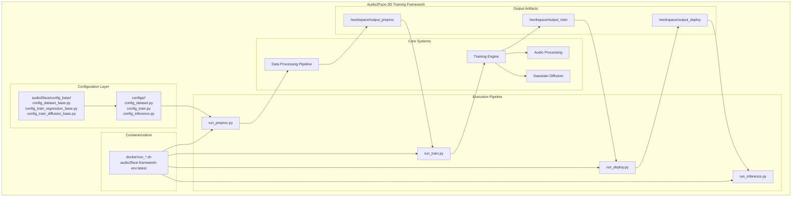
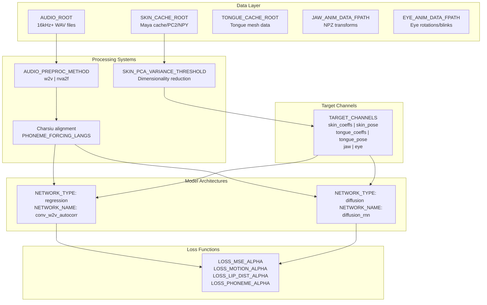
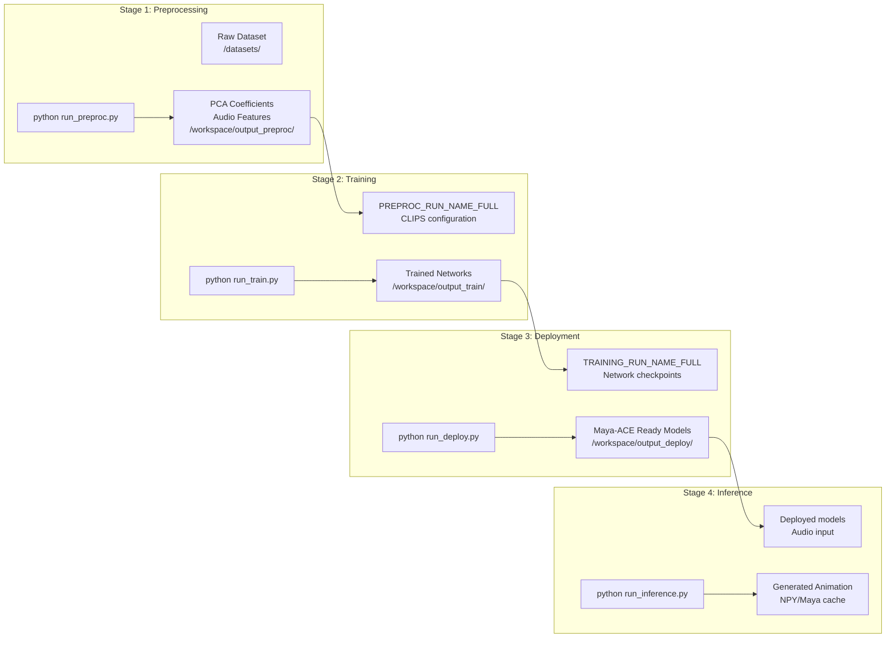
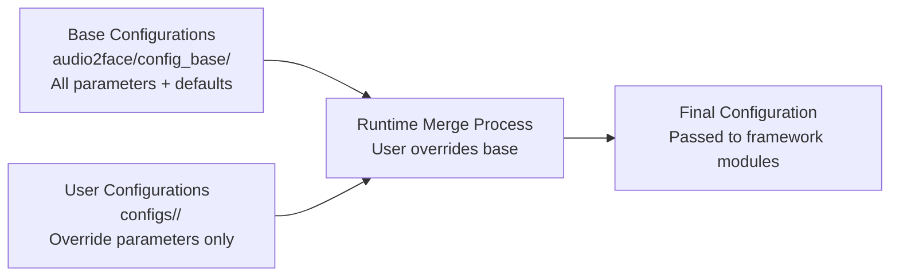

<!-- source: DeepWiki mcp.deepwiki.com · repo NVIDIA/Audio2Face-3D-Training-Framework · page 1 Overview · fetched 2026-10-26 -->

# Overview

Relevant source files

The following files were used as context for generating this wiki page:

- [README.md](README.md)
- [configs/example-diffusion-min/config_train.py](configs/example-diffusion-min/config_train.py)
- [configs/example-diffusion/config_train.py](configs/example-diffusion/config_train.py)
- [configs/example-regression-min/config_train.py](configs/example-regression-min/config_train.py)
- [docker/run_preproc.sh](docker/run_preproc.sh)
- [docker/run_shell.sh](docker/run_shell.sh)
- [docs/config_details.md](docs/config_details.md)
- [docs/training_framework.md](docs/training_framework.md)

This document provides a comprehensive overview of the Audio2Face-3D Training Framework, explaining its architecture, core components, and execution model. The framework is a containerized system designed to train high-fidelity facial animation models that generate realistic facial movements, including skin, jaw, tongue, and eye animations, from audio input.

For detailed configuration parameters, see [Configuration System](#3). For data preparation requirements, see [Data Preparation](#4). For training specifics, see [Training Framework](#5).

## System Purpose and Capabilities

The Audio2Face-3D Training Framework enables users to train custom facial animation models from synchronized audio-visual datasets. The system supports two primary model architectures:

- **Regression Models**: Standard approach using PCA-compressed geometry with faster training
- **Diffusion Models**: Advanced approach using absolute pose representation with higher fidelity output

The framework operates entirely within Docker containers and follows a sequential four-stage pipeline: preprocessing, training, deployment, and inference.

**Sources:** [README.md:9-13](), [docs/training_framework.md:12-25]()

## System Architecture

The framework consists of interconnected systems that process facial animation data through a standardized pipeline:

**Sources:** [docs/training_framework.md:28-44](), [docker/run_preproc.sh:18-44](), [README.md:172-238]()

## Core Component Architecture

This diagram shows the relationship between high-level system concepts and their corresponding code entities:

**Sources:** [docs/config_details.md:24-143](), [docs/config_details.md:414-419](), [docs/config_details.md:518-534]()

## Execution Pipeline

The framework executes through four sequential stages, each handled by dedicated Python scripts running in Docker containers:

**Sources:** [README.md:175-238](), [docs/training_framework.md:104-151]()

## Configuration System Architecture

The framework implements a two-tier configuration system that separates base parameter definitions from user customizations:

| Layer | Location | Purpose | Key Files |
|-------|----------|---------|-----------|
| Base Layer | `audio2face/config_base/` | Parameter definitions with defaults | `config_dataset_base.py`, `config_train_regression_base.py`, `config_train_diffusion_base.py` |
| User Layer | `configs/<CONFIG_NAME>/` | User overrides and customizations | `config_dataset.py`, `config_train.py`, `config_inference.py` |

### Configuration Merge Process

**Sources:** [docs/training_framework.md:48-101](), [docs/config_details.md:1-13]()

## Model Types and Capabilities

The framework supports two distinct neural network architectures with different characteristics:

### Regression Models

- **Network Class**: `conv_w2v_autocorr`
- **Target Representation**: PCA coefficients (`skin_coeffs`, `tongue_coeffs`)
- **Batch Processing**: `BATCH_SIZE = 32`, `SEQ_LEN = 2`
- **Training Features**: Phoneme supervision, emotion embeddings
- **Use Case**: Standard approach with faster training and good quality

### Diffusion Models

- **Network Class**: `diffusion_rnn` 
- **Target Representation**: Absolute poses (`skin_pose`, `tongue_pose`)
- **Batch Processing**: `BATCH_SIZE = 1`, `GRADIENT_ACCUMULATION_STEPS = 4`
- **Training Features**: `DIFFUSION_STEPS = 1000`, temporal RNN modeling
- **Use Case**: Advanced approach with higher fidelity output

| Feature | Regression | Diffusion |
|---------|------------|-----------|
| Data Representation | PCA compressed | Absolute geometry |
| Sequence Handling | Fixed length (`SEQ_LEN`) | Variable length |
| Training Speed | Faster | Slower |
| Output Quality | Good | Higher fidelity |
| Memory Usage | Lower | Higher |

**Sources:** [configs/example-regression-min/config_train.py:25](), [configs/example-diffusion-min/config_train.py:25](), [docs/config_details.md:356-360]()

---

