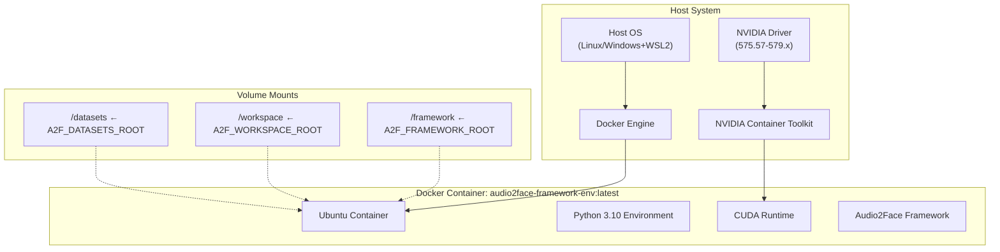
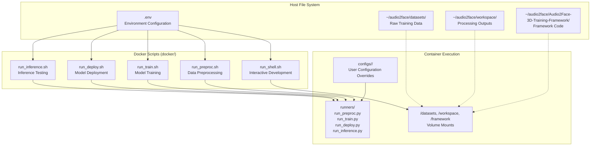
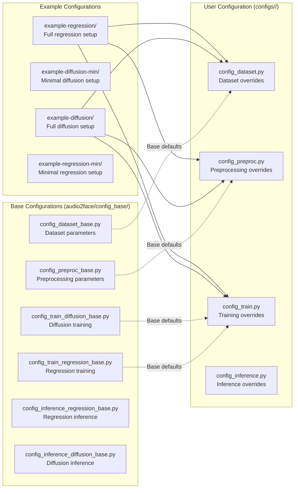
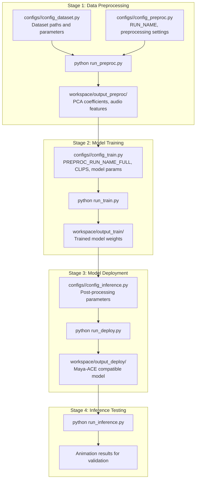

<!-- source: DeepWiki mcp.deepwiki.com · repo NVIDIA/Audio2Face-3D-Training-Framework · page 2 Getting Started · fetched 2026-10-26 -->

# Getting Started

<details>
<summary>Relevant source files</summary>

The following files were used as context for generating this wiki page:

- [configs/example-diffusion-min/config_preproc.py](configs/example-diffusion-min/config_preproc.py)
- [configs/example-diffusion/config_preproc.py](configs/example-diffusion/config_preproc.py)
- [configs/example-regression-min/config_preproc.py](configs/example-regression-min/config_preproc.py)
- [configs/example-regression/config_preproc.py](configs/example-regression/config_preproc.py)
- [docker/run_deploy.sh](docker/run_deploy.sh)
- [docker/run_inference.sh](docker/run_inference.sh)
- [docker/run_shell.sh](docker/run_shell.sh)
- [docker/run_train.sh](docker/run_train.sh)
- [docs/training_framework.md](docs/training_framework.md)

</details>


This page provides the essential setup and installation steps needed to begin using the Audio2Face-3D Training Framework. It covers system requirements, Docker environment setup, and the basic workflow to train your first model.

For detailed configuration parameters, see [Configuration System](#3). For data preparation requirements, see [Data Preparation](#4). For advanced training concepts, see [Training Framework](#5).

## Prerequisites

Before installing the framework, ensure your system meets the minimum requirements:

| Requirement | Specification |
|------------|---------------|
| **Storage** | Minimum 1 GB free disk space |
| **Hardware** | CUDA-compatible NVIDIA GPU with ≥6 GB VRAM |
| **NVIDIA Driver** | Linux: 575.57-579.x, Windows/WSL2: 576.57-579.x |
| **Operating System** | Linux or Windows with WSL2 |

**Container Architecture**



Sources: [docs/training_framework.md:261-272](), [docker/run_shell.sh:31-43]()

## Installation Steps

### 1. Clone the Repository

```bash
mkdir -p ~/audio2face && cd ~/audio2face
git clone https://github.com/NVIDIA/Audio2Face-3D-Training-Framework.git
```

### 2. Create Directory Structure

```bash
mkdir -p ~/audio2face/datasets
mkdir -p ~/audio2face/workspace
cd ~/audio2face/Audio2Face-3D-Training-Framework
```

### 3. Configure Environment Variables

```bash
cp .env.example .env
nano .env
```

Set the following paths in `.env`:
```bash
A2F_DATASETS_ROOT="/absolute/path/to/datasets"
A2F_WORKSPACE_ROOT="/absolute/path/to/workspace" 
A2F_FRAMEWORK_ROOT="/absolute/path/to/Audio2Face-3D-Training-Framework"
```

### 4. Build Docker Container

```bash
chmod +x docker/*.sh
./docker/build_docker.sh
```

Sources: [docs/training_framework.md:405-461]()

## Framework Architecture

**Execution Environment Structure**



Sources: [docs/training_framework.md:26-44](), [docker/run_shell.sh:18-43](), [docker/run_train.sh:18-44]()

## Configuration Overview

The framework uses a two-tier configuration system where base configurations define all available parameters, and user configurations override specific values for your use case.

**Configuration System Architecture**



Sources: [docs/training_framework.md:48-100](), [configs/example-diffusion/config_preproc.py:16-20](), [configs/example-regression/config_preproc.py:16-20]()

## Quick Start Workflow

The complete training pipeline consists of four sequential stages, each executed through Docker scripts:

**Pipeline Execution Flow**



Sources: [docs/training_framework.md:102-152]()

## Basic Usage Example

### 1. Start with Example Configuration

Copy one of the provided example configurations:
- `configs/example-diffusion/` - Advanced diffusion-based training
- `configs/example-regression/` - Standard regression-based training  
- `configs/example-diffusion-min/` - Minimal diffusion setup
- `configs/example-regression-min/` - Minimal regression setup

### 2. Configure Your Dataset

Edit `configs/<CONFIG_NAME>/config_dataset.py`:
```python
ACTOR_NAMES = ["your_actor_name"]
AUDIO_ROOT = "/datasets/your_dataset/audio"
SKIN_CACHE_ROOT = "/datasets/your_dataset/cache/skin"
```

### 3. Run Preprocessing

```bash
python run_preproc.py <CONFIG_NAME> <ACTOR_NAME>
```

### 4. Configure Training

Edit `configs/<CONFIG_NAME>/config_train.py` to reference the preprocessing output:
```python
PREPROC_RUN_NAME_FULL = {"actor_name": "YYYYMMDD_HHMMSS_actor_name"}
```

### 5. Run Training

```bash
python run_train.py <CONFIG_NAME>
```

### 6. Deploy Model

```bash
python run_deploy.py <CONFIG_NAME> <TRAINING_RUN_NAME_FULL>
```

Sources: [docs/training_framework.md:104-152](), [configs/example-diffusion-min/config_preproc.py:17-20]()

## Development Environment

For interactive development and debugging, use the development shell:

```bash
./docker/run_shell.sh
```

This provides:
- Interactive container access with all framework dependencies
- Volume mounts for live code editing
- GPU access for development testing
- Full Python environment with debugging capabilities

Sources: [docker/run_shell.sh:31-43](), [docs/training_framework.md:193-257]()

## Next Steps

After completing basic setup:

1. **Prepare Your Data**: See [Data Preparation](#4) for detailed requirements on audio files, animation caches, and geometry data
2. **Configure Training**: See [Configuration System](#3) for comprehensive parameter documentation  
3. **Understand Model Types**: See [Training Framework](#5) for details on regression vs diffusion models
4. **Deploy to Maya**: See [Deployment and Inference](#6) for Maya-ACE integration

The framework supports both single-actor and multi-actor training scenarios. For production workflows, review the complete configuration system to optimize training parameters for your specific dataset characteristics.

Sources: [docs/training_framework.md:100](), [docs/training_framework.md:154-192]()

---

