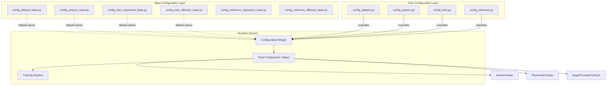
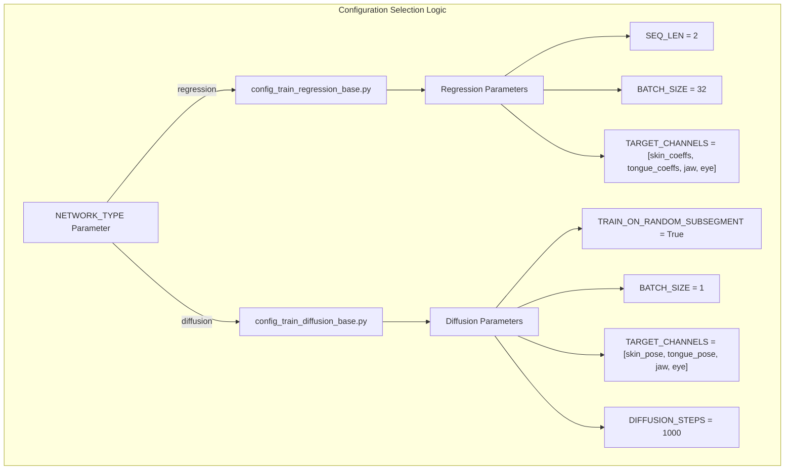
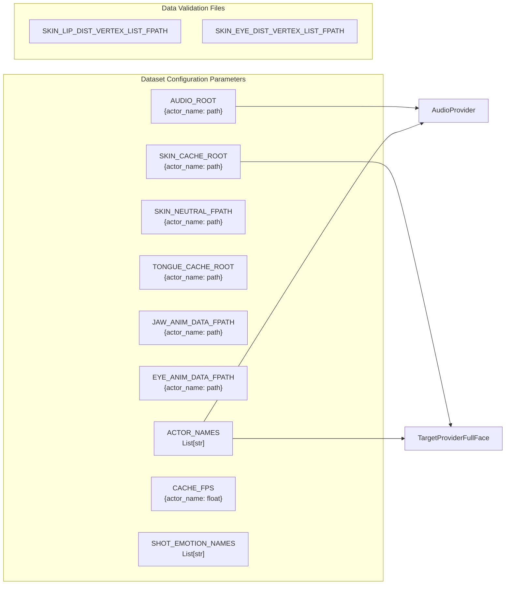
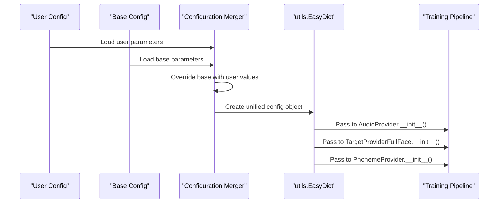
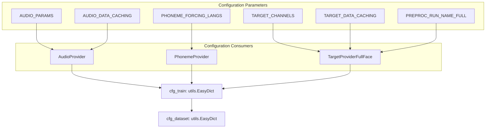
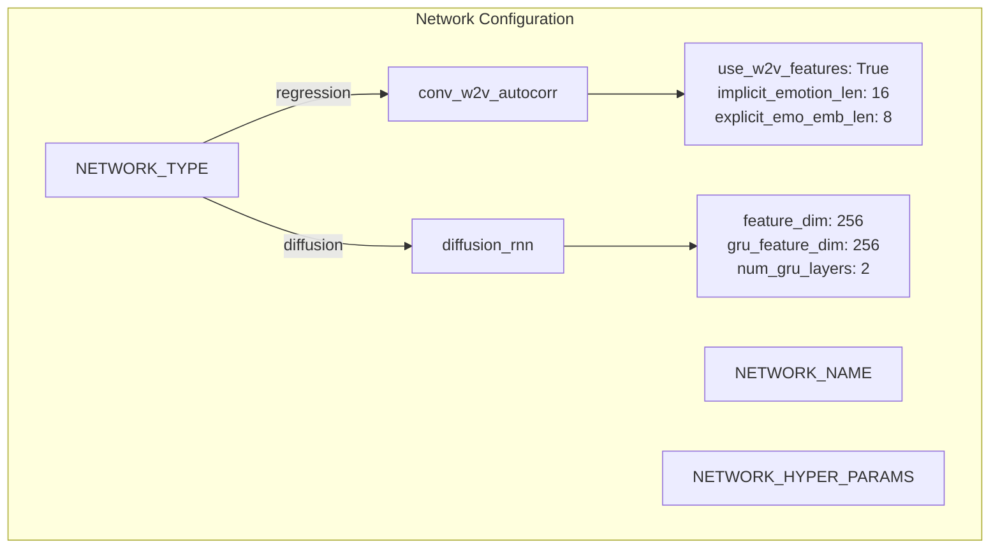
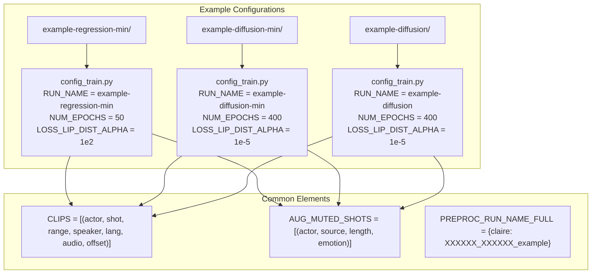

<!-- source: DeepWiki mcp.deepwiki.com · repo NVIDIA/Audio2Face-3D-Training-Framework · page 3 Configuration System · fetched 2026-10-26 -->

# Configuration System

<details>
<summary>Relevant source files</summary>

The following files were used as context for generating this wiki page:

- [audio2face/config_base/config_train_diffusion_base.py](audio2face/config_base/config_train_diffusion_base.py)
- [audio2face/config_base/config_train_regression_base.py](audio2face/config_base/config_train_regression_base.py)
- [audio2face/dataset.py](audio2face/dataset.py)
- [audio2face/networks/diffusion_rnn.py](audio2face/networks/diffusion_rnn.py)
- [configs/example-diffusion-min/config_train.py](configs/example-diffusion-min/config_train.py)
- [configs/example-diffusion/config_train.py](configs/example-diffusion/config_train.py)
- [configs/example-regression-min/config_train.py](configs/example-regression-min/config_train.py)
- [docs/config_details.md](docs/config_details.md)

</details>


The Configuration System is the core orchestration mechanism for the Audio2Face-3D Training Framework, implementing a two-tier architecture that separates base defaults from user customizations. This system manages all parameters across the entire pipeline, from dataset preparation through model deployment, providing a unified interface for controlling training workflows, model architectures, and inference settings.

For information about specific training configuration parameters, see [Training Configuration](#3.3). For dataset-specific configuration details, see [Dataset Configuration](#3.2).

## Two-Tier Configuration Architecture

The framework implements a hierarchical configuration system with two distinct layers that merge at runtime to produce the final configuration used by the training pipeline.

### Configuration Merger System



**Sources:** [audio2face/config_base/config_train_regression_base.py:1-215](), [audio2face/config_base/config_train_diffusion_base.py:1-224](), [audio2face/dataset.py:38-44]()

The base configuration layer provides comprehensive defaults for all framework components, while the user layer allows selective overrides for specific deployment scenarios. This architecture ensures that users only need to specify parameters that differ from sensible defaults.

### Configuration Type Selection



**Sources:** [audio2face/config_base/config_train_regression_base.py:25](), [audio2face/config_base/config_train_diffusion_base.py:25](), [audio2face/config_base/config_train_regression_base.py:153](), [audio2face/config_base/config_train_diffusion_base.py:173]()

## Configuration File Structure

The configuration system organizes parameters into four primary categories, each handled by dedicated configuration files with specific responsibilities.

### Core Configuration Components

| Configuration Type | Base File | Purpose | Key Parameters |
|-------------------|-----------|---------|----------------|
| Dataset | `config_dataset_base.py` | Data paths and actor properties | `AUDIO_ROOT`, `SKIN_CACHE_ROOT`, `ACTOR_NAMES` |
| Preprocessing | `config_preproc_base.py` | PCA and data preparation | `SKIN_PCA_VARIANCE_THRESHOLD`, `RUN_NAME` |
| Training | `config_train_*_base.py` | Model training parameters | `NETWORK_TYPE`, `BATCH_SIZE`, `LOSS_*_ALPHA` |
| Inference | `config_inference_*_base.py` | Post-processing and deployment | `TEMPORAL_SMOOTHING`, `LIP_SYNC_OFFSET` |

**Sources:** [docs/config_details.md:14-926]()

### Dataset Configuration Structure



**Sources:** [docs/config_details.md:27-202](), [audio2face/dataset.py:38-61](), [audio2face/dataset.py:381-409]()

## Configuration Merging and Resolution

The framework employs a runtime configuration resolution system that combines base and user configurations through parameter-level overrides.

### Parameter Resolution Process



**Sources:** [audio2face/dataset.py:39-41](), [audio2face/dataset.py:165-167](), [audio2face/dataset.py:117-120]()

The merging process ensures that user-specified parameters take precedence over base defaults, while maintaining type safety and parameter validation. The `utils.EasyDict` class provides the runtime configuration object used throughout the training pipeline.

### Actor-Specific Parameter Structure

Many configuration parameters use dictionary structures keyed by actor names to support multi-actor training scenarios:

```python
# Example from config files
PREPROC_RUN_NAME_FULL = {
    "claire": "XXXXXX_XXXXXX_example"
}

AUDIO_ROOT = {
    "actor_name": "path/to/audio/directory"
}
```

**Sources:** [configs/example-regression-min/config_train.py:38-40](), [docs/config_details.md:27-31]()

## Training Configuration Integration

The configuration system directly integrates with the training pipeline through provider classes that consume configuration parameters during initialization.

### Configuration Consumer Classes



**Sources:** [audio2face/dataset.py:39-44](), [audio2face/dataset.py:118-124](), [audio2face/dataset.py:165-169]()

### Network Architecture Configuration

The configuration system supports different network architectures through the `NETWORK_TYPE` parameter and associated hyperparameters:



**Sources:** [audio2face/config_base/config_train_regression_base.py:128-145](), [audio2face/config_base/config_train_diffusion_base.py:132-143](), [audio2face/networks/diffusion_rnn.py:201-227]()

The `NETWORK_HYPER_PARAMS` dictionary contains architecture-specific parameters that are passed directly to network constructors, enabling flexible model configuration without code changes.

## Example Configuration Hierarchy

The framework provides several example configurations demonstrating different use cases and complexity levels.

### Example Configuration Structure



**Sources:** [configs/example-regression-min/config_train.py:17](), [configs/example-diffusion-min/config_train.py:17](), [configs/example-diffusion/config_train.py:17](), [configs/example-regression-min/config_train.py:52-107](), [configs/example-regression-min/config_train.py:120-132]()

All example configurations share common structural elements like the `CLIPS` list for defining training data segments and `AUG_MUTED_SHOTS` for data augmentation, while differing in model-specific parameters like loss function weights and training epochs.

---

