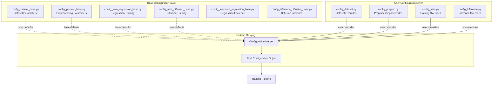
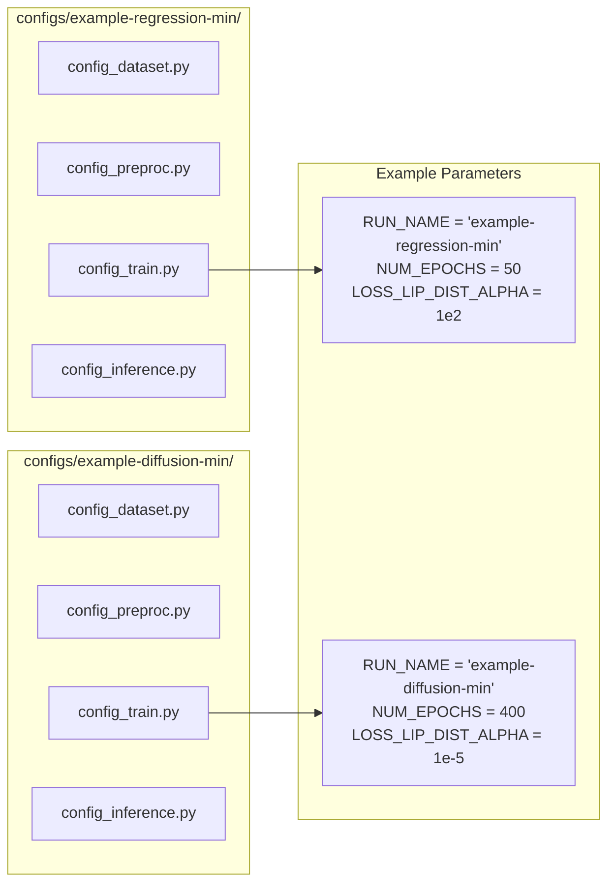
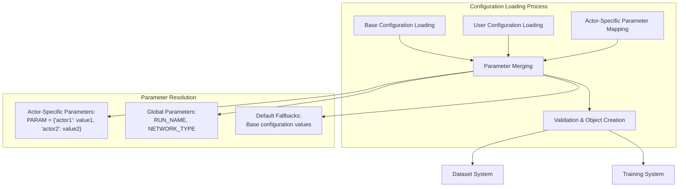
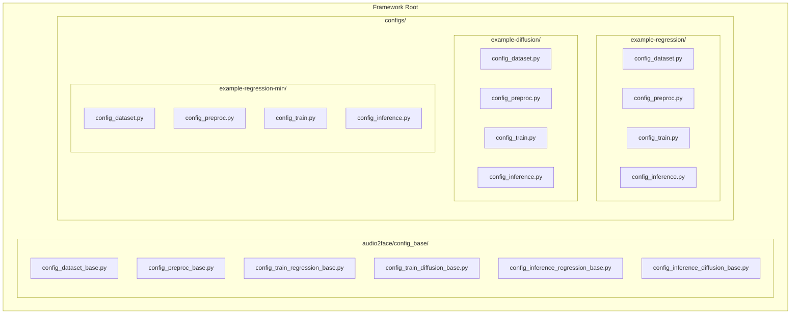

<!-- source: DeepWiki mcp.deepwiki.com · repo NVIDIA/Audio2Face-3D-Training-Framework · page 3.1 Configuration Architecture · fetched 2026-10-26 -->

# Configuration Architecture

<details>
<summary>Relevant source files</summary>

The following files were used as context for generating this wiki page:

- [audio2face/config_base/config_train_diffusion_base.py](audio2face/config_base/config_train_diffusion_base.py)
- [audio2face/config_base/config_train_regression_base.py](audio2face/config_base/config_train_regression_base.py)
- [audio2face/dataset.py](audio2face/dataset.py)
- [audio2face/networks/diffusion_rnn.py](audio2face/networks/diffusion_rnn.py)
- [configs/example-diffusion-min/config_train.py](configs/example-diffusion-min/config_train.py)
- [configs/example-diffusion/config_train.py](configs/example-diffusion/config_train.py)
- [configs/example-regression-min/config_train.py](configs/example-regression-min/config_train.py)
- [docs/config_details.md](docs/config_details.md)

</details>


The configuration architecture provides a two-tier system for managing parameters across the Audio2Face-3D Training Framework. This system separates base defaults from user customizations, enabling flexible parameter management while maintaining consistency across different training scenarios.

For specific parameter details and usage examples, see [Dataset Configuration](#3.2), [Training Configuration](#3.3), and [Inference Configuration](#3.4).

## Two-Tier Configuration System

The framework employs a hierarchical configuration architecture consisting of base configurations that define sensible defaults and user configurations that override specific parameters for particular use cases.



**Sources:** [docs/config_details.md:1-13](), [audio2face/config_base/config_train_diffusion_base.py:1-224](), [audio2face/config_base/config_train_regression_base.py:1-215]()

## Base Configuration Layer

The base configuration layer provides default parameter values organized by functional area. Each base configuration file defines parameters for a specific pipeline stage or model type.

### Base Configuration Files

| Configuration File | Purpose | Key Parameters |
|-------------------|---------|----------------|
| `config_dataset_base.py` | Dataset structure and paths | `ACTOR_NAMES`, `AUDIO_ROOT`, `SKIN_CACHE_ROOT` |
| `config_preproc_base.py` | Preprocessing pipeline | `SKIN_PCA_VARIANCE_THRESHOLD`, `RUN_NAME` |
| `config_train_regression_base.py` | Regression model training | `NETWORK_TYPE="regression"`, `SEQ_LEN=2` |
| `config_train_diffusion_base.py` | Diffusion model training | `NETWORK_TYPE="diffusion"`, `DIFFUSION_STEPS=1000` |
| `config_inference_regression_base.py` | Regression inference | Inference-specific parameters |
| `config_inference_diffusion_base.py` | Diffusion inference | Sampling and generation parameters |

### Model-Specific Base Configurations

The training base configurations define distinct parameter sets for different model architectures:

**Regression Base Configuration:**
- `NETWORK_TYPE = "regression"` [audio2face/config_base/config_train_regression_base.py:25]()
- `TARGET_CHANNELS = ["skin_coeffs", "tongue_coeffs", "jaw", "eye"]` [audio2face/config_base/config_train_regression_base.py:54-59]()
- `BATCH_SIZE = 32` [audio2face/config_base/config_train_regression_base.py:153]()
- `SEQ_LEN = 2` [audio2face/config_base/config_train_regression_base.py:77]()

**Diffusion Base Configuration:**
- `NETWORK_TYPE = "diffusion"` [audio2face/config_base/config_train_diffusion_base.py:25]()
- `TARGET_CHANNELS = ["skin_pose", "tongue_pose", "jaw", "eye"]` [audio2face/config_base/config_train_diffusion_base.py:55-61]()
- `BATCH_SIZE = 1` [audio2face/config_base/config_train_diffusion_base.py:173]()
- `DIFFUSION_STEPS = 1000` [audio2face/config_base/config_train_diffusion_base.py:146]()

**Sources:** [audio2face/config_base/config_train_regression_base.py:25-215](), [audio2face/config_base/config_train_diffusion_base.py:25-224]()

## User Configuration Layer

User configurations reside in the `configs/<CONFIG_NAME>/` directory structure and override base parameters for specific training scenarios. Each configuration set contains four files corresponding to pipeline stages.



### User Override Patterns

User configurations typically override specific parameters while inheriting base defaults:

**Training Run Configuration:**
```python
RUN_NAME = "example-regression-min"
NETWORK_VERSION = "2.3"
PREPROC_RUN_NAME_FULL = {"claire": "XXXXXX_XXXXXX_example"}
```

**Training Data Specification:**
```python
CLIPS = [
    ("claire", "cp1_neutral", (0, 348), "claire", "zh", "cp1_neutral.wav", 0),
    # ... additional clips
]
```

**Model-Specific Overrides:**
- Regression: `NUM_EPOCHS = 50`, `LOSS_LIP_DIST_ALPHA = 1e2`
- Diffusion: `NUM_EPOCHS = 400`, `LOSS_LIP_DIST_ALPHA = 1e-5`

**Sources:** [configs/example-regression-min/config_train.py:17-154](), [configs/example-diffusion-min/config_train.py:17-150]()

## Configuration Resolution and Loading

The framework resolves configurations by merging base parameters with user overrides at runtime. The configuration system handles actor-specific parameters through dictionary structures.



### Actor-Specific Parameter Handling

The configuration system supports multi-actor training through dictionary-based parameter specification:

```python
# Actor-specific parameters
PREPROC_RUN_NAME_FULL = {"actor1": "run_name_1", "actor2": "run_name_2"}
SKIN_PCA_COEFFS_FPATH = {"actor1": "/path/to/actor1/coeffs.npz"}

# Global parameters  
RUN_NAME = "training_run_name"
NETWORK_TYPE = "regression"
```

The system automatically resolves parameters using fallback mechanisms when actor-specific values are missing, particularly for preprocessing artifact paths [audio2face/dataset.py:196-204]().

### Configuration Usage in Runtime

The merged configuration objects (`cfg_train`, `cfg_dataset`) are passed to system components:

- **Dataset System**: Uses configurations for data loading and preprocessing [audio2face/dataset.py:39-41]()
- **Training Pipeline**: Accesses merged parameters for model initialization and training loops
- **Network Architecture**: Retrieves hyperparameters from `NETWORK_HYPER_PARAMS` dictionaries

**Sources:** [audio2face/dataset.py:39-41](), [audio2face/dataset.py:196-204](), [docs/config_details.md:34-38]()

## Configuration File Organization

The framework organizes configuration files in a standardized directory structure that separates concerns and enables easy management of different training scenarios.



### Configuration Naming Convention

Configuration directories follow the pattern `<purpose>-<model_type>[-<variant>]`:

- `example-regression`: Full regression model configuration
- `example-diffusion`: Full diffusion model configuration  
- `example-regression-min`: Minimal regression configuration
- `example-diffusion-min`: Minimal diffusion configuration

Each configuration directory contains the four standard configuration files that correspond to pipeline stages.

**Sources:** [configs/example-regression-min/config_train.py:1-15](), [configs/example-diffusion-min/config_train.py:1-15](), [configs/example-diffusion/config_train.py:1-15]()

## Configuration Parameter Categories

The configuration system organizes parameters into logical categories that align with framework functionality and pipeline stages.

| Category | Purpose | Key Files | Example Parameters |
|----------|---------|-----------|-------------------|
| **Dataset Paths** | File system locations | `config_dataset.py` | `AUDIO_ROOT`, `SKIN_CACHE_ROOT`, `ACTOR_NAMES` |
| **Preprocessing** | Data transformation | `config_preproc.py` | `SKIN_PCA_VARIANCE_THRESHOLD`, `RUN_NAME` |  
| **Model Architecture** | Network structure | `config_train.py` | `NETWORK_NAME`, `NETWORK_HYPER_PARAMS` |
| **Training Process** | Learning parameters | `config_train.py` | `NUM_EPOCHS`, `LEARNING_RATE`, `BATCH_SIZE` |
| **Loss Functions** | Training objectives | `config_train.py` | `LOSS_MSE_ALPHA`, `LOSS_LIP_DIST_ALPHA` |
| **Data Augmentation** | Training data variety | `config_train.py` | `AUGMENT`, `AUG_MUTED_SHOTS` |
| **Inference Settings** | Generation parameters | `config_inference.py` | Post-processing and deployment settings |

This categorical organization enables targeted parameter modification while maintaining system coherence across different training scenarios.

**Sources:** [docs/config_details.md:14-929](), [audio2face/config_base/config_train_regression_base.py:54-215](), [audio2face/config_base/config_train_diffusion_base.py:55-224]()

---

