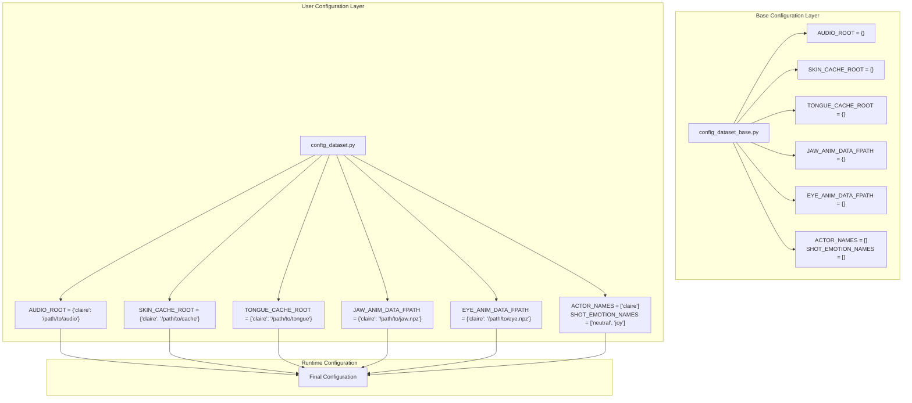
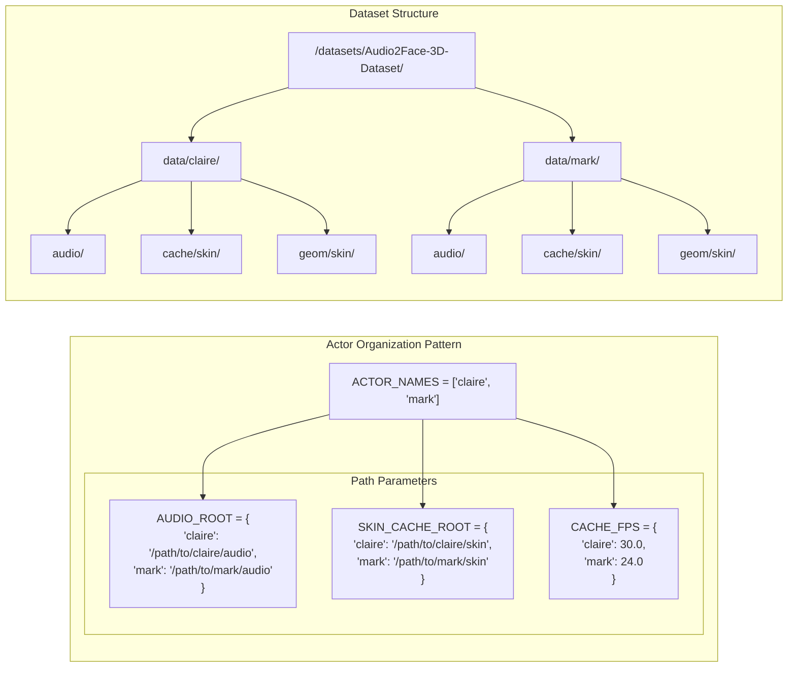
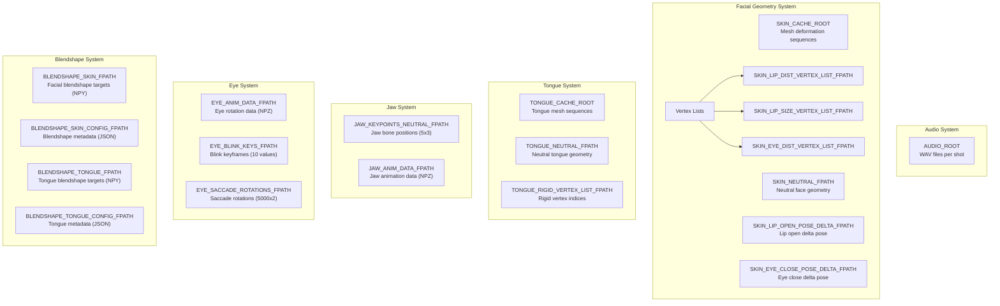
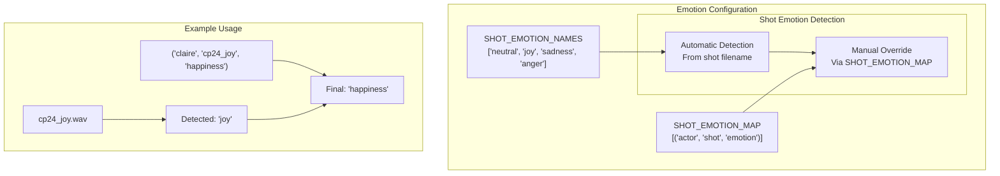
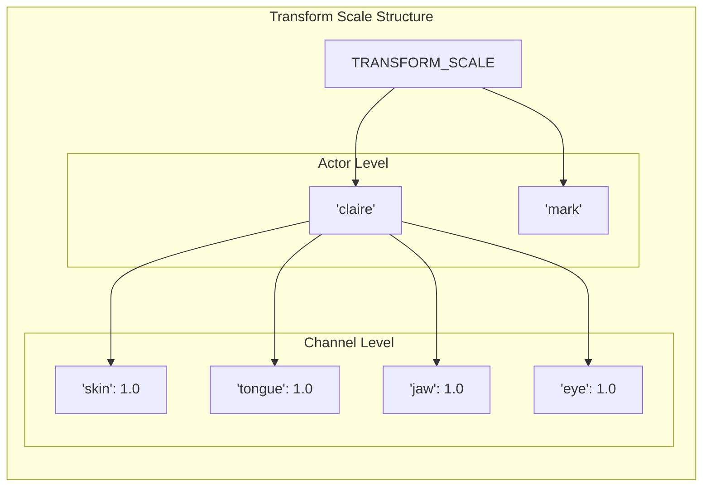

<!-- source: DeepWiki mcp.deepwiki.com · repo NVIDIA/Audio2Face-3D-Training-Framework · page 3.2 Dataset Configuration · fetched 2026-10-26 -->

# Dataset Configuration

<details>
<summary>Relevant source files</summary>

The following files were used as context for generating this wiki page:

- [audio2face/config_base/config_dataset_base.py](audio2face/config_base/config_dataset_base.py)
- [configs/example-diffusion-min/config_dataset.py](configs/example-diffusion-min/config_dataset.py)
- [configs/example-diffusion-min/config_train.py](configs/example-diffusion-min/config_train.py)
- [configs/example-diffusion/config_dataset.py](configs/example-diffusion/config_dataset.py)
- [configs/example-diffusion/config_train.py](configs/example-diffusion/config_train.py)
- [configs/example-regression-min/config_dataset.py](configs/example-regression-min/config_dataset.py)
- [configs/example-regression-min/config_train.py](configs/example-regression-min/config_train.py)
- [configs/example-regression/config_dataset.py](configs/example-regression/config_dataset.py)
- [docs/config_details.md](docs/config_details.md)

</details>


Dataset configuration defines the paths and properties for Audio2Face-3D training datasets. This configuration specifies where to find audio files, facial geometry data, animation caches, and metadata required for training facial animation models. Dataset configuration is the foundation layer of the framework's two-tier configuration system.

For information about training-specific parameters like model architecture and loss functions, see [Training Configuration](#3.3). For preprocessing parameters that control how dataset files are processed, see [Preprocessing Pipeline](#4.2).

## Configuration Architecture

The dataset configuration follows the framework's two-tier architecture where base configurations provide structure and user configurations supply actual values.



Sources: [audio2face/config_base/config_dataset_base.py:1-81](), [configs/example-regression/config_dataset.py:1-123]()

## Actor-Centric Organization

All dataset paths are organized using actor-specific dictionaries where keys are actor names from `ACTOR_NAMES` and values are the corresponding paths or settings for that actor.



Sources: [audio2face/config_base/config_dataset_base.py:75-81](), [configs/example-regression/config_dataset.py:23-31]()

## Data Path Specifications

### Required Data Components

The framework requires two essential data components for basic operation:

| Component | Parameter | Description |
|-----------|-----------|-------------|
| Audio Data | `AUDIO_ROOT` | Directory containing WAV audio files for each shot |
| Facial Geometry | `SKIN_CACHE_ROOT` | Directory containing facial mesh deformation sequences |

Sources: [configs/example-diffusion-min/config_dataset.py:20-31](), [configs/example-regression-min/config_dataset.py:20-31]()

### Complete Data Component Mapping



Sources: [audio2face/config_base/config_dataset_base.py:22-54](), [docs/config_details.md:24-169]()

## Dataset Properties and Metadata

Dataset configuration includes essential metadata that defines the training dataset's characteristics:

### Core Properties

| Property | Parameter | Description |
|----------|-----------|-------------|
| Actor List | `ACTOR_NAMES` | List of performers in the dataset |
| Emotions | `SHOT_EMOTION_NAMES` | Available emotion labels for shots |
| Frame Rate | `CACHE_FPS` | Animation cache frame rate per actor |
| Data Scaling | `TRANSFORM_SCALE` | Channel-specific scaling factors |

### Emotion System Configuration



Sources: [audio2face/config_base/config_dataset_base.py:60-69](), [configs/example-regression/config_dataset.py:98-111]()

### Transform Scaling System

The `TRANSFORM_SCALE` parameter provides per-actor, per-channel scaling factors to adjust data magnitude for numerical stability:



Sources: [audio2face/config_base/config_dataset_base.py:78-80](), [configs/example-diffusion/config_dataset.py:124-133]()

## Example Configurations

The framework provides four example configurations demonstrating different complexity levels:

### Configuration Comparison

| Configuration | Required Components | Optional Components | Use Case |
|---------------|-------------------|-------------------|----------|
| `example-regression-min` | `AUDIO_ROOT`, `SKIN_CACHE_ROOT` | None | Minimal setup for basic facial animation |
| `example-diffusion-min` | `AUDIO_ROOT`, `SKIN_CACHE_ROOT` | None | Minimal setup for diffusion-based models |
| `example-regression` | `AUDIO_ROOT`, `SKIN_CACHE_ROOT` | All geometry, jaw, eye, blendshape data | Full-featured regression training |
| `example-diffusion` | `AUDIO_ROOT`, `SKIN_CACHE_ROOT` | All geometry, jaw, eye, blendshape data | Full-featured diffusion training |

### Minimal Configuration Pattern

```python
# Required components only
AUDIO_ROOT = {
    "claire": "/datasets/Audio2Face-3D-Dataset-v1.0.0-claire/data/claire/audio",
}

SKIN_CACHE_ROOT = {
    "claire": "/datasets/Audio2Face-3D-Dataset-v1.0.0-claire/data/claire/cache/skin",
}

ACTOR_NAMES = ["claire"]
SHOT_EMOTION_NAMES = ["neutral", "joy", "sadness", "anger"]
CACHE_FPS = {"claire": 30.0}
```

### Full Configuration Pattern

```python
# Complete data specification
SKIN_NEUTRAL_FPATH = {
    "claire": "/datasets/.../geom/skin/neutral_pose.npy",
}
SKIN_LIP_DIST_VERTEX_LIST_FPATH = {
    "claire": "/datasets/.../geom/skin/lip_dist_vertex_list.json", 
}
JAW_ANIM_DATA_FPATH = {
    "claire": "/datasets/.../xform/jaw_keypoints_cache_all.npz",
}
EYE_ANIM_DATA_FPATH = {
    "claire": "/datasets/.../xform/eye_rotations_all.npz",
}
```

Sources: [configs/example-regression-min/config_dataset.py:23-61](), [configs/example-regression/config_dataset.py:31-92](), [configs/example-diffusion-min/config_dataset.py:24-72](), [configs/example-diffusion/config_dataset.py:31-133]()

---

