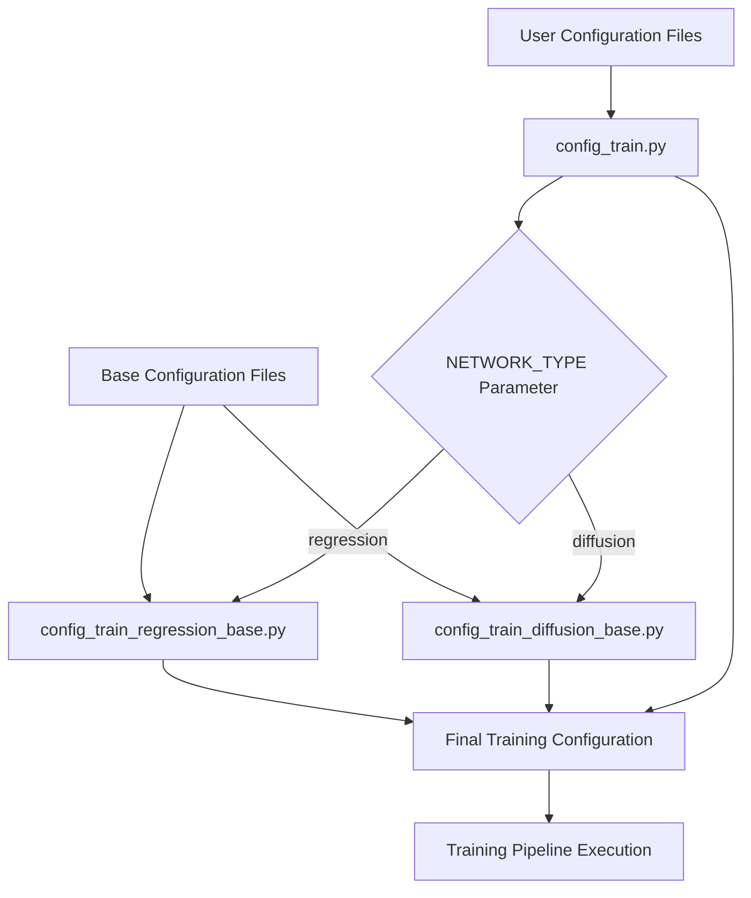
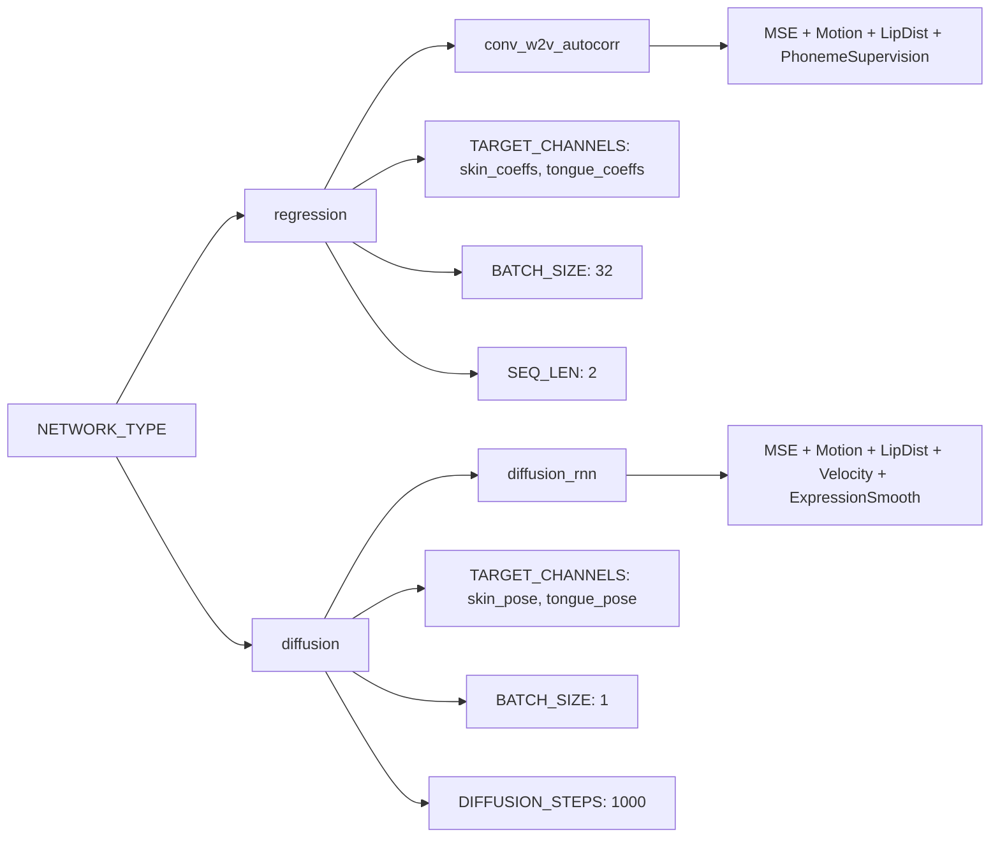
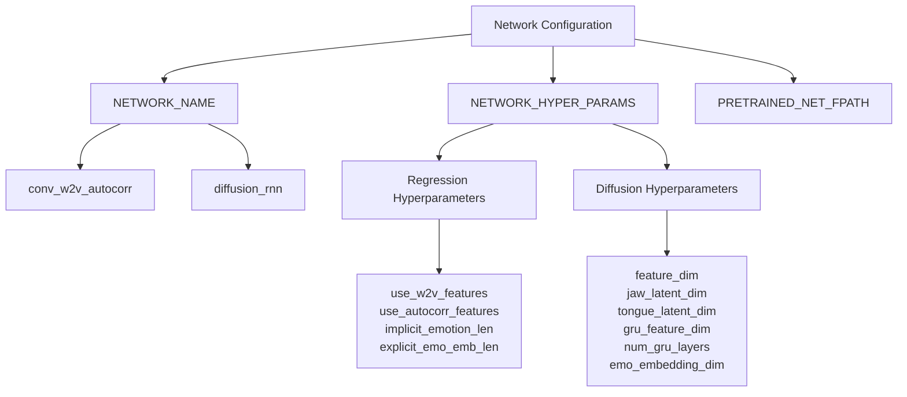
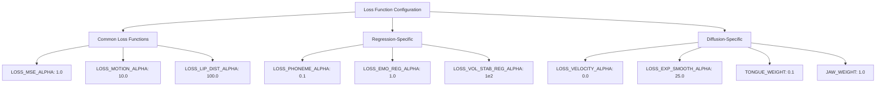
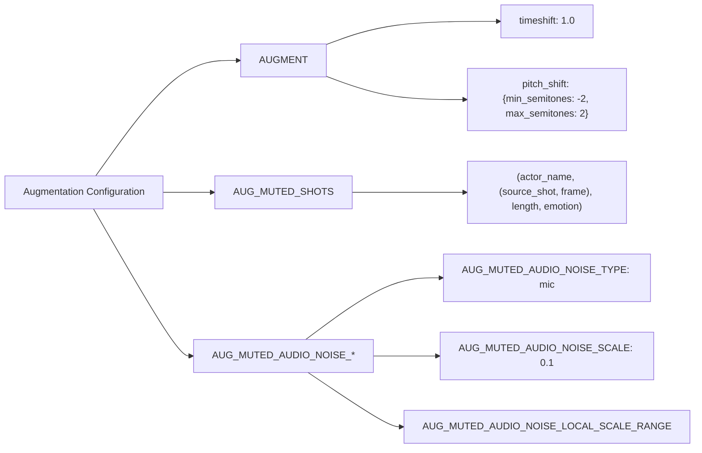
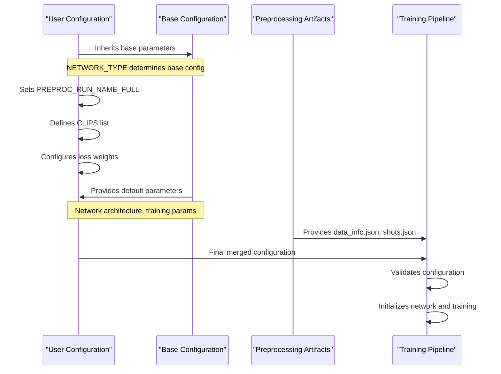

<!-- source: DeepWiki mcp.deepwiki.com · repo NVIDIA/Audio2Face-3D-Training-Framework · page 3.3 Training Configuration · fetched 2026-10-26 -->

# Training Configuration

<details>
<summary>Relevant source files</summary>

The following files were used as context for generating this wiki page:

- [audio2face/config_base/config_train_diffusion_base.py](audio2face/config_base/config_train_diffusion_base.py)
- [audio2face/config_base/config_train_regression_base.py](audio2face/config_base/config_train_regression_base.py)
- [audio2face/dataset.py](audio2face/dataset.py)
- [audio2face/networks/diffusion_rnn.py](audio2face/networks/diffusion_rnn.py)
- [configs/example-diffusion-min/config_train.py](configs/example-diffusion-min/config_train.py)
- [configs/example-diffusion/config_train.py](configs/example-diffusion/config_train.py)
- [configs/example-regression-min/config_train.py](configs/example-regression-min/config_train.py)
- [docs/config_details.md](docs/config_details.md)

</details>


This document covers the training configuration system of the Audio2Face-3D Training Framework, which controls model architecture, training hyperparameters, loss functions, and data sampling parameters. Training configuration is the second configuration file in the two-tier system and determines how neural networks are trained for facial animation generation.

For information about dataset configuration parameters, see [Dataset Configuration](#3.2). For preprocessing configuration, see the preprocessing sections. For inference configuration, see [Inference Configuration](#3.4).

## Configuration Architecture

The training configuration operates within the two-tier configuration system, where base configurations provide defaults and user configurations override specific parameters. Training configuration files are named `config_train.py` and inherit from either regression or diffusion base configurations.

### Configuration Flow



Sources: [audio2face/config_base/config_train_regression_base.py:25](), [audio2face/config_base/config_train_diffusion_base.py:25](), [docs/config_details.md:356-359]()

## Model Type Selection

The `NETWORK_TYPE` parameter determines which training pipeline and network architecture to use. This selection affects all downstream training parameters and loss functions.

### Model Type Architecture



Sources: [audio2face/config_base/config_train_regression_base.py:25](), [audio2face/config_base/config_train_diffusion_base.py:25](), [docs/config_details.md:356-359]()

## Core Parameter Categories

Training configuration parameters are organized into several key categories that control different aspects of the training process.

### Parameter Organization

| Category | Regression Key Parameters | Diffusion Key Parameters |
|----------|-------------------------|-------------------------|
| Network Architecture | `NETWORK_NAME`, `NETWORK_HYPER_PARAMS` | `NETWORK_NAME`, `NETWORK_HYPER_PARAMS`, `DIFFUSION_STEPS` |
| Training Parameters | `BATCH_SIZE`, `SEQ_LEN`, `LEARNING_RATE` | `BATCH_SIZE`, `GRADIENT_ACCUMULATION_STEPS`, `LEARNING_RATE` |
| Target Channels | `TARGET_CHANNELS` (coeffs) | `TARGET_CHANNELS` (pose) |
| Loss Functions | `LOSS_MSE_ALPHA`, `LOSS_PHONEME_ALPHA` | `LOSS_VELOCITY_ALPHA`, `LOSS_EXP_SMOOTH_ALPHA` |
| Data Processing | `SEQ_STRIDE`, `REMOVE_CLOSING_EYE` | `TRAIN_ON_RANDOM_SUBSEGMENT`, `NO_STANDARDIZE_AUDIO` |

Sources: [docs/config_details.md:414-419](), [audio2face/config_base/config_train_regression_base.py:54-59](), [audio2face/config_base/config_train_diffusion_base.py:55-60]()

## Network Architecture Configuration

Network architecture parameters define the neural network structure and capacity. Different model types use different network architectures optimized for their respective training approaches.

### Network Parameter Structure



Sources: [audio2face/config_base/config_train_regression_base.py:128-145](), [audio2face/config_base/config_train_diffusion_base.py:132-144](), [docs/config_details.md:518-535]()

## Loss Function Configuration

Loss functions control what aspects of facial animation the model learns to optimize. Each model type uses different loss functions tailored to its training approach.

### Loss Function Weights



Sources: [audio2face/config_base/config_train_regression_base.py:167-188](), [audio2face/config_base/config_train_diffusion_base.py:186-199](), [docs/config_details.md:572-624]()

## Data Augmentation Configuration

Data augmentation parameters control training data diversity and robustness. The framework supports different augmentation strategies for regression and diffusion models.

### Augmentation Parameter Mapping



Sources: [audio2face/config_base/config_train_regression_base.py:103-105](), [audio2face/config_base/config_train_diffusion_base.py:102-109](), [docs/config_details.md:461-515]()

## Training Clips Configuration

Training clips define the specific segments of animation data used for training. The `CLIPS` parameter specifies which shots and frame ranges to include in the training dataset.

### Clips Parameter Structure

The `CLIPS` parameter uses the following format:
```python
CLIPS = [
    (actor_name, shot_name, (clip_first_frame, clip_last_frame), speaker_name, audio_lang, audio_fpath_rel, audio_offset)
]
```

Each clip entry contains:
- **actor_name**: Actor identifier matching `ACTOR_NAMES`
- **shot_name**: Animation shot name from preprocessing
- **frame_range**: Tuple specifying start and end frames
- **speaker_name**: Audio speaker identifier
- **audio_lang**: Language code for phoneme alignment
- **audio_fpath_rel**: Relative audio file path
- **audio_offset**: Audio timing offset in samples

Sources: [docs/config_details.md:452-457](), [configs/example-regression-min/config_train.py:52-107](), [audio2face/config_base/config_train_regression_base.py:94-95]()

## Configuration Workflow

Training configuration follows a specific workflow that integrates with the preprocessing and training pipeline execution.

### Training Configuration Process



Sources: [docs/config_details.md:369-374](), [audio2face/dataset.py:196-204](), [audio2face/config_base/config_train_regression_base.py:34-38]()

## Model-Specific Configuration Differences

Regression and diffusion models require different configuration parameters due to their distinct training approaches and network architectures.

### Key Configuration Differences

| Parameter Category | Regression Models | Diffusion Models |
|-------------------|-------------------|------------------|
| Target Representation | PCA coefficients (`skin_coeffs`) | Absolute poses (`skin_pose`) |
| Batch Processing | Variable batch size (`BATCH_SIZE: 32`) | Fixed batch size (`BATCH_SIZE: 1`) |
| Sequence Handling | Fixed sequences (`SEQ_LEN: 2`) | Variable segments (`TRAIN_ON_RANDOM_SUBSEGMENT`) |
| Audio Processing | Standardized audio | Raw audio (`NO_STANDARDIZE_AUDIO: True`) |
| Training Steps | Epoch-based | Diffusion steps (`DIFFUSION_STEPS: 1000`) |
| Gradient Accumulation | Not used | Required (`GRADIENT_ACCUMULATION_STEPS: 4`) |

Sources: [audio2face/config_base/config_train_regression_base.py:54-78](), [audio2face/config_base/config_train_diffusion_base.py:55-83](), [docs/config_details.md:547-549]()

## Configuration Validation and Error Handling

The training system validates configuration parameters and provides error messages for common configuration issues. Key validation points include preprocessing artifact paths, clip definitions, and parameter compatibility.

### Common Configuration Issues

- **Missing PREPROC_RUN_NAME_FULL**: Training cannot proceed without valid preprocessing artifacts
- **Invalid CLIPS format**: Incorrect clip tuple structure causes dataset loading errors
- **Incompatible TARGET_CHANNELS**: Channel types must match model type (coeffs vs pose)
- **Missing loss function parameters**: Some loss functions require additional data files
- **Batch size constraints**: Diffusion models only support batch size 1

The validation occurs in the [audio2face/dataset.py:196-204]() `TargetProviderBase` class methods.

Sources: [audio2face/dataset.py:196-204](), [docs/config_details.md:369-374](), [audio2face/config_base/config_train_regression_base.py:34-38]()

---

