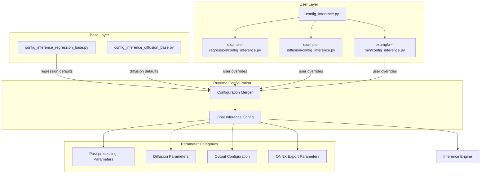
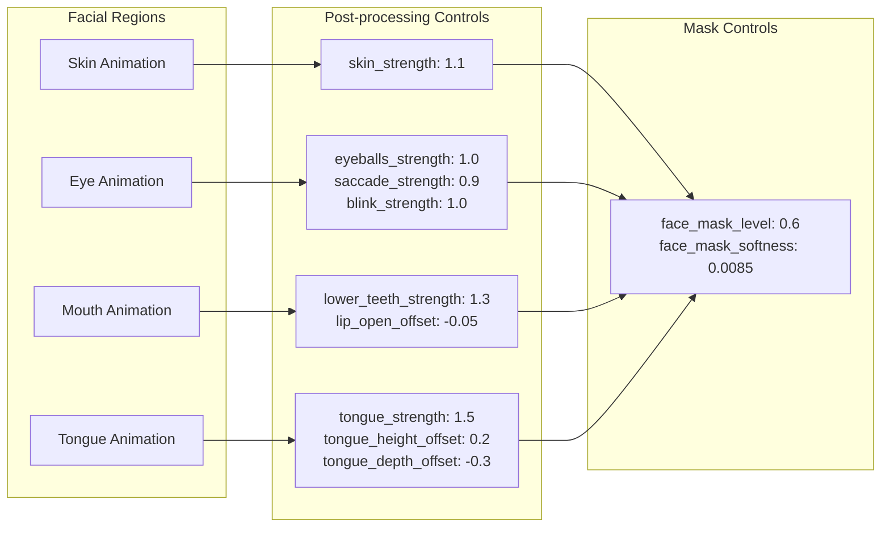
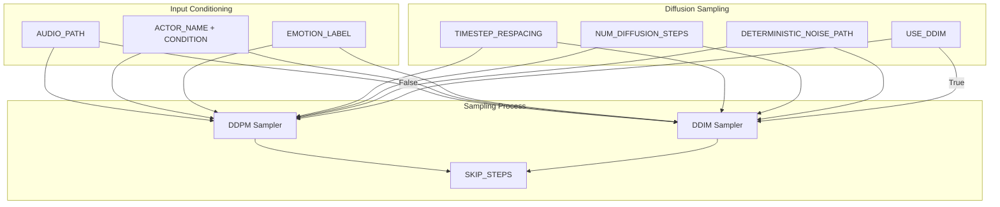

<!-- source: DeepWiki mcp.deepwiki.com · repo NVIDIA/Audio2Face-3D-Training-Framework · page 3.4 Inference Configuration · fetched 2026-10-26 -->

# Inference Configuration

<details>
<summary>Relevant source files</summary>

The following files were used as context for generating this wiki page:

- [audio2face/config_base/config_inference_diffusion_base.py](audio2face/config_base/config_inference_diffusion_base.py)
- [audio2face/config_base/config_inference_regression_base.py](audio2face/config_base/config_inference_regression_base.py)
- [audio2face/config_base/config_preproc_base.py](audio2face/config_base/config_preproc_base.py)
- [configs/example-diffusion-min/config_inference.py](configs/example-diffusion-min/config_inference.py)
- [configs/example-diffusion/config_inference.py](configs/example-diffusion/config_inference.py)
- [configs/example-regression-min/config_inference.py](configs/example-regression-min/config_inference.py)
- [configs/example-regression/config_inference.py](configs/example-regression/config_inference.py)

</details>


This document covers the inference configuration system for both regression and diffusion models in the Audio2Face-3D Training Framework. Inference configuration controls post-processing parameters, model-specific inference settings, and output generation options during animation inference.

For training-related configuration parameters, see [Training Configuration](#3.3). For dataset configuration, see [Dataset Configuration](#3.2).

## Configuration Architecture

The inference configuration follows the same two-tier architecture as other framework components, with base configurations providing defaults and user configurations enabling customization per experiment.



**Sources:** [audio2face/config_base/config_inference_regression_base.py:1-44](), [audio2face/config_base/config_inference_diffusion_base.py:1-65](), [configs/example-regression/config_inference.py:1-21](), [configs/example-diffusion/config_inference.py:1-24]()

## Post-processing Parameters

Both regression and diffusion models share a common set of post-processing parameters defined in the `CONFIG` dictionary. These parameters control animation strength, smoothing, and facial feature adjustments.

### Strength and Smoothing Parameters

| Parameter | Regression Default | Diffusion Default | Description |
|-----------|-------------------|-------------------|-------------|
| `input_strength` | 1.3 | 1.3 | Overall animation intensity multiplier |
| `upper_face_smoothing` | 0.001 | 0.003 | Temporal smoothing for upper facial regions |
| `lower_face_smoothing` | 0.0023 | 0.0023 | Temporal smoothing for lower facial regions |
| `upper_face_strength` | 1.0 | 1.0 | Animation strength for upper face |
| `lower_face_strength` | 1.7 | 1.7 | Animation strength for lower face |

### Facial Feature Controls



### Reference Frame Parameters

The `source_shot` and `source_frame` parameters define a neutral reference pose used during post-processing:

```python
"source_shot": "cp1_neutral",
"source_frame": 220,
```

**Sources:** [audio2face/config_base/config_inference_regression_base.py:17-44](), [audio2face/config_base/config_inference_diffusion_base.py:17-42](), [configs/example-regression/config_inference.py:17-20]()

## Diffusion-Specific Parameters

Diffusion models require additional inference parameters not used by regression models. These control the diffusion sampling process and conditioning.

### Core Diffusion Parameters

| Parameter | Default | Description |
|-----------|---------|-------------|
| `CONDITION` | None | Actor conditioning identifier |
| `ACTOR_NAME` | None | Target actor name for inference |
| `EMOTION_LABEL` | None | Emotion conditioning label |
| `TIMESTEP_RESPACING` | None | Diffusion timestep schedule |
| `NUM_DIFFUSION_STEPS` | 2 | Number of denoising steps |
| `SKIP_STEPS` | 0 | Steps to skip in diffusion process |
| `USE_DDIM` | False | Use DDIM sampling instead of DDPM |
| `INFERENCE_MODE` | None | Inference execution mode |

### Sampling and Conditioning Flow



**Sources:** [audio2face/config_base/config_inference_diffusion_base.py:44-56](), [configs/example-diffusion/config_inference.py:16-23]()

## Output Configuration

Inference output settings control where results are saved and in what formats.

### Output Paths and Formats

| Parameter | Default | Description |
|-----------|---------|-------------|
| `INFERENCE_OUTPUT_ROOT` | "/workspace/output_inference" | Root directory for inference outputs |
| `OUTPUT_MAYA_CACHE` | True | Generate Maya cache files |
| `OUTPUT_NPY_FILE` | False | Generate NumPy array files |

### ONNX Export Parameters

For production deployment, diffusion models support ONNX export with specific configuration options:

| Parameter | Default | Description |
|-----------|---------|-------------|
| `USE_PER_FRAME_EMO_LABEL` | True | Include per-frame emotion labels in ONNX model |
| `USE_EXTERNAL_NOISE_INPUT` | True | Accept noise as external input for reproducible inference |
| `USE_DELTA_OUTPUT` | True | Output position deltas instead of absolute positions |

**Sources:** [audio2face/config_base/config_inference_diffusion_base.py:57-65]()

## Example Configuration Usage

Different experiment configurations demonstrate typical inference parameter overrides:

### Minimal Regression Configuration
```python
# configs/example-regression-min/config_inference.py
CONFIG = {
    "source_shot": "cp1_neutral",
    "source_frame": 220,
}
```

### Full Diffusion Configuration
```python
# configs/example-diffusion/config_inference.py
CONDITION = "claire"
ACTOR_NAME = "claire" 
EMOTION_LABEL = "neutral"
TIMESTEP_RESPACING = "2"
INFERENCE_MODE = "offline"
AUDIO_PATH = "/datasets/Audio2Face-3D-Dataset-v1.0.0-claire/data/claire/audio/eg1_neutral.wav"
INFERENCE_OUTPUT_ROOT = "/workspace/output_inference"
```

**Sources:** [configs/example-regression-min/config_inference.py:16-20](), [configs/example-diffusion/config_inference.py:16-23](), [configs/example-diffusion-min/config_inference.py:16-23]()

---

