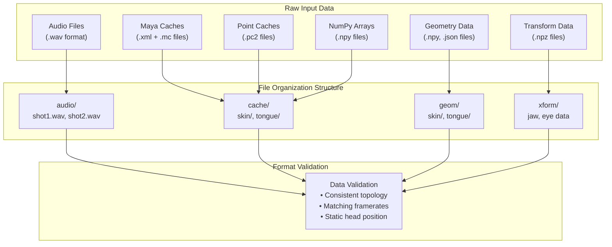
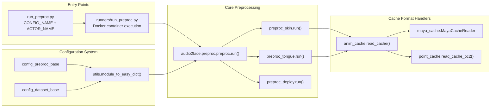
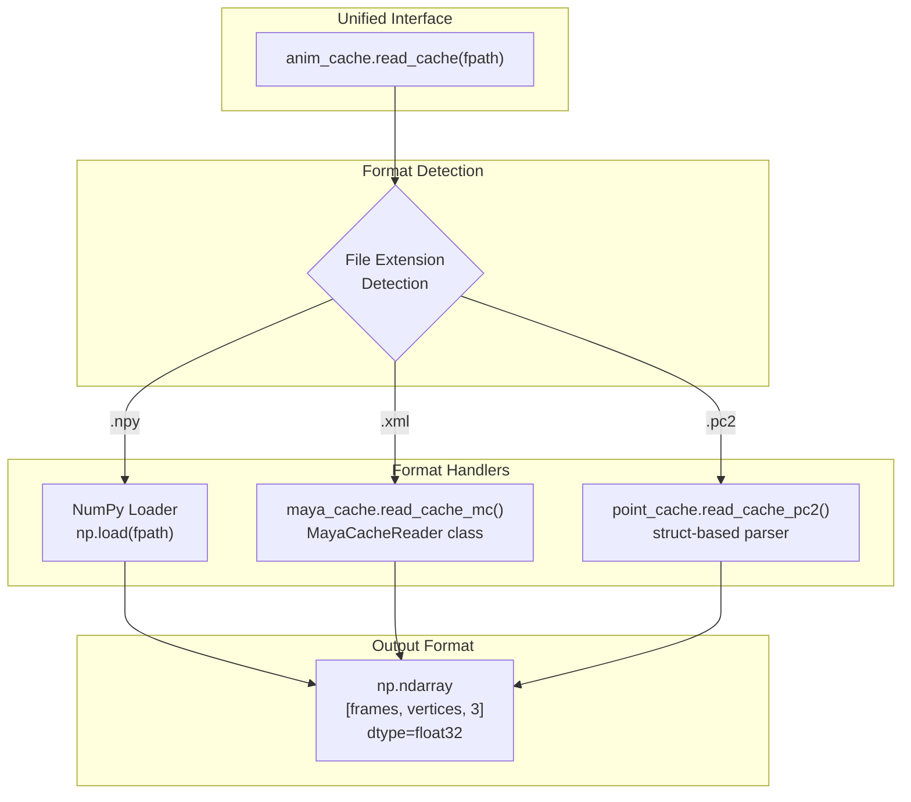
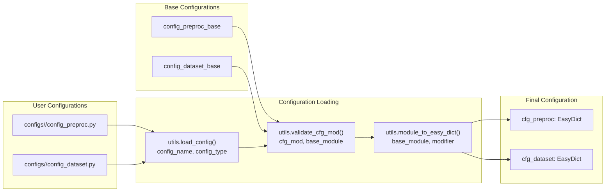
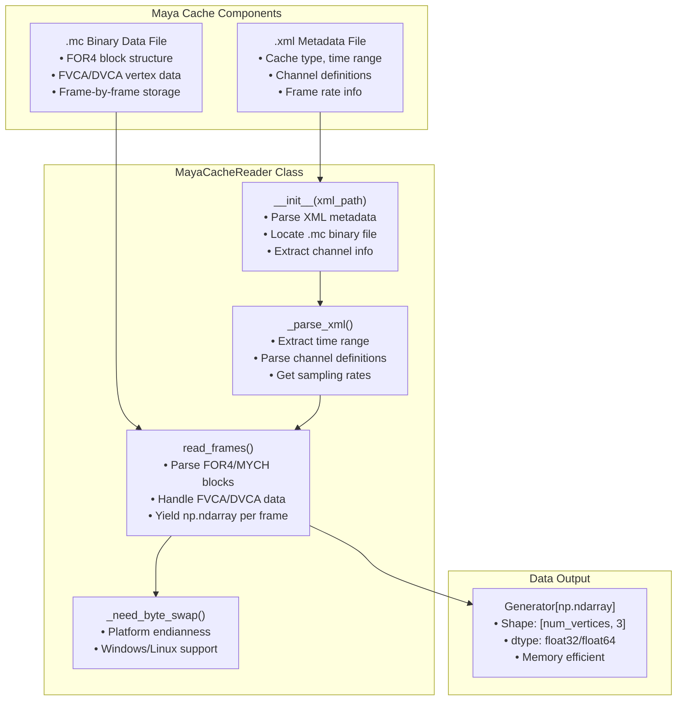
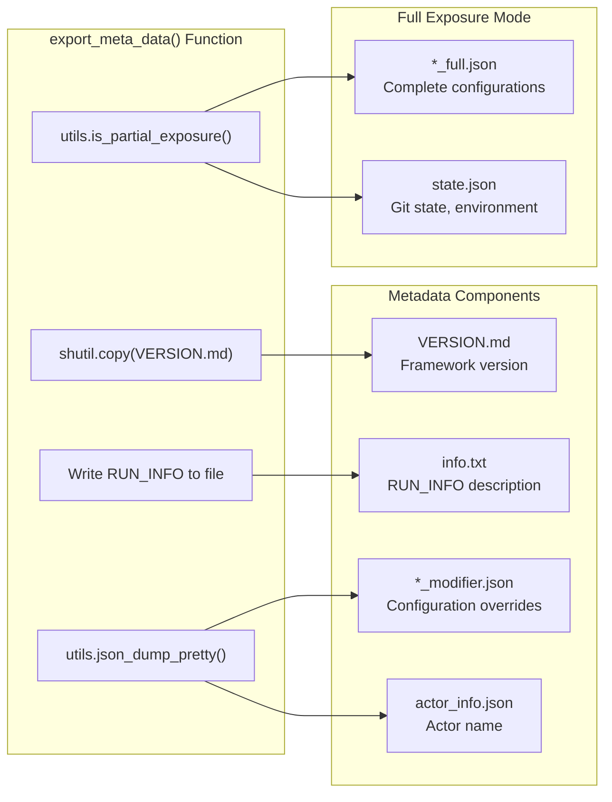

<!-- source: DeepWiki mcp.deepwiki.com · repo NVIDIA/Audio2Face-3D-Training-Framework · page 4 Data Preparation · fetched 2026-10-26 -->

# Data Preparation

Relevant source files

The following files were used as context for generating this wiki page:

- [audio2face/geometry/anim_cache.py](audio2face/geometry/anim_cache.py)
- [audio2face/geometry/maya_cache.py](audio2face/geometry/maya_cache.py)
- [audio2face/geometry/point_cache.py](audio2face/geometry/point_cache.py)
- [audio2face/preproc/preproc.py](audio2face/preproc/preproc.py)
- [configs/example-diffusion-min/config_preproc.py](configs/example-diffusion-min/config_preproc.py)
- [configs/example-diffusion/config_preproc.py](configs/example-diffusion/config_preproc.py)
- [configs/example-regression-min/config_preproc.py](configs/example-regression-min/config_preproc.py)
- [configs/example-regression/config_preproc.py](configs/example-regression/config_preproc.py)
- [docs/preparing_animation_data.md](docs/preparing_animation_data.md)
- [run_preproc.py](run_preproc.py)
- [runners/run_preproc.py](runners/run_preproc.py)
- [runners/run_preproc_debug.py](runners/run_preproc_debug.py)

This page covers the data preparation phase of the Audio2Face-3D Training Framework, which transforms raw animation datasets into training-ready formats. Data preparation involves validating input data, organizing file structures, and preprocessing animation caches, audio files, and geometry information into the standardized formats required by the training pipeline.

For information about the training process that follows data preparation, see [Training Framework](#5). For details about the configuration system that controls data preparation parameters, see [Configuration System](#3).

## Purpose and Scope

The data preparation system serves as the critical bridge between raw animation data exported from Digital Content Creation (DCC) applications and the machine learning training pipeline. It handles format conversion, data validation, dimensionality reduction through PCA analysis, and audio feature extraction to create standardized training datasets.

The system supports multiple input formats and provides a unified preprocessing pipeline that can be configured for both regression and diffusion model training workflows.

## Data Requirements and File Organization

### Supported Input Formats

The framework supports multiple animation cache formats and follows a strict file organization structure:

Sources: [docs/preparing_animation_data.md:47-157](), [audio2face/geometry/anim_cache.py:22-32]()

### Technical Data Specifications

The framework enforces strict technical requirements for all input data:

| Data Type | Requirements | Format | Validation |
|-----------|--------------|---------|------------|
| Audio | WAV format, ≥16kHz, ≥16-bit | `.wav` | Duration matches animation |
| Skin Animation | Consistent topology, static head | `.xml+.mc`, `.pc2`, `.npy` | Vertex count consistency |
| Tongue Animation | Optional, same topology rules | `.xml+.mc`, `.pc2`, `.npy` | Matches skin framerate |
| Geometry Poses | Neutral, eye closed, lip open | `.npy` float32 | `[num_vertices, 3]` |
| Vertex Lists | Eye/lip distance, lip size | `.json` | Integer vertex indices |
| Transform Data | Jaw keypoints, eye rotations | `.npz` | `[num_frames, N, 3]` |

Sources: [docs/preparing_animation_data.md:47-113]()

## Preprocessing Pipeline Architecture

### Pipeline Orchestration

The preprocessing system follows a modular architecture with separate components for different data types:

Sources: [run_preproc.py:35-42](), [runners/run_preproc.py:45](), [audio2face/preproc/preproc.py:51-96]()

### Cache Format Support Matrix

The unified cache reading system provides format-agnostic access to animation data:

Sources: [audio2face/geometry/anim_cache.py:22-32](), [audio2face/geometry/maya_cache.py:277-288](), [audio2face/geometry/point_cache.py:20-31]()

## Configuration System Integration

### Preprocessing Configuration Structure

The data preparation phase uses the two-tier configuration system with specialized preprocessing parameters:

| Configuration File | Purpose | Key Parameters |
|-------------------|---------|----------------|
| `config_preproc_base.py` | Base preprocessing settings | `PREPROC_OUTPUT_ROOT`, `RUN_NAME` |
| `config_dataset_base.py` | Dataset paths and structure | `AUDIO_ROOT`, `SKIN_CACHE_ROOT` |
| `configs/<name>/config_preproc.py` | User overrides | Custom `RUN_NAME`, `RUN_INFO` |
| `configs/<name>/config_dataset.py` | Dataset-specific paths | Actor-specific directory paths |

### Configuration Loading and Validation

Sources: [audio2face/preproc/preproc.py:71-74](), [configs/example-diffusion/config_preproc.py:17-20]()

## Maya Cache Format Implementation

The Maya cache format handler provides comprehensive support for Autodesk Maya's native cache format:

### MayaCacheReader Architecture

Sources: [audio2face/geometry/maya_cache.py:24-180]()

### Binary Format Parsing

The Maya cache binary format uses a complex block structure that the reader parses sequentially:

| Block Type | Purpose | Structure |
|------------|---------|-----------|
| `FOR4` | File/Block Header | 4-byte tag + 32-bit size |
| `MYCH` | Maya Cache Header | Identifies cache block |
| `TIME` | Frame Timestamp | 32-bit frame time |
| `CHNM` | Channel Name | Variable-length string |
| `FVCA`/`DVCA` | Vertex Array Data | Float32/Float64 vertex positions |

Sources: [audio2face/geometry/maya_cache.py:86-180]()

## Metadata Export and Tracking

The preprocessing system maintains comprehensive metadata about each preprocessing run:

### Export Metadata Function

Sources: [audio2face/preproc/preproc.py:28-49]()

This comprehensive data preparation system ensures that raw animation data from various DCC applications is properly validated, organized, and preprocessed into the standardized formats required by the Audio2Face-3D training pipeline, while maintaining full traceability through detailed metadata tracking.

---

