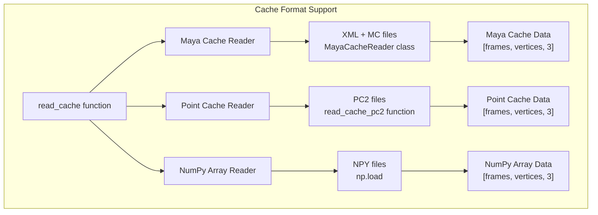
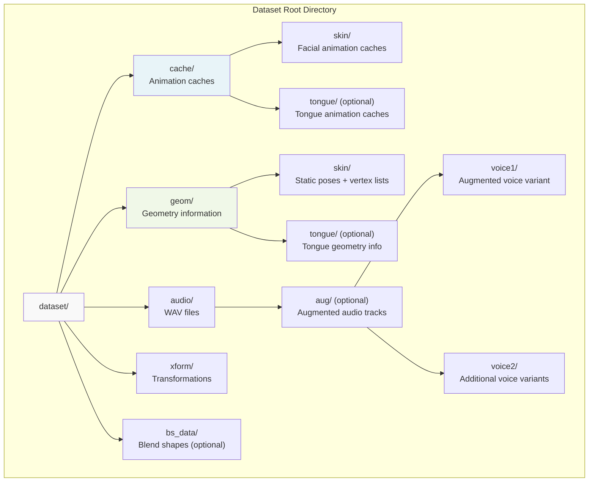
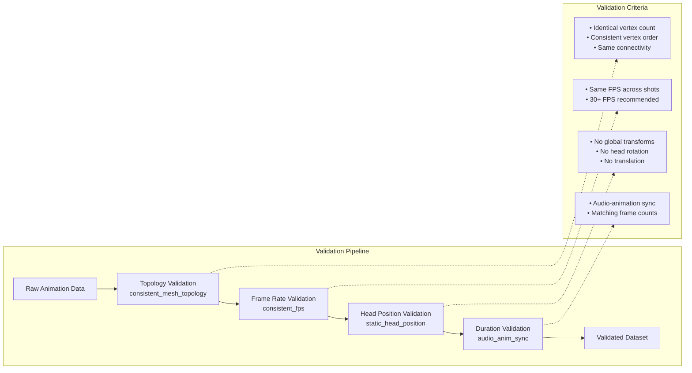

<!-- source: DeepWiki mcp.deepwiki.com · repo NVIDIA/Audio2Face-3D-Training-Framework · page 4.1 Animation Data Requirements · fetched 2026-10-26 -->

# Animation Data Requirements

<details>
<summary>Relevant source files</summary>

The following files were used as context for generating this wiki page:

- [audio2face/geometry/anim_cache.py](audio2face/geometry/anim_cache.py)
- [audio2face/geometry/maya_cache.py](audio2face/geometry/maya_cache.py)
- [audio2face/geometry/point_cache.py](audio2face/geometry/point_cache.py)
- [docs/preparing_animation_data.md](docs/preparing_animation_data.md)

</details>


This document defines the technical specifications and requirements for animation datasets used by the Audio2Face-3D Training Framework. It covers file formats, directory structures, data constraints, and the technical parameters required for successful model training.

For information about the preprocessing workflow that transforms this raw data into training-ready formats, see [Preprocessing Pipeline](#4.2). For details about configuring dataset paths and parameters, see [Dataset Configuration](#3.2).

## Core Data Requirements

The Audio2Face-3D Training Framework requires two fundamental data components for training:

### Audio Data
- **Format**: WAV files only
- **Sampling Rate**: Minimum 16kHz or higher  
- **Bit Depth**: Minimum 16-bit or higher
- **Synchronization**: Audio duration must match animation shot duration exactly
- **Naming**: Audio filenames must match corresponding animation cache names

### Skin Animation Data
- **Format**: Vertex animation caches (see supported formats below)
- **Topology**: Consistent mesh topology across all shots (identical vertex count, order, and connectivity)
- **Frame Rate**: Consistent FPS across all shots (30+ FPS recommended)
- **Head Position**: Static head with no global transformations or translations
- **Organization**: One cache file per audio track

Sources: [docs/preparing_animation_data.md:49-76]()

## Animation Cache Format Support

The framework supports multiple animation cache formats through a unified reading interface:



### Supported Formats

| Format | File Extensions | Source Application | Code Handler |
|--------|----------------|-------------------|--------------|
| Maya Cache | `.xml` + `.mc` | Autodesk Maya | `MayaCacheReader` |
| Point Cache | `.pc2` | Blender, 3ds Max | `read_cache_pc2` |
| NumPy Array | `.npy` | Python scripts | `np.load` |

**Technical Specifications**:
- **Dimensions**: `[num_frames, num_vertices, 3]` for all formats
- **Data Type**: `float32` for NumPy arrays
- **Frame Count**: Variable per shot, but consistent vertex count required
- **Coordinate System**: World space coordinates

Sources: [audio2face/geometry/anim_cache.py:22-31](), [audio2face/geometry/maya_cache.py:24-36](), [audio2face/geometry/point_cache.py:20-30]()

## Dataset File Organization

The framework expects a specific directory structure for organizing training data:



### Required Directory Structure

```text
dataset/
├── audio/                      # Audio tracks (required)
├── cache/                      # Animation caches (required)
│   ├── skin/                   # Skin animation (required)
│   └── tongue/                 # Tongue animation (optional)
├── geom/                       # Geometry information (required)
│   ├── skin/                   # Skin geometry data
│   └── tongue/                 # Tongue geometry data (optional)
└── xform/                      # Transform data (optional)
```

Sources: [docs/preparing_animation_data.md:114-143]()

## Optional Data Components

Beyond the core requirements, the framework supports several optional data types that enhance training quality:

### Tongue Animation
- **Cache Format**: Same formats as skin caches
- **Naming**: Must match corresponding skin cache names exactly
- **Directory**: `cache/tongue/`
- **Geometry Requirements**: Requires neutral pose and rigid vertex definitions

### Jaw Transformations  
- **Keypoints Neutral**: `xform/jaw_keypoints_neutral.npy` - `[N, 3]` float32 array
- **Animation Cache**: `xform/jaw_keypoints_cache_all.npz` - Dictionary of delta animations
- **Requirements**: N≥4 linearly independent keypoints, static head positioning

### Eye Animation
- **Rotations**: `xform/eye_rotations_all.npz` - Dictionary with `[num_frames, 2, 2]` arrays
- **Saccades**: `xform/eye_saccade_rotations.npy` - `[num_frames, 2]` float32 array  
- **Blinks**: `xform/eye_blink_keys.npy` - `[num_frames]` float32 array (0.0-1.0 range)

### Geometry Information
- **Static Poses**: Neutral, eyes closed, lips opened poses as `.npy` files
- **Vertex Lists**: JSON files defining anatomical regions (eyes, lips) for distance measurements
- **Format**: `[num_vertices, 3]` float32 arrays for poses, integer lists for vertex indices

Sources: [docs/preparing_animation_data.md:84-112](), [docs/preparing_animation_data.md:631-951]()

## Data Validation Requirements

The framework enforces strict validation rules to ensure training compatibility:



### Critical Constraints
- **Mesh Topology**: Vertex count and order must be identical across all animation files
- **Frame Rate**: All animations must use the same FPS (typically 30 FPS)
- **Head Stability**: No global head movement allowed in animation data
- **Synchronization**: Audio duration must exactly match animation frame count

Sources: [docs/preparing_animation_data.md:66-74]()

## Minimal Training Dataset

For basic functionality, the framework requires only:

| Component | Location | Description |
|-----------|----------|-------------|
| Audio Files | `audio/` | WAV audio tracks |
| Skin Caches | `cache/skin/` | Facial vertex animation |
| Neutral Pose | `geom/skin/neutral_pose.npy` | Static reference geometry |
| Eye/Lip Vertices | `geom/skin/*.json` | Anatomical region definitions |

All other data components (tongue, jaw, eyes, blend shapes) are optional enhancements that improve model quality but are not required for training completion.

Sources: [docs/preparing_animation_data.md:145-157]()

---

