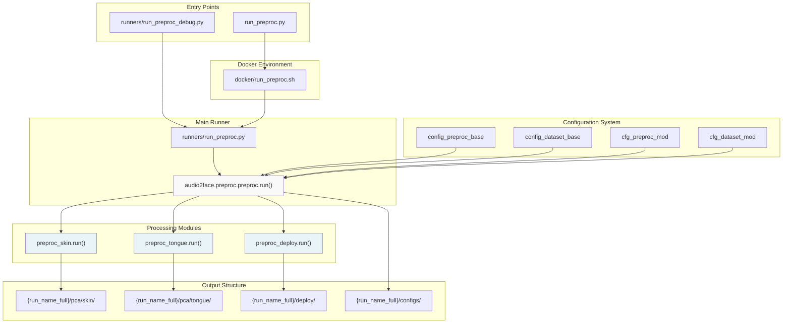
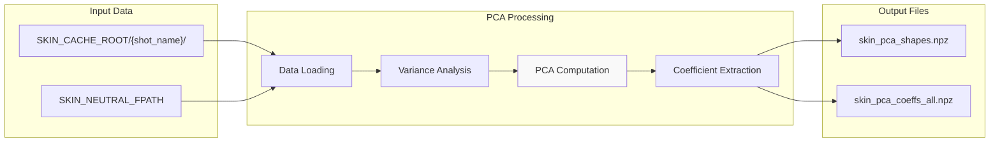
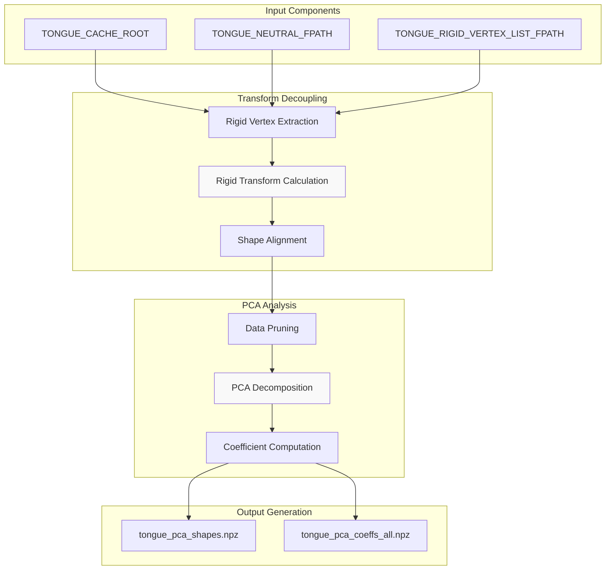
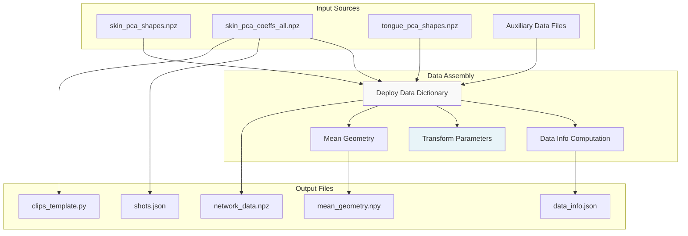

<!-- source: DeepWiki mcp.deepwiki.com · repo NVIDIA/Audio2Face-3D-Training-Framework · page 4.2 Preprocessing Pipeline · fetched 2026-10-26 -->

# Preprocessing Pipeline

<details>
<summary>Relevant source files</summary>

The following files were used as context for generating this wiki page:

- [audio2face/preproc/preproc.py](audio2face/preproc/preproc.py)
- [audio2face/preproc/preproc_deploy.py](audio2face/preproc/preproc_deploy.py)
- [audio2face/preproc/preproc_tongue.py](audio2face/preproc/preproc_tongue.py)
- [audio2face/utils.py](audio2face/utils.py)
- [run_preproc.py](run_preproc.py)
- [runners/run_preproc.py](runners/run_preproc.py)
- [runners/run_preproc_debug.py](runners/run_preproc_debug.py)

</details>


The preprocessing pipeline transforms raw animation data (skin geometry, tongue animation, audio files) into training-ready formats through PCA dimensionality reduction and data standardization. This pipeline prepares datasets for both regression and diffusion model training by converting high-dimensional mesh data into compact coefficient representations.

For information about the raw animation data requirements and file organization, see [Animation Data Requirements](#4.1). For details about the training process that consumes preprocessed data, see [Training Process](#5.2).

## Pipeline Overview

The preprocessing pipeline executes through a sequential workflow managed by the `preproc` module, orchestrating skin PCA analysis, tongue transform decoupling, and deployment data preparation.

### Preprocessing Execution Flow



**Sources:** [run_preproc.py:35-42](), [runners/run_preproc.py:27-45](), [audio2face/preproc/preproc.py:51-95]()

## Configuration and Input Validation

The preprocessing pipeline uses the two-tier configuration system to merge base configurations with user-specified overrides, then validates all inputs before processing.

### Configuration Loading Process

| Component | Purpose | Source |
|-----------|---------|--------|
| `config_preproc_base` | Base preprocessing parameters | Configuration system |
| `config_dataset_base` | Base dataset paths and settings | Configuration system |
| `cfg_preproc_mod` | User preprocessing overrides | JSON from command line |
| `cfg_dataset_mod` | User dataset overrides | JSON from command line |

The pipeline validates actor names, run names, and configuration parameters before creating output directories and initializing logging.

**Sources:** [runners/run_preproc.py:33-43](), [audio2face/preproc/preproc.py:71-77](), [audio2face/utils.py:331-344]()

## Processing Stages

### Skin Processing Stage

The skin processing stage applies PCA dimensionality reduction to facial mesh animation data, converting high-dimensional vertex positions into compact coefficient representations.



Key parameters controlled by configuration:
- `SKIN_PCA_VARIANCE_THRESHOLD`: Determines number of PCA components
- `SKIN_FORCE_COMPONENTS`: Override automatic component selection
- `SKIN_CACHE_SHOTS`: Specific shots to process

**Sources:** Referenced in [audio2face/preproc/preproc.py:79](), configuration parameters from skin processing module

### Tongue Processing Stage

The tongue processing stage handles tongue animation data with additional transform decoupling to separate rigid motion from deformation before applying PCA.



The `decoupleTransformDeformation` function extracts rigid motion from tongue data:

```python
def decoupleTransformDeformation(
    tongue_cache_dir: str,
    target_seqs: list[str], 
    tongue_neutral_fpath: str,
    out_tongue_cache_dir: str,
    rigid_vertex_list_fpath: str,
    fps: float
) -> None
```

**Sources:** [audio2face/preproc/preproc_tongue.py:29-82](), [audio2face/preproc/preproc_tongue.py:84-176](), [audio2face/preproc/preproc_tongue.py:212-324]()

### Deployment Data Preparation

The `preproc_deploy` module creates network-ready deployment files by combining PCA results with auxiliary data and computing transform parameters for diffusion models.



#### Transform Parameters for Diffusion Models

The deployment stage computes normalization parameters for diffusion training:

| Parameter | Purpose | Source Function |
|-----------|---------|----------------|
| `translate_skin` | Centering offset for skin data | `compute_transform_params()` |
| `scale_skin` | Scaling factor for skin data | `compute_transform_params()` |  
| `translate_tongue` | Centering offset for tongue data | `compute_transform_params()` |
| `scale_tongue` | Scaling factor for tongue data | `compute_transform_params()` |

**Sources:** [audio2face/preproc/preproc_deploy.py:159-386](), [audio2face/preproc/preproc_deploy.py:53-106](), [audio2face/preproc/preproc_deploy.py:108-157]()

## Data Artifacts and Output Structure

### Output Directory Structure

```
{PREPROC_OUTPUT_ROOT}/{run_name_full}/
├── configs/
│   ├── VERSION.md
│   ├── info.txt
│   ├── config_preproc_modifier.json
│   ├── config_dataset_modifier.json
│   └── actor_info.json
├── pca/
│   ├── skin/
│   │   ├── skin_pca_shapes.npz
│   │   └── skin_pca_coeffs_all.npz
│   └── tongue/
│       ├── tongue_pca_shapes.npz
│       └── tongue_pca_coeffs_all.npz
└── deploy/
    ├── network_data.npz
    ├── data_info.json
    ├── shots.json
    ├── clips_template.py
    └── mean_geometry.npy
```

### Key Data Files

| File | Content | Usage |
|------|---------|-------|
| `network_data.npz` | Combined PCA matrices and auxiliary data | Training data loading |
| `data_info.json` | Dimensions and transform parameters | Network configuration |
| `shots.json` | Shot metadata with frame counts and emotions | Dataset organization |
| `mean_geometry.npy` | Template geometry for diffusion models | Diffusion initialization |

The `run_name_full` follows the pattern `{YYMMDD_HHMMSS}_{RUN_NAME}` to ensure unique timestamped outputs.

**Sources:** [audio2face/preproc/preproc.py:56-64](), [audio2face/preproc/preproc_deploy.py:218-386](), [audio2face/preproc/preproc.py:28-49]()

---

