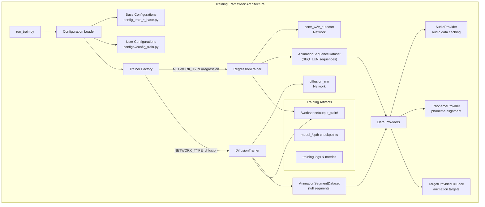
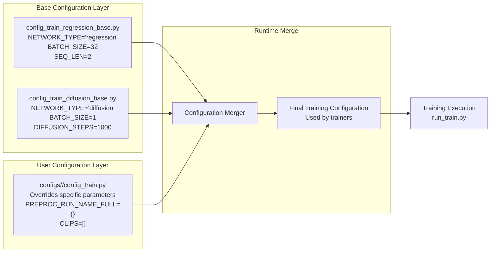
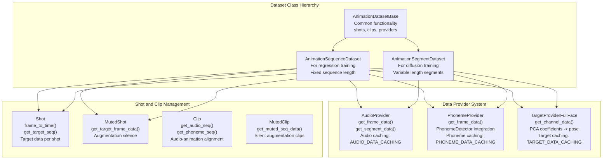
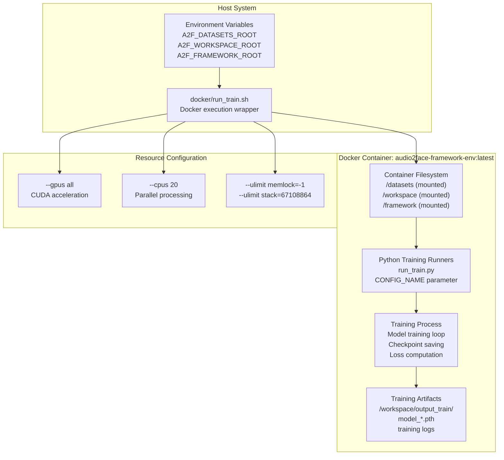
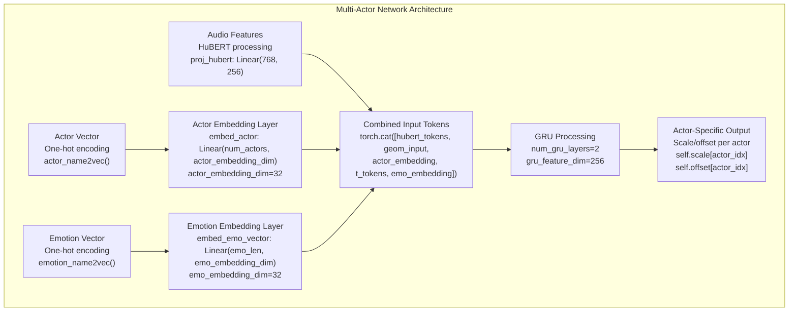

<!-- source: DeepWiki mcp.deepwiki.com · repo NVIDIA/Audio2Face-3D-Training-Framework · page 5 Training Framework · fetched 2026-10-26 -->

# Training Framework

<details>
<summary>Relevant source files</summary>

The following files were used as context for generating this wiki page:

- [audio2face/config_base/config_train_diffusion_base.py](audio2face/config_base/config_train_diffusion_base.py)
- [audio2face/config_base/config_train_regression_base.py](audio2face/config_base/config_train_regression_base.py)
- [audio2face/dataset.py](audio2face/dataset.py)
- [audio2face/networks/diffusion_rnn.py](audio2face/networks/diffusion_rnn.py)
- [docker/run_shell.sh](docker/run_shell.sh)
- [docs/training_framework.md](docs/training_framework.md)

</details>


The Training Framework is the core orchestration system that manages the neural network training process for Audio2Face-3D models. This system handles model training for both regression and diffusion approaches, manages multi-actor datasets, and provides a unified interface for training configuration and execution.

For detailed information about specific model architectures and their differences, see [Model Types](#5.1). For in-depth coverage of training procedures and optimization, see [Training Process](#5.2).

## Framework Architecture Overview

The Training Framework operates as a containerized system with distinct components handling configuration management, data processing, and model training orchestration.

### Training System Components



Sources: [audio2face/config_base/config_train_regression_base.py:25-26](), [audio2face/config_base/config_train_diffusion_base.py:25-26](), [audio2face/dataset.py:896-967](), [audio2face/dataset.py:969-1022](), [audio2face/dataset.py:38-115](), [audio2face/dataset.py:117-162](), [audio2face/dataset.py:381-518]()

### Configuration Merge Process

The Training Framework uses a two-tier configuration system where base configurations are merged with user-specific overrides:



Sources: [audio2face/config_base/config_train_regression_base.py:16-26](), [audio2face/config_base/config_train_diffusion_base.py:16-26](), [docs/training_framework.md:48-96]()

## Training Configuration System

The training configuration defines model architecture, hyperparameters, and training procedures through structured parameter sets.

### Core Training Parameters

| Parameter Category | Regression Config | Diffusion Config | Purpose |
|-------------------|------------------|------------------|---------|
| **Network Architecture** | `NETWORK_NAME = "conv_w2v_autocorr"` | `NETWORK_NAME = "diffusion_rnn"` | Defines model architecture |
| **Batch Processing** | `BATCH_SIZE = 32`<br/>`SEQ_LEN = 2` | `BATCH_SIZE = 1`<br/>`GRADIENT_ACCUMULATION_STEPS = 4` | Training batch configuration |
| **Target Channels** | `["skin_coeffs", "tongue_coeffs", "jaw", "eye"]` | `["skin_pose", "tongue_pose", "jaw", "eye"]` | Animation data channels |
| **Learning Parameters** | `LEARNING_RATE = 0.001 * 0.2`<br/>`NUM_EPOCHS = 50` | `LEARNING_RATE = 5e-5`<br/>`NUM_EPOCHS = 400` | Optimization settings |

Sources: [audio2face/config_base/config_train_regression_base.py:128-159](), [audio2face/config_base/config_train_diffusion_base.py:132-180](), [audio2face/config_base/config_train_regression_base.py:53-59](), [audio2face/config_base/config_train_diffusion_base.py:54-61]()

### Dataset Configuration Requirements

Training requires specific dataset configuration linking to preprocessed artifacts:

```python
# Required preprocessing artifacts per actor
PREPROC_RUN_NAME_FULL = {
    "actor1": "YYYYMMDD_HHMMSS_actor1_preprocessing_run",
    "actor2": "YYYYMMDD_HHMMSS_actor2_preprocessing_run"
}

# Training clips specification
CLIPS = [
    ("actor_name", "shot_name", (start_frame, end_frame), 
     "speaker_name", "audio_lang", "audio_file.wav", audio_offset),
]
```

Sources: [audio2face/config_base/config_train_regression_base.py:34-47](), [audio2face/config_base/config_train_regression_base.py:90-96](), [audio2face/config_base/config_train_diffusion_base.py:34-48](), [audio2face/config_base/config_train_diffusion_base.py:90-96]()

## Training Pipeline Components

### Dataset Management System

The framework provides specialized dataset classes for different training approaches:



Sources: [audio2face/dataset.py:748-894](), [audio2face/dataset.py:896-967](), [audio2face/dataset.py:969-1022](), [audio2face/dataset.py:38-115](), [audio2face/dataset.py:117-162](), [audio2face/dataset.py:381-518](), [audio2face/dataset.py:520-580](), [audio2face/dataset.py:582-625]()

### Loss Function Configuration

The framework supports different loss function combinations based on model type:

| Loss Component | Regression | Diffusion | Configuration Parameter |
|---------------|------------|-----------|------------------------|
| **MSE Loss** | `LOSS_MSE_ALPHA = 1.0` | Applied by default | Primary reconstruction loss |
| **Motion Loss** | `LOSS_MOTION_ALPHA = 10.0` | `LOSS_MOTION_ALPHA = 0.0` | Temporal consistency |
| **Lip Distance** | `LOSS_LIP_DIST_ALPHA = 100.0` | `LOSS_LIP_DIST_ALPHA = 1e-5` | Lip synchronization |
| **Phoneme Supervision** | `LOSS_PHONEME_ALPHA = 0.1` | Not used | Phoneme alignment |
| **Velocity Loss** | Not used | `LOSS_VELOCITY_ALPHA = 0.0` | Smooth motion |
| **Expression Smoothing** | Not used | `LOSS_EXP_SMOOTH_ALPHA = 25.0` | Temporal smoothing |

Sources: [audio2face/config_base/config_train_regression_base.py:167-188](), [audio2face/config_base/config_train_diffusion_base.py:186-199]()

## Execution Environment

The Training Framework operates within a Docker containerized environment for consistent execution across different systems.

### Docker Training Execution



Sources: [docker/run_shell.sh:31-43](), [docs/training_framework.md:13-25](), [audio2face/config_base/config_train_regression_base.py:193-195](), [audio2face/config_base/config_train_diffusion_base.py:204-206]()

### Training Command Interface

The framework provides a unified command-line interface for training execution:

```bash
# Basic training execution
python run_train.py <CONFIG_NAME>

# Example with specific configuration
python run_train.py example-diffusion
python run_train.py example-regression
```

The training process requires:
- Completed preprocessing artifacts (`PREPROC_RUN_NAME_FULL` configured)
- Training clips specification (`CLIPS` parameter populated) 
- Proper dataset paths and actor configuration

Sources: [docs/training_framework.md:124-136]()

## Multi-Actor Support

The Training Framework supports training models that can handle multiple actors simultaneously, primarily in diffusion mode.

### Multi-Actor Configuration Structure

Multi-actor training uses dictionary-based configuration where each parameter can specify actor-specific values:

```python
# Actor names list
ACTOR_NAMES = ["actor1", "actor2", "actor3"]

# Per-actor preprocessing artifacts
PREPROC_RUN_NAME_FULL = {
    "actor1": "20240315_143022_actor1_preproc",
    "actor2": "20240315_143055_actor2_preproc", 
    "actor3": "20240315_143128_actor3_preproc"
}

# Per-actor dataset paths (in config_dataset.py)
AUDIO_ROOT = {
    "actor1": "/datasets/dataset1/data/actor1/audio",
    "actor2": "/datasets/dataset2/data/actor2/audio",
    "actor3": "/datasets/dataset3/data/actor3/audio"
}
```

### Actor Embedding System

The diffusion model architecture includes actor-specific embedding layers for multi-actor support:



Sources: [audio2face/networks/diffusion_rnn.py:281-282](), [audio2face/networks/diffusion_rnn.py:211-214](), [audio2face/networks/diffusion_rnn.py:291-323](), [audio2face/dataset.py:876-881](), [audio2face/dataset.py:863-874](), [docs/training_framework.md:154-191]()

The multi-actor system enables training a single model that can generate animations for multiple different actors while maintaining actor-specific characteristics and scaling parameters.

---

