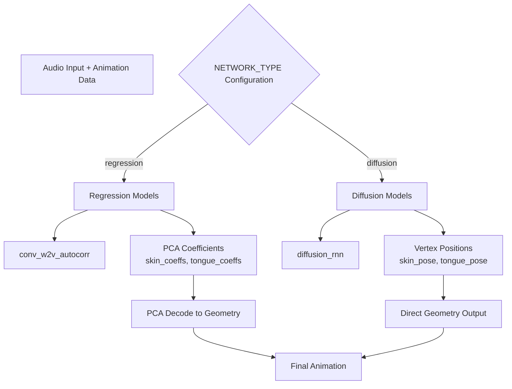
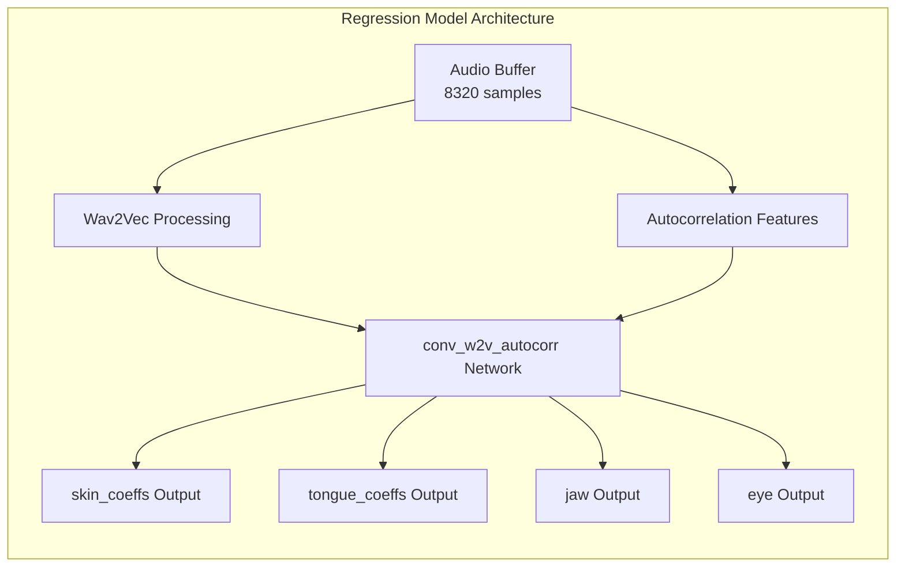
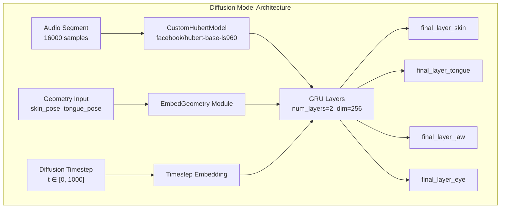
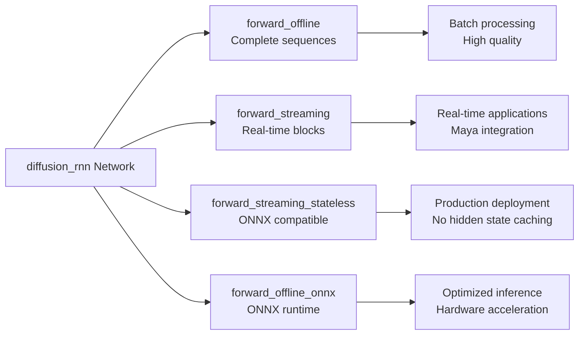
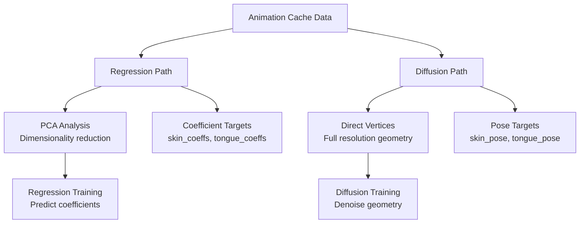

<!-- source: DeepWiki mcp.deepwiki.com · repo NVIDIA/Audio2Face-3D-Training-Framework · page 5.1 Model Types · fetched 2026-10-26 -->

# Model Types

Relevant source files

The following files were used as context for generating this wiki page:

- [audio2face/config_base/config_train_diffusion_base.py](audio2face/config_base/config_train_diffusion_base.py)
- [audio2face/config_base/config_train_regression_base.py](audio2face/config_base/config_train_regression_base.py)
- [audio2face/dataset.py](audio2face/dataset.py)
- [audio2face/emotion.py](audio2face/emotion.py)
- [audio2face/networks/diffusion_rnn.py](audio2face/networks/diffusion_rnn.py)
- [audio2face/train_regression.py](audio2face/train_regression.py)

This document describes the two neural network architectures supported by the Audio2Face-3D Training Framework: regression models and diffusion models. It covers their architectural differences, training characteristics, and appropriate use cases.

For information about the training process workflow, see [Training Process](#5.2). For deployment and inference details, see [Deployment and Inference](#6).

## Overview

The Audio2Face-3D Training Framework supports two distinct model architectures, each optimized for different quality and performance requirements:

**Model Type Selection**

The model type is determined by the `NETWORK_TYPE` parameter in the training configuration, which controls both the neural network architecture and the data processing pipeline.

**Sources:** [audio2face/config_base/config_train_regression_base.py:25](), [audio2face/config_base/config_train_diffusion_base.py:25]()

## Regression Models

Regression models use direct supervised learning to predict PCA coefficients from audio features. They provide fast, stable training and inference with moderate quality output.

### Architecture

**Network Implementation**

The regression model uses the `conv_w2v_autocorr` architecture, which combines Wav2Vec audio features with autocorrelation-based audio analysis. The network directly predicts PCA coefficients that are later decoded to vertex positions.

**Target Channels**
- `skin_coeffs`: PCA coefficients for facial skin deformation
- `tongue_coeffs`: PCA coefficients for tongue movement  
- `jaw`: Direct jaw transform parameters
- `eye`: Direct eye rotation parameters

**Training Characteristics**
- Batch size: 32 sequences
- Sequence length: 2 frames with stride of 1
- Target FPS: 30
- Audio buffer: 8320 samples with 4160 sample offset

**Sources:** [audio2face/config_base/config_train_regression_base.py:54-59](), [audio2face/config_base/config_train_regression_base.py:128](), [audio2face/config_base/config_train_regression_base.py:71-78]()

### Loss Functions

Regression models employ multiple loss functions for comprehensive training:

| Loss Component | Purpose | Alpha Parameter |
|---|---|---|
| MSE Loss | Basic reconstruction accuracy | `LOSS_MSE_ALPHA = 1.0` |
| Motion Loss | Temporal consistency | `LOSS_MOTION_ALPHA = 10.0` |
| Emotion Regularization | Emotion vector stability | `LOSS_EMO_REG_ALPHA = 1.0` |
| Lip Distance Loss | Lip sync accuracy | `LOSS_LIP_DIST_ALPHA = 100.0` |
| Phoneme Supervision | Phoneme-based guidance | `LOSS_PHONEME_ALPHA = 0.1` |

**Sources:** [audio2face/config_base/config_train_regression_base.py:167-187]()

## Diffusion Models  

Diffusion models use a denoising approach to generate high-quality vertex positions directly. They provide superior output quality at the cost of increased computational requirements.

### Architecture

**Network Implementation**

The diffusion model uses the `diffusion_rnn` architecture based on a denoising diffusion probabilistic model (DDPM). It processes raw vertex positions through a learned denoising process.

**Target Channels**
- `skin_pose`: Direct vertex positions for facial skin (num_verts_skin × 3)
- `tongue_pose`: Direct vertex positions for tongue (num_verts_tongue × 3)  
- `jaw`: Direct jaw transform parameters
- `eye`: Direct eye rotation parameters

**Training Characteristics**
- Batch size: 1 (gradient accumulation: 4 steps)
- Diffusion steps: 1000
- Target FPS: 60
- Audio buffer: 16000 samples with padding

**Sources:** [audio2face/config_base/config_train_diffusion_base.py:55-60](), [audio2face/config_base/config_train_diffusion_base.py:132](), [audio2face/networks/diffusion_rnn.py:201-291]()

### Inference Modes

The diffusion model supports multiple inference modes for different deployment scenarios:

**Sources:** [audio2face/networks/diffusion_rnn.py:363-393](), [audio2face/networks/diffusion_rnn.py:402-608]()

## Model Comparison

| Aspect | Regression Models | Diffusion Models |
|--------|------------------|------------------|
| **Architecture** | `conv_w2v_autocorr` | `diffusion_rnn` |
| **Output Format** | PCA coefficients | Direct vertex positions |
| **Training Speed** | Fast (batch_size=32) | Slower (batch_size=1, gradient_accumulation=4) |
| **Inference Speed** | Very fast | Moderate (requires denoising steps) |
| **Quality** | Good, stable | Higher quality, more expressive |
| **Memory Usage** | Lower | Higher |
| **Target FPS** | 30 | 60 |
| **Streaming Support** | Basic | Advanced (multiple modes) |

**Sources:** [audio2face/config_base/config_train_regression_base.py:64](), [audio2face/config_base/config_train_diffusion_base.py:65](), [audio2face/config_base/config_train_regression_base.py:153](), [audio2face/config_base/config_train_diffusion_base.py:173]()

## Configuration Differences

### Data Processing

The model type determines how animation data is processed and what targets are used for training:

**Key Configuration Parameters**

| Parameter | Regression | Diffusion |
|-----------|------------|-----------|
| `NETWORK_TYPE` | `"regression"` | `"diffusion"` |
| `NETWORK_NAME` | `"conv_w2v_autocorr"` | `"diffusion_rnn"` |
| `TARGET_CHANNELS` | `[skin_coeffs, tongue_coeffs, jaw, eye]` | `[skin_pose, tongue_pose, jaw, eye]` |
| `RESCALE_TARGET_CHANNEL_DATA` | `False` | `True` |
| `AUDIO_PARAMS.buffer_len` | `8320` | `16000` |
| `SEQ_LEN` | `2` | N/A (segment-based) |

**Sources:** [audio2face/dataset.py:164-380](), [audio2face/config_base/config_train_regression_base.py:53-78](), [audio2face/config_base/config_train_diffusion_base.py:54-84]()

## Training Implementation

Both model types share the same data infrastructure through the `AnimationDatasetBase` class but use different training scripts and procedures:

- **Regression Training**: Implemented in [train_regression.py]() with sequence-based batching
- **Diffusion Training**: Uses segment-based processing with denoising objectives  

The `TargetProviderFullFace` class handles the conversion between different target channel formats based on the configured `TARGET_CHANNELS`.

**Sources:** [audio2face/train_regression.py:38-559](), [audio2face/dataset.py:381-518]()

---

