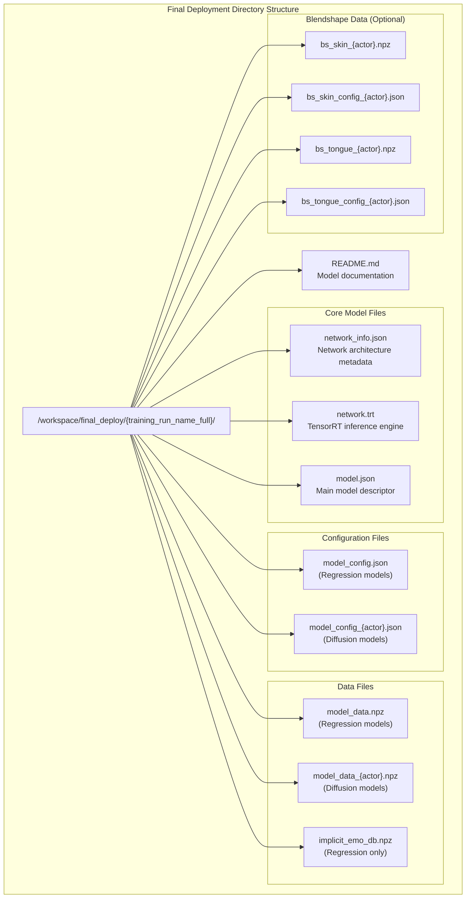
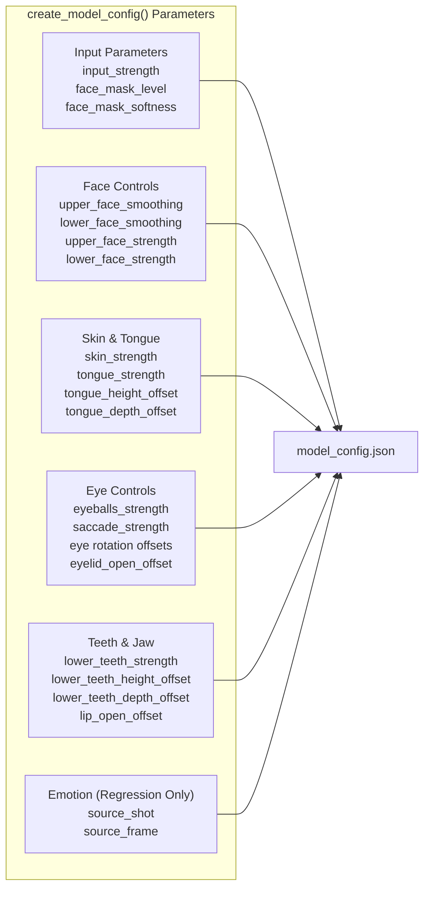
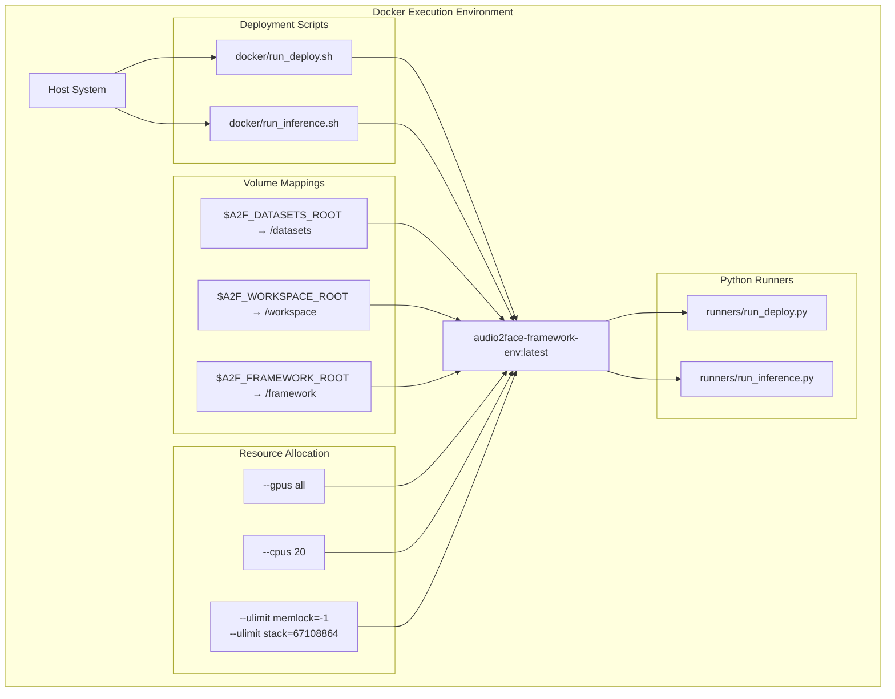
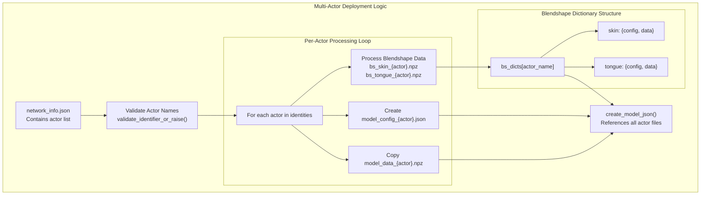
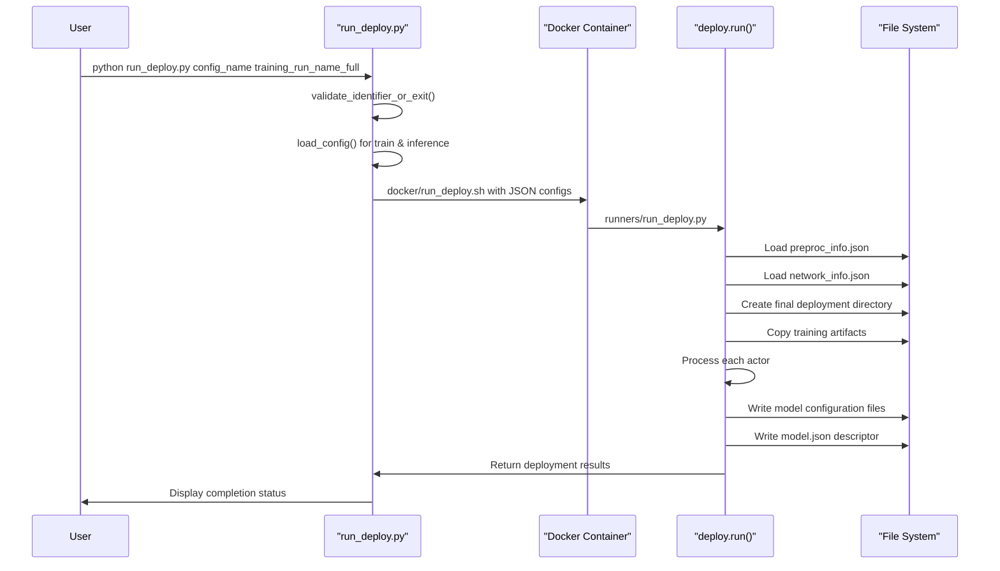

<!-- source: DeepWiki mcp.deepwiki.com · repo NVIDIA/Audio2Face-3D-Training-Framework · page 6 Deployment and Inference · fetched 2026-10-26 -->

# Deployment and Inference

<details>
<summary>Relevant source files</summary>

The following files were used as context for generating this wiki page:

- [audio2face/deploy.py](audio2face/deploy.py)
- [docker/run_deploy.sh](docker/run_deploy.sh)
- [docker/run_inference.sh](docker/run_inference.sh)
- [docker/run_train.sh](docker/run_train.sh)
- [run_deploy.py](run_deploy.py)
- [runners/run_deploy_debug.py](runners/run_deploy_debug.py)
- [runners/run_train_debug.py](runners/run_train_debug.py)

</details>


This document covers the deployment and inference components of the Audio2Face-3D Training Framework. Deployment packages trained models into production-ready artifacts, while inference executes these models to generate facial animations from audio input.

For information about training models, see [Training Framework](#5). For configuration of deployment parameters, see [Inference Configuration](#3.4).

## Deployment Overview

The deployment system transforms trained model checkpoints into standardized deployment packages. This process consolidates model weights, preprocessing data, configuration parameters, and optional blendshape information into a self-contained directory structure suitable for production use.

The deployment process supports both regression and diffusion model types, with automatic handling of single-actor and multi-actor configurations.

## Deployment Workflow

The deployment process follows a structured pipeline that collects artifacts from training and preprocessing stages:

```mermaid
flowgraph TD
    subgraph "Input Sources"
        TrainingOutput["Training Output Directory<br/>/workspace/train_output/{training_run_name_full}"]
        PreprocOutput["Preprocessing Output<br/>/workspace/preproc_output/{preproc_run_name_full}"]
        InferenceConfig["Inference Configuration<br/>config_inference.py"]
    end
    
    subgraph "Deployment Process"
        ValidateInputs["validate_identifier_or_raise()"]
        LoadNetworkInfo["Load network_info.json"]
        CreateDeployDir["Create Final Deploy Directory<br/>/workspace/final_deploy/{training_run_name_full}"]
        CopyArtifacts["Copy Training Artifacts<br/>shutil.copytree()"]
        ProcessActors["Process Each Actor"]
    end
    
    subgraph "Per-Actor Processing"
        CreateModelConfig["create_model_config()<br/>Model configuration JSON"]
        CopyModelData["Copy network_data.npz<br/>as model_data_{actor}.npz"]
        HandleBlendshapes["Copy Blendshape Data<br/>bs_skin_{actor}.npz<br/>bs_tongue_{actor}.npz"]
    end
    
    subgraph "Final Artifacts"
        ModelJSON["model.json<br/>Main model descriptor"]
        NetworkTRT["network.trt<br/>TensorRT engine"]
        ConfigFiles["Configuration Files<br/>model_config*.json"]
        DataFiles["Data Files<br/>model_data*.npz"]
        README["README.md<br/>Model documentation"]
    end
    
    TrainingOutput --> ValidateInputs
    PreprocOutput --> ValidateInputs
    InferenceConfig --> ValidateInputs
    
    ValidateInputs --> LoadNetworkInfo
    LoadNetworkInfo --> CreateDeployDir
    CreateDeployDir --> CopyArtifacts
    CopyArtifacts --> ProcessActors
    
    ProcessActors --> CreateModelConfig
    ProcessActors --> CopyModelData
    ProcessActors --> HandleBlendshapes
    
    CreateModelConfig --> ModelJSON
    CopyArtifacts --> NetworkTRT
    CreateModelConfig --> ConfigFiles
    CopyModelData --> DataFiles
    ProcessActors --> README
```

Sources: [audio2face/deploy.py:110-263]()

## Deployment Process Details

### Main Deployment Function

The deployment process is orchestrated by the `run()` function in the `deploy` module:

```mermaid
flowchart TD
    subgraph "deploy.run() Function Flow"
        StartDeploy["setup_logging()"]
        GetNetworkType["get_network_type_or_raise()"]
        LoadConfigs["Load Configuration Modules<br/>get_config_train_base()<br/>get_config_inference_base()"]
        ValidateConfig["validate_cfg_mod()"]
        LoadPreprocInfo["Load preproc_info.json"]
        ValidateActors["Validate Actor Names"]
        SetupDirectories["Setup Deployment Directories"]
        CopyNetworkFiles["Copy Network Files<br/>shutil.copytree()"]
        ProcessEachActor["Process Each Actor<br/>create_model_config()<br/>Copy model_data.npz<br/>Handle blendshapes"]
        CreateModelJSON["create_model_json()"]
        CreateREADME["Generate README.md"]
    end
    
    StartDeploy --> GetNetworkType
    GetNetworkType --> LoadConfigs
    LoadConfigs --> ValidateConfig
    ValidateConfig --> LoadPreprocInfo
    LoadPreprocInfo --> ValidateActors
    ValidateActors --> SetupDirectories
    SetupDirectories --> CopyNetworkFiles
    CopyNetworkFiles --> ProcessEachActor
    ProcessEachActor --> CreateModelJSON
    CreateModelJSON --> CreateREADME
```



Sources: [audio2face/deploy.py:110-263]()

### Network Type Handling

The deployment system supports two distinct model architectures with different artifact structures:

| Model Type | Configuration Files | Data Files | Emotion Database |
|------------|-------------------|------------|------------------|
| Diffusion | `model_config_{actor_name}.json` per actor | `model_data_{actor_name}.npz` per actor | Not used |
| Regression | Single `model_config.json` | Single `model_data.npz` | `implicit_emo_db.npz` |

Sources: [audio2face/deploy.py:50-67](), [audio2face/deploy.py:174-198]()

## Deployment Artifacts Structure

The deployment process creates a standardized directory structure containing all necessary files for model inference:



Sources: [audio2face/deploy.py:143-263]()

### Model Configuration Structure

The model configuration files contain inference parameters and control settings:



Sources: [audio2face/deploy.py:70-107]()

## Docker-Based Execution

The deployment and inference processes are executed within Docker containers to ensure consistent environments:



Sources: [docker/run_deploy.sh:18-44](), [docker/run_inference.sh:18-44]()

### Command Line Interface

The deployment process can be initiated through multiple interfaces:

| Interface | Purpose | Usage |
|-----------|---------|--------|
| `run_deploy.py` | Main CLI entry point | `python run_deploy.py <config_name> <training_run_name_full>` |
| `docker/run_deploy.sh` | Docker execution wrapper | Called by `run_deploy.py` |
| `runners/run_deploy.py` | Container-internal runner | Executed within Docker container |
| `runners/run_deploy_debug.py` | Development/debugging | Direct Python execution for testing |

Sources: [run_deploy.py:24-42](), [runners/run_deploy_debug.py:26-44]()

## Multi-Actor Support

The deployment system supports both single-actor and multi-actor model configurations:



Sources: [audio2face/deploy.py:162-243]()

## Command Execution Flow

The deployment process integrates with the broader framework workflow:



Sources: [run_deploy.py:35-42](), [audio2face/deploy.py:110-263]()

---

