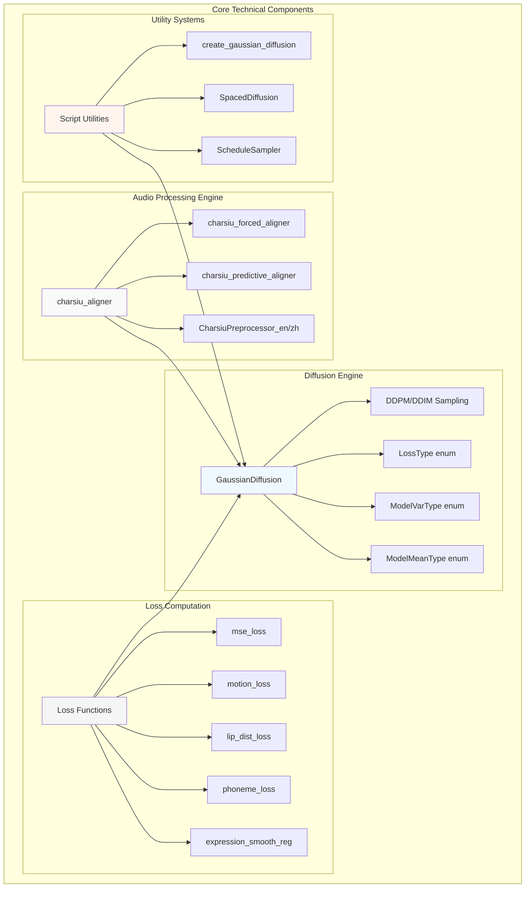
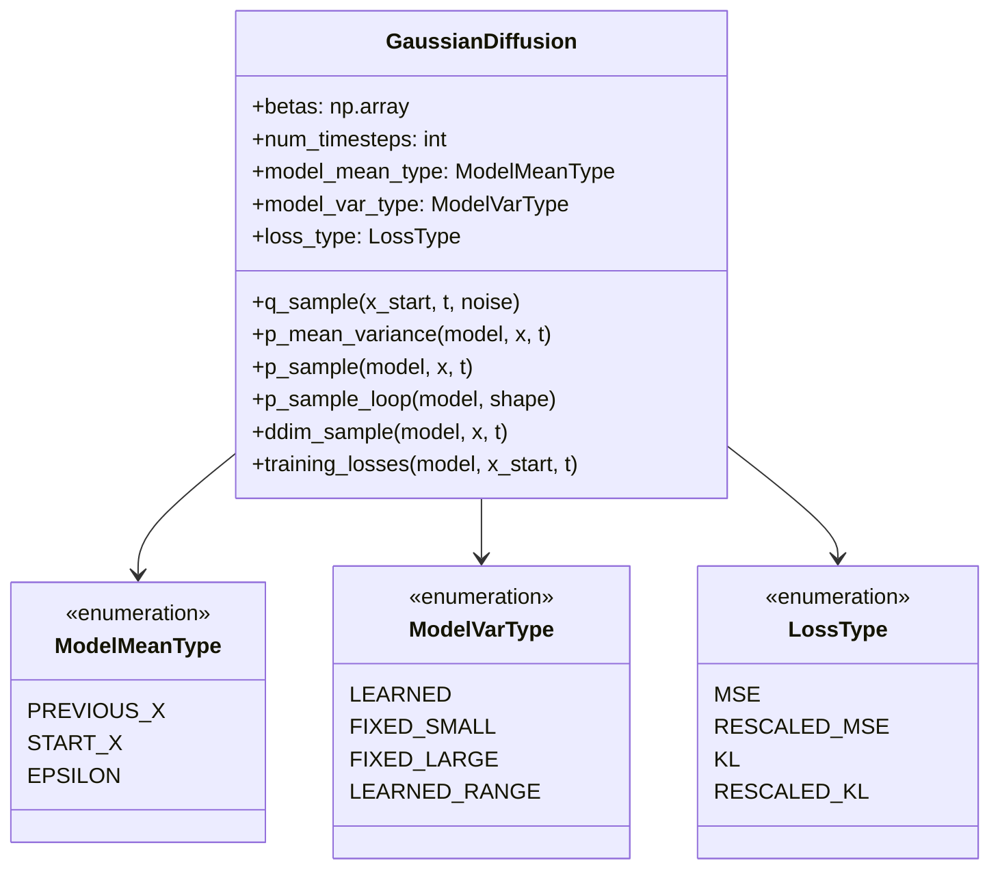
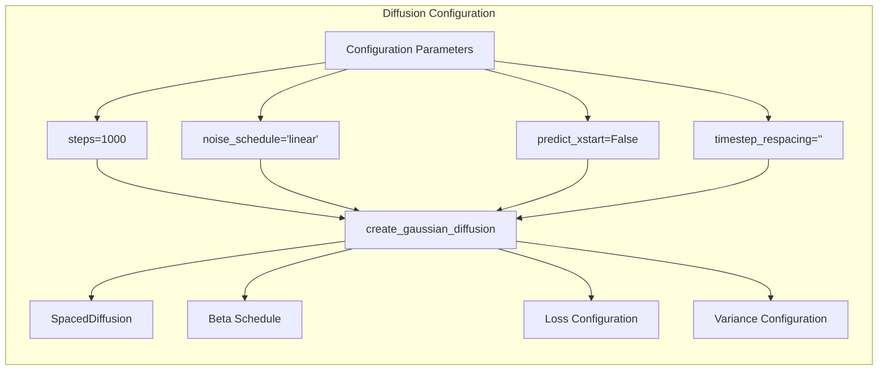
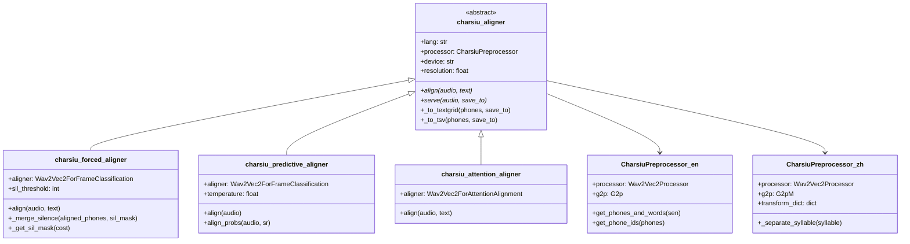
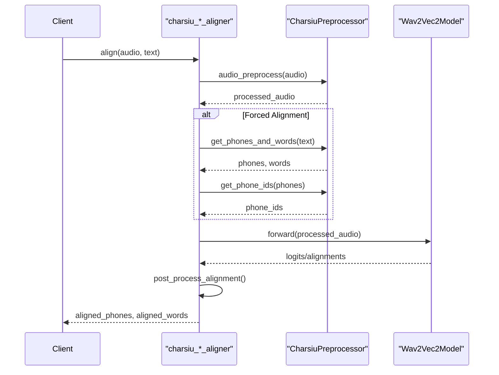
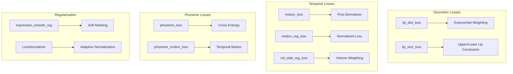
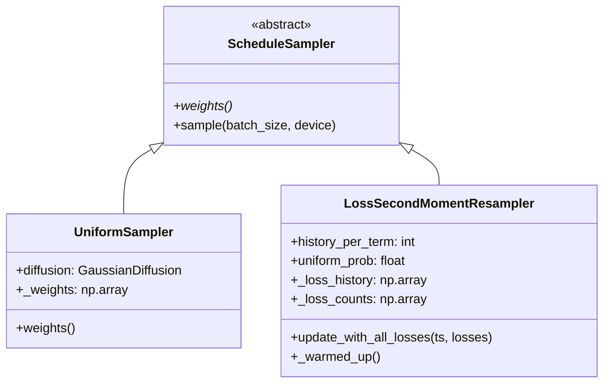

<!-- source: DeepWiki mcp.deepwiki.com · repo NVIDIA/Audio2Face-3D-Training-Framework · page 7 Technical Reference · fetched 2026-10-26 -->

# Technical Reference

<details>
<summary>Relevant source files</summary>

The following files were used as context for generating this wiki page:

- [audio2face/deps/charsiu/README.md](audio2face/deps/charsiu/README.md)
- [audio2face/deps/charsiu/src/Charsiu.py](audio2face/deps/charsiu/src/Charsiu.py)
- [audio2face/deps/charsiu/src/processors.py](audio2face/deps/charsiu/src/processors.py)
- [audio2face/deps/motion_diffusion_model/diffusion/gaussian_diffusion.py](audio2face/deps/motion_diffusion_model/diffusion/gaussian_diffusion.py)
- [audio2face/deps/motion_diffusion_model/diffusion/resample.py](audio2face/deps/motion_diffusion_model/diffusion/resample.py)
- [audio2face/deps/motion_diffusion_model/diffusion/script_utils.py](audio2face/deps/motion_diffusion_model/diffusion/script_utils.py)
- [audio2face/losses.py](audio2face/losses.py)

</details>


## Purpose and Scope

This technical reference provides detailed documentation of the core components and subsystems that implement the Audio2Face-3D Training Framework's functionality. It covers the implementation details, class hierarchies, and technical specifications of the framework's key modules.

For general system overview and architecture, see [Overview](#1). For configuration details, see [Configuration System](#3). For training workflow information, see [Training Framework](#5).

## Core Technical Architecture

The framework consists of several interconnected technical subsystems that handle different aspects of the audio-to-facial animation pipeline:



**Sources:** [audio2face/deps/charsiu/src/Charsiu.py:1-576](), [audio2face/deps/motion_diffusion_model/diffusion/gaussian_diffusion.py:1-1200](), [audio2face/losses.py:1-232](), [audio2face/deps/motion_diffusion_model/diffusion/script_utils.py:1-60]()

## Diffusion Model Implementation

The core diffusion functionality is implemented through the `GaussianDiffusion` class, which provides a complete diffusion process implementation based on Denoising Diffusion Probabilistic Models (DDPM).

### GaussianDiffusion Class Structure



The `GaussianDiffusion` class supports multiple sampling strategies:

| Sampling Method | Function | Description |
|-----------------|----------|-------------|
| DDPM | `p_sample_loop()` | Standard denoising diffusion sampling |
| DDIM | `ddim_sample_loop()` | Deterministic sampling with configurable eta |
| Progressive | `p_sample_loop_progressive()` | Yields intermediate samples at each timestep |

**Key Technical Features:**

- **Beta Scheduling**: Supports linear and cosine noise schedules via `get_named_beta_schedule()`
- **Model Prediction Types**: Can predict noise (epsilon), start image (x_0), or previous step (x_{t-1})
- **Variance Handling**: Fixed or learned variance with multiple parameterizations
- **Streaming Support**: Special handling for streaming inference modes

**Sources:** [audio2face/deps/motion_diffusion_model/diffusion/gaussian_diffusion.py:125-1200]()

### Diffusion Configuration Factory

The `create_gaussian_diffusion()` function provides a factory pattern for creating configured diffusion instances:



**Sources:** [audio2face/deps/motion_diffusion_model/diffusion/script_utils.py:27-60]()

## Phoneme Alignment System

The Charsiu phoneme alignment system provides forced alignment and text-independent alignment capabilities for multiple languages.

### Aligner Class Hierarchy



### Alignment Workflow

The alignment process follows a consistent pattern across different aligner types:



**Key Technical Components:**

- **Language Support**: English (`CharsiuPreprocessor_en`) and Mandarin (`CharsiuPreprocessor_zh`)
- **Model Types**: Frame classification, attention-based, and CTC models
- **Output Formats**: TextGrid and TSV file formats
- **Preprocessing**: Audio resampling to 16kHz, phoneme tokenization

**Sources:** [audio2face/deps/charsiu/src/Charsiu.py:41-576](), [audio2face/deps/charsiu/src/processors.py:1-531]()

## Loss Function System

The framework implements a comprehensive set of loss functions for training facial animation models:

### Core Loss Functions

| Function | Purpose | Input Shape | Key Features |
|----------|---------|-------------|--------------|
| `mse_loss()` | Basic reconstruction | `(batch, seq, features)` | Standard L2 loss |
| `motion_loss()` | Temporal consistency | `(batch, seq, features)` | First-order differences |
| `lip_dist_loss()` | Lip closure constraint | `(batch, seq, verts, 3)` | Exponential weighting |
| `phoneme_loss()` | Phoneme classification | `(batch, seq, classes)` | Cross-entropy with weights |
| `expression_smooth_reg()` | Upper face smoothing | `(batch, seq, verts, 3)` | Soft masking |

### Specialized Loss Components



### Loss Computation Pipeline

The `LossNormalizer` class provides adaptive loss scaling:

```python
class LossNormalizer:
    def __init__(self, mode: str, decay: float)
    def normalize(self, loss: torch.Tensor) -> torch.Tensor
    def reset(self) -> None
```

**Normalization Modes:**
- `"mean"`: Running average normalization
- `"stddev"`: Standard deviation normalization

**Sources:** [audio2face/losses.py:1-232]()

## Sampling and Scheduling System

The framework provides sophisticated timestep sampling strategies for diffusion training:

### Schedule Samplers



The `create_named_schedule_sampler()` factory function supports:
- `"uniform"`: Equal probability for all timesteps
- `"loss-second-moment"`: Importance sampling based on loss variance

**Resampling Strategy:**
1. Track loss history per timestep
2. Compute second moment of losses  
3. Sample timesteps proportional to loss variance
4. Apply importance weights to maintain unbiased estimates

**Sources:** [audio2face/deps/motion_diffusion_model/diffusion/resample.py:1-170]()

## Key Implementation Details

### Memory and Performance Optimizations

- **Gradient Accumulation**: Supported for large batch training
- **Mixed Precision**: Compatible with automatic mixed precision
- **Streaming Inference**: Special modes for real-time applications
- **Vectorized Operations**: Loss functions use tensor operations for efficiency

### Model Compatibility

The technical components support multiple model architectures:
- **Regression Models**: `conv_w2v_autocorr` network type
- **Diffusion Models**: `diffusion_rnn` network type  
- **Multi-Actor**: Configurable per-actor parameters
- **Target Channels**: Flexible output dimensionality

**Sources:** [audio2face/deps/motion_diffusion_model/diffusion/gaussian_diffusion.py:308-314](), [audio2face/deps/charsiu/src/Charsiu.py:542-544]()

---

