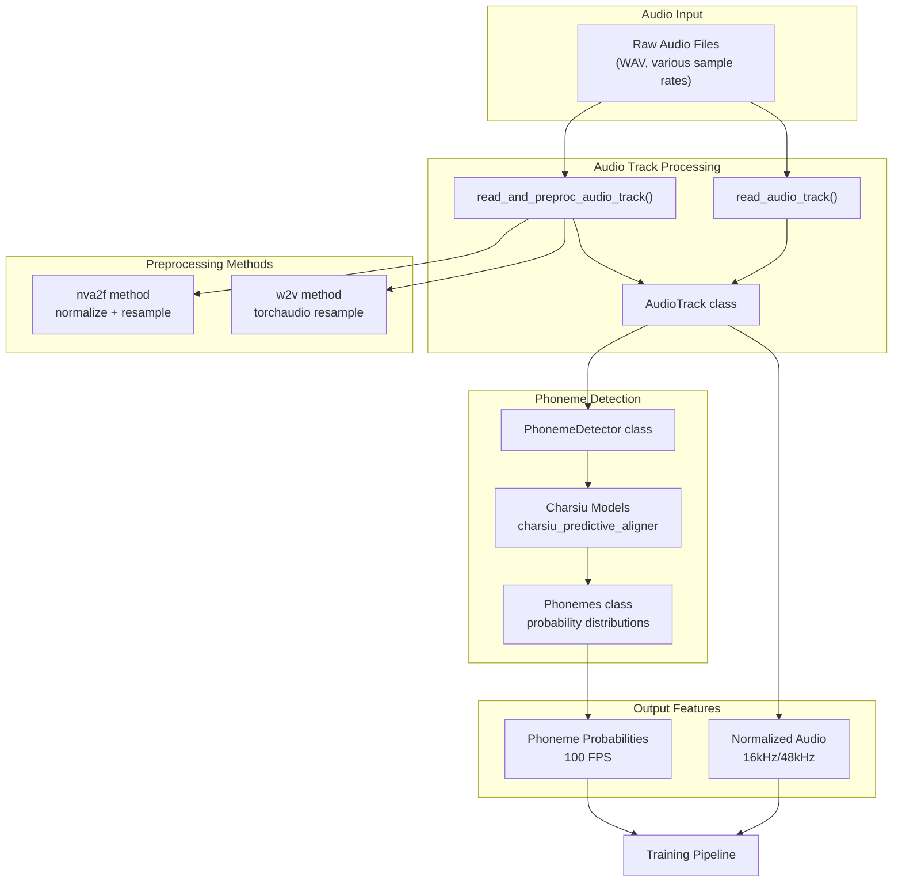
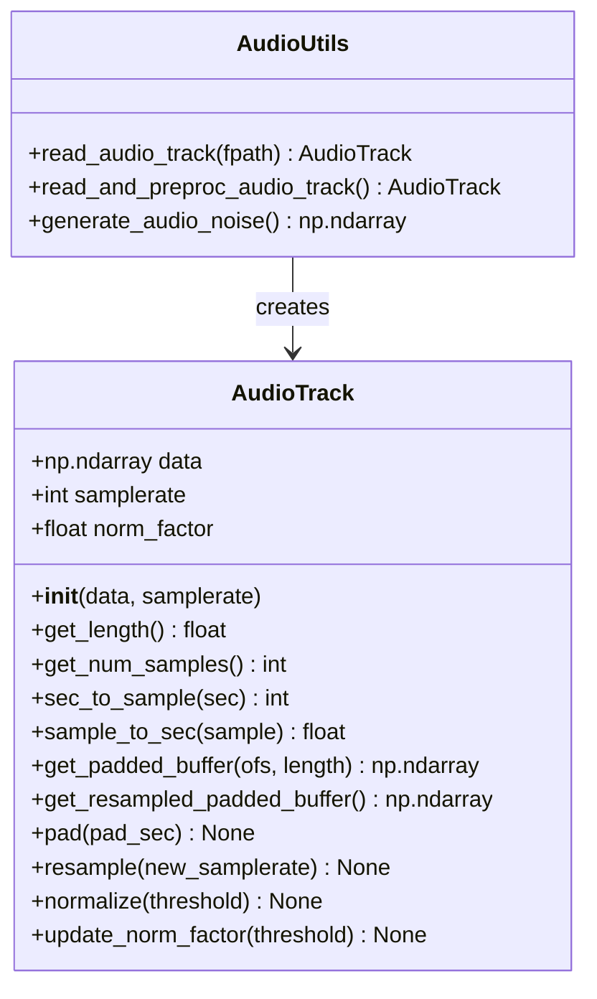
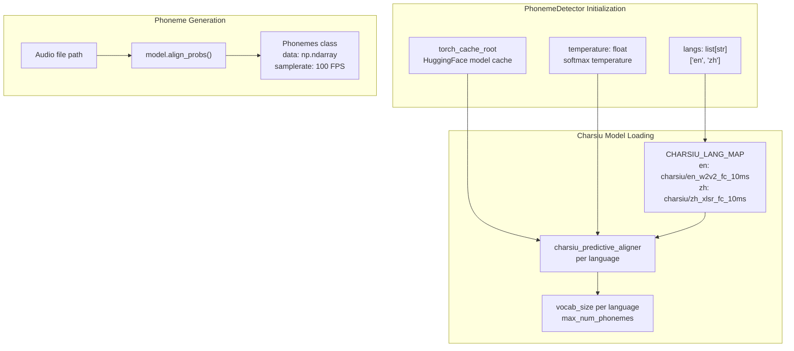
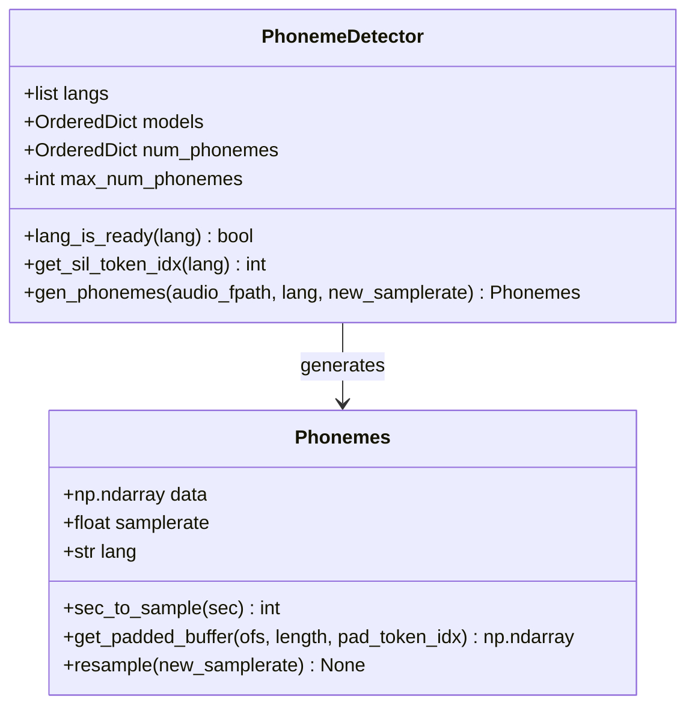
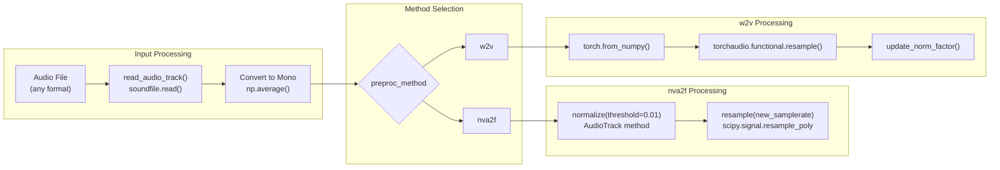
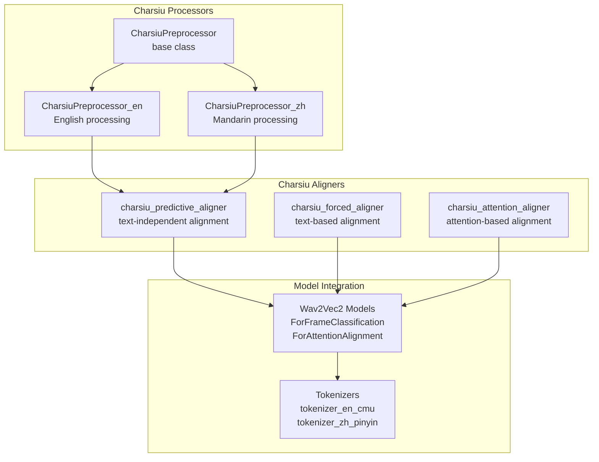
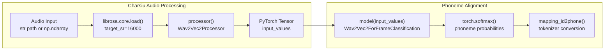
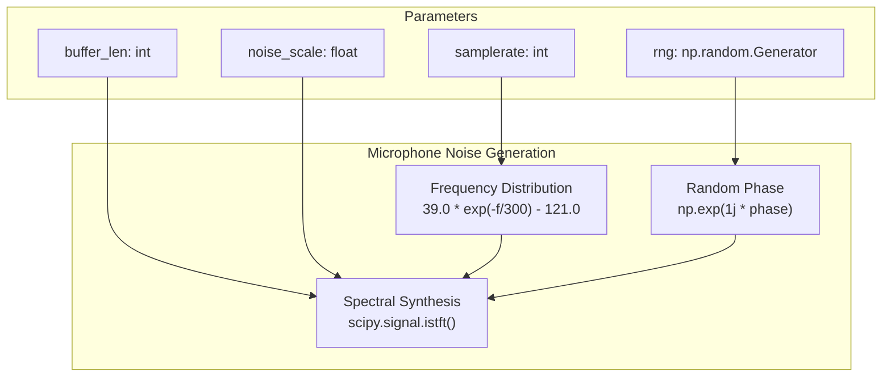
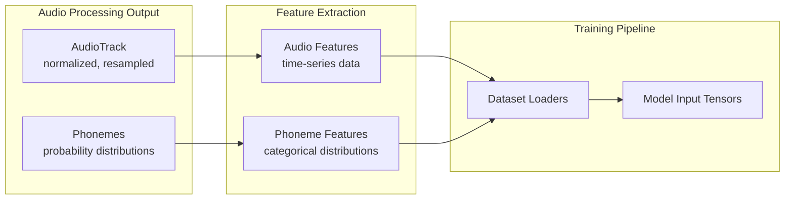

<!-- source: DeepWiki mcp.deepwiki.com · repo NVIDIA/Audio2Face-3D-Training-Framework · page 7.1 Audio Processing · fetched 2026-10-26 -->

# Audio Processing

Relevant source files

The following files were used as context for generating this wiki page:

- [audio2face/audio/__init__.py](audio2face/audio/__init__.py)
- [audio2face/audio/audio_track.py](audio2face/audio/audio_track.py)
- [audio2face/audio/utils.py](audio2face/audio/utils.py)
- [audio2face/deps/charsiu/README.md](audio2face/deps/charsiu/README.md)
- [audio2face/deps/charsiu/src/Charsiu.py](audio2face/deps/charsiu/src/Charsiu.py)
- [audio2face/deps/charsiu/src/processors.py](audio2face/deps/charsiu/src/processors.py)
- [audio2face/phoneme.py](audio2face/phoneme.py)

## Purpose and Scope

This document covers the audio processing subsystem within the Audio2Face-3D Training Framework, which handles audio data ingestion, preprocessing, and phoneme detection. The audio processing system provides the foundation for converting raw audio files into feature representations suitable for facial animation training.

For information about the broader data preparation pipeline, see [Data Preparation](#4). For details about the Charsiu phoneme alignment system specifically, see [Phoneme Alignment System](#7.3).

## Core Architecture

The audio processing system consists of three primary components: audio track management, phoneme detection, and preprocessing utilities. These work together to transform raw audio into training-ready features.

### Audio Processing Pipeline

**Sources:** [audio2face/audio/utils.py:27-54](), [audio2face/phoneme.py:61-107](), [audio2face/audio/audio_track.py:21-106]()

## Audio Track Management

The `AudioTrack` class provides the core abstraction for audio data handling throughout the framework. It manages audio data as floating-point arrays with associated sample rates and normalization factors.

### AudioTrack Class Structure

**Sources:** [audio2face/audio/audio_track.py:21-93](), [audio2face/audio/utils.py:27-89]()

### Key Audio Processing Operations

| Operation | Method | Purpose |
|-----------|--------|---------|
| Audio Loading | `read_audio_track()` | Convert audio files to AudioTrack objects |
| Mono Conversion | Line 30 in utils.py | Average multi-channel audio to mono |
| Resampling | `AudioTrack.resample()` | Change sample rate using scipy.signal |
| Normalization | `AudioTrack.normalize()` | Scale audio to prevent clipping |
| Buffer Management | `get_padded_buffer()` | Extract audio segments with padding |

**Sources:** [audio2face/audio/utils.py:27-31](), [audio2face/audio/audio_track.py:71-85]()

## Phoneme Detection System

The phoneme detection system integrates the Charsiu transformer-based phonetic aligner to extract phoneme probability distributions from audio. This provides temporal phoneme information that serves as conditioning input for facial animation models.

### PhonemeDetector Architecture

**Sources:** [audio2face/phoneme.py:61-82](), [audio2face/phoneme.py:25-28](), [audio2face/phoneme.py:100-106]()

### Phonemes Class Operations

The `Phonemes` class manages phoneme probability distributions with temporal alignment capabilities:

**Sources:** [audio2face/phoneme.py:31-59](), [audio2face/phoneme.py:89-106]()

## Audio Preprocessing Methods

The framework supports two primary audio preprocessing methods optimized for different model architectures:

### Preprocessing Method Comparison

| Method | Target Use | Normalization | Resampling | Implementation |
|--------|------------|---------------|------------|----------------|
| `nva2f` | General Audio2Face | `AudioTrack.normalize()` | `AudioTrack.resample()` | scipy-based |
| `w2v` | Wav2Vec2 Models | `update_norm_factor()` | `torchaudio.functional.resample()` | PyTorch-based |

### Preprocessing Pipeline Flow

**Sources:** [audio2face/audio/utils.py:34-54](), [audio2face/audio/audio_track.py:82-92]()

## Charsiu Integration

The framework integrates the Charsiu phonetic alignment system through a dependency located in `audio2face/deps/charsiu/`. This provides transformer-based phoneme detection capabilities.

### Charsiu Component Architecture

**Sources:** [audio2face/deps/charsiu/src/processors.py:49-291](), [audio2face/deps/charsiu/src/Charsiu.py:485-553]()

### Audio Processing in Charsiu

The Charsiu system performs its own audio preprocessing before phoneme detection:

**Sources:** [audio2face/deps/charsiu/src/processors.py:94-122](), [audio2face/deps/charsiu/src/Charsiu.py:517-523]()

## Audio Noise Generation

The framework includes utilities for generating synthetic audio noise for data augmentation and testing purposes:

### Noise Generation Methods

| Noise Type | Implementation | Use Case |
|------------|----------------|----------|
| `None` | `np.zeros()` | Silent baseline |
| `gauss` | `rng.normal()` | Gaussian white noise |
| `mic` | Spectral synthesis | Realistic microphone noise simulation |

### Microphone Noise Simulation

**Sources:** [audio2face/audio/utils.py:57-89]()

## Integration with Training Pipeline

The audio processing system provides processed audio and phoneme features to the training pipeline through standardized interfaces:

### Training Data Flow

**Sources:** [audio2face/audio/__init__.py:16-17](), [audio2face/phoneme.py:23-24]()

The audio processing system serves as the foundation for all audio-based features in the Audio2Face-3D Training Framework, providing robust audio handling, phoneme detection, and preprocessing capabilities that support both regression and diffusion model training approaches.

---

