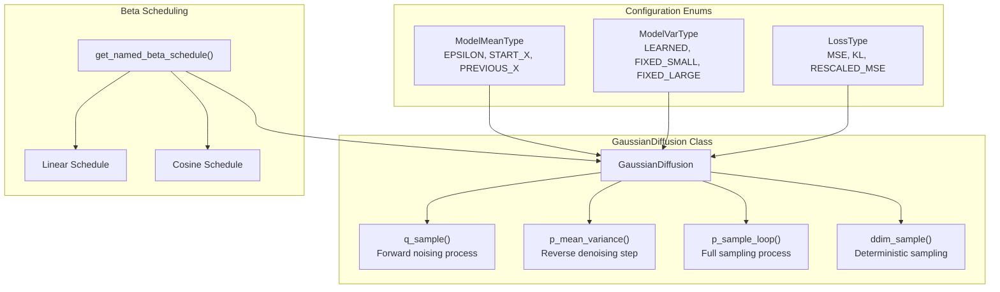
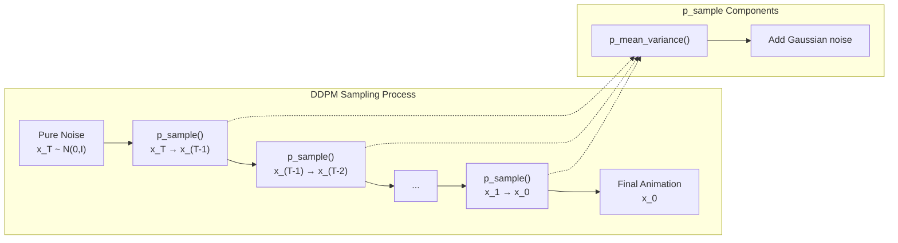
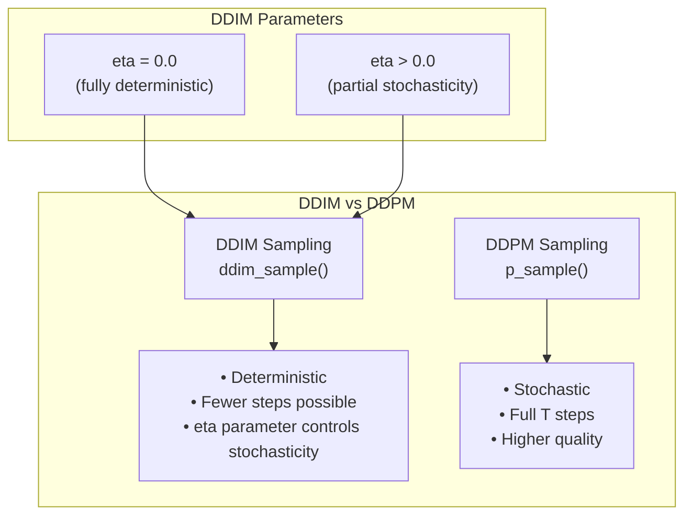
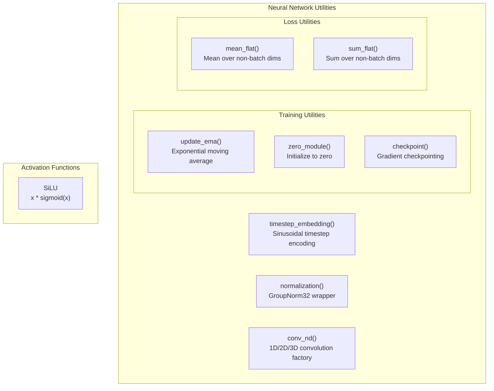
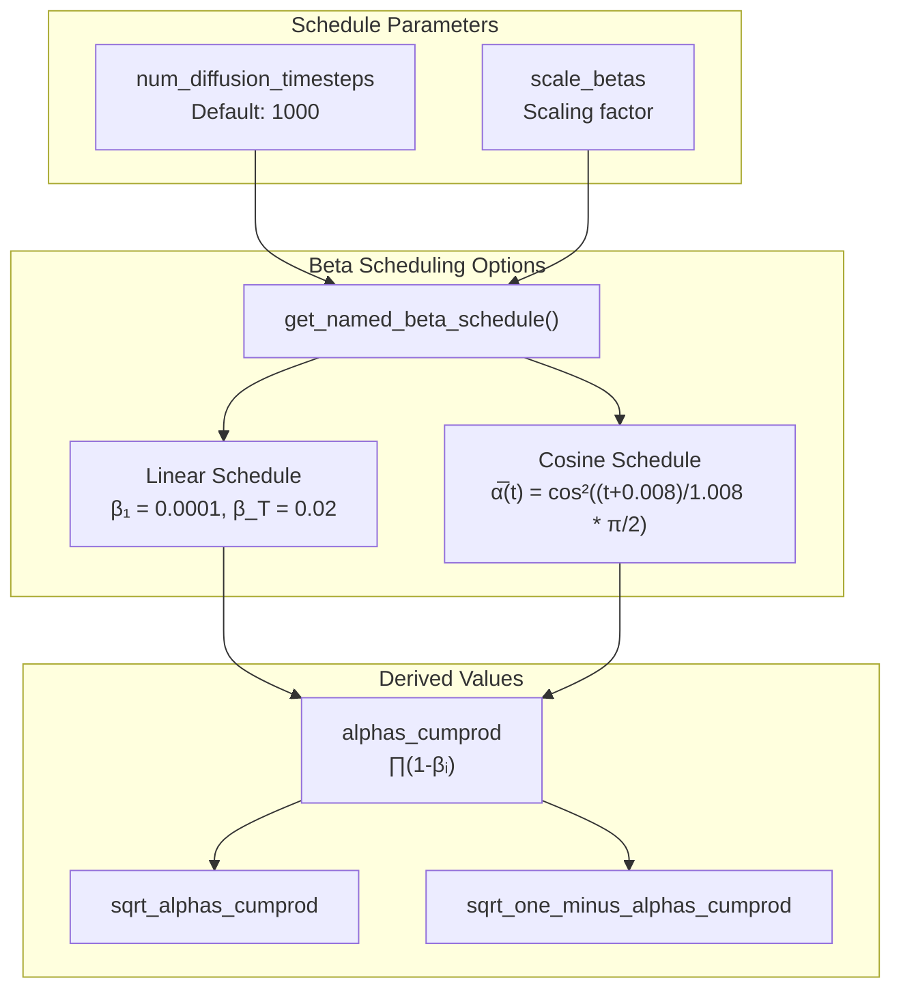
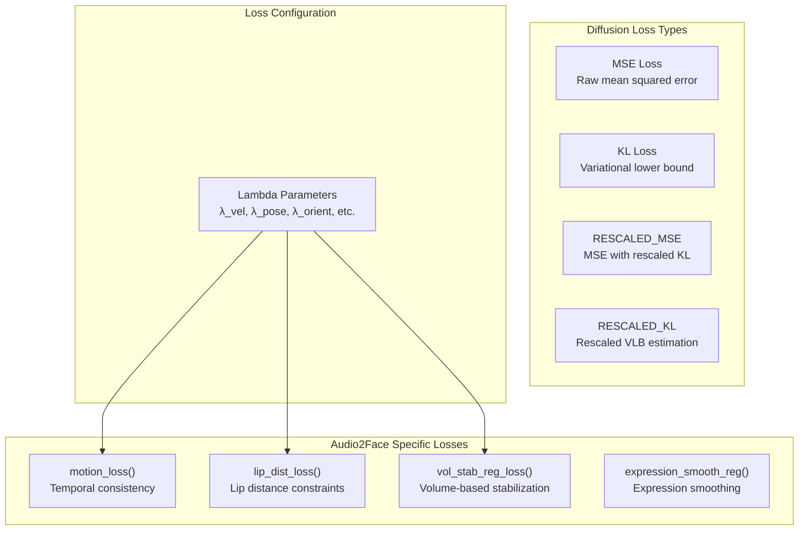
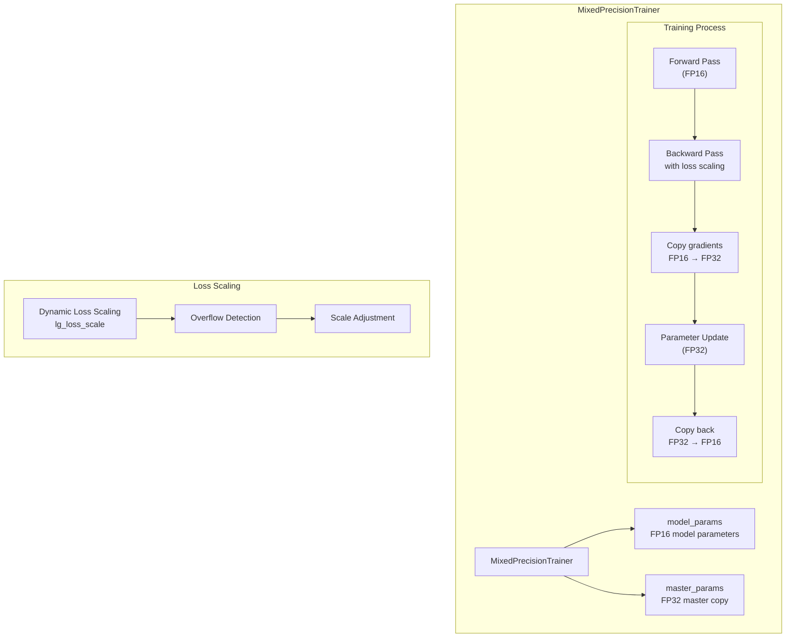
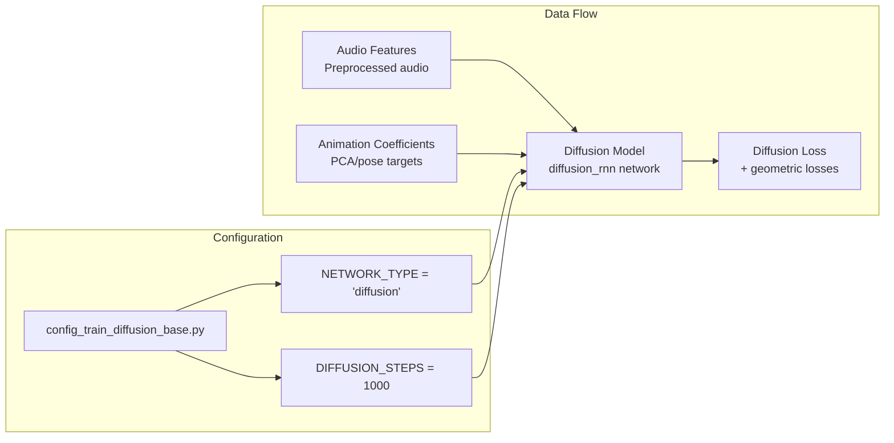
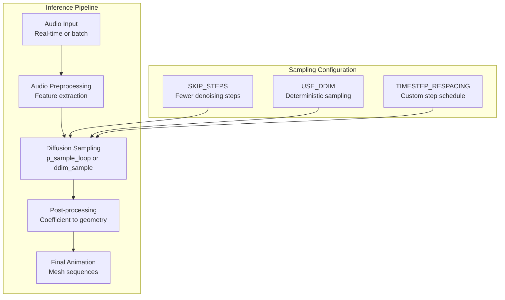
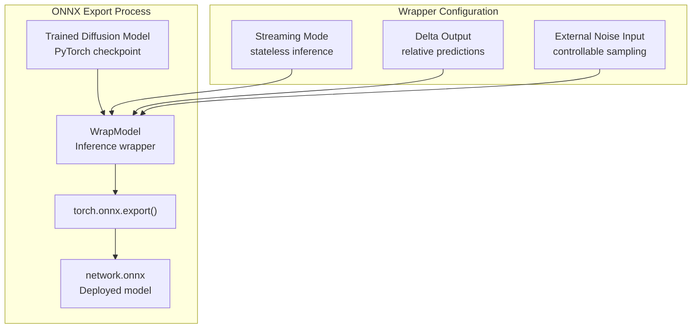

<!-- source: DeepWiki mcp.deepwiki.com · repo NVIDIA/Audio2Face-3D-Training-Framework · page 7.2 Diffusion Models · fetched 2026-10-26 -->

# Diffusion Models

<details>
<summary>Relevant source files</summary>

The following files were used as context for generating this wiki page:

- [audio2face/convert_onnx.py](audio2face/convert_onnx.py)
- [audio2face/deps/motion_diffusion_model/diffusion/fp16_util.py](audio2face/deps/motion_diffusion_model/diffusion/fp16_util.py)
- [audio2face/deps/motion_diffusion_model/diffusion/gaussian_diffusion.py](audio2face/deps/motion_diffusion_model/diffusion/gaussian_diffusion.py)
- [audio2face/deps/motion_diffusion_model/diffusion/nn.py](audio2face/deps/motion_diffusion_model/diffusion/nn.py)
- [audio2face/deps/motion_diffusion_model/diffusion/resample.py](audio2face/deps/motion_diffusion_model/diffusion/resample.py)
- [audio2face/deps/motion_diffusion_model/diffusion/script_utils.py](audio2face/deps/motion_diffusion_model/diffusion/script_utils.py)
- [audio2face/deps/motion_diffusion_model/utils/misc.py](audio2face/deps/motion_diffusion_model/utils/misc.py)
- [audio2face/losses.py](audio2face/losses.py)

</details>


## Purpose and Scope

This document covers the diffusion model implementation used in the Audio2Face-3D Training Framework for generating high-quality facial animation sequences from audio input. The diffusion models serve as the core generative component, implementing Denoising Diffusion Probabilistic Models (DDPM) and Denoising Diffusion Implicit Models (DDIM) for producing temporally coherent animation coefficients.

For information about the broader training system that utilizes these diffusion models, see [Training Framework](#5). For details about neural network architectures that work with the diffusion process, see [Model Types](#5.1). Audio preprocessing that feeds into the diffusion models is covered in [Audio Processing](#7.1).

## Core Diffusion Implementation

The diffusion functionality is centered around the `GaussianDiffusion` class, which implements the mathematical foundation of the diffusion process. This class handles the forward noising process, reverse denoising during sampling, and various loss computation methods.



**Sources:** [audio2face/deps/motion_diffusion_model/diffusion/gaussian_diffusion.py:125-161]()

The `GaussianDiffusion` class accepts several key parameters that control the diffusion process:

| Parameter | Type | Description |
|-----------|------|-------------|
| `betas` | np.array | Beta schedule controlling noise levels across timesteps |
| `model_mean_type` | ModelMeanType | What the model predicts (epsilon, x_start, or x_prev) |
| `model_var_type` | ModelVarType | How variance is computed (learned, fixed, etc.) |
| `loss_type` | LossType | Loss function for training (MSE, KL divergence) |
| `rescale_timesteps` | bool | Whether to rescale timesteps to [0,1000] range |

**Sources:** [audio2face/deps/motion_diffusion_model/diffusion/gaussian_diffusion.py:142-160]()

## Sampling Algorithms

The framework implements multiple sampling algorithms for generating animation sequences from the trained diffusion models.

### DDPM Sampling

The standard DDPM sampling process uses the `p_sample_loop` method to iteratively denoise from pure noise to the final animation sequence:



**Sources:** [audio2face/deps/motion_diffusion_model/diffusion/gaussian_diffusion.py:591-708](), [audio2face/deps/motion_diffusion_model/diffusion/gaussian_diffusion.py:492-545]()

### DDIM Sampling 

DDIM provides deterministic sampling with potentially fewer steps through the `ddim_sample` method:



**Sources:** [audio2face/deps/motion_diffusion_model/diffusion/gaussian_diffusion.py:789-830]()

## Neural Network Utilities

The diffusion models utilize specialized neural network components optimized for the diffusion training process.

### Core Utilities



**Sources:** [audio2face/deps/motion_diffusion_model/diffusion/nn.py:133-151](), [audio2face/deps/motion_diffusion_model/diffusion/nn.py:78-88](), [audio2face/deps/motion_diffusion_model/diffusion/nn.py:109-121]()

### Timestep Embedding

The `timestep_embedding` function creates sinusoidal positional encodings for diffusion timesteps:

```python
def timestep_embedding(timesteps, dim, max_period=10000):
    half = dim // 2
    freqs = th.exp(-math.log(max_period) * th.arange(start=0, end=half, dtype=th.float32) / half)
    args = timesteps[:, None].float() * freqs[None]
    embedding = th.cat([th.cos(args), th.sin(args)], dim=-1)
```

**Sources:** [audio2face/deps/motion_diffusion_model/diffusion/nn.py:133-151]()

## Beta Scheduling

The noise schedule controls how noise is added during the forward diffusion process and is critical for training stability and sample quality.

### Available Schedules



**Sources:** [audio2face/deps/motion_diffusion_model/diffusion/gaussian_diffusion.py:46-68](), [audio2face/deps/motion_diffusion_model/diffusion/gaussian_diffusion.py:71-88]()

## Loss Functions and Training

The framework supports multiple loss types for training diffusion models with various geometric and perceptual constraints.

### Core Loss Types



**Sources:** [audio2face/deps/motion_diffusion_model/diffusion/gaussian_diffusion.py:115-123](), [audio2face/losses.py:25-29](), [audio2face/losses.py:38-55](), [audio2face/losses.py:91-114]()

## Mixed Precision Training

The diffusion models support FP16 mixed precision training for improved memory efficiency and training speed.



**Sources:** [audio2face/deps/motion_diffusion_model/diffusion/fp16_util.py:160-241]()

## Integration with Audio2Face System

The diffusion models integrate with the broader Audio2Face framework through the training and inference pipelines.

### Training Integration



**Sources:** [audio2face/deps/motion_diffusion_model/diffusion/script_utils.py:27-59]()

### Inference Integration



**Sources:** [audio2face/convert_onnx.py:58-115](), [audio2face/infer_diffusion.py]() (referenced in convert_onnx.py)

## Model Deployment and ONNX Export

The trained diffusion models can be exported to ONNX format for deployment in production environments.



**Sources:** [audio2face/convert_onnx.py:117-178]()

---

