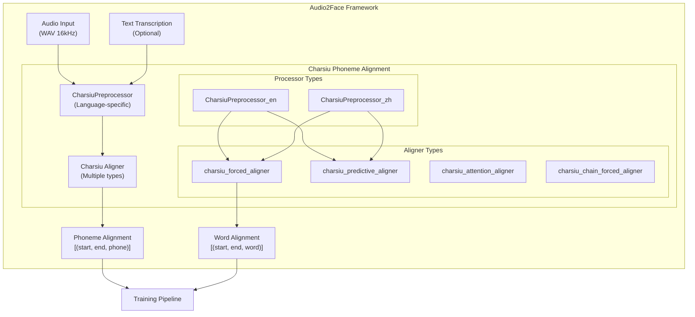
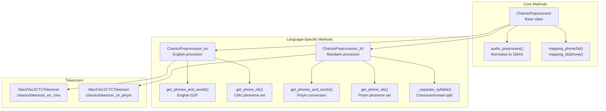
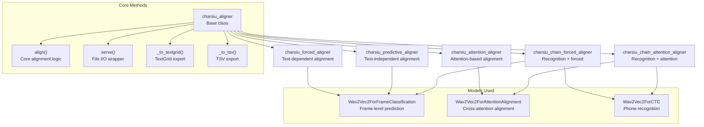

<!-- source: DeepWiki mcp.deepwiki.com · repo NVIDIA/Audio2Face-3D-Training-Framework · page 7.3 Phoneme Alignment System · fetched 2026-10-26 -->

# Phoneme Alignment System

Relevant source files

The following files were used as context for generating this wiki page:

- [audio2face/deps/charsiu/README.md](audio2face/deps/charsiu/README.md)
- [audio2face/deps/charsiu/__init__.py](audio2face/deps/charsiu/__init__.py)
- [audio2face/deps/charsiu/src/Charsiu.py](audio2face/deps/charsiu/src/Charsiu.py)
- [audio2face/deps/charsiu/src/processors.py](audio2face/deps/charsiu/src/processors.py)

The Phoneme Alignment System provides automatic phoneme-to-audio alignment capabilities for the Audio2Face-3D Training Framework. This system integrates the Charsiu transformer-based phonetic aligner to extract precise temporal phoneme information from audio inputs, which is essential for training high-quality audio-driven facial animation models.

For information about audio processing methods and preprocessing pipelines, see [Audio Processing](#7.1). For details about how phoneme data is used during model training, see [Training Process](#5.2).

## System Overview

The phoneme alignment system is built around the Charsiu aligner, which uses transformer-based models to perform phone-to-audio alignment. The system supports both forced alignment (with text transcriptions) and text-independent alignment modes.

**Charsiu Integration Architecture**

Sources: [audio2face/deps/charsiu/src/Charsiu.py:38-39](), [audio2face/deps/charsiu/src/processors.py:49-51]()

## Processor Components

The processor layer handles language-specific text-to-phoneme conversion and audio preprocessing. The system provides specialized processors for different languages with their own phonetic inventories and G2P (Grapheme-to-Phoneme) rules.

**Processor Class Hierarchy**

Sources: [audio2face/deps/charsiu/src/processors.py:130-142](), [audio2face/deps/charsiu/src/processors.py:279-291]()

### Audio Preprocessing

All processors normalize input audio to 16kHz sampling rate as required by the underlying Wav2Vec2 models. The `audio_preprocess` method accepts both file paths and NumPy arrays.

**Key Features:**
- Target sampling rate: 16kHz (Wav2Vec2 requirement)
- Automatic resampling using librosa
- Returns PyTorch tensors compatible with transformers

Sources: [audio2face/deps/charsiu/src/processors.py:94-122]()

### Phone-to-ID Mapping

The processors provide bidirectional mapping between phonetic symbols and numerical IDs using HuggingFace tokenizers:

| Method | Purpose |
|--------|---------|
| `mapping_phone2id()` | Convert phoneme string to numerical ID |
| `mapping_id2phone()` | Convert numerical ID back to phoneme string |
| `get_phone_ids()` | Convert phone sequence to ID list with optional silence padding |

Sources: [audio2face/deps/charsiu/src/processors.py:59-93]()

## Aligner Components

The aligner layer contains multiple alignment strategies, each optimized for different use cases. All aligners inherit from the base `charsiu_aligner` class and provide consistent interfaces.

**Aligner Architecture**

Sources: [audio2face/deps/charsiu/src/Charsiu.py:41-67](), [audio2face/deps/charsiu/src/Charsiu.py:109-115]()

### Forced Alignment

The `charsiu_forced_aligner` performs alignment when text transcriptions are available. It uses dynamic programming to find the optimal phone-to-audio mapping given the known phone sequence.

**Key Features:**
- Requires text transcription input
- Uses `Wav2Vec2ForFrameClassification` model
- Supports silence detection and filtering
- Outputs both phone and word alignments
- Configurable silence threshold

**Process Flow:**
1. Convert text to phone sequence using processor
2. Generate phone IDs with silence padding
3. Compute frame-level phone probabilities
4. Apply silence masking based on threshold
5. Perform forced alignment on non-silent regions
6. Merge silence and alignment results

Sources: [audio2face/deps/charsiu/src/Charsiu.py:109-158]()

### Predictive Alignment

The `charsiu_predictive_aligner` performs text-independent alignment, directly predicting phonemes from audio without requiring transcriptions.

**Key Features:**
- No text input required
- Direct acoustic-to-phoneme prediction
- Configurable temperature for probability adjustment
- Provides both discrete predictions and probability distributions
- Useful for unknown or multilingual content

Sources: [audio2face/deps/charsiu/src/Charsiu.py:485-553]()

## Processing Workflow

The phoneme alignment system follows a standardized workflow regardless of the specific aligner type used.

**Alignment Processing Pipeline**

```mermaid
graph LR
    Input[("Audio Input<br/>Text Input")]
    
    subgraph "Preprocessing Stage"
        AudioNorm["Audio Normalization<br/>audio_preprocess()"]
        TextProc["Text Processing<br/>get_phones_and_words()"]
        PhoneIds["Phone ID Generation<br/>get_phone_ids()"]
    end
    
    subgraph "Model Inference"
        ModelForward["Model Forward Pass<br/>Wav2Vec2 inference"]
        ProbCalc["Probability Calculation<br/>Softmax normalization"]
    end
    
    subgraph "Alignment Algorithm"
        AlignLogic["Alignment Logic<br/>forced_align() or argmax"]
        SilMerge["Silence Merging<br/>_merge_silence()"]
        Duration["Duration Calculation<br/>seq2duration()"]
    end
    
    subgraph "Output Generation"
        PhoneAlign["Phone Alignment<br/>[(start, end, phone)]"]
        WordAlign["Word Alignment<br/>[(start, end, word)]"]
        FileOutput["File Export<br/>TextGrid/TSV"]
    end
    
    Input --> AudioNorm
    Input --> TextProc
    TextProc --> PhoneIds
    
    AudioNorm --> ModelForward
    PhoneIds --> ModelForward
    ModelForward --> ProbCalc
    
    ProbCalc --> AlignLogic
    AlignLogic --> SilMerge
    SilMerge --> Duration
    
    Duration --> PhoneAlign
    Duration --> WordAlign
    PhoneAlign --> FileOutput
    WordAlign --> FileOutput
```

Sources: [audio2face/deps/charsiu/src/Charsiu.py:117-157](), [audio2face/deps/charsiu/src/utils.py:1]()

## Language Support

The system provides specialized support for multiple languages through dedicated processor implementations.

### English Support

The English processor (`CharsiuPreprocessor_en`) uses:
- **Tokenizer**: `charsiu/tokenizer_en_cmu` (CMU phoneme set)
- **Phoneme Set**: ARPAbet-based with stress markers
- **G2P**: CMU pronunciation dictionary rules
- **Silence Token**: `[SIL]`

**Features:**
- Stress marker handling (`\d` regex removal)
- Punctuation normalization
- Word-level alignment support
- Number normalization

Sources: [audio2face/deps/charsiu/src/processors.py:130-272]()

### Mandarin Support

The Mandarin processor (`CharsiuPreprocessor_zh`) provides:
- **Tokenizer**: `charsiu/tokenizer_zh_pinyin` (Pinyin phoneme set)
- **Phoneme Set**: Pinyin-based with tones
- **G2P**: Pinyin conversion with tone numbers
- **Syllable Separation**: Consonant/vowel splitting

**Special Handling:**
- Tone number preservation (1-5)
- `ü` vowel transformations (`u:` → `v`)
- Erhua (儿化) sound processing
- Retroflex consonant handling

Sources: [audio2face/deps/charsiu/src/processors.py:279-511]()

## Output Formats

The alignment system supports multiple output formats for integration with different downstream applications.

| Format | Extension | Content | Use Case |
|--------|-----------|---------|----------|
| Variable | N/A | Python tuples `(start, end, label)` | Programming integration |
| TextGrid | `.TextGrid` | Praat-compatible annotation | Phonetic analysis |
| TSV | `.tsv` | Tab-separated values | Spreadsheet import |

**TextGrid Structure:**
- Separate tiers for phones and words
- Time intervals in seconds
- Compatible with Praat software

**TSV Structure:**
- Three columns: start_time, end_time, label
- Separate files for phones (`_phone.tsv`) and words (`_word.tsv`)
- Numerical timestamps

Sources: [audio2face/deps/charsiu/src/Charsiu.py:72-107](), [audio2face/deps/charsiu/src/Charsiu.py:179-194]()

## Integration Points

The phoneme alignment system integrates with the broader Audio2Face framework at several key points:

- **Preprocessing Stage**: Extracts phoneme sequences during dataset preparation
- **Training Loop**: Provides phoneme supervision for loss functions
- **Feature Engineering**: Creates time-aligned phoneme embeddings
- **Model Conditioning**: Supplies phonetic context for generation models

The system's modular design allows for easy extension to additional languages and alignment strategies as needed for specific training scenarios.

Sources: [audio2face/deps/charsiu/src/Charsiu.py:1-576](), [audio2face/deps/charsiu/src/processors.py:1-531]()

---

