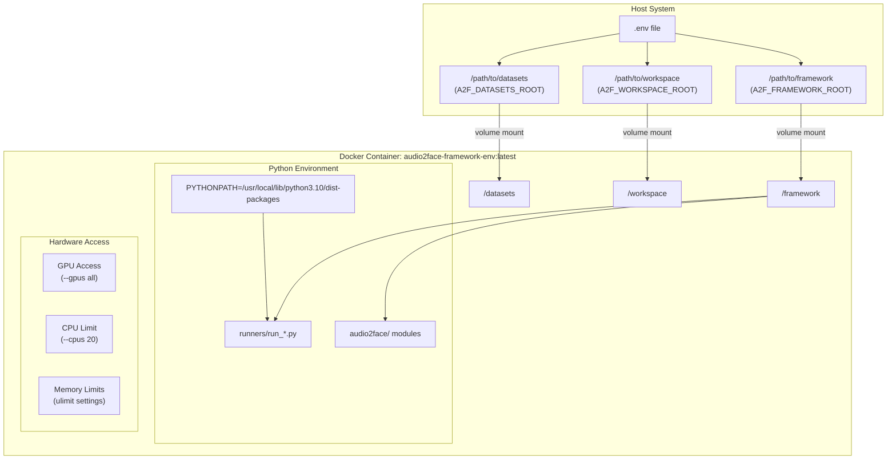
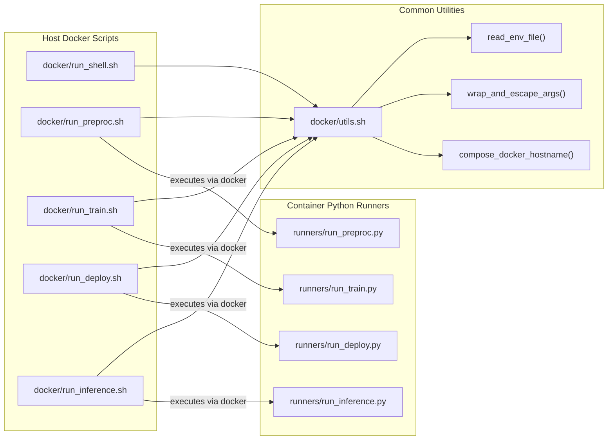
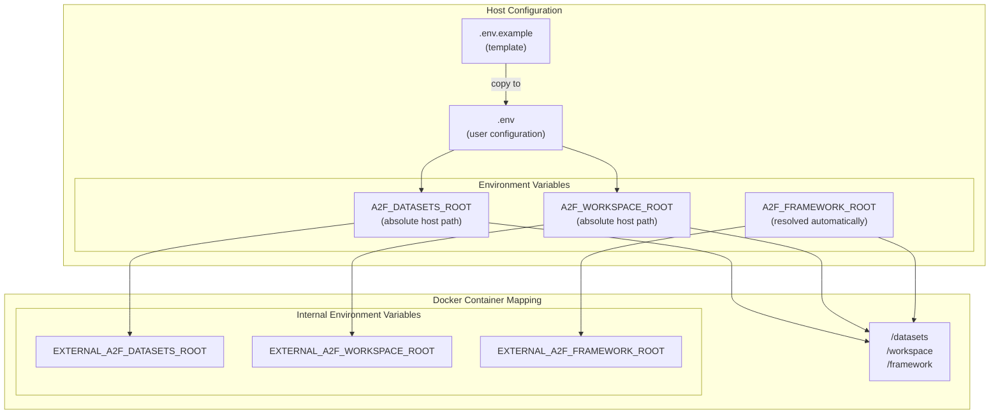

<!-- source: DeepWiki mcp.deepwiki.com · repo NVIDIA/Audio2Face-3D-Training-Framework · page 7.4 Docker Environment · fetched 2026-10-26 -->

# Docker Environment

<details>
<summary>Relevant source files</summary>

The following files were used as context for generating this wiki page:

- [docker/run_deploy.sh](docker/run_deploy.sh)
- [docker/run_inference.sh](docker/run_inference.sh)
- [docker/run_shell.sh](docker/run_shell.sh)
- [docker/run_train.sh](docker/run_train.sh)
- [docs/training_framework.md](docs/training_framework.md)

</details>


This document covers the Docker containerization system that provides the execution environment for the Audio2Face-3D Training Framework. The Docker environment ensures consistent execution across different platforms and manages dependencies, GPU access, and resource allocation for all framework operations.

For information about the overall training workflow, see [Training Framework](#5). For configuration management, see [Configuration System](#3).

## Container Architecture

The framework operates entirely within a Docker container using the `audio2face-framework-env:latest` image. This containerized approach eliminates the need for local dependency management while providing consistent GPU acceleration and resource management.

### Container Specification

The Docker container runs with the following key characteristics:

| Component | Configuration |
|-----------|---------------|
| Base Image | `audio2face-framework-env:latest` |
| GPU Access | `--gpus all` (full GPU passthrough) |
| CPU Allocation | `--cpus 20` |
| Memory Limits | `--ulimit memlock=-1 --ulimit stack=67108864` |
| IPC Mode | `--ipc=host` (for shared memory) |
| Privileges | `--privileged` (for development shell only) |



**Container Volume Mounts and Environment Variables**

Sources: [docker/run_shell.sh:34-40](), [docker/run_train.sh:36-41](), [docker/run_deploy.sh:35-40](), [docker/run_inference.sh:36-41]()

## Execution Scripts

The framework provides dedicated Docker execution scripts for each major operation. All scripts follow a consistent pattern of environment setup, volume mounting, and command execution within the container.

### Script Architecture



**Docker Execution Scripts and Python Runner Mapping**

### Script Execution Pattern

Each execution script implements the following standardized workflow:

1. **Environment Setup**: Source [docker/utils.sh:23]() and call `read_env_file`
2. **Path Resolution**: Determine `A2F_FRAMEWORK_ROOT` from script location [docker/run_train.sh:21-22]()
3. **Git Configuration**: Set safe directory with `git config --global --add safe.directory /framework` [docker/run_train.sh:27]()
4. **Argument Processing**: Wrap script arguments using `wrap_and_escape_args` [docker/run_train.sh:28]()
5. **Container Execution**: Run Docker container with standardized mounts and environment [docker/run_train.sh:33-44]()

| Script | Purpose | Python Runner | Working Directory |
|--------|---------|---------------|-------------------|
| `run_shell.sh` | Interactive development | N/A | `/framework` |
| `run_preproc.sh` | Dataset preprocessing | `runners/run_preproc.py` | `/framework` |
| `run_train.sh` | Model training | `runners/run_train.py` | `/framework` |
| `run_deploy.sh` | Model deployment | `runners/run_deploy.py` | `/framework` |
| `run_inference.sh` | Inference execution | `runners/run_inference.py` | `/framework` |

Sources: [docker/run_train.sh:18-19](), [docker/run_deploy.sh:18-19](), [docker/run_inference.sh:18-19](), [docker/run_shell.sh:18]()

## Development Environment

The Docker environment supports both production execution and interactive development through the development shell and VSCode integration.

### Interactive Development Shell

The `run_shell.sh` script provides an interactive bash environment within the container for development and debugging:

```bash
./docker/run_shell.sh
```

Key features of the development shell:
- **Interactive Mode**: Runs with `-it` flag for terminal interaction [docker/run_shell.sh:31]()
- **Privileged Access**: Uses `--privileged` flag for development flexibility [docker/run_shell.sh:33]()
- **Git Integration**: Automatically configures Git safe directories [docker/run_shell.sh:26-27]()
- **Full Framework Access**: Mounts framework source code as `/framework` [docker/run_shell.sh:36]()

### VSCode Integration

The framework supports VSCode development through the Dev Containers extension:

1. **Container Attachment**: VSCode can attach to running containers started by `run_shell.sh`
2. **Debug Configurations**: Pre-configured launch settings in `.vscode/launch.json`
3. **Debug Runners**: Specialized debug versions of runners with hardcoded parameters:
   - `runners/run_preproc_debug.py`
   - `runners/run_train_debug.py`
   - `runners/run_deploy_debug.py`
   - `runners/run_inference_debug.py`

Sources: [docs/training_framework.md:197-257]()

## Environment Configuration

The Docker environment uses a file-based configuration system to map host directories to container paths, enabling flexible deployment across different systems.

### Environment File Structure



**Environment Variable Mapping Between Host and Container**

### Path Configuration Requirements

The environment configuration requires three absolute paths on the host system:

| Variable | Purpose | Example Path | Container Mount |
|----------|---------|--------------|-----------------|
| `A2F_DATASETS_ROOT` | Dataset storage location | `/home/user/audio2face/datasets` | `/datasets` |
| `A2F_WORKSPACE_ROOT` | Training output workspace | `/home/user/audio2face/workspace` | `/workspace` |
| `A2F_FRAMEWORK_ROOT` | Framework source code | (auto-resolved from script location) | `/framework` |

### Environment Setup Process

1. **Template Copy**: Copy `.env.example` to `.env`
2. **Path Configuration**: Set absolute paths for datasets and workspace roots
3. **Automatic Resolution**: Framework root is resolved automatically from script location [docker/run_train.sh:21-22]()
4. **Environment Loading**: Scripts load environment using `read_env_file` function [docker/run_train.sh:25]()

Sources: [docker/run_train.sh:37-41](), [docs/training_framework.md:444-446]()

## Resource Management

The Docker environment implements resource controls and hardware access policies to optimize performance for deep learning workloads.

### GPU Access Configuration

All execution scripts enable full GPU access through the `--gpus all` flag, providing:
- **CUDA Runtime**: Direct access to NVIDIA CUDA libraries
- **GPU Memory**: Unrestricted GPU memory allocation  
- **Multi-GPU Support**: Access to all available GPUs on the host system

### CPU and Memory Limits

The container implements the following resource limits:

| Resource | Configuration | Purpose |
|----------|---------------|---------|
| CPU Cores | `--cpus 20` | Limit CPU usage for training processes |
| Memory Lock | `--ulimit memlock=-1` | Allow unlimited memory locking for GPU operations |
| Stack Size | `--ulimit stack=67108864` | Set stack size to 64MB for deep learning frameworks |
| IPC Mode | `--ipc=host` | Enable shared memory for multi-process training |

### Container Networking

Each container instance receives a unique hostname generated by the `compose_docker_hostname` function, enabling:
- **Process Identification**: Unique container identification in multi-instance scenarios
- **Network Isolation**: Separate network namespace per container
- **Host Integration**: Seamless integration with host networking stack

Sources: [docker/run_train.sh:34-35](), [docker/run_shell.sh:32-33](), [docker/run_train.sh:41]()