# Page: Overview

# Overview

<details>
<summary>Relevant source files</summary>

The following files were used as context for generating this wiki page:

- [README.md](README.md)
- [configs/example-diffusion-min/config_train.py](configs/example-diffusion-min/config_train.py)
- [configs/example-diffusion/config_train.py](configs/example-diffusion/config_train.py)
- [configs/example-regression-min/config_train.py](configs/example-regression-min/config_train.py)
- [docker/run_preproc.sh](docker/run_preproc.sh)
- [docker/run_shell.sh](docker/run_shell.sh)
- [docs/config_details.md](docs/config_details.md)
- [docs/training_framework.md](docs/training_framework.md)

</details>


This document provides a comprehensive overview of the Audio2Face-3D Training Framework, explaining its architecture, core components, and execution model. The framework is a containerized system designed to train high-fidelity facial animation models that generate realistic facial movements, including skin, jaw, tongue, and eye animations, from audio input.

For detailed configuration parameters, see [Configuration System](#3). For data preparation requirements, see [Data Preparation](#4). For training specifics, see [Training Framework](#5).

## System Purpose and Capabilities

The Audio2Face-3D Training Framework enables users to train custom facial animation models from synchronized audio-visual datasets. The system supports two primary model architectures:

- **Regression Models**: Standard approach using PCA-compressed geometry with faster training
- **Diffusion Models**: Advanced approach using absolute pose representation with higher fidelity output

The framework operates entirely within Docker containers and follows a sequential four-stage pipeline: preprocessing, training, deployment, and inference.

**Sources:** [README.md:9-13](), [docs/training_framework.md:12-25]()

## System Architecture

The framework consists of interconnected systems that process facial animation data through a standardized pipeline:

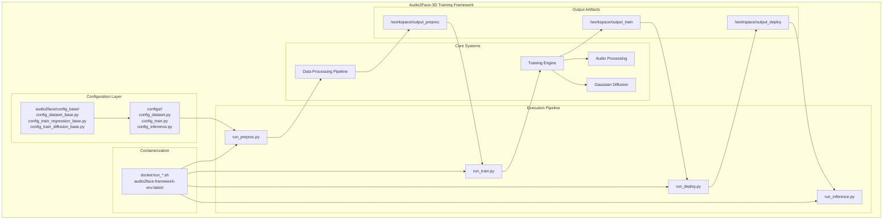

**Sources:** [docs/training_framework.md:28-44](), [docker/run_preproc.sh:18-44](), [README.md:172-238]()

## Core Component Architecture

This diagram shows the relationship between high-level system concepts and their corresponding code entities:

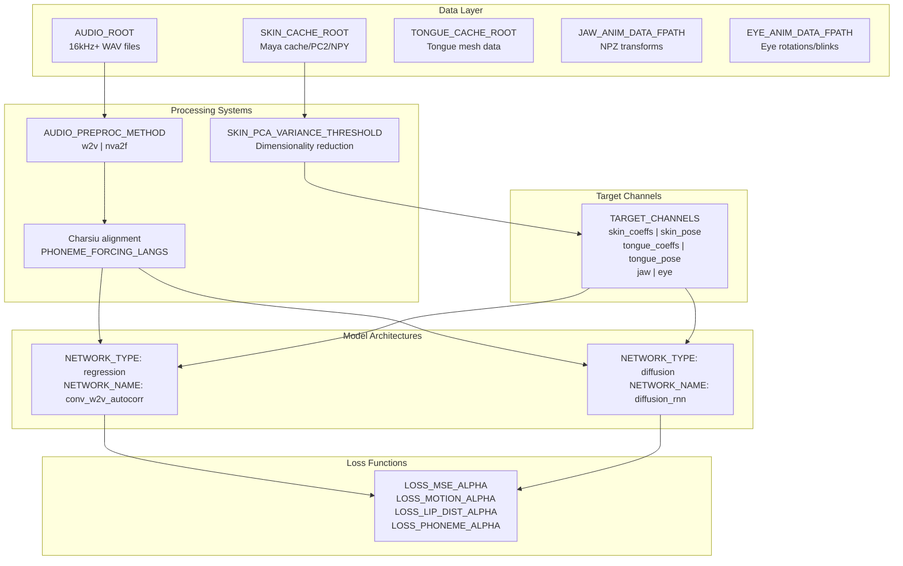

**Sources:** [docs/config_details.md:24-143](), [docs/config_details.md:414-419](), [docs/config_details.md:518-534]()

## Execution Pipeline

The framework executes through four sequential stages, each handled by dedicated Python scripts running in Docker containers:

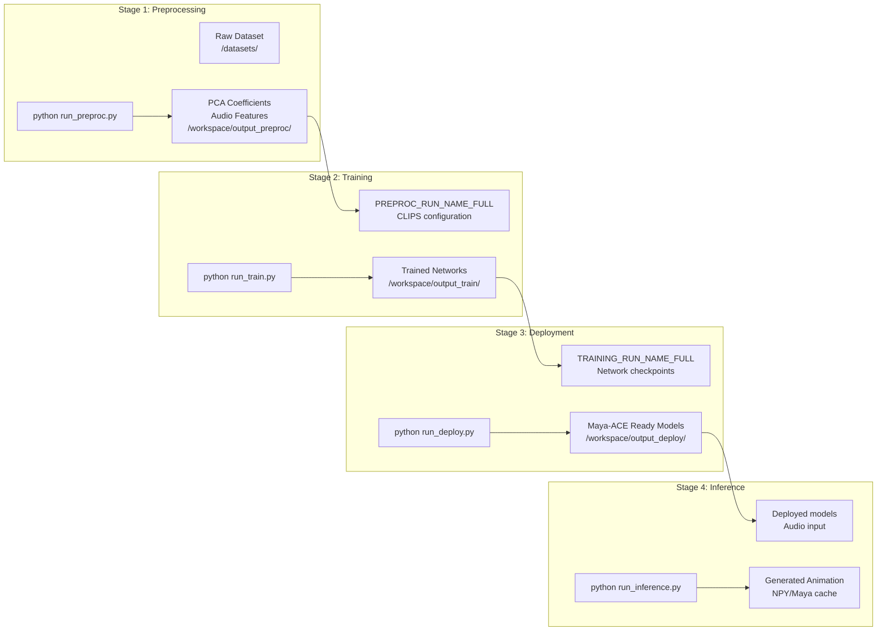

**Sources:** [README.md:175-238](), [docs/training_framework.md:104-151]()

## Configuration System Architecture

The framework implements a two-tier configuration system that separates base parameter definitions from user customizations:

| Layer | Location | Purpose | Key Files |
|-------|----------|---------|-----------|
| Base Layer | `audio2face/config_base/` | Parameter definitions with defaults | `config_dataset_base.py`, `config_train_regression_base.py`, `config_train_diffusion_base.py` |
| User Layer | `configs/<CONFIG_NAME>/` | User overrides and customizations | `config_dataset.py`, `config_train.py`, `config_inference.py` |

### Configuration Merge Process

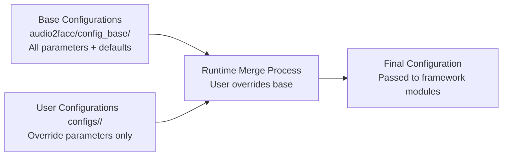

**Sources:** [docs/training_framework.md:48-101](), [docs/config_details.md:1-13]()

## Model Types and Capabilities

The framework supports two distinct neural network architectures with different characteristics:

### Regression Models

- **Network Class**: `conv_w2v_autocorr`
- **Target Representation**: PCA coefficients (`skin_coeffs`, `tongue_coeffs`)
- **Batch Processing**: `BATCH_SIZE = 32`, `SEQ_LEN = 2`
- **Training Features**: Phoneme supervision, emotion embeddings
- **Use Case**: Standard approach with faster training and good quality

### Diffusion Models

- **Network Class**: `diffusion_rnn` 
- **Target Representation**: Absolute poses (`skin_pose`, `tongue_pose`)
- **Batch Processing**: `BATCH_SIZE = 1`, `GRADIENT_ACCUMULATION_STEPS = 4`
- **Training Features**: `DIFFUSION_STEPS = 1000`, temporal RNN modeling
- **Use Case**: Advanced approach with higher fidelity output

| Feature | Regression | Diffusion |
|---------|------------|-----------|
| Data Representation | PCA compressed | Absolute geometry |
| Sequence Handling | Fixed length (`SEQ_LEN`) | Variable length |
| Training Speed | Faster | Slower |
| Output Quality | Good | Higher fidelity |
| Memory Usage | Lower | Higher |

**Sources:** [configs/example-regression-min/config_train.py:25](), [configs/example-diffusion-min/config_train.py:25](), [docs/config_details.md:356-360]()

---

# Page: Getting Started

# Getting Started

<details>
<summary>Relevant source files</summary>

The following files were used as context for generating this wiki page:

- [configs/example-diffusion-min/config_preproc.py](configs/example-diffusion-min/config_preproc.py)
- [configs/example-diffusion/config_preproc.py](configs/example-diffusion/config_preproc.py)
- [configs/example-regression-min/config_preproc.py](configs/example-regression-min/config_preproc.py)
- [configs/example-regression/config_preproc.py](configs/example-regression/config_preproc.py)
- [docker/run_deploy.sh](docker/run_deploy.sh)
- [docker/run_inference.sh](docker/run_inference.sh)
- [docker/run_shell.sh](docker/run_shell.sh)
- [docker/run_train.sh](docker/run_train.sh)
- [docs/training_framework.md](docs/training_framework.md)

</details>


This page provides the essential setup and installation steps needed to begin using the Audio2Face-3D Training Framework. It covers system requirements, Docker environment setup, and the basic workflow to train your first model.

For detailed configuration parameters, see [Configuration System](#3). For data preparation requirements, see [Data Preparation](#4). For advanced training concepts, see [Training Framework](#5).

## Prerequisites

Before installing the framework, ensure your system meets the minimum requirements:

| Requirement | Specification |
|------------|---------------|
| **Storage** | Minimum 1 GB free disk space |
| **Hardware** | CUDA-compatible NVIDIA GPU with ≥6 GB VRAM |
| **NVIDIA Driver** | Linux: 575.57-579.x, Windows/WSL2: 576.57-579.x |
| **Operating System** | Linux or Windows with WSL2 |

**Container Architecture**

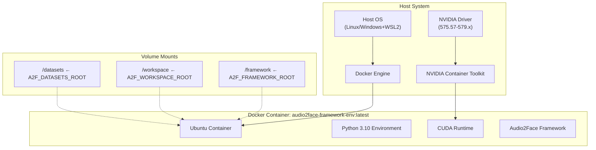

Sources: [docs/training_framework.md:261-272](), [docker/run_shell.sh:31-43]()

## Installation Steps

### 1. Clone the Repository

```bash
mkdir -p ~/audio2face && cd ~/audio2face
git clone https://github.com/NVIDIA/Audio2Face-3D-Training-Framework.git
```

### 2. Create Directory Structure

```bash
mkdir -p ~/audio2face/datasets
mkdir -p ~/audio2face/workspace
cd ~/audio2face/Audio2Face-3D-Training-Framework
```

### 3. Configure Environment Variables

```bash
cp .env.example .env
nano .env
```

Set the following paths in `.env`:
```bash
A2F_DATASETS_ROOT="/absolute/path/to/datasets"
A2F_WORKSPACE_ROOT="/absolute/path/to/workspace" 
A2F_FRAMEWORK_ROOT="/absolute/path/to/Audio2Face-3D-Training-Framework"
```

### 4. Build Docker Container

```bash
chmod +x docker/*.sh
./docker/build_docker.sh
```

Sources: [docs/training_framework.md:405-461]()

## Framework Architecture

**Execution Environment Structure**

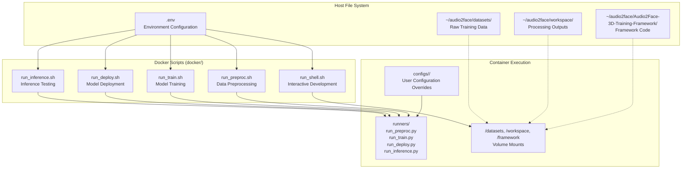

Sources: [docs/training_framework.md:26-44](), [docker/run_shell.sh:18-43](), [docker/run_train.sh:18-44]()

## Configuration Overview

The framework uses a two-tier configuration system where base configurations define all available parameters, and user configurations override specific values for your use case.

**Configuration System Architecture**

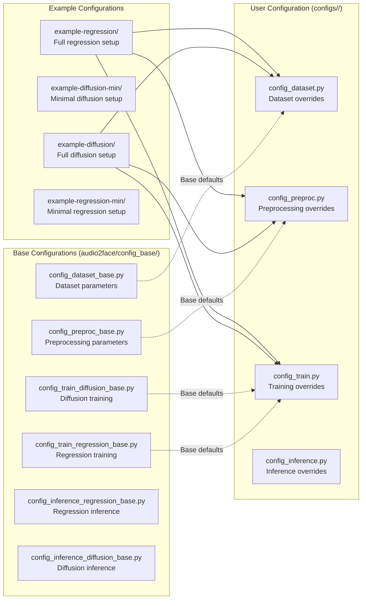

Sources: [docs/training_framework.md:48-100](), [configs/example-diffusion/config_preproc.py:16-20](), [configs/example-regression/config_preproc.py:16-20]()

## Quick Start Workflow

The complete training pipeline consists of four sequential stages, each executed through Docker scripts:

**Pipeline Execution Flow**

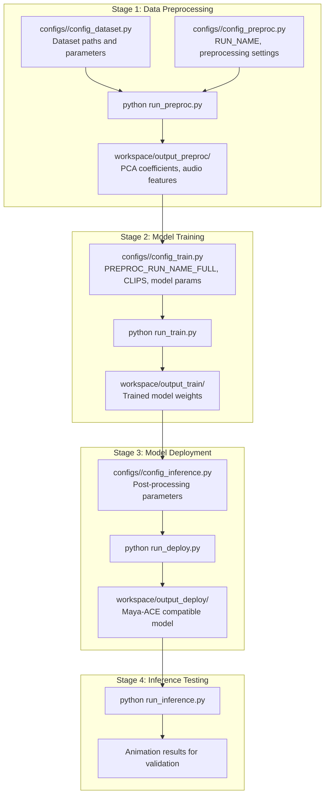

Sources: [docs/training_framework.md:102-152]()

## Basic Usage Example

### 1. Start with Example Configuration

Copy one of the provided example configurations:
- `configs/example-diffusion/` - Advanced diffusion-based training
- `configs/example-regression/` - Standard regression-based training  
- `configs/example-diffusion-min/` - Minimal diffusion setup
- `configs/example-regression-min/` - Minimal regression setup

### 2. Configure Your Dataset

Edit `configs/<CONFIG_NAME>/config_dataset.py`:
```python
ACTOR_NAMES = ["your_actor_name"]
AUDIO_ROOT = "/datasets/your_dataset/audio"
SKIN_CACHE_ROOT = "/datasets/your_dataset/cache/skin"
```

### 3. Run Preprocessing

```bash
python run_preproc.py <CONFIG_NAME> <ACTOR_NAME>
```

### 4. Configure Training

Edit `configs/<CONFIG_NAME>/config_train.py` to reference the preprocessing output:
```python
PREPROC_RUN_NAME_FULL = {"actor_name": "YYYYMMDD_HHMMSS_actor_name"}
```

### 5. Run Training

```bash
python run_train.py <CONFIG_NAME>
```

### 6. Deploy Model

```bash
python run_deploy.py <CONFIG_NAME> <TRAINING_RUN_NAME_FULL>
```

Sources: [docs/training_framework.md:104-152](), [configs/example-diffusion-min/config_preproc.py:17-20]()

## Development Environment

For interactive development and debugging, use the development shell:

```bash
./docker/run_shell.sh
```

This provides:
- Interactive container access with all framework dependencies
- Volume mounts for live code editing
- GPU access for development testing
- Full Python environment with debugging capabilities

Sources: [docker/run_shell.sh:31-43](), [docs/training_framework.md:193-257]()

## Next Steps

After completing basic setup:

1. **Prepare Your Data**: See [Data Preparation](#4) for detailed requirements on audio files, animation caches, and geometry data
2. **Configure Training**: See [Configuration System](#3) for comprehensive parameter documentation  
3. **Understand Model Types**: See [Training Framework](#5) for details on regression vs diffusion models
4. **Deploy to Maya**: See [Deployment and Inference](#6) for Maya-ACE integration

The framework supports both single-actor and multi-actor training scenarios. For production workflows, review the complete configuration system to optimize training parameters for your specific dataset characteristics.

Sources: [docs/training_framework.md:100](), [docs/training_framework.md:154-192]()

---

# Page: Configuration System

# Configuration System

<details>
<summary>Relevant source files</summary>

The following files were used as context for generating this wiki page:

- [audio2face/config_base/config_train_diffusion_base.py](audio2face/config_base/config_train_diffusion_base.py)
- [audio2face/config_base/config_train_regression_base.py](audio2face/config_base/config_train_regression_base.py)
- [audio2face/dataset.py](audio2face/dataset.py)
- [audio2face/networks/diffusion_rnn.py](audio2face/networks/diffusion_rnn.py)
- [configs/example-diffusion-min/config_train.py](configs/example-diffusion-min/config_train.py)
- [configs/example-diffusion/config_train.py](configs/example-diffusion/config_train.py)
- [configs/example-regression-min/config_train.py](configs/example-regression-min/config_train.py)
- [docs/config_details.md](docs/config_details.md)

</details>


The Configuration System is the core orchestration mechanism for the Audio2Face-3D Training Framework, implementing a two-tier architecture that separates base defaults from user customizations. This system manages all parameters across the entire pipeline, from dataset preparation through model deployment, providing a unified interface for controlling training workflows, model architectures, and inference settings.

For information about specific training configuration parameters, see [Training Configuration](#3.3). For dataset-specific configuration details, see [Dataset Configuration](#3.2).

## Two-Tier Configuration Architecture

The framework implements a hierarchical configuration system with two distinct layers that merge at runtime to produce the final configuration used by the training pipeline.

### Configuration Merger System

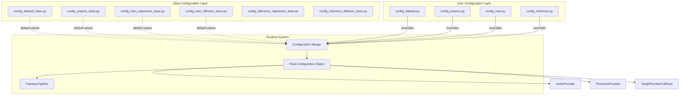

**Sources:** [audio2face/config_base/config_train_regression_base.py:1-215](), [audio2face/config_base/config_train_diffusion_base.py:1-224](), [audio2face/dataset.py:38-44]()

The base configuration layer provides comprehensive defaults for all framework components, while the user layer allows selective overrides for specific deployment scenarios. This architecture ensures that users only need to specify parameters that differ from sensible defaults.

### Configuration Type Selection

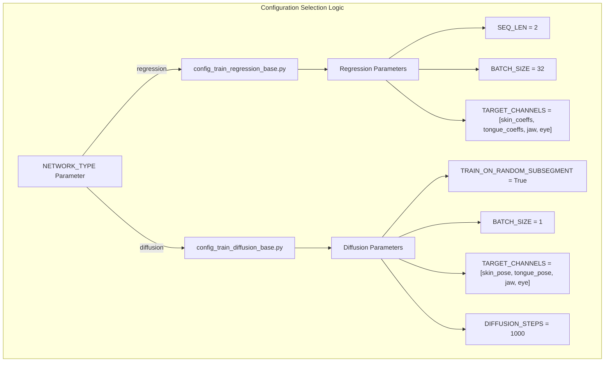

**Sources:** [audio2face/config_base/config_train_regression_base.py:25](), [audio2face/config_base/config_train_diffusion_base.py:25](), [audio2face/config_base/config_train_regression_base.py:153](), [audio2face/config_base/config_train_diffusion_base.py:173]()

## Configuration File Structure

The configuration system organizes parameters into four primary categories, each handled by dedicated configuration files with specific responsibilities.

### Core Configuration Components

| Configuration Type | Base File | Purpose | Key Parameters |
|-------------------|-----------|---------|----------------|
| Dataset | `config_dataset_base.py` | Data paths and actor properties | `AUDIO_ROOT`, `SKIN_CACHE_ROOT`, `ACTOR_NAMES` |
| Preprocessing | `config_preproc_base.py` | PCA and data preparation | `SKIN_PCA_VARIANCE_THRESHOLD`, `RUN_NAME` |
| Training | `config_train_*_base.py` | Model training parameters | `NETWORK_TYPE`, `BATCH_SIZE`, `LOSS_*_ALPHA` |
| Inference | `config_inference_*_base.py` | Post-processing and deployment | `TEMPORAL_SMOOTHING`, `LIP_SYNC_OFFSET` |

**Sources:** [docs/config_details.md:14-926]()

### Dataset Configuration Structure

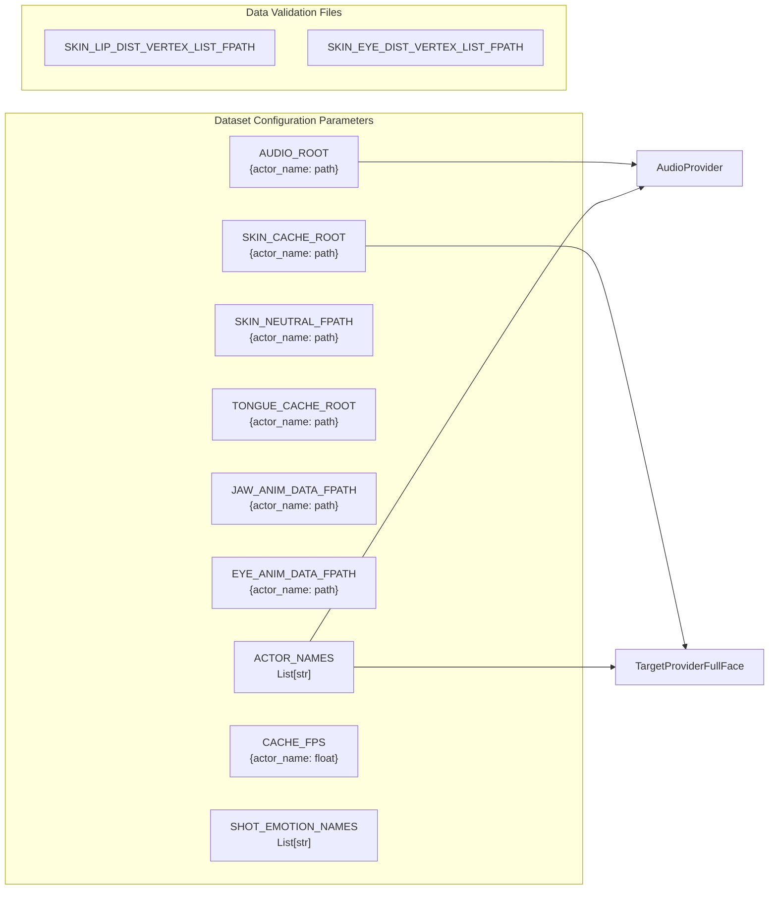

**Sources:** [docs/config_details.md:27-202](), [audio2face/dataset.py:38-61](), [audio2face/dataset.py:381-409]()

## Configuration Merging and Resolution

The framework employs a runtime configuration resolution system that combines base and user configurations through parameter-level overrides.

### Parameter Resolution Process

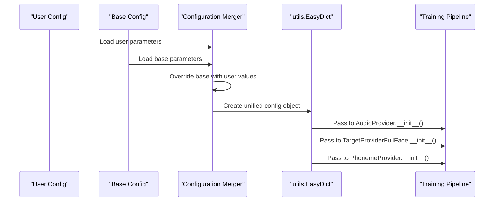

**Sources:** [audio2face/dataset.py:39-41](), [audio2face/dataset.py:165-167](), [audio2face/dataset.py:117-120]()

The merging process ensures that user-specified parameters take precedence over base defaults, while maintaining type safety and parameter validation. The `utils.EasyDict` class provides the runtime configuration object used throughout the training pipeline.

### Actor-Specific Parameter Structure

Many configuration parameters use dictionary structures keyed by actor names to support multi-actor training scenarios:

```python
# Example from config files
PREPROC_RUN_NAME_FULL = {
    "claire": "XXXXXX_XXXXXX_example"
}

AUDIO_ROOT = {
    "actor_name": "path/to/audio/directory"
}
```

**Sources:** [configs/example-regression-min/config_train.py:38-40](), [docs/config_details.md:27-31]()

## Training Configuration Integration

The configuration system directly integrates with the training pipeline through provider classes that consume configuration parameters during initialization.

### Configuration Consumer Classes

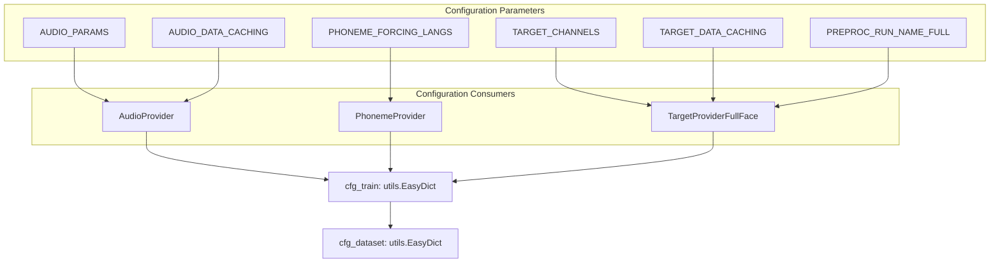

**Sources:** [audio2face/dataset.py:39-44](), [audio2face/dataset.py:118-124](), [audio2face/dataset.py:165-169]()

### Network Architecture Configuration

The configuration system supports different network architectures through the `NETWORK_TYPE` parameter and associated hyperparameters:

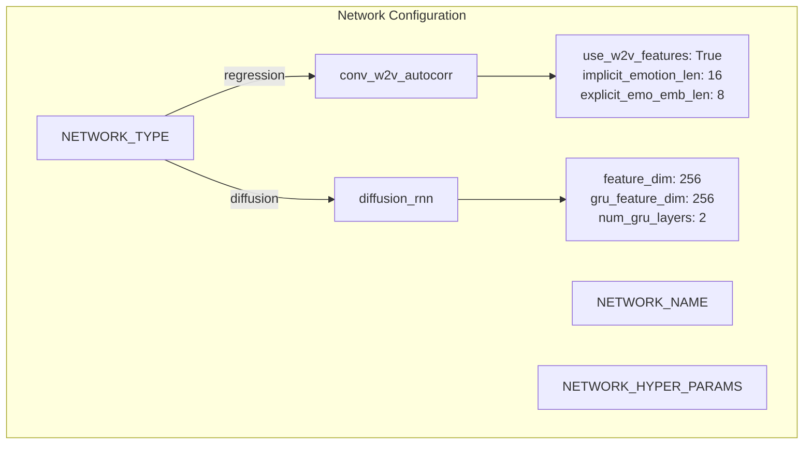

**Sources:** [audio2face/config_base/config_train_regression_base.py:128-145](), [audio2face/config_base/config_train_diffusion_base.py:132-143](), [audio2face/networks/diffusion_rnn.py:201-227]()

The `NETWORK_HYPER_PARAMS` dictionary contains architecture-specific parameters that are passed directly to network constructors, enabling flexible model configuration without code changes.

## Example Configuration Hierarchy

The framework provides several example configurations demonstrating different use cases and complexity levels.

### Example Configuration Structure

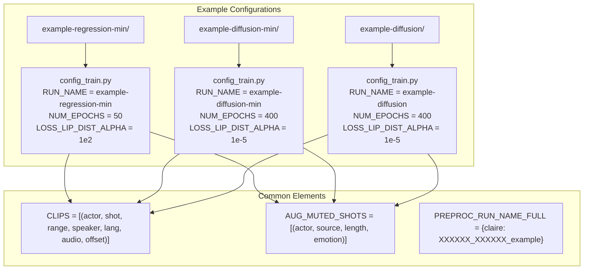

**Sources:** [configs/example-regression-min/config_train.py:17](), [configs/example-diffusion-min/config_train.py:17](), [configs/example-diffusion/config_train.py:17](), [configs/example-regression-min/config_train.py:52-107](), [configs/example-regression-min/config_train.py:120-132]()

All example configurations share common structural elements like the `CLIPS` list for defining training data segments and `AUG_MUTED_SHOTS` for data augmentation, while differing in model-specific parameters like loss function weights and training epochs.

---

# Page: Configuration Architecture

# Configuration Architecture

<details>
<summary>Relevant source files</summary>

The following files were used as context for generating this wiki page:

- [audio2face/config_base/config_train_diffusion_base.py](audio2face/config_base/config_train_diffusion_base.py)
- [audio2face/config_base/config_train_regression_base.py](audio2face/config_base/config_train_regression_base.py)
- [audio2face/dataset.py](audio2face/dataset.py)
- [audio2face/networks/diffusion_rnn.py](audio2face/networks/diffusion_rnn.py)
- [configs/example-diffusion-min/config_train.py](configs/example-diffusion-min/config_train.py)
- [configs/example-diffusion/config_train.py](configs/example-diffusion/config_train.py)
- [configs/example-regression-min/config_train.py](configs/example-regression-min/config_train.py)
- [docs/config_details.md](docs/config_details.md)

</details>


The configuration architecture provides a two-tier system for managing parameters across the Audio2Face-3D Training Framework. This system separates base defaults from user customizations, enabling flexible parameter management while maintaining consistency across different training scenarios.

For specific parameter details and usage examples, see [Dataset Configuration](#3.2), [Training Configuration](#3.3), and [Inference Configuration](#3.4).

## Two-Tier Configuration System

The framework employs a hierarchical configuration architecture consisting of base configurations that define sensible defaults and user configurations that override specific parameters for particular use cases.

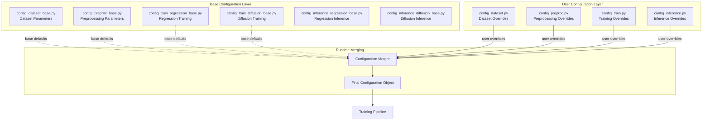

**Sources:** [docs/config_details.md:1-13](), [audio2face/config_base/config_train_diffusion_base.py:1-224](), [audio2face/config_base/config_train_regression_base.py:1-215]()

## Base Configuration Layer

The base configuration layer provides default parameter values organized by functional area. Each base configuration file defines parameters for a specific pipeline stage or model type.

### Base Configuration Files

| Configuration File | Purpose | Key Parameters |
|-------------------|---------|----------------|
| `config_dataset_base.py` | Dataset structure and paths | `ACTOR_NAMES`, `AUDIO_ROOT`, `SKIN_CACHE_ROOT` |
| `config_preproc_base.py` | Preprocessing pipeline | `SKIN_PCA_VARIANCE_THRESHOLD`, `RUN_NAME` |
| `config_train_regression_base.py` | Regression model training | `NETWORK_TYPE="regression"`, `SEQ_LEN=2` |
| `config_train_diffusion_base.py` | Diffusion model training | `NETWORK_TYPE="diffusion"`, `DIFFUSION_STEPS=1000` |
| `config_inference_regression_base.py` | Regression inference | Inference-specific parameters |
| `config_inference_diffusion_base.py` | Diffusion inference | Sampling and generation parameters |

### Model-Specific Base Configurations

The training base configurations define distinct parameter sets for different model architectures:

**Regression Base Configuration:**
- `NETWORK_TYPE = "regression"` [audio2face/config_base/config_train_regression_base.py:25]()
- `TARGET_CHANNELS = ["skin_coeffs", "tongue_coeffs", "jaw", "eye"]` [audio2face/config_base/config_train_regression_base.py:54-59]()
- `BATCH_SIZE = 32` [audio2face/config_base/config_train_regression_base.py:153]()
- `SEQ_LEN = 2` [audio2face/config_base/config_train_regression_base.py:77]()

**Diffusion Base Configuration:**
- `NETWORK_TYPE = "diffusion"` [audio2face/config_base/config_train_diffusion_base.py:25]()
- `TARGET_CHANNELS = ["skin_pose", "tongue_pose", "jaw", "eye"]` [audio2face/config_base/config_train_diffusion_base.py:55-61]()
- `BATCH_SIZE = 1` [audio2face/config_base/config_train_diffusion_base.py:173]()
- `DIFFUSION_STEPS = 1000` [audio2face/config_base/config_train_diffusion_base.py:146]()

**Sources:** [audio2face/config_base/config_train_regression_base.py:25-215](), [audio2face/config_base/config_train_diffusion_base.py:25-224]()

## User Configuration Layer

User configurations reside in the `configs/<CONFIG_NAME>/` directory structure and override base parameters for specific training scenarios. Each configuration set contains four files corresponding to pipeline stages.

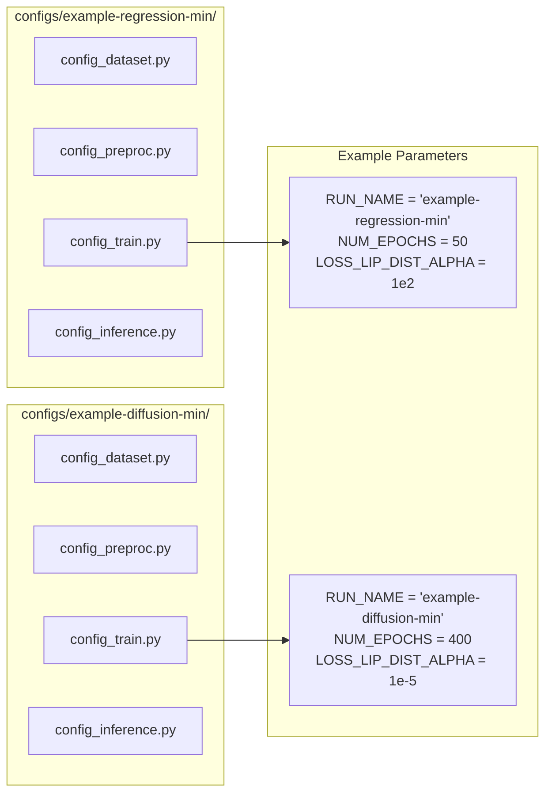

### User Override Patterns

User configurations typically override specific parameters while inheriting base defaults:

**Training Run Configuration:**
```python
RUN_NAME = "example-regression-min"
NETWORK_VERSION = "2.3"
PREPROC_RUN_NAME_FULL = {"claire": "XXXXXX_XXXXXX_example"}
```

**Training Data Specification:**
```python
CLIPS = [
    ("claire", "cp1_neutral", (0, 348), "claire", "zh", "cp1_neutral.wav", 0),
    # ... additional clips
]
```

**Model-Specific Overrides:**
- Regression: `NUM_EPOCHS = 50`, `LOSS_LIP_DIST_ALPHA = 1e2`
- Diffusion: `NUM_EPOCHS = 400`, `LOSS_LIP_DIST_ALPHA = 1e-5`

**Sources:** [configs/example-regression-min/config_train.py:17-154](), [configs/example-diffusion-min/config_train.py:17-150]()

## Configuration Resolution and Loading

The framework resolves configurations by merging base parameters with user overrides at runtime. The configuration system handles actor-specific parameters through dictionary structures.

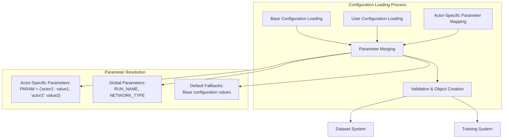

### Actor-Specific Parameter Handling

The configuration system supports multi-actor training through dictionary-based parameter specification:

```python
# Actor-specific parameters
PREPROC_RUN_NAME_FULL = {"actor1": "run_name_1", "actor2": "run_name_2"}
SKIN_PCA_COEFFS_FPATH = {"actor1": "/path/to/actor1/coeffs.npz"}

# Global parameters  
RUN_NAME = "training_run_name"
NETWORK_TYPE = "regression"
```

The system automatically resolves parameters using fallback mechanisms when actor-specific values are missing, particularly for preprocessing artifact paths [audio2face/dataset.py:196-204]().

### Configuration Usage in Runtime

The merged configuration objects (`cfg_train`, `cfg_dataset`) are passed to system components:

- **Dataset System**: Uses configurations for data loading and preprocessing [audio2face/dataset.py:39-41]()
- **Training Pipeline**: Accesses merged parameters for model initialization and training loops
- **Network Architecture**: Retrieves hyperparameters from `NETWORK_HYPER_PARAMS` dictionaries

**Sources:** [audio2face/dataset.py:39-41](), [audio2face/dataset.py:196-204](), [docs/config_details.md:34-38]()

## Configuration File Organization

The framework organizes configuration files in a standardized directory structure that separates concerns and enables easy management of different training scenarios.

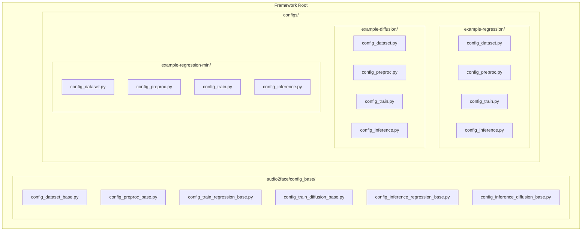

### Configuration Naming Convention

Configuration directories follow the pattern `<purpose>-<model_type>[-<variant>]`:

- `example-regression`: Full regression model configuration
- `example-diffusion`: Full diffusion model configuration  
- `example-regression-min`: Minimal regression configuration
- `example-diffusion-min`: Minimal diffusion configuration

Each configuration directory contains the four standard configuration files that correspond to pipeline stages.

**Sources:** [configs/example-regression-min/config_train.py:1-15](), [configs/example-diffusion-min/config_train.py:1-15](), [configs/example-diffusion/config_train.py:1-15]()

## Configuration Parameter Categories

The configuration system organizes parameters into logical categories that align with framework functionality and pipeline stages.

| Category | Purpose | Key Files | Example Parameters |
|----------|---------|-----------|-------------------|
| **Dataset Paths** | File system locations | `config_dataset.py` | `AUDIO_ROOT`, `SKIN_CACHE_ROOT`, `ACTOR_NAMES` |
| **Preprocessing** | Data transformation | `config_preproc.py` | `SKIN_PCA_VARIANCE_THRESHOLD`, `RUN_NAME` |  
| **Model Architecture** | Network structure | `config_train.py` | `NETWORK_NAME`, `NETWORK_HYPER_PARAMS` |
| **Training Process** | Learning parameters | `config_train.py` | `NUM_EPOCHS`, `LEARNING_RATE`, `BATCH_SIZE` |
| **Loss Functions** | Training objectives | `config_train.py` | `LOSS_MSE_ALPHA`, `LOSS_LIP_DIST_ALPHA` |
| **Data Augmentation** | Training data variety | `config_train.py` | `AUGMENT`, `AUG_MUTED_SHOTS` |
| **Inference Settings** | Generation parameters | `config_inference.py` | Post-processing and deployment settings |

This categorical organization enables targeted parameter modification while maintaining system coherence across different training scenarios.

**Sources:** [docs/config_details.md:14-929](), [audio2face/config_base/config_train_regression_base.py:54-215](), [audio2face/config_base/config_train_diffusion_base.py:55-224]()

---

# Page: Dataset Configuration

# Dataset Configuration

<details>
<summary>Relevant source files</summary>

The following files were used as context for generating this wiki page:

- [audio2face/config_base/config_dataset_base.py](audio2face/config_base/config_dataset_base.py)
- [configs/example-diffusion-min/config_dataset.py](configs/example-diffusion-min/config_dataset.py)
- [configs/example-diffusion-min/config_train.py](configs/example-diffusion-min/config_train.py)
- [configs/example-diffusion/config_dataset.py](configs/example-diffusion/config_dataset.py)
- [configs/example-diffusion/config_train.py](configs/example-diffusion/config_train.py)
- [configs/example-regression-min/config_dataset.py](configs/example-regression-min/config_dataset.py)
- [configs/example-regression-min/config_train.py](configs/example-regression-min/config_train.py)
- [configs/example-regression/config_dataset.py](configs/example-regression/config_dataset.py)
- [docs/config_details.md](docs/config_details.md)

</details>


Dataset configuration defines the paths and properties for Audio2Face-3D training datasets. This configuration specifies where to find audio files, facial geometry data, animation caches, and metadata required for training facial animation models. Dataset configuration is the foundation layer of the framework's two-tier configuration system.

For information about training-specific parameters like model architecture and loss functions, see [Training Configuration](#3.3). For preprocessing parameters that control how dataset files are processed, see [Preprocessing Pipeline](#4.2).

## Configuration Architecture

The dataset configuration follows the framework's two-tier architecture where base configurations provide structure and user configurations supply actual values.

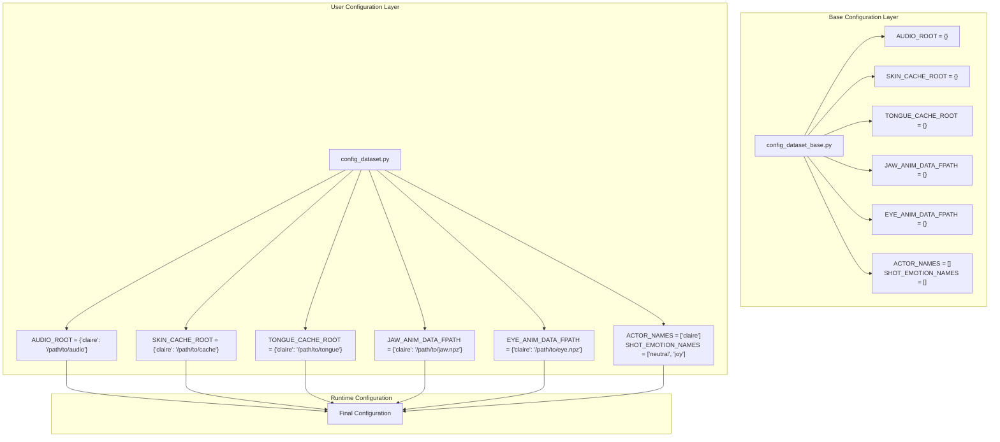

Sources: [audio2face/config_base/config_dataset_base.py:1-81](), [configs/example-regression/config_dataset.py:1-123]()

## Actor-Centric Organization

All dataset paths are organized using actor-specific dictionaries where keys are actor names from `ACTOR_NAMES` and values are the corresponding paths or settings for that actor.

```mermaid
graph LR
    subgraph "Actor Organization Pattern"
        ActorNames["ACTOR_NAMES = ['claire', 'mark']"]
        
        subgraph "Path Parameters"
            AudioRoot["AUDIO_ROOT = {<br/>'claire': '/path/to/claire/audio',<br/>'mark': '/path/to/mark/audio'<br/>}"]
            SkinCache["SKIN_CACHE_ROOT = {<br/>'claire': '/path/to/claire/skin',<br/>'mark': '/path/to/mark/skin'<br/>}"]
            CacheFPS["CACHE_FPS = {<br/>'claire': 30.0,<br/>'mark': 24.0<br/>}"]
        end
        
        ActorNames --> AudioRoot
        ActorNames --> SkinCache
        ActorNames --> CacheFPS
    end
    
    subgraph "Dataset Structure"
        DatasetRoot["/datasets/Audio2Face-3D-Dataset/"]
        DatasetRoot --> ClaireData["data/claire/"]
        DatasetRoot --> MarkData["data/mark/"]
        
        ClaireData --> ClaireAudio["audio/"]
        ClaireData --> ClaireSkin["cache/skin/"]
        ClaireData --> ClaireGeom["geom/skin/"]
        
        MarkData --> MarkAudio["audio/"]
        MarkData --> MarkSkin["cache/skin/"]
        MarkData --> MarkGeom["geom/skin/"]
    end
```

Sources: [audio2face/config_base/config_dataset_base.py:75-81](), [configs/example-regression/config_dataset.py:23-31]()

## Data Path Specifications

### Required Data Components

The framework requires two essential data components for basic operation:

| Component | Parameter | Description |
|-----------|-----------|-------------|
| Audio Data | `AUDIO_ROOT` | Directory containing WAV audio files for each shot |
| Facial Geometry | `SKIN_CACHE_ROOT` | Directory containing facial mesh deformation sequences |

Sources: [configs/example-diffusion-min/config_dataset.py:20-31](), [configs/example-regression-min/config_dataset.py:20-31]()

### Complete Data Component Mapping

```mermaid
graph TB
    subgraph "Audio System"
        AudioRoot["AUDIO_ROOT<br/>WAV files per shot"]
    end
    
    subgraph "Facial Geometry System"
        SkinCache["SKIN_CACHE_ROOT<br/>Mesh deformation sequences"]
        SkinNeutral["SKIN_NEUTRAL_FPATH<br/>Neutral face geometry"]
        SkinLipOpen["SKIN_LIP_OPEN_POSE_DELTA_FPATH<br/>Lip open delta pose"]
        SkinEyeClose["SKIN_EYE_CLOSE_POSE_DELTA_FPATH<br/>Eye close delta pose"]
        
        SkinVertexLists["Vertex Lists"]
        SkinVertexLists --> LipDistVerts["SKIN_LIP_DIST_VERTEX_LIST_FPATH"]
        SkinVertexLists --> LipSizeVerts["SKIN_LIP_SIZE_VERTEX_LIST_FPATH"]
        SkinVertexLists --> EyeDistVerts["SKIN_EYE_DIST_VERTEX_LIST_FPATH"]
    end
    
    subgraph "Tongue System"
        TongueCache["TONGUE_CACHE_ROOT<br/>Tongue mesh sequences"]
        TongueNeutral["TONGUE_NEUTRAL_FPATH<br/>Neutral tongue geometry"]
        TongueRigid["TONGUE_RIGID_VERTEX_LIST_FPATH<br/>Rigid vertex indices"]
    end
    
    subgraph "Jaw System"
        JawKeypoints["JAW_KEYPOINTS_NEUTRAL_FPATH<br/>Jaw bone positions (5x3)"]
        JawAnim["JAW_ANIM_DATA_FPATH<br/>Jaw animation data (NPZ)"]
    end
    
    subgraph "Eye System"
        EyeAnim["EYE_ANIM_DATA_FPATH<br/>Eye rotation data (NPZ)"]
        EyeBlink["EYE_BLINK_KEYS_FPATH<br/>Blink keyframes (10 values)"]
        EyeSaccade["EYE_SACCADE_ROTATIONS_FPATH<br/>Saccade rotations (5000x2)"]
    end
    
    subgraph "Blendshape System"
        BlendSkin["BLENDSHAPE_SKIN_FPATH<br/>Facial blendshape targets (NPY)"]
        BlendSkinConfig["BLENDSHAPE_SKIN_CONFIG_FPATH<br/>Blendshape metadata (JSON)"]
        BlendTongue["BLENDSHAPE_TONGUE_FPATH<br/>Tongue blendshape targets (NPY)"]
        BlendTongueConfig["BLENDSHAPE_TONGUE_CONFIG_FPATH<br/>Tongue metadata (JSON)"]
    end
```

Sources: [audio2face/config_base/config_dataset_base.py:22-54](), [docs/config_details.md:24-169]()

## Dataset Properties and Metadata

Dataset configuration includes essential metadata that defines the training dataset's characteristics:

### Core Properties

| Property | Parameter | Description |
|----------|-----------|-------------|
| Actor List | `ACTOR_NAMES` | List of performers in the dataset |
| Emotions | `SHOT_EMOTION_NAMES` | Available emotion labels for shots |
| Frame Rate | `CACHE_FPS` | Animation cache frame rate per actor |
| Data Scaling | `TRANSFORM_SCALE` | Channel-specific scaling factors |

### Emotion System Configuration

```mermaid
graph TD
    subgraph "Emotion Configuration"
        EmotionNames["SHOT_EMOTION_NAMES<br/>['neutral', 'joy', 'sadness', 'anger']"]
        EmotionMap["SHOT_EMOTION_MAP<br/>[('actor', 'shot', 'emotion')]"]
        
        subgraph "Shot Emotion Detection"
            AutoDetect["Automatic Detection<br/>From shot filename"]
            ManualOverride["Manual Override<br/>Via SHOT_EMOTION_MAP"]
            
            AutoDetect --> ManualOverride
        end
        
        EmotionNames --> AutoDetect
        EmotionMap --> ManualOverride
    end
    
    subgraph "Example Usage"
        ShotFile["cp24_joy.wav"]
        AutoEmotion["Detected: 'joy'"]
        OverrideEntry["('claire', 'cp24_joy', 'happiness')"]
        FinalEmotion["Final: 'happiness'"]
        
        ShotFile --> AutoEmotion
        OverrideEntry --> FinalEmotion
        AutoEmotion --> FinalEmotion
    end
```

Sources: [audio2face/config_base/config_dataset_base.py:60-69](), [configs/example-regression/config_dataset.py:98-111]()

### Transform Scaling System

The `TRANSFORM_SCALE` parameter provides per-actor, per-channel scaling factors to adjust data magnitude for numerical stability:

```mermaid
graph LR
    subgraph "Transform Scale Structure"
        TransformScale["TRANSFORM_SCALE"]
        
        subgraph "Actor Level"
            Claire["'claire'"]
            Mark["'mark'"]
        end
        
        subgraph "Channel Level"
            SkinScale["'skin': 1.0"]
            TongueScale["'tongue': 1.0"]
            JawScale["'jaw': 1.0"]
            EyeScale["'eye': 1.0"]
        end
        
        TransformScale --> Claire
        TransformScale --> Mark
        Claire --> SkinScale
        Claire --> TongueScale
        Claire --> JawScale
        Claire --> EyeScale
    end
```

Sources: [audio2face/config_base/config_dataset_base.py:78-80](), [configs/example-diffusion/config_dataset.py:124-133]()

## Example Configurations

The framework provides four example configurations demonstrating different complexity levels:

### Configuration Comparison

| Configuration | Required Components | Optional Components | Use Case |
|---------------|-------------------|-------------------|----------|
| `example-regression-min` | `AUDIO_ROOT`, `SKIN_CACHE_ROOT` | None | Minimal setup for basic facial animation |
| `example-diffusion-min` | `AUDIO_ROOT`, `SKIN_CACHE_ROOT` | None | Minimal setup for diffusion-based models |
| `example-regression` | `AUDIO_ROOT`, `SKIN_CACHE_ROOT` | All geometry, jaw, eye, blendshape data | Full-featured regression training |
| `example-diffusion` | `AUDIO_ROOT`, `SKIN_CACHE_ROOT` | All geometry, jaw, eye, blendshape data | Full-featured diffusion training |

### Minimal Configuration Pattern

```python
# Required components only
AUDIO_ROOT = {
    "claire": "/datasets/Audio2Face-3D-Dataset-v1.0.0-claire/data/claire/audio",
}

SKIN_CACHE_ROOT = {
    "claire": "/datasets/Audio2Face-3D-Dataset-v1.0.0-claire/data/claire/cache/skin",
}

ACTOR_NAMES = ["claire"]
SHOT_EMOTION_NAMES = ["neutral", "joy", "sadness", "anger"]
CACHE_FPS = {"claire": 30.0}
```

### Full Configuration Pattern

```python
# Complete data specification
SKIN_NEUTRAL_FPATH = {
    "claire": "/datasets/.../geom/skin/neutral_pose.npy",
}
SKIN_LIP_DIST_VERTEX_LIST_FPATH = {
    "claire": "/datasets/.../geom/skin/lip_dist_vertex_list.json", 
}
JAW_ANIM_DATA_FPATH = {
    "claire": "/datasets/.../xform/jaw_keypoints_cache_all.npz",
}
EYE_ANIM_DATA_FPATH = {
    "claire": "/datasets/.../xform/eye_rotations_all.npz",
}
```

Sources: [configs/example-regression-min/config_dataset.py:23-61](), [configs/example-regression/config_dataset.py:31-92](), [configs/example-diffusion-min/config_dataset.py:24-72](), [configs/example-diffusion/config_dataset.py:31-133]()

---

# Page: Training Configuration

# Training Configuration

<details>
<summary>Relevant source files</summary>

The following files were used as context for generating this wiki page:

- [audio2face/config_base/config_train_diffusion_base.py](audio2face/config_base/config_train_diffusion_base.py)
- [audio2face/config_base/config_train_regression_base.py](audio2face/config_base/config_train_regression_base.py)
- [audio2face/dataset.py](audio2face/dataset.py)
- [audio2face/networks/diffusion_rnn.py](audio2face/networks/diffusion_rnn.py)
- [configs/example-diffusion-min/config_train.py](configs/example-diffusion-min/config_train.py)
- [configs/example-diffusion/config_train.py](configs/example-diffusion/config_train.py)
- [configs/example-regression-min/config_train.py](configs/example-regression-min/config_train.py)
- [docs/config_details.md](docs/config_details.md)

</details>


This document covers the training configuration system of the Audio2Face-3D Training Framework, which controls model architecture, training hyperparameters, loss functions, and data sampling parameters. Training configuration is the second configuration file in the two-tier system and determines how neural networks are trained for facial animation generation.

For information about dataset configuration parameters, see [Dataset Configuration](#3.2). For preprocessing configuration, see the preprocessing sections. For inference configuration, see [Inference Configuration](#3.4).

## Configuration Architecture

The training configuration operates within the two-tier configuration system, where base configurations provide defaults and user configurations override specific parameters. Training configuration files are named `config_train.py` and inherit from either regression or diffusion base configurations.

### Configuration Flow

```mermaid
graph TD
    BaseConfigs["Base Configuration Files"]
    BaseConfigs --> RegBase["config_train_regression_base.py"]
    BaseConfigs --> DiffBase["config_train_diffusion_base.py"]
    
    UserConfigs["User Configuration Files"]
    UserConfigs --> UserTrain["config_train.py"]
    
    NetworkType{"NETWORK_TYPE Parameter"}
    UserTrain --> NetworkType
    
    NetworkType -->|"regression"| RegBase
    NetworkType -->|"diffusion"| DiffBase
    
    MergedConfig["Final Training Configuration"]
    RegBase --> MergedConfig
    DiffBase --> MergedConfig
    UserTrain --> MergedConfig
    
    TrainingPipeline["Training Pipeline Execution"]
    MergedConfig --> TrainingPipeline
```

Sources: [audio2face/config_base/config_train_regression_base.py:25](), [audio2face/config_base/config_train_diffusion_base.py:25](), [docs/config_details.md:356-359]()

## Model Type Selection

The `NETWORK_TYPE` parameter determines which training pipeline and network architecture to use. This selection affects all downstream training parameters and loss functions.

### Model Type Architecture

```mermaid
graph LR
    NetworkType["NETWORK_TYPE"]
    NetworkType --> Regression["regression"]
    NetworkType --> Diffusion["diffusion"]
    
    Regression --> RegNetwork["conv_w2v_autocorr"]
    Regression --> RegTargets["TARGET_CHANNELS: skin_coeffs, tongue_coeffs"]
    Regression --> RegBatch["BATCH_SIZE: 32"]
    Regression --> RegSeq["SEQ_LEN: 2"]
    
    Diffusion --> DiffNetwork["diffusion_rnn"]
    Diffusion --> DiffTargets["TARGET_CHANNELS: skin_pose, tongue_pose"]
    Diffusion --> DiffBatch["BATCH_SIZE: 1"]
    Diffusion --> DiffSteps["DIFFUSION_STEPS: 1000"]
    
    RegNetwork --> RegLoss["MSE + Motion + LipDist + PhonemeSupervision"]
    DiffNetwork --> DiffLoss["MSE + Motion + LipDist + Velocity + ExpressionSmooth"]
```

Sources: [audio2face/config_base/config_train_regression_base.py:25](), [audio2face/config_base/config_train_diffusion_base.py:25](), [docs/config_details.md:356-359]()

## Core Parameter Categories

Training configuration parameters are organized into several key categories that control different aspects of the training process.

### Parameter Organization

| Category | Regression Key Parameters | Diffusion Key Parameters |
|----------|-------------------------|-------------------------|
| Network Architecture | `NETWORK_NAME`, `NETWORK_HYPER_PARAMS` | `NETWORK_NAME`, `NETWORK_HYPER_PARAMS`, `DIFFUSION_STEPS` |
| Training Parameters | `BATCH_SIZE`, `SEQ_LEN`, `LEARNING_RATE` | `BATCH_SIZE`, `GRADIENT_ACCUMULATION_STEPS`, `LEARNING_RATE` |
| Target Channels | `TARGET_CHANNELS` (coeffs) | `TARGET_CHANNELS` (pose) |
| Loss Functions | `LOSS_MSE_ALPHA`, `LOSS_PHONEME_ALPHA` | `LOSS_VELOCITY_ALPHA`, `LOSS_EXP_SMOOTH_ALPHA` |
| Data Processing | `SEQ_STRIDE`, `REMOVE_CLOSING_EYE` | `TRAIN_ON_RANDOM_SUBSEGMENT`, `NO_STANDARDIZE_AUDIO` |

Sources: [docs/config_details.md:414-419](), [audio2face/config_base/config_train_regression_base.py:54-59](), [audio2face/config_base/config_train_diffusion_base.py:55-60]()

## Network Architecture Configuration

Network architecture parameters define the neural network structure and capacity. Different model types use different network architectures optimized for their respective training approaches.

### Network Parameter Structure

```mermaid
graph TD
    NetworkConfig["Network Configuration"]
    NetworkConfig --> NetworkName["NETWORK_NAME"]
    NetworkConfig --> NetworkHyper["NETWORK_HYPER_PARAMS"]
    NetworkConfig --> PretrainedNet["PRETRAINED_NET_FPATH"]
    
    NetworkName --> RegNet["conv_w2v_autocorr"]
    NetworkName --> DiffNet["diffusion_rnn"]
    
    NetworkHyper --> RegHyper["Regression Hyperparameters"]
    NetworkHyper --> DiffHyper["Diffusion Hyperparameters"]
    
    RegHyper --> RegParams["use_w2v_features<br/>use_autocorr_features<br/>implicit_emotion_len<br/>explicit_emo_emb_len"]
    
    DiffHyper --> DiffParams["feature_dim<br/>jaw_latent_dim<br/>tongue_latent_dim<br/>gru_feature_dim<br/>num_gru_layers<br/>emo_embedding_dim"]
```

Sources: [audio2face/config_base/config_train_regression_base.py:128-145](), [audio2face/config_base/config_train_diffusion_base.py:132-144](), [docs/config_details.md:518-535]()

## Loss Function Configuration

Loss functions control what aspects of facial animation the model learns to optimize. Each model type uses different loss functions tailored to its training approach.

### Loss Function Weights

```mermaid
graph TB
    LossConfig["Loss Function Configuration"]
    
    CommonLoss["Common Loss Functions"]
    LossConfig --> CommonLoss
    CommonLoss --> MSE["LOSS_MSE_ALPHA: 1.0"]
    CommonLoss --> Motion["LOSS_MOTION_ALPHA: 10.0"]
    CommonLoss --> LipDist["LOSS_LIP_DIST_ALPHA: 100.0"]
    
    RegLoss["Regression-Specific"]
    LossConfig --> RegLoss
    RegLoss --> Phoneme["LOSS_PHONEME_ALPHA: 0.1"]
    RegLoss --> EmoReg["LOSS_EMO_REG_ALPHA: 1.0"]
    RegLoss --> VolStab["LOSS_VOL_STAB_REG_ALPHA: 1e2"]
    
    DiffLoss["Diffusion-Specific"]
    LossConfig --> DiffLoss
    DiffLoss --> Velocity["LOSS_VELOCITY_ALPHA: 0.0"]
    DiffLoss --> ExpSmooth["LOSS_EXP_SMOOTH_ALPHA: 25.0"]
    DiffLoss --> TongueWeight["TONGUE_WEIGHT: 0.1"]
    DiffLoss --> JawWeight["JAW_WEIGHT: 1.0"]
```

Sources: [audio2face/config_base/config_train_regression_base.py:167-188](), [audio2face/config_base/config_train_diffusion_base.py:186-199](), [docs/config_details.md:572-624]()

## Data Augmentation Configuration

Data augmentation parameters control training data diversity and robustness. The framework supports different augmentation strategies for regression and diffusion models.

### Augmentation Parameter Mapping

```mermaid
graph LR
    AugConfig["Augmentation Configuration"]
    
    AugConfig --> TimeAug["AUGMENT"]
    AugConfig --> MutedAug["AUG_MUTED_SHOTS"]
    AugConfig --> AudioNoise["AUG_MUTED_AUDIO_NOISE_*"]
    
    TimeAug --> RegTimeshift["timeshift: 1.0"]
    TimeAug --> DiffPitch["pitch_shift: {min_semitones: -2, max_semitones: 2}"]
    
    MutedAug --> MutedFormat["(actor_name, (source_shot, frame), length, emotion)"]
    
    AudioNoise --> NoiseType["AUG_MUTED_AUDIO_NOISE_TYPE: mic"]
    AudioNoise --> NoiseScale["AUG_MUTED_AUDIO_NOISE_SCALE: 0.1"]
    AudioNoise --> NoiseRange["AUG_MUTED_AUDIO_NOISE_LOCAL_SCALE_RANGE"]
```

Sources: [audio2face/config_base/config_train_regression_base.py:103-105](), [audio2face/config_base/config_train_diffusion_base.py:102-109](), [docs/config_details.md:461-515]()

## Training Clips Configuration

Training clips define the specific segments of animation data used for training. The `CLIPS` parameter specifies which shots and frame ranges to include in the training dataset.

### Clips Parameter Structure

The `CLIPS` parameter uses the following format:
```python
CLIPS = [
    (actor_name, shot_name, (clip_first_frame, clip_last_frame), speaker_name, audio_lang, audio_fpath_rel, audio_offset)
]
```

Each clip entry contains:
- **actor_name**: Actor identifier matching `ACTOR_NAMES`
- **shot_name**: Animation shot name from preprocessing
- **frame_range**: Tuple specifying start and end frames
- **speaker_name**: Audio speaker identifier
- **audio_lang**: Language code for phoneme alignment
- **audio_fpath_rel**: Relative audio file path
- **audio_offset**: Audio timing offset in samples

Sources: [docs/config_details.md:452-457](), [configs/example-regression-min/config_train.py:52-107](), [audio2face/config_base/config_train_regression_base.py:94-95]()

## Configuration Workflow

Training configuration follows a specific workflow that integrates with the preprocessing and training pipeline execution.

### Training Configuration Process

```mermaid
sequenceDiagram
    participant User as "User Configuration"
    participant Base as "Base Configuration"
    participant Preproc as "Preprocessing Artifacts"
    participant Train as "Training Pipeline"
    
    User->>Base: Inherits base parameters
    Note over User,Base: NETWORK_TYPE determines base config
    
    User->>User: Sets PREPROC_RUN_NAME_FULL
    User->>User: Defines CLIPS list
    User->>User: Configures loss weights
    
    Base->>User: Provides default parameters
    Note over Base,User: Network architecture, training params
    
    Preproc->>Train: Provides data_info.json, shots.json
    User->>Train: Final merged configuration
    
    Train->>Train: Validates configuration
    Train->>Train: Initializes network and training
```

Sources: [docs/config_details.md:369-374](), [audio2face/dataset.py:196-204](), [audio2face/config_base/config_train_regression_base.py:34-38]()

## Model-Specific Configuration Differences

Regression and diffusion models require different configuration parameters due to their distinct training approaches and network architectures.

### Key Configuration Differences

| Parameter Category | Regression Models | Diffusion Models |
|-------------------|-------------------|------------------|
| Target Representation | PCA coefficients (`skin_coeffs`) | Absolute poses (`skin_pose`) |
| Batch Processing | Variable batch size (`BATCH_SIZE: 32`) | Fixed batch size (`BATCH_SIZE: 1`) |
| Sequence Handling | Fixed sequences (`SEQ_LEN: 2`) | Variable segments (`TRAIN_ON_RANDOM_SUBSEGMENT`) |
| Audio Processing | Standardized audio | Raw audio (`NO_STANDARDIZE_AUDIO: True`) |
| Training Steps | Epoch-based | Diffusion steps (`DIFFUSION_STEPS: 1000`) |
| Gradient Accumulation | Not used | Required (`GRADIENT_ACCUMULATION_STEPS: 4`) |

Sources: [audio2face/config_base/config_train_regression_base.py:54-78](), [audio2face/config_base/config_train_diffusion_base.py:55-83](), [docs/config_details.md:547-549]()

## Configuration Validation and Error Handling

The training system validates configuration parameters and provides error messages for common configuration issues. Key validation points include preprocessing artifact paths, clip definitions, and parameter compatibility.

### Common Configuration Issues

- **Missing PREPROC_RUN_NAME_FULL**: Training cannot proceed without valid preprocessing artifacts
- **Invalid CLIPS format**: Incorrect clip tuple structure causes dataset loading errors
- **Incompatible TARGET_CHANNELS**: Channel types must match model type (coeffs vs pose)
- **Missing loss function parameters**: Some loss functions require additional data files
- **Batch size constraints**: Diffusion models only support batch size 1

The validation occurs in the [audio2face/dataset.py:196-204]() `TargetProviderBase` class methods.

Sources: [audio2face/dataset.py:196-204](), [docs/config_details.md:369-374](), [audio2face/config_base/config_train_regression_base.py:34-38]()

---

# Page: Inference Configuration

# Inference Configuration

<details>
<summary>Relevant source files</summary>

The following files were used as context for generating this wiki page:

- [audio2face/config_base/config_inference_diffusion_base.py](audio2face/config_base/config_inference_diffusion_base.py)
- [audio2face/config_base/config_inference_regression_base.py](audio2face/config_base/config_inference_regression_base.py)
- [audio2face/config_base/config_preproc_base.py](audio2face/config_base/config_preproc_base.py)
- [configs/example-diffusion-min/config_inference.py](configs/example-diffusion-min/config_inference.py)
- [configs/example-diffusion/config_inference.py](configs/example-diffusion/config_inference.py)
- [configs/example-regression-min/config_inference.py](configs/example-regression-min/config_inference.py)
- [configs/example-regression/config_inference.py](configs/example-regression/config_inference.py)

</details>


This document covers the inference configuration system for both regression and diffusion models in the Audio2Face-3D Training Framework. Inference configuration controls post-processing parameters, model-specific inference settings, and output generation options during animation inference.

For training-related configuration parameters, see [Training Configuration](#3.3). For dataset configuration, see [Dataset Configuration](#3.2).

## Configuration Architecture

The inference configuration follows the same two-tier architecture as other framework components, with base configurations providing defaults and user configurations enabling customization per experiment.

```mermaid
graph TD
    subgraph "Base Layer"
        CIRB["config_inference_regression_base.py"]
        CIDB["config_inference_diffusion_base.py"]
    end
    
    subgraph "User Layer"
        CI["config_inference.py"]
        CI --> ExReg["example-regression/config_inference.py"]
        CI --> ExDiff["example-diffusion/config_inference.py"] 
        CI --> ExMin["example-*-min/config_inference.py"]
    end
    
    subgraph "Runtime Configuration"
        Merger["Configuration Merger"]
        FinalConfig["Final Inference Config"]
    end
    
    CIRB -->|"regression defaults"| Merger
    CIDB -->|"diffusion defaults"| Merger
    ExReg -->|"user overrides"| Merger
    ExDiff -->|"user overrides"| Merger
    ExMin -->|"user overrides"| Merger
    
    Merger --> FinalConfig
    FinalConfig --> InferenceEngine["Inference Engine"]
    
    subgraph "Parameter Categories"
        PostProc["Post-processing Parameters"]
        DiffParams["Diffusion Parameters"] 
        OutputConfig["Output Configuration"]
        ONNXParams["ONNX Export Parameters"]
    end
    
    FinalConfig --> PostProc
    FinalConfig --> DiffParams
    FinalConfig --> OutputConfig
    FinalConfig --> ONNXParams
```

**Sources:** [audio2face/config_base/config_inference_regression_base.py:1-44](), [audio2face/config_base/config_inference_diffusion_base.py:1-65](), [configs/example-regression/config_inference.py:1-21](), [configs/example-diffusion/config_inference.py:1-24]()

## Post-processing Parameters

Both regression and diffusion models share a common set of post-processing parameters defined in the `CONFIG` dictionary. These parameters control animation strength, smoothing, and facial feature adjustments.

### Strength and Smoothing Parameters

| Parameter | Regression Default | Diffusion Default | Description |
|-----------|-------------------|-------------------|-------------|
| `input_strength` | 1.3 | 1.3 | Overall animation intensity multiplier |
| `upper_face_smoothing` | 0.001 | 0.003 | Temporal smoothing for upper facial regions |
| `lower_face_smoothing` | 0.0023 | 0.0023 | Temporal smoothing for lower facial regions |
| `upper_face_strength` | 1.0 | 1.0 | Animation strength for upper face |
| `lower_face_strength` | 1.7 | 1.7 | Animation strength for lower face |

### Facial Feature Controls

```mermaid
graph LR
    subgraph "Facial Regions"
        Skin["Skin Animation"]
        Eyes["Eye Animation"] 
        Mouth["Mouth Animation"]
        Tongue["Tongue Animation"]
    end
    
    subgraph "Post-processing Controls"
        SkinParams["skin_strength: 1.1"]
        EyeParams["eyeballs_strength: 1.0<br/>saccade_strength: 0.9<br/>blink_strength: 1.0"]
        MouthParams["lower_teeth_strength: 1.3<br/>lip_open_offset: -0.05"]
        TongueParams["tongue_strength: 1.5<br/>tongue_height_offset: 0.2<br/>tongue_depth_offset: -0.3"]
    end
    
    subgraph "Mask Controls"
        FaceMask["face_mask_level: 0.6<br/>face_mask_softness: 0.0085"]
    end
    
    Skin --> SkinParams
    Eyes --> EyeParams
    Mouth --> MouthParams  
    Tongue --> TongueParams
    
    SkinParams --> FaceMask
    EyeParams --> FaceMask
    MouthParams --> FaceMask
    TongueParams --> FaceMask
```

### Reference Frame Parameters

The `source_shot` and `source_frame` parameters define a neutral reference pose used during post-processing:

```python
"source_shot": "cp1_neutral",
"source_frame": 220,
```

**Sources:** [audio2face/config_base/config_inference_regression_base.py:17-44](), [audio2face/config_base/config_inference_diffusion_base.py:17-42](), [configs/example-regression/config_inference.py:17-20]()

## Diffusion-Specific Parameters

Diffusion models require additional inference parameters not used by regression models. These control the diffusion sampling process and conditioning.

### Core Diffusion Parameters

| Parameter | Default | Description |
|-----------|---------|-------------|
| `CONDITION` | None | Actor conditioning identifier |
| `ACTOR_NAME` | None | Target actor name for inference |
| `EMOTION_LABEL` | None | Emotion conditioning label |
| `TIMESTEP_RESPACING` | None | Diffusion timestep schedule |
| `NUM_DIFFUSION_STEPS` | 2 | Number of denoising steps |
| `SKIP_STEPS` | 0 | Steps to skip in diffusion process |
| `USE_DDIM` | False | Use DDIM sampling instead of DDPM |
| `INFERENCE_MODE` | None | Inference execution mode |

### Sampling and Conditioning Flow

```mermaid
graph TB
    subgraph "Input Conditioning"
        AudioInput["AUDIO_PATH"]
        ActorCond["ACTOR_NAME + CONDITION"]
        EmoCond["EMOTION_LABEL"]
    end
    
    subgraph "Diffusion Sampling"
        TimestepSched["TIMESTEP_RESPACING"]
        DiffSteps["NUM_DIFFUSION_STEPS"]
        SamplerType["USE_DDIM"]
        NoiseSource["DETERMINISTIC_NOISE_PATH"]
    end
    
    subgraph "Sampling Process"
        DDPMSampler["DDPM Sampler"]
        DDIMSampler["DDIM Sampler"] 
        SkipLogic["SKIP_STEPS"]
    end
    
    AudioInput --> DDPMSampler
    AudioInput --> DDIMSampler
    ActorCond --> DDPMSampler
    ActorCond --> DDIMSampler
    EmoCond --> DDPMSampler
    EmoCond --> DDIMSampler
    
    TimestepSched --> DDPMSampler
    TimestepSched --> DDIMSampler
    DiffSteps --> DDPMSampler
    DiffSteps --> DDIMSampler
    NoiseSource --> DDPMSampler
    NoiseSource --> DDIMSampler
    
    SamplerType -->|"False"| DDPMSampler
    SamplerType -->|"True"| DDIMSampler
    
    DDPMSampler --> SkipLogic
    DDIMSampler --> SkipLogic
```

**Sources:** [audio2face/config_base/config_inference_diffusion_base.py:44-56](), [configs/example-diffusion/config_inference.py:16-23]()

## Output Configuration

Inference output settings control where results are saved and in what formats.

### Output Paths and Formats

| Parameter | Default | Description |
|-----------|---------|-------------|
| `INFERENCE_OUTPUT_ROOT` | "/workspace/output_inference" | Root directory for inference outputs |
| `OUTPUT_MAYA_CACHE` | True | Generate Maya cache files |
| `OUTPUT_NPY_FILE` | False | Generate NumPy array files |

### ONNX Export Parameters

For production deployment, diffusion models support ONNX export with specific configuration options:

| Parameter | Default | Description |
|-----------|---------|-------------|
| `USE_PER_FRAME_EMO_LABEL` | True | Include per-frame emotion labels in ONNX model |
| `USE_EXTERNAL_NOISE_INPUT` | True | Accept noise as external input for reproducible inference |
| `USE_DELTA_OUTPUT` | True | Output position deltas instead of absolute positions |

**Sources:** [audio2face/config_base/config_inference_diffusion_base.py:57-65]()

## Example Configuration Usage

Different experiment configurations demonstrate typical inference parameter overrides:

### Minimal Regression Configuration
```python
# configs/example-regression-min/config_inference.py
CONFIG = {
    "source_shot": "cp1_neutral",
    "source_frame": 220,
}
```

### Full Diffusion Configuration
```python
# configs/example-diffusion/config_inference.py
CONDITION = "claire"
ACTOR_NAME = "claire" 
EMOTION_LABEL = "neutral"
TIMESTEP_RESPACING = "2"
INFERENCE_MODE = "offline"
AUDIO_PATH = "/datasets/Audio2Face-3D-Dataset-v1.0.0-claire/data/claire/audio/eg1_neutral.wav"
INFERENCE_OUTPUT_ROOT = "/workspace/output_inference"
```

**Sources:** [configs/example-regression-min/config_inference.py:16-20](), [configs/example-diffusion/config_inference.py:16-23](), [configs/example-diffusion-min/config_inference.py:16-23]()

---

# Page: Data Preparation

# Data Preparation

<details>
<summary>Relevant source files</summary>

The following files were used as context for generating this wiki page:

- [audio2face/geometry/anim_cache.py](audio2face/geometry/anim_cache.py)
- [audio2face/geometry/maya_cache.py](audio2face/geometry/maya_cache.py)
- [audio2face/geometry/point_cache.py](audio2face/geometry/point_cache.py)
- [audio2face/preproc/preproc.py](audio2face/preproc/preproc.py)
- [configs/example-diffusion-min/config_preproc.py](configs/example-diffusion-min/config_preproc.py)
- [configs/example-diffusion/config_preproc.py](configs/example-diffusion/config_preproc.py)
- [configs/example-regression-min/config_preproc.py](configs/example-regression-min/config_preproc.py)
- [configs/example-regression/config_preproc.py](configs/example-regression/config_preproc.py)
- [docs/preparing_animation_data.md](docs/preparing_animation_data.md)
- [run_preproc.py](run_preproc.py)
- [runners/run_preproc.py](runners/run_preproc.py)
- [runners/run_preproc_debug.py](runners/run_preproc_debug.py)

</details>


This page covers the data preparation phase of the Audio2Face-3D Training Framework, which transforms raw animation datasets into training-ready formats. Data preparation involves validating input data, organizing file structures, and preprocessing animation caches, audio files, and geometry information into the standardized formats required by the training pipeline.

For information about the training process that follows data preparation, see [Training Framework](#5). For details about the configuration system that controls data preparation parameters, see [Configuration System](#3).

## Purpose and Scope

The data preparation system serves as the critical bridge between raw animation data exported from Digital Content Creation (DCC) applications and the machine learning training pipeline. It handles format conversion, data validation, dimensionality reduction through PCA analysis, and audio feature extraction to create standardized training datasets.

The system supports multiple input formats and provides a unified preprocessing pipeline that can be configured for both regression and diffusion model training workflows.

## Data Requirements and File Organization

### Supported Input Formats

The framework supports multiple animation cache formats and follows a strict file organization structure:

```mermaid
graph TD
    subgraph "Raw Input Data"
        AudioFiles["Audio Files<br/>(.wav format)"]
        MayaCache["Maya Caches<br/>(.xml + .mc files)"]
        PointCache["Point Caches<br/>(.pc2 files)"] 
        NumpyCache["NumPy Arrays<br/>(.npy files)"]
        GeomData["Geometry Data<br/>(.npy, .json files)"]
        XformData["Transform Data<br/>(.npz files)"]
    end
    
    subgraph "File Organization Structure"
        AudioDir["audio/<br/>shot1.wav, shot2.wav"]
        CacheDir["cache/<br/>skin/, tongue/"]
        GeomDir["geom/<br/>skin/, tongue/"]  
        XformDir["xform/<br/>jaw, eye data"]
    end
    
    subgraph "Format Validation"
        Validator["Data Validation<br/>• Consistent topology<br/>• Matching framerates<br/>• Static head position"]
    end
    
    AudioFiles --> AudioDir
    MayaCache --> CacheDir
    PointCache --> CacheDir
    NumpyCache --> CacheDir
    GeomData --> GeomDir
    XformData --> XformDir
    
    AudioDir --> Validator
    CacheDir --> Validator
    GeomDir --> Validator
    XformDir --> Validator
```

Sources: [docs/preparing_animation_data.md:47-157](), [audio2face/geometry/anim_cache.py:22-32]()

### Technical Data Specifications

The framework enforces strict technical requirements for all input data:

| Data Type | Requirements | Format | Validation |
|-----------|--------------|---------|------------|
| Audio | WAV format, ≥16kHz, ≥16-bit | `.wav` | Duration matches animation |
| Skin Animation | Consistent topology, static head | `.xml+.mc`, `.pc2`, `.npy` | Vertex count consistency |
| Tongue Animation | Optional, same topology rules | `.xml+.mc`, `.pc2`, `.npy` | Matches skin framerate |
| Geometry Poses | Neutral, eye closed, lip open | `.npy` float32 | `[num_vertices, 3]` |
| Vertex Lists | Eye/lip distance, lip size | `.json` | Integer vertex indices |
| Transform Data | Jaw keypoints, eye rotations | `.npz` | `[num_frames, N, 3]` |

Sources: [docs/preparing_animation_data.md:47-113]()

## Preprocessing Pipeline Architecture

### Pipeline Orchestration

The preprocessing system follows a modular architecture with separate components for different data types:

```mermaid
graph LR
    subgraph "Entry Points"
        RunPreproc["run_preproc.py<br/>CONFIG_NAME + ACTOR_NAME"]
        RunnerPreproc["runners/run_preproc.py<br/>Docker container execution"]
    end
    
    subgraph "Core Preprocessing"
        PreprocMain["audio2face.preproc.preproc.run()"]
        PreprocSkin["preproc_skin.run()"]
        PreprocTongue["preproc_tongue.run()"]
        PreprocDeploy["preproc_deploy.run()"]
    end
    
    subgraph "Cache Format Handlers"  
        MayaCacheReader["maya_cache.MayaCacheReader"]
        PointCacheReader["point_cache.read_cache_pc2()"]
        AnimCacheUnified["anim_cache.read_cache()"]
    end
    
    subgraph "Configuration System"
        ConfigPreproc["config_preproc_base"]
        ConfigDataset["config_dataset_base"]
        ConfigMerger["utils.module_to_easy_dict()"]
    end
    
    RunPreproc --> RunnerPreproc
    RunnerPreproc --> PreprocMain
    PreprocMain --> PreprocSkin
    PreprocMain --> PreprocTongue
    PreprocMain --> PreprocDeploy
    
    PreprocSkin --> AnimCacheUnified
    PreprocTongue --> AnimCacheUnified
    AnimCacheUnified --> MayaCacheReader
    AnimCacheUnified --> PointCacheReader
    
    ConfigPreproc --> ConfigMerger
    ConfigDataset --> ConfigMerger
    ConfigMerger --> PreprocMain
```

Sources: [run_preproc.py:35-42](), [runners/run_preproc.py:45](), [audio2face/preproc/preproc.py:51-96]()

### Cache Format Support Matrix

The unified cache reading system provides format-agnostic access to animation data:

```mermaid
graph TD
    subgraph "Unified Interface"
        ReadCache["anim_cache.read_cache(fpath)"]
    end
    
    subgraph "Format Detection"
        ExtCheck{"File Extension<br/>Detection"}
    end
    
    subgraph "Format Handlers"
        NpyHandler["NumPy Loader<br/>np.load(fpath)"]
        MayaHandler["maya_cache.read_cache_mc()<br/>MayaCacheReader class"]
        PointHandler["point_cache.read_cache_pc2()<br/>struct-based parser"]
    end
    
    subgraph "Output Format"
        UnifiedArray["np.ndarray<br/>[frames, vertices, 3]<br/>dtype=float32"]
    end
    
    ReadCache --> ExtCheck
    ExtCheck -->|".npy"| NpyHandler
    ExtCheck -->|".xml"| MayaHandler  
    ExtCheck -->|".pc2"| PointHandler
    
    NpyHandler --> UnifiedArray
    MayaHandler --> UnifiedArray
    PointHandler --> UnifiedArray
```

Sources: [audio2face/geometry/anim_cache.py:22-32](), [audio2face/geometry/maya_cache.py:277-288](), [audio2face/geometry/point_cache.py:20-31]()

## Configuration System Integration

### Preprocessing Configuration Structure

The data preparation phase uses the two-tier configuration system with specialized preprocessing parameters:

| Configuration File | Purpose | Key Parameters |
|-------------------|---------|----------------|
| `config_preproc_base.py` | Base preprocessing settings | `PREPROC_OUTPUT_ROOT`, `RUN_NAME` |
| `config_dataset_base.py` | Dataset paths and structure | `AUDIO_ROOT`, `SKIN_CACHE_ROOT` |
| `configs/<name>/config_preproc.py` | User overrides | Custom `RUN_NAME`, `RUN_INFO` |
| `configs/<name>/config_dataset.py` | Dataset-specific paths | Actor-specific directory paths |

### Configuration Loading and Validation

```mermaid
graph LR
    subgraph "Configuration Loading"
        LoadConfig["utils.load_config()<br/>config_name, config_type"]
        ValidateConfig["utils.validate_cfg_mod()<br/>cfg_mod, base_module"]
        MergeConfig["utils.module_to_easy_dict()<br/>base_module, modifier"]
    end
    
    subgraph "Base Configurations"
        PreprocBase["config_preproc_base"]
        DatasetBase["config_dataset_base"]
    end
    
    subgraph "User Configurations"  
        PreprocUser["configs/<name>/config_preproc.py"]
        DatasetUser["configs/<name>/config_dataset.py"]
    end
    
    subgraph "Final Configuration"
        EasyDictPreproc["cfg_preproc: EasyDict"]
        EasyDictDataset["cfg_dataset: EasyDict"]
    end
    
    PreprocBase --> ValidateConfig
    DatasetBase --> ValidateConfig
    PreprocUser --> LoadConfig
    DatasetUser --> LoadConfig
    
    LoadConfig --> ValidateConfig
    ValidateConfig --> MergeConfig
    MergeConfig --> EasyDictPreproc
    MergeConfig --> EasyDictDataset
```

Sources: [audio2face/preproc/preproc.py:71-74](), [configs/example-diffusion/config_preproc.py:17-20]()

## Maya Cache Format Implementation

The Maya cache format handler provides comprehensive support for Autodesk Maya's native cache format:

### MayaCacheReader Architecture

```mermaid
graph TD
    subgraph "Maya Cache Components"
        XmlFile[".xml Metadata File<br/>• Cache type, time range<br/>• Channel definitions<br/>• Frame rate info"]
        McFile[".mc Binary Data File<br/>• FOR4 block structure<br/>• FVCA/DVCA vertex data<br/>• Frame-by-frame storage"]
    end
    
    subgraph "MayaCacheReader Class"
        Constructor["__init__(xml_path)<br/>• Parse XML metadata<br/>• Locate .mc binary file<br/>• Extract channel info"]
        XmlParser["_parse_xml()<br/>• Extract time range<br/>• Parse channel definitions<br/>• Get sampling rates"]
        BinaryReader["read_frames()<br/>• Parse FOR4/MYCH blocks<br/>• Handle FVCA/DVCA data<br/>• Yield np.ndarray per frame"]
        ByteSwap["_need_byte_swap()<br/>• Platform endianness<br/>• Windows/Linux support"]
    end
    
    subgraph "Data Output"
        FrameGenerator["Generator[np.ndarray]<br/>• Shape: [num_vertices, 3]<br/>• dtype: float32/float64<br/>• Memory efficient"]
    end
    
    XmlFile --> Constructor
    McFile --> BinaryReader
    Constructor --> XmlParser
    XmlParser --> BinaryReader
    BinaryReader --> ByteSwap
    BinaryReader --> FrameGenerator
```

Sources: [audio2face/geometry/maya_cache.py:24-180]()

### Binary Format Parsing

The Maya cache binary format uses a complex block structure that the reader parses sequentially:

| Block Type | Purpose | Structure |
|------------|---------|-----------|
| `FOR4` | File/Block Header | 4-byte tag + 32-bit size |
| `MYCH` | Maya Cache Header | Identifies cache block |
| `TIME` | Frame Timestamp | 32-bit frame time |
| `CHNM` | Channel Name | Variable-length string |
| `FVCA`/`DVCA` | Vertex Array Data | Float32/Float64 vertex positions |

Sources: [audio2face/geometry/maya_cache.py:86-180]()

## Metadata Export and Tracking

The preprocessing system maintains comprehensive metadata about each preprocessing run:

### Export Metadata Function

```mermaid
graph LR
    subgraph "Metadata Components"
        VersionInfo["VERSION.md<br/>Framework version"]
        RunInfo["info.txt<br/>RUN_INFO description"]  
        ConfigMods["*_modifier.json<br/>Configuration overrides"]
        ActorInfo["actor_info.json<br/>Actor name"]
    end
    
    subgraph "Full Exposure Mode"
        FullConfigs["*_full.json<br/>Complete configurations"]
        StateInfo["state.json<br/>Git state, environment"]
    end
    
    subgraph "export_meta_data() Function"
        CopyVersion["shutil.copy(VERSION.md)"]
        WriteInfo["Write RUN_INFO to file"]
        DumpJson["utils.json_dump_pretty()"]
        CheckExposure["utils.is_partial_exposure()"]
    end
    
    CopyVersion --> VersionInfo
    WriteInfo --> RunInfo
    DumpJson --> ConfigMods
    DumpJson --> ActorInfo
    CheckExposure --> FullConfigs
    CheckExposure --> StateInfo
```

Sources: [audio2face/preproc/preproc.py:28-49]()

This comprehensive data preparation system ensures that raw animation data from various DCC applications is properly validated, organized, and preprocessed into the standardized formats required by the Audio2Face-3D training pipeline, while maintaining full traceability through detailed metadata tracking.

---

# Page: Animation Data Requirements

# Animation Data Requirements

<details>
<summary>Relevant source files</summary>

The following files were used as context for generating this wiki page:

- [audio2face/geometry/anim_cache.py](audio2face/geometry/anim_cache.py)
- [audio2face/geometry/maya_cache.py](audio2face/geometry/maya_cache.py)
- [audio2face/geometry/point_cache.py](audio2face/geometry/point_cache.py)
- [docs/preparing_animation_data.md](docs/preparing_animation_data.md)

</details>


This document defines the technical specifications and requirements for animation datasets used by the Audio2Face-3D Training Framework. It covers file formats, directory structures, data constraints, and the technical parameters required for successful model training.

For information about the preprocessing workflow that transforms this raw data into training-ready formats, see [Preprocessing Pipeline](#4.2). For details about configuring dataset paths and parameters, see [Dataset Configuration](#3.2).

## Core Data Requirements

The Audio2Face-3D Training Framework requires two fundamental data components for training:

### Audio Data
- **Format**: WAV files only
- **Sampling Rate**: Minimum 16kHz or higher  
- **Bit Depth**: Minimum 16-bit or higher
- **Synchronization**: Audio duration must match animation shot duration exactly
- **Naming**: Audio filenames must match corresponding animation cache names

### Skin Animation Data
- **Format**: Vertex animation caches (see supported formats below)
- **Topology**: Consistent mesh topology across all shots (identical vertex count, order, and connectivity)
- **Frame Rate**: Consistent FPS across all shots (30+ FPS recommended)
- **Head Position**: Static head with no global transformations or translations
- **Organization**: One cache file per audio track

Sources: [docs/preparing_animation_data.md:49-76]()

## Animation Cache Format Support

The framework supports multiple animation cache formats through a unified reading interface:

```mermaid
graph TB
    subgraph "Cache Format Support"
        UI[read_cache function]
        UI --> MC[Maya Cache Reader]
        UI --> PC2[Point Cache Reader] 
        UI --> NPY[NumPy Array Reader]
        
        MC --> XMLFiles["XML + MC files<br/>MayaCacheReader class"]
        PC2 --> PC2Files["PC2 files<br/>read_cache_pc2 function"]
        NPY --> NPYFiles["NPY files<br/>np.load"]
        
        XMLFiles --> MCData["Maya Cache Data<br/>[frames, vertices, 3]"]
        PC2Files --> PC2Data["Point Cache Data<br/>[frames, vertices, 3]"]  
        NPYFiles --> NPYData["NumPy Array Data<br/>[frames, vertices, 3]"]
    end
```

### Supported Formats

| Format | File Extensions | Source Application | Code Handler |
|--------|----------------|-------------------|--------------|
| Maya Cache | `.xml` + `.mc` | Autodesk Maya | `MayaCacheReader` |
| Point Cache | `.pc2` | Blender, 3ds Max | `read_cache_pc2` |
| NumPy Array | `.npy` | Python scripts | `np.load` |

**Technical Specifications**:
- **Dimensions**: `[num_frames, num_vertices, 3]` for all formats
- **Data Type**: `float32` for NumPy arrays
- **Frame Count**: Variable per shot, but consistent vertex count required
- **Coordinate System**: World space coordinates

Sources: [audio2face/geometry/anim_cache.py:22-31](), [audio2face/geometry/maya_cache.py:24-36](), [audio2face/geometry/point_cache.py:20-30]()

## Dataset File Organization

The framework expects a specific directory structure for organizing training data:

```mermaid
graph TD
    subgraph "Dataset Root Directory"
        Root["dataset/"] --> Audio["audio/<br/>WAV files"]
        Root --> Cache["cache/<br/>Animation caches"]
        Root --> Geom["geom/<br/>Geometry information"] 
        Root --> Xform["xform/<br/>Transformations"]
        Root --> BSData["bs_data/<br/>Blend shapes (optional)"]
        
        Cache --> SkinCache["skin/<br/>Facial animation caches"]
        Cache --> TongueCache["tongue/ (optional)<br/>Tongue animation caches"]
        
        Geom --> SkinGeom["skin/<br/>Static poses + vertex lists"]
        Geom --> TongueGeom["tongue/ (optional)<br/>Tongue geometry info"]
        
        Audio --> AugAudio["aug/ (optional)<br/>Augmented audio tracks"]
        AugAudio --> Voice1["voice1/<br/>Augmented voice variant"]
        AugAudio --> Voice2["voice2/<br/>Additional voice variants"]
    end
    
    style Root fill:#f9f9f9
    style Cache fill:#e8f4f8
    style Geom fill:#f0f8e8
```

### Required Directory Structure

```text
dataset/
├── audio/                      # Audio tracks (required)
├── cache/                      # Animation caches (required)
│   ├── skin/                   # Skin animation (required)
│   └── tongue/                 # Tongue animation (optional)
├── geom/                       # Geometry information (required)
│   ├── skin/                   # Skin geometry data
│   └── tongue/                 # Tongue geometry data (optional)
└── xform/                      # Transform data (optional)
```

Sources: [docs/preparing_animation_data.md:114-143]()

## Optional Data Components

Beyond the core requirements, the framework supports several optional data types that enhance training quality:

### Tongue Animation
- **Cache Format**: Same formats as skin caches
- **Naming**: Must match corresponding skin cache names exactly
- **Directory**: `cache/tongue/`
- **Geometry Requirements**: Requires neutral pose and rigid vertex definitions

### Jaw Transformations  
- **Keypoints Neutral**: `xform/jaw_keypoints_neutral.npy` - `[N, 3]` float32 array
- **Animation Cache**: `xform/jaw_keypoints_cache_all.npz` - Dictionary of delta animations
- **Requirements**: N≥4 linearly independent keypoints, static head positioning

### Eye Animation
- **Rotations**: `xform/eye_rotations_all.npz` - Dictionary with `[num_frames, 2, 2]` arrays
- **Saccades**: `xform/eye_saccade_rotations.npy` - `[num_frames, 2]` float32 array  
- **Blinks**: `xform/eye_blink_keys.npy` - `[num_frames]` float32 array (0.0-1.0 range)

### Geometry Information
- **Static Poses**: Neutral, eyes closed, lips opened poses as `.npy` files
- **Vertex Lists**: JSON files defining anatomical regions (eyes, lips) for distance measurements
- **Format**: `[num_vertices, 3]` float32 arrays for poses, integer lists for vertex indices

Sources: [docs/preparing_animation_data.md:84-112](), [docs/preparing_animation_data.md:631-951]()

## Data Validation Requirements

The framework enforces strict validation rules to ensure training compatibility:

```mermaid
graph LR
    subgraph "Validation Pipeline"
        Input["Raw Animation Data"] --> Topology["Topology Validation<br/>consistent_mesh_topology"]
        Topology --> Framerate["Frame Rate Validation<br/>consistent_fps"]
        Framerate --> HeadPos["Head Position Validation<br/>static_head_position"] 
        HeadPos --> Duration["Duration Validation<br/>audio_anim_sync"]
        Duration --> Output["Validated Dataset"]
    end
    
    subgraph "Validation Criteria"
        TopoRules["• Identical vertex count<br/>• Consistent vertex order<br/>• Same connectivity"]
        FrameRules["• Same FPS across shots<br/>• 30+ FPS recommended"]
        HeadRules["• No global transforms<br/>• No head rotation<br/>• No translation"]
        DurRules["• Audio-animation sync<br/>• Matching frame counts"]
    end
    
    Topology -.-> TopoRules
    Framerate -.-> FrameRules  
    HeadPos -.-> HeadRules
    Duration -.-> DurRules
```

### Critical Constraints
- **Mesh Topology**: Vertex count and order must be identical across all animation files
- **Frame Rate**: All animations must use the same FPS (typically 30 FPS)
- **Head Stability**: No global head movement allowed in animation data
- **Synchronization**: Audio duration must exactly match animation frame count

Sources: [docs/preparing_animation_data.md:66-74]()

## Minimal Training Dataset

For basic functionality, the framework requires only:

| Component | Location | Description |
|-----------|----------|-------------|
| Audio Files | `audio/` | WAV audio tracks |
| Skin Caches | `cache/skin/` | Facial vertex animation |
| Neutral Pose | `geom/skin/neutral_pose.npy` | Static reference geometry |
| Eye/Lip Vertices | `geom/skin/*.json` | Anatomical region definitions |

All other data components (tongue, jaw, eyes, blend shapes) are optional enhancements that improve model quality but are not required for training completion.

Sources: [docs/preparing_animation_data.md:145-157]()

---

# Page: Preprocessing Pipeline

# Preprocessing Pipeline

<details>
<summary>Relevant source files</summary>

The following files were used as context for generating this wiki page:

- [audio2face/preproc/preproc.py](audio2face/preproc/preproc.py)
- [audio2face/preproc/preproc_deploy.py](audio2face/preproc/preproc_deploy.py)
- [audio2face/preproc/preproc_tongue.py](audio2face/preproc/preproc_tongue.py)
- [audio2face/utils.py](audio2face/utils.py)
- [run_preproc.py](run_preproc.py)
- [runners/run_preproc.py](runners/run_preproc.py)
- [runners/run_preproc_debug.py](runners/run_preproc_debug.py)

</details>


The preprocessing pipeline transforms raw animation data (skin geometry, tongue animation, audio files) into training-ready formats through PCA dimensionality reduction and data standardization. This pipeline prepares datasets for both regression and diffusion model training by converting high-dimensional mesh data into compact coefficient representations.

For information about the raw animation data requirements and file organization, see [Animation Data Requirements](#4.1). For details about the training process that consumes preprocessed data, see [Training Process](#5.2).

## Pipeline Overview

The preprocessing pipeline executes through a sequential workflow managed by the `preproc` module, orchestrating skin PCA analysis, tongue transform decoupling, and deployment data preparation.

### Preprocessing Execution Flow

```mermaid
graph TD
    subgraph "Entry Points"
        EP1["run_preproc.py"]
        EP2["runners/run_preproc_debug.py"]
    end
    
    subgraph "Docker Environment"
        DS["docker/run_preproc.sh"]
    end
    
    subgraph "Main Runner"
        MR["runners/run_preproc.py"]
        MR --> PP["audio2face.preproc.preproc.run()"]
    end
    
    subgraph "Processing Modules"
        PP --> PS["preproc_skin.run()"]
        PP --> PT["preproc_tongue.run()"]
        PP --> PD["preproc_deploy.run()"]
    end
    
    subgraph "Configuration System"
        CB1["config_preproc_base"]
        CB2["config_dataset_base"]
        CM1["cfg_preproc_mod"]
        CM2["cfg_dataset_mod"]
    end
    
    subgraph "Output Structure"
        OS1["{run_name_full}/pca/skin/"]
        OS2["{run_name_full}/pca/tongue/"]
        OS3["{run_name_full}/deploy/"]
        OS4["{run_name_full}/configs/"]
    end
    
    EP1 --> DS
    EP2 --> MR
    DS --> MR
    
    CB1 --> PP
    CB2 --> PP
    CM1 --> PP
    CM2 --> PP
    
    PS --> OS1
    PT --> OS2
    PD --> OS3
    PP --> OS4
    
    style PP fill:#f9f9f9
    style PS fill:#e8f4f8
    style PT fill:#e8f4f8
    style PD fill:#e8f4f8
```

**Sources:** [run_preproc.py:35-42](), [runners/run_preproc.py:27-45](), [audio2face/preproc/preproc.py:51-95]()

## Configuration and Input Validation

The preprocessing pipeline uses the two-tier configuration system to merge base configurations with user-specified overrides, then validates all inputs before processing.

### Configuration Loading Process

| Component | Purpose | Source |
|-----------|---------|--------|
| `config_preproc_base` | Base preprocessing parameters | Configuration system |
| `config_dataset_base` | Base dataset paths and settings | Configuration system |
| `cfg_preproc_mod` | User preprocessing overrides | JSON from command line |
| `cfg_dataset_mod` | User dataset overrides | JSON from command line |

The pipeline validates actor names, run names, and configuration parameters before creating output directories and initializing logging.

**Sources:** [runners/run_preproc.py:33-43](), [audio2face/preproc/preproc.py:71-77](), [audio2face/utils.py:331-344]()

## Processing Stages

### Skin Processing Stage

The skin processing stage applies PCA dimensionality reduction to facial mesh animation data, converting high-dimensional vertex positions into compact coefficient representations.

```mermaid
graph LR
    subgraph "Input Data"
        SC["SKIN_CACHE_ROOT/{shot_name}/"]
        SN["SKIN_NEUTRAL_FPATH"]
    end
    
    subgraph "PCA Processing"
        DL["Data Loading"]
        VA["Variance Analysis"]
        PC["PCA Computation"]
        CE["Coefficient Extraction"]
    end
    
    subgraph "Output Files"
        SM["skin_pca_shapes.npz"]
        SC1["skin_pca_coeffs_all.npz"]
    end
    
    SC --> DL
    SN --> DL
    DL --> VA
    VA --> PC
    PC --> CE
    CE --> SM
    CE --> SC1
    
    style PC fill:#f9f9f9
```

Key parameters controlled by configuration:
- `SKIN_PCA_VARIANCE_THRESHOLD`: Determines number of PCA components
- `SKIN_FORCE_COMPONENTS`: Override automatic component selection
- `SKIN_CACHE_SHOTS`: Specific shots to process

**Sources:** Referenced in [audio2face/preproc/preproc.py:79](), configuration parameters from skin processing module

### Tongue Processing Stage

The tongue processing stage handles tongue animation data with additional transform decoupling to separate rigid motion from deformation before applying PCA.

```mermaid
graph TD
    subgraph "Input Components"
        TC["TONGUE_CACHE_ROOT"]
        TN["TONGUE_NEUTRAL_FPATH"] 
        TR["TONGUE_RIGID_VERTEX_LIST_FPATH"]
    end
    
    subgraph "Transform Decoupling"
        RV["Rigid Vertex Extraction"]
        RT["Rigid Transform Calculation"]
        SA["Shape Alignment"]
    end
    
    subgraph "PCA Analysis"
        DP["Data Pruning"]
        PCA["PCA Decomposition"]
        CC["Coefficient Computation"]
    end
    
    subgraph "Output Generation"
        TS["tongue_pca_shapes.npz"]
        TC1["tongue_pca_coeffs_all.npz"]
    end
    
    TC --> RV
    TN --> RV
    TR --> RV
    
    RV --> RT
    RT --> SA
    SA --> DP
    DP --> PCA
    PCA --> CC
    
    CC --> TS
    CC --> TC1
    
    style RT fill:#f9f9f9
    style PCA fill:#f9f9f9
```

The `decoupleTransformDeformation` function extracts rigid motion from tongue data:

```python
def decoupleTransformDeformation(
    tongue_cache_dir: str,
    target_seqs: list[str], 
    tongue_neutral_fpath: str,
    out_tongue_cache_dir: str,
    rigid_vertex_list_fpath: str,
    fps: float
) -> None
```

**Sources:** [audio2face/preproc/preproc_tongue.py:29-82](), [audio2face/preproc/preproc_tongue.py:84-176](), [audio2face/preproc/preproc_tongue.py:212-324]()

### Deployment Data Preparation

The `preproc_deploy` module creates network-ready deployment files by combining PCA results with auxiliary data and computing transform parameters for diffusion models.

```mermaid
graph TD
    subgraph "Input Sources"
        SPS["skin_pca_shapes.npz"]
        SPC["skin_pca_coeffs_all.npz"] 
        TPS["tongue_pca_shapes.npz"]
        AUX["Auxiliary Data Files"]
    end
    
    subgraph "Data Assembly"
        DD["Deploy Data Dictionary"]
        DI["Data Info Computation"]
        TP["Transform Parameters"]
        MG["Mean Geometry"]
    end
    
    subgraph "Output Files"
        ND["network_data.npz"]
        DIF["data_info.json"]
        SL["shots.json"]
        CT["clips_template.py"]
        MGF["mean_geometry.npy"]
    end
    
    SPS --> DD
    SPC --> DD
    TPS --> DD
    AUX --> DD
    
    DD --> DI
    DD --> TP
    DD --> MG
    
    DD --> ND
    DI --> DIF
    SPC --> SL
    SPC --> CT
    MG --> MGF
    
    style DD fill:#f9f9f9
    style TP fill:#e8f4f8
```

#### Transform Parameters for Diffusion Models

The deployment stage computes normalization parameters for diffusion training:

| Parameter | Purpose | Source Function |
|-----------|---------|----------------|
| `translate_skin` | Centering offset for skin data | `compute_transform_params()` |
| `scale_skin` | Scaling factor for skin data | `compute_transform_params()` |  
| `translate_tongue` | Centering offset for tongue data | `compute_transform_params()` |
| `scale_tongue` | Scaling factor for tongue data | `compute_transform_params()` |

**Sources:** [audio2face/preproc/preproc_deploy.py:159-386](), [audio2face/preproc/preproc_deploy.py:53-106](), [audio2face/preproc/preproc_deploy.py:108-157]()

## Data Artifacts and Output Structure

### Output Directory Structure

```
{PREPROC_OUTPUT_ROOT}/{run_name_full}/
├── configs/
│   ├── VERSION.md
│   ├── info.txt
│   ├── config_preproc_modifier.json
│   ├── config_dataset_modifier.json
│   └── actor_info.json
├── pca/
│   ├── skin/
│   │   ├── skin_pca_shapes.npz
│   │   └── skin_pca_coeffs_all.npz
│   └── tongue/
│       ├── tongue_pca_shapes.npz
│       └── tongue_pca_coeffs_all.npz
└── deploy/
    ├── network_data.npz
    ├── data_info.json
    ├── shots.json
    ├── clips_template.py
    └── mean_geometry.npy
```

### Key Data Files

| File | Content | Usage |
|------|---------|-------|
| `network_data.npz` | Combined PCA matrices and auxiliary data | Training data loading |
| `data_info.json` | Dimensions and transform parameters | Network configuration |
| `shots.json` | Shot metadata with frame counts and emotions | Dataset organization |
| `mean_geometry.npy` | Template geometry for diffusion models | Diffusion initialization |

The `run_name_full` follows the pattern `{YYMMDD_HHMMSS}_{RUN_NAME}` to ensure unique timestamped outputs.

**Sources:** [audio2face/preproc/preproc.py:56-64](), [audio2face/preproc/preproc_deploy.py:218-386](), [audio2face/preproc/preproc.py:28-49]()

---

# Page: Training Framework

# Training Framework

<details>
<summary>Relevant source files</summary>

The following files were used as context for generating this wiki page:

- [audio2face/config_base/config_train_diffusion_base.py](audio2face/config_base/config_train_diffusion_base.py)
- [audio2face/config_base/config_train_regression_base.py](audio2face/config_base/config_train_regression_base.py)
- [audio2face/dataset.py](audio2face/dataset.py)
- [audio2face/networks/diffusion_rnn.py](audio2face/networks/diffusion_rnn.py)
- [docker/run_shell.sh](docker/run_shell.sh)
- [docs/training_framework.md](docs/training_framework.md)

</details>


The Training Framework is the core orchestration system that manages the neural network training process for Audio2Face-3D models. This system handles model training for both regression and diffusion approaches, manages multi-actor datasets, and provides a unified interface for training configuration and execution.

For detailed information about specific model architectures and their differences, see [Model Types](#5.1). For in-depth coverage of training procedures and optimization, see [Training Process](#5.2).

## Framework Architecture Overview

The Training Framework operates as a containerized system with distinct components handling configuration management, data processing, and model training orchestration.

### Training System Components

```mermaid
graph TD
    subgraph "Training Framework Architecture"
        RunTrain[run_train.py] --> ConfigLoader[Configuration Loader]
        ConfigLoader --> BaseConfigs["Base Configurations<br/>config_train_*_base.py"]
        ConfigLoader --> UserConfigs["User Configurations<br/>configs/<CONFIG_NAME>/config_train.py"]
        
        ConfigLoader --> TrainerFactory[Trainer Factory]
        TrainerFactory --> |NETWORK_TYPE=regression| RegTrainer[RegressionTrainer]
        TrainerFactory --> |NETWORK_TYPE=diffusion| DiffTrainer[DiffusionTrainer]
        
        RegTrainer --> RegNetwork["conv_w2v_autocorr<br/>Network"]
        DiffTrainer --> DiffNetwork["diffusion_rnn<br/>Network"]
        
        RegTrainer --> RegDataset["AnimationSequenceDataset<br/>(SEQ_LEN sequences)"]
        DiffTrainer --> DiffDataset["AnimationSegmentDataset<br/>(full segments)"]
        
        RegDataset --> DataProviders[Data Providers]
        DiffDataset --> DataProviders
        
        DataProviders --> AudioProvider["AudioProvider<br/>audio data caching"]
        DataProviders --> PhonemeProvider["PhonemeProvider<br/>phoneme alignment"]
        DataProviders --> TargetProvider["TargetProviderFullFace<br/>animation targets"]
        
        subgraph "Training Artifacts"
            TrainOutput["/workspace/output_train/<RUN_NAME>"]
            Checkpoints["model_*.pth checkpoints"]
            Logs["training logs & metrics"]
        end
        
        RegTrainer --> TrainOutput
        DiffTrainer --> TrainOutput
    end
```

Sources: [audio2face/config_base/config_train_regression_base.py:25-26](), [audio2face/config_base/config_train_diffusion_base.py:25-26](), [audio2face/dataset.py:896-967](), [audio2face/dataset.py:969-1022](), [audio2face/dataset.py:38-115](), [audio2face/dataset.py:117-162](), [audio2face/dataset.py:381-518]()

### Configuration Merge Process

The Training Framework uses a two-tier configuration system where base configurations are merged with user-specific overrides:

```mermaid
graph LR
    subgraph "Base Configuration Layer"
        CTRB["config_train_regression_base.py<br/>NETWORK_TYPE='regression'<br/>BATCH_SIZE=32<br/>SEQ_LEN=2"]
        CTDB["config_train_diffusion_base.py<br/>NETWORK_TYPE='diffusion'<br/>BATCH_SIZE=1<br/>DIFFUSION_STEPS=1000"]
    end
    
    subgraph "User Configuration Layer"
        UserTrain["configs/<CONFIG_NAME>/config_train.py<br/>Overrides specific parameters<br/>PREPROC_RUN_NAME_FULL={}<br/>CLIPS=[]"]
    end
    
    subgraph "Runtime Merge"
        Merger[Configuration Merger] --> FinalConfig["Final Training Configuration<br/>Used by trainers"]
    end
    
    CTRB --> Merger
    CTDB --> Merger
    UserTrain --> Merger
    
    FinalConfig --> TrainingExecution["Training Execution<br/>run_train.py <CONFIG_NAME>"]
```

Sources: [audio2face/config_base/config_train_regression_base.py:16-26](), [audio2face/config_base/config_train_diffusion_base.py:16-26](), [docs/training_framework.md:48-96]()

## Training Configuration System

The training configuration defines model architecture, hyperparameters, and training procedures through structured parameter sets.

### Core Training Parameters

| Parameter Category | Regression Config | Diffusion Config | Purpose |
|-------------------|------------------|------------------|---------|
| **Network Architecture** | `NETWORK_NAME = "conv_w2v_autocorr"` | `NETWORK_NAME = "diffusion_rnn"` | Defines model architecture |
| **Batch Processing** | `BATCH_SIZE = 32`<br/>`SEQ_LEN = 2` | `BATCH_SIZE = 1`<br/>`GRADIENT_ACCUMULATION_STEPS = 4` | Training batch configuration |
| **Target Channels** | `["skin_coeffs", "tongue_coeffs", "jaw", "eye"]` | `["skin_pose", "tongue_pose", "jaw", "eye"]` | Animation data channels |
| **Learning Parameters** | `LEARNING_RATE = 0.001 * 0.2`<br/>`NUM_EPOCHS = 50` | `LEARNING_RATE = 5e-5`<br/>`NUM_EPOCHS = 400` | Optimization settings |

Sources: [audio2face/config_base/config_train_regression_base.py:128-159](), [audio2face/config_base/config_train_diffusion_base.py:132-180](), [audio2face/config_base/config_train_regression_base.py:53-59](), [audio2face/config_base/config_train_diffusion_base.py:54-61]()

### Dataset Configuration Requirements

Training requires specific dataset configuration linking to preprocessed artifacts:

```python
# Required preprocessing artifacts per actor
PREPROC_RUN_NAME_FULL = {
    "actor1": "YYYYMMDD_HHMMSS_actor1_preprocessing_run",
    "actor2": "YYYYMMDD_HHMMSS_actor2_preprocessing_run"
}

# Training clips specification
CLIPS = [
    ("actor_name", "shot_name", (start_frame, end_frame), 
     "speaker_name", "audio_lang", "audio_file.wav", audio_offset),
]
```

Sources: [audio2face/config_base/config_train_regression_base.py:34-47](), [audio2face/config_base/config_train_regression_base.py:90-96](), [audio2face/config_base/config_train_diffusion_base.py:34-48](), [audio2face/config_base/config_train_diffusion_base.py:90-96]()

## Training Pipeline Components

### Dataset Management System

The framework provides specialized dataset classes for different training approaches:

```mermaid
graph TD
    subgraph "Dataset Class Hierarchy"
        AnimDatasetBase["AnimationDatasetBase<br/>Common functionality<br/>shots, clips, providers"]
        AnimDatasetBase --> AnimSeqDataset["AnimationSequenceDataset<br/>For regression training<br/>Fixed sequence length"]
        AnimDatasetBase --> AnimSegDataset["AnimationSegmentDataset<br/>For diffusion training<br/>Variable length segments"]
    end
    
    subgraph "Data Provider System"
        AudioProv["AudioProvider<br/>get_frame_data()<br/>get_segment_data()<br/>Audio caching: AUDIO_DATA_CACHING"]
        PhonemeProv["PhonemeProvider<br/>get_frame_data()<br/>PhonemeDetector integration<br/>Phoneme caching: PHONEME_DATA_CACHING"]
        TargetProv["TargetProviderFullFace<br/>get_channel_data()<br/>PCA coefficients -> pose<br/>Target caching: TARGET_DATA_CACHING"]
    end
    
    subgraph "Shot and Clip Management"
        Shot["Shot<br/>frame_to_time()<br/>get_target_seq()<br/>Target data per shot"]
        MutedShot["MutedShot<br/>get_target_frame_data()<br/>Augmentation silence"]
        Clip["Clip<br/>get_audio_seq()<br/>get_phoneme_seq()<br/>Audio-animation alignment"]
        MutedClip["MutedClip<br/>get_muted_seq_data()<br/>Silent augmentation clips"]
    end
    
    AnimSeqDataset --> AudioProv
    AnimSegDataset --> AudioProv
    AnimSeqDataset --> PhonemeProv
    AnimSegDataset --> PhonemeProv
    AnimSeqDataset --> TargetProv
    AnimSegDataset --> TargetProv
    
    AnimSeqDataset --> Shot
    AnimSegDataset --> Shot
    AnimSeqDataset --> MutedShot
    AnimSegDataset --> MutedShot
```

Sources: [audio2face/dataset.py:748-894](), [audio2face/dataset.py:896-967](), [audio2face/dataset.py:969-1022](), [audio2face/dataset.py:38-115](), [audio2face/dataset.py:117-162](), [audio2face/dataset.py:381-518](), [audio2face/dataset.py:520-580](), [audio2face/dataset.py:582-625]()

### Loss Function Configuration

The framework supports different loss function combinations based on model type:

| Loss Component | Regression | Diffusion | Configuration Parameter |
|---------------|------------|-----------|------------------------|
| **MSE Loss** | `LOSS_MSE_ALPHA = 1.0` | Applied by default | Primary reconstruction loss |
| **Motion Loss** | `LOSS_MOTION_ALPHA = 10.0` | `LOSS_MOTION_ALPHA = 0.0` | Temporal consistency |
| **Lip Distance** | `LOSS_LIP_DIST_ALPHA = 100.0` | `LOSS_LIP_DIST_ALPHA = 1e-5` | Lip synchronization |
| **Phoneme Supervision** | `LOSS_PHONEME_ALPHA = 0.1` | Not used | Phoneme alignment |
| **Velocity Loss** | Not used | `LOSS_VELOCITY_ALPHA = 0.0` | Smooth motion |
| **Expression Smoothing** | Not used | `LOSS_EXP_SMOOTH_ALPHA = 25.0` | Temporal smoothing |

Sources: [audio2face/config_base/config_train_regression_base.py:167-188](), [audio2face/config_base/config_train_diffusion_base.py:186-199]()

## Execution Environment

The Training Framework operates within a Docker containerized environment for consistent execution across different systems.

### Docker Training Execution

```mermaid
graph TB
    subgraph "Host System"
        EnvVars["Environment Variables<br/>A2F_DATASETS_ROOT<br/>A2F_WORKSPACE_ROOT<br/>A2F_FRAMEWORK_ROOT"]
        RunTrainScript["docker/run_train.sh<br/>Docker execution wrapper"]
    end
    
    subgraph "Docker Container: audio2face-framework-env:latest"
        ContainerFS["Container Filesystem<br/>/datasets (mounted)<br/>/workspace (mounted)<br/>/framework (mounted)"]
        
        PythonRunners["Python Training Runners<br/>run_train.py<br/>CONFIG_NAME parameter"]
        
        TrainingProcess["Training Process<br/>Model training loop<br/>Checkpoint saving<br/>Loss computation"]
        
        OutputArtifacts["Training Artifacts<br/>/workspace/output_train/<RUN_NAME><br/>model_*.pth<br/>training logs"]
    end
    
    EnvVars --> RunTrainScript
    RunTrainScript --> ContainerFS
    ContainerFS --> PythonRunners
    PythonRunners --> TrainingProcess
    TrainingProcess --> OutputArtifacts
    
    subgraph "Resource Configuration"
        GPUAccess["--gpus all<br/>CUDA acceleration"]
        CPULimits["--cpus 20<br/>Parallel processing"]
        MemoryLimits["--ulimit memlock=-1<br/>--ulimit stack=67108864"]
    end
    
    RunTrainScript --> GPUAccess
    RunTrainScript --> CPULimits
    RunTrainScript --> MemoryLimits
```

Sources: [docker/run_shell.sh:31-43](), [docs/training_framework.md:13-25](), [audio2face/config_base/config_train_regression_base.py:193-195](), [audio2face/config_base/config_train_diffusion_base.py:204-206]()

### Training Command Interface

The framework provides a unified command-line interface for training execution:

```bash
# Basic training execution
python run_train.py <CONFIG_NAME>

# Example with specific configuration
python run_train.py example-diffusion
python run_train.py example-regression
```

The training process requires:
- Completed preprocessing artifacts (`PREPROC_RUN_NAME_FULL` configured)
- Training clips specification (`CLIPS` parameter populated) 
- Proper dataset paths and actor configuration

Sources: [docs/training_framework.md:124-136]()

## Multi-Actor Support

The Training Framework supports training models that can handle multiple actors simultaneously, primarily in diffusion mode.

### Multi-Actor Configuration Structure

Multi-actor training uses dictionary-based configuration where each parameter can specify actor-specific values:

```python
# Actor names list
ACTOR_NAMES = ["actor1", "actor2", "actor3"]

# Per-actor preprocessing artifacts
PREPROC_RUN_NAME_FULL = {
    "actor1": "20240315_143022_actor1_preproc",
    "actor2": "20240315_143055_actor2_preproc", 
    "actor3": "20240315_143128_actor3_preproc"
}

# Per-actor dataset paths (in config_dataset.py)
AUDIO_ROOT = {
    "actor1": "/datasets/dataset1/data/actor1/audio",
    "actor2": "/datasets/dataset2/data/actor2/audio",
    "actor3": "/datasets/dataset3/data/actor3/audio"
}
```

### Actor Embedding System

The diffusion model architecture includes actor-specific embedding layers for multi-actor support:

```mermaid
graph TD
    subgraph "Multi-Actor Network Architecture"
        ActorVec["Actor Vector<br/>One-hot encoding<br/>actor_name2vec()"]
        ActorEmbed["Actor Embedding Layer<br/>embed_actor: Linear(num_actors, actor_embedding_dim)<br/>actor_embedding_dim=32"]
        
        EmoVec["Emotion Vector<br/>One-hot encoding<br/>emotion_name2vec()"]
        EmoEmbed["Emotion Embedding Layer<br/>embed_emo_vector: Linear(emo_len, emo_embedding_dim)<br/>emo_embedding_dim=32"]
        
        AudioFeatures["Audio Features<br/>HuBERT processing<br/>proj_hubert: Linear(768, 256)"]
        
        CombinedTokens["Combined Input Tokens<br/>torch.cat([hubert_tokens, geom_input,<br/>actor_embedding, t_tokens, emo_embedding])"]
        
        GRULayers["GRU Processing<br/>num_gru_layers=2<br/>gru_feature_dim=256"]
        
        ActorSpecificOutput["Actor-Specific Output<br/>Scale/offset per actor<br/>self.scale[actor_idx]<br/>self.offset[actor_idx]"]
    end
    
    ActorVec --> ActorEmbed
    EmoVec --> EmoEmbed
    AudioFeatures --> CombinedTokens
    ActorEmbed --> CombinedTokens
    EmoEmbed --> CombinedTokens
    CombinedTokens --> GRULayers
    GRULayers --> ActorSpecificOutput
```

Sources: [audio2face/networks/diffusion_rnn.py:281-282](), [audio2face/networks/diffusion_rnn.py:211-214](), [audio2face/networks/diffusion_rnn.py:291-323](), [audio2face/dataset.py:876-881](), [audio2face/dataset.py:863-874](), [docs/training_framework.md:154-191]()

The multi-actor system enables training a single model that can generate animations for multiple different actors while maintaining actor-specific characteristics and scaling parameters.

---

# Page: Model Types

# Model Types

<details>
<summary>Relevant source files</summary>

The following files were used as context for generating this wiki page:

- [audio2face/config_base/config_train_diffusion_base.py](audio2face/config_base/config_train_diffusion_base.py)
- [audio2face/config_base/config_train_regression_base.py](audio2face/config_base/config_train_regression_base.py)
- [audio2face/dataset.py](audio2face/dataset.py)
- [audio2face/emotion.py](audio2face/emotion.py)
- [audio2face/networks/diffusion_rnn.py](audio2face/networks/diffusion_rnn.py)
- [audio2face/train_regression.py](audio2face/train_regression.py)

</details>


This document describes the two neural network architectures supported by the Audio2Face-3D Training Framework: regression models and diffusion models. It covers their architectural differences, training characteristics, and appropriate use cases.

For information about the training process workflow, see [Training Process](#5.2). For deployment and inference details, see [Deployment and Inference](#6).

## Overview

The Audio2Face-3D Training Framework supports two distinct model architectures, each optimized for different quality and performance requirements:

```mermaid
graph TD
    Input["Audio Input + Animation Data"]
    ModelChoice{"NETWORK_TYPE Configuration"}
    
    ModelChoice -->|"regression"| RegPath["Regression Models"]
    ModelChoice -->|"diffusion"| DiffPath["Diffusion Models"]
    
    RegPath --> RegNetwork["conv_w2v_autocorr"]
    RegPath --> RegOutput["PCA Coefficients<br/>skin_coeffs, tongue_coeffs"]
    
    DiffPath --> DiffNetwork["diffusion_rnn"]
    DiffPath --> DiffOutput["Vertex Positions<br/>skin_pose, tongue_pose"]
    
    RegOutput --> PCADecode["PCA Decode to Geometry"]
    DiffOutput --> DirectGeom["Direct Geometry Output"]
    
    PCADecode --> FinalGeom["Final Animation"]
    DirectGeom --> FinalGeom
```

**Model Type Selection**

The model type is determined by the `NETWORK_TYPE` parameter in the training configuration, which controls both the neural network architecture and the data processing pipeline.

**Sources:** [audio2face/config_base/config_train_regression_base.py:25](), [audio2face/config_base/config_train_diffusion_base.py:25]()

## Regression Models

Regression models use direct supervised learning to predict PCA coefficients from audio features. They provide fast, stable training and inference with moderate quality output.

### Architecture

```mermaid
graph LR
    subgraph "Regression Model Architecture"
        AudioInput["Audio Buffer<br/>8320 samples"]
        W2VProc["Wav2Vec Processing"]
        AutoCorr["Autocorrelation Features"]
        
        ConvNet["conv_w2v_autocorr Network"]
        
        SkinCoeffs["skin_coeffs Output"]
        TongueCoeffs["tongue_coeffs Output"] 
        JawOutput["jaw Output"]
        EyeOutput["eye Output"]
        
        AudioInput --> W2VProc
        AudioInput --> AutoCorr
        W2VProc --> ConvNet
        AutoCorr --> ConvNet
        
        ConvNet --> SkinCoeffs
        ConvNet --> TongueCoeffs
        ConvNet --> JawOutput
        ConvNet --> EyeOutput
    end
```

**Network Implementation**

The regression model uses the `conv_w2v_autocorr` architecture, which combines Wav2Vec audio features with autocorrelation-based audio analysis. The network directly predicts PCA coefficients that are later decoded to vertex positions.

**Target Channels**
- `skin_coeffs`: PCA coefficients for facial skin deformation
- `tongue_coeffs`: PCA coefficients for tongue movement  
- `jaw`: Direct jaw transform parameters
- `eye`: Direct eye rotation parameters

**Training Characteristics**
- Batch size: 32 sequences
- Sequence length: 2 frames with stride of 1
- Target FPS: 30
- Audio buffer: 8320 samples with 4160 sample offset

**Sources:** [audio2face/config_base/config_train_regression_base.py:54-59](), [audio2face/config_base/config_train_regression_base.py:128](), [audio2face/config_base/config_train_regression_base.py:71-78]()

### Loss Functions

Regression models employ multiple loss functions for comprehensive training:

| Loss Component | Purpose | Alpha Parameter |
|---|---|---|
| MSE Loss | Basic reconstruction accuracy | `LOSS_MSE_ALPHA = 1.0` |
| Motion Loss | Temporal consistency | `LOSS_MOTION_ALPHA = 10.0` |
| Emotion Regularization | Emotion vector stability | `LOSS_EMO_REG_ALPHA = 1.0` |
| Lip Distance Loss | Lip sync accuracy | `LOSS_LIP_DIST_ALPHA = 100.0` |
| Phoneme Supervision | Phoneme-based guidance | `LOSS_PHONEME_ALPHA = 0.1` |

**Sources:** [audio2face/config_base/config_train_regression_base.py:167-187]()

## Diffusion Models  

Diffusion models use a denoising approach to generate high-quality vertex positions directly. They provide superior output quality at the cost of increased computational requirements.

### Architecture

```mermaid
graph TD
    subgraph "Diffusion Model Architecture"
        AudioInput["Audio Segment<br/>16000 samples"]
        GeomInput["Geometry Input<br/>skin_pose, tongue_pose"]
        TimeStep["Diffusion Timestep<br/>t ∈ [0, 1000]"]
        
        HubertModel["CustomHubertModel<br/>facebook/hubert-base-ls960"]
        GeomEmbed["EmbedGeometry Module"]
        TimeEmbed["Timestep Embedding"]
        
        GRU["GRU Layers<br/>num_layers=2, dim=256"]
        
        FinalSkin["final_layer_skin"]
        FinalTongue["final_layer_tongue"] 
        FinalJaw["final_layer_jaw"]
        FinalEye["final_layer_eye"]
        
        AudioInput --> HubertModel
        GeomInput --> GeomEmbed
        TimeStep --> TimeEmbed
        
        HubertModel --> GRU
        GeomEmbed --> GRU
        TimeEmbed --> GRU
        
        GRU --> FinalSkin
        GRU --> FinalTongue
        GRU --> FinalJaw
        GRU --> FinalEye
    end
```

**Network Implementation**

The diffusion model uses the `diffusion_rnn` architecture based on a denoising diffusion probabilistic model (DDPM). It processes raw vertex positions through a learned denoising process.

**Target Channels**
- `skin_pose`: Direct vertex positions for facial skin (num_verts_skin × 3)
- `tongue_pose`: Direct vertex positions for tongue (num_verts_tongue × 3)  
- `jaw`: Direct jaw transform parameters
- `eye`: Direct eye rotation parameters

**Training Characteristics**
- Batch size: 1 (gradient accumulation: 4 steps)
- Diffusion steps: 1000
- Target FPS: 60
- Audio buffer: 16000 samples with padding

**Sources:** [audio2face/config_base/config_train_diffusion_base.py:55-60](), [audio2face/config_base/config_train_diffusion_base.py:132](), [audio2face/networks/diffusion_rnn.py:201-291]()

### Inference Modes

The diffusion model supports multiple inference modes for different deployment scenarios:

```mermaid
graph LR
    DiffModel["diffusion_rnn Network"]
    
    DiffModel --> Offline["forward_offline<br/>Complete sequences"]
    DiffModel --> Streaming["forward_streaming<br/>Real-time blocks"]
    DiffModel --> StreamingStateless["forward_streaming_stateless<br/>ONNX compatible"]
    DiffModel --> OfflineONNX["forward_offline_onnx<br/>ONNX runtime"]
    
    Offline --> OfflineUse["Batch processing<br/>High quality"]
    Streaming --> StreamingUse["Real-time applications<br/>Maya integration"]
    StreamingStateless --> ONNXUse["Production deployment<br/>No hidden state caching"]
    OfflineONNX --> OptimizedUse["Optimized inference<br/>Hardware acceleration"]
```

**Sources:** [audio2face/networks/diffusion_rnn.py:363-393](), [audio2face/networks/diffusion_rnn.py:402-608]()

## Model Comparison

| Aspect | Regression Models | Diffusion Models |
|--------|------------------|------------------|
| **Architecture** | `conv_w2v_autocorr` | `diffusion_rnn` |
| **Output Format** | PCA coefficients | Direct vertex positions |
| **Training Speed** | Fast (batch_size=32) | Slower (batch_size=1, gradient_accumulation=4) |
| **Inference Speed** | Very fast | Moderate (requires denoising steps) |
| **Quality** | Good, stable | Higher quality, more expressive |
| **Memory Usage** | Lower | Higher |
| **Target FPS** | 30 | 60 |
| **Streaming Support** | Basic | Advanced (multiple modes) |

**Sources:** [audio2face/config_base/config_train_regression_base.py:64](), [audio2face/config_base/config_train_diffusion_base.py:65](), [audio2face/config_base/config_train_regression_base.py:153](), [audio2face/config_base/config_train_diffusion_base.py:173]()

## Configuration Differences

### Data Processing

The model type determines how animation data is processed and what targets are used for training:

```mermaid
graph TD
    DataInput["Animation Cache Data"]
    
    DataInput --> RegPath["Regression Path"]
    DataInput --> DiffPath["Diffusion Path"] 
    
    RegPath --> PCAAnalysis["PCA Analysis<br/>Dimensionality reduction"]
    RegPath --> CoeffTargets["Coefficient Targets<br/>skin_coeffs, tongue_coeffs"]
    
    DiffPath --> DirectVerts["Direct Vertices<br/>Full resolution geometry"]
    DiffPath --> PoseTargets["Pose Targets<br/>skin_pose, tongue_pose"]
    
    PCAAnalysis --> RegTraining["Regression Training<br/>Predict coefficients"]
    DirectVerts --> DiffTraining["Diffusion Training<br/>Denoise geometry"]
```

**Key Configuration Parameters**

| Parameter | Regression | Diffusion |
|-----------|------------|-----------|
| `NETWORK_TYPE` | `"regression"` | `"diffusion"` |
| `NETWORK_NAME` | `"conv_w2v_autocorr"` | `"diffusion_rnn"` |
| `TARGET_CHANNELS` | `[skin_coeffs, tongue_coeffs, jaw, eye]` | `[skin_pose, tongue_pose, jaw, eye]` |
| `RESCALE_TARGET_CHANNEL_DATA` | `False` | `True` |
| `AUDIO_PARAMS.buffer_len` | `8320` | `16000` |
| `SEQ_LEN` | `2` | N/A (segment-based) |

**Sources:** [audio2face/dataset.py:164-380](), [audio2face/config_base/config_train_regression_base.py:53-78](), [audio2face/config_base/config_train_diffusion_base.py:54-84]()

## Training Implementation

Both model types share the same data infrastructure through the `AnimationDatasetBase` class but use different training scripts and procedures:

- **Regression Training**: Implemented in [train_regression.py]() with sequence-based batching
- **Diffusion Training**: Uses segment-based processing with denoising objectives  

The `TargetProviderFullFace` class handles the conversion between different target channel formats based on the configured `TARGET_CHANNELS`.

**Sources:** [audio2face/train_regression.py:38-559](), [audio2face/dataset.py:381-518]()

---

# Page: Training Process

# Training Process

<details>
<summary>Relevant source files</summary>

The following files were used as context for generating this wiki page:

- [audio2face/config_base/config_train_diffusion_base.py](audio2face/config_base/config_train_diffusion_base.py)
- [audio2face/config_base/config_train_regression_base.py](audio2face/config_base/config_train_regression_base.py)
- [audio2face/dataset.py](audio2face/dataset.py)
- [audio2face/emotion.py](audio2face/emotion.py)
- [audio2face/networks/diffusion_rnn.py](audio2face/networks/diffusion_rnn.py)
- [audio2face/train_regression.py](audio2face/train_regression.py)

</details>


This document details the training workflow, loss functions, and optimization procedures for both regression and diffusion models in the Audio2Face-3D Training Framework. It covers the step-by-step training process from dataset loading through model convergence, including the specific loss calculations and parameter updates used for each model type.

For information about model architectures and their differences, see [Model Types](#5.1). For dataset preparation requirements, see [Data Preparation](#4).

## Training Workflow Overview

The training process follows a structured pipeline that handles both regression and diffusion model types through a common framework with type-specific customizations.

```mermaid
flowgraph TD
    subgraph "Training Initialization"
        A["Trainer.__init__()"] --> B["setup()"]
        B --> C["prepare_out_dirs()"]
        C --> D["setup_torch()"]
    end
    
    subgraph "Data Pipeline Setup"
        D --> E["AudioProvider"]
        D --> F["PhonemeProvider"]
        D --> G["TargetProviderFullFace"]
        E --> H["AnimationSequenceDataset"]
        F --> H
        G --> H
        H --> I["DataLoader"]
    end
    
    subgraph "Model Setup"
        D --> J["create_network()"]
        D --> K["ImplicitEmotionDB"]
        J --> L["Network (regression/diffusion)"]
        K --> M["Emotion Embeddings"]
    end
    
    subgraph "Training Loop"
        I --> N["train_step()"]
        N --> O["Forward Pass"]
        O --> P["Loss Calculation"]
        P --> Q["Backward Pass"]
        Q --> R["Optimizer Step"]
        R --> S["Learning Rate Schedule"]
        S --> N
    end
    
    subgraph "Training Output"
        N --> T["Export Artifacts"]
        T --> U["ONNX Export"]
        T --> V["Implicit Emotion DB"]
        T --> W["Model Weights"]
    end
```

Sources: [audio2face/train_regression.py:38-548]()

## Training Modes

The framework supports two distinct training modes, each with specialized configurations and loss functions.

### Regression Training

Regression models use the `conv_w2v_autocorr` network and predict PCA coefficients directly from audio features.

**Key Parameters:**
- `BATCH_SIZE`: 32 sequences per batch
- `SEQ_LEN`: 2 frames per sequence 
- `TARGET_CHANNELS`: `["skin_coeffs", "tongue_coeffs", "jaw", "eye"]`
- `NUM_EPOCHS`: 50 training epochs
- `LEARNING_RATE`: 0.0002 with exponential decay

**Training Step Process:**
The `train_step()` method in regression training processes sequences of audio-animation pairs:

```mermaid
flowgraph TD
    A["Batch Input"] --> B["batch.x (audio)"]
    A --> C["batch.y (target animation)"]
    A --> D["batch.explicit_emo"]
    
    B --> E["implicit_emo_db(batch.global_frame_idx)"]
    D --> F["joint_emo = cat(implicit_emo, explicit_emo)"]
    E --> F
    
    F --> G["network(batch.x, joint_emo, batch.x_norm_factor)"]
    B --> G
    
    G --> H["y_pred, aux_pred"]
    H --> I["Loss Calculation"]
    C --> I
    
    I --> J["loss.backward()"]
    J --> K["optimizer.step()"]
```

Sources: [audio2face/config_base/config_train_regression_base.py:25-159](), [audio2face/train_regression.py:268-408]()

### Diffusion Training  

Diffusion models use the `diffusion_rnn` network and predict vertex positions directly through a denoising process.

**Key Parameters:**
- `BATCH_SIZE`: 1 (only supports single sequences)
- `GRADIENT_ACCUMULATION_STEPS`: 4 steps
- `TARGET_CHANNELS`: `["skin_pose", "tongue_pose", "jaw", "eye"]`
- `DIFFUSION_STEPS`: 1000 denoising steps
- `NUM_EPOCHS`: 400 training epochs

The diffusion training process implements a Gaussian diffusion framework with configurable noise schedules.

Sources: [audio2face/config_base/config_train_diffusion_base.py:25-173](), [audio2face/networks/diffusion_rnn.py:201-427]()

## Loss Functions

The framework implements multiple loss functions that can be weighted and combined based on the model type and training requirements.

### Regression Model Losses

The regression training uses six primary loss components:

| Loss Function | Configuration Parameter | Purpose |
|---------------|------------------------|---------|
| MSE Loss | `LOSS_MSE_ALPHA` | Basic reconstruction accuracy |
| Motion Loss | `LOSS_MOTION_ALPHA` | Temporal consistency between frames |
| Emotion Regularization | `LOSS_EMO_REG_ALPHA` | Implicit emotion smoothness |
| Lip Distance Loss | `LOSS_LIP_DIST_ALPHA` | Lip closure accuracy |
| Volume Stability | `LOSS_VOL_STAB_REG_ALPHA` | Prevents unrealistic deformations |
| Phoneme Supervision | `LOSS_PHONEME_ALPHA` | Audio-phoneme alignment |

**Loss Calculation in Training Step:**
```mermaid
flowgraph TD
    A["y_pred, y_target"] --> B["MSE Loss"]
    A --> C["Motion Loss"] 
    A --> D["Lip Distance Loss"]
    
    E["implicit_emo"] --> F["Emotion Regularization Loss"]
    
    G["aux_pred.phonemes"] --> H["Phoneme Loss"]
    I["batch.phonemes"] --> H
    
    B --> J["Weighted Sum"]
    C --> J
    D --> J
    F --> J
    H --> J
    
    J --> K["Total Loss"]
    K --> L["loss.backward()"]
```

The loss calculation includes exponential weighting based on training progress:
```python
loss_exp = 1.0 - self.global_step / (self.num_batches * self.cfg_train.NUM_EPOCHS)
```

Sources: [audio2face/train_regression.py:297-359](), [audio2face/config_base/config_train_regression_base.py:164-188]()

### Diffusion Model Losses

Diffusion models use a simpler loss structure focused on denoising accuracy:

| Loss Function | Configuration Parameter | Purpose |
|---------------|------------------------|---------|
| MSE Loss | Implicit | Denoising reconstruction |
| Motion Loss | `LOSS_MOTION_ALPHA` | Temporal smoothness |
| Lip Distance Loss | `LOSS_LIP_DIST_ALPHA` | Facial feature accuracy |
| Velocity Loss | `LOSS_VELOCITY_ALPHA` | Motion consistency |
| Expression Smoothing | `LOSS_EXP_SMOOTH_ALPHA` | Expression stability |

Sources: [audio2face/config_base/config_train_diffusion_base.py:185-199]()

## Optimization and Learning Rate Scheduling

### Regression Model Optimization

The regression trainer uses Adam optimizer with separate learning rates for network parameters and emotion embeddings:

```python
optimizer_param_groups = [
    {
        "params": self.network.parameters(),
        "lr": self.cfg_train.LEARNING_RATE,
    },
    {
        "params": self.implicit_emo_db.parameters(), 
        "lr": self.cfg_train.LEARNING_RATE * self.cfg_train.EMO_LR_MULT,
    },
]
```

**Learning Rate Schedule:**
- Base learning rate: 0.0002
- Emotion multiplier: `EMO_LR_MULT` (default 1.0)
- Step scheduler with `LR_STEP_GAMMA`: 0.994 per epoch

**Loss Normalization:**
The framework uses `LossNormalizer` with standard deviation normalization (0.99 momentum) for stable training:

```python
self.normloss_mse = losses.LossNormalizer("stddev", 0.99)
self.normloss_motion = losses.LossNormalizer("stddev", 0.99)
```

Sources: [audio2face/train_regression.py:470-486]()

### Diffusion Model Optimization

Diffusion training uses a simpler optimization setup:

- Learning rate: 5e-5
- Gradient accumulation over 4 steps
- Single Adam optimizer for all parameters

Sources: [audio2face/config_base/config_train_diffusion_base.py:179-180]()

## Data Flow During Training

The training process manages complex data flows between audio processing, target animation, and emotion systems.

```mermaid
flowgraph TD
    subgraph "Input Processing"
        A["Audio Files"] --> B["AudioProvider"]
        C["Animation Cache"] --> D["TargetProviderFullFace"]
        E["Phoneme Data"] --> F["PhonemeProvider"]
    end
    
    subgraph "Dataset Batch Creation"
        B --> G["AnimationSequenceDataset"]
        D --> G
        F --> G
        G --> H["DataLoader"]
        H --> I["Training Batch"]
    end
    
    subgraph "Batch Contents"
        I --> J["batch.x (audio features)"]
        I --> K["batch.y (target animation)"]
        I --> L["batch.explicit_emo"]
        I --> M["batch.global_frame_idx"]
        I --> N["batch.phonemes (if enabled)"]
    end
    
    subgraph "Model Forward Pass"
        J --> O["Network Input"]
        P["ImplicitEmotionDB"] --> Q["implicit_emo"]
        M --> P
        L --> R["joint_emo"]
        Q --> R
        R --> O
        O --> S["y_pred, aux_pred"]
    end
    
    subgraph "Loss and Backprop"
        S --> T["Loss Functions"]
        K --> T
        N --> T
        T --> U["Total Loss"]
        U --> V["loss.backward()"]
        V --> W["optimizer.step()"]
    end
```

**Key Data Transformations:**

1. **Audio Processing**: Raw WAV files → Audio features via `AudioProvider.get_frame_data()`
2. **Animation Loading**: PCA coefficients/vertex positions via `TargetProviderFullFace.get_data()`
3. **Emotion Encoding**: Shot emotion names → one-hot vectors via `emotion_name2vec()`
4. **Implicit Emotions**: Global frame indices → learned embeddings via `ImplicitEmotionDB`

Sources: [audio2face/dataset.py:748-884](), [audio2face/train_regression.py:268-297]()

## Training Configuration and Monitoring

### Configuration Management

Training configurations use the two-tier system with base configurations and user overrides:

**Base Configuration Files:**
- Regression: `config_train_regression_base.py`
- Diffusion: `config_train_diffusion_base.py`

**Key Training Parameters:**

| Parameter | Regression Default | Diffusion Default | Purpose |
|-----------|-------------------|-------------------|---------|
| `BATCH_SIZE` | 32 | 1 | Sequences per training step |
| `NUM_EPOCHS` | 50 | 400 | Complete dataset passes |
| `LEARNING_RATE` | 0.0002 | 5e-5 | Optimizer step size |
| `LOG_PERIOD` | 50 | 10 | Steps between logging |
| `TARGET_FPS` | 30.0 | 60.0 | Animation frame rate |

### Training Monitoring

The training process logs comprehensive metrics through TensorBoard:

**Core Metrics:**
- `loss`: Total weighted loss value
- `r2`: R-squared coefficient for prediction accuracy  
- `learning_rate`: Current optimizer learning rate

**Detailed Loss Components:**
- `losses/mse`: Mean squared error
- `losses/motion`: Temporal consistency loss
- `losses/lip_dist`: Lip distance accuracy
- `losses/phoneme`: Phoneme supervision loss

**Training Progress:**
The trainer estimates remaining time and logs progress every `LOG_PERIOD` iterations:

```python
time_remain = (time.time() - self.time_start) * (
    float(self.num_batches * self.cfg_train.NUM_EPOCHS) / float(self.global_step + 1) - 1.0
)
```

Sources: [audio2face/train_regression.py:363-407](), [audio2face/config_base/config_train_regression_base.py:206](), [audio2face/config_base/config_train_diffusion_base.py:215]()

---

# Page: Deployment and Inference

# Deployment and Inference

<details>
<summary>Relevant source files</summary>

The following files were used as context for generating this wiki page:

- [audio2face/deploy.py](audio2face/deploy.py)
- [docker/run_deploy.sh](docker/run_deploy.sh)
- [docker/run_inference.sh](docker/run_inference.sh)
- [docker/run_train.sh](docker/run_train.sh)
- [run_deploy.py](run_deploy.py)
- [runners/run_deploy_debug.py](runners/run_deploy_debug.py)
- [runners/run_train_debug.py](runners/run_train_debug.py)

</details>


This document covers the deployment and inference components of the Audio2Face-3D Training Framework. Deployment packages trained models into production-ready artifacts, while inference executes these models to generate facial animations from audio input.

For information about training models, see [Training Framework](#5). For configuration of deployment parameters, see [Inference Configuration](#3.4).

## Deployment Overview

The deployment system transforms trained model checkpoints into standardized deployment packages. This process consolidates model weights, preprocessing data, configuration parameters, and optional blendshape information into a self-contained directory structure suitable for production use.

The deployment process supports both regression and diffusion model types, with automatic handling of single-actor and multi-actor configurations.

## Deployment Workflow

The deployment process follows a structured pipeline that collects artifacts from training and preprocessing stages:

```mermaid
flowgraph TD
    subgraph "Input Sources"
        TrainingOutput["Training Output Directory<br/>/workspace/train_output/{training_run_name_full}"]
        PreprocOutput["Preprocessing Output<br/>/workspace/preproc_output/{preproc_run_name_full}"]
        InferenceConfig["Inference Configuration<br/>config_inference.py"]
    end
    
    subgraph "Deployment Process"
        ValidateInputs["validate_identifier_or_raise()"]
        LoadNetworkInfo["Load network_info.json"]
        CreateDeployDir["Create Final Deploy Directory<br/>/workspace/final_deploy/{training_run_name_full}"]
        CopyArtifacts["Copy Training Artifacts<br/>shutil.copytree()"]
        ProcessActors["Process Each Actor"]
    end
    
    subgraph "Per-Actor Processing"
        CreateModelConfig["create_model_config()<br/>Model configuration JSON"]
        CopyModelData["Copy network_data.npz<br/>as model_data_{actor}.npz"]
        HandleBlendshapes["Copy Blendshape Data<br/>bs_skin_{actor}.npz<br/>bs_tongue_{actor}.npz"]
    end
    
    subgraph "Final Artifacts"
        ModelJSON["model.json<br/>Main model descriptor"]
        NetworkTRT["network.trt<br/>TensorRT engine"]
        ConfigFiles["Configuration Files<br/>model_config*.json"]
        DataFiles["Data Files<br/>model_data*.npz"]
        README["README.md<br/>Model documentation"]
    end
    
    TrainingOutput --> ValidateInputs
    PreprocOutput --> ValidateInputs
    InferenceConfig --> ValidateInputs
    
    ValidateInputs --> LoadNetworkInfo
    LoadNetworkInfo --> CreateDeployDir
    CreateDeployDir --> CopyArtifacts
    CopyArtifacts --> ProcessActors
    
    ProcessActors --> CreateModelConfig
    ProcessActors --> CopyModelData
    ProcessActors --> HandleBlendshapes
    
    CreateModelConfig --> ModelJSON
    CopyArtifacts --> NetworkTRT
    CreateModelConfig --> ConfigFiles
    CopyModelData --> DataFiles
    ProcessActors --> README
```

Sources: [audio2face/deploy.py:110-263]()

## Deployment Process Details

### Main Deployment Function

The deployment process is orchestrated by the `run()` function in the `deploy` module:

```mermaid
flowchart TD
    subgraph "deploy.run() Function Flow"
        StartDeploy["setup_logging()"]
        GetNetworkType["get_network_type_or_raise()"]
        LoadConfigs["Load Configuration Modules<br/>get_config_train_base()<br/>get_config_inference_base()"]
        ValidateConfig["validate_cfg_mod()"]
        LoadPreprocInfo["Load preproc_info.json"]
        ValidateActors["Validate Actor Names"]
        SetupDirectories["Setup Deployment Directories"]
        CopyNetworkFiles["Copy Network Files<br/>shutil.copytree()"]
        ProcessEachActor["Process Each Actor<br/>create_model_config()<br/>Copy model_data.npz<br/>Handle blendshapes"]
        CreateModelJSON["create_model_json()"]
        CreateREADME["Generate README.md"]
    end
    
    StartDeploy --> GetNetworkType
    GetNetworkType --> LoadConfigs
    LoadConfigs --> ValidateConfig
    ValidateConfig --> LoadPreprocInfo
    LoadPreprocInfo --> ValidateActors
    ValidateActors --> SetupDirectories
    SetupDirectories --> CopyNetworkFiles
    CopyNetworkFiles --> ProcessEachActor
    ProcessEachActor --> CreateModelJSON
    CreateModelJSON --> CreateREADME
```

Sources: [audio2face/deploy.py:110-263]()

### Network Type Handling

The deployment system supports two distinct model architectures with different artifact structures:

| Model Type | Configuration Files | Data Files | Emotion Database |
|------------|-------------------|------------|------------------|
| Diffusion | `model_config_{actor_name}.json` per actor | `model_data_{actor_name}.npz` per actor | Not used |
| Regression | Single `model_config.json` | Single `model_data.npz` | `implicit_emo_db.npz` |

Sources: [audio2face/deploy.py:50-67](), [audio2face/deploy.py:174-198]()

## Deployment Artifacts Structure

The deployment process creates a standardized directory structure containing all necessary files for model inference:

```mermaid
graph TD
    subgraph "Final Deployment Directory Structure"
        DeployRoot["/workspace/final_deploy/{training_run_name_full}/"]
        
        subgraph "Core Model Files"
            NetworkInfo["network_info.json<br/>Network architecture metadata"]
            NetworkTRT["network.trt<br/>TensorRT inference engine"]
            ModelJSON["model.json<br/>Main model descriptor"]
        end
        
        subgraph "Configuration Files"
            ModelConfigSingle["model_config.json<br/>(Regression models)"]
            ModelConfigMulti["model_config_{actor}.json<br/>(Diffusion models)"]
        end
        
        subgraph "Data Files"
            ModelDataSingle["model_data.npz<br/>(Regression models)"]
            ModelDataMulti["model_data_{actor}.npz<br/>(Diffusion models)"]
            EmotionDB["implicit_emo_db.npz<br/>(Regression only)"]
        end
        
        subgraph "Blendshape Data (Optional)"
            BSSkinData["bs_skin_{actor}.npz"]
            BSSkinConfig["bs_skin_config_{actor}.json"]
            BSTongueData["bs_tongue_{actor}.npz"]
            BSTongueConfig["bs_tongue_config_{actor}.json"]
        end
        
        Documentation["README.md<br/>Model documentation"]
        
        DeployRoot --> NetworkInfo
        DeployRoot --> NetworkTRT
        DeployRoot --> ModelJSON
        DeployRoot --> ModelConfigSingle
        DeployRoot --> ModelConfigMulti
        DeployRoot --> ModelDataSingle
        DeployRoot --> ModelDataMulti
        DeployRoot --> EmotionDB
        DeployRoot --> BSSkinData
        DeployRoot --> BSSkinConfig
        DeployRoot --> BSTongueData
        DeployRoot --> BSTongueConfig
        DeployRoot --> Documentation
    end
```

Sources: [audio2face/deploy.py:143-263]()

### Model Configuration Structure

The model configuration files contain inference parameters and control settings:

```mermaid
graph LR
    subgraph "create_model_config() Parameters"
        InputParams["Input Parameters<br/>input_strength<br/>face_mask_level<br/>face_mask_softness"]
        
        FaceControls["Face Controls<br/>upper_face_smoothing<br/>lower_face_smoothing<br/>upper_face_strength<br/>lower_face_strength"]
        
        SkinTongue["Skin & Tongue<br/>skin_strength<br/>tongue_strength<br/>tongue_height_offset<br/>tongue_depth_offset"]
        
        EyeControls["Eye Controls<br/>eyeballs_strength<br/>saccade_strength<br/>eye rotation offsets<br/>eyelid_open_offset"]
        
        TeethJaw["Teeth & Jaw<br/>lower_teeth_strength<br/>lower_teeth_height_offset<br/>lower_teeth_depth_offset<br/>lip_open_offset"]
        
        EmotionParams["Emotion (Regression Only)<br/>source_shot<br/>source_frame"]
    end
    
    InputParams --> ConfigJSON["model_config.json"]
    FaceControls --> ConfigJSON
    SkinTongue --> ConfigJSON
    EyeControls --> ConfigJSON
    TeethJaw --> ConfigJSON
    EmotionParams --> ConfigJSON
```

Sources: [audio2face/deploy.py:70-107]()

## Docker-Based Execution

The deployment and inference processes are executed within Docker containers to ensure consistent environments:

```mermaid
graph TD
    subgraph "Docker Execution Environment"
        HostSystem["Host System"]
        DockerImage["audio2face-framework-env:latest"]
        
        subgraph "Volume Mappings"
            DatasetsVol["$A2F_DATASETS_ROOT → /datasets"]
            WorkspaceVol["$A2F_WORKSPACE_ROOT → /workspace"] 
            FrameworkVol["$A2F_FRAMEWORK_ROOT → /framework"]
        end
        
        subgraph "Deployment Scripts"
            RunDeployScript["docker/run_deploy.sh"]
            RunInferenceScript["docker/run_inference.sh"]
        end
        
        subgraph "Python Runners"
            RunDeployPy["runners/run_deploy.py"]
            RunInferencePy["runners/run_inference.py"]
        end
        
        subgraph "Resource Allocation"
            GPUAccess["--gpus all"]
            CPULimit["--cpus 20"]
            MemorySettings["--ulimit memlock=-1<br/>--ulimit stack=67108864"]
        end
    end
    
    HostSystem --> RunDeployScript
    HostSystem --> RunInferenceScript
    RunDeployScript --> DockerImage
    RunInferenceScript --> DockerImage
    DockerImage --> RunDeployPy
    DockerImage --> RunInferencePy
    
    DatasetsVol --> DockerImage
    WorkspaceVol --> DockerImage
    FrameworkVol --> DockerImage
    
    GPUAccess --> DockerImage
    CPULimit --> DockerImage
    MemorySettings --> DockerImage
```

Sources: [docker/run_deploy.sh:18-44](), [docker/run_inference.sh:18-44]()

### Command Line Interface

The deployment process can be initiated through multiple interfaces:

| Interface | Purpose | Usage |
|-----------|---------|--------|
| `run_deploy.py` | Main CLI entry point | `python run_deploy.py <config_name> <training_run_name_full>` |
| `docker/run_deploy.sh` | Docker execution wrapper | Called by `run_deploy.py` |
| `runners/run_deploy.py` | Container-internal runner | Executed within Docker container |
| `runners/run_deploy_debug.py` | Development/debugging | Direct Python execution for testing |

Sources: [run_deploy.py:24-42](), [runners/run_deploy_debug.py:26-44]()

## Multi-Actor Support

The deployment system supports both single-actor and multi-actor model configurations:

```mermaid
graph TD
    subgraph "Multi-Actor Deployment Logic"
        NetworkInfo["network_info.json<br/>Contains actor list"]
        ActorValidation["Validate Actor Names<br/>validate_identifier_or_raise()"]
        
        subgraph "Per-Actor Processing Loop"
            ActorLoop["For each actor in identities"]
            CreateConfig["Create model_config_{actor}.json"]
            CopyData["Copy model_data_{actor}.npz"]
            HandleBS["Process Blendshape Data<br/>bs_skin_{actor}.npz<br/>bs_tongue_{actor}.npz"]
        end
        
        subgraph "Blendshape Dictionary Structure"
            BSDict["bs_dicts[actor_name]"]
            SkinBS["skin: {config, data}"]
            TongueBS["tongue: {config, data}"]
        end
        
        FinalModel["create_model_json()<br/>References all actor files"]
    end
    
    NetworkInfo --> ActorValidation
    ActorValidation --> ActorLoop
    ActorLoop --> CreateConfig
    ActorLoop --> CopyData
    ActorLoop --> HandleBS
    
    HandleBS --> BSDict
    BSDict --> SkinBS
    BSDict --> TongueBS
    
    CreateConfig --> FinalModel
    CopyData --> FinalModel
    BSDict --> FinalModel
```

Sources: [audio2face/deploy.py:162-243]()

## Command Execution Flow

The deployment process integrates with the broader framework workflow:

```mermaid
sequenceDiagram
    participant User
    participant CLI as "run_deploy.py"
    participant Docker as "Docker Container"
    participant Deploy as "deploy.run()"
    participant FS as "File System"
    
    User->>CLI: python run_deploy.py config_name training_run_name_full
    CLI->>CLI: validate_identifier_or_exit()
    CLI->>CLI: load_config() for train & inference
    CLI->>Docker: docker/run_deploy.sh with JSON configs
    Docker->>Deploy: runners/run_deploy.py
    Deploy->>FS: Load preproc_info.json
    Deploy->>FS: Load network_info.json
    Deploy->>FS: Create final deployment directory
    Deploy->>FS: Copy training artifacts
    Deploy->>Deploy: Process each actor
    Deploy->>FS: Write model configuration files
    Deploy->>FS: Write model.json descriptor
    Deploy->>CLI: Return deployment results
    CLI->>User: Display completion status
```

Sources: [run_deploy.py:35-42](), [audio2face/deploy.py:110-263]()

---

# Page: Technical Reference

# Technical Reference

<details>
<summary>Relevant source files</summary>

The following files were used as context for generating this wiki page:

- [audio2face/deps/charsiu/README.md](audio2face/deps/charsiu/README.md)
- [audio2face/deps/charsiu/src/Charsiu.py](audio2face/deps/charsiu/src/Charsiu.py)
- [audio2face/deps/charsiu/src/processors.py](audio2face/deps/charsiu/src/processors.py)
- [audio2face/deps/motion_diffusion_model/diffusion/gaussian_diffusion.py](audio2face/deps/motion_diffusion_model/diffusion/gaussian_diffusion.py)
- [audio2face/deps/motion_diffusion_model/diffusion/resample.py](audio2face/deps/motion_diffusion_model/diffusion/resample.py)
- [audio2face/deps/motion_diffusion_model/diffusion/script_utils.py](audio2face/deps/motion_diffusion_model/diffusion/script_utils.py)
- [audio2face/losses.py](audio2face/losses.py)

</details>


## Purpose and Scope

This technical reference provides detailed documentation of the core components and subsystems that implement the Audio2Face-3D Training Framework's functionality. It covers the implementation details, class hierarchies, and technical specifications of the framework's key modules.

For general system overview and architecture, see [Overview](#1). For configuration details, see [Configuration System](#3). For training workflow information, see [Training Framework](#5).

## Core Technical Architecture

The framework consists of several interconnected technical subsystems that handle different aspects of the audio-to-facial animation pipeline:

```mermaid
graph TB
    subgraph "Core Technical Components"
        subgraph "Audio Processing Engine"
            AP[charsiu_aligner]
            AP --> CFA[charsiu_forced_aligner]
            AP --> CPA[charsiu_predictive_aligner]
            AP --> CPP[CharsiuPreprocessor_en/zh]
        end
        
        subgraph "Diffusion Engine"
            GD[GaussianDiffusion]
            GD --> SMS[DDPM/DDIM Sampling]
            GD --> LT[LossType enum]
            GD --> MVT[ModelVarType enum]
            GD --> MMT[ModelMeanType enum]
        end
        
        subgraph "Loss Computation"
            LC[Loss Functions]
            LC --> MSE[mse_loss]
            LC --> ML[motion_loss]  
            LC --> LDL[lip_dist_loss]
            LC --> PL[phoneme_loss]
            LC --> ESR[expression_smooth_reg]
        end
        
        subgraph "Utility Systems"
            SU[Script Utilities]
            SU --> CGD[create_gaussian_diffusion]
            SU --> SD[SpacedDiffusion]
            SU --> SS[ScheduleSampler]
        end
    end
    
    AP --> GD
    LC --> GD
    SU --> GD
    
    style AP fill:#f9f9f9
    style GD fill:#f0f8ff  
    style LC fill:#f5f5f5
    style SU fill:#fff5ee
```

**Sources:** [audio2face/deps/charsiu/src/Charsiu.py:1-576](), [audio2face/deps/motion_diffusion_model/diffusion/gaussian_diffusion.py:1-1200](), [audio2face/losses.py:1-232](), [audio2face/deps/motion_diffusion_model/diffusion/script_utils.py:1-60]()

## Diffusion Model Implementation

The core diffusion functionality is implemented through the `GaussianDiffusion` class, which provides a complete diffusion process implementation based on Denoising Diffusion Probabilistic Models (DDPM).

### GaussianDiffusion Class Structure

```mermaid
classDiagram
    class GaussianDiffusion {
        +betas: np.array
        +num_timesteps: int
        +model_mean_type: ModelMeanType
        +model_var_type: ModelVarType  
        +loss_type: LossType
        +q_sample(x_start, t, noise)
        +p_mean_variance(model, x, t)
        +p_sample(model, x, t)
        +p_sample_loop(model, shape)
        +ddim_sample(model, x, t)
        +training_losses(model, x_start, t)
    }
    
    class ModelMeanType {
        <<enumeration>>
        PREVIOUS_X
        START_X
        EPSILON
    }
    
    class ModelVarType {
        <<enumeration>>  
        LEARNED
        FIXED_SMALL
        FIXED_LARGE
        LEARNED_RANGE
    }
    
    class LossType {
        <<enumeration>>
        MSE
        RESCALED_MSE
        KL
        RESCALED_KL
    }
    
    GaussianDiffusion --> ModelMeanType
    GaussianDiffusion --> ModelVarType
    GaussianDiffusion --> LossType
```

The `GaussianDiffusion` class supports multiple sampling strategies:

| Sampling Method | Function | Description |
|-----------------|----------|-------------|
| DDPM | `p_sample_loop()` | Standard denoising diffusion sampling |
| DDIM | `ddim_sample_loop()` | Deterministic sampling with configurable eta |
| Progressive | `p_sample_loop_progressive()` | Yields intermediate samples at each timestep |

**Key Technical Features:**

- **Beta Scheduling**: Supports linear and cosine noise schedules via `get_named_beta_schedule()`
- **Model Prediction Types**: Can predict noise (epsilon), start image (x_0), or previous step (x_{t-1})
- **Variance Handling**: Fixed or learned variance with multiple parameterizations
- **Streaming Support**: Special handling for streaming inference modes

**Sources:** [audio2face/deps/motion_diffusion_model/diffusion/gaussian_diffusion.py:125-1200]()

### Diffusion Configuration Factory

The `create_gaussian_diffusion()` function provides a factory pattern for creating configured diffusion instances:

```mermaid
graph LR
    subgraph "Diffusion Configuration"
        CONFIG[Configuration Parameters] 
        CONFIG --> steps["steps=1000"]
        CONFIG --> schedule["noise_schedule='linear'"]  
        CONFIG --> predict["predict_xstart=False"]
        CONFIG --> respacing["timestep_respacing=''"]
        
        steps --> CGD[create_gaussian_diffusion]
        schedule --> CGD
        predict --> CGD  
        respacing --> CGD
        
        CGD --> SD[SpacedDiffusion]
        CGD --> BETA[Beta Schedule]
        CGD --> LOSS[Loss Configuration]
        CGD --> VAR[Variance Configuration]
    end
```

**Sources:** [audio2face/deps/motion_diffusion_model/diffusion/script_utils.py:27-60]()

## Phoneme Alignment System

The Charsiu phoneme alignment system provides forced alignment and text-independent alignment capabilities for multiple languages.

### Aligner Class Hierarchy

```mermaid
classDiagram
    class charsiu_aligner {
        <<abstract>>
        +lang: str
        +processor: CharsiuPreprocessor
        +device: str
        +resolution: float
        +align(audio, text)*
        +serve(audio, save_to)*
        +_to_textgrid(phones, save_to)
        +_to_tsv(phones, save_to)
    }
    
    class charsiu_forced_aligner {
        +aligner: Wav2Vec2ForFrameClassification
        +sil_threshold: int
        +align(audio, text)
        +_merge_silence(aligned_phones, sil_mask)
        +_get_sil_mask(cost)
    }
    
    class charsiu_predictive_aligner {
        +aligner: Wav2Vec2ForFrameClassification
        +temperature: float
        +align(audio)
        +align_probs(audio, sr)
    }
    
    class charsiu_attention_aligner {
        +aligner: Wav2Vec2ForAttentionAlignment
        +align(audio, text)
    }
    
    class CharsiuPreprocessor_en {
        +processor: Wav2Vec2Processor
        +g2p: G2p
        +get_phones_and_words(sen)
        +get_phone_ids(phones)
    }
    
    class CharsiuPreprocessor_zh {
        +processor: Wav2Vec2Processor  
        +g2p: G2pM
        +transform_dict: dict
        +_separate_syllable(syllable)
    }
    
    charsiu_aligner <|-- charsiu_forced_aligner
    charsiu_aligner <|-- charsiu_predictive_aligner
    charsiu_aligner <|-- charsiu_attention_aligner
    charsiu_aligner --> CharsiuPreprocessor_en
    charsiu_aligner --> CharsiuPreprocessor_zh
```

### Alignment Workflow

The alignment process follows a consistent pattern across different aligner types:

```mermaid
sequenceDiagram
    participant Client
    participant Aligner as "charsiu_*_aligner"
    participant Processor as "CharsiuPreprocessor"
    participant Model as "Wav2Vec2Model"
    
    Client->>Aligner: align(audio, text)
    Aligner->>Processor: audio_preprocess(audio)
    Processor-->>Aligner: processed_audio
    
    alt Forced Alignment
        Aligner->>Processor: get_phones_and_words(text)
        Processor-->>Aligner: phones, words
        Aligner->>Processor: get_phone_ids(phones)
        Processor-->>Aligner: phone_ids
    end
    
    Aligner->>Model: forward(processed_audio)
    Model-->>Aligner: logits/alignments
    Aligner->>Aligner: post_process_alignment()
    Aligner-->>Client: aligned_phones, aligned_words
```

**Key Technical Components:**

- **Language Support**: English (`CharsiuPreprocessor_en`) and Mandarin (`CharsiuPreprocessor_zh`)
- **Model Types**: Frame classification, attention-based, and CTC models
- **Output Formats**: TextGrid and TSV file formats
- **Preprocessing**: Audio resampling to 16kHz, phoneme tokenization

**Sources:** [audio2face/deps/charsiu/src/Charsiu.py:41-576](), [audio2face/deps/charsiu/src/processors.py:1-531]()

## Loss Function System

The framework implements a comprehensive set of loss functions for training facial animation models:

### Core Loss Functions

| Function | Purpose | Input Shape | Key Features |
|----------|---------|-------------|--------------|
| `mse_loss()` | Basic reconstruction | `(batch, seq, features)` | Standard L2 loss |
| `motion_loss()` | Temporal consistency | `(batch, seq, features)` | First-order differences |
| `lip_dist_loss()` | Lip closure constraint | `(batch, seq, verts, 3)` | Exponential weighting |
| `phoneme_loss()` | Phoneme classification | `(batch, seq, classes)` | Cross-entropy with weights |
| `expression_smooth_reg()` | Upper face smoothing | `(batch, seq, verts, 3)` | Soft masking |

### Specialized Loss Components

```mermaid
graph TB
    subgraph "Geometric Losses"
        LD[lip_dist_loss]
        LS[lip_size_loss]  
        LD --> EW["Exponential Weighting"]
        LS --> UL["Upper/Lower Lip Constraints"]
    end
    
    subgraph "Temporal Losses" 
        ML[motion_loss]
        MR[motion_reg_loss]
        VS[vol_stab_reg_loss]
        ML --> FD["First Derivatives"]
        MR --> NL["Normalized Loss"]
        VS --> VW["Volume Weighting"]
    end
    
    subgraph "Phoneme Losses"
        PL[phoneme_loss]
        PM[phoneme_motion_loss]
        PL --> CE["Cross Entropy"]
        PM --> TM["Temporal Motion"]
    end
    
    subgraph "Regularization"
        ES[expression_smooth_reg]
        LN[LossNormalizer]
        ES --> SM["Soft Masking"] 
        LN --> AN["Adaptive Normalization"]
    end
```

### Loss Computation Pipeline

The `LossNormalizer` class provides adaptive loss scaling:

```python
class LossNormalizer:
    def __init__(self, mode: str, decay: float)
    def normalize(self, loss: torch.Tensor) -> torch.Tensor
    def reset(self) -> None
```

**Normalization Modes:**
- `"mean"`: Running average normalization
- `"stddev"`: Standard deviation normalization

**Sources:** [audio2face/losses.py:1-232]()

## Sampling and Scheduling System

The framework provides sophisticated timestep sampling strategies for diffusion training:

### Schedule Samplers

```mermaid
classDiagram
    class ScheduleSampler {
        <<abstract>>
        +weights()* 
        +sample(batch_size, device)
    }
    
    class UniformSampler {
        +diffusion: GaussianDiffusion
        +_weights: np.array
        +weights()
    }
    
    class LossSecondMomentResampler {
        +history_per_term: int
        +uniform_prob: float
        +_loss_history: np.array
        +_loss_counts: np.array
        +update_with_all_losses(ts, losses)
        +_warmed_up()
    }
    
    ScheduleSampler <|-- UniformSampler
    ScheduleSampler <|-- LossSecondMomentResampler
```

The `create_named_schedule_sampler()` factory function supports:
- `"uniform"`: Equal probability for all timesteps
- `"loss-second-moment"`: Importance sampling based on loss variance

**Resampling Strategy:**
1. Track loss history per timestep
2. Compute second moment of losses  
3. Sample timesteps proportional to loss variance
4. Apply importance weights to maintain unbiased estimates

**Sources:** [audio2face/deps/motion_diffusion_model/diffusion/resample.py:1-170]()

## Key Implementation Details

### Memory and Performance Optimizations

- **Gradient Accumulation**: Supported for large batch training
- **Mixed Precision**: Compatible with automatic mixed precision
- **Streaming Inference**: Special modes for real-time applications
- **Vectorized Operations**: Loss functions use tensor operations for efficiency

### Model Compatibility

The technical components support multiple model architectures:
- **Regression Models**: `conv_w2v_autocorr` network type
- **Diffusion Models**: `diffusion_rnn` network type  
- **Multi-Actor**: Configurable per-actor parameters
- **Target Channels**: Flexible output dimensionality

**Sources:** [audio2face/deps/motion_diffusion_model/diffusion/gaussian_diffusion.py:308-314](), [audio2face/deps/charsiu/src/Charsiu.py:542-544]()

---

# Page: Audio Processing

# Audio Processing

<details>
<summary>Relevant source files</summary>

The following files were used as context for generating this wiki page:

- [audio2face/audio/__init__.py](audio2face/audio/__init__.py)
- [audio2face/audio/audio_track.py](audio2face/audio/audio_track.py)
- [audio2face/audio/utils.py](audio2face/audio/utils.py)
- [audio2face/deps/charsiu/README.md](audio2face/deps/charsiu/README.md)
- [audio2face/deps/charsiu/src/Charsiu.py](audio2face/deps/charsiu/src/Charsiu.py)
- [audio2face/deps/charsiu/src/processors.py](audio2face/deps/charsiu/src/processors.py)
- [audio2face/phoneme.py](audio2face/phoneme.py)

</details>


## Purpose and Scope

This document covers the audio processing subsystem within the Audio2Face-3D Training Framework, which handles audio data ingestion, preprocessing, and phoneme detection. The audio processing system provides the foundation for converting raw audio files into feature representations suitable for facial animation training.

For information about the broader data preparation pipeline, see [Data Preparation](#4). For details about the Charsiu phoneme alignment system specifically, see [Phoneme Alignment System](#7.3).

## Core Architecture

The audio processing system consists of three primary components: audio track management, phoneme detection, and preprocessing utilities. These work together to transform raw audio into training-ready features.

### Audio Processing Pipeline

```mermaid
graph TB
    subgraph "Audio Input"
        RawAudio["Raw Audio Files<br/>(WAV, various sample rates)"]
    end
    
    subgraph "Audio Track Processing"
        ReadAudio["read_audio_track()"]
        AudioTrack["AudioTrack class"]
        Preproc["read_and_preproc_audio_track()"]
    end
    
    subgraph "Preprocessing Methods"
        NVA2F["nva2f method<br/>normalize + resample"]
        W2V["w2v method<br/>torchaudio resample"]
    end
    
    subgraph "Phoneme Detection"
        PhonemeDetector["PhonemeDetector class"]
        CharsiuModels["Charsiu Models<br/>charsiu_predictive_aligner"]
        Phonemes["Phonemes class<br/>probability distributions"]
    end
    
    subgraph "Output Features"
        AudioFeatures["Normalized Audio<br/>16kHz/48kHz"]
        PhonemeFeatures["Phoneme Probabilities<br/>100 FPS"]
    end
    
    RawAudio --> ReadAudio
    RawAudio --> Preproc
    ReadAudio --> AudioTrack
    Preproc --> AudioTrack
    Preproc --> NVA2F
    Preproc --> W2V
    
    AudioTrack --> PhonemeDetector
    PhonemeDetector --> CharsiuModels
    CharsiuModels --> Phonemes
    
    AudioTrack --> AudioFeatures
    Phonemes --> PhonemeFeatures
    
    AudioFeatures --> TrainingPipeline["Training Pipeline"]
    PhonemeFeatures --> TrainingPipeline
```

**Sources:** [audio2face/audio/utils.py:27-54](), [audio2face/phoneme.py:61-107](), [audio2face/audio/audio_track.py:21-106]()

## Audio Track Management

The `AudioTrack` class provides the core abstraction for audio data handling throughout the framework. It manages audio data as floating-point arrays with associated sample rates and normalization factors.

### AudioTrack Class Structure

```mermaid
classDiagram
    class AudioTrack {
        +np.ndarray data
        +int samplerate
        +float norm_factor
        +__init__(data, samplerate)
        +get_length() float
        +get_num_samples() int
        +sec_to_sample(sec) int
        +sample_to_sec(sample) float
        +get_padded_buffer(ofs, length) np.ndarray
        +get_resampled_padded_buffer() np.ndarray
        +pad(pad_sec) None
        +resample(new_samplerate) None
        +normalize(threshold) None
        +update_norm_factor(threshold) None
    }
    
    class AudioUtils {
        +read_audio_track(fpath) AudioTrack
        +read_and_preproc_audio_track() AudioTrack
        +generate_audio_noise() np.ndarray
    }
    
    AudioUtils --> AudioTrack : creates
```

**Sources:** [audio2face/audio/audio_track.py:21-93](), [audio2face/audio/utils.py:27-89]()

### Key Audio Processing Operations

| Operation | Method | Purpose |
|-----------|--------|---------|
| Audio Loading | `read_audio_track()` | Convert audio files to AudioTrack objects |
| Mono Conversion | Line 30 in utils.py | Average multi-channel audio to mono |
| Resampling | `AudioTrack.resample()` | Change sample rate using scipy.signal |
| Normalization | `AudioTrack.normalize()` | Scale audio to prevent clipping |
| Buffer Management | `get_padded_buffer()` | Extract audio segments with padding |

**Sources:** [audio2face/audio/utils.py:27-31](), [audio2face/audio/audio_track.py:71-85]()

## Phoneme Detection System

The phoneme detection system integrates the Charsiu transformer-based phonetic aligner to extract phoneme probability distributions from audio. This provides temporal phoneme information that serves as conditioning input for facial animation models.

### PhonemeDetector Architecture

```mermaid
graph TB
    subgraph "PhonemeDetector Initialization"
        LangList["langs: list[str]<br/>['en', 'zh']"]
        TorchCache["torch_cache_root<br/>HuggingFace model cache"]
        Temperature["temperature: float<br/>softmax temperature"]
    end
    
    subgraph "Charsiu Model Loading"
        CharsiuMap["CHARSIU_LANG_MAP<br/>en: charsiu/en_w2v2_fc_10ms<br/>zh: charsiu/zh_xlsr_fc_10ms"]
        PredictiveAligner["charsiu_predictive_aligner<br/>per language"]
        VocabSize["vocab_size per language<br/>max_num_phonemes"]
    end
    
    subgraph "Phoneme Generation"
        AudioInput["Audio file path"]
        AlignProbs["model.align_probs()"]
        PhonemesClass["Phonemes class<br/>data: np.ndarray<br/>samplerate: 100 FPS"]
    end
    
    LangList --> CharsiuMap
    TorchCache --> PredictiveAligner
    Temperature --> PredictiveAligner
    CharsiuMap --> PredictiveAligner
    PredictiveAligner --> VocabSize
    
    AudioInput --> AlignProbs
    AlignProbs --> PhonemesClass
```

**Sources:** [audio2face/phoneme.py:61-82](), [audio2face/phoneme.py:25-28](), [audio2face/phoneme.py:100-106]()

### Phonemes Class Operations

The `Phonemes` class manages phoneme probability distributions with temporal alignment capabilities:

```mermaid
classDiagram
    class Phonemes {
        +np.ndarray data
        +float samplerate
        +str lang
        +sec_to_sample(sec) int
        +get_padded_buffer(ofs, length, pad_token_idx) np.ndarray
        +resample(new_samplerate) None
    }
    
    class PhonemeDetector {
        +list langs
        +OrderedDict models
        +OrderedDict num_phonemes
        +int max_num_phonemes
        +lang_is_ready(lang) bool
        +get_sil_token_idx(lang) int
        +gen_phonemes(audio_fpath, lang, new_samplerate) Phonemes
    }
    
    PhonemeDetector --> Phonemes : generates
```

**Sources:** [audio2face/phoneme.py:31-59](), [audio2face/phoneme.py:89-106]()

## Audio Preprocessing Methods

The framework supports two primary audio preprocessing methods optimized for different model architectures:

### Preprocessing Method Comparison

| Method | Target Use | Normalization | Resampling | Implementation |
|--------|------------|---------------|------------|----------------|
| `nva2f` | General Audio2Face | `AudioTrack.normalize()` | `AudioTrack.resample()` | scipy-based |
| `w2v` | Wav2Vec2 Models | `update_norm_factor()` | `torchaudio.functional.resample()` | PyTorch-based |

### Preprocessing Pipeline Flow

```mermaid
graph LR
    subgraph "Input Processing"
        AudioFile["Audio File<br/>(any format)"]
        ReadTrack["read_audio_track()<br/>soundfile.read()"]
        MonoConvert["Convert to Mono<br/>np.average()"]
    end
    
    subgraph "Method Selection"
        ProcMethod{"preproc_method"}
        NVA2FPath["nva2f"]
        W2VPath["w2v"]
    end
    
    subgraph "nva2f Processing"
        NormNVA2F["normalize(threshold=0.01)<br/>AudioTrack method"]
        ResampleNVA2F["resample(new_samplerate)<br/>scipy.signal.resample_poly"]
    end
    
    subgraph "w2v Processing"
        TorchConvert["torch.from_numpy()"]
        TorchResample["torchaudio.functional.resample()"]
        UpdateNorm["update_norm_factor()"]
    end
    
    AudioFile --> ReadTrack
    ReadTrack --> MonoConvert
    MonoConvert --> ProcMethod
    
    ProcMethod --> NVA2FPath
    ProcMethod --> W2VPath
    
    NVA2FPath --> NormNVA2F
    NormNVA2F --> ResampleNVA2F
    
    W2VPath --> TorchConvert
    TorchConvert --> TorchResample
    TorchResample --> UpdateNorm
```

**Sources:** [audio2face/audio/utils.py:34-54](), [audio2face/audio/audio_track.py:82-92]()

## Charsiu Integration

The framework integrates the Charsiu phonetic alignment system through a dependency located in `audio2face/deps/charsiu/`. This provides transformer-based phoneme detection capabilities.

### Charsiu Component Architecture

```mermaid
graph TB
    subgraph "Charsiu Processors"
        CharsiuBase["CharsiuPreprocessor<br/>base class"]
        CharsiuEN["CharsiuPreprocessor_en<br/>English processing"]
        CharsiuZH["CharsiuPreprocessor_zh<br/>Mandarin processing"]
    end
    
    subgraph "Charsiu Aligners"
        PredictiveAligner["charsiu_predictive_aligner<br/>text-independent alignment"]
        ForcedAligner["charsiu_forced_aligner<br/>text-based alignment"]
        AttentionAligner["charsiu_attention_aligner<br/>attention-based alignment"]
    end
    
    subgraph "Model Integration"
        Wav2Vec2Models["Wav2Vec2 Models<br/>ForFrameClassification<br/>ForAttentionAlignment"]
        TokenizerModels["Tokenizers<br/>tokenizer_en_cmu<br/>tokenizer_zh_pinyin"]
    end
    
    CharsiuBase --> CharsiuEN
    CharsiuBase --> CharsiuZH
    
    CharsiuEN --> PredictiveAligner
    CharsiuZH --> PredictiveAligner
    
    PredictiveAligner --> Wav2Vec2Models
    ForcedAligner --> Wav2Vec2Models
    AttentionAligner --> Wav2Vec2Models
    
    Wav2Vec2Models --> TokenizerModels
```

**Sources:** [audio2face/deps/charsiu/src/processors.py:49-291](), [audio2face/deps/charsiu/src/Charsiu.py:485-553]()

### Audio Processing in Charsiu

The Charsiu system performs its own audio preprocessing before phoneme detection:

```mermaid
graph LR
    subgraph "Charsiu Audio Processing"
        AudioInput["Audio Input<br/>str path or np.ndarray"]
        LoadAudio["librosa.core.load()<br/>target_sr=16000"]
        ProcessorPrep["processor()<br/>Wav2Vec2Processor"]
        TensorOutput["PyTorch Tensor<br/>input_values"]
    end
    
    subgraph "Phoneme Alignment"
        ModelInference["model(input_values)<br/>Wav2Vec2ForFrameClassification"]
        SoftmaxProbs["torch.softmax()<br/>phoneme probabilities"]
        PhonemeMapping["mapping_id2phone()<br/>tokenizer conversion"]
    end
    
    AudioInput --> LoadAudio
    LoadAudio --> ProcessorPrep
    ProcessorPrep --> TensorOutput
    
    TensorOutput --> ModelInference
    ModelInference --> SoftmaxProbs
    SoftmaxProbs --> PhonemeMapping
```

**Sources:** [audio2face/deps/charsiu/src/processors.py:94-122](), [audio2face/deps/charsiu/src/Charsiu.py:517-523]()

## Audio Noise Generation

The framework includes utilities for generating synthetic audio noise for data augmentation and testing purposes:

### Noise Generation Methods

| Noise Type | Implementation | Use Case |
|------------|----------------|----------|
| `None` | `np.zeros()` | Silent baseline |
| `gauss` | `rng.normal()` | Gaussian white noise |
| `mic` | Spectral synthesis | Realistic microphone noise simulation |

### Microphone Noise Simulation

```mermaid
graph TB
    subgraph "Microphone Noise Generation"
        FreqDist["Frequency Distribution<br/>39.0 * exp(-f/300) - 121.0"]
        SpectralSynthesis["Spectral Synthesis<br/>scipy.signal.istft()"]
        PhaseRandom["Random Phase<br/>np.exp(1j * phase)"]
    end
    
    subgraph "Parameters"
        BufferLen["buffer_len: int"]
        SampleRate["samplerate: int"]
        NoiseScale["noise_scale: float"]
        RNG["rng: np.random.Generator"]
    end
    
    BufferLen --> SpectralSynthesis
    SampleRate --> FreqDist
    NoiseScale --> SpectralSynthesis
    RNG --> PhaseRandom
    
    FreqDist --> SpectralSynthesis
    PhaseRandom --> SpectralSynthesis
```

**Sources:** [audio2face/audio/utils.py:57-89]()

## Integration with Training Pipeline

The audio processing system provides processed audio and phoneme features to the training pipeline through standardized interfaces:

### Training Data Flow

```mermaid
graph LR
    subgraph "Audio Processing Output"
        ProcessedAudio["AudioTrack<br/>normalized, resampled"]
        PhonemeProbs["Phonemes<br/>probability distributions"]
    end
    
    subgraph "Feature Extraction"
        AudioFeatures["Audio Features<br/>time-series data"]
        PhonemeFeatures["Phoneme Features<br/>categorical distributions"]
    end
    
    subgraph "Training Pipeline"
        DataLoader["Dataset Loaders"]
        ModelInput["Model Input Tensors"]
    end
    
    ProcessedAudio --> AudioFeatures
    PhonemeProbs --> PhonemeFeatures
    
    AudioFeatures --> DataLoader
    PhonemeFeatures --> DataLoader
    
    DataLoader --> ModelInput
```

**Sources:** [audio2face/audio/__init__.py:16-17](), [audio2face/phoneme.py:23-24]()

The audio processing system serves as the foundation for all audio-based features in the Audio2Face-3D Training Framework, providing robust audio handling, phoneme detection, and preprocessing capabilities that support both regression and diffusion model training approaches.

---

# Page: Diffusion Models

# Diffusion Models

<details>
<summary>Relevant source files</summary>

The following files were used as context for generating this wiki page:

- [audio2face/convert_onnx.py](audio2face/convert_onnx.py)
- [audio2face/deps/motion_diffusion_model/diffusion/fp16_util.py](audio2face/deps/motion_diffusion_model/diffusion/fp16_util.py)
- [audio2face/deps/motion_diffusion_model/diffusion/gaussian_diffusion.py](audio2face/deps/motion_diffusion_model/diffusion/gaussian_diffusion.py)
- [audio2face/deps/motion_diffusion_model/diffusion/nn.py](audio2face/deps/motion_diffusion_model/diffusion/nn.py)
- [audio2face/deps/motion_diffusion_model/diffusion/resample.py](audio2face/deps/motion_diffusion_model/diffusion/resample.py)
- [audio2face/deps/motion_diffusion_model/diffusion/script_utils.py](audio2face/deps/motion_diffusion_model/diffusion/script_utils.py)
- [audio2face/deps/motion_diffusion_model/utils/misc.py](audio2face/deps/motion_diffusion_model/utils/misc.py)
- [audio2face/losses.py](audio2face/losses.py)

</details>


## Purpose and Scope

This document covers the diffusion model implementation used in the Audio2Face-3D Training Framework for generating high-quality facial animation sequences from audio input. The diffusion models serve as the core generative component, implementing Denoising Diffusion Probabilistic Models (DDPM) and Denoising Diffusion Implicit Models (DDIM) for producing temporally coherent animation coefficients.

For information about the broader training system that utilizes these diffusion models, see [Training Framework](#5). For details about neural network architectures that work with the diffusion process, see [Model Types](#5.1). Audio preprocessing that feeds into the diffusion models is covered in [Audio Processing](#7.1).

## Core Diffusion Implementation

The diffusion functionality is centered around the `GaussianDiffusion` class, which implements the mathematical foundation of the diffusion process. This class handles the forward noising process, reverse denoising during sampling, and various loss computation methods.

```mermaid
graph TB
    subgraph "GaussianDiffusion Class"
        GD[GaussianDiffusion]
        GD --> QSample["q_sample()<br/>Forward noising process"]
        GD --> PMeanVar["p_mean_variance()<br/>Reverse denoising step"]
        GD --> PSampleLoop["p_sample_loop()<br/>Full sampling process"]
        GD --> DDIMSample["ddim_sample()<br/>Deterministic sampling"]
    end
    
    subgraph "Configuration Enums"
        MMT[ModelMeanType<br/>EPSILON, START_X, PREVIOUS_X]
        MVT[ModelVarType<br/>LEARNED, FIXED_SMALL, FIXED_LARGE]
        LT[LossType<br/>MSE, KL, RESCALED_MSE]
    end
    
    subgraph "Beta Scheduling"
        BetaSchedule["get_named_beta_schedule()"]
        BetaSchedule --> LinearSchedule["Linear Schedule"]
        BetaSchedule --> CosineSchedule["Cosine Schedule"]
    end
    
    MMT --> GD
    MVT --> GD
    LT --> GD
    BetaSchedule --> GD
```

**Sources:** [audio2face/deps/motion_diffusion_model/diffusion/gaussian_diffusion.py:125-161]()

The `GaussianDiffusion` class accepts several key parameters that control the diffusion process:

| Parameter | Type | Description |
|-----------|------|-------------|
| `betas` | np.array | Beta schedule controlling noise levels across timesteps |
| `model_mean_type` | ModelMeanType | What the model predicts (epsilon, x_start, or x_prev) |
| `model_var_type` | ModelVarType | How variance is computed (learned, fixed, etc.) |
| `loss_type` | LossType | Loss function for training (MSE, KL divergence) |
| `rescale_timesteps` | bool | Whether to rescale timesteps to [0,1000] range |

**Sources:** [audio2face/deps/motion_diffusion_model/diffusion/gaussian_diffusion.py:142-160]()

## Sampling Algorithms

The framework implements multiple sampling algorithms for generating animation sequences from the trained diffusion models.

### DDPM Sampling

The standard DDPM sampling process uses the `p_sample_loop` method to iteratively denoise from pure noise to the final animation sequence:

```mermaid
graph LR
    subgraph "DDPM Sampling Process"
        Noise["Pure Noise<br/>x_T ~ N(0,I)"]
        Step1["p_sample()<br/>x_T → x_(T-1)"]
        Step2["p_sample()<br/>x_(T-1) → x_(T-2)"]
        StepDots["..."]
        StepFinal["p_sample()<br/>x_1 → x_0"]
        Result["Final Animation<br/>x_0"]
        
        Noise --> Step1
        Step1 --> Step2
        Step2 --> StepDots
        StepDots --> StepFinal
        StepFinal --> Result
    end
    
    subgraph "p_sample Components"
        PMeanVar["p_mean_variance()"]
        NoiseAdd["Add Gaussian noise"]
        PMeanVar --> NoiseAdd
    end
    
    Step1 -.-> PMeanVar
    Step2 -.-> PMeanVar
    StepFinal -.-> PMeanVar
```

**Sources:** [audio2face/deps/motion_diffusion_model/diffusion/gaussian_diffusion.py:591-708](), [audio2face/deps/motion_diffusion_model/diffusion/gaussian_diffusion.py:492-545]()

### DDIM Sampling 

DDIM provides deterministic sampling with potentially fewer steps through the `ddim_sample` method:

```mermaid
graph TB
    subgraph "DDIM vs DDPM"
        DDIM["DDIM Sampling<br/>ddim_sample()"]
        DDPM["DDPM Sampling<br/>p_sample()"]
        
        DDIM --> DDIMChar["• Deterministic<br/>• Fewer steps possible<br/>• eta parameter controls stochasticity"]
        DDPM --> DDPMChar["• Stochastic<br/>• Full T steps<br/>• Higher quality"]
    end
    
    subgraph "DDIM Parameters"
        Eta["eta = 0.0<br/>(fully deterministic)"]
        EtaPos["eta > 0.0<br/>(partial stochasticity)"]
    end
    
    Eta --> DDIM
    EtaPos --> DDIM
```

**Sources:** [audio2face/deps/motion_diffusion_model/diffusion/gaussian_diffusion.py:789-830]()

## Neural Network Utilities

The diffusion models utilize specialized neural network components optimized for the diffusion training process.

### Core Utilities

```mermaid
graph TB
    subgraph "Neural Network Utilities"
        TE["timestep_embedding()<br/>Sinusoidal timestep encoding"]
        Norm["normalization()<br/>GroupNorm32 wrapper"]
        ConvND["conv_nd()<br/>1D/2D/3D convolution factory"]
        
        subgraph "Training Utilities"
            EMA["update_ema()<br/>Exponential moving average"]
            ZeroMod["zero_module()<br/>Initialize to zero"]
            Checkpoint["checkpoint()<br/>Gradient checkpointing"]
        end
        
        subgraph "Loss Utilities"
            MeanFlat["mean_flat()<br/>Mean over non-batch dims"]
            SumFlat["sum_flat()<br/>Sum over non-batch dims"]
        end
    end
    
    subgraph "Activation Functions"
        SiLU["SiLU<br/>x * sigmoid(x)"]
    end
```

**Sources:** [audio2face/deps/motion_diffusion_model/diffusion/nn.py:133-151](), [audio2face/deps/motion_diffusion_model/diffusion/nn.py:78-88](), [audio2face/deps/motion_diffusion_model/diffusion/nn.py:109-121]()

### Timestep Embedding

The `timestep_embedding` function creates sinusoidal positional encodings for diffusion timesteps:

```python
def timestep_embedding(timesteps, dim, max_period=10000):
    half = dim // 2
    freqs = th.exp(-math.log(max_period) * th.arange(start=0, end=half, dtype=th.float32) / half)
    args = timesteps[:, None].float() * freqs[None]
    embedding = th.cat([th.cos(args), th.sin(args)], dim=-1)
```

**Sources:** [audio2face/deps/motion_diffusion_model/diffusion/nn.py:133-151]()

## Beta Scheduling

The noise schedule controls how noise is added during the forward diffusion process and is critical for training stability and sample quality.

### Available Schedules

```mermaid
graph TB
    subgraph "Beta Scheduling Options"
        GetSchedule["get_named_beta_schedule()"]
        
        GetSchedule --> Linear["Linear Schedule<br/>β₁ = 0.0001, β_T = 0.02"]
        GetSchedule --> Cosine["Cosine Schedule<br/>α̅(t) = cos²((t+0.008)/1.008 * π/2)"]
    end
    
    subgraph "Schedule Parameters"
        NumSteps["num_diffusion_timesteps<br/>Default: 1000"]
        ScaleBetas["scale_betas<br/>Scaling factor"]
    end
    
    NumSteps --> GetSchedule
    ScaleBetas --> GetSchedule
    
    subgraph "Derived Values"
        Linear --> AlphasCumprod["alphas_cumprod<br/>∏(1-βᵢ)"]
        Cosine --> AlphasCumprod
        AlphasCumprod --> SqrtAlphas["sqrt_alphas_cumprod"]
        AlphasCumprod --> SqrtOneMinusAlphas["sqrt_one_minus_alphas_cumprod"]
    end
```

**Sources:** [audio2face/deps/motion_diffusion_model/diffusion/gaussian_diffusion.py:46-68](), [audio2face/deps/motion_diffusion_model/diffusion/gaussian_diffusion.py:71-88]()

## Loss Functions and Training

The framework supports multiple loss types for training diffusion models with various geometric and perceptual constraints.

### Core Loss Types

```mermaid
graph TB
    subgraph "Diffusion Loss Types"
        MSE["MSE Loss<br/>Raw mean squared error"]
        KL["KL Loss<br/>Variational lower bound"]
        RescaledMSE["RESCALED_MSE<br/>MSE with rescaled KL"]
        RescaledKL["RESCALED_KL<br/>Rescaled VLB estimation"]
    end
    
    subgraph "Audio2Face Specific Losses"
        Motion["motion_loss()<br/>Temporal consistency"]
        LipDist["lip_dist_loss()<br/>Lip distance constraints"]
        VolStab["vol_stab_reg_loss()<br/>Volume-based stabilization"]
        ExprSmooth["expression_smooth_reg()<br/>Expression smoothing"]
    end
    
    subgraph "Loss Configuration"
        LambdaParams["Lambda Parameters<br/>λ_vel, λ_pose, λ_orient, etc."]
    end
    
    LambdaParams --> Motion
    LambdaParams --> LipDist
    LambdaParams --> VolStab
```

**Sources:** [audio2face/deps/motion_diffusion_model/diffusion/gaussian_diffusion.py:115-123](), [audio2face/losses.py:25-29](), [audio2face/losses.py:38-55](), [audio2face/losses.py:91-114]()

## Mixed Precision Training

The diffusion models support FP16 mixed precision training for improved memory efficiency and training speed.

```mermaid
graph TB
    subgraph "MixedPrecisionTrainer"
        MPT["MixedPrecisionTrainer"]
        MPT --> ModelParams["model_params<br/>FP16 model parameters"]
        MPT --> MasterParams["master_params<br/>FP32 master copy"]
        
        subgraph "Training Process"
            Forward["Forward Pass<br/>(FP16)"]
            Backward["Backward Pass<br/>with loss scaling"]
            GradCopy["Copy gradients<br/>FP16 → FP32"]
            Update["Parameter Update<br/>(FP32)"]
            CopyBack["Copy back<br/>FP32 → FP16"]
        end
        
        Forward --> Backward
        Backward --> GradCopy
        GradCopy --> Update
        Update --> CopyBack
    end
    
    subgraph "Loss Scaling"
        LossScale["Dynamic Loss Scaling<br/>lg_loss_scale"]
        OverflowCheck["Overflow Detection"]
        ScaleAdjust["Scale Adjustment"]
        
        LossScale --> OverflowCheck
        OverflowCheck --> ScaleAdjust
    end
```

**Sources:** [audio2face/deps/motion_diffusion_model/diffusion/fp16_util.py:160-241]()

## Integration with Audio2Face System

The diffusion models integrate with the broader Audio2Face framework through the training and inference pipelines.

### Training Integration

```mermaid
graph LR
    subgraph "Data Flow"
        AudioFeatures["Audio Features<br/>Preprocessed audio"]
        Coefficients["Animation Coefficients<br/>PCA/pose targets"]
        
        AudioFeatures --> DiffusionModel["Diffusion Model<br/>diffusion_rnn network"]
        Coefficients --> DiffusionModel
        
        DiffusionModel --> Loss["Diffusion Loss<br/>+ geometric losses"]
    end
    
    subgraph "Configuration"
        ConfigTrain["config_train_diffusion_base.py"]
        NetworkType["NETWORK_TYPE = 'diffusion'"]
        DiffusionSteps["DIFFUSION_STEPS = 1000"]
        
        ConfigTrain --> NetworkType
        ConfigTrain --> DiffusionSteps
    end
    
    NetworkType --> DiffusionModel
    DiffusionSteps --> DiffusionModel
```

**Sources:** [audio2face/deps/motion_diffusion_model/diffusion/script_utils.py:27-59]()

### Inference Integration

```mermaid
graph TB
    subgraph "Inference Pipeline"
        AudioInput["Audio Input<br/>Real-time or batch"]
        
        AudioInput --> Preprocessing["Audio Preprocessing<br/>Feature extraction"]
        Preprocessing --> DiffusionSampling["Diffusion Sampling<br/>p_sample_loop or ddim_sample"]
        
        DiffusionSampling --> PostProcess["Post-processing<br/>Coefficient to geometry"]
        PostProcess --> Animation["Final Animation<br/>Mesh sequences"]
    end
    
    subgraph "Sampling Configuration"
        SkipSteps["SKIP_STEPS<br/>Fewer denoising steps"]
        UseDDIM["USE_DDIM<br/>Deterministic sampling"]
        TimestepRespacing["TIMESTEP_RESPACING<br/>Custom step schedule"]
    end
    
    SkipSteps --> DiffusionSampling
    UseDDIM --> DiffusionSampling
    TimestepRespacing --> DiffusionSampling
```

**Sources:** [audio2face/convert_onnx.py:58-115](), [audio2face/infer_diffusion.py]() (referenced in convert_onnx.py)

## Model Deployment and ONNX Export

The trained diffusion models can be exported to ONNX format for deployment in production environments.

```mermaid
graph TB
    subgraph "ONNX Export Process"
        TrainedModel["Trained Diffusion Model<br/>PyTorch checkpoint"]
        WrapModel["WrapModel<br/>Inference wrapper"]
        ONNXExport["torch.onnx.export()"]
        DeployedModel["network.onnx<br/>Deployed model"]
        
        TrainedModel --> WrapModel
        WrapModel --> ONNXExport
        ONNXExport --> DeployedModel
    end
    
    subgraph "Wrapper Configuration"
        StreamingMode["Streaming Mode<br/>stateless inference"]
        DeltaOutput["Delta Output<br/>relative predictions"]
        ExternalNoise["External Noise Input<br/>controllable sampling"]
    end
    
    StreamingMode --> WrapModel
    DeltaOutput --> WrapModel
    ExternalNoise --> WrapModel
```

**Sources:** [audio2face/convert_onnx.py:117-178]()

---

# Page: Phoneme Alignment System

# Phoneme Alignment System

<details>
<summary>Relevant source files</summary>

The following files were used as context for generating this wiki page:

- [audio2face/deps/charsiu/README.md](audio2face/deps/charsiu/README.md)
- [audio2face/deps/charsiu/__init__.py](audio2face/deps/charsiu/__init__.py)
- [audio2face/deps/charsiu/src/Charsiu.py](audio2face/deps/charsiu/src/Charsiu.py)
- [audio2face/deps/charsiu/src/processors.py](audio2face/deps/charsiu/src/processors.py)

</details>


The Phoneme Alignment System provides automatic phoneme-to-audio alignment capabilities for the Audio2Face-3D Training Framework. This system integrates the Charsiu transformer-based phonetic aligner to extract precise temporal phoneme information from audio inputs, which is essential for training high-quality audio-driven facial animation models.

For information about audio processing methods and preprocessing pipelines, see [Audio Processing](#7.1). For details about how phoneme data is used during model training, see [Training Process](#5.2).

## System Overview

The phoneme alignment system is built around the Charsiu aligner, which uses transformer-based models to perform phone-to-audio alignment. The system supports both forced alignment (with text transcriptions) and text-independent alignment modes.

**Charsiu Integration Architecture**

```mermaid
graph TB
    subgraph "Audio2Face Framework"
        AudioInput["Audio Input<br/>(WAV 16kHz)"]
        TextInput["Text Transcription<br/>(Optional)"]
        
        subgraph "Charsiu Phoneme Alignment"
            Processor["CharsiuPreprocessor<br/>(Language-specific)"]
            Aligner["Charsiu Aligner<br/>(Multiple types)"]
            
            subgraph "Processor Types"
                ProcEn["CharsiuPreprocessor_en"]
                ProcZh["CharsiuPreprocessor_zh"]
            end
            
            subgraph "Aligner Types"
                ForcedAligner["charsiu_forced_aligner"]
                PredictiveAligner["charsiu_predictive_aligner"]
                AttentionAligner["charsiu_attention_aligner"]
                ChainAligner["charsiu_chain_forced_aligner"]
            end
        end
        
        PhonemeOutput["Phoneme Alignment<br/>[(start, end, phone)]"]
        WordOutput["Word Alignment<br/>[(start, end, word)]"]
    end
    
    AudioInput --> Processor
    TextInput --> Processor
    Processor --> Aligner
    
    ProcEn --> ForcedAligner
    ProcZh --> ForcedAligner
    ProcEn --> PredictiveAligner
    ProcZh --> PredictiveAligner
    
    Aligner --> PhonemeOutput
    ForcedAligner --> WordOutput
    
    PhonemeOutput --> TrainingPipeline["Training Pipeline"]
    WordOutput --> TrainingPipeline
```

Sources: [audio2face/deps/charsiu/src/Charsiu.py:38-39](), [audio2face/deps/charsiu/src/processors.py:49-51]()

## Processor Components

The processor layer handles language-specific text-to-phoneme conversion and audio preprocessing. The system provides specialized processors for different languages with their own phonetic inventories and G2P (Grapheme-to-Phoneme) rules.

**Processor Class Hierarchy**

```mermaid
graph TB
    BaseProc["CharsiuPreprocessor<br/>Base class"]
    
    BaseProc --> EnProc["CharsiuPreprocessor_en<br/>English processor"]
    BaseProc --> ZhProc["CharsiuPreprocessor_zh<br/>Mandarin processor"]
    
    subgraph "Core Methods"
        BaseProc --> AudioPreproc["audio_preprocess()<br/>Normalize to 16kHz"]
        BaseProc --> PhoneMap["mapping_phone2id()<br/>mapping_id2phone()"]
    end
    
    subgraph "Language-Specific Methods"
        EnProc --> EnPhones["get_phones_and_words()<br/>English G2P"]
        EnProc --> EnIds["get_phone_ids()<br/>CMU phoneme set"]
        
        ZhProc --> ZhPhones["get_phones_and_words()<br/>Pinyin conversion"]
        ZhProc --> ZhIds["get_phone_ids()<br/>Pinyin phoneme set"]
        ZhProc --> ZhSyllable["_separate_syllable()<br/>Consonant/vowel split"]
    end
    
    subgraph "Tokenizers"
        EnTokenizer["Wav2Vec2CTCTokenizer<br/>charsiu/tokenizer_en_cmu"]
        ZhTokenizer["Wav2Vec2CTCTokenizer<br/>charsiu/tokenizer_zh_pinyin"]
    end
    
    EnProc --> EnTokenizer
    ZhProc --> ZhTokenizer
```

Sources: [audio2face/deps/charsiu/src/processors.py:130-142](), [audio2face/deps/charsiu/src/processors.py:279-291]()

### Audio Preprocessing

All processors normalize input audio to 16kHz sampling rate as required by the underlying Wav2Vec2 models. The `audio_preprocess` method accepts both file paths and NumPy arrays.

**Key Features:**
- Target sampling rate: 16kHz (Wav2Vec2 requirement)
- Automatic resampling using librosa
- Returns PyTorch tensors compatible with transformers

Sources: [audio2face/deps/charsiu/src/processors.py:94-122]()

### Phone-to-ID Mapping

The processors provide bidirectional mapping between phonetic symbols and numerical IDs using HuggingFace tokenizers:

| Method | Purpose |
|--------|---------|
| `mapping_phone2id()` | Convert phoneme string to numerical ID |
| `mapping_id2phone()` | Convert numerical ID back to phoneme string |
| `get_phone_ids()` | Convert phone sequence to ID list with optional silence padding |

Sources: [audio2face/deps/charsiu/src/processors.py:59-93]()

## Aligner Components

The aligner layer contains multiple alignment strategies, each optimized for different use cases. All aligners inherit from the base `charsiu_aligner` class and provide consistent interfaces.

**Aligner Architecture**

```mermaid
graph TB
    BaseAligner["charsiu_aligner<br/>Base class"]
    
    BaseAligner --> ForcedAligner["charsiu_forced_aligner<br/>Text-dependent alignment"]
    BaseAligner --> AttentionAligner["charsiu_attention_aligner<br/>Attention-based alignment"]
    BaseAligner --> PredictiveAligner["charsiu_predictive_aligner<br/>Text-independent alignment"]
    BaseAligner --> ChainAttention["charsiu_chain_attention_aligner<br/>Recognition + attention"]
    BaseAligner --> ChainForced["charsiu_chain_forced_aligner<br/>Recognition + forced"]
    
    subgraph "Core Methods"
        BaseAligner --> AlignMethod["align()<br/>Core alignment logic"]
        BaseAligner --> ServeMethod["serve()<br/>File I/O wrapper"]
        BaseAligner --> TextGridOut["_to_textgrid()<br/>TextGrid export"]
        BaseAligner --> TSVOut["_to_tsv()<br/>TSV export"]
    end
    
    subgraph "Models Used"
        FrameModel["Wav2Vec2ForFrameClassification<br/>Frame-level prediction"]
        AttentionModel["Wav2Vec2ForAttentionAlignment<br/>Cross-attention alignment"]
        CTCModel["Wav2Vec2ForCTC<br/>Phone recognition"]
    end
    
    ForcedAligner --> FrameModel
    PredictiveAligner --> FrameModel
    AttentionAligner --> AttentionModel
    ChainForced --> FrameModel
    ChainForced --> CTCModel
    ChainAttention --> AttentionModel
    ChainAttention --> CTCModel
```

Sources: [audio2face/deps/charsiu/src/Charsiu.py:41-67](), [audio2face/deps/charsiu/src/Charsiu.py:109-115]()

### Forced Alignment

The `charsiu_forced_aligner` performs alignment when text transcriptions are available. It uses dynamic programming to find the optimal phone-to-audio mapping given the known phone sequence.

**Key Features:**
- Requires text transcription input
- Uses `Wav2Vec2ForFrameClassification` model
- Supports silence detection and filtering
- Outputs both phone and word alignments
- Configurable silence threshold

**Process Flow:**
1. Convert text to phone sequence using processor
2. Generate phone IDs with silence padding
3. Compute frame-level phone probabilities
4. Apply silence masking based on threshold
5. Perform forced alignment on non-silent regions
6. Merge silence and alignment results

Sources: [audio2face/deps/charsiu/src/Charsiu.py:109-158]()

### Predictive Alignment

The `charsiu_predictive_aligner` performs text-independent alignment, directly predicting phonemes from audio without requiring transcriptions.

**Key Features:**
- No text input required
- Direct acoustic-to-phoneme prediction
- Configurable temperature for probability adjustment
- Provides both discrete predictions and probability distributions
- Useful for unknown or multilingual content

Sources: [audio2face/deps/charsiu/src/Charsiu.py:485-553]()

## Processing Workflow

The phoneme alignment system follows a standardized workflow regardless of the specific aligner type used.

**Alignment Processing Pipeline**

```mermaid
graph LR
    Input[("Audio Input<br/>Text Input")]
    
    subgraph "Preprocessing Stage"
        AudioNorm["Audio Normalization<br/>audio_preprocess()"]
        TextProc["Text Processing<br/>get_phones_and_words()"]
        PhoneIds["Phone ID Generation<br/>get_phone_ids()"]
    end
    
    subgraph "Model Inference"
        ModelForward["Model Forward Pass<br/>Wav2Vec2 inference"]
        ProbCalc["Probability Calculation<br/>Softmax normalization"]
    end
    
    subgraph "Alignment Algorithm"
        AlignLogic["Alignment Logic<br/>forced_align() or argmax"]
        SilMerge["Silence Merging<br/>_merge_silence()"]
        Duration["Duration Calculation<br/>seq2duration()"]
    end
    
    subgraph "Output Generation"
        PhoneAlign["Phone Alignment<br/>[(start, end, phone)]"]
        WordAlign["Word Alignment<br/>[(start, end, word)]"]
        FileOutput["File Export<br/>TextGrid/TSV"]
    end
    
    Input --> AudioNorm
    Input --> TextProc
    TextProc --> PhoneIds
    
    AudioNorm --> ModelForward
    PhoneIds --> ModelForward
    ModelForward --> ProbCalc
    
    ProbCalc --> AlignLogic
    AlignLogic --> SilMerge
    SilMerge --> Duration
    
    Duration --> PhoneAlign
    Duration --> WordAlign
    PhoneAlign --> FileOutput
    WordAlign --> FileOutput
```

Sources: [audio2face/deps/charsiu/src/Charsiu.py:117-157](), [audio2face/deps/charsiu/src/utils.py:1]()

## Language Support

The system provides specialized support for multiple languages through dedicated processor implementations.

### English Support

The English processor (`CharsiuPreprocessor_en`) uses:
- **Tokenizer**: `charsiu/tokenizer_en_cmu` (CMU phoneme set)
- **Phoneme Set**: ARPAbet-based with stress markers
- **G2P**: CMU pronunciation dictionary rules
- **Silence Token**: `[SIL]`

**Features:**
- Stress marker handling (`\d` regex removal)
- Punctuation normalization
- Word-level alignment support
- Number normalization

Sources: [audio2face/deps/charsiu/src/processors.py:130-272]()

### Mandarin Support

The Mandarin processor (`CharsiuPreprocessor_zh`) provides:
- **Tokenizer**: `charsiu/tokenizer_zh_pinyin` (Pinyin phoneme set)
- **Phoneme Set**: Pinyin-based with tones
- **G2P**: Pinyin conversion with tone numbers
- **Syllable Separation**: Consonant/vowel splitting

**Special Handling:**
- Tone number preservation (1-5)
- `ü` vowel transformations (`u:` → `v`)
- Erhua (儿化) sound processing
- Retroflex consonant handling

Sources: [audio2face/deps/charsiu/src/processors.py:279-511]()

## Output Formats

The alignment system supports multiple output formats for integration with different downstream applications.

| Format | Extension | Content | Use Case |
|--------|-----------|---------|----------|
| Variable | N/A | Python tuples `(start, end, label)` | Programming integration |
| TextGrid | `.TextGrid` | Praat-compatible annotation | Phonetic analysis |
| TSV | `.tsv` | Tab-separated values | Spreadsheet import |

**TextGrid Structure:**
- Separate tiers for phones and words
- Time intervals in seconds
- Compatible with Praat software

**TSV Structure:**
- Three columns: start_time, end_time, label
- Separate files for phones (`_phone.tsv`) and words (`_word.tsv`)
- Numerical timestamps

Sources: [audio2face/deps/charsiu/src/Charsiu.py:72-107](), [audio2face/deps/charsiu/src/Charsiu.py:179-194]()

## Integration Points

The phoneme alignment system integrates with the broader Audio2Face framework at several key points:

- **Preprocessing Stage**: Extracts phoneme sequences during dataset preparation
- **Training Loop**: Provides phoneme supervision for loss functions
- **Feature Engineering**: Creates time-aligned phoneme embeddings
- **Model Conditioning**: Supplies phonetic context for generation models

The system's modular design allows for easy extension to additional languages and alignment strategies as needed for specific training scenarios.

Sources: [audio2face/deps/charsiu/src/Charsiu.py:1-576](), [audio2face/deps/charsiu/src/processors.py:1-531]()

---

# Page: Docker Environment

# Docker Environment

<details>
<summary>Relevant source files</summary>

The following files were used as context for generating this wiki page:

- [docker/run_deploy.sh](docker/run_deploy.sh)
- [docker/run_inference.sh](docker/run_inference.sh)
- [docker/run_shell.sh](docker/run_shell.sh)
- [docker/run_train.sh](docker/run_train.sh)
- [docs/training_framework.md](docs/training_framework.md)

</details>


This document covers the Docker containerization system that provides the execution environment for the Audio2Face-3D Training Framework. The Docker environment ensures consistent execution across different platforms and manages dependencies, GPU access, and resource allocation for all framework operations.

For information about the overall training workflow, see [Training Framework](#5). For configuration management, see [Configuration System](#3).

## Container Architecture

The framework operates entirely within a Docker container using the `audio2face-framework-env:latest` image. This containerized approach eliminates the need for local dependency management while providing consistent GPU acceleration and resource management.

### Container Specification

The Docker container runs with the following key characteristics:

| Component | Configuration |
|-----------|---------------|
| Base Image | `audio2face-framework-env:latest` |
| GPU Access | `--gpus all` (full GPU passthrough) |
| CPU Allocation | `--cpus 20` |
| Memory Limits | `--ulimit memlock=-1 --ulimit stack=67108864` |
| IPC Mode | `--ipc=host` (for shared memory) |
| Privileges | `--privileged` (for development shell only) |

```mermaid
graph TB
    subgraph "Host System"
        HostDatasets["/path/to/datasets<br/>(A2F_DATASETS_ROOT)"]
        HostWorkspace["/path/to/workspace<br/>(A2F_WORKSPACE_ROOT)"]
        HostFramework["/path/to/framework<br/>(A2F_FRAMEWORK_ROOT)"]
        EnvFile[".env file"]
    end
    
    subgraph "Docker Container: audio2face-framework-env:latest"
        ContainerDatasets["/datasets"]
        ContainerWorkspace["/workspace"] 
        ContainerFramework["/framework"]
        
        subgraph "Python Environment"
            PythonPath["PYTHONPATH=/usr/local/lib/python3.10/dist-packages"]
            Runners["runners/run_*.py"]
            Audio2Face["audio2face/ modules"]
        end
        
        subgraph "Hardware Access"
            GPUAccess["GPU Access<br/>(--gpus all)"]
            CPULimit["CPU Limit<br/>(--cpus 20)"]
            MemoryLimits["Memory Limits<br/>(ulimit settings)"]
        end
    end
    
    HostDatasets -->|"volume mount"| ContainerDatasets
    HostWorkspace -->|"volume mount"| ContainerWorkspace  
    HostFramework -->|"volume mount"| ContainerFramework
    EnvFile --> HostDatasets
    EnvFile --> HostWorkspace
    EnvFile --> HostFramework
    
    ContainerFramework --> Runners
    ContainerFramework --> Audio2Face
    PythonPath --> Runners
```

**Container Volume Mounts and Environment Variables**

Sources: [docker/run_shell.sh:34-40](), [docker/run_train.sh:36-41](), [docker/run_deploy.sh:35-40](), [docker/run_inference.sh:36-41]()

## Execution Scripts

The framework provides dedicated Docker execution scripts for each major operation. All scripts follow a consistent pattern of environment setup, volume mounting, and command execution within the container.

### Script Architecture

```mermaid
graph LR
    subgraph "Host Docker Scripts"
        RunShell["docker/run_shell.sh"]
        RunPreproc["docker/run_preproc.sh"]
        RunTrain["docker/run_train.sh"]
        RunDeploy["docker/run_deploy.sh"]
        RunInference["docker/run_inference.sh"]
    end
    
    subgraph "Common Utilities"
        Utils["docker/utils.sh"]
        ReadEnv["read_env_file()"]
        WrapArgs["wrap_and_escape_args()"]
        ComposeHostname["compose_docker_hostname()"]
    end
    
    subgraph "Container Python Runners"
        RunnerPreproc["runners/run_preproc.py"]
        RunnerTrain["runners/run_train.py"]
        RunnerDeploy["runners/run_deploy.py"]
        RunnerInference["runners/run_inference.py"]
    end
    
    RunShell --> Utils
    RunPreproc --> Utils
    RunTrain --> Utils
    RunDeploy --> Utils
    RunInference --> Utils
    
    Utils --> ReadEnv
    Utils --> WrapArgs
    Utils --> ComposeHostname
    
    RunPreproc -->|"executes via docker"| RunnerPreproc
    RunTrain -->|"executes via docker"| RunnerTrain
    RunDeploy -->|"executes via docker"| RunnerDeploy
    RunInference -->|"executes via docker"| RunnerInference
```

**Docker Execution Scripts and Python Runner Mapping**

### Script Execution Pattern

Each execution script implements the following standardized workflow:

1. **Environment Setup**: Source [docker/utils.sh:23]() and call `read_env_file`
2. **Path Resolution**: Determine `A2F_FRAMEWORK_ROOT` from script location [docker/run_train.sh:21-22]()
3. **Git Configuration**: Set safe directory with `git config --global --add safe.directory /framework` [docker/run_train.sh:27]()
4. **Argument Processing**: Wrap script arguments using `wrap_and_escape_args` [docker/run_train.sh:28]()
5. **Container Execution**: Run Docker container with standardized mounts and environment [docker/run_train.sh:33-44]()

| Script | Purpose | Python Runner | Working Directory |
|--------|---------|---------------|-------------------|
| `run_shell.sh` | Interactive development | N/A | `/framework` |
| `run_preproc.sh` | Dataset preprocessing | `runners/run_preproc.py` | `/framework` |
| `run_train.sh` | Model training | `runners/run_train.py` | `/framework` |
| `run_deploy.sh` | Model deployment | `runners/run_deploy.py` | `/framework` |
| `run_inference.sh` | Inference execution | `runners/run_inference.py` | `/framework` |

Sources: [docker/run_train.sh:18-19](), [docker/run_deploy.sh:18-19](), [docker/run_inference.sh:18-19](), [docker/run_shell.sh:18]()

## Development Environment

The Docker environment supports both production execution and interactive development through the development shell and VSCode integration.

### Interactive Development Shell

The `run_shell.sh` script provides an interactive bash environment within the container for development and debugging:

```bash
./docker/run_shell.sh
```

Key features of the development shell:
- **Interactive Mode**: Runs with `-it` flag for terminal interaction [docker/run_shell.sh:31]()
- **Privileged Access**: Uses `--privileged` flag for development flexibility [docker/run_shell.sh:33]()
- **Git Integration**: Automatically configures Git safe directories [docker/run_shell.sh:26-27]()
- **Full Framework Access**: Mounts framework source code as `/framework` [docker/run_shell.sh:36]()

### VSCode Integration

The framework supports VSCode development through the Dev Containers extension:

1. **Container Attachment**: VSCode can attach to running containers started by `run_shell.sh`
2. **Debug Configurations**: Pre-configured launch settings in `.vscode/launch.json`
3. **Debug Runners**: Specialized debug versions of runners with hardcoded parameters:
   - `runners/run_preproc_debug.py`
   - `runners/run_train_debug.py`
   - `runners/run_deploy_debug.py`
   - `runners/run_inference_debug.py`

Sources: [docs/training_framework.md:197-257]()

## Environment Configuration

The Docker environment uses a file-based configuration system to map host directories to container paths, enabling flexible deployment across different systems.

### Environment File Structure

```mermaid
graph TD
    subgraph "Host Configuration"
        EnvExample[".env.example<br/>(template)"]
        EnvFile[".env<br/>(user configuration)"]
        
        subgraph "Environment Variables"
            DatasetsRoot["A2F_DATASETS_ROOT<br/>(absolute host path)"]
            WorkspaceRoot["A2F_WORKSPACE_ROOT<br/>(absolute host path)"]
            FrameworkRoot["A2F_FRAMEWORK_ROOT<br/>(resolved automatically)"]
        end
    end
    
    subgraph "Docker Container Mapping"
        ContainerPaths["/datasets<br/>/workspace<br/>/framework"]
        
        subgraph "Internal Environment Variables"
            ExternalDatasets["EXTERNAL_A2F_DATASETS_ROOT"]
            ExternalWorkspace["EXTERNAL_A2F_WORKSPACE_ROOT"] 
            ExternalFramework["EXTERNAL_A2F_FRAMEWORK_ROOT"]
        end
    end
    
    EnvExample -->|"copy to"| EnvFile
    EnvFile --> DatasetsRoot
    EnvFile --> WorkspaceRoot
    DatasetsRoot --> ContainerPaths
    WorkspaceRoot --> ContainerPaths
    FrameworkRoot --> ContainerPaths
    
    DatasetsRoot --> ExternalDatasets
    WorkspaceRoot --> ExternalWorkspace
    FrameworkRoot --> ExternalFramework
```

**Environment Variable Mapping Between Host and Container**

### Path Configuration Requirements

The environment configuration requires three absolute paths on the host system:

| Variable | Purpose | Example Path | Container Mount |
|----------|---------|--------------|-----------------|
| `A2F_DATASETS_ROOT` | Dataset storage location | `/home/user/audio2face/datasets` | `/datasets` |
| `A2F_WORKSPACE_ROOT` | Training output workspace | `/home/user/audio2face/workspace` | `/workspace` |
| `A2F_FRAMEWORK_ROOT` | Framework source code | (auto-resolved from script location) | `/framework` |

### Environment Setup Process

1. **Template Copy**: Copy `.env.example` to `.env`
2. **Path Configuration**: Set absolute paths for datasets and workspace roots
3. **Automatic Resolution**: Framework root is resolved automatically from script location [docker/run_train.sh:21-22]()
4. **Environment Loading**: Scripts load environment using `read_env_file` function [docker/run_train.sh:25]()

Sources: [docker/run_train.sh:37-41](), [docs/training_framework.md:444-446]()

## Resource Management

The Docker environment implements resource controls and hardware access policies to optimize performance for deep learning workloads.

### GPU Access Configuration

All execution scripts enable full GPU access through the `--gpus all` flag, providing:
- **CUDA Runtime**: Direct access to NVIDIA CUDA libraries
- **GPU Memory**: Unrestricted GPU memory allocation  
- **Multi-GPU Support**: Access to all available GPUs on the host system

### CPU and Memory Limits

The container implements the following resource limits:

| Resource | Configuration | Purpose |
|----------|---------------|---------|
| CPU Cores | `--cpus 20` | Limit CPU usage for training processes |
| Memory Lock | `--ulimit memlock=-1` | Allow unlimited memory locking for GPU operations |
| Stack Size | `--ulimit stack=67108864` | Set stack size to 64MB for deep learning frameworks |
| IPC Mode | `--ipc=host` | Enable shared memory for multi-process training |

### Container Networking

Each container instance receives a unique hostname generated by the `compose_docker_hostname` function, enabling:
- **Process Identification**: Unique container identification in multi-instance scenarios
- **Network Isolation**: Separate network namespace per container
- **Host Integration**: Seamless integration with host networking stack

Sources: [docker/run_train.sh:34-35](), [docker/run_shell.sh:32-33](), [docker/run_train.sh:41]()