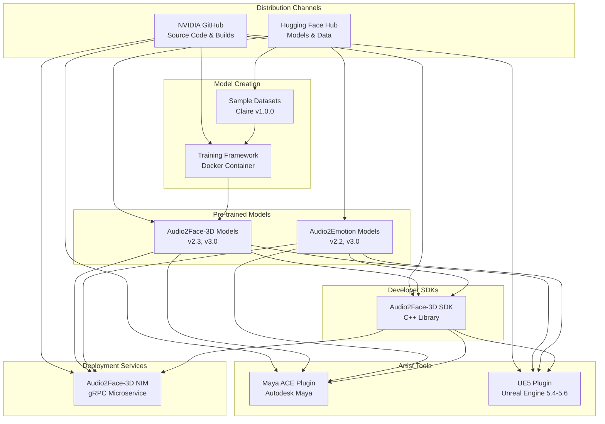
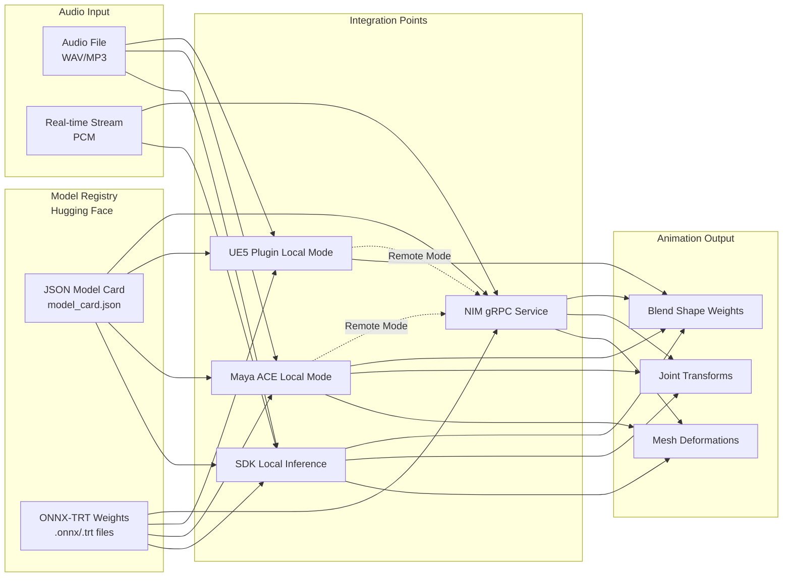
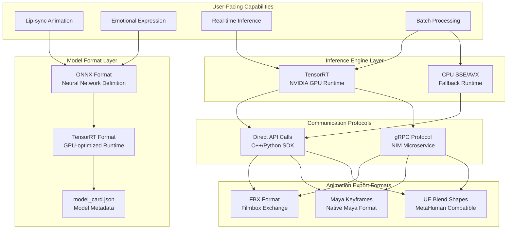
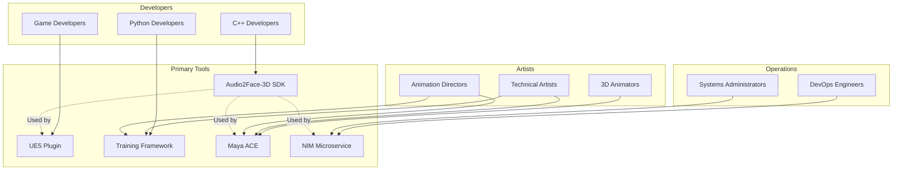

<!-- source: DeepWiki mcp.deepwiki.com · repo NVIDIA/Audio2Face-3D · page 1 Overview · fetched 2026-10-26 -->

# Overview

Relevant source files

The following files were used as context for generating this wiki page:

- [README.md](README.md)

## Purpose and Scope

This document provides a comprehensive introduction to the Audio2Face-3D ecosystem, an advanced system for generating high-fidelity 3D facial animation from audio sources. It covers the purpose of the technology, the complete set of available components, distribution channels, and how these components interact to enable facial animation workflows across different platforms and use cases.

For detailed technical information about specific components, refer to:
- Audio-to-animation pipeline mechanics: [Core Technology](#2)
- Developer and artist tools: [Integration Tools](#3)
- Custom model creation: [Model Training](#4)
- Pre-trained model specifications: [Pre-trained Models](#5)
- Production deployment strategies: [Deployment](#6)

**Sources:** [README.md:1-16]()

## What is Audio2Face-3D?

Audio2Face-3D is a neural network-based system that transforms audio input (either pre-recorded files or real-time streams) into detailed 3D facial animations. The technology performs two parallel analyses on vocal data:

1. **Phonetic Analysis** - Generates accurate lip-sync by analyzing speech sounds
2. **Emotional Tone Analysis** - Infers emotional state to drive facial expressions

The system outputs animation data in three standard formats:
- **Mesh Deformations** - Direct vertex positions for facial geometry
- **Joint Transformations** - Skeletal rig transformations (rotation, translation, scale)
- **Blend Shape Weights** - Morph target weights for blend shape-based rigs

This flexibility enables integration with diverse character rigs and animation pipelines across game engines, digital content creation tools, and custom applications.

**Sources:** [README.md:4-11]()

## Ecosystem Architecture

The Audio2Face-3D ecosystem consists of five primary component categories, distributed across two channels (NVIDIA GitHub repositories and Hugging Face Hub):

**Sources:** [README.md:17-107]()

## Distribution Model

Audio2Face-3D components are distributed through two distinct channels, each serving a specific purpose:

### NVIDIA GitHub Repositories

NVIDIA's GitHub organization hosts all source code, compiled binaries, and development tooling:

| Repository | Format | License |
|------------|--------|---------|
| `Audio2Face-3D-SDK` | C++ & Python source | MIT |
| `Audio2Face-3D-training-framework` | Python & Docker | Apache |
| `Maya-ACE` | Maya Plugin Module, C++ & Python source | MIT |
| Unreal Engine 5 Plugin | `.uplugin` files, C++ source | MIT |
| Audio2Face-3D NIM | Docker Container | NVIDIA Software License |

### Hugging Face Hub

Hugging Face Hub serves as the centralized model registry for trained neural network weights and datasets:

| Artifact Type | Format | Versions |
|---------------|--------|----------|
| Audio2Face-3D Models | ONNX-TRT + JSON Model Cards | v2.3 (Mark, Claire, James), v3.0 (Diffusion) |
| Audio2Emotion Models | ONNX-TRT + JSON Model Cards | v2.2 (Production), v3.0 (Experimental) |
| Training Datasets | Audio files, blendshape data, geometry caches, transforms | v1.0.0 (Claire) |

This dual-channel architecture decouples code releases from model releases, enabling independent versioning and update cycles.

**Sources:** [README.md:19-107]()

## Component Interaction Flow

The following diagram illustrates how different components consume models and interact with each other:

**Sources:** [README.md:115-120](), [README.md:162-169](), [README.md:200-203](), [README.md:217-227]()

## Component Summary

### Development SDKs

**Audio2Face-3D SDK** (`Audio2Face-3D-SDK`)
- Cross-platform C++ library for custom application development
- Real-time inference engine with GPU acceleration (TensorRT) and CPU fallback
- Supports all Audio2Face-3D and Audio2Emotion ONNX-TRT models
- Target users: C++ developers, tools engineers, pipeline developers

**Sources:** [README.md:109-128]()

### Artist Integration Tools

**Maya ACE Plugin** (`Maya-ACE`)
- Autodesk Maya plugin (v2.0) for animation authoring
- User interface for real-time animation preview in Maya viewport
- Exports to Maya keyframes or FBX format
- Supports local inference and remote NIM connections
- Includes Python API for scripting and automation
- Target users: 3D animators, technical directors

**Unreal Engine 5 Plugin** (`nv_ace_reference-ue5.x`)
- Blueprint-integrated plugin for UE 5.4, 5.5, and 5.6
- Sample project includes MetaHuman rigging configuration
- Requires two components: ACE Unreal plugin + Audio2Face-3D Models plugin
- Supports local and remote inference modes
- Full C++ source code available for customization
- Target users: Game developers, virtual production artists

**Sources:** [README.md:152-177](), [README.md:179-210]()

### Model Training

**Training Framework** (`Audio2Face-3D-training-framework`)
- Docker-containerized Python framework (v1.0)
- Creates custom ONNX-TRT models from proprietary animation datasets
- Generates JSON model cards for model metadata
- Supports single-language and multi-language training
- Same framework used to train official Mark, Claire, and James models
- Target users: ML researchers, technical artists, animation directors

**Sample Datasets** (`Audio2Face-3D-Dataset-v1.0.0-claire`)
- Claire dataset (v1.0.0) demonstrates required data format:
  - Audio files (WAV format)
  - Blendshape coefficient data
  - Animated geometry caches
  - Base geometry files
  - Transform files
- Serves as template for structuring custom training data

**Sources:** [README.md:129-151](), [README.md:100-105]()

### Deployment Infrastructure

**Audio2Face-3D NIM**
- Docker-containerized gRPC microservice for large-scale deployment
- Multi-stream support for concurrent inference requests
- Centralizes GPU resources on server infrastructure
- Compatible with all Audio2Face-3D SDK clients
- Enables remote inference for Maya ACE and UE5 Plugin
- Target users: DevOps engineers, cloud administrators, systems integrators

**Sources:** [README.md:211-234]()

## Technology Stack

The following diagram maps high-level capabilities to their underlying technical implementations:

**Sources:** [README.md:83-89](), [README.md:92-97](), [README.md:119-121](), [README.md:144](), [README.md:217-227]()

## Model Versioning Strategy

Audio2Face-3D models follow a semantic versioning scheme with distinct lineages:

| Model Family | Version | Architecture | Status | Use Case |
|--------------|---------|--------------|--------|----------|
| Audio2Face-3D | v2.3 (Mark) | Regression | Production | Male character, English |
| Audio2Face-3D | v2.3.1 (Claire) | Regression | Production | Female character, English |
| Audio2Face-3D | v2.3.1 (James) | Regression | Production | Male character, English |
| Audio2Face-3D | v3.0 | Diffusion | Production | Universal, improved quality |
| Audio2Emotion | v2.2 | Classification | Production | Emotion inference, stable |
| Audio2Emotion | v3.0 | Advanced | Experimental | Emotion inference, research |

All models share the same interface contract defined by their JSON model cards, enabling hot-swapping across all Audio2Face-3D tools without code changes.

**Sources:** [README.md:82-97]()

## Target User Personas

**Sources:** [README.md:111](), [README.md:131](), [README.md:156](), [README.md:181](), [README.md:213]()

## File Format Specifications

Audio2Face-3D components work with the following standardized file formats:

### Model Formats
- **ONNX-TRT** - Neural network weights in ONNX format with TensorRT optimization metadata
- **JSON Model Cards** (`model_card.json`) - Model metadata including input/output specifications, version, and compatibility requirements

### Animation Input
- **WAV** - Waveform audio file format (training datasets)
- **MP3** - Compressed audio format (runtime inference)
- **PCM** - Raw pulse-code modulation streams (real-time inference)

### Animation Output
- **FBX** - Autodesk Filmbox format for cross-application interchange
- **Maya Keyframes** - Native Maya animation curves
- **Geometry Caches** - Alembic or Maya geometry cache formats
- **Blend Shape Weights** - Numeric coefficients for morph target animation

### Training Data
- **Blendshape Data** - Numeric coefficients per frame
- **Geometry Files** - Base mesh topology (OBJ, Alembic)
- **Transform Files** - Joint transformation matrices

**Sources:** [README.md:36](), [README.md:43](), [README.md:50](), [README.md:57](), [README.md:84](), [README.md:102-103](), [README.md:144](), [README.md:169]()

## Workflow Patterns

Audio2Face-3D supports three primary workflow patterns:

### Local Workstation Workflow
1. Download pre-trained models from Hugging Face Hub
2. Install Maya ACE plugin or UE5 plugin
3. Load model via JSON model card
4. Import audio file
5. Generate animation with local GPU inference
6. Export to FBX or native format

### Remote Service Workflow
1. Deploy Audio2Face-3D NIM on server infrastructure
2. Connect Maya ACE or UE5 plugin in remote mode
3. Submit audio via gRPC protocol
4. Receive animation data from centralized service
5. Export to desired format

### Custom Application Workflow
1. Integrate Audio2Face-3D SDK into C++ application
2. Implement model loading from Hugging Face Hub
3. Build custom audio input pipeline
4. Call SDK inference APIs
5. Process animation data in application-specific format

**Sources:** [README.md:123-127](), [README.md:166-169](), [README.md:200-203](), [README.md:217-234]()

## System Requirements

All Audio2Face-3D components share common infrastructure dependencies:

### Hardware Requirements
- **GPU**: NVIDIA GPU with TensorRT support (recommended for real-time performance)
- **CPU**: SSE/AVX-compatible processor (fallback mode)
- **Memory**: Varies by model size and batch processing requirements

### Software Dependencies
- **TensorRT**: NVIDIA TensorRT runtime for GPU inference
- **CUDA**: NVIDIA CUDA toolkit (GPU mode)
- **Docker**: Container runtime (Training Framework and NIM)
- **gRPC**: High-performance RPC framework (NIM communication)

### Platform Support
- **Linux**: Full support for all components
- **Windows**: SDK, Maya ACE, UE5 Plugin support
- **macOS**: SDK and Maya ACE support (CPU-only inference)

**Sources:** [README.md:119-121]()

---

