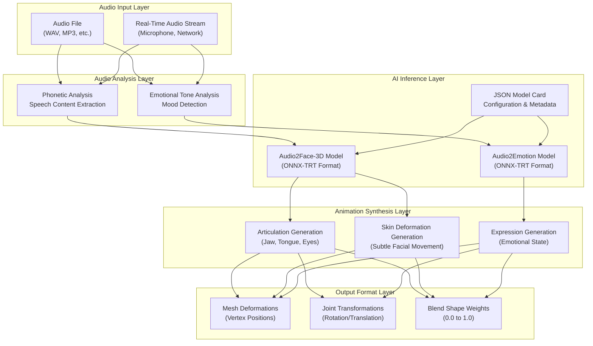
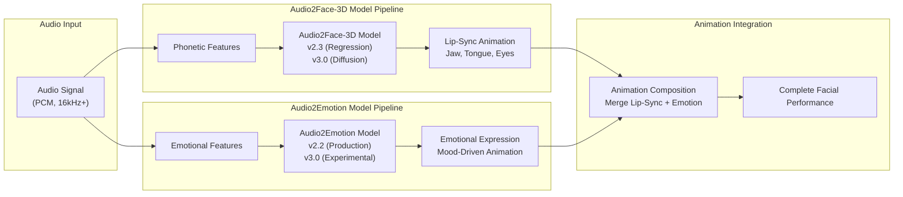
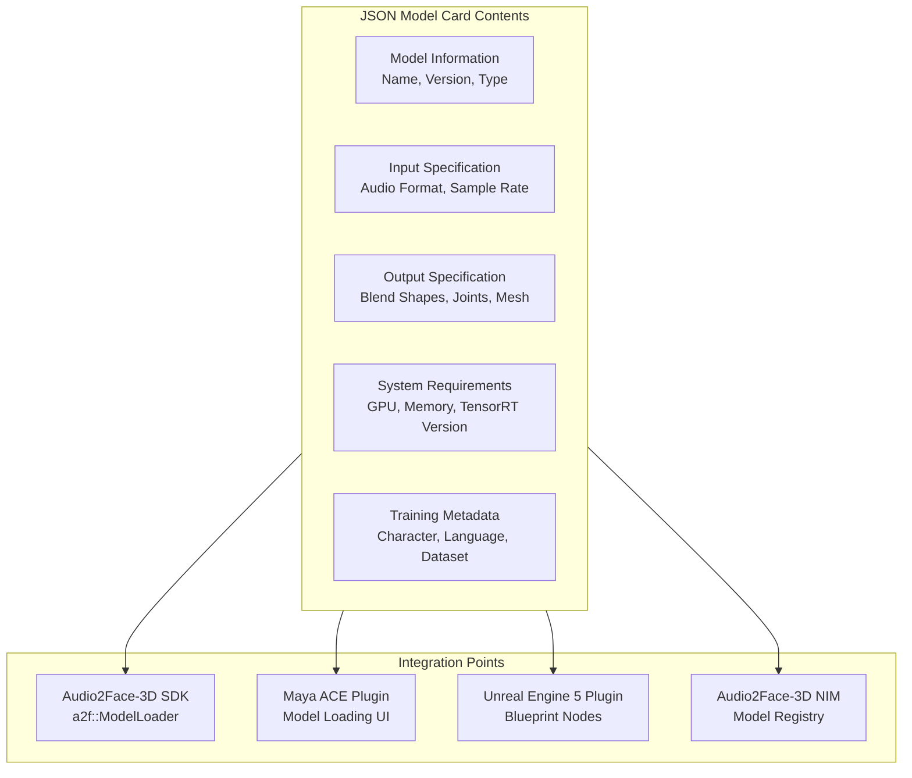
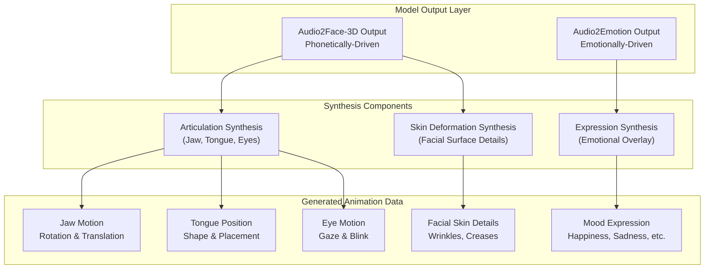
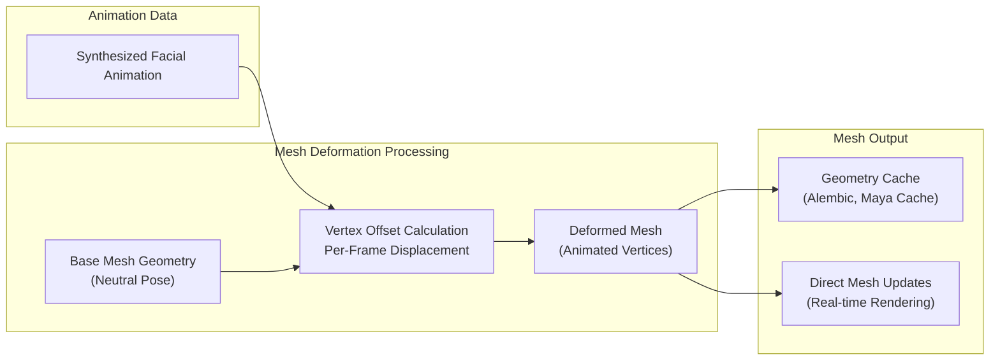
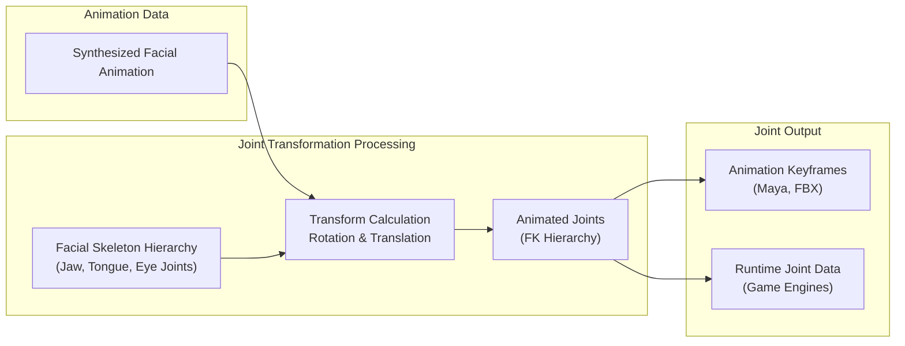
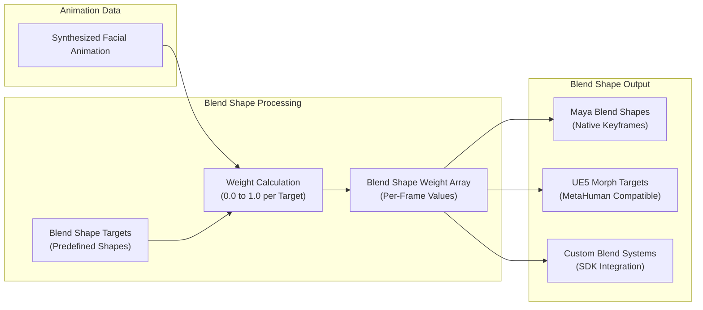
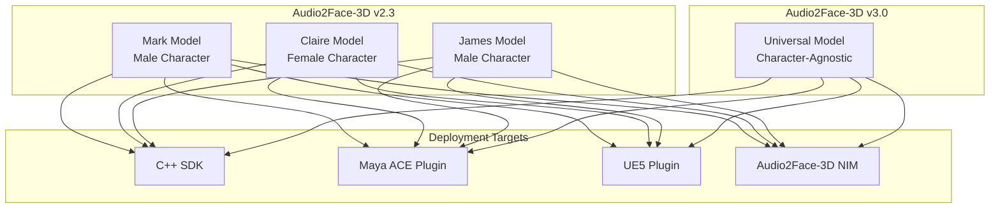
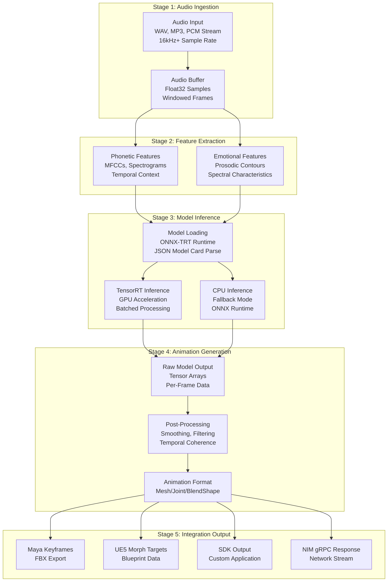

<!-- source: DeepWiki mcp.deepwiki.com · repo NVIDIA/Audio2Face-3D · page 2 Core Technology · fetched 2026-10-26 -->

# Core Technology

Relevant source files

The following files were used as context for generating this wiki page:

- [README.md](README.md)
- [media/Aki_ArchFlow_Banner.png](media/Aki_ArchFlow_Banner.png)

## Purpose and Scope

This document explains the internal architecture and technical implementation of Audio2Face-3D, focusing on how the system transforms audio input into 3D facial animation output. It covers the audio-to-animation pipeline, the dual-model inference architecture, phonetic and emotional analysis, and the three output format options (mesh deformations, joint transformations, blend shape weights).

For information about integrating these capabilities into applications, see [Integration Tools](#3). For pre-trained model versions and specifications, see [Pre-trained Models](#5). For creating custom models, see [Model Training](#4).

**Sources:** [README.md:1-16]()

---

## Audio-to-Animation Pipeline

The Audio2Face-3D system implements a complete pipeline that transforms audio data into synchronized 3D facial animation through multiple processing stages:

**Pipeline Overview**

The system processes audio through five distinct layers:

1. **Audio Input Layer**: Accepts both pre-recorded audio files and real-time audio streams
2. **Audio Analysis Layer**: Performs parallel phonetic and emotional analysis on the incoming audio
3. **AI Inference Layer**: Two specialized neural networks process the analyzed audio data
4. **Animation Synthesis Layer**: Generates articulation movements, skin deformations, and emotional expressions
5. **Output Format Layer**: Produces animation data in one or more standardized formats compatible with different rigging systems

**Sources:** [README.md:4-11]()

---

## Dual-Model Inference Architecture

Audio2Face-3D employs a dual-model architecture where two specialized neural networks operate in parallel to generate comprehensive facial animation:

**Model Responsibilities**

| Model | Primary Function | Output Components | Model Versions |
|-------|------------------|-------------------|----------------|
| **Audio2Face-3D** | Generates accurate lip-sync based on phonetic analysis | Jaw motion, tongue position, eye movement, facial skin deformation | v2.3 (regression-based) v3.0 (diffusion-based) |
| **Audio2Emotion** | Infers emotional state from tone of speech | Emotional expression overlays, mood-driven facial adjustments | v2.2 (production) v3.0 (experimental) |

Both models operate independently but their outputs are composed to produce a unified facial performance that includes both precise articulation and emotional nuance.

**Sources:** [README.md:6-11](), [README.md:82-98]()

---

## Audio Analysis

The system performs two types of audio analysis that feed into the dual-model inference architecture:

### Phonetic Analysis

The phonetic analysis component extracts speech content from the audio signal to enable accurate lip-sync generation. This analysis identifies:

- **Speech phonemes**: Individual sound units that form spoken words
- **Articulatory features**: Characteristics of speech production (vowels, consonants, etc.)
- **Timing information**: Precise temporal alignment of phonetic events

The phonetic features are fed to the Audio2Face-3D model, which generates synchronized facial movements corresponding to the speech content.

### Emotional Tone Analysis

The emotional tone analysis extracts affective characteristics from the audio signal:

- **Prosodic features**: Pitch variation, rhythm, and intonation patterns
- **Vocal qualities**: Energy, timbre, and spectral characteristics
- **Temporal dynamics**: Changes in emotional state over time

These features drive the Audio2Emotion model to generate expressions that reflect the speaker's emotional state, adding depth and believability to the animation beyond mechanical lip-sync.

**Sources:** [README.md:6-9]()

---

## Model Architecture and Formats

### ONNX-TRT Model Format

All Audio2Face-3D and Audio2Emotion models are distributed in the ONNX-TRT format, which provides:

- **Cross-platform compatibility**: Models can be loaded on different operating systems
- **Hardware acceleration**: Optimized for NVIDIA GPU execution via TensorRT
- **CPU fallback support**: Models can run on systems without compatible GPUs
- **Standardized interface**: Consistent input/output specifications across model versions

### JSON Model Card

Each model is accompanied by a JSON model card that serves as a configuration and metadata file:

The JSON model card enables:

- **Model discovery**: Tools can scan available models and present them to users
- **Automatic configuration**: Integration tools can adapt to model-specific requirements
- **Version management**: Applications can verify compatibility before loading
- **Custom model support**: User-trained models work seamlessly with all tools if they include a valid model card

**Sources:** [README.md:84-85](), [README.md:144](), [README.md:162]()

---

## Animation Synthesis

The inference models generate three categories of facial animation data:

### Articulation Generation

The Audio2Face-3D model generates precise, synchronized motion for primary speech articulators:

- **Jaw movement**: Opening and closing corresponding to vowels and consonants
- **Tongue position**: Shape and placement for different phonemes
- **Eye motion**: Gaze direction and blink timing correlated with speech

### Skin Deformation Generation

Beyond major articulator movement, the system synthesizes subtle facial skin deformations:

- **Natural wrinkles and creases**: Dynamic skin folding around the mouth, eyes, and cheeks
- **Compression and stretching**: Realistic skin behavior during articulation
- **Secondary motion**: Subtle movements that add realism to the performance

### Expression Generation

The Audio2Emotion model produces emotional expression data that overlays the phonetic animation:

- **Mood-driven facial adjustments**: Modifications to neutral articulation based on emotional state
- **Emotional timing**: Temporal correlation between speech content and affective displays
- **Expression blending**: Smooth transitions between different emotional states

**Sources:** [README.md:6-11]()

---

## Output Formats

Audio2Face-3D supports three standardized output formats to accommodate different character rigging systems and animation workflows:

### Output Format Comparison

| Format | Description | Use Cases | Integration Tools |
|--------|-------------|-----------|-------------------|
| **Mesh Deformations** | Direct vertex position modifications | Characters with dense mesh topology; real-time applications requiring direct geometry manipulation | SDK, Maya ACE |
| **Joint Transformations** | Hierarchical bone rotations and translations | Skeletal-rigged characters; standard animation pipelines using FK/IK systems | SDK, Maya ACE |
| **Blend Shape Weights** | Weighted combination of pre-defined shape targets | Blend shape-based facial rigs; MetaHumans; standardized facial animation systems | SDK, Maya ACE, UE5 Plugin |

### Mesh Deformations

Mesh deformations provide direct control over vertex positions, enabling:

- **Maximum fidelity**: Every vertex can be independently positioned
- **Mesh-level details**: Capture subtle skin deformations not achievable with skeletons alone
- **Cache export**: Can be exported as geometry caches (Alembic, Maya Cache) for offline rendering

### Joint Transformations

Joint transformations work with skeletal facial rigs:

- **Standard workflow**: Compatible with traditional animation pipelines
- **Hierarchical control**: Parent-child joint relationships maintained
- **Export flexibility**: Can be exported as keyframe animation or FBX files

### Blend Shape Weights

Blend shape weights drive pre-defined facial targets:

- **Industry standard**: Most facial rigs use some form of blend shape system
- **MetaHuman compatibility**: Direct support for Epic Games' MetaHuman characters
- **Normalized values**: Weights range from 0.0 (no influence) to 1.0 (full influence)
- **Multiple target support**: Can drive dozens to hundreds of blend shape targets simultaneously

**Sources:** [README.md:11](), [README.md:169](), [README.md:203]()

---

## Model Versions and Architecture Types

Audio2Face-3D supports multiple model versions with different underlying neural network architectures:

### Audio2Face-3D Model Versions

| Version | Architecture Type | Characteristics | Distribution |
|---------|-------------------|-----------------|--------------|
| **v2.3** | Regression-based | Fast inference, deterministic output, character-specific (Mark, Claire, James) | Hugging Face Hub |
| **v3.0** | Diffusion-based | Higher quality, more natural variation, character-agnostic | Hugging Face Hub |

### Audio2Emotion Model Versions

| Version | Status | Characteristics | Distribution |
|---------|--------|-----------------|--------------|
| **v2.2** | Production | Stable, validated for production use | Hugging Face Hub |
| **v3.0** | Experimental | Advanced features, research-oriented | Hugging Face Hub |

All model versions use the same ONNX-TRT format and JSON model card structure, ensuring compatibility across all integration tools. The choice of model version depends on the specific requirements of the project, hardware capabilities, and desired animation characteristics.

**Sources:** [README.md:82-98]()

---

## Technical Data Flow

The following diagram illustrates the complete technical data flow through the Audio2Face-3D system, mapping the abstract pipeline to specific technical formats and processing stages:

**Processing Stages**

1. **Audio Ingestion**: Raw audio is buffered and prepared for feature extraction
2. **Feature Extraction**: Parallel extraction of phonetic and emotional features
3. **Model Inference**: ONNX-TRT models execute on GPU (with CPU fallback)
4. **Animation Generation**: Raw tensors are post-processed and formatted
5. **Integration Output**: Animation data is delivered in the appropriate format for each tool

**Sources:** [README.md:4-11](), [README.md:119-121](), [README.md:84-85]()

---

## Performance Characteristics

The Audio2Face-3D system is optimized for real-time performance:

### Hardware Acceleration

- **GPU acceleration**: Leverages NVIDIA GPUs via TensorRT for maximum performance
- **CPU fallback**: Provides compatibility with systems lacking compatible GPUs, though at reduced performance
- **Multi-stream support**: Can process multiple concurrent audio streams (especially in NIM deployments)

### Real-Time Capabilities

The system supports real-time inference suitable for:

- Interactive applications (games, virtual assistants)
- Live virtual production
- Real-time preview in content creation tools (Maya ACE, UE5 Plugin)
- Streaming scenarios with low-latency requirements

### Batch Processing

For non-real-time scenarios, the system can be configured for:

- High-throughput batch processing of multiple audio files
- Automated pipeline integration
- Cloud-based rendering services

**Sources:** [README.md:119-121](), [README.md:223-224]()

---

