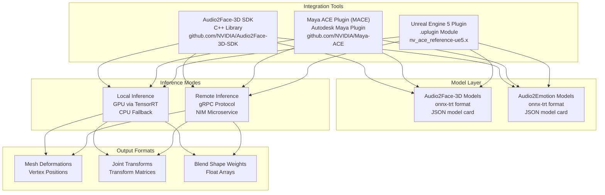
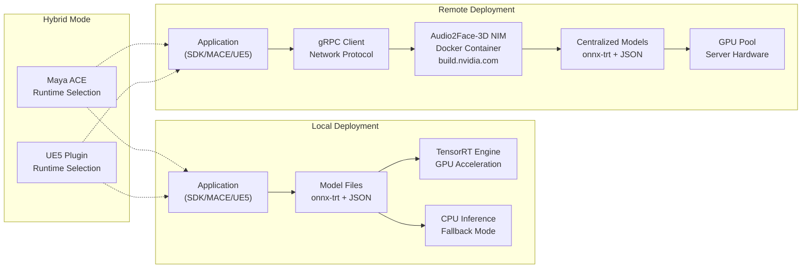
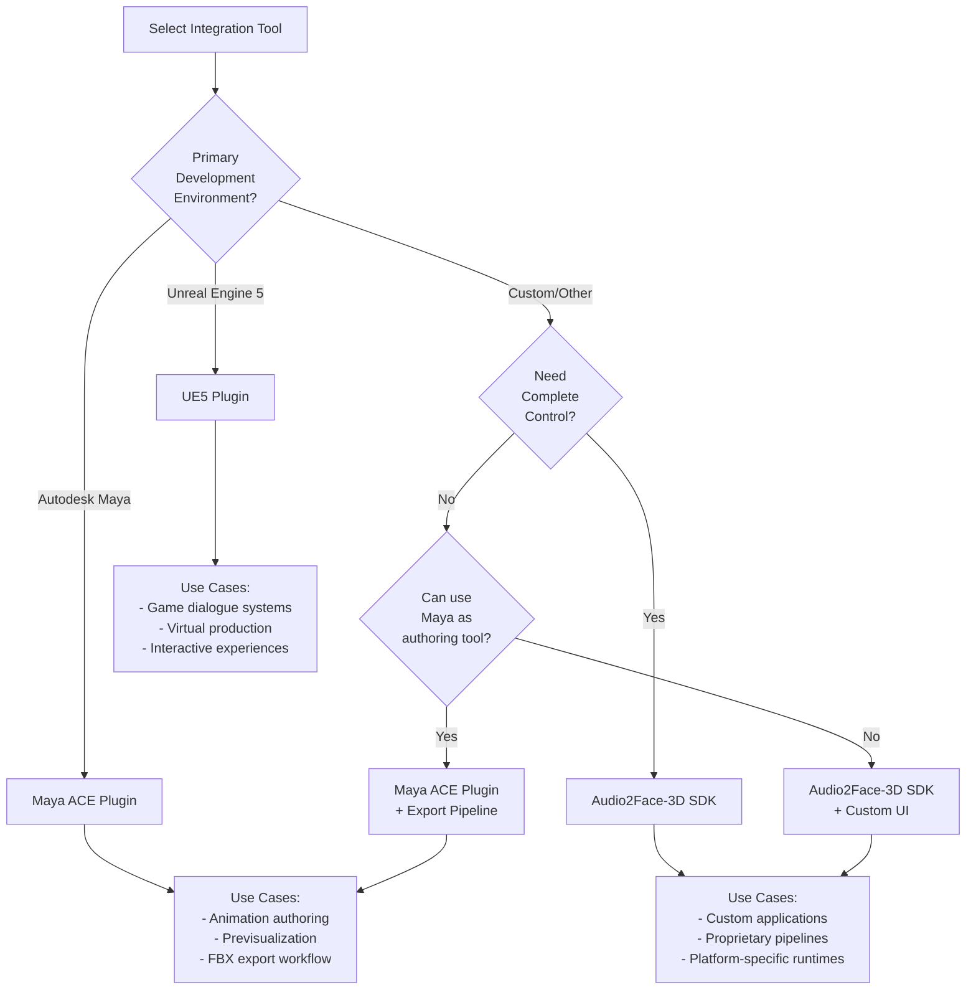
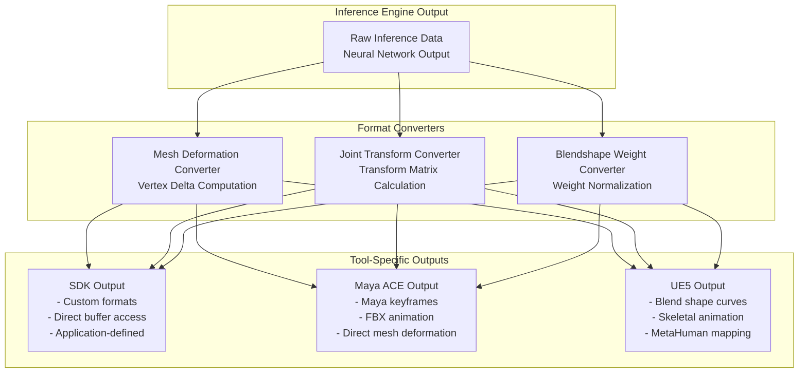

<!-- source: DeepWiki mcp.deepwiki.com · repo NVIDIA/Audio2Face-3D · page 3 Integration Tools · fetched 2026-10-26 -->

# Integration Tools

Relevant source files

The following files were used as context for generating this wiki page:

- [README.md](README.md)

## Purpose and Scope

This document provides an overview of the three primary integration tools that enable developers and artists to incorporate Audio2Face-3D capabilities into their applications and workflows. These tools—the C++ SDK, Maya ACE Plugin, and Unreal Engine 5 Plugin—serve different user personas and use cases while sharing a common foundation of models and inference capabilities.

For detailed information about specific models used by these tools, see [Pre-trained Models](#5). For deployment infrastructure including the NIM microservice that these tools can connect to, see [Deployment](#6). For information about creating custom models to use with these tools, see [Model Training](#4).

**Sources:** [README.md:17-21](), [README.md:109-233]()

## Integration Tools Ecosystem

The Audio2Face-3D integration tools form a three-tiered architecture designed to serve distinct workflows while maintaining interoperability through shared model formats and optional centralized inference services.

**Diagram: Integration Tools Architecture**

**Sources:** [README.md:109-233](), [README.md:82-89](), [README.md:92-97]()

## Tool Comparison Matrix

The following table summarizes the key characteristics and capabilities of each integration tool:

| Feature | Audio2Face-3D SDK | Maya ACE Plugin | UE5 Plugin |
|---------|-------------------|-----------------|------------|
| **Primary Interface** | C++ and Python APIs | Maya UI and Python nodes | Blueprint nodes |
| **Target Audience** | C++ developers, pipeline engineers | 3D animators, technical directors | Game developers |
| **Distribution Format** | Source code (C++ & Python) | Maya plugin module, source code (C++ & Python) | .uplugin file, C++ source |
| **License** | MIT | MIT | MIT |
| **Local Inference** | Yes (GPU/CPU) | Yes (GPU/CPU) | Yes (GPU/CPU) |
| **Remote Inference** | Yes (via gRPC) | Yes (via gRPC) | Yes (via gRPC) |
| **Model Loading** | Direct API calls | JSON model card | Plugin configuration |
| **Real-time Preview** | Application-dependent | Maya viewport | Unreal viewport |
| **Export Formats** | Application-defined | Maya keyframes, FBX | UE animation assets |
| **Platform Support** | Cross-platform | Windows, Linux (Maya supported platforms) | Windows, Linux (UE5 supported platforms) |
| **Hardware Acceleration** | NVIDIA GPU (TensorRT), CPU fallback | NVIDIA GPU (TensorRT), CPU fallback | NVIDIA GPU (TensorRT), CPU fallback |
| **Customization** | Full source code access | Maya node editing, Python scripting | C++ source code access |

**Sources:** [README.md:109-127](), [README.md:152-177](), [README.md:179-209]()

## Deployment Mode Architecture

All three integration tools support both local and remote inference modes, providing flexibility for different hardware configurations and deployment scenarios.

**Diagram: Local vs Remote Inference Deployment Modes**

**Sources:** [README.md:120-121](), [README.md:167](), [README.md:202](), [README.md:211-227]()

## Audio2Face-3D SDK

The Audio2Face-3D SDK provides the foundational C++ library for integrating real-time facial animation inference directly into custom applications. It serves as the lowest-level integration option, offering maximum flexibility and control.

**Repository:** [github.com/NVIDIA/Audio2Face-3D-SDK](https://github.com/NVIDIA/Audio2Face-3D-SDK)

**Key Characteristics:**
- Cross-platform C++ library with Python bindings
- Direct API access to inference engine
- Hardware acceleration via TensorRT on NVIDIA GPUs
- CPU fallback for broader hardware support
- MIT license for commercial and open-source use

**Primary Use Cases:**
- Building custom content creation tools
- Integrating into proprietary game engines
- Developing batch processing pipelines
- Creating platform-specific runtime applications

The SDK is designed for developers who need to build their own user interfaces, export pipelines, or runtime systems. It provides the raw inference capabilities without imposing any specific workflow or file format constraints.

For complete SDK documentation including API reference, build instructions, and integration examples, see [C++ SDK](#3.1).

**Sources:** [README.md:109-127](), [README.md:34-38]()

## Maya ACE Plugin (MACE)

Maya ACE (Animation Character Editor) is a comprehensive plugin that integrates Audio2Face-3D inference capabilities directly into the Autodesk Maya environment. It provides an artist-friendly interface for real-time facial animation authoring.

**Repository:** [github.com/NVIDIA/Maya-ACE](https://github.com/NVIDIA/Maya-ACE)

**Key Characteristics:**
- Native Maya plugin module (.mll on Windows, .so on Linux)
- User interface integrated into Maya's native UI framework
- Python scripting support via Maya command interface
- JSON model card system for loading compatible models
- Dual-mode inference: local execution or remote NIM connection
- Export to Maya keyframes or FBX format

**Primary Use Cases:**
- Real-time animation authoring in Maya viewport
- Previsualization and performance iteration
- Animation pipeline integration for studios
- Configuration file creation for batch processing

MACE bridges the gap between AI-driven animation and traditional keyframe workflows, allowing animators to generate initial performances and then refine them using standard Maya tools.

For detailed MACE documentation including installation, UI walkthrough, and scripting examples, see [Maya ACE Plugin](#3.2).

**Sources:** [README.md:152-177](), [README.md:48-52]()

## Unreal Engine 5 Plugin

The Unreal Engine 5 Plugin delivers real-time facial animation capabilities through Blueprint nodes, enabling game developers to integrate Audio2Face-3D into interactive experiences without C++ programming.

**Distribution:** Binary releases available from [developer.nvidia.com](https://developer.nvidia.com)
- UE 5.6 plugin: `nv_ace_reference-ue5.6-v2.5.0rc3.zip`
- UE 5.5 plugin: `nv_ace_reference-ue5.5-v2.5.0rc3.zip`
- UE 5.4 plugin: `nv_ace_reference-ue5.4-v2.4.0.zip`
- Model plugins: `ace_3.0_a2f_models.zip`, `ace_2.5_v2.3_a2f_models.zip`

**Key Characteristics:**
- Blueprint node interface for visual scripting
- C++ source code available for customization
- MetaHuman facial rig compatibility
- Sample project with complete character setup
- Supports both local inference and remote NIM connection
- Real-time viewport preview

**Primary Use Cases:**
- In-game dialogue systems with dynamic facial animation
- Virtual production and cinematic sequences
- Interactive narrative experiences
- Real-time character performances

The plugin requires two components: the core ACE Unreal plugin (containing the inference engine) and the Audio2Face-3D Models plugin (containing model assets). The sample project demonstrates the complete setup including facial rig mapping for Epic Games MetaHumans.

For comprehensive UE5 plugin documentation including Blueprint reference, rigging setup, and sample project walkthrough, see [Unreal Engine 5 Plugin](#3.3).

**Sources:** [README.md:179-209](), [README.md:55-59](), [README.md:183-190]()

## Tool Selection Guidance

The following decision tree helps determine which integration tool best fits specific project requirements:

**Diagram: Integration Tool Selection Decision Tree**

**Considerations by Workflow Type:**

| Workflow Type | Recommended Tool | Rationale |
|---------------|------------------|-----------|
| **Film/Animation Production** | Maya ACE Plugin | Native integration with animation workflows, keyframe export, FBX compatibility |
| **Game Development (UE5)** | UE5 Plugin | Direct Blueprint integration, MetaHuman support, real-time preview |
| **Game Development (Other Engines)** | Audio2Face-3D SDK | Full control over integration, custom export formats, engine-specific optimizations |
| **Web/Cloud Applications** | Audio2Face-3D SDK + NIM | Server-side deployment, multi-user support, cross-platform clients |
| **Research & Prototyping** | Maya ACE Plugin | Rapid iteration, visual feedback, no coding required for basic use |
| **Mobile/Console Platforms** | Audio2Face-3D SDK | Platform-specific builds, optimized runtime, custom asset pipelines |

**Sources:** [README.md:123-127](), [README.md:172-177](), [README.md:206-209]()

## Model Compatibility

All three integration tools share a common model format and loading mechanism, ensuring interoperability and consistency across the ecosystem.

**Model Format Specifications:**
- **Primary Format:** ONNX-TensorRT (`.onnx` files optimized for TensorRT inference)
- **Metadata Format:** JSON model card (`.json` file describing model capabilities and requirements)
- **Audio2Face-3D Models:** Versions 2.3 (regression-based) and 3.0 (diffusion-based)
- **Audio2Emotion Models:** Versions 2.2 (production) and 3.0 (experimental)

**Model Loading Mechanisms:**

| Tool | Model Loading Method | Configuration |
|------|---------------------|---------------|
| SDK | Direct API calls (`loadModel()` functions) | Programmatic model path specification |
| Maya ACE | JSON model card selection in UI | UI file browser or Python command with JSON path |
| UE5 Plugin | Plugin configuration and Blueprint nodes | Asset import and Blueprint parameter assignment |

All tools can utilize the same model files downloaded from Hugging Face Hub, enabling studios to standardize on a single set of models across different tools and workflows. Custom models trained with the Training Framework (see [Model Training](#4)) are compatible with all three integration tools without modification.

**Sources:** [README.md:82-89](), [README.md:92-97](), [README.md:168]()

## Output Format Compatibility

The integration tools support multiple output formats to accommodate different character rigging approaches:

**Diagram: Output Format Pipeline**

**Format Capabilities by Tool:**

- **SDK:** Provides raw access to all output formats through API functions. Applications can process mesh deformations, joint transforms, or blend shape weights according to their specific rigging requirements.

- **Maya ACE:** Converts outputs to Maya-native representations including keyframe animation on transform nodes, blend shape weight animation, or direct mesh deformation on geometry nodes. Exports to FBX preserve animation data for use in other applications.

- **UE5 Plugin:** Integrates with Unreal's skeletal mesh and morph target systems. Blend shape outputs map directly to MetaHuman facial rigs, while joint transforms integrate with standard skeletal animation workflows.

**Sources:** [README.md:6-11](), [README.md:162](), [README.md:169](), [README.md:194]()

---

