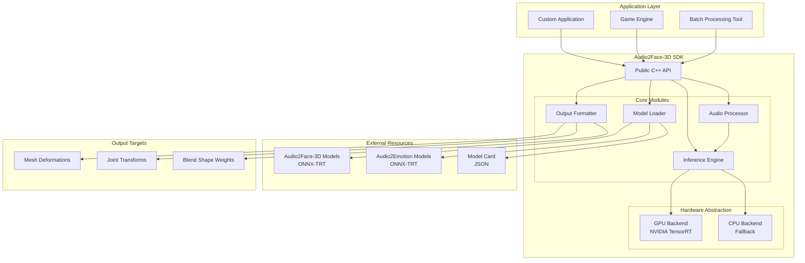
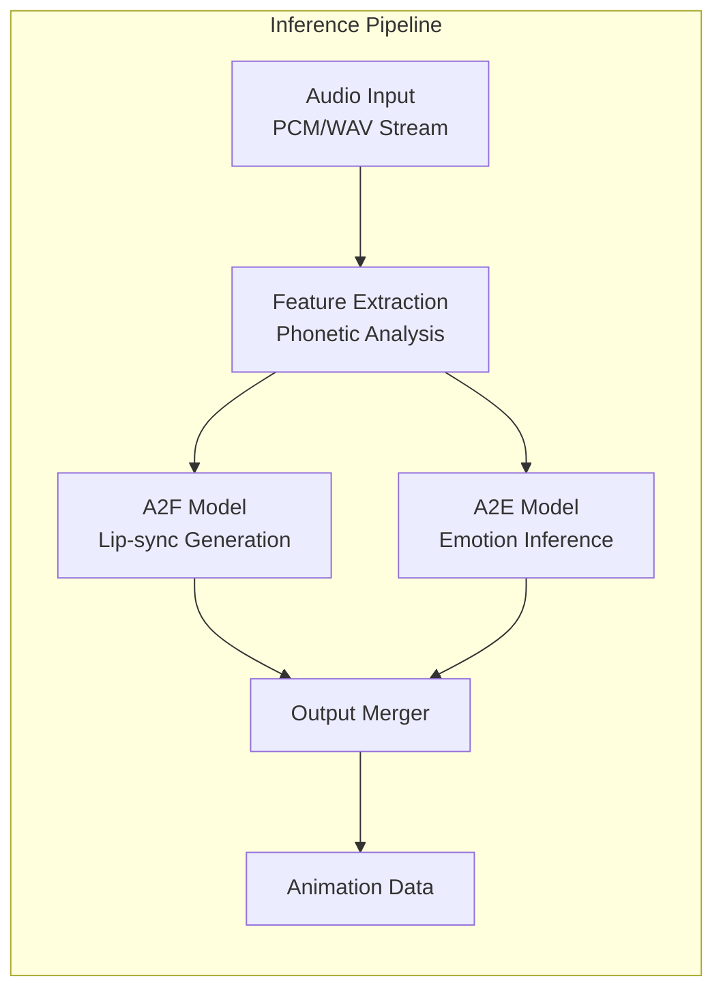
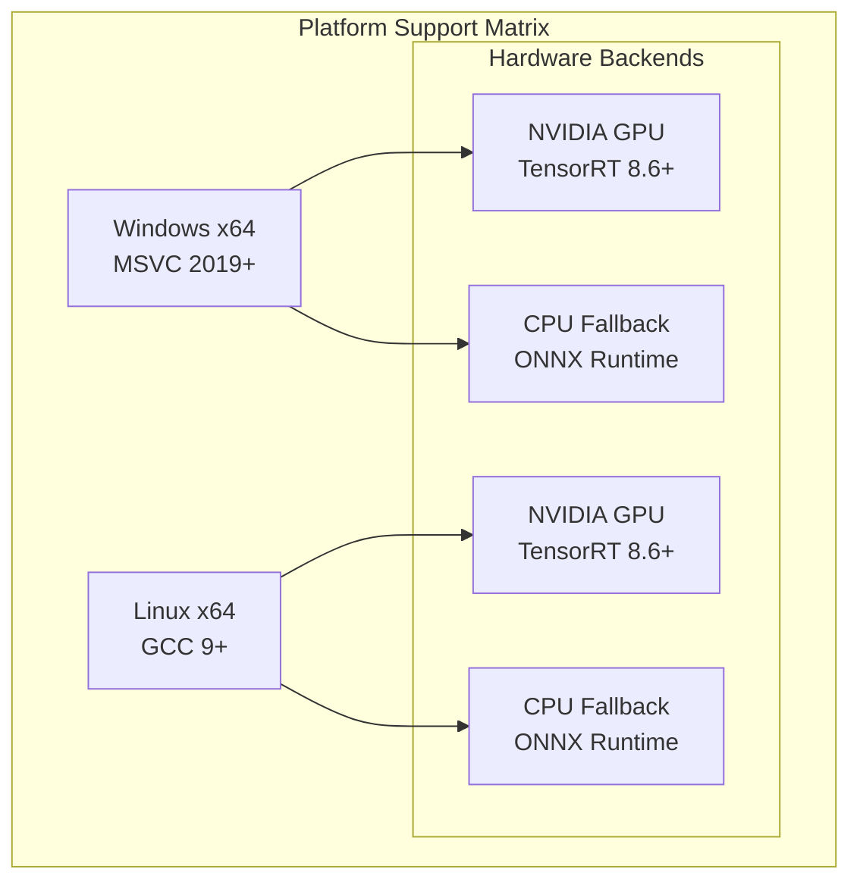
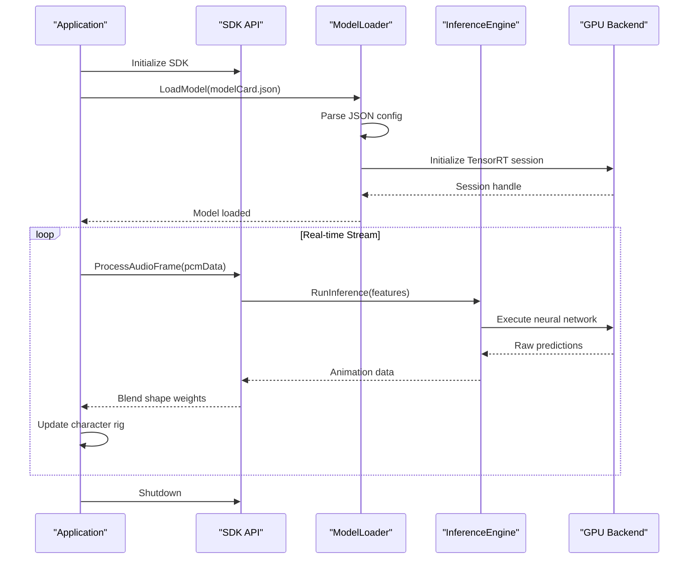
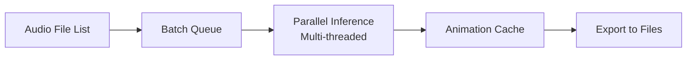

<!-- source: DeepWiki mcp.deepwiki.com · repo NVIDIA/Audio2Face-3D · page 3.1 C++ SDK · fetched 2026-10-26 -->

# C++ SDK

Relevant source files

The following files were used as context for generating this wiki page:

- [README.md](README.md)

## Purpose and Scope

The Audio2Face-3D SDK is a cross-platform C++ library that provides real-time facial animation inference capabilities for integration into custom applications, tools, and production pipelines. This page documents the SDK's architecture, core components, platform support, and integration patterns.

For information about pre-trained models compatible with the SDK, see [Audio2Face-3D Models](#5.1) and [Audio2Emotion Models](#5.2). For deployment options using the SDK in production environments, see [Deployment Patterns](#6.2). For plugin implementations built on top of the SDK, see [Maya ACE Plugin](#3.2) and [Unreal Engine 5 Plugin](#3.3).

**Sources:** [README.md:109-128]()

---

## SDK Architecture Overview

**SDK Architecture Overview**

The SDK provides a layered architecture separating application integration, core processing modules, and hardware abstraction. Applications interact through a unified C++ API that manages model loading, audio processing, and inference execution. The hardware abstraction layer enables GPU acceleration via NVIDIA TensorRT with automatic CPU fallback for broader compatibility.

**Sources:** [README.md:109-128](), [README.md:6-11]()

---

## Core Components

### Model Loader

The Model Loader component handles initialization and configuration of Audio2Face-3D and Audio2Emotion models. It parses JSON model cards to extract model metadata, input/output specifications, and runtime requirements.

**Responsibilities:**
- Parse JSON model card configuration
- Load ONNX-TRT model weights from disk
- Validate model compatibility with SDK version
- Initialize inference session with hardware backend
- Support for multiple model versions (v2.3 regression, v3.0 diffusion)

**Model Card Format:**
| Field | Description |
|-------|-------------|
| Model metadata | Version, character name, language support |
| Input specifications | Audio sample rate, frame size, feature dimensions |
| Output specifications | Blend shape count, joint topology, mesh vertex count |
| Runtime requirements | GPU memory, compute capability, TensorRT version |

**Sources:** [README.md:82-89](), [README.md:92-97](), [README.md:144]()

### Inference Engine

The Inference Engine executes neural network inference to transform audio features into facial animation data. It manages inference sessions, batch processing, and hardware resource allocation.

**Inference Pipeline**

The inference engine processes audio through feature extraction and parallel model execution. Audio2Face-3D generates phonetically-driven lip-sync while Audio2Emotion produces emotional expression. Results merge into unified animation data.

**Key Operations:**
- Real-time audio stream processing
- Parallel execution of A2F and A2E models
- Batch inference for offline processing
- Frame-level synchronization with audio timing
- Memory management for continuous streams

**Sources:** [README.md:6-11](), [README.md:120]()

### Audio Processor

The Audio Processor normalizes input audio streams and extracts features required for inference. It handles various audio formats and sample rates.

**Processing Pipeline:**
1. Audio format validation and conversion
2. Sample rate normalization
3. Phonetic feature extraction for lip-sync
4. Spectral analysis for emotional tone
5. Frame buffering for real-time streaming

**Supported Input:**
- File formats: WAV, MP3, AAC
- Sample rates: 16kHz, 22.05kHz, 44.1kHz, 48kHz
- Channels: Mono, Stereo (downmixed to mono)
- Real-time streams: PCM buffers

**Sources:** [README.md:4](), [README.md:8]()

### Output Formatter

The Output Formatter converts raw inference results into application-specific animation formats. It supports three primary output modes.

**Output Modes:**

| Mode | Description | Use Case |
|------|-------------|----------|
| Mesh Deformations | Per-vertex displacement vectors | Direct geometry manipulation, cloth simulation |
| Joint Transforms | Bone rotation/translation matrices | Skeletal rigs, game engines |
| Blend Shape Weights | Scalar weights for morph targets | Maya blend shapes, MetaHumans, ARKit |

**Sources:** [README.md:11](), [README.md:162](), [README.md:194]()

---

## Platform Support and Hardware Acceleration

### Cross-Platform Compatibility

**Platform Support Matrix**

The SDK provides native builds for Windows and Linux x64 platforms with dual hardware backend support. GPU acceleration via TensorRT delivers real-time performance for interactive applications, while CPU fallback ensures compatibility across diverse hardware configurations.

**Compiler Requirements:**
- Windows: MSVC 2019 or later
- Linux: GCC 9 or later, GLIBC 2.31+

**Sources:** [README.md:119](), [README.md:121]()

### GPU Acceleration

**NVIDIA GPU Requirements:**
- Compute Capability: 7.0 or higher (Volta, Turing, Ampere, Ada, Hopper)
- VRAM: 2GB minimum, 4GB recommended for v3.0 diffusion models
- Driver: R525 or later
- CUDA: 11.8 or later
- TensorRT: 8.6 or later

**Performance Characteristics:**
- Real-time inference at 30+ FPS for v2.3 regression models
- Near real-time (15-20 FPS) for v3.0 diffusion models on RTX 3080+
- Low latency (<100ms) for interactive applications

**Sources:** [README.md:121]()

### CPU Fallback

The CPU backend provides functional compatibility when GPU acceleration is unavailable. Performance is reduced but suitable for offline batch processing or development workstations without NVIDIA GPUs.

**CPU Performance:**
- 2-5 FPS on modern multi-core CPUs (Intel i7/i9, AMD Ryzen 7/9)
- Batch processing recommended over real-time streaming
- Multi-threading support for parallel frame processing

**Sources:** [README.md:121]()

---

## Integration Patterns

### Local Inference Integration

**Local Inference Sequence Diagram**

This pattern demonstrates SDK integration for local, on-device inference. The application initializes the SDK, loads a model via JSON configuration, then processes audio frames in a real-time loop. Each frame triggers GPU inference and returns animation data for immediate character rig updates.

**Integration Steps:**
1. Link SDK library (`libAudio2Face3D.so` or `Audio2Face3D.dll`)
2. Include SDK headers
3. Initialize SDK with hardware preferences
4. Load model from JSON model card
5. Process audio frames or streams
6. Apply animation data to target rig
7. Cleanup and shutdown

**Sources:** [README.md:115](), [README.md:125-127]()

### Batch Processing Integration

For offline workflows, the SDK supports batch mode processing of multiple audio files with optimized throughput.

**Batch Workflow:**

**Batch Processing Workflow**

Batch mode queues multiple audio files for parallel processing across available CPU cores or GPU streams. Results are cached and exported in bulk, optimizing throughput for production pipelines.

**Optimization Strategies:**
- Multi-threaded CPU inference with thread pool
- GPU stream multiplexing for concurrent inference
- Pre-allocated memory buffers to reduce allocation overhead
- Asynchronous I/O for audio loading and animation export

**Sources:** [README.md:127]()

---

## Model Compatibility

The SDK supports all official Audio2Face-3D and Audio2Emotion models distributed via Hugging Face Hub. Model selection is managed through JSON model card files.

**Model Version Support:**

| Model Family | Version | Architecture | SDK Compatibility |
|--------------|---------|--------------|-------------------|
| Audio2Face-3D Mark | v2.3 | Regression | All SDK versions |
| Audio2Face-3D Claire | v2.3.1 | Regression | All SDK versions |
| Audio2Face-3D James | v2.3.1 | Regression | All SDK versions |
| Audio2Face-3D | v3.0 | Diffusion | SDK v2.0+ |
| Audio2Emotion | v2.2 | Production | All SDK versions |
| Audio2Emotion | v3.0 | Experimental | SDK v2.0+ |

**Custom Model Support:**

The SDK can load custom models trained via the Training Framework, provided they:
- Export to ONNX-TRT format
- Include valid JSON model card
- Match SDK input/output tensor specifications
- Meet TensorRT version compatibility

**Sources:** [README.md:82-97](), [README.md:135-144](), [README.md:168]()

---

## Use Cases

### Game Development

**Real-time NPC Dialogue:**
- Integrate SDK into game engine runtime
- Drive facial animation for in-game conversations
- Synchronize with audio playback system
- Support dynamic dialogue trees with runtime audio

**Cinematic Sequences:**
- Batch process cutscene audio during asset bake
- Export animation as engine-native curves or blend shapes
- Cache results for deterministic playback

**Sources:** [README.md:125]()

### Custom Application Development

**Content Creation Tools:**
- Add Audio2Face-3D as plugin or extension
- Provide UI for model selection and parameter tuning
- Export to application-native animation formats
- Support artist workflows for iteration and refinement

**Pipeline Integration:**
- Build command-line batch processing tools
- Integrate with farm rendering systems
- Support studio-specific file formats and conventions

**Sources:** [README.md:126]()

### Production Deployment

**Automated Animation Services:**
- Deploy SDK in server environments
- Process audio assets at scale
- Integrate with asset management systems
- Support concurrent processing jobs

**Cloud-Native Applications:**
- Package SDK in containerized services
- Expose via REST or gRPC APIs
- Scale horizontally with load balancers
- Monitor performance metrics

**Note:** For pre-built microservice deployment, see [NIM Microservice](#6.1).

**Sources:** [README.md:127](), [README.md:217-233]()

---

## Platform-Specific Considerations

### Windows Development

**Build Requirements:**
- Visual Studio 2019 or later
- Windows 10/11 SDK
- CUDA Toolkit (for GPU support)
- CMake 3.18+

**Runtime Dependencies:**
- Microsoft Visual C++ Redistributable 2019+
- NVIDIA GPU Driver R525+
- TensorRT 8.6+ libraries

**Sources:** [README.md:119]()

### Linux Development

**Build Requirements:**
- GCC 9+ or Clang 10+
- GLIBC 2.31+
- CUDA Toolkit (for GPU support)
- CMake 3.18+

**Runtime Dependencies:**
- NVIDIA GPU Driver R525+
- TensorRT 8.6+ libraries
- ONNX Runtime (for CPU fallback)

**Sources:** [README.md:119]()

---

## Performance Optimization

**GPU Memory Management:**
- Pre-allocate tensor buffers for streaming
- Reuse inference sessions across frames
- Profile memory usage with NVIDIA Nsight Systems
- Reduce batch size for memory-constrained GPUs

**Threading Strategy:**
- Dedicate inference thread separate from audio I/O
- Use lock-free queues for frame handoff
- Minimize mutex contention in real-time loops

**Model Selection:**
- Use v2.3 regression models for maximum FPS
- Reserve v3.0 diffusion for quality-critical applications
- Consider CPU fallback for non-interactive workflows

**Sources:** [README.md:120-121]()

---

## SDK Distribution

The Audio2Face-3D SDK is distributed via NVIDIA GitHub repositories under MIT license. It includes:

**Package Contents:**
- C++ header files
- Compiled libraries (`.so`, `.dll`)
- Python bindings (optional)
- Sample code and integration examples
- CMake build scripts
- Documentation

**Download:** [Audio2Face-3D SDK on GitHub](https://github.com/NVIDIA/Audio2Face-3D-SDK)

**License:** MIT License

**Sources:** [README.md:33-38](), [README.md:113]()

---

