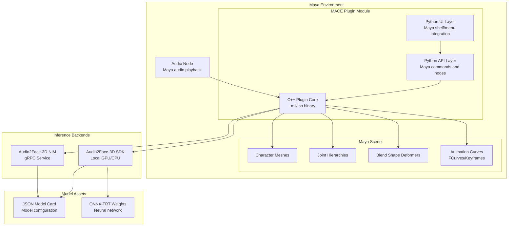
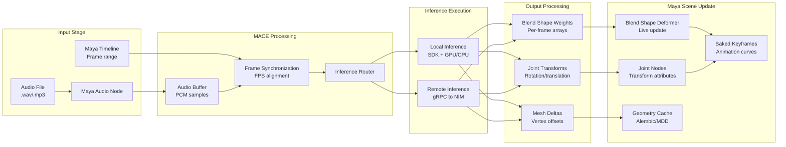
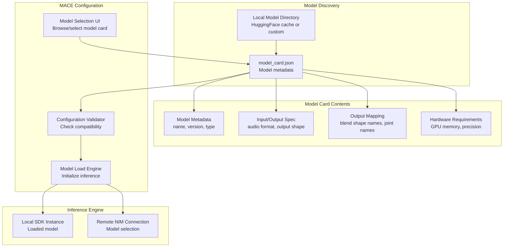
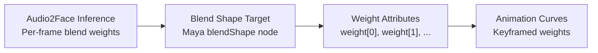
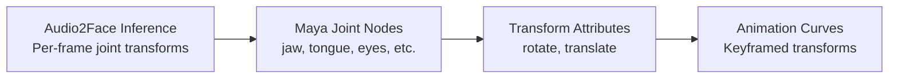
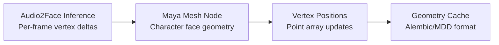
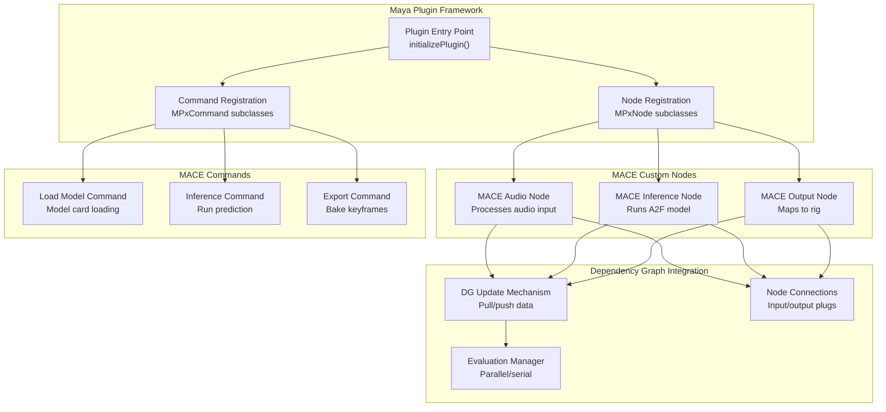
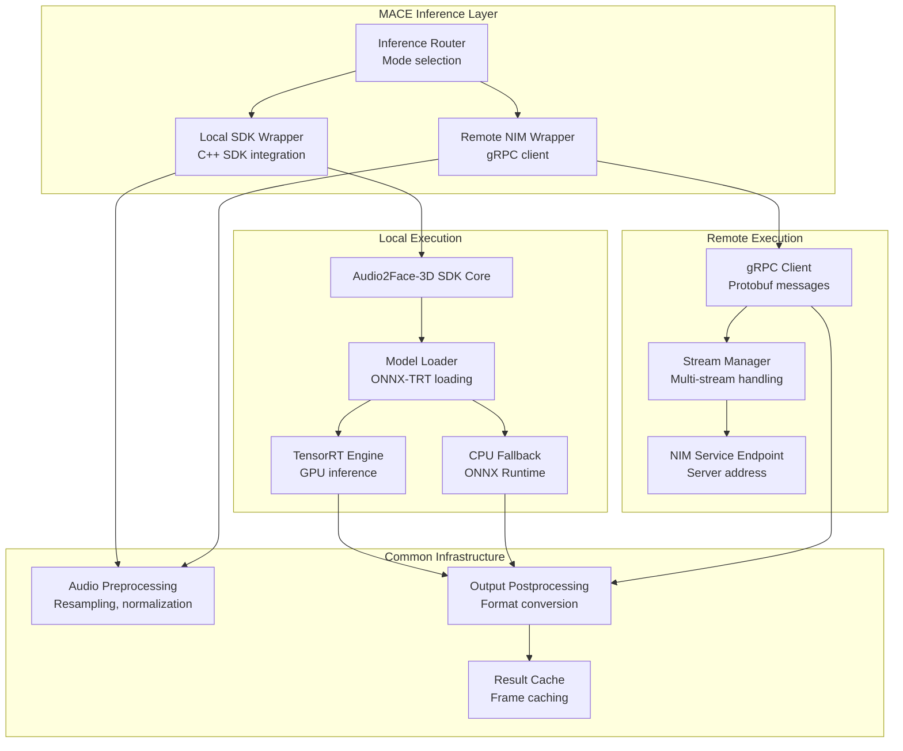

<!-- source: DeepWiki mcp.deepwiki.com · repo NVIDIA/Audio2Face-3D · page 3.2 Maya ACE Plugin · fetched 2026-10-26 -->

# Maya ACE Plugin

<details>
<summary>Relevant source files</summary>

The following files were used as context for generating this wiki page:

- [README.md](README.md)
- [RELEASE.md](RELEASE.md)
- [media/Mace_banner.png](media/Mace_banner.png)

</details>


## Purpose and Scope

This document covers the Maya ACE Plugin (MACE), an Autodesk Maya integration for the Audio2Face-3D system. MACE provides an artist-friendly interface for generating facial animation from audio directly within the Maya environment, supporting both local and remote inference modes.

For information about the underlying C++ SDK that powers MACE's local inference capabilities, see [C++ SDK](#3.1). For details about the remote inference service that MACE can connect to, see [NIM Microservice](#6.1). For information about the pre-trained models that MACE can load, see [Audio2Face-3D Models](#5.1) and [Audio2Emotion Models](#5.2).

**Sources:** [README.md:152-178]()

---

## Overview

Maya ACE (MACE) is a comprehensive plugin that integrates Audio2Face-3D functionality directly into Autodesk Maya's authoring environment. The plugin is distributed as a Maya module containing both C++ compiled components (`.mll` on Windows, `.so` on Linux) and Python scripts that provide the user interface and Maya scene integration.

The plugin allows animators to:
- Generate real-time facial animation from audio files or streams
- Preview animation directly in the Maya viewport
- Export to Maya keyframes or FBX format
- Switch between local GPU-accelerated inference and remote microservice inference
- Load any compatible Audio2Face-3D model via JSON model cards

MACE is version 2.0 and is released under the MIT license. The source code and installation packages are available in the Maya-ACE GitHub repository.

**Sources:** [README.md:48-52](), [README.md:152-178]()

---

## Plugin Architecture

The following diagram illustrates the high-level architecture of the Maya ACE plugin and its relationship to the Maya environment and Audio2Face-3D inference engines:



**Plugin Architecture Diagram**: This diagram shows the layered structure of MACE within Maya. The Python UI layer provides shelf buttons and menu items. The Python API layer wraps Maya commands and custom nodes. The C++ core handles performance-critical operations and communicates with either the local SDK or remote NIM service. The plugin writes animation data to Maya scene entities (meshes, joints, blend shapes) and can bake results to animation curves.

**Sources:** [README.md:48-52](), [README.md:160-171]()

---

## Component Breakdown

The Maya ACE plugin consists of several key components:

### C++ Plugin Binary

The compiled binary (`.mll` on Windows, `.so` on Linux/macOS) contains:
- Maya API node implementations (likely extending `MPxNode` for custom dependency graph nodes)
- Maya command implementations (likely extending `MPxCommand` for UI operations)
- Audio2Face-3D SDK integration for local inference
- gRPC client implementation for remote inference
- Audio processing and synchronization logic

### Python Integration Layer

Python scripts provide:
- User interface components integrated into Maya's shelf and menus
- High-level commands for model loading and inference configuration
- Scene setup utilities for character rigging integration
- Export utilities for keyframe baking and FBX output
- Sample scripts demonstrating API usage and pipeline integration

### Model Configuration System

The plugin uses JSON model cards to:
- Specify model metadata (version, capabilities, output format)
- Define required input parameters and preprocessing
- Configure blend shape mappings or joint transformations
- Specify hardware requirements and optimization settings

**Sources:** [README.md:50-52](), [README.md:162-171]()

---

## Data Flow and Inference Pipeline

The following diagram illustrates the complete data flow from audio input through inference to final animation output:



**Inference Pipeline Diagram**: This shows the complete data flow from audio input to final animation. Audio is loaded from file and synchronized with Maya's timeline. The inference router directs processing to either local SDK or remote NIM. Results are generated as blend shape weights, joint transforms, or mesh deltas, which update Maya scene entities. Finally, the live animation can be baked to keyframes for export.

**Sources:** [README.md:6-11](), [README.md:166-169]()

---

## Inference Modes

MACE supports two distinct inference modes that can be selected based on deployment requirements:

### Local Inference Mode

In local mode, the plugin uses the Audio2Face-3D SDK directly on the artist's workstation:

| Aspect | Details |
|--------|---------|
| **Execution** | Audio2Face-3D SDK loaded in Maya process |
| **Hardware** | Uses local GPU (TensorRT) or CPU fallback |
| **Models** | Loaded from local disk using model card path |
| **Latency** | Minimal latency, real-time preview |
| **Use Case** | Single-user workstations, offline authoring |
| **Requirements** | NVIDIA GPU recommended, sufficient VRAM |

### Remote Inference Mode

In remote mode, the plugin connects to an Audio2Face-3D NIM microservice:

| Aspect | Details |
|--------|---------|
| **Execution** | gRPC client connects to remote NIM server |
| **Hardware** | Server-side GPU, client can be lightweight |
| **Models** | Managed on NIM server, hot-swappable |
| **Latency** | Network-dependent, suitable for preview |
| **Use Case** | Multi-user studios, cloud workflows, resource sharing |
| **Requirements** | Network access to NIM service endpoint |

The inference mode can be switched in the MACE UI without restarting Maya, allowing artists to choose based on current workflow needs.

**Sources:** [README.md:167](), [README.md:176-177]()

---

## Model Loading and Configuration



**Model Loading Architecture**: This diagram shows how MACE discovers and loads models. Models are stored locally with JSON model cards that specify metadata, I/O formats, output mappings, and hardware requirements. The UI allows selection of model cards, which are validated for compatibility before loading into either the local SDK or selecting on the remote NIM service.

**Sources:** [README.md:162](), [README.md:168]()

---

## Output Formats and Export Options

MACE supports three primary output formats, each suitable for different rigging approaches:

### 1. Blend Shape Weights



- **Format**: Array of float values per frame, one per blend shape target
- **Maya Integration**: Connects to `blendShape` node weight attributes
- **Export**: Keyframes on weight attributes, compatible with FBX export
- **Use Case**: Standard blend shape facial rigs, MetaHuman-compatible

### 2. Joint Transformations



- **Format**: Rotation and translation values per joint per frame
- **Maya Integration**: Connects to joint node `rotate` and `translate` attributes
- **Export**: Standard Maya animation, universally compatible
- **Use Case**: Joint-driven facial rigs, game engine export

### 3. Direct Mesh Deformations



- **Format**: Vertex position deltas per frame
- **Maya Integration**: Direct mesh deformation via custom deformer
- **Export**: Geometry cache (Alembic, MDD) for high-fidelity playback
- **Use Case**: Highest-quality output, VFX workflows, no rig required

**Sources:** [README.md:6-11](), [README.md:162](), [README.md:169]()

---

## Export Capabilities

MACE provides production-ready export options:

### Maya Keyframe Export

- **Format**: Native Maya animation curves (FCurves)
- **Process**: Bakes real-time preview to keyframes on target attributes
- **Sampling**: User-configurable frame rate and keyframe density
- **Filtering**: Optional curve smoothing and keyframe reduction
- **Compatibility**: Works with all Maya animation tools and workflows

### FBX Export

- **Format**: FBX file with embedded animation
- **Contents**: Character geometry, rig, and baked animation
- **Use Cases**: Export to game engines, other DCC applications
- **Options**: Configurable FBX version and export settings
- **Integration**: Uses Maya's native FBX export with MACE presets

**Sources:** [README.md:169]()

---

## User Interface Components

The MACE user interface is fully integrated into Maya's native UI framework:

### Main Control Panel

The primary interface provides:
- **Audio Source Selection**: Browse and load audio files
- **Model Selection**: Browse and load model cards from local or remote sources
- **Inference Mode Toggle**: Switch between local SDK and remote NIM
- **Playback Controls**: Real-time preview with Maya timeline sync
- **Export Options**: Keyframe baking and FBX export configuration

### Maya Shelf Integration

MACE adds a custom shelf with quick-access buttons for:
- Opening the main MACE panel
- Loading last-used model
- Quick export to keyframes
- Sample scene setup utilities

### Menu Integration

MACE extends Maya's menu bar with:
- Model management commands
- Configuration presets
- Pipeline integration utilities
- Help and documentation links

### Node Editor Integration

MACE nodes are visible and editable in Maya's Node Editor, allowing technical users to:
- Inspect node connections and data flow
- Create custom node graphs
- Debug inference and output mapping
- Extend functionality with MEL/Python scripting

**Sources:** [README.md:154-155](), [README.md:162](), [README.md:170]()

---

## Pipeline Integration and Scripting

MACE is designed to integrate into studio pipelines through its scriptable API:

### Python API

The plugin exposes Python commands that can be called from scripts or pipeline tools:

```python
# Pseudocode example based on typical Maya plugin patterns
import maya.cmds as cmds

# Load a model card
cmds.maceLoadModel(modelCard="/path/to/model_card.json")

# Configure inference mode
cmds.maceSetInferenceMode(mode="local")  # or "remote"

# Set audio source
cmds.maceSetAudio(audioFile="/path/to/audio.wav")

# Run inference and bake to keyframes
cmds.maceGenerateAnimation(startFrame=1, endFrame=100, bake=True)
```

### Batch Processing

For automated pipeline workflows, MACE supports:
- Headless Maya execution with MACE commands
- Configuration files for inference settings
- Batch export of multiple audio files to animation
- Integration with render farm or compute cluster workflows

### Custom Node Creation

Technical artists can extend MACE by:
- Accessing MACE nodes in the dependency graph
- Creating custom deformers that read MACE output
- Building higher-level tools on top of the MACE API
- Integrating with proprietary rig systems

**Sources:** [README.md:156](), [README.md:162](), [README.md:175-177]()

---

## Configuration Files for Production

MACE can generate and consume configuration files for advanced workflows:

### Inference Configuration Files

These files specify:
- Model card path and version
- Inference mode (local/remote)
- Remote NIM endpoint (if using remote mode)
- Audio preprocessing settings
- Output mapping configuration

### Use in Batch Pipelines

Configuration files enable:
- Consistent settings across multiple artists
- Version-controlled inference parameters
- Automated batch processing without UI
- Integration with Audio2Face-3D NIM deployments

### Use in NIM Deployments

Studios can:
- Create standardized configurations for NIM services
- Deploy consistent models and settings to cloud infrastructure
- Share configurations between MACE and other Audio2Face-3D tools
- Maintain configuration libraries for different characters/languages

**Sources:** [README.md:177]()

---

## Installation and Setup

The Maya ACE plugin is distributed as a Maya module:

### Installation Process

1. **Download**: Obtain the plugin package from the Maya-ACE GitHub repository
2. **Extract**: Unpack the module to a local directory
3. **Configure Module Path**: Add the module directory to Maya's `MAYA_MODULE_PATH`
4. **Load Plugin**: Maya automatically discovers and loads the plugin on startup
5. **Verify**: Check for MACE shelf and menu items in Maya UI

### System Requirements

| Component | Requirement |
|-----------|-------------|
| **Operating System** | Windows, Linux (Maya supported platforms) |
| **Maya Version** | Compatible with Maya 2020+ (verify specific versions in repository) |
| **GPU (Local Mode)** | NVIDIA GPU with CUDA support, sufficient VRAM for models |
| **CPU (Fallback)** | Multi-core CPU for CPU-based inference |
| **Storage** | Space for plugin binaries and model files |
| **Network (Remote Mode)** | Network access to Audio2Face-3D NIM service |

### Model Setup

After installation, users need to:
1. Download pre-trained models from Hugging Face or train custom models
2. Place model files in an accessible directory
3. Load model cards through the MACE UI
4. Verify model compatibility with target character rig

**Sources:** [README.md:48-52](), [README.md:158]()

---

## Use Cases and Workflows

### 3D Animators: Rapid Animation Authoring

**Workflow:**
1. Load character rig in Maya scene
2. Import audio dialogue file
3. Select appropriate Audio2Face-3D model
4. Generate real-time preview of facial animation
5. Iterate on performance by adjusting audio or model
6. Bake final animation to keyframes
7. Refine with traditional animation tools
8. Export to production pipeline

**Benefits:** Dramatically reduces time spent on lip-sync, allows focus on performance and emotion rather than technical precision.

### Technical Artists: Pipeline Integration

**Workflow:**
1. Test inference configurations with different models
2. Create standardized configuration files for production
3. Develop custom scripts integrating MACE with studio tools
4. Set up batch processing for multiple sequences
5. Integrate with remote NIM infrastructure for scalability
6. Create presets and templates for common character types

**Benefits:** Establishes repeatable, scalable workflow for entire studio; reduces technical barriers for animators.

### Directors & Supervisors: Real-time Review

**Workflow:**
1. Load temp audio or ADR recordings
2. Generate quick facial animation for previs
3. Review performance in real-time during recording sessions
4. Iterate on dialogue timing and delivery
5. Provide immediate feedback to voice actors
6. Export previs animation for editorial

**Benefits:** Enables rapid iteration on performance during production; bridges gap between audio recording and final animation.

### Animation Pipeline: Batch Processing

**Workflow:**
1. Create configuration files for inference settings
2. Set up automated batch processing scripts
3. Process multiple audio files in parallel
4. Deploy to render farm or compute cluster
5. Connect to centralized NIM service for GPU sharing
6. Integrate with asset management and version control

**Benefits:** Scales facial animation production for large-scale projects; leverages centralized GPU resources efficiently.

**Sources:** [README.md:172-177]()

---

## Integration with Other Audio2Face-3D Components

MACE integrates with the broader Audio2Face-3D ecosystem:

### Audio2Face-3D SDK

- MACE uses the SDK for local inference mode
- Shares model format and configuration with SDK
- Can load any model compatible with SDK
- Benefits from SDK performance optimizations

### Audio2Face-3D NIM

- MACE can connect to NIM microservice for remote inference
- Uses same gRPC protocol as other NIM clients
- Shares configuration file format with NIM deployments
- Enables hybrid workflows (local development, remote production)

### Pre-trained Models

- Loads Audio2Face-3D v2.3 regression models (Mark, Claire, James)
- Supports Audio2Face-3D v3.0 diffusion models
- Compatible with Audio2Emotion models for emotional expression
- Can load custom-trained models from Training Framework

### Training Framework

- Custom models trained with Training Framework work with MACE
- Model card format is standardized across ecosystem
- Enables character-specific or language-specific model development
- Training output directly compatible with MACE loading system

**Sources:** [README.md:162](), [README.md:167-168](), [README.md:176-177]()

---

## Technical Architecture Deep Dive

### Maya Plugin System Integration

MACE likely implements the following Maya API patterns:



**Maya Plugin Integration**: This diagram shows how MACE integrates with Maya's plugin system. The plugin registers custom nodes (likely extending MPxNode) and commands (likely extending MPxCommand) through the plugin entry point. Custom nodes participate in Maya's dependency graph evaluation, pulling data from inputs and pushing to outputs. The evaluation manager handles update scheduling.

### Inference Engine Architecture



**Inference Engine Architecture**: This shows the dual-path inference system. The router selects between local and remote modes. Local mode integrates the SDK with TensorRT for GPU inference or ONNX Runtime for CPU fallback. Remote mode uses gRPC to communicate with NIM. Both paths share audio preprocessing and output postprocessing infrastructure. Results are cached for efficient playback.

**Sources:** [README.md:115-122](), [README.md:167](), [README.md:211-227]()

---

## Performance Considerations

### Local Inference Performance

| Factor | Impact | Mitigation |
|--------|--------|------------|
| **GPU Memory** | Large models may exceed VRAM | Use smaller models or CPU fallback |
| **Model Load Time** | Initial load can take seconds | Pre-load models at scene startup |
| **Frame Rate** | Real-time preview requires fast inference | Use TensorRT optimization, lower preview quality |
| **Audio Buffer Size** | Larger buffers increase latency | Tune buffer size for latency vs stability |

### Remote Inference Performance

| Factor | Impact | Mitigation |
|--------|--------|------------|
| **Network Latency** | Round-trip time affects preview | Use local network, increase buffer size |
| **Server Load** | Multiple users compete for resources | Scale NIM instances, queue management |
| **Data Transfer** | Audio/animation data bandwidth | Compress data, batch frames |
| **Connection Stability** | Network issues interrupt workflow | Implement reconnection logic, fallback to local |

### Maya Scene Performance

| Factor | Impact | Mitigation |
|--------|--------|------------|
| **Node Graph Complexity** | Deep graphs slow evaluation | Optimize node connections, reduce dependencies |
| **Keyframe Density** | Many keyframes slow playback | Use keyframe reduction, preview mode |
| **Character Complexity** | High-poly meshes slow deformation | Use proxy geometry for preview |
| **Multiple Characters** | Parallel inference on multiple rigs | Batch processing, stagger evaluation |

**Sources:** [README.md:120-121](), [README.md:167](), [README.md:223-227]()

---

## Troubleshooting and Best Practices

### Model Compatibility

**Issue**: Model fails to load or produces incorrect output

**Solutions**:
- Verify model card version matches MACE version
- Check model output format matches character rig (blend shapes vs joints)
- Ensure GPU has sufficient memory for model
- Test with known-good models (Mark, Claire, James) first

### Inference Failures

**Issue**: Inference crashes or produces no output

**Solutions**:
- Check Maya script editor for error messages
- Verify audio file format is supported (WAV, MP3)
- Ensure character rig is properly selected/connected
- Try CPU fallback if GPU inference fails
- Check remote NIM service is reachable and responsive

### Export Issues

**Issue**: Exported animation is incorrect or incomplete

**Solutions**:
- Verify frame range covers entire audio duration
- Check keyframe baking settings (sample rate, filtering)
- Ensure target attributes are not locked or connected
- Test FBX export settings for target application compatibility

### Performance Optimization

**Best Practices**:
- Pre-load models at session start to avoid delays
- Use proxy geometry for real-time preview
- Process long sequences in batches
- Cache results for repeated playback
- Use remote NIM for GPU-constrained workstations
- Optimize character rigs for evaluation performance

**Sources:** [README.md:162-171](), [README.md:176-177]()

---

## Summary

Maya ACE Plugin (MACE) provides a comprehensive integration of Audio2Face-3D technology into the Autodesk Maya environment. The plugin combines:

- **Artist-Friendly Interface**: Fully integrated Maya UI requiring no coding for standard workflows
- **Flexible Deployment**: Local GPU/CPU inference or remote NIM microservice connection
- **Universal Model Support**: Loads any compatible Audio2Face-3D model via JSON model cards
- **Multiple Output Formats**: Blend shapes, joint transforms, or direct mesh deformation
- **Production-Ready Export**: Native Maya keyframes and FBX export for pipeline integration
- **Scriptable API**: Python commands for pipeline automation and batch processing
- **High Performance**: Real-time preview with optimized inference and GPU acceleration

MACE serves animators, technical directors, and pipeline engineers by bridging the gap between audio dialogue and high-fidelity facial animation within their existing Maya workflows.

**Sources:** [README.md:152-178]()

---

