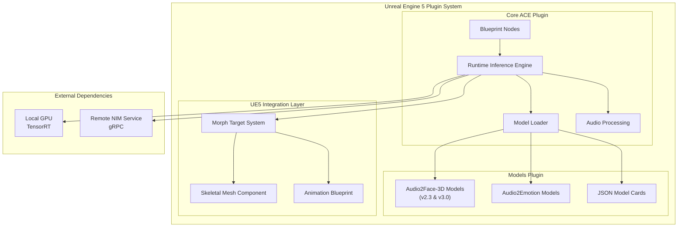
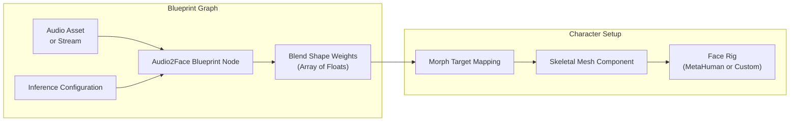
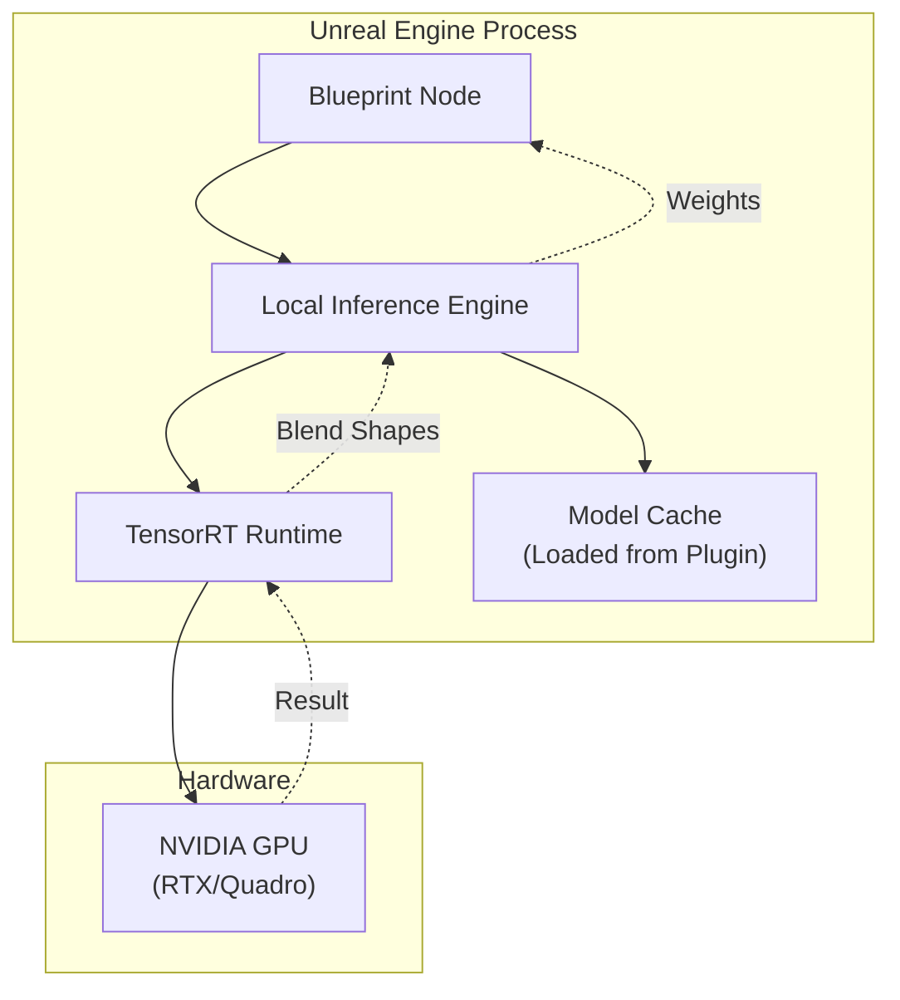
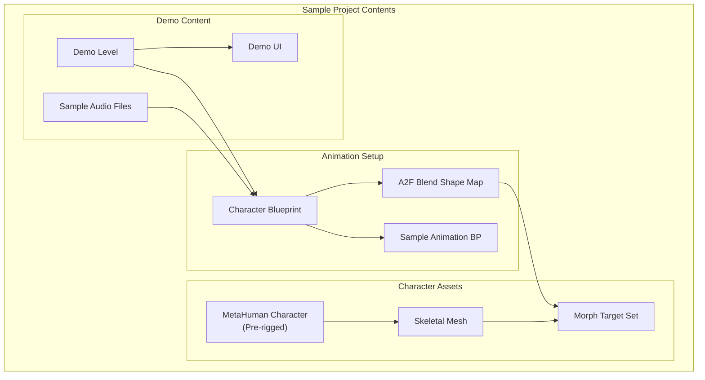
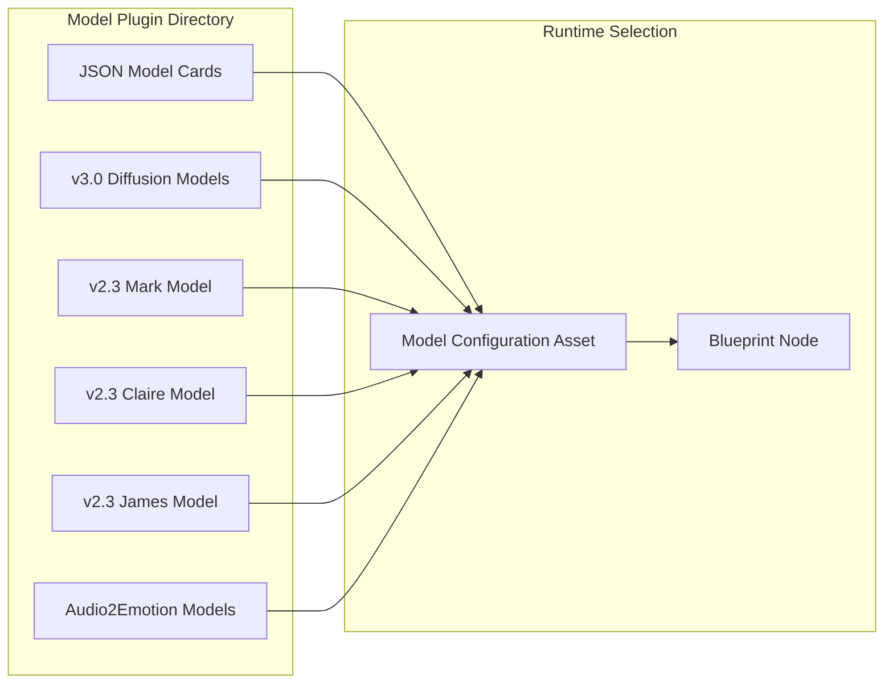
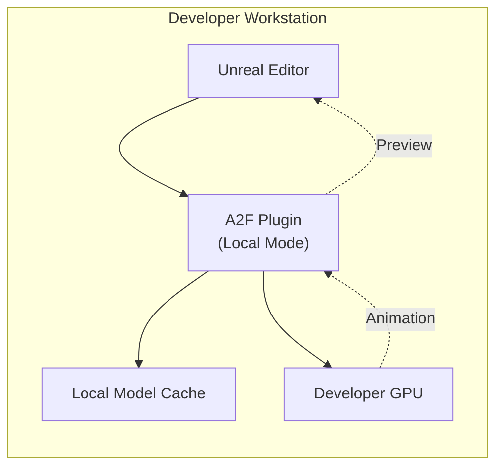
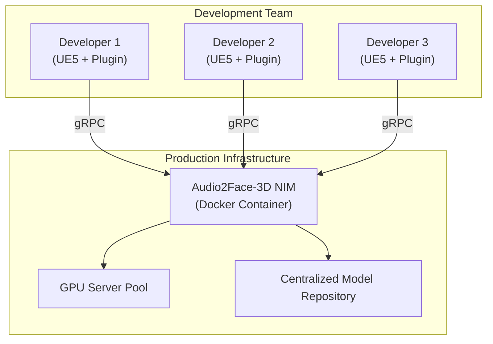

<!-- source: DeepWiki mcp.deepwiki.com · repo NVIDIA/Audio2Face-3D · page 3.3 Unreal Engine 5 Plugin · fetched 2026-10-26 -->

# Unreal Engine 5 Plugin

<details>
<summary>Relevant source files</summary>

The following files were used as context for generating this wiki page:

- [README.md](README.md)

</details>


This document covers the Audio2Face-3D plugin for Unreal Engine 5, which provides real-time AI-driven facial animation directly within Unreal Engine game development and virtual production workflows. The plugin integrates with UE5 through Blueprint nodes and supports both local and remote inference modes.

For information about the C++ SDK that underlies this plugin's inference capabilities, see [C++ SDK](#3.1). For details on deploying remote inference services that this plugin can connect to, see [NIM Microservice](#6.1). For information about the pre-trained models used by this plugin, see [Audio2Face-3D Models](#5.1) and [Audio2Emotion Models](#5.2).

**Sources:** [README.md:179-210]()

## Overview

The Unreal Engine 5 Plugin enables game developers and virtual production artists to generate facial animation from audio sources directly within the Unreal Editor. The plugin exposes Audio2Face-3D functionality through Blueprint nodes, eliminating the need for C++ programming for standard use cases. It is distributed as two separate components: the core ACE Unreal plugin and the Audio2Face-3D Models plugin.

The plugin supports Unreal Engine versions 5.4, 5.5, and 5.6, with version-specific builds provided for each. A comprehensive sample project demonstrates complete integration with Epic Games' MetaHuman characters, including pre-configured blend shape mappings.

**Sources:** [README.md:179-196]()

## Plugin Architecture

### Component Structure



**Diagram: UE5 Plugin Component Architecture**

The plugin is organized into two installation packages. The Core ACE Plugin contains the Blueprint interface, runtime inference engine, model loading subsystem, and audio processing pipeline. The Models Plugin provides the pre-trained Audio2Face-3D and Audio2Emotion models along with their JSON model cards. The runtime inference engine can execute locally using TensorRT on NVIDIA GPUs or connect to a remote NIM service via gRPC. Output is delivered through the Unreal Engine morph target system, which drives skeletal mesh deformations and integrates with Animation Blueprints.

**Sources:** [README.md:179-196](), [README.md:200-204]()

## Installation Components

The plugin requires two separate installations:

| Component | Version | UE Compatibility | Purpose |
|-----------|---------|------------------|---------|
| ACE Unreal Plugin | v2.5.0rc3 | UE 5.5, 5.6 | Core inference engine and Blueprint nodes |
| ACE Unreal Plugin | v2.4.0 | UE 5.4 | Core inference engine and Blueprint nodes |
| Audio2Face-3D 3.0 Models Plugin | - | All versions | Diffusion-based A2F models |
| Audio2Face-3D 2.3 Models Plugin | - | All versions | Regression-based A2F models (Mark, Claire, James) |
| Unreal Sample Project | v1.0.0 | UE 5.x | MetaHuman integration example |

The ACE Unreal Plugin provides the runtime infrastructure, while the Models Plugin contains the neural network weights. Both must be installed for the plugin to function.

**Sources:** [README.md:183-190]()

## Blueprint Integration

### Animation Data Flow



**Diagram: Blueprint Node Data Flow**

The plugin exposes Audio2Face-3D functionality through Blueprint nodes that accept audio input (either from audio assets or real-time streams) and inference configuration parameters. The nodes output an array of blend shape weights corresponding to facial animation targets. These weights are mapped to the character's skeletal mesh morph targets through a configuration that defines which blend shape drives which morph target. The sample project includes a complete mapping for MetaHuman characters.

**Sources:** [README.md:200-204]()

### Blueprint Node Interface

The Audio2Face Blueprint nodes provide an artist-friendly interface that requires no C++ coding. Standard Blueprint operations include:

- **Audio Source Selection**: Connect audio assets or live audio streams to the inference node
- **Model Selection**: Choose between Audio2Face-3D models (v2.3 regression or v3.0 diffusion) and Audio2Emotion models
- **Inference Mode Configuration**: Toggle between local GPU execution and remote NIM service
- **Output Mapping**: Configure blend shape to morph target mappings for specific character rigs
- **Real-Time Preview**: View animation results directly in the UE5 viewport during playback

**Sources:** [README.md:200-202]()

## Inference Modes

The plugin supports two distinct inference execution patterns, allowing developers to choose between local processing and remote service architecture.

### Local Inference Mode



**Diagram: Local Inference Execution Path**

In local inference mode, the plugin loads models directly from the installed Models Plugin and executes inference on the local machine's NVIDIA GPU using TensorRT. This mode provides the lowest latency and does not require network connectivity, making it ideal for standalone development workstations and offline workflows.

**Sources:** [README.md:202]()

### Remote Inference Mode

```mermaid
graph TB
    subgraph "Unreal Engine Client"
        BP_Remote["Blueprint Node"]
        gRPCClient["gRPC Client"]
        AudioBuffer["Audio Buffer"]
    end
    
    subgraph "Network"
        Network["gRPC Protocol<br/>(TCP/IP)"]
    end
    
    subgraph "NIM Service (Remote Server)"
        NIMServer["Audio2Face-3D NIM"]
        ServerGPU["Server GPU Pool"]
        ServerModels["Centralized Models"]
    end
    
    BP_Remote --> AudioBuffer
    AudioBuffer --> gRPCClient
    gRPCClient --> Network
    Network --> NIMServer
    
    NIMServer --> ServerModels
    NIMServer --> ServerGPU
    
    ServerGPU -.Inference.-> NIMServer
    NIMServer -.Blend Shapes.-> Network
    Network -.Weights.-> gRPCClient
    gRPCClient -.Result.-> BP_Remote
```

**Diagram: Remote Inference via NIM Service**

Remote inference mode connects to an Audio2Face-3D NIM microservice running on a separate server. The plugin sends audio data over the network using the gRPC protocol and receives blend shape weights in response. This architecture enables teams to centralize GPU resources, support less powerful client machines, and maintain consistent model versions across multiple users. For deployment information, see [NIM Microservice](#6.1).

**Sources:** [README.md:202](), [README.md:216-227]()

## MetaHuman Integration

The plugin provides native support for Epic Games' MetaHuman characters through pre-configured blend shape mappings. The sample project demonstrates a complete rigging setup that maps Audio2Face-3D output to MetaHuman facial controls.

### MetaHuman Blend Shape Mapping

MetaHuman characters expose a standardized set of facial morph targets that control mouth, jaw, tongue, and eye movements. The plugin sample project includes a mapping configuration that translates Audio2Face-3D blend shape outputs to the corresponding MetaHuman morph targets:

- **Jaw and Mouth Controls**: Mouth open/close, lip corner movements, lip pucker/stretch
- **Tongue Controls**: Tongue position and articulation for phoneme accuracy
- **Eye Controls**: Blink, squint, and eye direction (integrated with emotional expression)
- **Subtle Deformations**: Cheek, nose, and skin tension for realistic secondary motion

The mapping is configurable, allowing technical artists to adjust or create custom mappings for modified MetaHuman characters or entirely custom facial rigs.

**Sources:** [README.md:203-204]()

## Sample Project Structure

The Unreal Sample Project provides a reference implementation demonstrating complete integration of the Audio2Face-3D plugin with a MetaHuman character.

### Sample Project Components



**Diagram: Sample Project Asset Organization**

The sample project includes a pre-configured MetaHuman character with skeletal mesh and morph targets, a Character Blueprint demonstrating Audio2Face-3D node usage, blend shape mapping configuration files, sample audio files for testing, and a demo level with UI controls for switching between inference modes and models.

**Sources:** [README.md:190](), [README.md:203-204]()

## Model Management

### Model Loading and Selection

The plugin accesses models installed via the Audio2Face-3D Models Plugin. Models are identified by their JSON model cards, which specify the model's capabilities, required input format, and output blend shape structure.



**Diagram: Model Selection System**

Models are selected at runtime through configuration assets that reference the desired model's JSON card. The plugin supports hot-swapping between models without restarting the editor, allowing artists to compare different models' output on the same audio input. Both Audio2Face-3D models (for lip-sync) and Audio2Emotion models (for emotional expression) can be loaded and used in combination.

**Sources:** [README.md:183-189]()

### Supported Model Versions

| Model Type | Version | Architecture | Use Case |
|------------|---------|--------------|----------|
| Audio2Face-3D | v3.0 | Diffusion-based | Highest quality, slower inference |
| Audio2Face-3D | v2.3 (Mark) | Regression-based | Fast inference, male character |
| Audio2Face-3D | v2.3 (Claire) | Regression-based | Fast inference, female character |
| Audio2Face-3D | v2.3 (James) | Regression-based | Fast inference, neutral character |
| Audio2Emotion | v2.2 | Production model | Emotional state inference |
| Audio2Emotion | v3.0 | Experimental | Enhanced emotion detection |

The regression-based v2.3 models provide faster inference suitable for real-time applications, while the diffusion-based v3.0 model offers higher quality output at the cost of increased latency. For detailed model specifications, see [Audio2Face-3D Models](#5.1) and [Audio2Emotion Models](#5.2).

**Sources:** [README.md:183-189](), [README.md:82-98]()

## Deployment Patterns

### Development Workflow

During development, the plugin typically operates in local inference mode, allowing individual developers to iterate rapidly without network dependencies:



**Diagram: Development Deployment Pattern**

**Sources:** [README.md:202]()

### Production Deployment

For production builds and distributed teams, the plugin can connect to a centralized NIM service:



**Diagram: Production Team Deployment Pattern**

This architecture centralizes GPU resources and ensures all team members use consistent model versions. It also enables deployment scenarios where game clients connect to a backend service for facial animation generation. For detailed deployment guidance, see [Deployment Patterns](#6.2).

**Sources:** [README.md:202](), [README.md:216-234]()

## Extensibility

The plugin's full C++ source code is available for developers who need to extend or customize its functionality. Common customization scenarios include:

- **Custom Blend Shape Mappings**: Implementing specialized mappings for non-standard character rigs
- **Custom Audio Processing**: Integrating external audio analysis or preprocessing pipelines
- **Performance Optimization**: Tailoring inference execution for specific hardware configurations
- **Integration with Custom Animation Systems**: Extending the plugin to work with proprietary animation tools
- **Multi-Character Support**: Modifying the plugin to drive multiple characters simultaneously

Developers modifying the plugin source code should follow standard Unreal Engine plugin development practices and ensure compatibility with the target UE5 version.

**Sources:** [README.md:204-205]()

## Use Cases

The Unreal Engine 5 Plugin is designed for two primary application domains:

### Game Development

Game developers use the plugin to create dynamic, audio-driven facial animation for non-player characters (NPCs) and player characters. The Blueprint integration allows designers and artists to set up facial animation without programming, while the local inference mode ensures low latency suitable for interactive gameplay. The MetaHuman integration provides immediate compatibility with Epic's character creation ecosystem.

### Virtual Production and Cinematics

Virtual production teams and cinematic artists use the plugin for rapid generation of facial performances during real-time filmmaking and previsualization workflows. The ability to preview animation directly in the Unreal Editor viewport accelerates iteration cycles, while remote inference mode allows integration with studio-wide animation services. The sample project demonstrates complete production-ready setups.

**Sources:** [README.md:206-210]()

---

