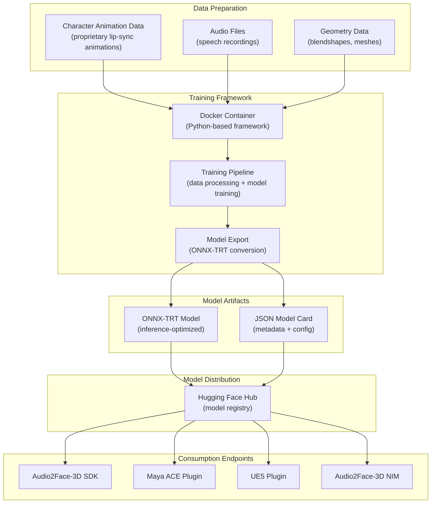
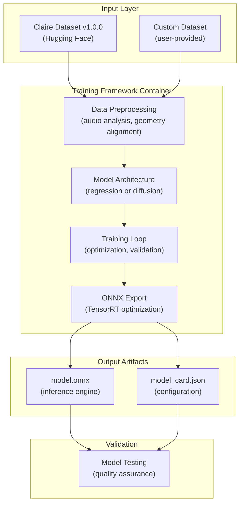
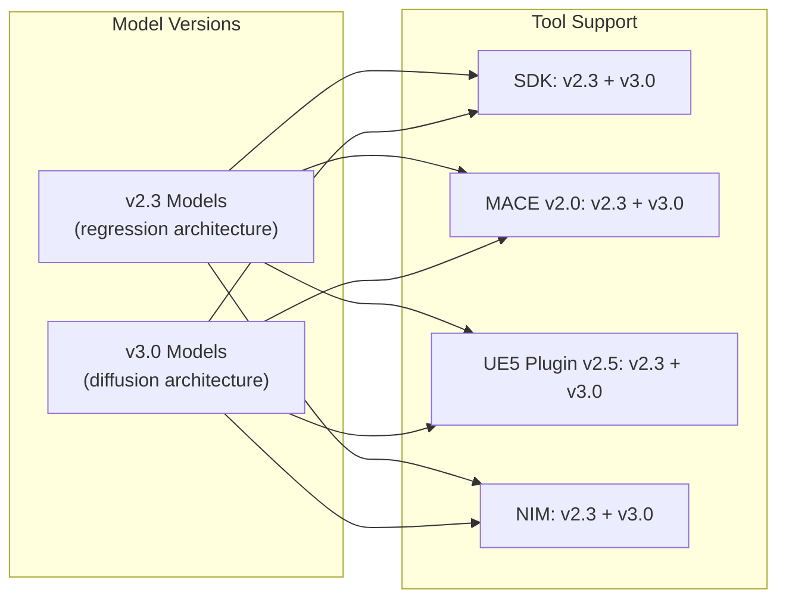

<!-- source: DeepWiki mcp.deepwiki.com · repo NVIDIA/Audio2Face-3D · page 4 Model Training · fetched 2026-10-26 -->

# Model Training

<details>
<summary>Relevant source files</summary>

The following files were used as context for generating this wiki page:

- [README.md](README.md)

</details>


## Purpose and Scope

This page provides an introduction to creating custom Audio2Face-3D models using proprietary datasets and character-specific animation data. Custom model training enables developers and studios to generate facial animation models that capture unique character personalities, performance styles, or support specific languages beyond the capabilities of pre-trained models.

For detailed information about:
- The Training Framework setup and workflows, see [Training Framework](#4.1)
- Dataset preparation and format specifications, see [Training Datasets](#4.2)
- Available pre-trained models and their capabilities, see [Pre-trained Models](#5)

**Sources:** [README.md:129-151]()

---

## Why Train Custom Models

Audio2Face-3D provides pre-trained models (Mark, Claire, James) that work well for general English-language facial animation. However, custom training becomes necessary when you need:

| Requirement | Pre-trained Models | Custom Trained Models |
|-------------|-------------------|----------------------|
| **Character Personality** | Generic performance style | Character-specific mannerisms and expressions |
| **Language Support** | English only | Any language or multi-language support |
| **Performance Style** | Standard conversational speech | Specific acting styles (theatrical, whispered, etc.) |
| **Production Control** | Fixed model behavior | Full control over training data and output quality |
| **Research Applications** | Limited customization | Complete flexibility for experimentation |

Custom model training uses the same framework that NVIDIA employed to create the official Mark, Claire, and James models. This ensures production-grade quality and compatibility with all Audio2Face-3D integration tools.

**Sources:** [README.md:135-150]()

---

## Training Ecosystem Overview

The following diagram illustrates how model training fits within the broader Audio2Face-3D ecosystem:



**Training Workflow Stages:**

1. **Data Preparation:** Character-specific animation data, audio recordings, and geometry information are collected and formatted
2. **Training Framework:** The Docker-based training environment processes the data and trains the neural network
3. **Model Export:** Trained models are converted to ONNX-TRT format with accompanying JSON model cards
4. **Distribution:** Models are published to Hugging Face Hub for version control and distribution
5. **Consumption:** All Audio2Face-3D tools can load custom-trained models using the JSON model card specification

**Sources:** [README.md:17-21](), [README.md:129-144](), [README.md:71-107]()

---

## Training Framework Architecture



The Training Framework is distributed as a Docker container to ensure consistent Python environments and dependencies across different development systems. This containerized approach eliminates common environment setup issues and provides reproducible training results.

**Key Components:**

- **Data Preprocessing:** Converts raw audio files and animation data into the format required by the neural network
- **Model Architecture:** Supports both regression-based (v2.3) and diffusion-based (v3.0) architectures
- **Training Loop:** Executes the iterative optimization process with validation checkpoints
- **ONNX Export:** Converts the trained PyTorch model to ONNX-TRT format for optimized inference across all platforms

**Sources:** [README.md:129-151](), [README.md:100-105]()

---

## Model Artifact Specifications

After training completes, two critical artifacts are produced:

### ONNX-TRT Model File

The trained neural network in ONNX format with TensorRT optimizations. This file contains:
- Network architecture (layer definitions, weights, biases)
- TensorRT-specific optimizations for GPU inference
- Input/output tensor specifications

File format: `.onnx` extension, binary serialization
Compatibility: All Audio2Face-3D tools (SDK, MACE, UE5, NIM)

### JSON Model Card

A metadata file that describes the model's capabilities and configuration:

```json
{
  "model_version": "1.0.0",
  "architecture": "regression",
  "language_support": ["en-US"],
  "input_sample_rate": 16000,
  "output_format": "blendshapes",
  "training_data": "custom_character",
  "inference_requirements": {
    "min_gpu_memory": "4GB",
    "tensorrt_version": "8.6"
  }
}
```

The JSON model card enables integration tools to:
- Verify model compatibility before loading
- Display model metadata to users
- Configure inference parameters automatically
- Validate hardware requirements

**Sources:** [README.md:144](), [README.md:82-89](), [README.md:162]()

---

## Training to Deployment Pipeline

```mermaid
flowchart LR
    subgraph "Development"
        RecordData["1. Record Training Data<br/>(character animations)"]
        PrepareDataset["2. Prepare Dataset<br/>(format + organize)"]
    end
    
    subgraph "Training"
        RunFramework["3. Run Training Framework<br/>(Docker container)"]
        ValidateModel["4. Validate Model<br/>(test inference)"]
    end
    
    subgraph "Distribution"
        PublishHF["5. Publish to Hugging Face<br/>(model + card)"]
    end
    
    subgraph "Integration"
        LoadInTools["6. Load in Tools<br/>(SDK/MACE/UE5/NIM)"]
        Production["7. Production Use<br/>(generate animations)"]
    end
    
    RecordData --> PrepareDataset
    PrepareDataset --> RunFramework
    RunFramework --> ValidateModel
    ValidateModel --> PublishHF
    PublishHF --> LoadInTools
    LoadInTools --> Production
```



**Pipeline Stages:**

1. **Record Training Data:** Create high-quality lip-synced animations for your character with corresponding audio
2. **Prepare Dataset:** Format data according to the Audio2Face-3D dataset specification (see [Training Datasets](#4.2))
3. **Run Training Framework:** Execute training in the Docker container with your dataset (see [Training Framework](#4.1))
4. **Validate Model:** Test the trained model's inference quality and performance characteristics
5. **Publish to Hugging Face:** Upload the ONNX-TRT model and JSON card to a Hugging Face repository
6. **Load in Tools:** Reference the model in SDK, Maya ACE, UE5 Plugin, or NIM using the JSON model card
7. **Production Use:** Generate facial animations using your custom-trained model

**Sources:** [README.md:135-150]()

---

## Multi-Language Training Support

The Training Framework natively supports training on datasets containing multiple languages. This enables creation of polyglot models that can generate accurate lip-sync for characters speaking different languages:

| Training Approach | Output Model Capability | Use Case |
|------------------|------------------------|----------|
| **Single Language** | One language (e.g., English) | Character with fixed language |
| **Multi-Language** | Multiple languages in one model | Multilingual characters, localization |
| **Language-Specific** | Separate models per language | Maximum quality per language |

Multi-language models are trained on datasets containing audio and animation pairs from all target languages. The model learns the phonetic and visual patterns specific to each language's articulation.

**Sources:** [README.md:143]()

---

## Training Framework vs Pre-trained Models

The decision to train a custom model versus using pre-trained models depends on your project requirements:

### When to Use Pre-trained Models

- English-language content with standard conversational speech
- Rapid prototyping and proof-of-concept development
- Projects without access to character-specific animation data
- Testing and evaluation of Audio2Face-3D capabilities

Pre-trained models available on Hugging Face Hub:
- `Audio2Face-3D-v2.3-Mark` (regression-based, English)
- `Audio2Face-3D-v2.3.1-Claire` (regression-based, English)
- `Audio2Face-3D-v2.3.1-James` (regression-based, English)
- `Audio2Face-3D-v3.0` (diffusion-based, English)

See [Audio2Face-3D Models](#5.1) for detailed model specifications.

### When to Train Custom Models

- Non-English languages or multi-language support required
- Character-specific personality and performance style needed
- Specialized animation requirements (theatrical, whispered, exaggerated)
- Full control over training data and model behavior
- Research and development of novel animation techniques

**Sources:** [README.md:82-89](), [README.md:135-150]()

---

## Model Version Compatibility

Custom-trained models must adhere to the version specifications supported by the consumption tools:



The Training Framework (v1.0) can export models in both v2.3 (regression) and v3.0 (diffusion) formats. All current Audio2Face-3D integration tools support both model architectures through their respective JSON model card specifications.

**Sources:** [README.md:34-67](), [README.md:82-89]()

---

## Sample Training Data

NVIDIA provides a sample dataset on Hugging Face Hub to help users understand the complete workflow from data preparation to trained model:

**Claire Dataset v1.0.0** (`nvidia/Audio2Face-3D-Dataset-v1.0.0-claire`)

This dataset includes:
- Audio files (WAV format, speech recordings)
- Blendshape data (character facial expressions)
- Animated geometry caches (mesh deformations over time)
- Geometry files (base character mesh)
- Transform files (skeletal rig transformations)

The Claire dataset demonstrates the exact data format and organization required by the Training Framework. Users can examine this dataset to understand how to structure their own proprietary training data.

For detailed dataset format specifications, see [Training Datasets](#4.2).

**Sources:** [README.md:100-105]()

---

## Integration with Audio2Face-3D Tools

Custom-trained models integrate seamlessly with all Audio2Face-3D tools through the standardized JSON model card interface:

| Tool | Model Loading Method | Configuration |
|------|---------------------|---------------|
| **SDK** | C++ API call with model card path | Programmatic model selection |
| **Maya ACE** | UI dialog for model card selection | Artist-friendly file browser |
| **UE5 Plugin** | Blueprint node with model card asset | Visual scripting integration |
| **NIM** | Docker environment variable or config file | Deployment-time configuration |

All tools validate the JSON model card before loading to ensure:
- Model version compatibility
- Hardware requirement satisfaction (GPU memory, TensorRT version)
- Expected input/output tensor formats

This unified interface means a single custom-trained model can be used across development (SDK), authoring (Maya ACE), game engines (UE5), and production deployment (NIM) without modification.

**Sources:** [README.md:162](), [README.md:168](), [README.md:202](), [README.md:217-227]()

---

