<!-- source: DeepWiki mcp.deepwiki.com · repo NVIDIA/Audio2Face-3D · page 4.1 Training Framework · fetched 2026-10-26 -->

# Training Framework

Relevant source files

The following files were used as context for generating this wiki page:

- [README.md](README.md)

## Purpose and Scope

This document covers the Audio2Face-3D Training Framework (v1.0), a Python-based system for creating custom Audio2Face-3D models from proprietary animation datasets. The framework is distributed as a Docker container and produces ONNX-TensorRT models with accompanying JSON model cards that are compatible with all Audio2Face-3D integration tools.

For information about using pre-trained models, see [Pre-trained Models](#5). For dataset format specifications, see [Training Datasets](#4.2). For deploying trained models, see [Deployment](#6).

**Target Audience:** 3D animators, animation technical and art directors, Python scripters, ML researchers

**Sources:** [README.md:129-151]()

## System Architecture

### Component Overview

The Training Framework operates as a self-contained Docker environment that processes character-specific animation data and outputs production-ready inference models. NVIDIA uses this same framework to train the official Mark, Claire, and James pre-trained models.

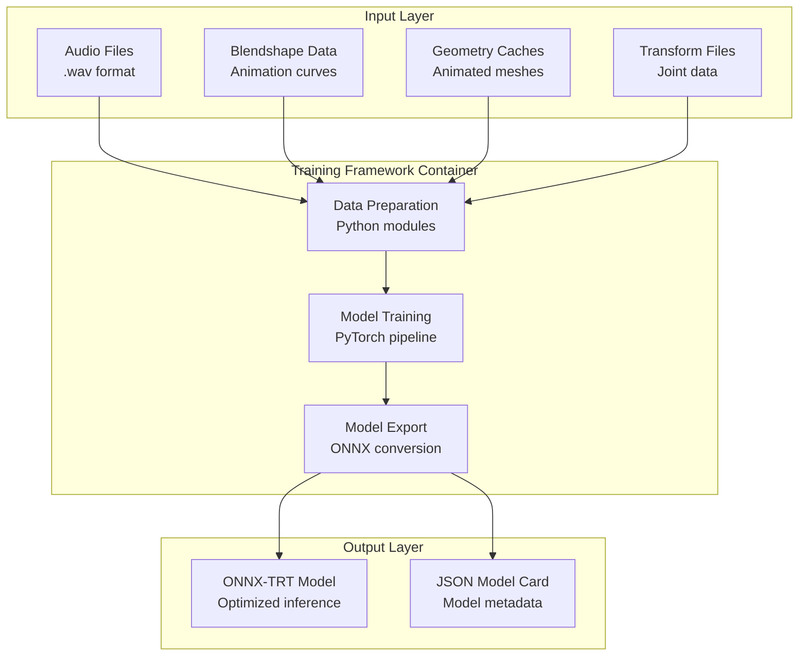

**Sources:** [README.md:41-45](), [README.md:129-151]()

### Docker Container Architecture

The framework is packaged as a Docker container to ensure reproducible training environments across different hardware and operating systems.

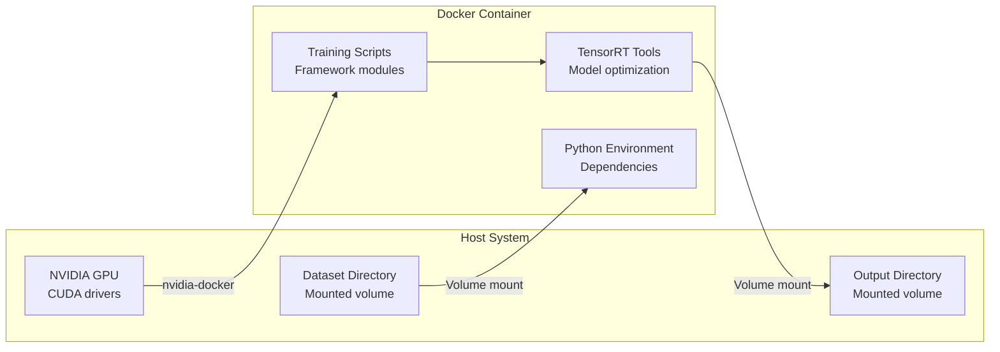

**Sources:** [README.md:42-43](), [README.md:142]()

## Training Workflow

### End-to-End Pipeline

The training process follows a standardized pipeline from raw animation data to deployable models.

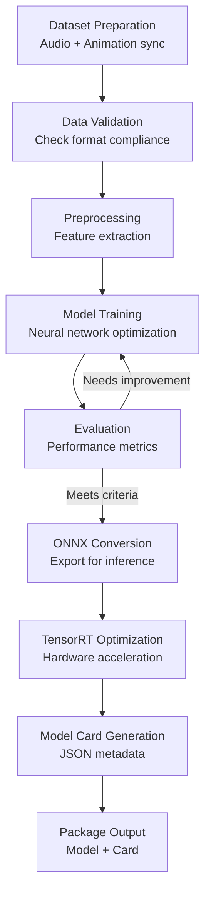

**Sources:** [README.md:135-144]()

### Training Phases

| Phase | Purpose | Key Outputs |
|-------|---------|-------------|
| **Data Validation** | Verify dataset structure and completeness | Validation report |
| **Preprocessing** | Extract audio features and normalize animation data | Processed tensors |
| **Training** | Optimize neural network weights | Checkpoint files |
| **Evaluation** | Measure model performance on validation set | Metrics (loss, accuracy) |
| **Export** | Convert trained model to ONNX format | `.onnx` file |
| **Optimization** | Apply TensorRT optimizations for inference | `.onnx-trt` file |
| **Model Card** | Generate metadata and configuration | `.json` file |

**Sources:** [README.md:144]()

## Input Requirements

### Dataset Structure

The framework expects datasets with synchronized audio and animation data. The Claire sample dataset on Hugging Face demonstrates the required format.

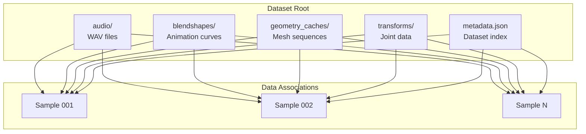

**Sources:** [README.md:100-104]()

### Audio Requirements

Audio files serve as the input signal for model training and must be synchronized with the corresponding animation data.

| Property | Specification |
|----------|---------------|
| **Format** | WAV (uncompressed) |
| **Sample Rate** | 16 kHz or higher recommended |
| **Channels** | Mono or stereo |
| **Bit Depth** | 16-bit or 32-bit |
| **Content** | Spoken dialogue with visible lip movement |

**Sources:** [README.md:102]()

### Animation Data Requirements

Animation data captures the ground truth facial performance that the model will learn to replicate from audio alone.

| Data Type | Purpose | Format |
|-----------|---------|--------|
| **Blendshape Data** | Target blend shape weights per frame | Curve data, CSV, or binary |
| **Geometry Caches** | Animated mesh sequences for validation | Alembic (.abc) or similar |
| **Transform Files** | Joint transformations for skeletal rigs | Matrix data per frame |

**Sources:** [README.md:102]()

## Multi-Language Support

### Language-Specific Training

The framework natively supports training models on single or multiple languages, enabling localization and multilingual character performance.

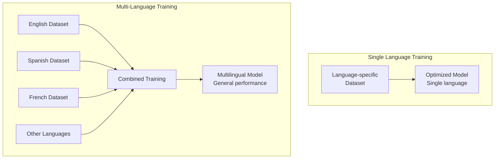

**Sources:** [README.md:143]()

### Language Training Strategy

| Strategy | Advantages | Use Cases |
|----------|------------|-----------|
| **Single Language** | Higher accuracy for target language; Smaller model size | Character speaks only one language; Performance-critical applications |
| **Multi-Language** | Broader language support; Better generalization | Multilingual characters; Localization workflows |
| **Transfer Learning** | Leverage pre-trained models; Faster convergence | Fine-tuning for new languages; Limited training data |

**Sources:** [README.md:143](), [README.md:149]()

## Model Export

### ONNX-TensorRT Format

Trained models are exported in ONNX format and optimized with TensorRT for maximum inference performance on NVIDIA GPUs.

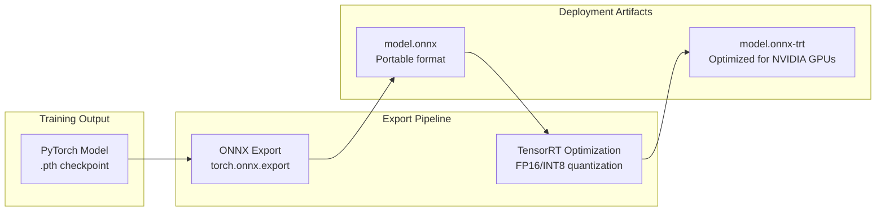

**Sources:** [README.md:144](), [README.md:84]()

### JSON Model Card

Each exported model includes a JSON model card that describes its capabilities, requirements, and configuration. This card enables seamless loading across all Audio2Face-3D integration tools.

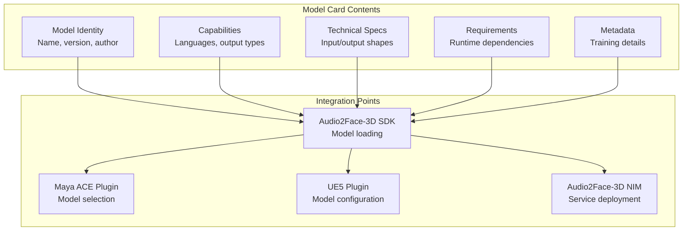

**Sources:** [README.md:144](), [README.md:162](), [README.md:168]()

## Integration with Audio2Face-3D Ecosystem

### Model Lifecycle

Trained models flow through the ecosystem from training to deployment across multiple integration points.

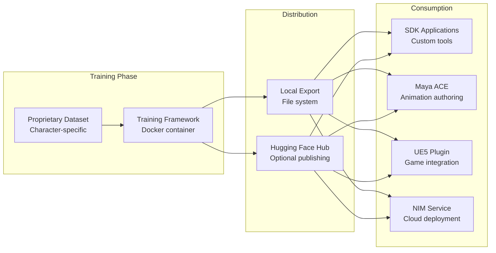

**Sources:** [README.md:129-151](), [README.md:82-89]()

### Official Pre-trained Models

NVIDIA uses the Training Framework to create the official pre-trained models available on Hugging Face.

| Model | Version | Type | Training Focus |
|-------|---------|------|----------------|
| **Mark** | v2.3 | Regression | General English lip-sync |
| **Claire** | v2.3.1 | Regression | Female character, English |
| **James** | v2.3.1 | Regression | Male character, English |
| **v3.0** | v3.0 | Diffusion | Advanced quality, multi-language |

**Sources:** [README.md:135](), [README.md:86-89]()

## Docker Container Usage

### Container Invocation

The Training Framework runs as a Docker container with volume mounts for input datasets and output models.

| Mount Point | Purpose | Example Path |
|-------------|---------|--------------|
| **Dataset Volume** | Read access to training data | `/data/claire_dataset` |
| **Output Volume** | Write access for trained models | `/output/models` |
| **Config Volume** | Optional training configuration | `/config/training_params.yaml` |

**Sources:** [README.md:42-43](), [README.md:142]()

### GPU Requirements

The framework requires NVIDIA GPU support via `nvidia-docker` or Docker with `--gpus` flag for hardware-accelerated training.

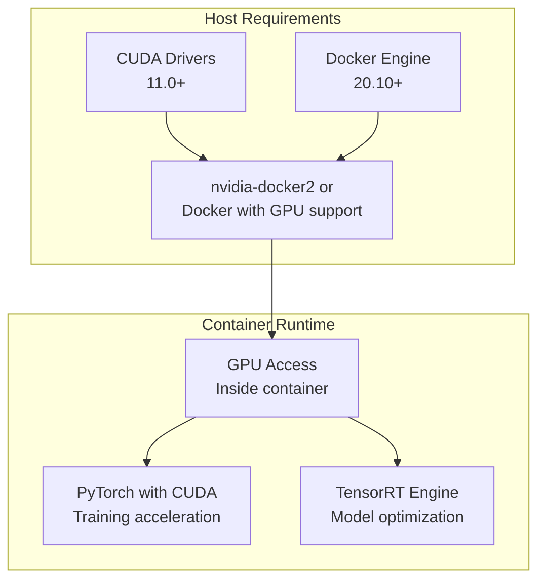

**Sources:** [README.md:42-43]()

## Training Use Cases

### Character-Specific Performance

Train models that capture unique character personalities, speaking styles, and performance characteristics.

| Objective | Training Approach | Output |
|-----------|------------------|--------|
| **Specific personality** | Dataset with consistent character voice | Model captures character's unique speech patterns |
| **Performance style** | Animation with specific performance direction | Model replicates artistic style choices |
| **Visual style** | Geometry and rig-specific animations | Model optimized for character topology |

**Sources:** [README.md:148]()

### Localization and Multilingual Support

Create models that support dialogue in multiple languages for international content distribution.

| Objective | Training Approach | Output |
|-----------|------------------|--------|
| **Single language** | Monolingual dataset | Highest accuracy for target language |
| **Multiple languages** | Combined multilingual dataset | Broad language support |
| **Regional variants** | Dialect-specific recordings | Accent-aware models |

**Sources:** [README.md:149]()

### Research and Specialized Applications

Build highly specialized models for unique research objectives or production requirements.

| Objective | Training Approach | Output |
|-----------|------------------|--------|
| **Novel output formats** | Custom animation data structures | Experimental model architectures |
| **Performance constraints** | Optimized for specific hardware | Lightweight or high-speed models |
| **Domain-specific** | Specialized datasets (singing, non-speech) | Task-specific models |

**Sources:** [README.md:150]()

## System Requirements

### Development Environment

| Component | Requirement |
|-----------|-------------|
| **Operating System** | Linux (Ubuntu 20.04+ recommended), Windows WSL2, macOS |
| **Docker** | Docker Engine 20.10+ with GPU support |
| **NVIDIA Driver** | 470.x or newer |
| **CUDA** | 11.0 or newer |
| **GPU Memory** | 16 GB VRAM minimum (24+ GB recommended) |
| **System RAM** | 32 GB minimum |
| **Storage** | 100+ GB for datasets and checkpoints |

**Sources:** [README.md:42-43]()

### Python Environment

The Docker container includes all necessary Python dependencies pre-installed.

| Package | Purpose |
|---------|---------|
| **PyTorch** | Neural network training |
| **ONNX** | Model export format |
| **TensorRT** | Inference optimization |
| **NumPy** | Numerical operations |
| **Audio processing libraries** | Feature extraction from audio |

**Sources:** [README.md:42]()

## Output Compatibility

### Integration with Audio2Face-3D Tools

Models exported by the Training Framework are compatible with all Audio2Face-3D integration tools through the standardized ONNX-TRT format and JSON model card.

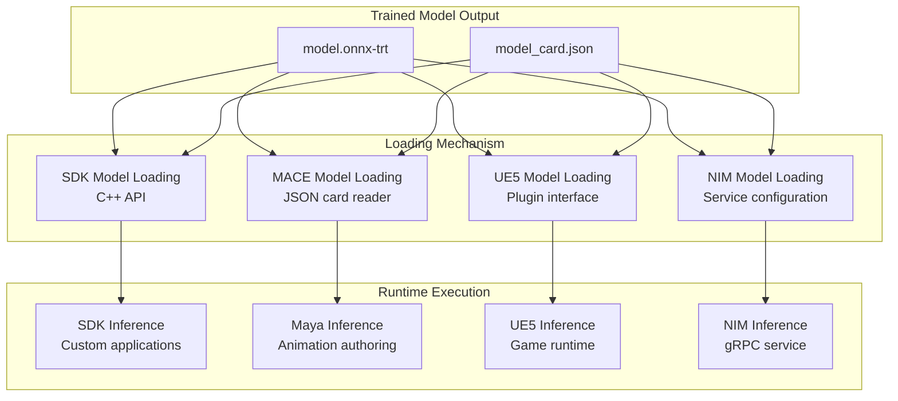

**Sources:** [README.md:144](), [README.md:162](), [README.md:168]()

### Model Version Compatibility

| Model Type | SDK Support | MACE Support | UE5 Support | NIM Support |
|------------|-------------|--------------|-------------|-------------|
| **v2.3 Regression** | ✓ | ✓ | ✓ | ✓ |
| **v3.0 Diffusion** | ✓ | ✓ | ✓ | ✓ |
| **Custom Trained** | ✓ | ✓ | ✓ | ✓ |

**Sources:** [README.md:86-89](), [README.md:162](), [README.md:196]()

## Distribution

### Local Model Storage

Trained models can be stored locally and referenced by file path in integration tools.

**Sources:** [README.md:144]()

### Hugging Face Hub Publication

Models can optionally be published to Hugging Face Hub for sharing and distribution, following the same pattern as the official pre-trained models.

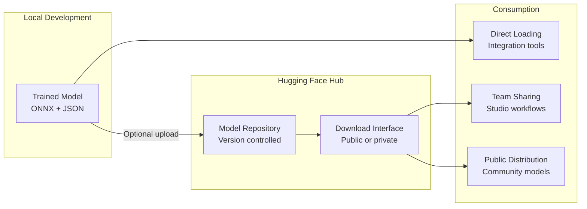

**Sources:** [README.md:82-89](), [README.md:144]()

## Related Documentation

- For pre-trained model specifications, see [Audio2Face-3D Models](#5.1)
- For dataset format details, see [Training Datasets](#4.2)
- For model deployment at scale, see [NIM Microservice](#6.1)
- For using trained models in Maya, see [Maya ACE Plugin](#3.2)
- For UE5 integration, see [Unreal Engine 5 Plugin](#3.3)
- For C++ integration, see [C++ SDK](#3.1)

**Sources:** [README.md:129-151]()

---

