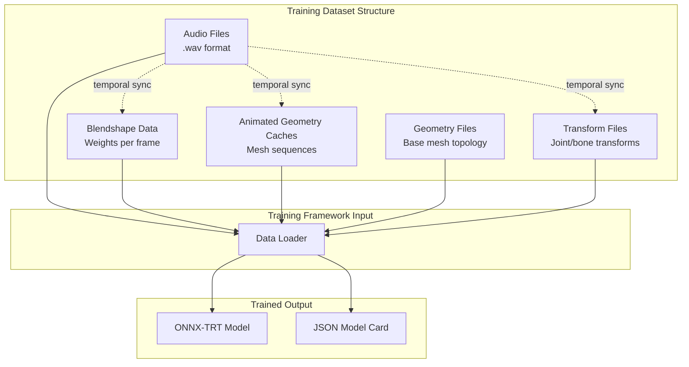
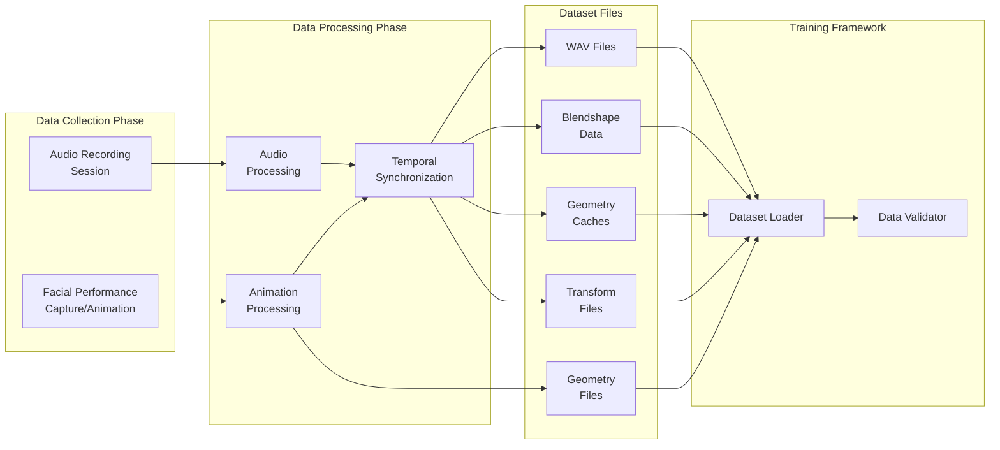
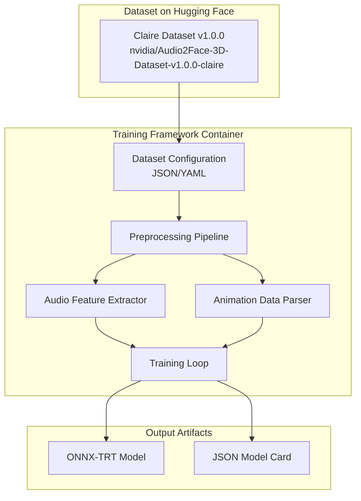
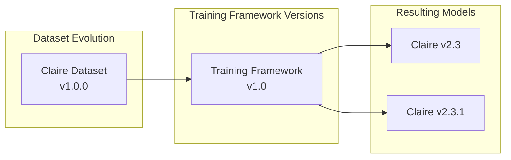

<!-- source: DeepWiki mcp.deepwiki.com · repo NVIDIA/Audio2Face-3D · page 4.2 Training Datasets · fetched 2026-10-26 -->

# Training Datasets

Relevant source files

The following files were used as context for generating this wiki page:

- [README.md](README.md)

## Purpose and Scope

This document describes the training data format and structure used by the Audio2Face-3D Training Framework. It covers the sample Claire dataset available on Hugging Face Hub, the required data components for training custom models, and guidelines for preparing proprietary datasets.

For information about the training process itself, including Docker container usage and model export, see [Training Framework](#4.1). For information about the resulting pre-trained models, see [Audio2Face-3D Models](#5.1).

**Sources:** [README.md:100-105]()

---

## Overview

Training datasets for Audio2Face-3D consist of synchronized audio recordings paired with corresponding facial animation data. These datasets enable the training framework to learn the relationship between acoustic features and facial movements, resulting in models that can generate realistic lip-sync and facial performances from audio input.

The official sample dataset is the **Claire Dataset v1.0.0**, distributed via Hugging Face Hub under an evaluation-only license. This dataset demonstrates the complete data structure required by the training framework and serves as a reference implementation for creating custom datasets.

**Sources:** [README.md:100-105](), [README.md:135-137]()

---

## Dataset Components Architecture

**Sources:** [README.md:102](), [README.md:141-144]()

---

## Claire Dataset Format

The Claire Dataset v1.0.0 provides a complete reference implementation of the data structure required by the Audio2Face-3D Training Framework. This dataset was used to train the official Claire v2.3.1 pre-trained model.

### Dataset Location

- **Repository:** `nvidia/Audio2Face-3D-Dataset-v1.0.0-claire` on Hugging Face Hub
- **License:** Custom (evaluation only)
- **Format:** Audio files, blendshape data, animated geometry caches, geometry files, and transform files

### Purpose

The Claire dataset serves three primary functions:

1. **Training Reference:** Demonstrates the exact file formats and data structures expected by the training framework
2. **Validation Baseline:** Provides a known-good dataset for validating custom training pipelines
3. **Format Template:** Acts as a template for structuring proprietary datasets

**Sources:** [README.md:100-105](), [README.md:87-88]()

---

## Dataset Component Specifications

### Audio Files

Audio files provide the acoustic input that drives facial animation generation. The training framework analyzes these files to extract phonetic and prosodic features.

**Format Requirements:**
- **File Format:** WAV (`.wav`)
- **Sample Rate:** Consistent across all files in the dataset
- **Channels:** Mono or stereo (framework-dependent)
- **Bit Depth:** 16-bit or 24-bit PCM recommended

**Purpose:** Audio files serve as the primary input feature set. The framework extracts speech characteristics including phoneme timing, pitch, energy, and emotional tone.

### Blendshape Data

Blendshape data represents facial animation as weighted combinations of predefined facial poses. Each frame contains normalized weight values for all blendshape targets.

**Data Structure:**
- **Format:** Frame-by-frame weight vectors
- **Synchronization:** Temporally aligned with audio at the target animation framerate
- **Value Range:** Typically normalized to [0.0, 1.0] or [-1.0, 1.0] depending on blendshape convention
- **Dimensionality:** Fixed number of blendshape channels per character rig

**Purpose:** Blendshape weights provide the ground-truth animation data that the model learns to predict from audio features.

### Animated Geometry Caches

Geometry caches store per-frame vertex positions representing the deformed facial mesh over time. These provide dense spatial information about facial surface movement.

**Data Structure:**
- **Format:** Sequential mesh frames
- **Synchronization:** Frame-locked with audio and blendshape data
- **Topology:** Consistent vertex count and connectivity across all frames
- **Precision:** Floating-point vertex coordinates

**Purpose:** Geometry caches capture subtle skin deformations and wrinkles that may not be fully represented by blendshape weights alone. They provide high-fidelity training targets for models that output direct mesh deformations.

### Geometry Files

Geometry files define the base mesh topology and structure of the character's face in its neutral pose.

**Data Structure:**
- **Format:** Static mesh representation
- **Components:** Vertex positions, face topology, UV coordinates
- **Purpose:** Establishes the reference topology for all animated geometry caches

**Purpose:** The base geometry defines the character's facial structure and serves as the neutral reference frame. It ensures all animated frames share consistent vertex ordering and connectivity.

### Transform Files

Transform files contain joint or bone transformation data for skeletal animation of facial features (jaw, eyes, tongue, etc.).

**Data Structure:**
- **Format:** Per-frame transformation matrices or rotation/translation vectors
- **Synchronization:** Temporally aligned with audio and other animation data
- **Hierarchy:** Joint parent-child relationships and naming conventions
- **Transforms:** Position, rotation, and optionally scale for each joint

**Purpose:** Transform data enables training models that output skeletal animation rather than direct mesh deformation or blendshape weights. This is particularly important for jaw motion and eye movement.

**Sources:** [README.md:102]()

---

## Dataset Organization and Workflow

**Sources:** [README.md:135-144]()

---

## Custom Dataset Requirements

### Temporal Synchronization

All dataset components must be precisely synchronized in time:

- **Audio-Animation Alignment:** Animation data must be frame-locked to the audio timeline
- **Framerate Consistency:** All animation data (blendshapes, geometry caches, transforms) must use the same framerate
- **Frame Offset Tracking:** Any offset between audio start time and animation start time must be documented

### Data Quality Standards

Training datasets should meet the following quality criteria:

| Component | Quality Requirement |
|-----------|-------------------|
| Audio | Clean recordings with minimal background noise, consistent volume levels |
| Blendshape Data | Smooth weight transitions, valid value ranges, no interpolation artifacts |
| Geometry Caches | Consistent topology, no mesh corruption, smooth vertex motion |
| Geometry Files | Valid topology, manifold meshes, consistent coordinate system |
| Transform Files | Valid transformation matrices, consistent joint hierarchy |

### Volume and Coverage

Effective training datasets require:

- **Phonetic Coverage:** Sufficient examples of all phonemes in the target language(s)
- **Emotional Range:** Varied emotional expressions and speaking styles if emotional inference is desired
- **Dataset Size:** Adequate sample count for model generalization (framework-specific recommendations)
- **Speaker Consistency:** All samples should represent the same character or performance style

**Sources:** [README.md:141-150]()

---

## Integration with Training Framework

The Training Framework expects datasets to be structured according to the format demonstrated by the Claire dataset. The framework provides:

- **Dataset Loaders:** Automated parsing of audio and animation data files
- **Validation Tools:** Verification of temporal synchronization and data integrity
- **Preprocessing Pipelines:** Normalization and feature extraction from raw dataset files
- **Configuration Templates:** JSON/YAML schemas for specifying dataset paths and parameters

**Sources:** [README.md:135-144]()

---

## Dataset Access and Distribution

### Hugging Face Hub Integration

Sample datasets are distributed via Hugging Face Hub to enable:

- **Version Control:** Tracked dataset revisions and updates
- **Access Management:** License enforcement and download tracking
- **Large File Support:** Efficient storage and transfer of geometry caches and audio files
- **Integration:** Direct dataset loading from training framework Docker containers

### Claire Dataset Access

| Property | Value |
|----------|-------|
| Repository ID | `nvidia/Audio2Face-3D-Dataset-v1.0.0-claire` |
| Platform | Hugging Face Datasets |
| License | Custom (evaluation only) |
| Components | Audio files, blendshape data, animated geometry caches, geometry files, transform files |
| Trained Model | Claire v2.3.1 |

**Sources:** [README.md:100-105](), [README.md:21]()

---

## Custom Dataset Creation Workflow

For creating proprietary datasets to train character-specific or language-specific models:

### Step 1: Audio Recording
Record clean audio samples with the target speaker or language content. Ensure consistent recording quality and comprehensive phonetic coverage.

### Step 2: Animation Production
Create corresponding facial animation through:
- **Performance Capture:** Record facial motion capture synchronized with audio
- **Manual Animation:** Hand-animate facial performances in Maya or other DCC tools
- **Hybrid Approach:** Capture base performance and refine with manual animation

### Step 3: Data Export
Export animation data in the required formats:
- Blendshape weights as numerical arrays
- Geometry caches as mesh sequences
- Transform hierarchies as matrix or vector data
- Base geometry as static mesh files

### Step 4: Synchronization
Ensure precise temporal alignment between audio and all animation data components. Document framerates and any time offsets.

### Step 5: Validation
Use the Training Framework's validation tools to verify:
- File format correctness
- Temporal synchronization accuracy
- Data completeness and consistency
- Value range validity

### Step 6: Training
Load the validated dataset into the Training Framework Docker container and initiate the training process as described in [Training Framework](#4.1).

**Sources:** [README.md:135-150]()

---

## Dataset Versioning and Model Lineage

The sample datasets maintain version numbers that track with the trained models they produce. The Claire Dataset v1.0.0 was used to train the Claire v2.3 and v2.3.1 regression models available on Hugging Face Hub.

**Sources:** [README.md:42](), [README.md:87-88](), [README.md:104]()

---

## Summary

Training datasets for Audio2Face-3D consist of temporally synchronized audio files paired with multiple forms of facial animation data: blendshape weights, geometry caches, base geometry definitions, and skeletal transforms. The Claire Dataset v1.0.0 provides a complete reference implementation of this structure and is available on Hugging Face Hub for evaluation purposes. Custom datasets following this format can be used with the Training Framework to create character-specific or language-specific models.

**Sources:** [README.md:100-105](), [README.md:135-150]()

---

