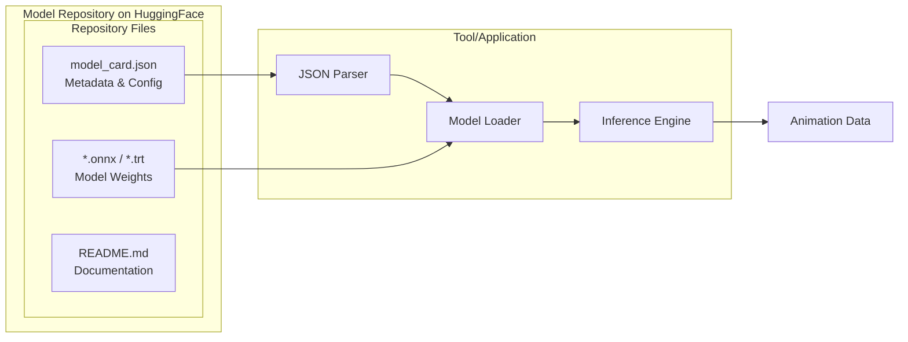
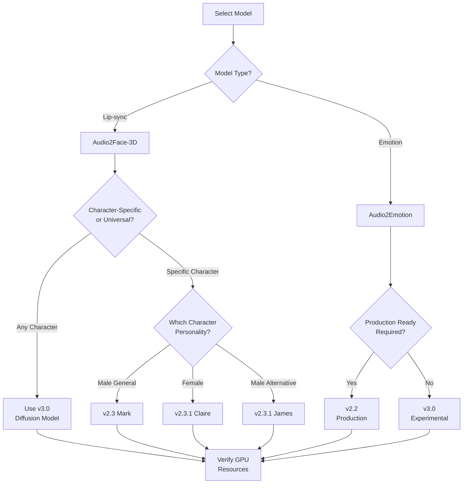
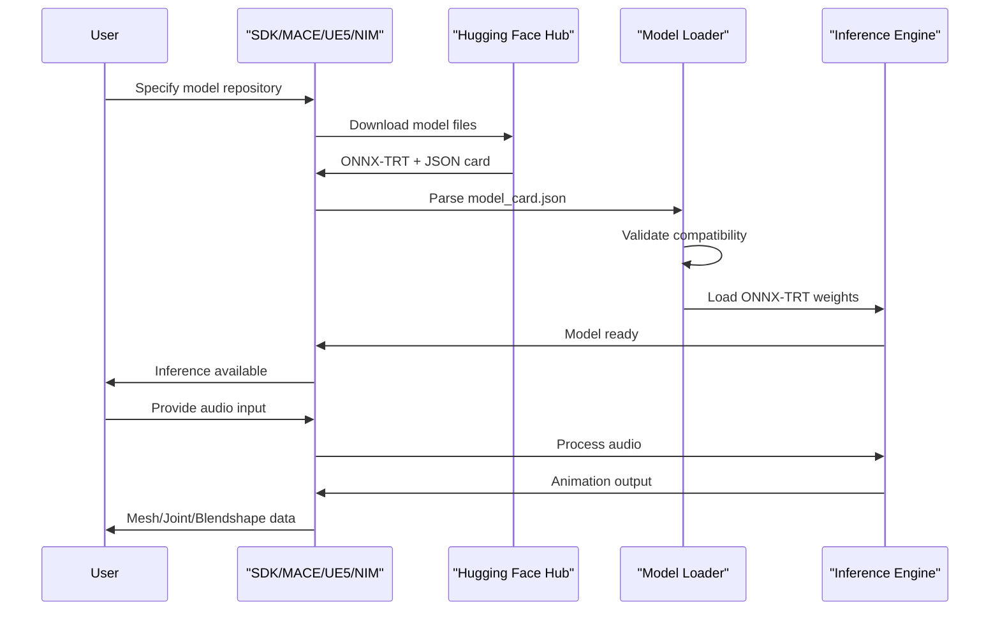

<!-- source: DeepWiki mcp.deepwiki.com · repo NVIDIA/Audio2Face-3D · page 5 Pre-trained Models · fetched 2026-10-26 -->

# Pre-trained Models

Relevant source files

The following files were used as context for generating this wiki page:

- [README.md](README.md)

## Purpose and Scope

This page provides an overview of the official pre-trained models distributed via Hugging Face Hub for the Audio2Face-3D ecosystem. It covers model families, versioning strategy, format specifications, licensing, and selection guidance. For detailed documentation on specific model types, see [Audio2Face-3D Models](#5.1) and [Audio2Emotion Models](#5.2).

The pre-trained models enable developers and artists to generate facial animation without requiring custom training. All models are distributed through Hugging Face Hub as a centralized model registry, separate from the source code repositories maintained on GitHub.

**Sources:** [README.md:17-21](), [README.md:71-106]()

## Model Distribution Architecture

All pre-trained models are hosted on Hugging Face Hub rather than GitHub repositories. This separation enables independent versioning of models and tooling, allowing model updates without requiring changes to integration tools.

### Hugging Face Model Registry

```mermaid
graph TB
    subgraph HF["Hugging Face Hub"]
        subgraph A2F["Audio2Face-3D Models"]
            V30["nvidia/Audio2Face-3D-v3.0<br/>Diffusion-based"]
            Mark["nvidia/Audio2Face-3D-v2.3-Mark<br/>Regression"]
            Claire["nvidia/Audio2Face-3D-v2.3.1-Claire<br/>Regression"]
            James["nvidia/Audio2Face-3D-v2.3.1-James<br/>Regression"]
        end
        
        subgraph A2E["Audio2Emotion Models"]
            A2E22["nvidia/Audio2Emotion-v2.2<br/>Production"]
            A2E30["nvidia/Audio2Emotion-v3.0<br/>Experimental"]
        end
        
        subgraph Data["Training Datasets"]
            ClaireDat["nvidia/Audio2Face-3D-Dataset-v1.0.0-claire"]
        end
    end
    
    subgraph Consumers["Model Consumers"]
        SDK["Audio2Face-3D SDK"]
        MACE["Maya ACE Plugin"]
        UE5["UE5 Plugin"]
        NIM["A2F NIM Service"]
        Training["Training Framework"]
    end
    
    V30 --> SDK
    V30 --> MACE
    V30 --> UE5
    V30 --> NIM
    
    Mark --> SDK
    Mark --> MACE
    Mark --> UE5
    Mark --> NIM
    
    Claire --> SDK
    Claire --> MACE
    Claire --> UE5
    Claire --> NIM
    
    James --> SDK
    James --> MACE
    James --> UE5
    James --> NIM
    
    A2E22 --> SDK
    A2E22 --> MACE
    A2E22 --> UE5
    A2E22 --> NIM
    
    A2E30 --> SDK
    A2E30 --> MACE
    A2E30 --> UE5
    A2E30 --> NIM
    
    ClaireDat --> Training
```

**Hugging Face Model Repository Structure**

Each model is distributed as a separate Hugging Face repository with a standardized naming convention:
- `nvidia/Audio2Face-3D-v{version}-{character}` for character-specific regression models
- `nvidia/Audio2Face-3D-v{version}` for universal models
- `nvidia/Audio2Emotion-v{version}` for emotion inference models

All integration tools (SDK, Maya ACE, UE5 Plugin, NIM) support loading any compatible model from these repositories. This allows users to select models based on their specific requirements without tool modifications.

**Sources:** [README.md:71-106](), [README.md:82-97]()

## Model Format Specification

All Audio2Face-3D pre-trained models use a standardized two-part format: ONNX-TRT model weights and a JSON model card.

### Model Package Structure

**Model Card (JSON)**

The JSON model card contains:
- Model metadata (version, type, character)
- Input/output specifications
- Hardware requirements
- Blend shape or joint mappings
- Performance characteristics
- License information

The model card enables tools to programmatically validate compatibility and configure the inference pipeline without hardcoding model-specific logic.

**ONNX-TRT Format**

Models are exported in ONNX (Open Neural Network Exchange) format optimized for TensorRT inference. This format provides:
- Hardware-accelerated inference on NVIDIA GPUs
- Cross-platform compatibility
- Optimized performance for real-time applications

**Sources:** [README.md:82-97](), [README.md:144](), [README.md:168]()

## Model Families

The Audio2Face-3D ecosystem includes two distinct model families, each serving a different aspect of facial animation generation.

| Model Family | Purpose | Versions Available | License Type |
|--------------|---------|-------------------|--------------|
| **Audio2Face-3D** | Generates lip-sync facial animation from phonetic analysis | v2.3 (Mark, Claire, James) v3.0 (Universal) | NVIDIA Open Model |
| **Audio2Emotion** | Infers emotional state from audio tone | v2.2 (Production) v3.0 (Experimental) | Custom (A2F use only) |

### Audio2Face-3D Models

These models generate the core facial animation, including:
- Jaw articulation synchronized to speech
- Tongue movement for accurate phoneme formation
- Eye motion and blink patterns
- Subtle facial skin deformations

Output formats:
- Direct mesh deformations
- Joint transformations
- Blend shape weights

### Audio2Emotion Models

These models analyze the emotional tone of speech and generate:
- Emotional expression overlays
- Mood-driven facial configurations
- Affective state transitions

Audio2Emotion models are designed to work in conjunction with Audio2Face-3D models, where the lip-sync animation is combined with emotional expression for complete performances.

**Sources:** [README.md:6-11](), [README.md:82-97]()

## Version Comparison

### Audio2Face-3D Model Versions

| Version | Type | Characters | Description | Release Status |
|---------|------|------------|-------------|----------------|
| **v2.3** | Regression | Mark | Male character, general purpose | Stable |
| **v2.3.1** | Regression | Claire | Female character, optimized performance | Stable |
| **v2.3.1** | Regression | James | Male character, alternative performance style | Stable |
| **v3.0** | Diffusion | Universal | Character-agnostic, higher quality output | Latest |

**Regression Models (v2.3 Series)**

Character-specific models trained on individual performance datasets:
- Faster inference speed
- Deterministic output
- Optimized for specific character topology
- Suitable for real-time applications

**Diffusion Models (v3.0)**

Universal model supporting any character rig:
- Higher quality animation synthesis
- Character-agnostic topology support
- Increased computational requirements
- Advanced temporal coherence

### Audio2Emotion Model Versions

| Version | Status | Characteristics |
|---------|--------|-----------------|
| **v2.2** | Production | Validated for production use, stable output |
| **v3.0** | Experimental | Enhanced emotional range, research grade |

**Sources:** [README.md:82-89](), [README.md:92-97]()

## Model Selection Guide

Selecting the appropriate model depends on use case requirements, hardware constraints, and quality targets.

### Decision Matrix

### Selection Criteria

**For Real-Time Applications:**
- Use v2.3 regression models (Mark, Claire, or James)
- Lower latency and consistent frame rates
- Suitable for interactive experiences and game engines

**For High-Quality Offline Rendering:**
- Use v3.0 diffusion models
- Superior animation quality
- Acceptable for batch processing where speed is secondary

**For Production Deployment:**
- Audio2Face-3D: v2.3.1 Claire or James (most recent regression updates)
- Audio2Emotion: v2.2 (production validated)

**For Research and Experimentation:**
- Audio2Face-3D: v3.0 (latest diffusion approach)
- Audio2Emotion: v3.0 (experimental features)

**Sources:** [README.md:82-97]()

## Model Integration Pattern

All Audio2Face-3D integration tools support loading models via their JSON model cards, enabling dynamic model selection at runtime.

### Tool-Model Integration Flow

### Model Loading Methods

Each integration tool provides mechanisms to load models from Hugging Face:

**SDK (C++ Library)**
- Programmatic API for model loading
- Supports local file paths and Hugging Face repository IDs
- Hardware acceleration configuration

**Maya ACE Plugin**
- UI-based model selector
- Loads via JSON model card specification
- Supports both local and remote inference modes

**UE5 Plugin**
- Blueprint nodes for model configuration
- Separate model plugin packages for different versions
- Editor-time and runtime loading

**NIM Microservice**
- Container environment variables specify model repositories
- Hot-swappable model updates without service restart
- Centralized model caching

**Sources:** [README.md:115-121](), [README.md:162-169](), [README.md:196-204](), [README.md:217-227]()

## Licensing

Pre-trained models have different license terms than the source code repositories.

| Model Type | License | Restrictions |
|------------|---------|--------------|
| Audio2Face-3D Models (v2.3, v3.0) | NVIDIA Open Model | Open weights, commercial use allowed |
| Audio2Emotion Models (v2.2, v3.0) | Custom | Use restricted to Audio2Face-3D applications only |
| Training Sample Datasets | Custom | Evaluation use only, no redistribution |

The Audio2Emotion models have usage restrictions that limit their application to Audio2Face-3D workflows. They cannot be used independently or in other facial animation systems.

**Sources:** [README.md:82-97](), [README.md:100-104]()

## Model Repository Access

### Hugging Face Repository URLs

**Audio2Face-3D Models:**
- v3.0 Universal: `https://huggingface.co/nvidia/Audio2Face-3D-v3.0`
- v2.3 Mark: `https://huggingface.co/nvidia/Audio2Face-3D-v2.3-Mark`
- v2.3.1 Claire: `https://huggingface.co/nvidia/Audio2Face-3D-v2.3.1-Claire`
- v2.3.1 James: `https://huggingface.co/nvidia/Audio2Face-3D-v2.3.1-James`

**Audio2Emotion Models:**
- v2.2 Production: `https://huggingface.co/nvidia/Audio2Emotion-v2.2`
- v3.0 Experimental: `https://huggingface.co/nvidia/Audio2Emotion-v3.0`

### Download Methods

Models can be accessed via:
1. **Direct Download:** Through Hugging Face web interface
2. **Hugging Face CLI:** Using `huggingface-cli download` command
3. **Programmatic Access:** Via integration tool APIs that handle downloads automatically
4. **NIM Container:** Automatic download during container initialization

**Sources:** [README.md:86-97]()

## Model Performance Characteristics

Model performance varies based on architecture type and inference hardware.

### Inference Performance Comparison

| Model | Architecture | Typical Latency | GPU Memory | Best For |
|-------|--------------|-----------------|------------|----------|
| Mark v2.3 | Regression | <10ms | ~500MB | Real-time male characters |
| Claire v2.3.1 | Regression | <10ms | ~500MB | Real-time female characters |
| James v2.3.1 | Regression | <10ms | ~500MB | Real-time male characters (alt) |
| Universal v3.0 | Diffusion | ~50-100ms | ~2GB | High-quality offline rendering |
| Audio2Emotion v2.2 | CNN | <5ms | ~200MB | Real-time emotion inference |
| Audio2Emotion v3.0 | Transformer | ~20ms | ~800MB | High-quality emotion analysis |

Performance characteristics are approximate and depend on:
- GPU model (RTX 3000/4000 series recommended)
- TensorRT optimization level
- Input audio sampling rate
- Batch size configuration

**Sources:** [README.md:82-97](), [README.md:120-121]()

## Custom Model Training

Users can create custom models using the Training Framework with their own datasets. The training process produces models in the same ONNX-TRT + JSON format, ensuring compatibility with all integration tools.

Custom models enable:
- Character-specific animation styles
- Language-specific phoneme modeling
- Proprietary performance capture data integration
- Specialized animation quality targets

For details on creating custom models, see [Training Framework](#4.1) and [Training Datasets](#4.2).

**Sources:** [README.md:135-150]()

---

