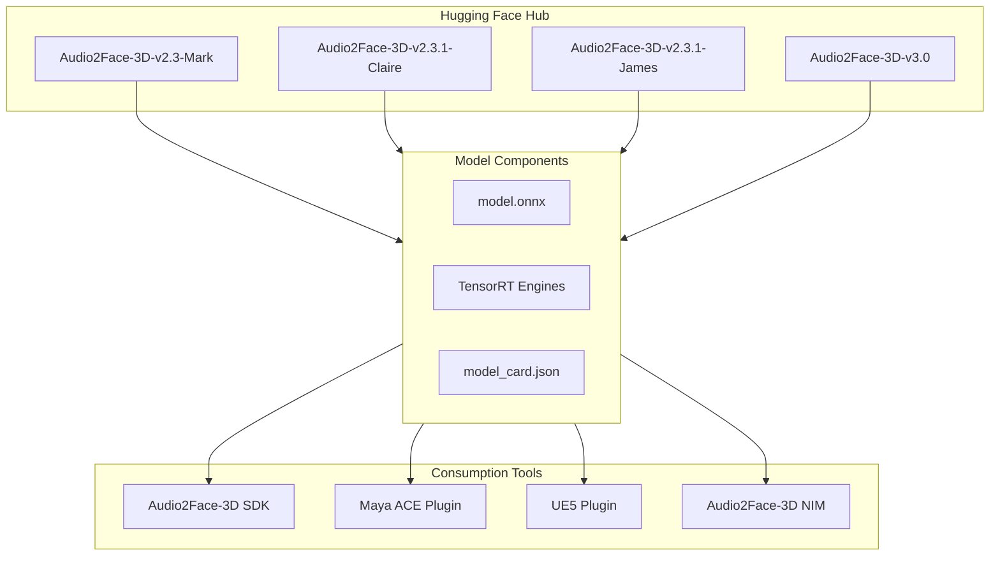
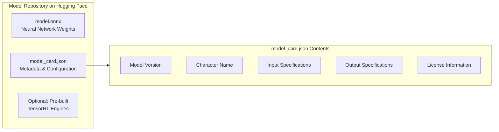
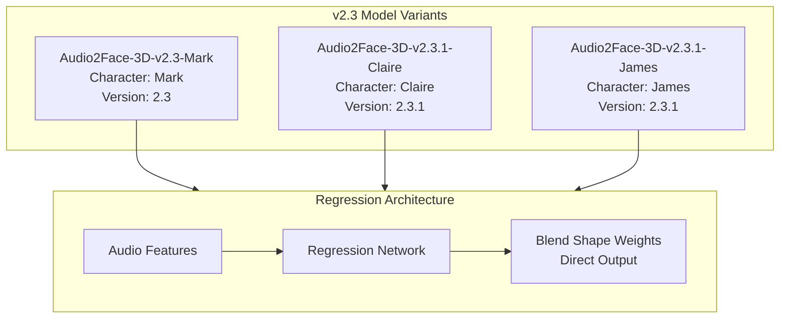
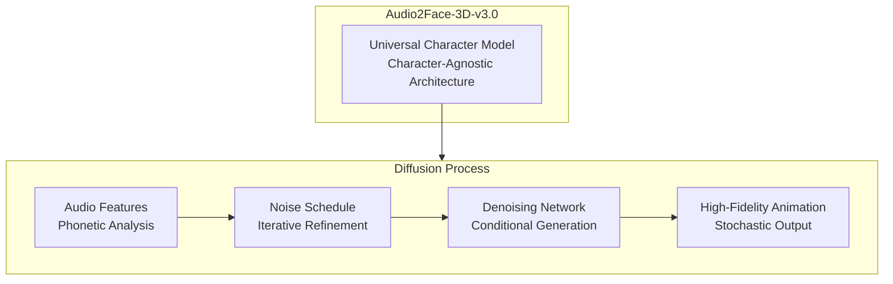
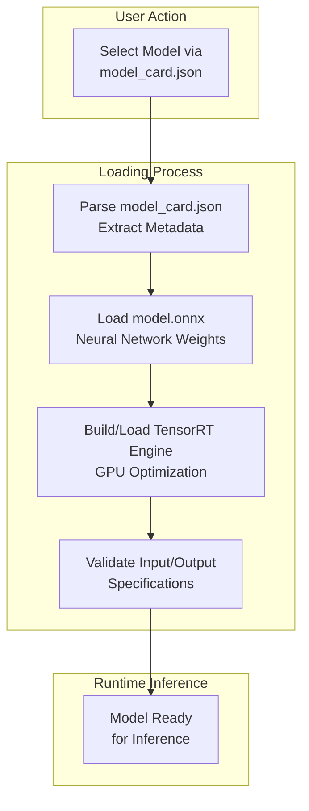
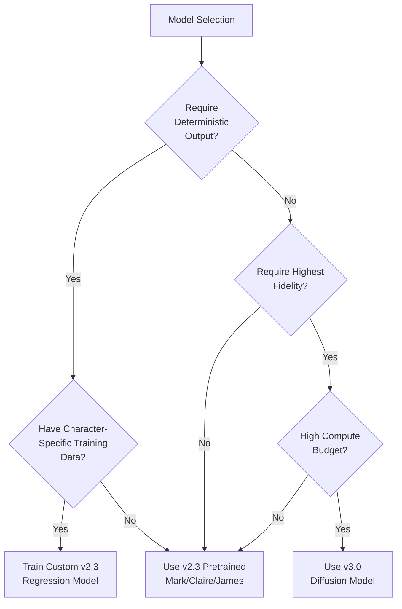

<!-- source: DeepWiki mcp.deepwiki.com · repo NVIDIA/Audio2Face-3D · page 5.1 Audio2Face-3D Models · fetched 2026-10-26 -->

# Audio2Face-3D Models

Relevant source files

The following files were used as context for generating this wiki page:

- [README.md](README.md)

This document describes the pre-trained Audio2Face-3D models available for download from Hugging Face Hub. These models generate lip-sync animation from audio input using neural network inference. For information about Audio2Emotion models, which infer emotional state from audio, see [Audio2Emotion Models](#5.2). For guidance on training custom models, see [Training Framework](#4.1).

**Sources:** [README.md:82-89]()

---

## Model Versions Overview

Audio2Face-3D models are available in two major versions, each using a different neural network architecture:

| Version | Architecture | Character Models | Status | Key Characteristics |
|---------|--------------|------------------|--------|---------------------|
| v2.3 / v2.3.1 | Regression-based | Mark, Claire, James | Production | Fast inference, deterministic output, character-specific training |
| v3.0 | Diffusion-based | Universal | Production | Higher fidelity, stochastic generation, character-agnostic |

**Sources:** [README.md:82-89]()

---

## Model Distribution Architecture

The following diagram illustrates how Audio2Face-3D models are distributed and consumed across the ecosystem:

**Sources:** [README.md:82-89](), [README.md:109-234]()

---

## Model Format and Structure

All Audio2Face-3D models are distributed in ONNX-TRT format with accompanying metadata. Each model repository contains:

### Model Card Specification

The `model_card.json` file provides critical metadata required for model loading and inference configuration. This JSON file is referenced by all consuming tools to understand model capabilities and requirements.

**File Format Components:**

- **ONNX Weights**: Neural network parameters in Open Neural Network Exchange format
- **TensorRT Engines**: GPU-optimized inference engines (platform-specific)
- **Model Card**: JSON metadata describing model characteristics and interface

**Sources:** [README.md:83-84](), [README.md:144](), [README.md:168]()

---

## v2.3 Regression-Based Models

The v2.3 model family uses regression neural networks trained on character-specific animation datasets. Each model is optimized for a particular facial topology and performance style.

### Character-Specific Models

### Model Characteristics

| Model | Repository Name | Version | Key Features |
|-------|----------------|---------|--------------|
| Mark | `Audio2Face-3D-v2.3-Mark` | 2.3 | Original production model |
| Claire | `Audio2Face-3D-v2.3.1-Claire` | 2.3.1 | Refined training pipeline |
| James | `Audio2Face-3D-v2.3.1-James` | 2.3.1 | Refined training pipeline |

### Inference Characteristics

- **Output Type**: Deterministic (same audio produces same animation)
- **Inference Speed**: Optimized for real-time performance
- **Character Dependency**: Trained on specific character topology
- **Format**: Open Weights, ONNX-TRT compatible

**Sources:** [README.md:86-89](), [README.md:135-136]()

---

## v3.0 Diffusion-Based Models

The v3.0 model uses a diffusion-based architecture, representing a significant advancement in animation quality and flexibility.

### Diffusion Architecture

### Model Characteristics

| Attribute | Specification |
|-----------|--------------|
| Repository | `Audio2Face-3D-v3.0` |
| Architecture | Diffusion-based generative model |
| Character Support | Universal (character-agnostic) |
| Output Quality | Higher fidelity than v2.3 |
| Output Type | Stochastic (variation between runs) |
| Inference Cost | Higher computational requirements |

### Technical Advantages

- **Character Agnostic**: Single model works across different facial topologies
- **Higher Fidelity**: Captures subtle performance nuances
- **Generative Variability**: Produces natural variation across inference runs
- **Advanced Training**: Leverages diffusion model training techniques

**Sources:** [README.md:83](), [README.md:86]()

---

## Model Loading and Integration

All Audio2Face-3D consuming tools load models using a consistent pattern based on the `model_card.json` file.

### Model Loading Flow

### Tool-Specific Integration

The following table shows how different tools reference and load models:

| Tool | Model Loading Method | Configuration |
|------|---------------------|---------------|
| SDK | Direct API call with model path | C++ API accepts `model_card.json` path |
| Maya ACE | UI model selection | Plugin reads `model_card.json` via UI |
| UE5 Plugin | Blueprint node configuration | Plugin package bundles models |
| NIM | Container environment variable | Service loads model at startup |

**Sources:** [README.md:115](), [README.md:162-168](), [README.md:196](), [README.md:217]()

---

## Model Selection Guidance

Selecting the appropriate model depends on use case requirements, hardware constraints, and desired output characteristics.

### Decision Matrix

### Use Case Recommendations

| Use Case | Recommended Model | Rationale |
|----------|------------------|-----------|
| Real-time game dialogue | v2.3 (any character) | Fast inference, low latency, deterministic |
| Film production | v3.0 | Highest quality, artistic variation acceptable |
| Batch processing pipeline | v2.3 custom-trained | Deterministic output, production consistency |
| Interactive web avatars | v2.3 (any character) | Real-time performance on varied hardware |
| Research & experimentation | v3.0 | Access to latest architecture |
| Multi-language localization | v2.3 custom-trained | Language-specific model training |

**Sources:** [README.md:123-128](), [README.md:141-150]()

---

## License and Distribution

All Audio2Face-3D models are distributed under the **NVIDIA Open Model License** through Hugging Face Hub.

### Model Repository URLs

| Model | Repository URL |
|-------|---------------|
| v3.0 Universal | `https://huggingface.co/nvidia/Audio2Face-3D-v3.0` |
| v2.3 Mark | `https://huggingface.co/nvidia/Audio2Face-3D-v2.3-Mark` |
| v2.3.1 Claire | `https://huggingface.co/nvidia/Audio2Face-3D-v2.3.1-Claire` |
| v2.3.1 James | `https://huggingface.co/nvidia/Audio2Face-3D-v2.3.1-James` |

### Download and Access

Models can be downloaded directly from Hugging Face or accessed programmatically by Audio2Face-3D tools. For detailed download procedures and integration with specific tools, see [Hugging Face Hub](#7.2).

**Sources:** [README.md:82-89]()

---

## Model Training and Customization

While this section covers pre-trained models, users can create custom Audio2Face-3D models using their own datasets. The Training Framework uses the same architecture as the official models and exports compatible ONNX-TRT and JSON model card files.

For complete training documentation, see [Training Framework](#4.1) and [Training Datasets](#4.2).

**Sources:** [README.md:135-150]()

---

