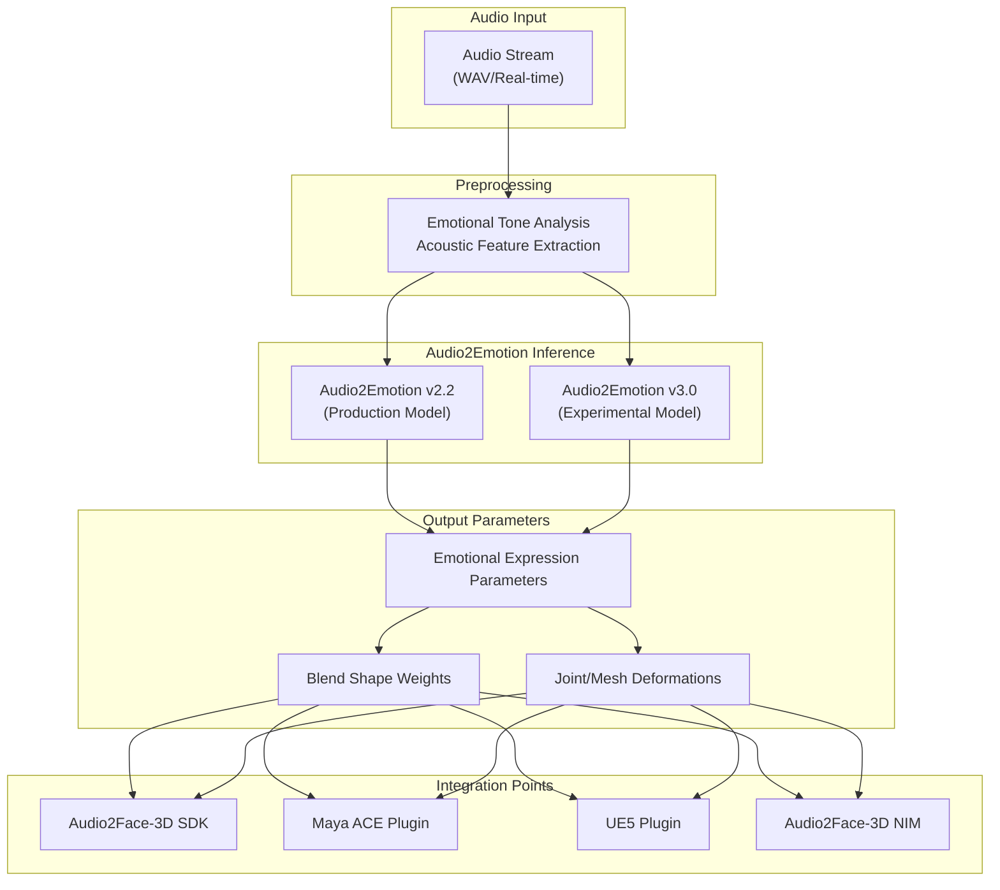
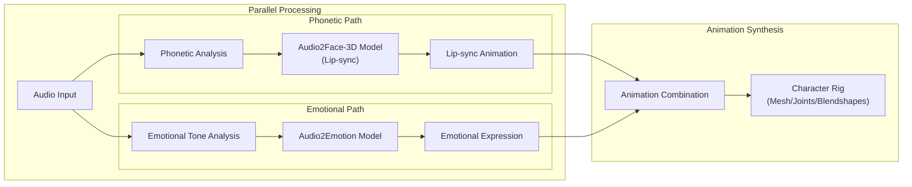
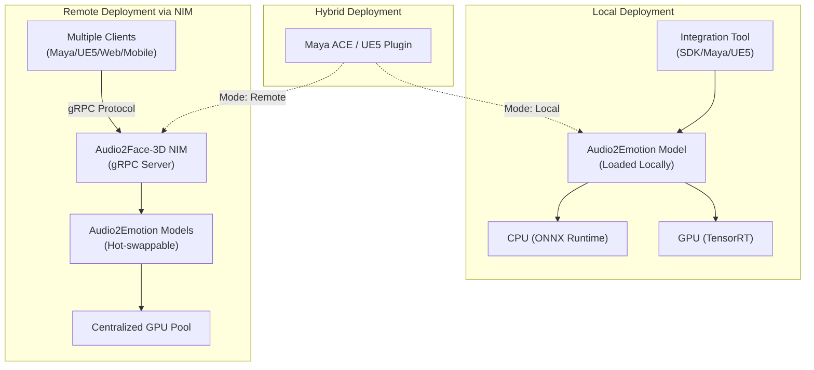
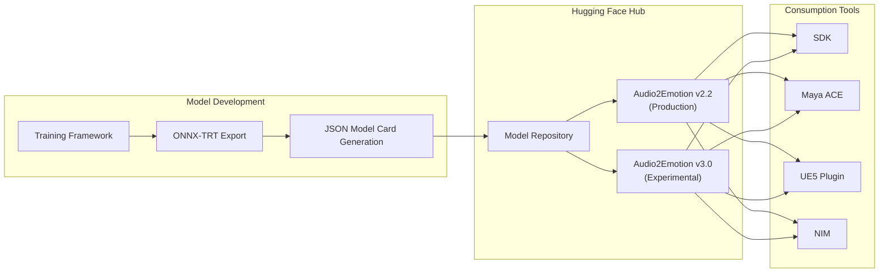

<!-- source: DeepWiki mcp.deepwiki.com · repo NVIDIA/Audio2Face-3D · page 5.2 Audio2Emotion Models · fetched 2026-10-26 -->

# Audio2Emotion Models

Relevant source files

The following files were used as context for generating this wiki page:

- [README.md](README.md)

## Purpose and Scope

This document describes the Audio2Emotion (A2E) models, which are specialized neural networks that infer emotional state from audio input. These models analyze the tone, prosody, and acoustic characteristics of speech to generate emotional expression parameters that drive facial animation.

Audio2Emotion models work in parallel with Audio2Face-3D lip-sync models (see [Audio2Face-3D Models](#5.1)) to produce complete facial performances. While Audio2Face-3D generates accurate lip-sync based on phonetic content, Audio2Emotion adds emotional nuance by controlling broader facial expressions that convey the speaker's mood and emotional state.

**Sources:** [README.md:8-9](), [README.md:92-97]()

---

## Model Architecture Overview

The Audio2Emotion system processes audio through an emotional tone analysis pipeline, producing expression parameters that can be applied to facial rigs via mesh deformations, joint transformations, or blend shape weights.

**Sources:** [README.md:6-11](), [README.md:92-97]()

---

## Available Model Versions

Two versions of the Audio2Emotion model are distributed via Hugging Face Hub, each serving different production and research needs.

### Model Version Comparison

| Version | Status | Use Case | Characteristics | Hugging Face Repository |
|---------|--------|----------|-----------------|------------------------|
| v2.2 | Production | Stable deployment scenarios | Production-tested, reliable emotional inference | [nvidia/Audio2Emotion-v2.2](https://huggingface.co/nvidia/Audio2Emotion-v2.2) |
| v3.0 | Experimental | Research and testing | Advanced features, may include newer techniques | [nvidia/Audio2Emotion-v3.0](https://huggingface.co/nvidia/Audio2Emotion-v3.0) |

**Sources:** [README.md:92-97]()

### Version Selection Guidance

- **v2.2 (Production)**: Recommended for production pipelines, commercial projects, and scenarios requiring stable, predictable results. This version has been validated for reliability across diverse audio inputs.

- **v3.0 (Experimental)**: Suitable for research projects, experimental workflows, and advanced users who want to evaluate newer emotional inference capabilities. May exhibit different behavior or require additional tuning.

**Sources:** [README.md:92-97]()

---

## Technical Specifications

### Model Format and Structure

Both Audio2Emotion model versions are distributed in the same technical format used across the Audio2Face-3D ecosystem:

| Specification | Details |
|---------------|---------|
| Format | ONNX-TRT (TensorRT-optimized ONNX) |
| Inference Engine | TensorRT for GPU acceleration, ONNX Runtime for CPU fallback |
| Model Card | JSON metadata file describing model capabilities and configuration |
| Distribution | Hugging Face Hub model repositories |

**Sources:** [README.md:94]()

### Model Card Metadata

Each Audio2Emotion model includes a JSON model card containing:

- Model version and creation date
- Input audio format requirements
- Output parameter specification
- Recommended inference settings
- Compatibility information for integration tools

**Sources:** [README.md:144](), [README.md:168]()

---

## Integration with Audio2Face-3D Pipeline

Audio2Emotion models function as a complementary component in the complete Audio2Face-3D system, working alongside lip-sync models to generate comprehensive facial performances.

### Parallel Inference Architecture

The Audio2Face-3D system processes audio through two independent neural network paths:

1. **Phonetic Path (Audio2Face-3D)**: Analyzes speech content to generate precise jaw, tongue, and eye movements for accurate lip-sync
2. **Emotional Path (Audio2Emotion)**: Analyzes emotional tone to generate broader facial expressions conveying mood

These two animation streams are synthesized at the output stage, producing a complete facial performance that combines technical accuracy (lip-sync) with emotional authenticity (expression).

**Sources:** [README.md:6-11]()

---

## Loading and Using Audio2Emotion Models

All Audio2Face-3D integration tools support loading and using Audio2Emotion models through their respective interfaces.

### Integration Point Support Matrix

| Tool | A2E Model Loading | Configuration Method | Local Inference | Remote Inference |
|------|-------------------|---------------------|-----------------|------------------|
| Audio2Face-3D SDK | ✓ | C++ API | ✓ | N/A |
| Maya ACE Plugin | ✓ | JSON model card | ✓ | ✓ (via NIM) |
| UE5 Plugin | ✓ | Blueprint nodes | ✓ | ✓ (via NIM) |
| Audio2Face-3D NIM | ✓ | Container configuration | ✓ | N/A (is the server) |

**Sources:** [README.md:109-233]()

### Model Loading Process

Audio2Emotion models are loaded using their JSON model card, which specifies the model path and configuration:

1. Download the desired model version from Hugging Face Hub
2. Extract the model files (ONNX-TRT weights and JSON card)
3. Reference the JSON model card path in the integration tool
4. The tool automatically loads the model and configures inference parameters

**Sources:** [README.md:162](), [README.md:168]()

---

## Deployment Patterns

Audio2Emotion models can be deployed in multiple configurations depending on workflow requirements.

### Local Deployment

In local deployment, the Audio2Emotion model runs on the same workstation as the integration tool. Inference uses GPU acceleration when available, falling back to CPU for broader hardware compatibility.

**Use Cases:**
- Individual animator workstations
- Offline batch processing
- Development and testing environments

**Sources:** [README.md:115-122](), [README.md:167]()

### Remote Deployment

Remote deployment centralizes Audio2Emotion inference in an Audio2Face-3D NIM microservice. Multiple clients connect via gRPC to share a centralized GPU resource pool.

**Use Cases:**
- Multi-user studio environments
- Web-based avatar applications
- Resource-constrained client devices
- Large-scale batch processing

**Sources:** [README.md:211-233]()

### Hybrid Deployment

Maya ACE and the UE5 Plugin support switching between local and remote inference modes, allowing users to choose based on current workflow needs.

**Sources:** [README.md:167](), [README.md:202]()

---

## Licensing and Distribution

### License Terms

Audio2Emotion models are distributed under a custom license that restricts their use to Audio2Face-3D workflows only. The models cannot be used independently or integrated with non-Audio2Face-3D systems.

**License:** Custom (use allowed with Audio2Face only)

**Sources:** [README.md:95]()

### Distribution Channels

| Version | Hugging Face Repository | Format |
|---------|------------------------|--------|
| v2.2 (Production) | [nvidia/Audio2Emotion-v2.2](https://huggingface.co/nvidia/Audio2Emotion-v2.2) | ONNX-TRT + JSON card |
| v3.0 (Experimental) | [nvidia/Audio2Emotion-v3.0](https://huggingface.co/nvidia/Audio2Emotion-v3.0) | ONNX-TRT + JSON card |

All models are distributed as "Open Weights" via Hugging Face Hub, allowing download and use within the constraints of the license agreement. See [Hugging Face Hub](#7.2) for detailed download procedures.

**Sources:** [README.md:71-106](), [README.md:92-97]()

---

## Model Lifecycle and Versioning

Audio2Emotion models follow a versioning scheme aligned with the broader Audio2Face-3D ecosystem.

### Version Evolution

- **v2.2**: Current production-stable version, recommended for all commercial and production workflows
- **v3.0**: Experimental version incorporating newer emotional inference techniques, subject to change

Future versions will be released to Hugging Face Hub as they become available, maintaining backward compatibility with existing integration tools through the JSON model card abstraction.

**Sources:** [README.md:92-97](), [README.md:128-150]()

---

