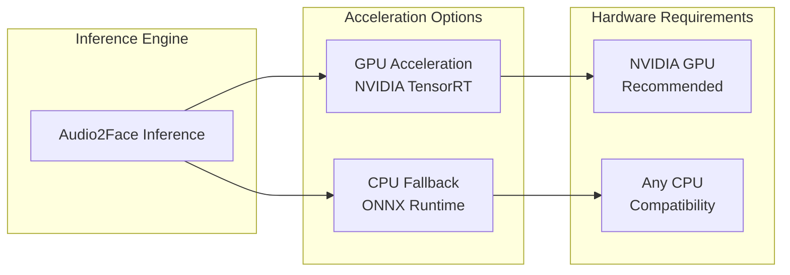
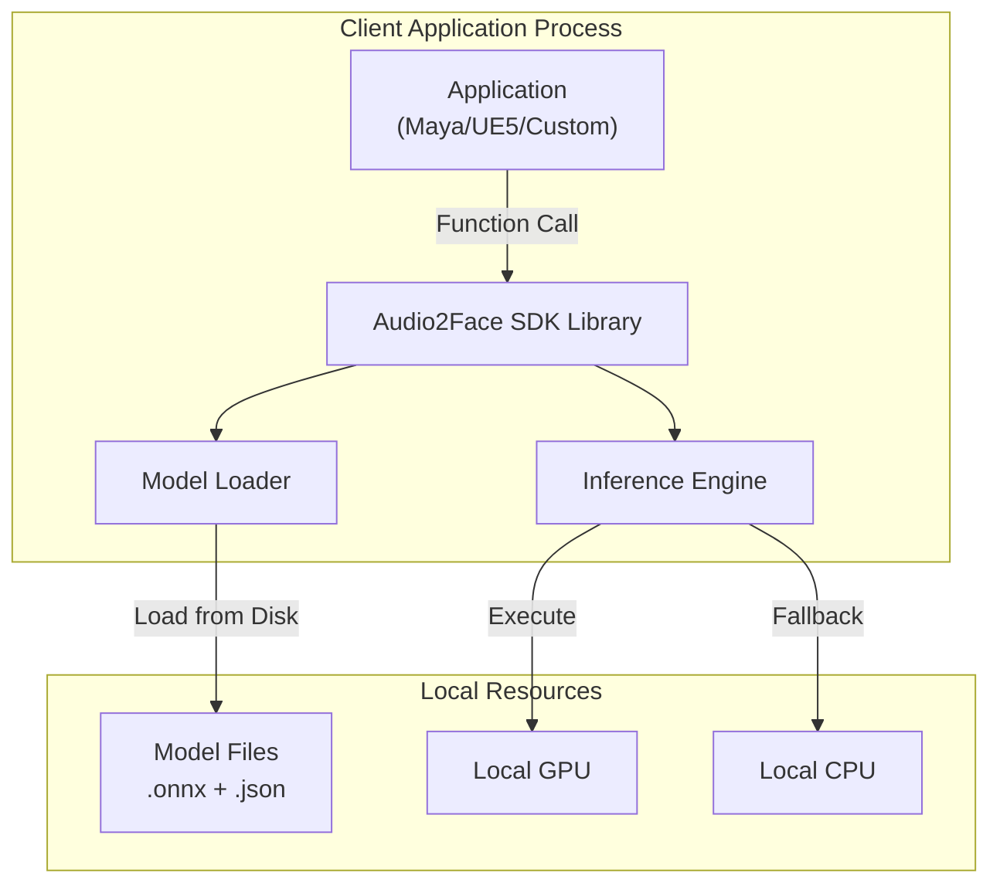
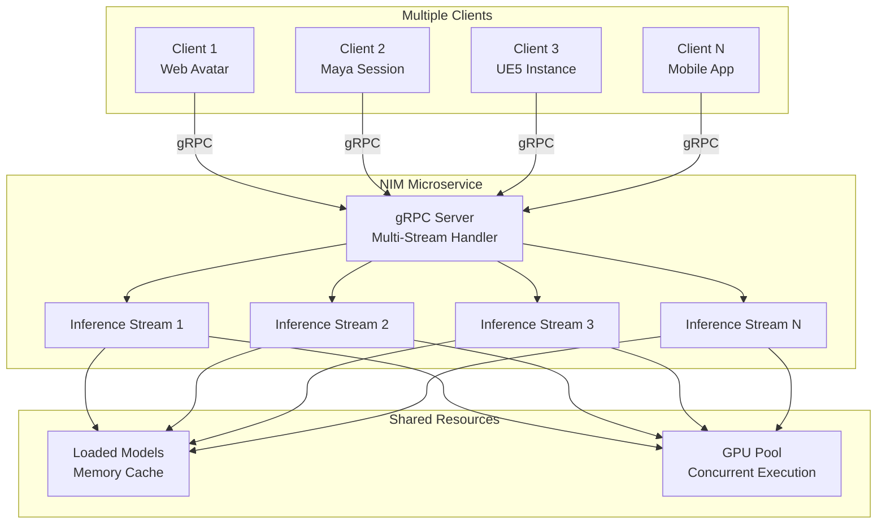

<!-- source: DeepWiki mcp.deepwiki.com · repo NVIDIA/Audio2Face-3D · page 6 Deployment · fetched 2026-10-26 -->

# Deployment

<details>
<summary>Relevant source files</summary>

The following files were used as context for generating this wiki page:

- [README.md](README.md)

</details>


This document provides an overview of deployment options for Audio2Face-3D, covering the range from single-user workstation installations to large-scale cloud infrastructure. It explains the fundamental deployment modes, hardware acceleration options, and how different Audio2Face-3D components support various deployment patterns.

For detailed information on the Audio2Face-3D NIM microservice for large-scale deployments, see [NIM Microservice](#6.1). For architectural guidance on specific deployment patterns including local, remote, and hybrid configurations, see [Deployment Patterns](#6.2).

**Sources:** [README.md:1-16]()

## Deployment Modes

Audio2Face-3D supports two fundamental deployment modes that determine where inference computation occurs and how components communicate.

### Local Deployment

In local deployment, the Audio2Face-3D inference engine runs directly on the same machine as the client application. The integration tool (SDK, Maya ACE, or UE5 Plugin) loads models from disk and executes inference using the local hardware. This mode uses in-process function calls for minimal latency.

**Characteristics:**
- Models loaded from local filesystem
- Inference executed on local GPU or CPU
- No network communication overhead
- Single-user operation
- Hardware requirements must be met on each workstation

### Remote Deployment

In remote deployment, inference is delegated to a separate Audio2Face-3D NIM microservice running on a dedicated server. Client applications communicate with the NIM via the gRPC protocol over a network connection. The server centralizes GPU resources and can serve multiple concurrent clients.

**Characteristics:**
- Models loaded on remote server
- Inference executed on server GPU pool
- Network latency from gRPC communication
- Multi-user, multi-stream support
- Client machines have minimal hardware requirements

**Sources:** [README.md:109-127](), [README.md:211-234]()

## Hardware Acceleration



**Hardware Acceleration Options**

Audio2Face-3D supports two execution backends that provide different performance and compatibility tradeoffs:

| Backend | Technology | Performance | Hardware Requirement |
|---------|-----------|-------------|---------------------|
| GPU Acceleration | NVIDIA TensorRT | Real-time, low-latency | NVIDIA GPU |
| CPU Fallback | ONNX Runtime | Slower, higher latency | Any x86-64 CPU |

The GPU acceleration path uses TensorRT for optimized inference on NVIDIA GPUs, delivering real-time performance suitable for interactive applications. The CPU fallback path uses ONNX Runtime, providing broader hardware compatibility at the cost of reduced performance.

All Audio2Face-3D components (SDK, Maya ACE, UE5 Plugin, NIM) support both acceleration options. The selection is typically automatic based on available hardware, with GPU preferred when available.

**Sources:** [README.md:119-121]()

## Component Deployment Support

Different Audio2Face-3D integration tools support different combinations of deployment modes and acceleration options:

| Component | Local Deployment | Remote Deployment | GPU Acceleration | CPU Fallback |
|-----------|-----------------|-------------------|------------------|--------------|
| **Audio2Face-3D SDK** | ✓ | N/A (builds clients) | ✓ | ✓ |
| **Maya ACE Plugin** | ✓ | ✓ | ✓ | ✓ |
| **UE5 Plugin** | ✓ | ✓ | ✓ | ✓ |
| **Audio2Face-3D NIM** | N/A (is server) | ✓ (serves clients) | ✓ | ✓ |

The SDK provides the low-level library used by all other components. Maya ACE and the UE5 Plugin support both local and remote modes, allowing artists to choose based on their workstation capabilities and project requirements. The NIM is specifically designed for remote deployment scenarios.

**Sources:** [README.md:109-234]()

## Deployment Communication Flow

### Local Deployment Flow



In local deployment, all components run within the same process. The application makes direct function calls to the Audio2Face SDK library, which loads models from the local filesystem and executes inference using local hardware resources.

### Remote Deployment Flow

```mermaid
flowchart TD
    subgraph "Client Machine"
        ClientApp["Client Application<br/>(Maya/UE5/Web App)"]
        gRPCClient["gRPC Client"]
    end
    
    subgraph "Network"
        Network["Network Connection<br/>TCP/IP"]
    end
    
    subgraph "Server Machine (NIM Container)"
        gRPCServer["gRPC Server"]
        NIM["Audio2Face-3D NIM"]
        ServerModelLoader["Model Loader"]
        ServerInference["Inference Engine"]
        ServerGPU["Server GPU Pool"]
    end
    
    subgraph "Server Storage"
        ServerModels["Centralized Models<br/>.onnx + .json"]
    end
    
    ClientApp -->|"API Call"| gRPCClient
    gRPCClient -->|"gRPC Protocol"| Network
    Network -->|"gRPC Protocol"| gRPCServer
    gRPCServer --> NIM
    NIM --> ServerModelLoader
    ServerModelLoader -->|"Load Once"| ServerModels
    NIM --> ServerInference
    ServerInference --> ServerGPU
```

In remote deployment, the client application communicates with the Audio2Face-3D NIM microservice over a network connection using the gRPC protocol. The NIM loads models once into server memory and can serve multiple concurrent client requests, centralizing GPU resources.

**Sources:** [README.md:217-226]()

## Multi-Stream Deployment Architecture



The Audio2Face-3D NIM supports multi-stream deployment, where a single NIM instance handles concurrent inference requests from multiple independent clients. Each client establishes its own gRPC connection and inference stream, while the NIM shares loaded models and GPU resources across all streams. This architecture enables efficient resource utilization for scenarios like studio-wide animation services, web-based digital humans serving many simultaneous users, or batch processing pipelines.

**Sources:** [README.md:223-233]()

## Deployment Mode Selection Guide

The choice between local and remote deployment depends on several factors:

**Use Local Deployment When:**
- Single user or small team
- Powerful workstations with NVIDIA GPUs available
- Minimal network latency required
- Offline operation needed
- Simple setup preferred

**Use Remote Deployment When:**
- Multiple concurrent users
- Centralized GPU resources available
- Client machines have limited hardware
- Cloud-native architecture required
- Batch processing at scale
- Cross-platform clients (web, mobile)

**Hybrid Approach:**

Maya ACE and the UE5 Plugin support switching between local and remote modes at runtime, enabling a hybrid deployment strategy. Studios can provision artists with local inference for development and iteration, while using a centralized NIM for final production rendering or team collaboration.

**Sources:** [README.md:152-177](), [README.md:179-209](), [README.md:211-234]()

## Container-Based Deployment

```mermaid
graph TB
    subgraph "Host System"
        Docker["Docker Engine"]
    end
    
    subgraph "NIM Container"
        BaseImage["NVIDIA Base Image<br/>CUDA + TensorRT"]
        A2FNIM["Audio2Face-3D NIM<br/>Microservice Binary"]
        gRPCEndpoint["gRPC Endpoint<br/>Port Exposed"]
        ModelMount["Model Volume Mount<br/>/models"]
    end
    
    subgraph "External Resources"
        GPUDriver["NVIDIA GPU Driver<br/>nvidia-docker2"]
        ModelStorage["Model Storage<br/>Host or Network"]
    end
    
    Docker --> NIM Container
    GPUDriver --> Docker
    ModelStorage -->|"Volume Mount"| ModelMount
    
    A2FNIM --> gRPCEndpoint
    A2FNIM --> ModelMount
```

The Audio2Face-3D NIM is distributed as a Docker container for consistent, reproducible deployment across different environments. The container includes the complete runtime environment with CUDA, TensorRT, and the NIM microservice binary. Models are mounted into the container via Docker volumes, allowing dynamic model updates without rebuilding the container.

Container deployment requires:
- Docker Engine with NVIDIA Container Toolkit (`nvidia-docker2`)
- NVIDIA GPU drivers on host system
- Network access for gRPC communication
- Volume mount for model files

**Sources:** [README.md:61-66](), [README.md:211-217]()

## Platform and Format Support

All deployment modes support the same Audio2Face-3D model formats and output capabilities:

**Model Formats:**
- ONNX-TensorRT models (`.onnx` files)
- JSON model cards (`.json` metadata)
- Compatible with v2.3 regression and v3.0 diffusion models
- Audio2Face-3D and Audio2Emotion models

**Output Formats:**
- Direct mesh deformations
- Joint transformations
- Blend shape weights

**Platform Support:**
- Windows (SDK, Maya ACE, UE5 Plugin - local mode)
- Linux (SDK, NIM, all remote deployments)
- Cross-platform clients via gRPC (when using NIM)

The SDK provides cross-platform C++ libraries, while the NIM runs exclusively on Linux in Docker containers. Maya ACE and the UE5 Plugin inherit platform support from their host applications (Autodesk Maya and Unreal Engine).

**Sources:** [README.md:6-11](), [README.md:119](), [README.md:82-97]()

---

