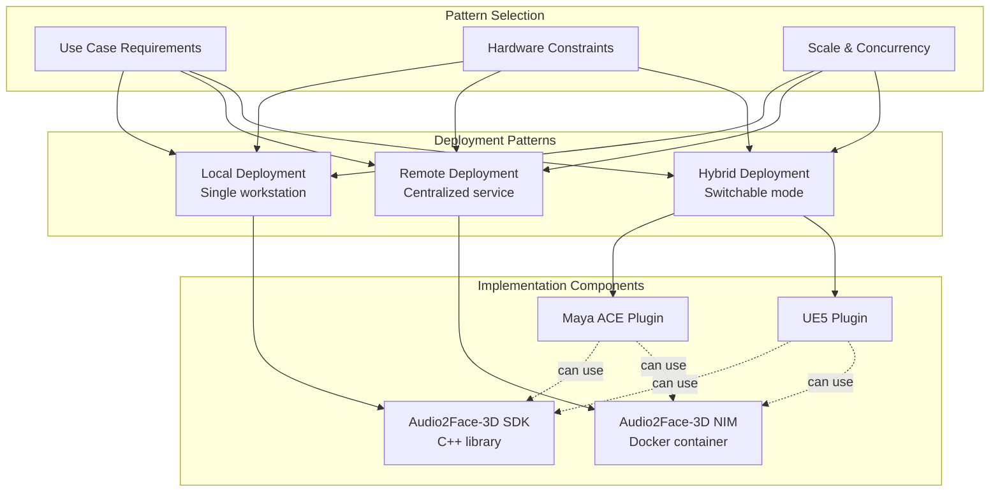
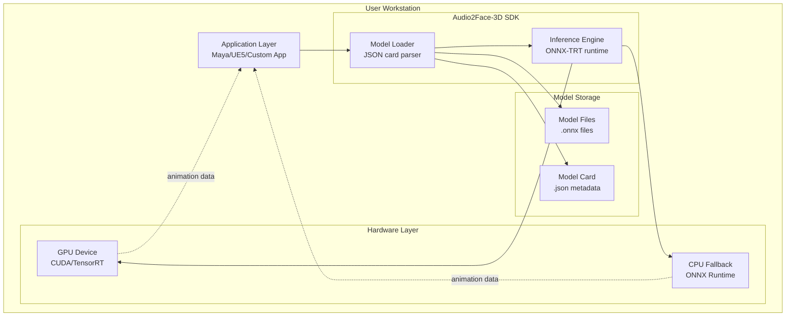
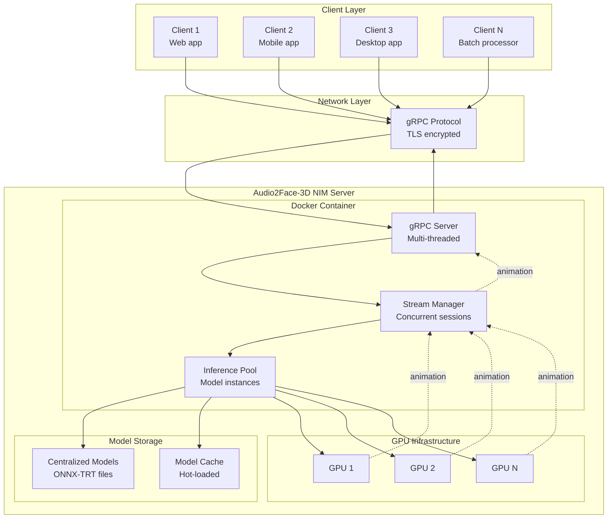
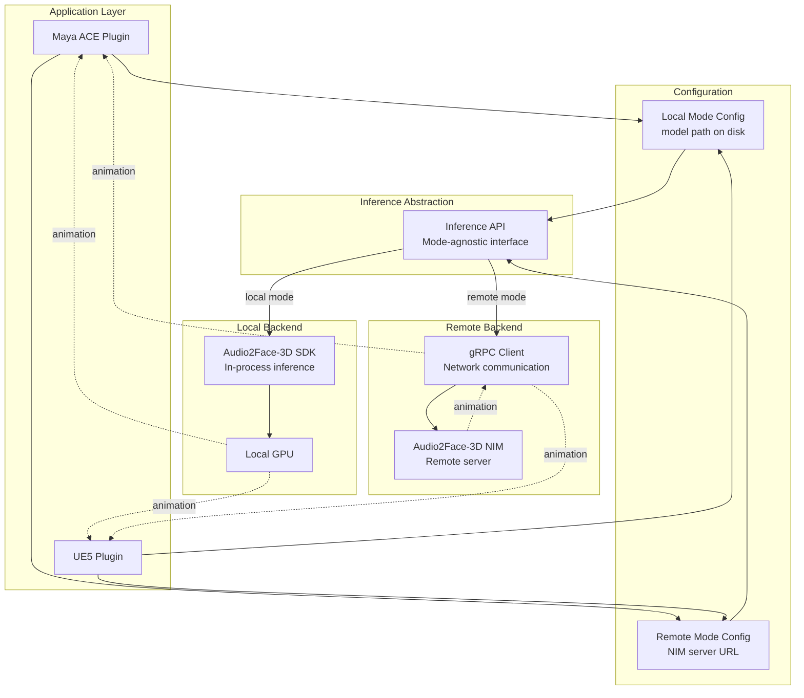
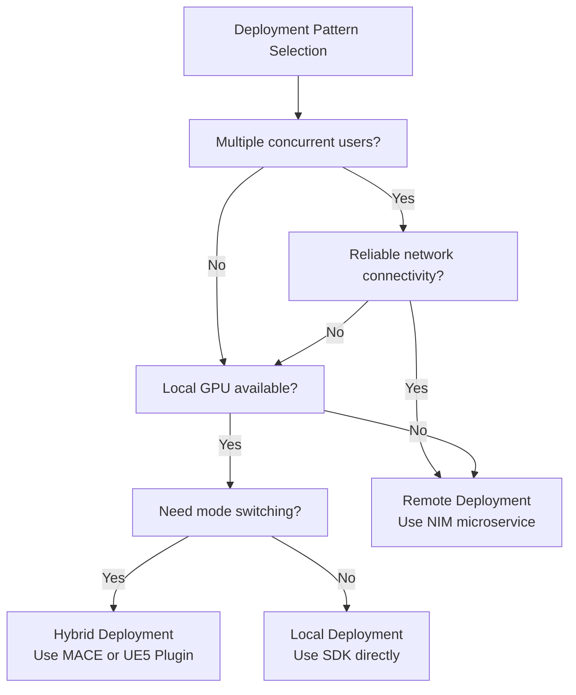

<!-- source: DeepWiki mcp.deepwiki.com · repo NVIDIA/Audio2Face-3D · page 6.2 Deployment Patterns · fetched 2026-10-26 -->

# Deployment Patterns

<details>
<summary>Relevant source files</summary>

The following files were used as context for generating this wiki page:

- [README.md](README.md)

</details>


## Purpose and Scope

This page provides architectural guidance for deploying Audio2Face-3D inference capabilities in production environments. It covers three fundamental deployment patterns: **Local Deployment** (single-user, on-device inference), **Remote Deployment** (centralized NIM-based microservice), and **Hybrid Deployment** (tools that can switch between local and remote modes).

For information about the Audio2Face-3D NIM microservice specifically, see [NIM Microservice](#6.1). For details about individual integration tools, see [Integration Tools](#3).

**Sources:** [README.md:1-234]()

---

## Deployment Pattern Overview

Audio2Face-3D supports three distinct deployment architectures, each optimized for different use cases, scale requirements, and hardware configurations. All patterns utilize the same core inference engine and model formats but differ in where inference executes and how resources are provisioned.



**Sources:** [README.md:96-234]()

---

## Local Deployment Pattern

### Architecture

Local deployment runs the Audio2Face-3D inference engine directly on the user's workstation or target device. This pattern loads models from disk, executes inference on local hardware (GPU or CPU), and returns animation data to the application in the same process or via local inter-process communication.



**Sources:** [README.md:109-127](), [README.md:119-122]()

### Implementation via SDK

The Audio2Face-3D SDK is the primary mechanism for local deployment. Applications link against the C++ library and invoke inference directly in their process space.

**Key SDK Features for Local Deployment:**
- **Cross-platform support:** Windows, Linux compatibility
- **Hardware acceleration:** Automatic GPU detection with CPU fallback
- **Low-latency inference:** Optimized for real-time applications
- **Thread safety:** Supports concurrent inference requests within a single process

**Sources:** [README.md:109-127](), [README.md:119-122]()

### Hardware Requirements

| Component | Minimum | Recommended |
|-----------|---------|-------------|
| GPU | NVIDIA GPU with CUDA support | NVIDIA RTX series (Ampere or newer) |
| GPU Memory | 4 GB VRAM | 8+ GB VRAM |
| System RAM | 8 GB | 16+ GB |
| CPU | Multi-core x64 processor | 8+ core processor (for CPU fallback) |
| Storage | 500 MB for models | SSD for faster model loading |

**Sources:** [README.md:119-122]()

### Use Cases

**Optimal scenarios for local deployment:**

1. **Content creation workstations** - 3D animators and artists working in Maya or standalone applications
2. **Single-user applications** - Custom tools where only one user performs inference at a time
3. **Offline processing** - Batch rendering pipelines without network dependencies
4. **Low-latency requirements** - Real-time interactive applications requiring <50ms inference time
5. **Secure environments** - Air-gapped systems where network access is restricted

**Sources:** [README.md:123-127]()

---

## Remote Deployment Pattern

### Architecture

Remote deployment centralizes the Audio2Face-3D inference engine in a server environment, exposing it as a network service via the gRPC protocol. Clients connect to the service over the network, send audio data, and receive animation results without requiring local GPU resources or model files.



**Sources:** [README.md:211-234]()

### Implementation via NIM

The Audio2Face-3D NIM (NVIDIA Inference Microservice) provides the remote deployment implementation. It is distributed as a Docker container that packages the inference engine, gRPC server, and all dependencies.

**Key NIM Features for Remote Deployment:**
- **Multi-stream support:** Handles concurrent audio streams from multiple clients
- **gRPC protocol:** High-performance, low-latency communication
- **Docker packaging:** Consistent deployment across environments
- **Centralized resources:** GPU pool shared across all clients
- **Model hot-swapping:** Load different models without restarting the service

**Sources:** [README.md:211-234](), [README.md:223-226]()

### Scaling Considerations

| Scale Dimension | Single GPU | Multi-GPU | Cloud Deployment |
|----------------|------------|-----------|------------------|
| Concurrent streams | 1-10 | 10-100 | 100+ |
| Deployment | Single Docker container | Multiple containers | Kubernetes cluster |
| Load balancing | Not required | Container orchestration | K8s service mesh |
| GPU allocation | 1 GPU per container | N GPUs per container | Auto-scaling GPU nodes |
| Model storage | Local disk | Shared volume | Object storage (S3) |

**Sources:** [README.md:223-226]()

### Use Cases

**Optimal scenarios for remote deployment:**

1. **Multi-user environments** - Studios with multiple artists needing simultaneous access
2. **Web applications** - Browser-based avatars and interactive experiences
3. **Mobile/embedded clients** - Devices without sufficient GPU resources
4. **Cloud-native services** - SaaS platforms requiring elastic scaling
5. **Batch processing at scale** - Generating thousands of animations across a render farm
6. **Resource centralization** - Sharing expensive GPU hardware across a team

**Sources:** [README.md:228-233]()

---

## Hybrid Deployment Pattern

### Architecture

Hybrid deployment allows applications to switch between local and remote inference modes at runtime or via configuration. This pattern is implemented by the Maya ACE Plugin and UE5 Plugin, which abstract the inference backend behind a common interface.



**Sources:** [README.md:152-177](), [README.md:179-209](), [README.md:167](), [README.md:202]()

### Mode Selection

Both Maya ACE and the UE5 Plugin support runtime mode selection based on configuration:

**Local Mode:**
- Loads models from local file system path
- Executes inference using the embedded SDK
- Requires local GPU or CPU resources
- No network dependencies

**Remote Mode:**
- Connects to NIM server via gRPC endpoint (URL + port)
- Sends audio data over network
- Receives animation results from remote service
- Minimal local resource requirements

**Sources:** [README.md:167](), [README.md:202]()

### Maya ACE Implementation

The Maya ACE Plugin provides both local and remote inference capabilities through its node-based architecture.

**Local inference workflow:**
1. User specifies model JSON card path in plugin UI
2. Plugin loads model via SDK on plugin initialization
3. Audio data processed in Maya process space
4. Animation keyframes written directly to Maya scene

**Remote inference workflow:**
1. User specifies NIM server URL in plugin UI
2. Plugin establishes gRPC connection on demand
3. Audio data streamed to remote server
4. Received animation data written as Maya keyframes

**Sources:** [README.md:152-177](), [README.md:166-167]()

### UE5 Plugin Implementation

The UE5 Plugin exposes inference mode selection through Blueprint nodes, allowing game developers to configure the backend without C++ code.

**Blueprint Integration:**
- `Local Inference` node: Loads model from Content directory path
- `Remote Inference` node: Connects to NIM server URL
- Mode can be changed at runtime through Blueprint logic
- Sample project demonstrates both configurations with MetaHuman

**Sources:** [README.md:179-209](), [README.md:200-202]()

### Use Cases

**Optimal scenarios for hybrid deployment:**

1. **Development vs production** - Local during development, remote for production builds
2. **Variable hardware** - Local on high-end workstations, remote for lower-spec machines
3. **Network reliability** - Fallback to local mode when network is unavailable
4. **Studio pipelines** - Artists choose based on current task (preview locally, render remotely)
5. **Iterative workflows** - Quick local testing, then batch processing via remote service

**Sources:** [README.md:175-177](), [README.md:206-209]()

---

## Deployment Pattern Comparison

### Feature Matrix

| Feature | Local Deployment | Remote Deployment | Hybrid Deployment |
|---------|-----------------|-------------------|-------------------|
| **Implementation** | SDK integration | NIM microservice | MACE, UE5 Plugin |
| **Hardware requirements** | GPU/CPU on device | GPU on server only | Flexible |
| **Network dependency** | None | Required | Optional |
| **Latency** | <50ms | 50-200ms (network dependent) | Mode-dependent |
| **Concurrent users** | 1 | Unlimited (resource-limited) | 1 (local) or many (remote) |
| **Model storage** | Local disk | Centralized server | Both supported |
| **GPU sharing** | No | Yes | Mode-dependent |
| **Scaling** | Vertical (better GPU) | Horizontal (more servers) | Both |
| **Deployment complexity** | Low | High | Medium |
| **Operational cost** | Per-device hardware | Shared infrastructure | Variable |

**Sources:** [README.md:109-234]()

### Selection Decision Tree



**Sources:** [README.md:1-234]()

### Cost and Performance Trade-offs

**Local Deployment:**
- **Cost:** High upfront (GPU per device), low operational
- **Performance:** Best latency, limited concurrency
- **Maintenance:** Distributed model updates

**Remote Deployment:**
- **Cost:** Shared infrastructure, operational hosting fees
- **Performance:** Higher latency, excellent concurrency
- **Maintenance:** Centralized model updates

**Hybrid Deployment:**
- **Cost:** Flexible (start local, scale to remote)
- **Performance:** Best-of-both-worlds approach
- **Maintenance:** Requires managing both modes

**Sources:** [README.md:1-234]()

---

## Configuration Examples

### Local Deployment Configuration

When using the SDK for local deployment, applications specify model paths directly:

**Model loading pattern:**
```
Model JSON card: /path/to/model/model_card.json
Model ONNX file: /path/to/model/model.onnx
```

The SDK parses the JSON model card to discover model metadata, input/output specifications, and required dependencies.

**Sources:** [README.md:109-127](), [README.md:168]()

### Remote Deployment Configuration

NIM-based deployments require specifying the gRPC service endpoint:

**Client configuration:**
```
Protocol: gRPC
Host: audio2face-nim.example.com
Port: 50051
TLS: Enabled (recommended)
```

Multiple clients connect to the same endpoint. The NIM service manages request queuing and GPU allocation internally.

**Sources:** [README.md:217-226](), [README.md:225]()

### Hybrid Mode Switching

Maya ACE and UE5 Plugin support configuration files or UI-based mode selection:

**Configuration parameters:**
- `inference_mode`: "local" or "remote"
- `model_path`: File path (local mode)
- `server_url`: gRPC endpoint (remote mode)
- `server_port`: gRPC port (remote mode)

Applications can change modes without code modifications by updating configuration.

**Sources:** [README.md:167](), [README.md:202]()

---

## Summary

Audio2Face-3D's deployment flexibility enables adoption across diverse production scenarios:

- **Local Deployment** optimizes for single-user, low-latency applications with dedicated hardware
- **Remote Deployment** enables multi-user, cloud-native, and resource-constrained scenarios via NIM
- **Hybrid Deployment** provides deployment flexibility through Maya ACE and UE5 Plugin

The choice depends on user count, hardware availability, network topology, and operational requirements. Many organizations start with local deployment for development and transition to remote or hybrid patterns for production scale.

**Sources:** [README.md:1-234]()

---

