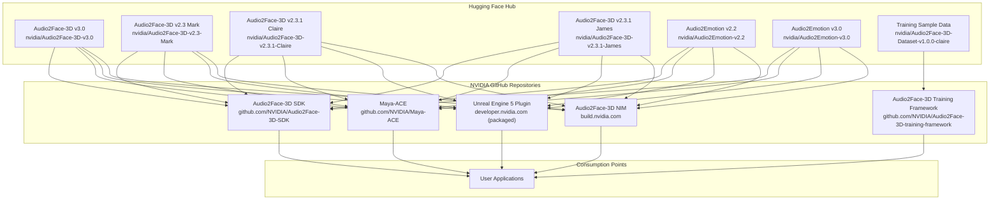
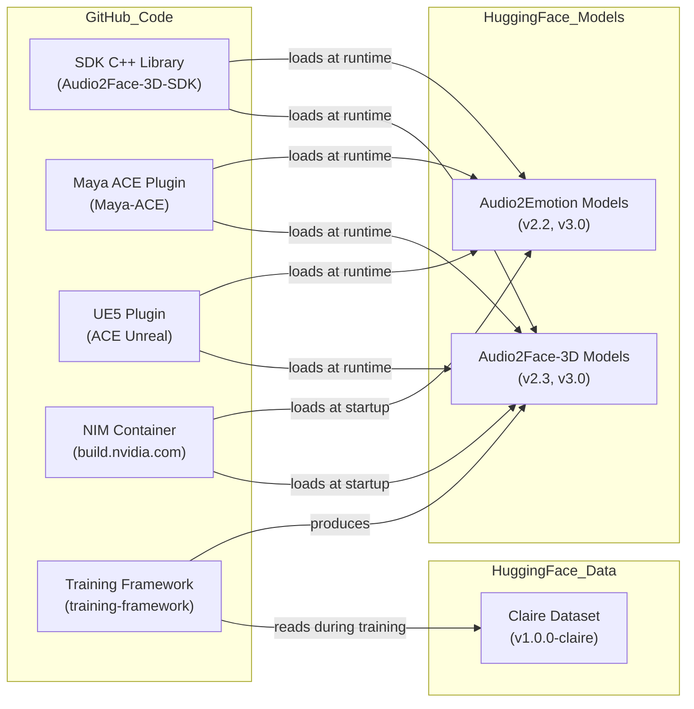
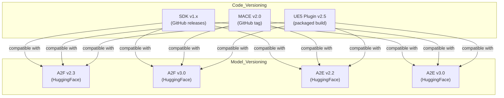

<!-- source: DeepWiki mcp.deepwiki.com · repo NVIDIA/Audio2Face-3D · page 7 Distribution Channels · fetched 2026-10-26 -->

# Distribution Channels

<details>
<summary>Relevant source files</summary>

The following files were used as context for generating this wiki page:

- [README.md](README.md)

</details>


This document explains how Audio2Face-3D components are distributed across two primary channels: NVIDIA GitHub repositories and Hugging Face Hub. It covers the architectural rationale for the dual-channel strategy, component-to-channel mappings, access methods, and versioning practices.

For detailed information about specific NVIDIA repositories, see [NVIDIA Repositories](#7.1). For Hugging Face model and dataset access, see [Hugging Face Hub](#7.2).

**Sources:** [README.md:17-21]()

## Distribution Architecture

The Audio2Face-3D ecosystem separates distribution into two independent channels based on content type and licensing requirements. This architecture enables independent versioning, specialized access controls, and optimized delivery mechanisms for each asset class.



**Distribution Channel Mapping**

| Channel | Content Type | Format | Primary Purpose |
|---------|-------------|--------|-----------------|
| NVIDIA GitHub | Source code, SDKs, plugins | C++, Python, build artifacts | Development, integration, deployment tools |
| Hugging Face Hub | Pre-trained models, datasets | ONNX-TRT, audio files, animation data | Trained neural networks, training data |

**Sources:** [README.md:17-21](), [README.md:23-68](), [README.md:71-106]()

## Component Distribution Matrix

The following table maps each Audio2Face-3D component to its distribution channel, format, license, and access method:

| Component | Distribution Channel | Repository/Collection | Format | License | Access Method |
|-----------|---------------------|----------------------|--------|---------|---------------|
| Audio2Face-3D SDK | NVIDIA GitHub | `NVIDIA/Audio2Face-3D-SDK` | C++ source, Python bindings | MIT | `git clone` or GitHub releases |
| Training Framework | NVIDIA GitHub | `NVIDIA/Audio2Face-3D-training-framework` | Python source, Docker container | Apache | `git clone` or Docker Hub |
| Maya ACE | NVIDIA GitHub | `NVIDIA/Maya-ACE` | C++ source, Python scripts, `.mod` file | MIT | `git clone` or GitHub releases |
| UE5 Plugin | NVIDIA Developer | `developer.nvidia.com/downloads` | `.uplugin`, C++ source (packaged) | MIT | Direct download (zip) |
| Audio2Face-3D NIM | build.nvidia.com | `build.nvidia.com/nvidia/audio2face-3d` | Docker container | NVIDIA AI Products | Docker pull (requires NGC credentials) |
| Audio2Face-3D v3.0 | Hugging Face Hub | `nvidia/Audio2Face-3D-v3.0` | ONNX-TRT, JSON model card | NVIDIA Open Model | Hugging Face CLI or web download |
| Audio2Face-3D v2.3 Mark | Hugging Face Hub | `nvidia/Audio2Face-3D-v2.3-Mark` | ONNX-TRT, JSON model card | NVIDIA Open Model | Hugging Face CLI or web download |
| Audio2Face-3D v2.3.1 Claire | Hugging Face Hub | `nvidia/Audio2Face-3D-v2.3.1-Claire` | ONNX-TRT, JSON model card | NVIDIA Open Model | Hugging Face CLI or web download |
| Audio2Face-3D v2.3.1 James | Hugging Face Hub | `nvidia/Audio2Face-3D-v2.3.1-James` | ONNX-TRT, JSON model card | NVIDIA Open Model | Hugging Face CLI or web download |
| Audio2Emotion v2.2 | Hugging Face Hub | `nvidia/Audio2Emotion-v2.2` | ONNX-TRT, JSON model card | Custom (A2F only) | Hugging Face CLI or web download |
| Audio2Emotion v3.0 | Hugging Face Hub | `nvidia/Audio2Emotion-v3.0` | ONNX-TRT, JSON model card | Custom (A2F only) | Hugging Face CLI or web download |
| Training Sample Data (Claire) | Hugging Face Hub | `nvidia/Audio2Face-3D-Dataset-v1.0.0-claire` | Audio, blendshapes, geometry caches | Custom (evaluation only) | Hugging Face CLI or web download |

**Sources:** [README.md:25-68](), [README.md:73-106]()

## Dependency Flow

This diagram illustrates how components from different distribution channels depend on each other at runtime:



**Sources:** [README.md:113-127](), [README.md:133-150](), [README.md:158-177](), [README.md:183-204](), [README.md:215-233]()

## License Segregation Strategy

The dual-channel distribution enables distinct licensing for different asset types:

**NVIDIA GitHub Repositories (Code)**

| Repository | License | Redistribution Rights | Commercial Use |
|------------|---------|----------------------|----------------|
| Audio2Face-3D SDK | MIT | Permitted | Permitted |
| Training Framework | Apache 2.0 | Permitted | Permitted |
| Maya ACE | MIT | Permitted | Permitted |
| UE5 Plugin | MIT | Permitted | Permitted |
| Audio2Face-3D NIM | NVIDIA AI Products EULA | Restricted | Permitted (with agreement) |

**Hugging Face Hub (Models and Data)**

| Asset | License | Redistribution Rights | Commercial Use |
|-------|---------|----------------------|----------------|
| Audio2Face-3D Models (all versions) | NVIDIA Open Model | Permitted | Permitted |
| Audio2Emotion v2.2, v3.0 | Custom (use with A2F only) | Restricted | Permitted (A2F applications only) |
| Claire Training Dataset | Custom (evaluation only) | Prohibited | Prohibited |

**Sources:** [README.md:30-31](), [README.md:44](), [README.md:51](), [README.md:58](), [README.md:65](), [README.md:78](), [README.md:95](), [README.md:103]()

## Version Independence

The separation of code and models into different distribution channels enables independent versioning:



This architecture allows:
- Code updates (bug fixes, new features) without model retraining
- Model updates (improved accuracy, new characters) without code changes
- Users can upgrade models independently of integration tools
- Experimental models (A2E v3.0) can coexist with production models (A2E v2.2)

**Sources:** [README.md:83-89](), [README.md:93-97](), [README.md:49](), [README.md:56]()

## Access Pattern Examples

**GitHub Repository Access (SDK Example)**

```bash
# Clone the SDK repository
git clone https://github.com/NVIDIA/Audio2Face-3D-SDK.git

# Access specific release
wget https://github.com/NVIDIA/Audio2Face-3D-SDK/releases/download/v1.0/sdk-package.tar.gz
```

**Hugging Face Hub Access (Model Example)**

```bash
# Using Hugging Face CLI
huggingface-cli download nvidia/Audio2Face-3D-v3.0

# Using Python huggingface_hub library
from huggingface_hub import snapshot_download
snapshot_download(repo_id="nvidia/Audio2Face-3D-v3.0")
```

**Direct Download Access (UE5 Plugin Example)**

The UE5 plugin and packaged model archives are distributed via direct download from `developer.nvidia.com`:

- ACE Unreal 5.6 Plugin: `developer.nvidia.com/downloads/assets/ace/nv_ace_reference-ue5.6-v2.5.0rc3.zip`
- Audio2Face-3D 3.0 Models Plugin: `developer.nvidia.com/downloads/assets/ace/ace_3.0_a2f_models.zip`

**Sources:** [README.md:113](), [README.md:86-89](), [README.md:185-189]()

## Distribution Channel Selection Matrix

| Use Case | Recommended Channel | Rationale |
|----------|-------------------|-----------|
| Integrate A2F into custom C++ application | SDK from GitHub + Models from HF | Source code build flexibility, latest model compatibility |
| Animate characters in Maya | MACE from GitHub + Models from HF | Plugin source for customization, model selection per character |
| Develop UE5 game with facial animation | UE5 Plugin from nvidia.com + Models from nvidia.com | Pre-packaged integration, minimal setup |
| Train custom model for proprietary character | Training Framework from GitHub + Data from HF | Source code for custom data loaders, sample data as reference |
| Deploy multi-user cloud service | NIM from build.nvidia.com + Models from HF | Container for scalability, model hot-swapping |
| Research new animation techniques | Training Framework from GitHub + SDK from GitHub + Models from HF | Full source access, model introspection, custom inference |

**Sources:** [README.md:111-127](), [README.md:156-177](), [README.md:181-204](), [README.md:131-150](), [README.md:213-233]()

## Model Card Interoperability

All tools that consume Audio2Face-3D models rely on a standardized JSON model card format. This file is distributed alongside each model on Hugging Face Hub and defines:

- Model input/output specifications
- Expected audio sample rate
- Output blendshape count and topology
- Supported inference backends (ONNX-TRT)
- Version compatibility information

The model card enables any tool from the GitHub distribution channel (SDK, MACE, UE5 Plugin, NIM) to dynamically load and configure any compatible model from the Hugging Face channel without code modifications.

**Sources:** [README.md:144](), [README.md:168]()

---

